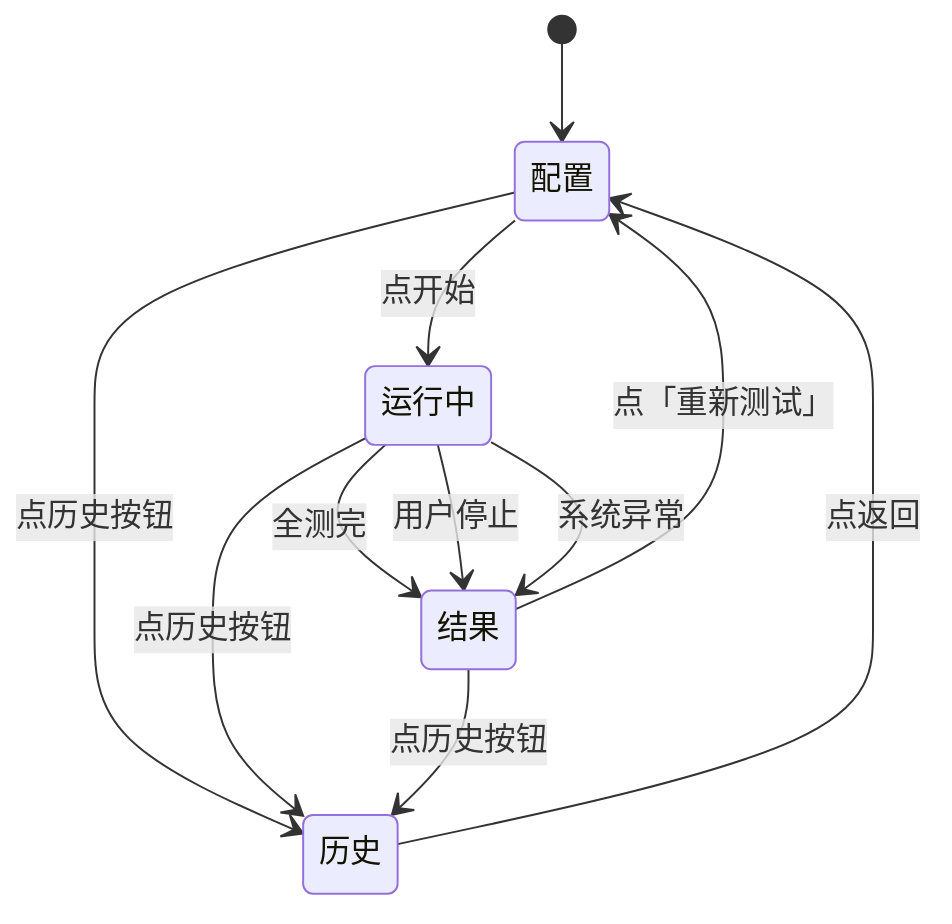

# 工厂老化测试工具 — 需求与设计

> 单机本地运行的桌面硬件体检 + 老化测试工具,跑在被测设备自身。
> 目标平台: **全志 A527** (ARM Cortex-A55 + Mali-G57)

---

## 目录

- [1. 项目目的](#1-项目目的)
- [2. 需求与范围](#2-需求与范围)
- [3. 达到的效果](#3-达到的效果)
- [4. 系统架构](#4-系统架构)
  - [4.1 部署模式](#41-部署模式)
  - [4.2 软件分层](#42-软件分层)
  - [4.3 数据流](#43-数据流)
  - [4.4 启动流程](#44-启动流程)
- [5. 用户场景与典型流程](#5-用户场景与典型流程)
- [6. 测试项设计 — 通过判定的依据](#6-测试项设计--通过判定的依据)
  - [6.1 概述](#61-概述)
  - [6.2 CPU 压力](#62-cpu-压力)
  - [6.3 GPU 渲染](#63-gpu-渲染-open-gl-es-2-全屏压测)
  - [6.4 WiFi 验证](#64-wifi-验证-软件开关--射频检查--实际扫描-不需-ap)
  - [6.5 USB 枚举 + 读写](#65-usb-枚举--读写)
  - [6.6 网口](#66-网口-链路--ping-通即可-不做吞吐)
  - [6.7 HDMI 输出](#67-hdmi-输出-sysfs-优先-不需-root)
  - [6.8 风扇 GPIO](#68-风扇-gpio-主动拉高拉低轮转-验证控制链双向)
  - [6.9 TF 卡读写](#69-tf-卡读写自动检测--未插提示)
  - [6.10 内存压力](#610-内存压力-rc--精确判定)
  - [6.11 eMMC 存储](#611-emmc-存储)
- [7. UI 设计](#7-ui-设计)
- [8. 数据与存储](#8-数据与存储)
- [9. 测试通过与否的依据](#9-测试通过与否的依据总规则)
  - [9.1 状态判定](#91-状态判定)
  - [9.2 通过率口径](#92-通过率口径)
  - [9.3 边界与例外](#93-边界与例外)
  - [9.4 默认阈值参考](#94-默认阈值参考)
- [10. 可观测性原则](#10-可观测性原则-ux-hard-rule)
  - [10.1 推送频率硬约束](#101-推送频率硬约束)
  - [10.2 前端呈现约束](#102-前端呈现约束)
  - [10.3 过程证据要求](#103-过程证据要求)
  - [10.4 添加测试项时的规约](#104-添加测试项时的规约)
  - [10.5 实时事件类型与生命周期](#105-实时事件类型与生命周期)
- [11. 运行时约束 (产线环境必备)](#11-运行时约束-产线环境必备)
  - (§11.1 ~ §11.6 工具调用 / 权限 / 错误识别 / 策略选择 / 进程生命周期 / 启动脚本;**§11.7 离线预打包必读**)
- [12. 技术栈](#12-技术栈)

---

## 1. 项目目的

### 1.1 业务背景

产线上,每台全志 A527 量产设备在下线前要做**硬件功能体检 + 短期老化跑测**,筛除生产环节出现的问题件。当前痛点:

- 测试靠工人手工 + ad-hoc 脚本,执行不规范
- 结果散落各处,无法沉淀数据做质量分析
- pass / fail 全凭经验,争议无据可查

### 1.2 核心价值

把"测试 + 记录 + 报告"做成一个**单机闭环**,让产线工人:

1. 桌面图标一键启动 → 自动开浏览器
2. 勾选要测的项目 → 点开始 → 等结果
3. 看到一份**明确 pass / fail** 的报告
4. 历史可查、有据可依

### 1.3 解决什么问题

| 维度 | 改进前 | 改进后 |
|---|---|---|
| 操作门槛 | 工人需懂命令 | 勾选 + 点开始 |
| 一致性 | 每人执行手法不同 | 工具统一调度 |
| 记录 | 无 / 散乱 | SQLite 全量存 |
| 申诉凭据 | 无 | 历史详情 + 指标 |

---

## 2. 需求与范围

### 2.1 在做什么

- 单机本地测试工具,跑在被测设备(DUT)自身上
- 10 项硬件测试:CPU / GPU / WiFi(扫描) / USB / 网口 / HDMI / 风扇 / TF 卡 / 内存 / eMMC
- 极简 Web UI:勾选 + 次数/时长 + 全选 + 开始
- 跑测过程**实时可见**(每项独立面板,见 §10.5 实时事件 / §10.2 前端呈现)
- 报告(每项指标 + 错误信息)+ 历史可查

### 2.2 测试项清单

| # | 名称 | 主要工具 | 自动 / 交互 |
|---|---|---|---|
| 1 | CPU 压力 | stress-ng | 自动 |
| 2 | GPU 渲染 | glmark2-es2 | 自动 |
| 3 | WiFi 验证 (开关/射频/扫描 3 件套) | iw / rfkill / iproute2 | 自动 |
| 4 | USB 枚举 + 读写 | lsusb + fio | 自动 |
| 5 | 网口 链路 + DHCP + ping | ethtool + udhcpc + ping | 自动 (未插网线提示) |
| 6 | HDMI 输出 | modetest | 自动 |
| 7 | 风扇 GPIO | /proc/rp_gpio/pi5 (拉高拉低轮转) | 自动 |
| 8 | TF 卡读写 | fio | 自动(未插则弹提示选「插 / 跳」) |
| 9 | 内存压力 | memtester | 自动 |
| 10 | eMMC 存储 | fio | 自动 |

> 看门狗(WDT)剔除;风扇为 B 类(纯 GPIO 通断,无 tach);**TF 卡自动检测 + 未插提示**(启动该测试时自动探挂载点,没探到则弹提示让用户选「插 / 跳」);**网口未插提示**(链路未起时弹提示选「插 / 跳」);默认全部勾选,工人按需减

**设备身份 (SN) —— 每次运行强制记录**

被测设备 SN 是产线追溯的锚点,**每条 run 记录 + 每份报告 + 每份 PDF 必须携带 SN**。

- **提取命令** —— `cat /proc/cmdline | grep -oP 'snum=\K[^ ]*'`
- **回落源** —— 提取失败(为空)时回落 `cat /proc/cmdline | grep -oP 'androidboot.serialno=\K[^ ]*'`
- **仍为空** —— 记为 `unknown`,报告中照常输出 `unknown` 并在 UI 顶部黄色提示,**不阻断测试**
- **实测样例** —— `snum=31175c3d01850801f56`(同一条 cmdline 里 `androidboot.serialno=` 值一致,双源互为校验)

关联章节:§8.1(入库字段)、§8.2(PDF 报告头)、§7(UI 顶部常驻显示)。

---

## 3. 达到的效果

### 3.1 功能效果

- 一台 A527 新机,从上架到出报告,工人操作 ≤ 30 秒(配置) + 测试时间(默认约 12 分钟)

> **12 分钟的依据**(按 §9.4 默认参数逐项累加):CPU 300s + eMMC 60s×2 + USB 30s×2 + TF 30s×2 + 内存 60s + GPU 一轮 120-300s(驱动相关,不可控) + WiFi ≈20s + 网口 ≈20s + HDMI ≈5s + 风扇 ≈15s,合计约 680s,**加 10 项间 5s 静默期(§5.1)≈ 730s ≈ 12 分钟**。
> **产线已确认接受该节拍**;GPU 单轮时长是唯一波动项(见 §6.3 超时兜底),其余项时长均可配置伸缩。
- 任意子项失败立即定位(指标 + 错误信息明文)
- 跑测全程**无 UI 交互**(除开始前的配置勾选)

### 3.2 易用性效果

- 工人首次接触 < 5 分钟可独立完成
- 不读文档就能完成"勾 → 开始 → 看结果"
- 默认全选 + 默认参数,开箱即用

### 3.3 质量效果

- 测试过程可重放:参数 + 指标 + 日志全部入 SQLite
- 争议可复核:历史详情完整回看

### 3.4 可观测性效果 (hard rule)

- 测试运行中,**工人能实时看到**每项测试独立显示:状态色 / 进度条 / 关键指标 / 滚动日志
- 点开始后必须 **立即有反馈**,绝不允许 "黑屏" 或 "无任何动静" 的体验
- 静默阶段也要持续推心跳进度,不让用户怀疑工具死锁
- 历史记录可重看完整 `progress` / `metric` / `log` 流

---

## 4. 系统架构

### 4.1 部署模式

被测设备本身就是工具宿主。浏览器、后端、系统工具、待测硬件**全部在同一台机器**,**不**外接、不连远端。

**离线交付 = 依赖预置,不是运行禁网**

本文档中"离线 / 预打包"**只约束依赖的获取时机**:所有测试所需的系统工具 / Python 依赖 / 第三方素材必须在**打包阶段**一次性下载好,集成进出货镜像;目标设备装机后**启动即可跑全套,运行期间一律不得再联网装包**,**不允许出现“测试中才发现某包未装”的产线故障**。清单与打包流程见 §11.7。

**产线网络前提(已确认)**

产线**有网络,有线无线均可用**,且工位**接 HDMI 显示器**:

| 条件 | 支撑的测试项 | 说明 |
|---|---|---|
| 有线网络可达 + DHCP 可用 | §6.6 网口(取 IP + ping 外网) | ping 公网目标已验证可达(RTT 约 8-13ms) |
| 无线有 AP 可扫描 | §6.4 WiFi(第 ④ 步扫 SSID) | 产线工位周边有可扫描 AP |
| HDMI 显示器连接中 | §6.3 GPU 全屏渲染 + §6.7 HDMI | 常态连接,不进入"未接显示器"分支 |

即:**依赖不可现场安装,但测试本身用得到网络**。因此 §11.4 的取舍原则相应调整为——**不依赖"不可控的外部条件"**(AP 凭证、临时公网可达性、第三方服务等),而不是"不依赖网络"。

### 4.2 软件分层

自上而下:前端(Vue 3 SPA)→ 后端服务(FastAPI) → 测试运行时(注册表 + 调度器) → 测试实现(10 个模块) → 系统工具与内核驱动。

### 4.3 数据流

跑测期间单向流动:

- **用户 → 后端** —— POST 提交配置
- **后端 → 系统工具** —— `subprocess` 调起 Linux 工具,读 stdout / 退出码
- **后端 → 前端** —— WebSocket 持续推三类事件(进度 / 日志 / 指标)
- **后端 → 持久化** —— 测试结果异步入 SQLite

跑测的完整步骤视角见 §5.1。

### 4.4 启动流程

**桌面双击图标 → 浏览器显示完整步骤:**

1. 工人双击桌面图标
2. 系统调起启动脚本(**普通用户身份直接启动,启动路径不要求提权**)
3. 脚本后台启动 Web 服务监听 `:8000`
4. 脚本调系统命令自动打开浏览器
5. 浏览器请求主页, 后端返回页面
6. 浏览器加载完成后请求配置接口, 后端返回测试项 + 默认参数
7. 浏览器渲染 UI, 等待工人操作

**权限取得方式 —— 命令级 `sudo`,不靠提权启动**

服务以普通用户身份运行即可;**需要 root 的系统调用一律在测试项内部以 `sudo <命令>` 前缀执行**(完整规则见 §11.2)。因此桌面图标可以直接调起 `start.sh start`,不需要 `pkexec` / `sudo` 包装启动脚本。

**启动时读取 SN**

服务启动即执行 §2.2 的 SN 提取命令,读到的 SN 常驻内存并展示在 UI 顶部;读不到时显示 `SN: unknown` + 黄色提示。SN 随每次 run 写入数据库(§8.1)并印在 PDF 报告头(§8.2)。

---

## 5. 用户场景与典型流程

**核心流程一图通读（PPT 友好，可整张贴进幻灯片）:**

```
                              开始
                               ↓
                  ┌──────────────────────────┐
                  │ ① 开测试工具               │
                  │ ② 勾选要测的项 + 调默认参数   │
                  │ ③ 点「开始」               │
                  └──────────────────────────┘
                               ↓ 建本次运行记录
                               ↓
        ┌── 主循环（每跑一项重复）─────────────────────────┐
   ─→   │ ④ 取下一项 → ⑤ 执行 → ⑥ 判定（5 态之一）→ ⑦ 写结果 │ ──┐
        └──────────────────────────────────────────────┘   │
   ↑                                                       │
   └───────────────── 回到 ④ ─────────────────────────────┘
                               ↓ 全部跑完 / 中途停止
                  中途停止 → 当前项 + 剩余未跑项 = stopped
                               ↓
                          汇总 → 写总报告 → UI 显示
                               ↓
                  任一 failed / error？
            ├─ 否 → 整机通过，可下架 → 结束 ✓
            └─ 是 → 整机不通过，留厂排查 → 结束 ✗

旁路分支:
  单项重跑 → 报告出后，对单条 failed/error 项点「重跑这一次」
          → 替换该条结果 → 回到「汇总」重新判定
```

**判定 5 态**（完整定义见 §9.1）:

| 状态 | 触发 | 行为 |
|---|---|---|
| `passed`  | 满足该项所有通过条件             | 写指标，继续下一项 |
| `failed`  | 断言不达标（如网口 ping 不通）  | 写失败原因,**不阻断**,继续下一项 |
| `error`   | 工具缺失 / 代码异常              | 写异常详情,**不阻断**,继续下一项 |
| `skipped` | 用户主动跳过（如 TF 卡未插选「跳」） | 写跳过原因,**不计入**通过率 |
| `stopped` | 用户中途点「停止」               | **不**算 failed，报告里高亮 |

**配套硬规则:**

- **5 秒静默期** —— 每项测完后留 5 s，让 CPU / 温度 / 调度器复位再跑下一项
- **推荐执行顺序** —— 默认 4 阶段：轻量（内存 / eMMC / TF） → 接口（HDMI / USB / 网口 / 风扇） → 射频（WiFi） → 重载（GPU / CPU）;工人在 UI 可拖动调整
- **整机不通过判定** —— 任一项 `failed` 或 `error` → 整机不通过（详见 §9.2 通过率口径）

**流程前置 —— 工位环境自检（run 开始前先做一次）**

网络类测试（WiFi / 网口）的结论**强依赖工位环境**。为了不让工人逐项猜「到底是机子坏了还是网络挂了」，每次 run 开始前先探一次工位网络：

| 检查 | 方式 | 结果标注 |
|---|---|---|
| 默认网关可达 | `ping -c 2 -W 1 <默认网关>` | 不通 → 环境异常 |
| DHCP 可用 | `udhcpc -i <iface>` 试一把（或读上次 DHCP 租约） | 失败 → 环境异常 |
| 周边有 AP | `iw dev <wlan> scan` 数 SSID | 0 个 → 无线环境异常 |

- **环境正常** → 顶部不显示任何异常标记，报告正常呈现
- **环境异常** → UI 顶部**橙色 banner**：「⚠ 当前工位网络异常，以下网络类测试结果仅供参考」;报告首页同步标红
- **不阻断测试** —— 继续跑完，网络类测试项按各自的降级通道(§6.4 / §6.6)出结论
- **作用** —— 让「环境问题」与「设备问题」在报告上一眼可分，避免好机被误判、坏机被漏判

---

## 6. 测试项设计 — 通过判定的依据

### 6.1 概述

10 项默认全选,通过 / 失败 / 错误 / 跳过 / 停止 五档状态。详细判定见 §6.2 - §6.11,数值门槛见 §9.4。

### 6.2 CPU 压力

- **目的** —— 拉满所有核, 验证不崩 + 不超温
- **工具** —— `sudo stress-ng --cpu N --timeout Ds`
- **通过** —— 退出码 0 **且** 峰值温度 ≤ 阈值
- **指标** —— `peak_temp_c`、`avg_load_pct`;失败时记温度峰值 + 退出码

### 6.3 GPU 渲染 (OpenGL ES 2 全屏压测)

- **目的** —— 验证 GPU 渲染管线 (GLES2 驱动 + 时钟 + 内存带宽) 在 Wayland 全屏持续渲染压力下稳定不死机、不报错
- **安装** —— `sudo apt install glmark2-es2-wayland` (提供 `glmark2-es2` 可执行,依赖 EGL/Wayland 后端)
- **工具** —— `sudo glmark2-es2 --fullscreen` (走 Wayland 全屏输出,不需 X11;启动后全屏运行)

**前置条件(缺任一 → 本项 `error` 并明确报错,不做静默降级)**

| # | 前置 | 检查方式 | 缺失后果 |
|---|---|---|---|
| 1 | **HDMI 显示器已连接** | `/sys/class/drm/*HDMI*/status == connected` | EGL 拿不到 native window,glmark2 启动即失败 |
| 2 | **Wayland 会话已启动** | `WAYLAND_DISPLAY` 非空 + compositor 进程在 | 无 GLES 上下文,直接退出 |
| 3 | **DRM 节点存在** | `/dev/dri/card*` + `/dev/dri/renderD*` | 无渲染设备 |

> 产线**已确认 HDMI 常态连接测试**(见 §4.1),因此本项**不进入"未接显示器 → skipped"分支**;第 1 条不满足属于工位配置问题,应报 `error` 而非 `skipped`,否则等于 GPU 静默漏测。

- **通过** —— **跑完一轮测试**(全部内置场景渲染完成, 终端输出 `glmark2 Score: <数字>` 结尾且 exit code = 0)
- **超时兜底** —— 一轮理论 2-5 分钟,但受 GL 驱动 / 场景耗时差异影响波动大;配置 `gpu.timeout_sec`(默认 **600 s**),超时即 `error` + 记 stderr 末 N 行,**防止个别机器跑飞挂死整个 run**
- **指标** —— `score` (最终评分)、`frames_rendered`、`elapsed_sec`、`exit_code`、`precheck_display`、`precheck_wayland`、`precheck_dri`;失败时记 stderr 末尾 N 行
- **备注** —— glmark2 一轮完整跑完自然结束(无需 `--run-forever`),每场景覆盖不同 GPU 单元(曲面 / 着色 / 纹理 / 光照),老化与功能验证一并兼得
- **UI 参数** —— 本项**不提供 `[次数]` / `[时长]` 输入框**:glmark2 以"一轮完整跑完"为最小粒度,单轮时长由驱动决定,给工人调次数/时长没有意义。与其他可调项在 UI 上明确区分(见 §7.2)

### 6.4 WiFi 验证 (软件开关 + 射频检查 + 扫描, 含环境降级)

- **目的** —— 验证 WiFi 子系统工作:**驱动响应 `ip link` 软件开关** + **射频 `rfkill` 未被屏蔽** + **射频通路真的能完成一次扫描**
- **设计哲学** —— 产线**有无线网络、且工位周边通常有 AP 可扫描**,但仍**不连 AP / 不需凭证 / 不需 WPA 交互**:只验证 WiFi 子系统本身能开关、射频能工作。连接 AP 会引入凭证管理 / 握手超时等额外变量,屏蔽这一层换来 **可重复 / 老化阶段纯驱动检查** 的稳定测试。
- **核心原则:环境问题 ≠ 设备问题** —— 判定依据必须是「**设备自己能不能做**」,不能是「**环境有没有配合**」。周边有没有 AP、有没有外网,都是工位条件而非设备能力,因此**必须设计降级通道**:
  - 技术依据:`iw dev wlan0 scan` 在**周边一个 AP 都没有**的环境下,驱动照样正常完成扫描,输出 `bssid / signal / SSID` 表头 + `scan completed`,**退出码 0**,只是结果列表为空。**这条命令成功跑完 = 射频通路已工作**;扫不到 SSID 仅仅是环境里没 AP,**不该判设备坏**。
- **需要 root** (CAP_NET_ADMIN, ip link / iw / rfkill 都要), 通过命令级 `sudo -n` 取得(§11.2);`sudo` 不可用 → 本项判 `error`,不静默降级

**测试逻辑 — 4 步顺序执行 + 第 ④ 步降级通道:**

| 步骤 | 命令 (**全部经 `sudo -n`**) | 通过条件 |
|---|---|---|
| ① 软件开关响应 | `ip link set wlan0 down` → 等 1 s → `ip link set wlan0 up` | 两句都退出 0 (驱动响应 `ip link` 命令) |
| ② 状态确认 | `ip link show wlan0` | 输出含 `state UP` (操作实际生效) |
| ③ 射频检查 | `rfkill list wifi` | 输出**不含** `blocked: yes` (射频未被软/硬屏蔽) |
| ④ 扫描执行 | `iw dev wlan0 scan` (≤ 15 s 超时) | 优先:**扫到 ≥ 1 个 SSID**;降级:**命令成功完成扫描即过**(见下) |

**第 ④ 步降级链 —— 环境无 AP 时仍能判通过**

| 阶段 | 动作 | 结果 |
|---|---|---|
| 4a 首次扫描 | `iw dev wlan0 scan` | 扫到 ≥1 SSID → 直接 `passed` |
| 4b 重试 | 仍未命中时,**间隔 5 s 重试,最多 2 次** (共最多 3 次) | 排除瞬时抖动 / 射频刚唤醒未稳定 |
| 4c 命令级降级 | 重试仍为 0 SSID,但**退出码 0 且输出含扫描完成标志**(`scan completed` / `bssid` 表头 / `Results:`) | **判 `passed`** + `degraded=true` + `note="环境无 AP,射频通路已验证"` |
| 4d 驱动级失败 | 命令**报错 / 非 0 退出 / 超时 / 输出无扫描完成标志** | `failed` —— 这是真设备问题,无兼底 |

- **4c 是本项的降级通道** —— 判定依据是「驱动能不能完成一次射频扫描」,而非「环境里有没有 AP」
- **4d 不设降级** —— 驱动报错就是驱动坏了,必须暴露
- **`degraded` 必须入库并在 UI / PDF 上可见**(标黄),让产线知道这台是在"无 AP 环境"下测的

**通过** —— ①②③ 全过 **且** ④ 走完 4a 或 4c;任一失败 → `failed`,在 `step_failed` 里指出失败步骤编号 (1/2/3/4)

**指标**:
- `ip_link_state` — ② 读到的 state (`UP` / `DOWN` / `UNKNOWN` / `DORMANT`)
- `rfkill_blocked` — ③ 是否被屏蔽 (`yes` / `no`)
- `scan_ssid_count` — ④ 扫到的 SSID 数 (降级通过时为 `0`)
- `top_ssid` — ④ 第一个命中的 SSID 字符串 (降级时为空)
- `scan_duration_ms` — ④ 扫描实际耗时
- `scan_retry_count` — ④ 实际重试次数 (0-2)
- `scan_cmd_ok` — ④ `iw scan` 是否成功完成 (退出码 0 且输出含扫描完成标志)
- **`degraded`** — 是否走 4c 降级通道通过 (`true` / `false`)
- `degraded_reason` — 降级原因 (如 `"环境无 AP,射频通路已验证"`)
- `step_failed` — 失败时的步骤编号 (1/2/3/4), 成功时为空
- `step_failed_reason` — 失败时的错误输出(命令 stderr 末几行)

**为什么不卡 RSSI 阈值:**
工位周边 AP 的信号强度受产线环境(隔墙、金属工位、同时开着的其他设备)影响很大,卡固定 dBm 阈值会把"设备能用但现场信号弱"误判为不合格。本测试只验证 “**驱动 / 射频 / 扫描能力**” 这三件事全通 —— 扫到 SSID 就说明射频链路真的在工作;扫不到则退到 4c 降级通道,只要扫描命令能完成就过,不卡具体信号强度。强度问题交由出货后现场场景处理, 不进老化判断。

**为什么不连 AP / 验证 WPA 握手:**
工位虽有 AP,但 AP 的凭证管理、超时重连、不同 AP 型号差异都会引入大量额外变量,测试稳定性反而变差。WPA 握手层缺陷率约 5%, 那 5% 出货后现场报修成本可控, 屏蔽这一层反而换来 **不依赖特定 AP / 不依赖凭证 / 可重复 / 老化阶段纯驱动检查** 的稳定测试。

### 6.5 USB 枚举 + 读写

- **目的** —— USB 控制器 + 端口 + 连接的 U 盘都活着
- **工具** —— `lsusb`, 块设备上跑 `fio`
- **读写时长** —— 默认 **写 30s + 读 30s** (config: `usb.write_sec: 30` / `usb.read_sec: 30`); `fio --runtime=<sec>` 控制单步时长
- **通过** —— 枚举到 ≥ 1 个非 root-hub 设备 ∧ (适用时) 顺序读写吞吐**都** ≥ 阈值
- **指标** —— `devices[]`、`write_mbps`、`read_mbps`、`write_sec`、`read_sec`;失败时列可见设备 vs 期望设备

### 6.6 网口 (链路 + DHCP + ping 通外网, 不做吞吐)

- **目的** —— 验证以太网 PHY + 网线 + DHCP + 外网连通: **物理链路上 → DHCP 拿到 IP → 能 ping 通外网**;**吞吐不在老化测试范围**
- **网络前提(产线已确认,见 §4.1)** —— 工位网线**常态插好**、产线 DHCP 服务可达、外网可达。因此下面 3 步是**主干路径**,"未插网线"仅作异常兼底。
- **需要 root** (ethtool / udhcpc / ip addr / ping 都需), 通过命令级 `sudo -n` 取得(§11.2)

**测试流程 — 3 步顺序执行 + 环境降级通道:**

| 步 | 命令 | 通过条件 | 网络依赖 |
|---|---|---|---|
| ① 链路检测 | `ethtool <iface>` (默认 `eth0`, 见 `config.yaml.eth.iface`) | 输出含 `Link detected: yes` (网线物理接好) + 取 `Speed:` 作为协商速率 | **零依赖**(纯PHY层) |
| ② 取 IP | 先 `udhcpc -i <iface>` (≤ 10 s);失败则**静态兜底** `ip addr add <static_ip>` | DHCP 拿到 lease **或** 静态 IP 配上去 | 依赖 DHCP 服务 |
| ③ 外网连通 | `ping -I <iface> -c <count> -W <sec> <target>` | **三级降级,任一通过即算通过** (见下) | 依赖上游网络 |

> **① 完全不依赖网络** —— PHY 链路能不能建起来是纯物理层事实,交换机 / DHCP / 外网全挂也照样能测。这是本项在网络整体异常时**仍能给出有效结论**的基础。

**第 ② 步环境降级 —— DHCP 挂了还有静态 IP 兜底**

产线 DHCP 服务器故障是常见工位异常,不能因此把好机判成坏机:

| 阶段 | 动作 | 结果 |
|---|---|---|
| 2a DHCP | `udhcpc -i <iface>` (≤ `dhcp_timeout_sec`) | 拿到 lease → `ip_mode = dhcp`,继续 ③ |
| 2b 静态兜底 | DHCP 超时/失败时,`ip addr add <static_ip>` + `ip link set up` | 配上去 → `ip_mode = static`,继续 ③;配不上 → ②③ 一并 `skipped(env: no_ip)` |

**第 ③ 步三级降级 —— 避免单点抖动造成误判**

外网可达性受产线网络波动 / DNS 偶发超时影响,直接 ping 公网会把**网络环境的偶发故障**计到被测设备头上。因此按顺序尝试,**任一级通过即通过**:

| 优先级 | 目标 | 通过条件 |
|---|---|---|
| 1 | **默认网关** (从 `ip route` 取) | c/c 全部 echo,0% loss |
| 2 | **DNS 服务器** (如 `223.5.5.5`) | c/c 全部 echo,0% loss |
| 3 | **公网域名** (`ping_target`,默认 `www.baidu.com`) | c/c 全部 echo,0% loss |

- **优先默认网关**:证明设备 IP 确实可路由出网,且不受 DNS / 公网波动影响
- **三级全败** → 结合 `ip_mode` 定性(见下方判定矩阵)

**最终判定矩阵 —— 环境问题 ≠ 设备问题**

| ① 链路 | ② 取 IP | ③ 出网 | 判定 | 依据 |
|---|---|---|---|---|
| yes | `dhcp` | 任一级过 | **`passed`** | 主干路径,三层全通 |
| yes | `dhcp` | 三级全败 | **`skipped`** (env: `no_egress`) | PHY ✓ DHCP 客户端 ✓,仅出网未验;工位上游问题,**不判 failed**,强制复测 |
| yes | `static` | **网关级过** | **`passed`** + `degraded=true` | DHCP 服务器挂了,但静态 IP 下网路通 → **设备网络栈正常** |
| yes | `static` | 网关都不过 | **`failed`** | 静态 IP 配上了仍 ping 不通网关 → **真设备问题**(网络栈/二层异常),无兼底 |
| yes | 静态也配不上 | — | **`skipped`** (env: `no_ip`) | 环境完全不具备取 IP 条件,不判 failed |
| no | — | — | 走"未插网线"交互分支 | 见下 |

> **设计要点** —— `failed` 只留给**能明确归因到设备**的情况:① 链路不通,或**静态 IP 下仍 ping 不通网关**。凡是「设备能做的动作都成功了,只是环境没配合」的,一律 `skipped` + 环境原因标记(不计入通过率,见 §9.2)+ UI/PDF 显式披露。

**未插网线分支 (异常兼底, 非主路径):**

`ethtool eth0` 输出含 `Link detected: no` → UI 红色 banner **「请插网线」**, 用户二选一:
- 「已插好(重新检测)」 → 重跑 ①
- 「跳过此项」 → 记 `skipped` (env: `unplugged`), 报告中明示「**未插网线**」, **不计入通过率**(见 §9.2 跳过项规则)

**通过** — 见上方判定矩阵;`passed` 含两种形态:主干通过 / `degraded` 静态 IP 兼底通过,两者都在 UI 与 PDF 上区分显示

**失败模式:**
- `failed` — `Link detected: no` 且用户未处理 (物理层不通)
- `failed` — 静态 IP 兼底下**连默认网关都 ping 不通** → 设备网络栈 / 二层异常,**无兼底,真设备问题**
- `skipped`(env: `dhcp_unavailable`) — DHCP 不可用但静态兼底通过 → 标 `degraded`,不算失败,建议产线核查 DHCP 服务器
- `skipped`(env: `no_egress`) — 已拿到 IP 但三级 ping 全败 → 上游网络问题,**不判 failed**,需复测
- `skipped`(env: `no_ip`) — DHCP 与静态兼底均失败 → 环境不具备取 IP 条件
- `error` — ethtool / udhcpc / ping 命令缺失(出像未预装) → 立即停, *这个属于 §11.7 打包问题*

**指标:**
- `link_detected` — ① yes / no
- `link_speed_mbps` — ① 协商速率 (1000 / 100 / 10) 或 0
- `ip_addr` — ② 实际使用的 IP (DHCP 拿到的 或 静态兼底的)
- `ip_mode` — ② `dhcp` / `static` / `none`
- `dhcp_duration_ms` — ② DHCP 耗时
- `static_fallback_used` — ② 是否走了静态兼底 (`true` / `false`)
- `ping_target` — ③ ping 目标 (例 `www.baidu.com`)
- `ping_level` — ③ 停在哪一级 (`gateway` / `dns` / `public` / `none`)
- `ping_gateway` — ③ 第 1 级实际 ping 的网关地址
- `ping_sent` / `ping_recv` / `ping_loss_pct`
- `ping_avg_ms` / `ping_min_ms` / `ping_max_ms`
- **`degraded`** — 是否走降级通道得出结论 (`true` / `false`)
- `degraded_reason` — 降级原因说明
- `skipped_reason` — 跳过原因 (`unplugged` / `user_skip` / `no_ip` / `no_egress`)

**配置 (`config.yaml.eth`):**
- `iface: eth0` — 网口设备名
- `ping_target: www.baidu.com` — 第 3 级降级目标(可配)
- `ping_gateway: auto` — 第 1 级目标,`auto` = 从 `ip route` 自动取默认网关
- `ping_dns: 223.5.5.5` — 第 2 级目标
- `ping_count: 6` — 每级 ping 包数
- `ping_timeout_sec: 2` — 单包超时
- `dhcp_timeout_sec: 10` — DHCP 取 IP 超时,超时转静态兼底
- `static_ip: "192.168.1.50/24"` — **DHCP 失败时的静态兼底地址**

**为什么测试外网 ping 而不是本地:** 本地 ping 只能证明链路+IP 到本机,不证明 IP 可上网;到默认网关的 ping 同时验证 IP 可路由出网,开销最低且不受公网波动影响,作为第 1 级;公网域名 ping 作为第 3 级兼底,兼顾"验证 IP 确实能上网"。每级仅 6 个包,开销低。

### 6.7 HDMI 输出 (sysfs 优先, 不需 root)

- **目的** —— 验证 HDMI 物理链 + EDID 可读 + 模式可设
- **工具优先级**:
  1. **`/sys/class/drm/` 读 connector** — 不需 root, 产线工控机也能跑; 读 `status` (connected/disconnected) + `modes` (支持的分辨率列表)
  2. `modetest` (libdrm) — 需 root + `/dev/dri/` 存在, 用于切模式
- **通过** —— sysfs 报告 `connected` ∧ 至少 1 个 mode
- **指标** —— `connector`、`current_resolution`、`modes_count`、`target_mode_in_modes`;可选 `modetest_ok`
- **未接显示器** → skipped (不 fail, 避免误报);**modetest 不可用但 sysfs 确认连接** → 仍 pass

### 6.8 风扇 GPIO (主动拉高/拉低轮转, 验证控制链双向)

- **目的** —— 验证风扇硬件通断控制链 (SoC GPIO ↔ 厂家驱动 ↔ `/proc/rp_gpio/` ↔ 风扇本体) **双向** 工作.
  与"被动监测启动时电平"的差异: 主动循环拉高 / 拉低 N 次, 才能暴露虚焊 / 接触不良 / 驱动半初始化 / GPIO readback 错位等偶发故障 — 仅看启动状态一次判不出.

- **硬件** —— B 类纯 GPIO 通断, **无 tach**, 接 40-pin 排针 PI5.
  厂家在内核镜像里把 PI5 暴露成普通文件: `/proc/rp_gpio/pi5` (mode `0666`, 任何用户可读写, 单字节 `'0'` / `'1'` + 换行).
  同目录其他脚: `pc12 / pc2 / pc3 / pc4 / pc7 / pl8` (通用 GPIO 暴露, 非风扇专用).

- **实测已确认** —— 开发机上 `/proc/rp_gpio/` 完整存在 `pc12 / pc2 / pc3 / pc4 / pc7 / pi5 / pl8`,其中 `pi5` 权限 `-rw-rw-rw- (0666)`,任意用户可读写,主路径成立。
  打包自检时需逐台验证该节点存在且可写(见 §11.7);**该节点由出货内核镜像提供,apt 包补不了** —— 若某台机器缺失,本项判 `error` 并报"内核镜像缺 `/proc/rp_gpio/pi5`,非本工具可修复",由镜像侧解决,不允许用 gpioget 静默兼底成 `skipped`。

- **IO 接口 (明确给出, 不靠猜测)**:
  - **读电平** —— `open('/proc/rp_gpio/pi5','rb').read(1)` 返回 `b'0'` 或 `b'1'`
    (无需 gpioget / sysfs / python-libgpiod; 无依赖; ms 级; 非 root)
  - **写高** —— `echo 1 > /proc/rp_gpio/pi5` (风扇 ON)
  - **写低** —— `echo 0 > /proc/rp_gpio/pi5` (风扇 OFF)
  文件读出由厂家驱动在写时同步刷新, 写后立刻读即可拿到新电平.

- **测试流程** — 共 **2 轮** 拉高 / 拉低轮转 (config: `fan.cycles: 2`):
  1. **基线读** — 读一次 `/proc/rp_gpio/pi5`, 记为 `baseline`
  2. **轮转循环 i=1..2**, 每轮两步:
     - **拉高**: `echo 1 > $path` → **等 `step_settle_sec` 秒 (默认 3.0)** → 读回确认是 `'1'`
     - **拉低**: `echo 0 > $path` → **等同样时间** → 读回确认是 `'0'`

     **`step_settle_sec` 不是闲等,这三秒里同步发生三件事:**
     - **~10 ms** — 电平读回从驱动刷出,稳定(去抖 + 驱动刷新缓冲)
     - **~0.5-1.5 s** — 风扇从静止物理启转 / 接近全速(同方向停转需要同样量级)
     - **~2 s** — **现场操作员目视确认风扇启停** (听声音变化 / 看出风口有没有风 / 摸进风口风量)
     操作员站在机旁跑测时,可在这一步听到 / 看到风扇状态;若没听到启转或启转异常(异响 / 卡顿),即记下交给工程师排查.
     **可调**: 若操作员感觉 3s 太短不方便看,可在 `config.yaml.fan.step_settle_sec` 调到 `5.0`(产线日常足够);返修 / 高低温复测拉至 `8.0+` 也行.
  3. **末尾读** — 读一次, 记为 `final_state`
  板子返修 / 高低温复测可调高 (3-5);工厂日常就是 2 轮.
  **2 轮** 而非 1 轮, 是为了避免单次偶然抖动误判;不更多,是因为风扇通断已经是几秒级机械响应,2 轮足够暴露接触问题.

- **通过** — 全部轮转满足:
  - 写命令成功 (无 `FileNotFoundError` / `PermissionError`)
  - **写后读回 = 期望电平** (`active_level` 默认 `high`, 即写 `1` 必须读到 `1`, 写 `0` 必须读到 `0`)
  - 整轮中读失败 (None 采样) < N×2

- **失败 / 错误**:
  - `error` — `/proc/rp_gpio/pi5` 不存在 / 写命令直接拒绝 (Image 损坏 / 权限被改), 立刻停
  - `failed` — ≥1 轮写后读回 ≠ 期望电平; 详情查 `transitions` 指标定位哪一轮哪一步
  - `stopped` — 用户中途取消

- **指标** (报告写入):
  - `cycles` — 配置轮转次数
  - `cycles_passed` — 双步都通过 (`1→1` + `0→0`) 的轮数
  - `transitions[]` — 每步 `{cycle, step: high|low, wrote, readback, ok}`, 故障定位
  - `baseline` / `final_state` — 起始 / 结束读到的电平
  - `io_method` — `"vendor procfs (/proc/rp_gpio/pi5)"`
  - `active_level` — `"high"` 或 `"low"`

- **配置 (`config.yaml.fan`)**:
  ```yaml
  fan:
    procfs_path: "/proc/rp_gpio/pi5"   # 厂家脚位暴露路径
    cycles: 2                          # 拉高 / 拉低轮转次数
    step_settle_sec: 3.0               # 拉高/拉低间等待秒数(含电平稳定 + 风扇启转 + 操作员目视确认)
    active_level: "high"               # 哪个电平 = 风扇 ON
  ```

- **UI 表现** — 与其他测试项对齐: 勾选 + 次数输入框 (默认 2) + 开始. 后端异常时以红色 banner 提示 “`/proc/rp_gpio/pi5` 不可用”。

### 6.9 TF 卡读写(自动检测 + 未插提示)

- **目的** —— TF 卡槽 + 卡 + 读写速度
- **工具** —— `fio` 顺序写 + 顺序读到自动挂载点
- **交互流程** —— 启动该测试时探挂载点:
  - ✅ 探到 → 跑测试
  - ❌ 没探到 → **弹提示**(用户二选一):
    - 「已插好(重新检测)」— 重探一次,探到就跑
    - 「跳过此项」— 标记 `skipped`,**报告中明示「未插」**(不计入 total)
- **通过** —— 检测到挂载点 ∧ 顺序读 ≥ 阈值
- **指标** —— `mountpoint`、`read_mbps`、`write_mbps`

### 6.10 内存压力 (rc + 精确判定)

- **目的** —— DRAM 完整性, 无位翻转
- **工具** —— `sudo memtester <size_mb>M <times>` (用 `find_tool` 找, 不靠 PATH)
- **通过判定**:
  1. `memtester` 退出码 == 0
  2. 正则匹配 `^\s*test\s+\d+:[^\n]*\bFAIL\b` (大写 FAIL, 词边界) 在输出中**不存在**
- **不**用关键字模糊匹配 (FAIL/ERROR/bad substring) — memtester 输出里偶有 "failures" / "fail_count" / "error" 无关字串会导致误判
- **指标** —— `size_mb`、`ok_tests` (通过项数)、`elapsed_sec`

### 6.11 eMMC 存储

- **目的** —— eMMC 控制器 + 介质 + **随机小文件读写** + **介质寿命** 综合评估;重点抓小文件 IOPS(产线系统调用多为零碎写) + 厂家自带的寿命损耗计数
- **工具** —— `sudo fio` 主 + `cat /sys/block/mmcblk0/device/life_time` 健康度

**3 项测试顺序执行:**

| # | 测什么 | 命令 | 通过条件 |
|---|---|---|---|
| ① 4K **随机写 IOPS** | `sudo fio --name=randwrite --filename=/tmp/fio_test --bs=4k --size=1G --rw=randwrite --iodepth=16 --direct=1 --runtime=60` | exit 0 + 输出 `iops` 字段入库 |
| ② 4K **随机读 IOPS** | `sudo fio --name=randread --filename=/tmp/fio_test --bs=4k --size=1G --rw=randread --iodepth=16 --direct=1 --runtime=60` | exit 0 + 读 `iops` 字段入库 |
| ③ 寿命检查 | `cat /sys/block/mmcblk0/device/life_time` | 返回值 < 0x08 (损耗 < 80%) |

**配置 (`config.yaml.emmc.*`):**
- 文件大小 `1 GB` (sparse 文件, 不一次占满 eMMC)
- 块大小 `4 KB` (典型随机 IO 场景)
- 随机读/写各跑 60s, 单条 fio 命令跑完即可
- 总耗时 ~120s + 健康度 < 1s

**通过 (pass)** —— 3 项全过:
- ①② 命令退出码 0 + `iops` 指标入库 (供历史趋势, IOPS 衰减检测)
- ③ `life_time < 0x08`

**输出利用:**
- `fio` 输出里重点关注 `iops` 值, 这直接反映 eMMC 处理小文件的能力
- 历史趋势可抓 IOPS 衰减 — 同样型号同 size 的指标应稳定, 偏离 >30% 视为异常
- `bw_mbps` 顺手记录作为吞吐参考

**失败模式:**
- `error` — `fio` 未装 / 权限拒绝 (见 §11.7 打包)
- `error` — `/sys/block/mmcblk0/device/life_time` 不存在 (部分镜像无该节点视为不查该指标, 只判 IO)
- `failed` — `life_time ≥ 0x08` (损耗 ≥ 80%) — 标记老化风险送修

**指标**:
- `iops` — fio 输出随机 写 / 读 IOPS
- `bw_mbps` — 顺手记录的吞吐
- `life_time_hex` — 寿命损耗 16 进制 (0x01–0x0A)
- `health_pct_wear` — 从 `life_time_hex × 10%` 推导

**`life_time` 含义** (Hex 16 进制):
- `0x01` = 损耗 0%–10% (全新)
- `0x05` = 损耗 40%–50%
- `0x0A` = 损耗 90%+ (需送修)
- **通过阈值** = < 0x08 (< 80% 损耗)

**写入量说明 —— 消耗的是 eMMC 寿命,不是存储空间**

- `--size=1G` 是**文件大小上限**(sparse),不是本次测试的写入总量;`--direct=1` 绕过 page cache 直接落盘
- `--rw=randwrite` + `iodepth=16` + `runtime=60` 是**反复覆盖同一区域**,实际写入量由 IOPS 决定(实测区间几百 MB ~ 2GB),但**文件占用的 1G 空间在测试后删除即可完全回收**
- 真正消耗的是 **wear 寿命**:`life_time` 从 `0x01` 涨到 `0x02` 需累计写掉约 10% 的寿命总量,单次测试(≤2GB)差着好几个数量级
- 产线为**每台机单独测试**,各自只磨自己的 eMMC,一次性出厂代价可接受
- **强制收尾** —— 每条 fio 命令结束后 `rm -f /tmp/fio_test`,释放空间且避免残留文件被后续测试误用

**为什么只 3 项不更复杂流程:**
产线老化场景**重点抓小文件 IOPS + 介质寿命**, 这两项是 eMMC 老化最敏感的指标:
- 大文件顺序读写快, 但掩盖随机表现差; 产线系统调用多为零碎小文件 (sqlite/db/log 等)
- `life_time` 是 eMMC 厂商自带的健康计数, 直接反映介质磨损
- 顺序大块读写测试在 §6.5 USB / §6.9 TF 等其他总线测试里已有覆盖, eMMC 不重复

---

## 7. UI 设计

### 7.1 状态机



### 7.2 页面布局

**配置页:**

```
┌────────────────────────────────────────────────┐
│ 🏭 工厂老化测试工具   SN: 31175c3d…  [历史记录] │
├────────────────────────────────────────────────┤
│  ☑ CPU 压力          [次数 N]  [时长 S s]     │
│  ☑ GPU 渲染           (单轮 · 无参数)         │
│  ☑ WiFi 验证          (单次 · 无参数)         │
│  ☑ USB 枚举 + 读写    [写 30s] [读 30s]        │
│  ☑ 网口 链路+DHCP+ping (单次 · 无参数)         │
│  ☑ HDMI 输出                                  │
│  ☑ 风扇 GPIO          [轮转 2 次]             │
│  ☑ TF 卡  (未插时弹提示选「插 / 跳」)          │
│  ☑ 内存 压力          [次数 N]  [时长 S s]     │
│  ☑ eMMC 存储         [写 60s] [读 60s]        │
├────────────────────────────────────────────────┤
│   [全选]  [全不选]              [▶ 开始测试]   │
└────────────────────────────────────────────────┘
```

> **SN 常驻显示** —— 顶部一直显示当前被测设备 SN(来源见 §2.2);读不到时显示 `SN: unknown` 并转黄,提醒工人核对设备。
> **参数粒度按项区分** —— GPU(单轮跑完)/ WiFi(单次 4 步)/ 网口(单次 3 步)**不提供次数 / 时长**,只给真正可调的项(CPU / 内存 / USB / TF / eMMC / 风扇)暴露输入框,避免工人调了不生效的参数。

**进度页(运行中 / 已结束):**

```
┌──────────────────────────────────────────────┐
│  ⏳ 测试进行中                       [停止]   │
├──────────────────────────────────────────────┤
│  ✅ CPU 压力         peak 78°C / 5m00s        │
│  ⏳ GPU 渲染 [████████░░░░] 60% / 1m48s      │
│     场景 10/17 (shading)  score: 412         │
│  ⏸ WiFi 扫描                                │
│  ⏸ USB / 网口 / HDMI / 风扇 / TF / 内存 / eMMC │
├──────────────────────────────────────────────┤
│  实时日志                                     │
│  [12:00:05] [gpu] opening ...                 │
│  [12:00:06] [gpu] using hw decode             │
└──────────────────────────────────────────────┘

结束后:
┌────────────────────────────────────────────────┐
│  ✅ 测试通过 (8/8 实测)     [🔁 重新测试]      │
│  SN: 31175c3d01850801f56 · 2026-10-21 10:34    │
├────────────────────────────────────────────────┤
│  ✅ CPU  ✅ GPU  ✅ WiFi(扫到 7 个 AP)          │
│  ✅ USB  ✅ 网口  ✅ HDMI  ✅ 风扇              │
│  ⏭ TF (未插 · 已跳过)  ✅ 内存  ✅ eMMC        │
└────────────────────────────────────────────────┘
```

**跳过项必须显式高亮** —— `skipped` 项在结果页用**独立颜色(灰 / 橙)+「未测」字样**渲染,**不得**与绿色 `passed` 视觉混淆;当 `skipped > 0` 时汇总行额外显示 `⚠ 本次有 N 项未测`并列出具体项名。
**不允许工人只看「通过率」就以为全测过** —— 这是产线漏测的第一道防线。

---

## 8. 数据与存储

### 8.1 SQLite Schema

一次 run = 1 行 `runs` + N 行 `run_tests`(每行一项测试结果)。

**runs 表(每次汇总):**

| 字段 | 类型 | 说明 |
|---|---|---|
| `id` | int | 主键 |
| **`sn`** | text | **被测设备 SN**(来源 §2.2;取不到记 `unknown`);**与 PDF 文件名 / 报告头保持一致** |
| **`operator`** | text | 工位号 / 操作员工号(取不到记 `unknown`),产线责任追溯 |
| **`batch`** | text | 批次号(可选,手工录入或扫码带出) |
| `started_at` / `finished_at` | datetime | 起止时间 |
| `status` | text | 见 §9.1 |
| `summary_json` | text | 各项计数(passed/failed/error/skipped/total) |
| `config_json` | text | 测试时的配置快照 |
| **`pdf_path`** | text | 本次导出的 PDF 路径(见 §8.2);导出失败则留空 |
| `error` | text | 系统级错误(若有) |

> **SN 是必填追溯字段** —— 没有 SN 的 run 在产线视为无法对应到具体机器;UI 顶部常驻显示(§7.2)、历史列表每行展示(§8.2)、PDF 报告头打印(§8.2)。

**run_tests 表(每项一次):**

| 字段 | 类型 | 说明 |
|---|---|---|
| `id` | int | 主键 |
| `run_id` | int | 外键 → runs.id |
| `test_name` | text | 测试项内部名(cpu / gpu / wifi / ...) |
| `status` | text | 见 §9.1 |
| `started_at` / `finished_at` | datetime | 单项起止 |
| `duration_sec` | real | 耗时 |
| `metrics_json` | text | 该项指标(供过程可见性,见 §10.3) |
| `log` | text | 过程日志关键行 |
| `error` | text | 失败原因(若有) |

`status` 字段取值见 §9.1。

### 8.2 报告呈现规则

- 1 run = 1 行汇总 + N 行逐项结果
- 汇总: `{total, passed, failed, error, skipped}` + 整体 `status`
- 历史列表展示 **SN + 起止时间 + 整体状态 + 汇总计数**,**点行进详情**才逐项展开

**每次 run 结束必须导出一份独立 PDF**

| 项 | 规定 |
|---|---|
| **导出时机** | 每次 run 正常结束 / `stopped` 后**自动导出**,不等工人点任何按钮 |
| **存放目录** | `reports/pdf/` —— 专门文件夹,与运行数据隔离,便于产线批量归档 / 拷贝 |
| **文件名** | `{SN}_{YYYYmmdd_HHMMSS}.pdf`,例 `31175c3d01850801f56_20261021_103412.pdf`;SN 为 `unknown` 时用 `unknown_...` |
| **报告头** | SN / 起止时间 / 工位号 / 批次 / 整体 `status` / 汇总计数 / 本次配置快照 |
| **汇总段** | `passed / failed / error / skipped / total` + 明确的整机结论,**并逐一列出所有未测项** |
| **逐项段** | 每项:状态色块 / 耗时 / **§6 各小节定义的全部核心指标** / `failed` 与 `error` 的完整原因 + stderr 末 N 行 / `skipped` 的跳过原因 |
| **日志附录** | 全量测试日志(独立分页) |
| **导出失败处理** | **不阻断**测试流程:结果已入库,PDF 失败仅记一条 warning 事件 + `pdf_path` 留空,并在 UI 顶部提示"PDF 导出失败,可在历史页手动重导";**不允许因 PDF 问题丢失测试结果** |
| **手动重导** | 历史页每条 run 提供「重新导出 PDF」入口(补打 / 重打纸质件用) |

> 理由:产线要**纸质归档 / SPC 抽检 / 质量部留档**,只在 UI / SQLite 里看不算交付(呼应 §3.3 "争议可复核")。

---

## 9. 测试通过与否的依据(总规则)

### 9.1 状态判定

| run 级状态 | 条件 |
|---|---|
| `passed` | `total > 0` 且全部已执行项都 `passed` |
| `failed` | ≥ 1 个 `failed` |
| **`skipped`** | **`total = 0`(勾选项全被跳过)—— 不得判 `passed`(见 §9.2)** |
| `stopped` | 用户中途点"停止" |
| `error` | 系统级异常(如 Python 崩、工具缺失、`sudo` 失效) |

| 单项状态 | 触发条件 |
|---|---|
| `passed` | 满足该项所有通过条件(§6.2 ~ §6.11) |
| `failed` | 不满足任一通过条件 |
| `error` | 测试实现本身异常(工具未装、抛异常) |
| `skipped` | 未勾 / 前置不满足(如 TF 卡未插入,用户选「跳过」) |
| `stopped` | 用户中途点"停止",该单项被中断,未取得完整结果 |

### 9.2 通过率口径

- **项级** —— 满足 §6 各小节"通过"清单的所有条目
- **run 级** —— `passed / total`(其中 total 仅算勾选 + 实际执行的项)
- TF 卡未插时跳过(工人选「跳」), 不计入 `total`

**`total` 的精确口径**

| 项是否 | 计入 `total` | 理由 |
|---|---|---|
| `passed` / `failed` / `error` | ✅ 计入 | 实际跑了,无论结果好坏都算数 |
| `skipped`(未插 / 未接线 / 工人主动跳) | ❌ 不计入 | 没跑,不该拉低通过率 |
| `stopped`(中途停止未跑完) | ❌ 不计入 | 没跑完,等同未执行 |

**全部跳过 (`total = 0`) 的强制规则**

- `total = 0` **不得判 `passed`** —— 否则工人把所有项都选「跳过」就能拿到一个漂亮的「100% 通过」假报告
- `total = 0` → run 整体状态判 **`skipped`**,UI 显示 `⚠ 本次无任何项目实际执行`(橙色),**不产出「测试通过」结论**
- PDF 报告头同步标 `⚠ 本次未实际执行任何测试项`

**`skipped > 0` 的披露规则**

- 汇总行必须显示 `⚠ 本次有 N 项未测` 并列出具体项名(§7.2)
- PDF 汇总段必须逐一列出所有未测项(§8.2)
- 通过率旁同时展示 `(已测 M / 共勾选 K)`,避免只看百分比产生误读

### 9.3 边界与例外

| 场景 | 判定 |
|---|---|
| 工人没勾任何项 | 整体 `error`(测试不开) |
| **所有勾选项都被跳过(`total = 0`)** | 整体 **`skipped`**,**不得判 `passed`**(见 §9.2) |
| `skipped` 项 | 不计入 pass/fail 统计,但必须在汇总行 + PDF 中显式列出 |
| **网络类项因环境异常未验完** (WiFi 降级过 / 网口 `no_egress`、`no_ip`) | `skipped` 或 `passed+degraded`,**不得判 `failed`**;报告标记环境原因,建议复测(判定规则见 §6.4 / §6.6) |
| **工位网络整体异常** | run 开始前环境自检标红(§5),网络类结果仅供参考,**不阻断其余测试项** |
| `stopped` 项(中途停止未跑完) | 不计入 `total`,不判 `failed` |
| 用户中途停止 | 已完成的项各按自身判定;当前正在进行这项 `stopped`, 其余未跑的项也 `stopped`(**区别于 `skipped`,后者是用户主动跳**) |
| 工具缺失 | 该项 `error`, run 整体 `error` |
| `sudo` 不可用 / 密码交互卡住 | 该项 `error` + 明确报"sudo 需免密配置"(见 §11.2),**不静默降级成 `skipped`** |
| SN 提取失败 | 记 `unknown`,测试照常;UI / PDF 黄色提示核对设备 |
| PDF 导出失败 | 不影响测试结果(已入库),仅 warning + 允许手动重导(见 §8.2) |
| 跑测中浏览器关闭 | 后端继续跑; 重连可见进度 |
| eMMC 满 | 用稀疏文件 + `filesize` 限制, 绕过此风险 |

### 9.4 默认阈值参考

(可在 `config.yaml` 调整, 这里只列基线)

| 项 | 默认阈值 |
|---|---|
| CPU 最高温度 | 85°C |
| GPU 渲染 | glmark2-es2 一轮完整跑完 + exit code 0 + 终端以 `glmark2 Score:` 收尾(详见 §6.3) |
| **WiFi 信号** | **①②③ 全过(ip link down→up 驱动响应 + state UP + rfkill 不阻塞)且 ④ 扫描成立:** 扫到 ≥1 SSID → 直接过;**扫到 0 个但 `iw scan` 退出码 0 且输出含扫描完成标志 → 降级过**(`degraded=true`,最多重试 2 次);`iw scan` 报错/超时/无完成标志 → `failed`。详见 §6.4 |
| USB 顺序写 / 读 | 各跳 30s, 写 ≥ 20 MB/s, 读 ≥ 20 MB/s |
| 网口 | **环境无关部分:** `ethtool link detected yes`;**IP 层:** DHCP 拿 IP(失败转静态 IP 兜底)+ ping 三级降级任一通过(默认网关 → DNS → 公网);DHCP 挂但静态 IP 下网关能 ping 通 → **降级过**;静态 IP 下网关都不通 → `failed`。详见 §6.6 判定矩阵 |
| HDMI | EDID 可读 + 模式可设 |
| 风扇 GPIO | 2 轮轮转均通过 (写 1 读到 1, 写 0 读到 0) |
| TF 卡顺序读 | ≥ 10 MB/s(未插时弹提示选「插 / 跳」, 选了跳则该项 skipped) |
| 内存 | memtester 1 pass, 无 error |
| eMMC 综合 3 项 | `fio` 4K 随机写 + 4K 随机读 (各 1G sparse, iodepth=16, direct=1, runtime=60s) + `life_time < 0x08` 健康度; 总耗时 ~120s (详见 §6.11) |

---

## 10. 可观测性原则 (UX hard rule)

> 产品级不可妥协的需求。架构里实时事件机制本就具备, 本节要求**任何新加的测试项**都必须遵守下面这些约束。

### 10.1 推送频率硬约束

- 单项测试期间, 每 **≤ 2 秒** 至少推 1 帧 progress 或 log 事件
- 静默阶段(调工具启动、长任务等待)也要周期性推 "心跳进度", 避免假死
- 实时数值指标(温度、吞吐、信号强度等)按需推, 用于实时指标面板

### 10.2 前端呈现约束

- 每项测试 **独立面板**: 状态色 / 进度条 / 当前指标 / 关键日志
- 全局滚动日志区: 同时显示所有项的最近 N 行 (默认 500, 超出从尾部截断)
- 浏览器关闭重连后, **必须补一帧当前快照**, 不能让用户丢失当前进度
- 进度条带百分比 + 当前阶段描述(如 "第 2/3 轮 / 1m30s")

### 10.3 过程证据要求

任何判定为 pass / failed 的项, 必须有可观测的过程证据(可入库 + 历史可重看):

- 含 ≥ 1 个核心指标
- 含 ≥ 1 条过程日志(进度 / 关键状态)
- `failed` 必须有 `error` 字段 + 错误上下文

> ❌ **不允许** "工具退出码 0 就当 pass, 中间啥也不记录"。必须有过程数据可复查。

### 10.4 添加测试项时的规约

实现测试项时, **必须**:

- 在长循环里周期性回报 进度 + 日志
- 在静默等待前先推一条"工具启动..."再执行
- 取消路径中也要回报"用户取消", 便于事后追溯

### 10.5 实时事件类型与生命周期

跑测期间, 三类事件持续推向前端:

- **进度事件** —— 每项的百分比 + 当前阶段描述(如 "第 2/3 轮 / 1m30s")
- **日志事件** —— 每个测试工具输出的关键行
- **指标事件** —— 实时数值(温度、吞吐、信号强度等)

推送频率要求见 §10.1(每 ≤ 2s 至少 1 帧)。

**生命周期事件:**

- `run_started` / `run_finished` — 整体开始 / 结束
- `test_started` / `test_finished` — 单项开始 / 结束

前端订阅 `/ws`, 按 `type` 字段路由到对应 UI(进度条 / 日志流 / 指标芯片 / 状态色)。浏览器关闭重连时, 后端会补发当前 snapshot, 确保前端不丢状态。

---

## 11. 运行时约束 (产线环境必备)

这些是在**真实 A527 产线环境**跑下来总结的坑, 写进 spec 防复发:

### 11.1 工具调用健壮性
- **必须用 `find_tool(name)`** 找二进制, 搜 `PATH + /sbin + /usr/sbin + /usr/local/sbin`. 禁 `os.system("which ...")` (普通用户 PATH 不含 /sbin, 会误报"未安装")
- 每个 test 内部**先 find_tool**, 找不到时**清晰报错 + 修复提示** (如 "未找到 modetest. 解决: sudo bash scripts/install_deps.sh")

### 11.2 权限处理 (命令级 `sudo` 取 root, 启动不提权)

**总原则** —— 服务以**普通用户身份**正常启动(桌面图标直接调 `start.sh start`,不提权);**所有需要 root 的系统调用,一律在测试项内部以 `sudo <命令>` 前缀执行**。

**预置前提(打包阶段必须完成,否则 `sudo` 会卡在密码输入)**

- 出货镜像内**普通用户必须在 `sudo` 组**,且 `sudo` 配 **`NOPASSWD`**(实测开发机 `sudo -n true` = YES)
- 打包自检时执行 `sudo -n true`,失败即**拒绝签出**(见 §11.7)
- 本项是"加 `sudo` 就能拿 root"方案成立的前提,不可省略

**命令级规则**

- 需 root 的命令:`ip link set ...` / `ip addr` / `udhcpc` / `modetest -s` / `stress-ng` / `glmark2-es2 --fullscreen` / `memtester` / `fio` / `ethtool` / `rfkill` / `iw ... scan`
- **无论是否真需要 root,文档与实现一律显式加 `sudo` 前缀** —— 避免"忘了加"导致整项被跳过
- 子进程调起统一走 `["sudo", "-n", <cmd>, ...]`(`-n` = 非交互),**绝不弹密码提示**,否则产线会卡死在密码输入
- `/proc/rp_gpio/pi5` 本身 0666 无需 root,但仍走 `sudo` 保持一致(实测见 §6.8)

**失败处理 —— 不静默降级为 skipped**

- `sudo` 不可用 / `-n` 执行失败 → 该项判 **`error`** + 明确报 "sudo 需免密配置(NOPASSWD)",**绝不标 `skipped`**
- **理由**:静默跳过会让工人看到「通过」而实际没测(WiFi / 网口 / eMMC 等整项漏测),这是产线上最危险的一类故障(见 §9.3)
- `/api/health` 暴露 `sudo_available: bool` + `is_root: bool`;UI 顶部在 `sudo_available = false` 时显示**红色 banner 阻断测试**

### 11.3 错误识别 — 不被无关文本误判
- **不用 substring 模糊匹配** (e.g. `if "error" in log.lower()`). 文本里偶有 "failures" / "error_count" / "fail" 等无关字串
- 改用**退出码 + 精确正则** (e.g. memtester: `re.search(r"^\s*test\s+\d+:...FAIL\b", log, MULTILINE)`)

### 11.4 测试策略选择 (按产线场景)
> 注:产线**有网络**(§4.1),因此这里的取舍原则是「**不依赖不可控的外部条件**」,而非「不依赖网络」。

- **优先选择不依赖外部设备/网络的测法**:
  - WiFi: 走 §6.4 软件开关 + 射频检查 + 实际扫描三件套,不连 AP、不需凭证(工位周边有 AP 可扫即可)
  - 网口: 走 §6.6 链路 + DHCP + **三级降级 ping**(网关 → DNS → 公网),公网抖动不误判
  - HDMI: 首选 `/sys/class/drm/` 读 connector(不需 root,不渲染);可选 `modetest` 切模式用于验证(但要 root + `/dev/dri/`)
  - 风扇: 主动 `/proc/rp_gpio/pi5` echo 拉高/拉低轮转验证,不读 tach(无 tach 硬件)
  - GPU: `glmark2-es2 --fullscreen` Wayland 全屏跑,不需要外部视频素材;**依赖工位接 HDMI 显示器**(§6.3 前置条件)
- RF / 显示 / 传感器等"必须外部"的功能, 退化为可选 (failed 变 skipped)

### 11.5 进程生命周期
- 用 `asyncio.wait_for(proc.wait(), timeout=...)` 不用 `readline()` 阻塞 — glmark2-es2 等压测工具**不写 stdout** 时,readline 也会永远等,需用 wait+timeout 模式
- 超时硬杀 (`proc.kill()`) + 2s grace, 然后再 `await proc.wait()`
- `cancel()` 方法必杀子进程, 防测试中途停导致僵尸

### 11.6 启动脚本 (start.sh) 健壮性
- **PID 文件僵尸处理**: `kill -0 <PID>` 失败就删 PID 文件
- **端口占用清理**: 启动前 `lsof -t -i :8000` 找占端口进程, 软杀 + 硬杀
- **启动失败回滚**: 服务起来但 `/api/health` 不可达 → 删 PID 文件, 避免下次误判
- `restart` = `stop` + `start`, 保证干净状态

### 11.7 工具 / 依赖预打包 (离线安装, hard rule)

**原则** —— **"离线"只约束依赖的获取时机,不约束运行时联网**(产线有网,见 §4.1):所有 apt 包、pip 包、第三方素材必须在**打包机**上一次性下载完成,集成进出货镜像;目标设备装好后,**测试启动前 / 跑测中 / 中途补依赖一律不许**去镜像源拉包。

**违反即产品质量事故** —— 如果产线跑测时出现 “`module 'xxx' not found`” / “`fio: command not found`” / “`glmark2-es2: command not found`” 等任意一项工具或依赖缺失,**视为打包脚本缺陷**,不接受后补依赖临时解决。

**打包必装清单** (与 §12 技术栈 对应,缺一拒绝出货):

| 测试项 | 需要的包 / 文件 |
|---|---|
| CPU | `stress-ng` (apt) |
| **GPU** | `glmark2-es2-wayland` (apt) — Wayland 后端必备,提供 `glmark2-es2` |
| 内存 | `memtester` (apt) |
| eMMC / TF / USB | `fio` (apt);`lsblk` 随 `util-linux` 一并装上 |
| 网口 | `ethtool` (apt)、**`iputils-ping`** (apt,提供 `ping`)、**`busybox`** (apt,提供 `udhcpc`;**不依赖"镜像自带"这种侥幸**) |
| HDMI | **`libdrm-tests`** (提供 `modetest`;`sysfs` 主路径不需它,作兼底) |
| WiFi | `iw` (apt)、**`rfkill`** (apt,**独立包,不由 util-linux 提供**)、`iproute2` (apt,提供 `ip`) |
| USB 枚举 | `usbutils` (apt,提供 `lsusb`) |
| 风扇 | `/proc/rp_gpio/pi5` —— **由出货内核镜像提供,apt 包补不了**;列为**逐台自检项**(见下),不作为包依赖 |
| Python | `requirements.txt` 全量, 用 `pip wheel` 打成 wheel 包,现场 `pip install --no-index` 装 |
| 依赖补位 | `python3-libgpiod`, `libgpiod-tools` — **作为备份路径必须一起装**,即使主路径走 `/proc/rp_gpio/` |
| **权限前提** | **`sudo` + 普通用户入 `sudo` 组 + `NOPASSWD` 配置** —— §11.2 命令级提权的前提,缺此项整条方案失效 |
| **启动依赖** | **`xdg-utils` + 至少一个浏览器**(firefox / chromium / epiphany 任一)—— §4.4 需 `xdg-open` 自动打开 UI,**缺浏览器工人打不开界面** |
| 工具定位兜底 | `find_tool()` 依赖的常见 bin 路径 (`/usr/sbin/ethtool` 等),打包后保留软链接 / PATH |
| 图形会话 | Wayland compositor(§6.3 前置),`/dev/dri/card*` + `/dev/dri/renderD*` 可访问 |

> **包名校验提醒** —— `modetest` 属于 **`libdrm-tests`**;**`libdrm-tools` 这个包在 Ubuntu(focal) 仓库中不存在**,写错会让 `apt-get download` 直接失败。新增依赖前必须在**同架构 aarch64 的打包机**上先 `apt-cache policy <包>` 确认存在。

**非包类逐台自检项**(不属于 apt,靠 `check_deps.sh` 逐台验证):

| 自检项 | 检查方式 | 失败处理 |
|---|---|---|
| `sudo` 免密可用 | `sudo -n true` | 拒绝签出(§11.2 前提) |
| 厂商 GPIO 节点 | `test -w /proc/rp_gpio/pi5` | 拒绝签出,报"内核镜像缺该节点"(§6.8) |
| `/dev/dri` 可用 | `ls /dev/dri/card* /dev/dri/renderD*` | GPU / HDMI 项将 `error`,拒绝签出 |
| HDMI 已连接 | `/sys/class/drm/*HDMI*/status == connected` | 拒绝签出(§6.3 前置条件 1) |
| Wayland 会话 | `WAYLAND_DISPLAY` 非空 | 拒绝签出(§6.3 前置条件 2) |
| eMMC 健康节点 | `cat /sys/block/mmcblk0/device/life_time` | 不存在则该项 `error`(§6.11) |
| SN 可读 | `grep -oP 'snum=\K[^ ]*' /proc/cmdline` | 非阻断,但提示核对(§2.2) |

**打包流程** (进 `scripts/build_bundle.sh`):

1. 在**同架构**(aarch64) 且**联网**的打包机上跑脚本
2. `apt-get download <列表全部>` → 本地 `.deb` 仓
3. `pip download --dest=wheels/ -r requirements.txt` → 本地 wheel 仓
4. 同步 `start.sh / config.yaml / static/ / server/` 等项目文件
5. 加上 `scripts/install.sh` 在装机时一次性 `dpkg -i *.deb` + `pip install --no-index --find-links=wheels/` 装上
6. 装机后**冒烟跑全套 10 项** (`scripts/check_deps.sh` 升级为 smoke runner),任一项 `error` 拒绝签发出货

**自检约束** —— `install.sh` 跑完后立即调一次 `check_deps.sh`(包类检查 + 上表逐台自检项);若发现任一关键工具缺位,**安装整体报错退出**,不允许溜进产线用户手里。任一「逐台自检项」失败同样拒绝签出。

**升级路径** —— 新增 / 升级某测试项时,同步更新本清单 + `requirements.txt` + `check_deps.sh` 三处,CI 上跑一遍 `build_bundle.sh --dry-run` 验证依赖链路完整。

---

## 12. 技术栈

| 层 | 选型 |
|---|---|
| 后端 | Python 3.11 + FastAPI |
| 前端 | Vue 3 (CDN, 单文件 JS) |
| 数据库 | SQLite |
| 实时 | WebSocket |
| 报告 | 自动导出 PDF(§8.2) |
| 提权 | 命令级 `sudo -n`(NOPASSWD,§11.2) |
| 系统工具 | stress-ng / glmark2-es2 / memtester / fio / ethtool / iputils-ping / udhcpc(busybox) / iw / rfkill / iproute2 / usbutils(lsusb) / util-linux(lsblk) / libdrm-tests(modetest) / libgpiod / ffmpeg(资产生成,dev only) |

---

## 变更记录

| 日期 | 变更 |
|---|---|
| 2026-10-21 | **网络类测试环境降级**(应对产线网络异常时仍能正常测试):①确立核心原则「**环境问题 ≠ 设备问题**」—— 判定依据必须是「设备自己能不能做」而非「环境有没有配合」;②§6.4 WiFi 第④步降级链 `4a 首扫 → 4b 重试 2 次(间隔 5s) → 4c 命令级降级 → 4d 驱动级失败`:技术依据是 `iw scan` 在零 AP 环境下同样退出 0 并输出 `scan completed`,所以**扫到 0 个 SSID 但扫描命令成功完成 → 判 `passed` + `degraded=true`**,仅当命令报错/超时/无完成标志才 `failed`;③§6.6 网口新增**静态 IP 兜底**(DHCP 超时 → `ip addr add` 静态地址),并给出 6 行判定矩阵——**`failed` 只留给能归因到设备的情况**(① 链路不通 / 静态 IP 下 ping 不通网关),凡是「设备动作都成功只是环境没配合」的一律 `skipped` + 环境原因标记;④§5 新增**流程前置:工位环境自检**(网关可达 / DHCP 可用 / 周边有 AP),异常时 UI 顶部橙色 banner + 报告首页标红,**不阻断测试**;⑤§9.3 / §9.4 同步补充降级相关边界与阈值口径 |
| 2026-10-21 | **按产线实情全面对齐**(开发机自检后修订):①§2.2 新增 SN 机制(`/proc/cmdline` 提 `snum=`,回落 `androidboot.serialno=`,实测验得 `31175c3d01850801f56`);②§3.1 总时长 10min → **12min**(逐项累加 680s + 50s 静默期,产线已接受),附计算依据;③§4.1 「离线交付」重定义为**依赖预置 ≠ 运行禁网**,补产线网络前提表(有线 + 无线 + 接 HDMI);④§4.4 启动流程明确**不提权**,服务普通用户身份启动,启动时读 SN;⑤§6.3 GPU 补 3 条前置条件(接 HDMI / Wayland 会话 / `/dev/dri`)+ `gpu.timeout_sec` 默认 600s 超时兜底 + 取消 `[次数][时长]` UI 参数;⑥§6.4 WiFi 「产线无 AP」→ **「产线有无线网络且工位有 AP 可扫」**,§11.4 同步调整取舍原则;⑦§6.6 网口第 ③ 步改 **三级降级 ping**(默认网关 → DNS → 公网,任一过即通过),避免公网抖动误判;⑧§6.8 补实测确认(`/proc/rp_gpio/pi5` 实测存在且 0666),节点缺失判 `error` 不静默降级;⑨§6.11 补「写入量说明」(消耗 wear 非空间)+ 测完 `rm -f /tmp/fio_test`;⑩§7.2 UI 顶部常驻 SN、参数粒度按项区分、**`skipped` 必须高亮为「未测」**;⑪§8.1 `runs` 表新增 `sn` / `operator` / `batch` / `pdf_path`;⑫**§8.2 删除「不做 PDF/HTML 导出」,改为每次 run 自动导出单份 PDF 到 `reports/pdf/{SN}_{时间戳}.pdf`**,失败不阻断结果;⑬§9.2 补 `total` 精确口径 + **`total=0` 不得判 passed** + `skipped>0` 必须披露;⑭§9.3 补全跳过/停止/ sudo 失效/SN 失败/PDF 失败等边界;⑮**§11.2 改为命令级 `sudo -n` 提权**(服务不提权启动),补 NOPASSWD 预置前提 + 「sudo 失效判 `error` 不静默降级」;⑯§11.7 清单修正 **`libdrm-tools` → `libdrm-tests`**(前者不存在)、补 `rfkill`/`iputils-ping`/`busybox`/`usbutils`/`sudo`+NOPASSWD/浏览器,并新增「非包类逐台自检项」表;⑰§12 技术栈对齐 |
| 2026-10-20 | §6.11 eMMC 重设回 3 项极简方案: `fio --name=randwrite` (4K 随机写) + `fio --name=randread` (4K 随机读) + `cat /sys/block/mmcblk0/device/life_time`; 各 1G sparse 文件 size=1G (从 256M 提升, sample 表量), 各跑 60s (随机必须跑够才能稳定出 IOPS), 健康度阈值 life_time < 0x08 (损耗 < 80%); 不含顺序读/写(那些在 USB/TF 测试覆盖); 总耗时 ~120s, IOPS 作为评估主要依据 |
| 2026-10-19 | 加 §7.6 推荐执行顺序(含 5 秒静默期) + §7.7 失败重测 / 单项重跑(mini-run 模式) |
| 2026-10-19 | TF 卡交互改:启动时探挂载点,没探到则弹提示让用户选「插 / 跳」 |
| 2026-10-19 | 删"不做什么"章节;TF 卡改为自动检测;加目录(TOC) |
| 2026-10-19 | 还原到上一版(539 行);准备用此版生成 PPT |
| 2026-10-19 | 重画一版, 增加 8 个图 |
| 2026-10-19 | 删除 §13 部署 / §14 添加新测试项规约 / §15 后续方向 |
| 2026-10-19 | §7.3 / §7.4 改文字 + 表格(去 mermaid); §8.1 改 Markdown 表格; §12.1 / §12.4 改文字列表 |
| 2026-10-19 | 去重: §3.3 删 WiFi 重复, §7.5 mermaid, §9.5 报告产出 |
| 2026-10-20 | GPU: `mpv/ffplay` 视频 → `glmark2-es2 --fullscreen`(`sudo apt install glmark2-es2-wayland`);跑完一轮 + exit 0 判通过 |
| 2026-10-20 | 网口: 删 iperf3 吞吐;改为链路 + ping 通即可;未插网线提示「插 / 跳」 |
| 2026-10-20 | USB: 明确写 30s + 读 30s,读写都判 |
| 2026-10-20 | 风扇: 默认 `cycles=2`,「先查电平 → echo 切 → 读回验证」;删 §6.8 降级段(指令已确定可行) |
| 2026-10-20 | eMMC: 64K 块 / 256M 文件 / 各 15s = 总 ~30s;读 ≥ 80 ∧ 写 ≥ 30 MB/s |
| 2026-10-20 | §5 改写 mermaid 流程图(含中断 / 重跑 虚线分支);关键节点说明补 failed/error/skipped 4 态处理 |
| 2026-10-20 | §7 关键流程拆分并入 §4.4 启动 / §5.2 通用骨架 / §5.3 执行顺序 / §5.4 失败重测 / §6.4 扫描流程 / §10.5 实时事件;§7 留为指针章 |
| 2026-10-20 | WiFi (§6.4) 增加 4 步扫描流水线;on/off 循环改为第二步 |
| 2026-10-20 | 新增 §11.7 工具/依赖离线预打包(hard rule)+ §4.1 补「离线交付」说明 |
| 2026-10-20 | 文档统一:状态名 cancelled → stopped;§9.1 单项状态表补 stopped 行;TOC 全面重写 |
| 2026-10-20 | §5.1 mermaid 流程图改为「文字 + 箭头」形式(可读性提升);§7 关键流程章彻底删除(原指针章也清理),章号跳 6 → 8 |
| 2026-10-20 | 章号全连续化:§8→§7、§9→§8、§10→§9、§11→§10、§12→§11、§13→§12(标题/TOC/锚链/交叉引用同步);§5 大幅瘦身,只保留「流程图一图通读」+ 4 态表 + 硬规则,适合整张贴进 PPT;原 §5.2 - §5.5 (单项骨架 mermaid / 推荐执行顺序表 / mini-run 详情 / 场景示例) 一并移除 |
| 2026-10-20 | §6.8 风扇: `step_settle_sec` 默认 2.0 → 3.0,新增「这三秒里同步发生三件事」说明(电平稳定 ~10ms + 风扇物理启转 ~0.5-1.5s + **操作员目视确认启停 ~2s**);明示 3s 偏短时可在 config.yaml 调到 5.0(产线) / 8.0+(返修) |
| 2026-10-20 | §6.4 WiFi 简化: 去掉旧 4 步流水线 + 5 轮 on/off 压力,改成 **4 步命令直测**(`ip link set wlan0 down→up` 响应 + `ip link show` state UP + `rfkill list` 不 blocked + `iw dev wlan0 scan \| grep SSID` ≥ 1 命中);**取消 RSSI 阈值**(产线屏蔽室信号随意)、**取消 on/off 循环**(单次响应即够);§9.4 阈值表 WiFi 行同步更新为「4 步全过 + 扫到 ≥ 1 SSID」 |
| 2026-10-20 | §6.6 网口重写: 加入 DHCP 取 IP 步(`sudo udhcpc -i eth0`),链路 → DHCP → ping 外网 3 步顺序;ping 包数 5→6(使用用户例验证),目标默认 `www.baidu.com`(可配),不撞本地网关是因本地只能测链路+IP、不能验可路由上网;未插网线提示保留;§2.2/§9.4 同步、§11.7 补 udhcpc(busybox 常在) |
| 2026-10-20 | 所有测试项工具调用统一加 `sudo` 前缀(`stress-ng` / `glmark2-es2 --fullscreen` / `memtester`),**安全优先**,默认 `sudo bash start.sh` 起服务后这些命令都被 root 执行;无论需不需要 root,文档上一律显式 `sudo` 以避免跱点 |
| 2026-10-19 | 新增「可观测性原则」§11 |
| 2026-10-19 | 同步 4 段测试设计 (WiFi→开/关、HDMI→sysfs、内存→精确正则、风扇→多方法探测); 新增 §12 运行时约束 (6 小节)
| 2026-10-19 | WiFi 改「仅扫描」 |
| 2026-10-19 | 重写: 增加图形表达, 移除版本标注 |
| 2026-10-16 | 工厂 AP / kiosk 路线撤回; 10 项实现 |
| 2026-10-16 | 多设备并行 → 单台体检校准 |
| 2026-10-16 | 初稿 |
