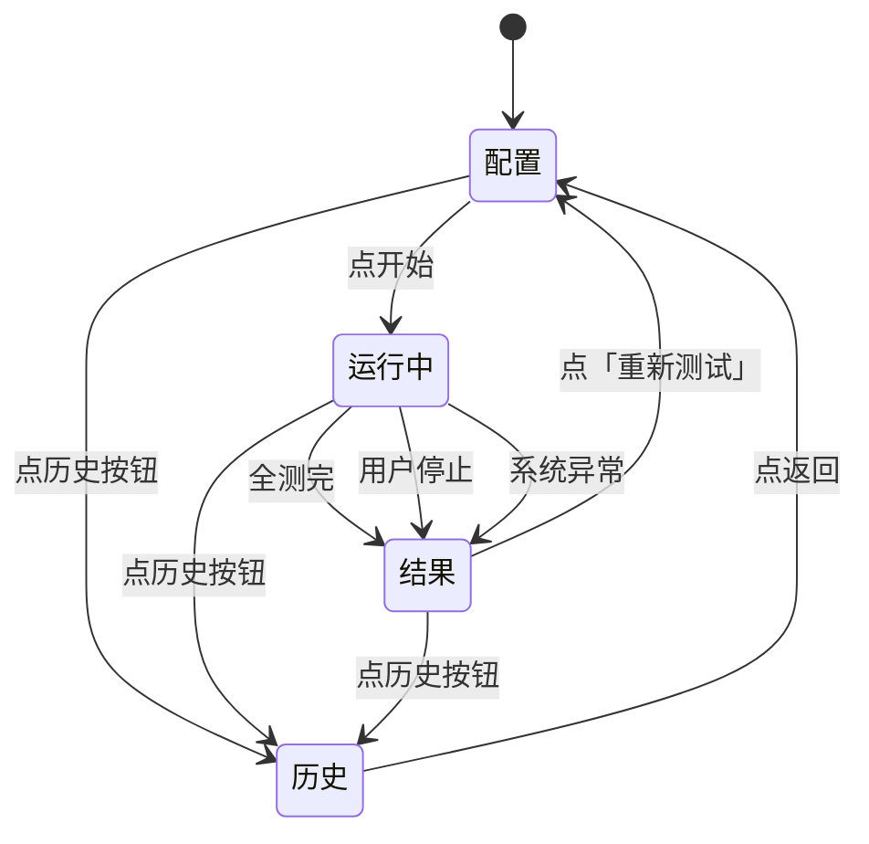

# 工厂老化测试工具 — 需求与设计

> 单机本地运行的桌面硬件体检 + 老化测试工具,跑在被测设备自身。
> 目标平台: **全志 A527** (ARM Cortex-A55 + Mali-G57)

---

## 目录

- [1. 项目目的](#1-项目目的)
- [2. 需求与范围](#2-需求与范围)
- [3. 达到的效果](#3-达到的效果)
- [4. 系统架构](#4-系统架构)
  - [4.1 部署模式](#41-部署模式)
  - [4.2 软件分层](#42-软件分层)
  - [4.3 数据流](#43-数据流)
  - [4.4 启动流程](#44-启动流程)
- [5. 用户场景与典型流程](#5-用户场景与典型流程)
- [6. 测试项设计 — 通过判定的依据](#6-测试项设计--通过判定的依据)
  - [6.1 概述](#61-概述)
  - [6.2 CPU 压力](#62-cpu-压力)
  - [6.3 GPU 渲染](#63-gpu-渲染-opengl-es-2-全屏压测)
  - [6.4 WiFi 验证](#64-wifi-验证-软件开关--射频检查--扫描-含环境降级)
  - [6.5 USB 枚举 + 读写](#65-usb-枚举--读写)
  - [6.6 网口](#66-网口-链路--dhcp--ping-通外网-不做吞吐)
  - [6.7 HDMI 输出](#67-hdmi-输出-sysfs-优先-不需-root)
    - [6.7.1 模式切换在本板不可用 — 实测结论](#671-⚠️-模式切换在本板不可用--实测结论-2026-10-23)
    - [6.7.2 当前分辨率改用 xrandr 读真实输出](#672-✅-当前分辨率改用-xrandr-读真实输出-2026-10-23)
  - [6.8 风扇 GPIO (主动拉高/拉低轮转)](#68-风扇-gpio-主动拉高拉低轮转--⚠️-必须用裸系统调用-禁用-python-的-open)
  - [6.9 TF 卡读写](#69-tf-卡读写自动检测--未插提示)
  - [6.10 内存压力](#610-内存压力-rc--精确判定)
  - [6.11 eMMC 存储](#611-emmc-存储)
- [7. UI 设计](#7-ui-设计)
  - [7.1 状态机](#71-状态机)
  - [7.2 页面布局](#72-页面布局)
  - [7.3 需要人工介入时, 后端必须真的停住](#73-需要人工介入时-后端必须真的停住)
  - [7.4 画面只能由后端事件推动](#74-画面只能由后端事件推动-hard-rule)
  - [7.5 计时条: 2026-10-23 整块从界面移除](#75-计时条-2026-10-23-整块从界面移除)
  - [7.6 运行态必须能靠快照恢复 —— 事件不许丢](#76-运行态必须能靠快照恢复--事件不许丢)
- [8. 数据与存储](#8-数据与存储)
- [9. 测试通过与否的依据](#9-测试通过与否的依据总规则)
  - [9.1 状态判定](#91-状态判定)
  - [9.2 通过率口径](#92-通过率口径)
  - [9.3 边界与例外](#93-边界与例外)
  - [9.4 默认阈值参考](#94-默认阈值参考)
- [10. 可观测性原则](#10-可观测性原则-ux-hard-rule)
  - [10.1 推送频率硬约束](#101-推送频率硬约束)
  - [10.2 前端呈现约束](#102-前端呈现约束)
  - [10.3 过程证据要求](#103-过程证据要求)
  - [10.4 添加测试项时的规约](#104-添加测试项时的规约)
  - [10.5 实时事件类型与生命周期](#105-实时事件类型与生命周期)
- [11. 运行时约束 (产线环境必备)](#11-运行时约束-产线环境必备)
  - (§11.1 ~ §11.6 工具调用 / 权限 / 错误识别 / 策略选择 / 进程生命周期 / 启动脚本;**§11.7 离线预打包必读**)
- [12. 技术栈](#12-技术栈)

---

## 1. 项目目的

### 1.1 业务背景

产线上,每台全志 A527 量产设备在下线前要做**硬件功能体检 + 短期老化跑测**,筛除生产环节出现的问题件。当前痛点:

- 测试靠工人手工 + ad-hoc 脚本,执行不规范
- 结果散落各处,无法沉淀数据做质量分析
- pass / fail 全凭经验,争议无据可查

### 1.2 核心价值

把"测试 + 记录 + 报告"做成一个**单机闭环**,让产线工人:

1. 桌面图标一键启动 → 自动开浏览器
2. 勾选要测的项目 → 点开始 → 等结果
3. 看到一份**明确 pass / fail** 的报告
4. 历史可查、有据可依

### 1.3 解决什么问题

| 维度 | 改进前 | 改进后 |
|---|---|---|
| 操作门槛 | 工人需懂命令 | 勾选 + 点开始 |
| 一致性 | 每人执行手法不同 | 工具统一调度 |
| 记录 | 无 / 散乱 | SQLite 全量存 |
| 申诉凭据 | 无 | 历史详情 + 指标 |

---

## 2. 需求与范围

### 2.1 在做什么

- 单机本地测试工具,跑在被测设备(DUT)自身上
- 10 项硬件测试:CPU / GPU / WiFi(扫描) / USB / 网口 / HDMI / 风扇 / TF 卡 / 内存 / eMMC
- 极简 Web UI:勾选 + 次数/时长 + 全选 + 开始
- 跑测过程**实时可见**(每项独立面板,见 §10.5 实时事件 / §10.2 前端呈现)
- 报告(每项指标 + 错误信息)+ 历史可查

### 2.2 测试项清单

| # | 名称 | 主要工具 | 自动 / 交互 |
|---|---|---|---|
| 1 | CPU 压力 | stress-ng | 自动 |
| 2 | GPU 渲染 | glmark2-es2 | 自动 |
| 3 | WiFi 验证 (开关/射频/扫描 3 件套) | iw / rfkill / iproute2 | 自动 |
| 4 | USB 枚举 + 读写 | lsusb + fio | 自动 |
| 5 | 网口 链路 + DHCP + ping | ethtool + udhcpc + ping | 自动 (未插网线提示) |
| 6 | HDMI 输出 | xrandr (x11-xserver-utils) | 自动 |
| 7 | 风扇 GPIO | /proc/rp_gpio/pi5 (**读写双向**: 主动拉低/拉高轮转 + 回读校验; 必须走裸系统调用, 见 §6.8) | 自动 |
| 8 | TF 卡读写 | fio | 自动(未插则弹提示选「插 / 跳」) |
| 9 | 内存压力 | memtester | 自动 |
| 10 | eMMC 存储 | fio | 自动 |

> 看门狗(WDT)剔除;风扇为 B 类(纯 GPIO 通断,无 tach);**TF 卡自动检测 + 未插提示**(启动该测试时自动探挂载点,没探到则弹提示让用户选「插 / 跳」);**网口未插提示**(链路未起时弹提示选「插 / 跳」);默认全部勾选,工人按需减

**设备身份 (SN) —— 每次运行强制记录**

被测设备 SN 是产线追溯的锚点,**每条 run 记录 + 每份报告 + 每份 PDF 必须携带 SN**。

- **提取命令** —— `cat /proc/cmdline | grep -oP 'snum=\K[^ ]*'`
- **回落源** —— 提取失败(为空)时回落 `cat /proc/cmdline | grep -oP 'androidboot.serialno=\K[^ ]*'`
- **仍为空** —— 记为 `unknown`,报告中照常输出 `unknown` 并在 UI 顶部黄色提示,**不阻断测试**
- **实测样例** —— `snum=31175c3d01850801f56`(同一条 cmdline 里 `androidboot.serialno=` 值一致,双源互为校验)

关联章节:§8.1(入库字段)、§8.2(PDF 报告头)、§7(UI 顶部常驻显示)。

---

## 3. 达到的效果

### 3.1 功能效果

- 一台 A527 新机,从上架到出报告,工人操作 ≤ 30 秒(配置) + 测试时间(默认约 9–12 分钟)

> **9–12 分钟的依据**(按 §9.4 默认参数逐项累加):eMMC 写30s+读30s=60s + TF 写30s+读30s=60s + USB 3 轮×18s=54s + CPU 60s,**固定项合计 234s**;再加 WiFi ≈20s + 网口 ≈20s + HDMI ≈5s + 风扇 ≈15s、GPU 一轮 120–300s(驱动相关,**不可控**),以及 10 项间 5s 静默期(§5)=50s。
> ⚠️ **内存这一项没有计入上面的账** —— 它是 memtester「跑完 N 遍就退出」, 耗时 = 遍数 × 工作集 ÷ **机器内存带宽**, 换板子能差几倍, 事先算不准(§7.5)。1GB × 1 遍实测通常在几十秒量级, 但**不写进合计** —— 写一个假的数字不如留空。
> **2026-10-23 按产线要求整体压到最短**: CPU 300→180→120→**60s**、USB 2×30→5×24→**3×18s**、TF 2×30s→2×60s→**2×30s**、eMMC 60s×2→**30s×2**。固定项从 660s 压到 **234s**(不含内存与 GPU)。
> 这些**只是出厂默认值** —— 产线觉得不够覆盖, 在配置页把「次数/时长」调大即可(§7.5 会把用户改的值同步显示在测试界面上)。
> ⚠️ GPU 那 120–300s 现在占了整轮的大头, 是唯一不可控的项。产线若还要压节拍, 有效方向只有减 GPU 轮数(`gpu.rounds`)—— CPU 和存储项已经压到接近下限了, 内存项则根本不该按时间压(见上一条)。
- 任意子项失败立即定位(指标 + 错误信息明文)
- 跑测全程**无 UI 交互**(除开始前的配置勾选)

### 3.2 易用性效果

- 工人首次接触 < 5 分钟可独立完成
- 不读文档就能完成"勾 → 开始 → 看结果"
- 默认全选 + 默认参数,开箱即用

### 3.3 质量效果

- 测试过程可重放:参数 + 指标 + 日志全部入 SQLite
- 争议可复核:历史详情完整回看

### 3.4 可观测性效果 (hard rule)

- 测试运行中,**工人能实时看到**每项测试独立显示:状态色 / 进度条 / 关键指标 / 滚动日志
- 点开始后必须 **立即有反馈**,绝不允许 "黑屏" 或 "无任何动静" 的体验
- 静默阶段也要持续推心跳进度,不让用户怀疑工具死锁
- 历史记录可重看完整 `progress` / `metric` / `log` 流

---

## 4. 系统架构

### 4.1 部署模式

被测设备本身就是工具宿主。浏览器、后端、系统工具、待测硬件**全部在同一台机器**,**不**外接、不连远端。

**离线交付 = 依赖预置,不是运行禁网**

本文档中"离线 / 预打包"**只约束依赖的获取时机**:所有测试所需的系统工具 / Python 依赖 / 第三方素材必须在**打包阶段**一次性下载好,集成进出货镜像;目标设备装机后**启动即可跑全套,运行期间一律不得再联网装包**,**不允许出现“测试中才发现某包未装”的产线故障**。清单与打包流程见 §11.7。

**产线网络前提(已确认)**

产线**有网络,有线无线均可用**,且工位**接 HDMI 显示器**:

| 条件 | 支撑的测试项 | 说明 |
|---|---|---|
| 有线网络可达 + DHCP 可用 | §6.6 网口(取 IP + ping 外网) | ping 公网目标已验证可达(RTT 约 8-13ms) |
| 无线有 AP 可扫描 | §6.4 WiFi(第 ④ 步扫 SSID) | 产线工位周边有可扫描 AP |
| HDMI 显示器连接中 | §6.3 GPU 全屏渲染 + §6.7 HDMI | 常态连接,不进入"未接显示器"分支 |

即:**依赖不可现场安装,但测试本身用得到网络**。因此 §11.4 的取舍原则相应调整为——**不依赖"不可控的外部条件"**(AP 凭证、临时公网可达性、第三方服务等),而不是"不依赖网络"。

### 4.2 软件分层

自上而下:前端(Vue 3 SPA)→ 后端服务(FastAPI) → 测试运行时(注册表 + 调度器) → 测试实现(10 个模块) → 系统工具与内核驱动。

### 4.3 数据流

跑测期间单向流动:

- **用户 → 后端** —— POST 提交配置
- **后端 → 系统工具** —— `subprocess` 调起 Linux 工具,读 stdout / 退出码
- **后端 → 前端** —— WebSocket 持续推三类事件(进度 / 日志 / 指标)
- **后端 → 持久化** —— 测试结果异步入 SQLite

跑测的完整步骤视角见 §5。

### 4.4 启动流程

**桌面双击图标 → 浏览器显示完整步骤:**

1. 工人双击桌面图标
2. 系统调起启动脚本(**普通用户身份直接启动,启动路径不要求提权**)
3. 脚本后台启动 Web 服务监听 `:8000`
4. 脚本调系统命令自动打开浏览器
5. 浏览器请求主页, 后端返回页面
6. 浏览器加载完成后请求配置接口, 后端返回测试项 + 默认参数
7. 浏览器渲染 UI, 等待工人操作

**权限取得方式 —— 命令级 `sudo`,不靠提权启动**

服务以普通用户身份运行即可;**需要 root 的系统调用一律在测试项内部以 `sudo <命令>` 前缀执行**(完整规则见 §11.2)。因此桌面图标可以直接调起 `start.sh start`,不需要 `pkexec` / `sudo` 包装启动脚本。

**启动时读取 SN**

服务启动即执行 §2.2 的 SN 提取命令,读到的 SN 常驻内存并展示在 UI 顶部;读不到时显示 `SN: unknown` + 黄色提示。SN 随每次 run 写入数据库(§8.1)并印在 PDF 报告头(§8.2)。

---

## 5. 用户场景与典型流程

**核心流程一图通读（PPT 友好，可整张贴进幻灯片）:**

```
                              开始
                               ↓
                  ┌──────────────────────────┐
                  │ ① 开测试工具               │
                  │ ② 勾选要测的项 + 调默认参数   │
                  │ ③ 点「开始」               │
                  └──────────────────────────┘
                               ↓ 建本次运行记录
                               ↓
        ┌── 主循环（每跑一项重复）─────────────────────────┐
   ─→   │ ④ 取下一项 → ⑤ 执行 → ⑥ 判定（5 态之一）→ ⑦ 写结果 │ ──┐
        └──────────────────────────────────────────────┘   │
   ↑                                                       │
   └───────────────── 回到 ④ ─────────────────────────────┘
                               ↓ 全部跑完 / 中途停止
                  中途停止 → 当前项 + 剩余未跑项 = stopped
                               ↓
                          汇总 → 写总报告 → UI 显示
                               ↓
                  任一 failed / error？
            ├─ 否 → 整机通过，可下架 → 结束 ✓
            └─ 是 → 整机不通过，留厂排查 → 结束 ✗

旁路分支:
  单项重跑 → 报告出后，对单条 failed/error 项点「重跑这一次」
          → 替换该条结果 → 回到「汇总」重新判定
```

**判定 5 态**（完整定义见 §9.1）:

| 状态 | 触发 | 行为 |
|---|---|---|
| `passed`  | 满足该项所有通过条件             | 写指标，继续下一项 |
| `failed`  | 断言不达标（如网口 ping 不通）  | 写失败原因,**不阻断**,继续下一项 |
| `error`   | 工具缺失 / 代码异常              | 写异常详情,**不阻断**,继续下一项 |
| `skipped` | 用户主动跳过（如 TF 卡未插选「跳」） | 写跳过原因,**不计入**通过率 |
| `stopped` | 用户中途点「停止」               | **不**算 failed，报告里高亮 |

**配套硬规则:**

- **5 秒静默期** —— 每项测完后留 5 s，让 CPU / 温度 / 调度器复位再跑下一项
- **推荐执行顺序** —— 默认 4 阶段：轻量（内存 / eMMC / TF） → 接口（HDMI / USB / 网口 / 风扇） → 射频（WiFi） → 重载（GPU / CPU）;工人在 UI 可拖动调整
- **整机不通过判定** —— 任一项 `failed` 或 `error` → 整机不通过（详见 §9.2 通过率口径）

**流程前置 —— 工位环境自检（run 开始前先做一次）**

网络类测试（WiFi / 网口）的结论**强依赖工位环境**。为了不让工人逐项猜「到底是机子坏了还是网络挂了」，每次 run 开始前先探一次工位网络：

| 检查 | 方式 | 结果标注 |
|---|---|---|
| 默认网关可达 | `ping -c 2 -W 1 <默认网关>` | 不通 → 环境异常 |
| DHCP 可用 | `udhcpc -i <iface>` 试一把（或读上次 DHCP 租约） | 失败 → 环境异常 |
| 周边有 AP | `iw dev <wlan> scan` 数 SSID | 0 个 → 无线环境异常 |

- **环境正常** → 顶部不显示任何异常标记，报告正常呈现
- **环境异常** → UI 顶部**橙色 banner**：「⚠ 当前工位网络异常，以下网络类测试结果仅供参考」;报告首页同步标红
- **不阻断测试** —— 继续跑完，网络类测试项按各自的降级通道(§6.4 / §6.6)出结论
- **作用** —— 让「环境问题」与「设备问题」在报告上一眼可分，避免好机被误判、坏机被漏判

---

## 6. 测试项设计 — 通过判定的依据

### 6.1 概述

10 项默认全选,通过 / 失败 / 错误 / 跳过 / 停止 五档状态。详细判定见 §6.2 - §6.11,数值门槛见 §9.4。

### 6.2 CPU 压力

- **目的** —— 拉满所有核, 验证不崩 + 不超温
- **工具** —— `sudo stress-ng --cpu N --timeout Ds`
- **通过** —— 退出码 0 **且** 峰值温度 ≤ 阈值
- **指标** —— `peak_temp_c`、`avg_load_pct`;失败时记温度峰值 + 退出码

### 6.3 GPU 渲染 (OpenGL ES 2 全屏压测)

- **目的** —— 验证 GPU 渲染管线 (GLES2 驱动 + 时钟 + 内存带宽) 在 Wayland 全屏持续渲染压力下稳定不死机、不报错
- **安装** —— `sudo apt install glmark2-es2 glmark2-es2-wayland`(**两个都装**;各提供一个**不同**的二进制,测试按当前会话自动选 —— 见下)
- **工具** —— `sudo <所选变体> --fullscreen`,变体表:

  | 变体 | 二进制 | 需要的会话 | 提供者 |
  |---|---|---|---|
  | Wayland | `glmark2-es2-wayland` | `WAYLAND_DISPLAY` + compositor | `glmark2-es2-wayland` 包 |
  | X11 | `glmark2-es2` | `DISPLAY`(+ `XAUTHORITY`) | `glmark2-es2` 包 |

  默认 `variant: auto` —— **谁的会话环境变量在、且对应二进制装了,就用谁**;两个都在时优先 Wayland(本节原始设计意图)。可强制 `wayland` / `x11`。

  > ⚠️ **2026-10-22 实测更正两处原文错误**:
  >
  > ① 原文称 `glmark2-es2-wayland` 包「提供 `glmark2-es2` 可执行」——**不对**。该包提供的是 `/usr/bin/glmark2-es2-wayland`,与 `/usr/bin/glmark2-es2` 是两个不同文件(md5 不同)。
  > ② `glmark2-es2` 本身 `ldd` 链接的是 **libX11**,是 **X11 变体** —— 与原文「必须有 Wayland 会话」这条前置**互斥**。本机 `XDG_SESSION_TYPE=x11`、无 Wayland,结果 GPU 项在 **GPU 完全正常**的板子上(run 41 / run 48)被自己的前置条件挡死,**一轮都没跑**。
  >
  > 实测本机 GPU 本身健康: `GL_RENDERER: Mali-G57 (Panfrost)` / `GL_VERSION: OpenGL ES 3.1 Mesa 22.2.2`。

**前置条件(缺任一 → 本项 `error` 并明确报错,不做静默降级)**

| # | 前置 | 检查方式 | 缺失后果 |
|---|---|---|---|
| 1 | **HDMI 显示器已连接** | `/sys/class/drm/*HDMI*/status == connected` | EGL 拿不到 native window,glmark2 启动即失败 |
| 2 | **图形会话可用**(前置跟着所选变体走) | wayland: `WAYLAND_DISPLAY` 非空 + compositor 进程在<br>x11: `DISPLAY` 非空 + `/tmp/.X11-unix/X<n>` 可达 + `XAUTHORITY` 有效 | 无 GLES 上下文,直接退出 |
| 3 | **DRM 节点存在** | `/dev/dri/card*` + `/dev/dri/renderD*` | 无渲染设备 |

> 产线**已确认 HDMI 常态连接测试**(见 §4.1),因此本项**不进入"未接显示器 → skipped"分支**;第 1 条不满足属于工位配置问题,应报 `error` 而非 `skipped`,否则等于 GPU 静默漏测。

- **通过** —— **跑完全部轮次且每轮都完整跑完一轮测试**(全部内置场景渲染完成, 终端输出 `glmark2 Score: <数字>` 结尾且 exit code = 0)
- **超时兜底** —— 一轮理论 2-5 分钟,但受 GL 驱动 / 场景耗时差异影响波动大;配置 `gpu.timeout_sec`(默认 **600 s**,**单轮**上限,不是整项上限),超时即 `error` + 记 stderr 末 N 行,**防止个别机器跑飞挂死整个 run**
- **指标** —— `score` (最终评分)、`frames_rendered`、`elapsed_sec`、`exit_code`、`precheck_display`、`precheck_wayland`、`precheck_dri`;失败时记 stderr 末尾 N 行
- **备注** —— glmark2 一轮完整跑完自然结束(无需 `--run-forever`),每场景覆盖不同 GPU 单元(曲面 / 着色 / 纹理 / 光照),老化与功能验证一并兼得

- **轮次 `gpu.rounds`(默认 1, 可手动调大)** ——
  glmark2 以"一轮完整跑完"为最小粒度,单轮时长由驱动决定,所以**不提供 `[时长]` 输入框**(给工人调时长没有意义)。但**提供 `[次数]` 输入框**:一轮理论只有 2-5 分钟,对"老化"这个定位偏薄,而产线有时需要把 GPU 负载拉起来做加强筛查,或用多轮分数的**衰减趋势**暴露间歇性故障(第 1 轮 800 分、第 3 轮 200 分 ⇒ 有东西在坏 —— 单轮给不了这个信号)。
  - **默认 `rounds: 1`** —— 出货默认行为与本节原描述完全一致,不改变任何既有判定口径
  - 可在 UI 手动调大(返修复测 / 抽检加强);每次 run 之间独立跑完整轮,不共享上下文
  - 每轮独立计时、独立判超时;任一轮失败即整项 `failed`,并记 `failed_round` 指出是哪一轮
  - 逐轮记录分数进 `rounds[]`,`score` 仍取**最后一轮**;`rounds=1` 时 `rounds[]` 长度为 1
  - **不提供 `[时长]`** —— 负载深度靠 CPU/内存/eMMC 那几项的可调时长控制,GPU 侧只调次数

- **UI 参数** —— `[次数]` 输入框(默认 1,可调大);**不提供 `[时长]`**。与其他可调项在 UI 上区分(见 §7.2)

- **配置 (`config.yaml`)**:
  ```yaml
  gpu:
    enabled: true
    rounds: 1          # 跑几轮完整 glmark2 (默认 1 = 原单轮行为); 可手动调大
    timeout_sec: 600   # 单轮超时上限, 非整项上限
  ```

### 6.4 WiFi 验证 (软件开关 + 射频检查 + 扫描, 含环境降级)

- **目的** —— 验证 WiFi 子系统工作:**驱动响应 `ip link` 软件开关** + **射频 `rfkill` 未被屏蔽** + **射频通路真的能完成一次扫描**
- **设计哲学** —— 产线**有无线网络、且工位周边通常有 AP 可扫描**,但仍**不连 AP / 不需凭证 / 不需 WPA 交互**:只验证 WiFi 子系统本身能开关、射频能工作。连接 AP 会引入凭证管理 / 握手超时等额外变量,屏蔽这一层换来 **可重复 / 老化阶段纯驱动检查** 的稳定测试。
- **核心原则:环境问题 ≠ 设备问题** —— 判定依据必须是「**设备自己能不能做**」,不能是「**环境有没有配合**」。周边有没有 AP、有没有外网,都是工位条件而非设备能力,因此**必须设计降级通道**:
  - 技术依据:`iw dev wlan0 scan` 在**周边一个 AP 都没有**的环境下,驱动照样正常完成扫描,输出 `bssid / signal / SSID` 表头 + `scan completed`,**退出码 0**,只是结果列表为空。**这条命令成功跑完 = 射频通路已工作**;扫不到 SSID 仅仅是环境里没 AP,**不该判设备坏**。
- **需要 root** (CAP_NET_ADMIN, ip link / iw / rfkill 都要), 通过命令级 `sudo -n` 取得(§11.2);`sudo` 不可用 → 本项判 `error`,不静默降级

**测试逻辑 — 4 步顺序执行 + 第 ④ 步降级通道:**

| 步骤 | 命令 (**全部经 `sudo -n`**) | 通过条件 |
|---|---|---|
| ① 软件开关响应 | `ip link set wlan0 down` → 等 `switch_settle_sec`(默认 1 s) → `ip link set wlan0 up` | 两句都退出 0 (驱动响应 `ip link` 命令) |
| ② 状态确认 | **轮询** `ip link show wlan0`(每 0.3 s 一次, 上限 `state_timeout_sec` 默认 10 s) | 轮询到 `state UP` 即过 (操作实际生效) |
| ③ 射频检查 | `rfkill list wifi` | 输出**不含** `blocked: yes` (射频未被软/硬屏蔽) |
| ④ 扫描执行 | `iw dev wlan0 scan` (≤ 15 s 超时) | 优先:**扫到 ≥ 1 个 SSID**;降级:**命令成功完成扫描即过**(见下) |

> ⚠️ **第 ② 步必须轮询, 不能固定 sleep** —— 2026-10-22 实测踩过的坑:
>
> 无线驱动在 `ip link set up` 之后**还要初始化射频**, 这段时间内核报 `state DORMANT`
> (= 接口已 up, 链路未就绪), 是**正常中间态, 不是故障**。本机实测 `DORMANT`→`UP` 要
> **3.22 秒**, 而原实现固定等 `switch_settle_sec`(1.0 s) 就去读 —— 必然读到
> `DORMANT` 判 `failed`。实测 run 43 / 44 / 47 **三次全倒在这一处**, 而同一时刻
> 接口其实是好的(`state UP`、有关联、IP 正常)。
>
> 改成轮询后, 驱动初始化多慢都能过, 只有**真超时**才 `failed`, 且报错能区分
> 「没等到」(超时) 与「等到了但状态不对」。
>
> **`switch_settle_sec` 语义收窄** —— 它现在**只**表示「down 与 up 之间的间隔」,
> 不再兼任「等 up 生效」; 后者由 `state_timeout_sec` 独立管。不要靠调大
> `switch_settle_sec` 来绕过这个问题 —— 那只是把固定等待换成一个同样脆弱的魔数。
>
> **别把 `mode DORMANT` 当成 `state DORMANT`** —— `ip link show` 实际输出形如:
> ```
> 12: wlan0: <BROADCAST,MULTICAST,UP,LOWER_UP> mtu 1500 qdisc fq_codel state UP mode DORMANT ...
> ```
> `state` 后面才是链路状态; `mode` 后面那个 `DORMANT` 是**射频省电模式**(正常)。
> 解析必须锚定 `state` 关键字 —— 已用本机真实输出 + 3 组构造样本逐条验证正则无误。

**第 ④ 步降级链 —— 环境无 AP 时仍能判通过**

| 阶段 | 动作 | 结果 |
|---|---|---|
| 4a 首次扫描 | `iw dev wlan0 scan` | 扫到 ≥1 SSID → 直接 `passed` |
| 4b 重试 | 仍未命中时,**间隔 5 s 重试,最多 2 次** (共最多 3 次) | 排除瞬时抖动 / 射频刚唤醒未稳定 |
| 4c 命令级降级 | 重试仍为 0 SSID,但**退出码 0 且输出含扫描完成标志**(`scan completed` / `bssid` 表头 / `Results:`) | **判 `passed`** + `degraded=true` + `note="环境无 AP,射频通路已验证"` |
| 4d 驱动级失败 | 命令**报错 / 非 0 退出 / 超时 / 输出无扫描完成标志** | `failed` —— 这是真设备问题,无兼底 |

- **4c 是本项的降级通道** —— 判定依据是「驱动能不能完成一次射频扫描」,而非「环境里有没有 AP」
- **4d 不设降级** —— 驱动报错就是驱动坏了,必须暴露
- **`degraded` 必须入库并在 UI / PDF 上可见**(标黄),让产线知道这台是在"无 AP 环境"下测的

**通过** —— ①②③ 全过 **且** ④ 走完 4a 或 4c;任一失败 → `failed`,在 `step_failed` 里指出失败步骤编号 (1/2/3/4)

**指标**:
- `ip_link_state` — ② **轮询结束时**的 state (`UP` / `DOWN` / `UNKNOWN` / `DORMANT`)
- `state_wait_ms` — ② 从 `set up` 到 `state` 首次变 `UP` 的耗时 (ms)。正常约 3000±500; 老化时可据此看出驱动初始化有没有随时间变慢
- `rfkill_blocked` — ③ 是否被屏蔽 (`yes` / `no`)
- `scan_ssid_count` — ④ 扫到的 SSID 数 (降级通过时为 `0`)
- `top_ssid` — ④ 第一个命中的 SSID 字符串 (降级时为空)
- `scan_duration_ms` — ④ 扫描实际耗时
- `scan_retry_count` — ④ 实际重试次数 (0-2)
- `scan_cmd_ok` — ④ `iw scan` 是否成功完成 (退出码 0 且输出含扫描完成标志)
- **`degraded`** — 是否走 4c 降级通道通过 (`true` / `false`)
- `degraded_reason` — 降级原因 (如 `"环境无 AP,射频通路已验证"`)
- `step_failed` — 失败时的步骤编号 (1/2/3/4), 成功时为空
- `step_failed_reason` — 失败时的错误输出(命令 stderr 末几行)

**轮次可调 (`wifi.times`, 默认 1)** ——
- **默认 `times: 1`** —— 出货默认行为与本节原描述完全一致, 不改变任何既有判定口径
- 每轮跑**完整 4 步**(开关 → 状态 → 射频 → 扫描)。老化加强时调大, 反复开关射频 + 反复扫描更容易暴露**间歇性**驱动问题 —— 第 2 轮才 scan 不出来 / 第 3 轮 `ip link` 不 UP, 这些单轮给不了信号
- **任一轮 `failed` / `error` / `skipped` 即整项停**, 剩余轮次不再跑 —— 与 §6.3 GPU「任一轮失败即整项 failed」同一口径
- 逐轮指标存 `round_N_*`, 顶层指标取**最后一轮**;`times=1` 时无 `round_*` 前缀(与单轮时完全一致)
- **不提供 `[时长]`** —— 单轮时长由 `switch_settle_sec` / `state_timeout_sec` / `scan_timeout_sec` / `scan_retry_*` 决定, 它们是「每步的上限 / 重试」语义, 不是「跑多久」
- UI: `[次数]` 输入框(默认 1), 与 GPU / 风扇同档(见 §7.2)

**为什么不卡 RSSI 阈值:**
工位周边 AP 的信号强度受产线环境(隔墙、金属工位、同时开着的其他设备)影响很大,卡固定 dBm 阈值会把"设备能用但现场信号弱"误判为不合格。本测试只验证 “**驱动 / 射频 / 扫描能力**” 这三件事全通 —— 扫到 SSID 就说明射频链路真的在工作;扫不到则退到 4c 降级通道,只要扫描命令能完成就过,不卡具体信号强度。强度问题交由出货后现场场景处理, 不进老化判断。

**为什么不连 AP / 验证 WPA 握手:**
工位虽有 AP,但 AP 的凭证管理、超时重连、不同 AP 型号差异都会引入大量额外变量,测试稳定性反而变差。WPA 握手层缺陷率约 5%, 那 5% 出货后现场报修成本可控, 屏蔽这一层反而换来 **不依赖特定 AP / 不依赖凭证 / 可重复 / 老化阶段纯驱动检查** 的稳定测试。

### 6.5 USB 枚举 + 读写

- **目的** —— USB 控制器 + 端口 + 连接的 U 盘都活着
- **工具** —— `lsusb`, 块设备上跑 `fio`
- **写入时长** —— 默认 **3 轮 × 每轮 18s = 54s**(config: `usb.times: 3` / `usb.duration_sec: 18`);靠 `fio --time_based=1 --runtime=<sec>` **持续写**,工作集 `usb.size_mb: 32`(MB)反复覆写
  - 📝 `18 × N` 到不了整数个 60 —— 要**正好一分钟**得用 `20s × 3` 或 `15s × 4`, 产线按节拍二选一改 `config.yaml` 即可。
  - ⚠️ **只写不读**,且目标是 `/dev/sdX` **裸块设备** —— 会真的反复擦写 U 盘闪存。这正是老化测试要的(挑坏块 / 挑接触不良),但**别拿唯一一份、有未备份数据的盘来跑**。
  - 📌 与本节历史版本的差异:早期设计写的是「写 30s + 读 30s」(`usb.write_sec` / `usb.read_sec`),但**代码从未实现读**,`config.yaml` 里也没有这两个键。**以本节现文与 `config.yaml` 为准**。
- **通过** —— 枚举到 ≥ 1 个非 root-hub 设备 ∧ (适用时)**每轮 `fio` 退出码为 0**。
  **⚠️ 速度不参与判定**(2026-10-23 产线决定, 见 §6.5.1)
- **指标** —— `device_count`、`round_{N}_write_mbps`、`avg_write_mbps`(均为**仅上报**);失败时列可见设备 vs 期望设备

#### 6.5.1 ⚠️ USB 不再用速度判定通过与否 (2026-10-23)

**现象**: 产线插入一个正常 U 盘, 日志看着一切正常, 结果页却显示「失败」, 而且**没有给出任何原因**。

**两个独立问题, 各查各的**:

**① 阈值不合理 —— 已取消。** 实测三轮写速 `10.9 / 10.7 / 10.9 MB/s`(极稳定, ±1%, 说明盘和链路都健康),
而原阈值 `min_write_mbps: 20`。**20 卡在典型值上沿**: USB 2.0 High-Speed(480 Mbps)链路上
闪存的**写**要经 FTL 擦写, 典型值本就只有 **8~20 MB/s**(读通常 20~35, 写慢一半是常态)。
本板控制器实测 `usb1: 480 Mbps` / `usb2: 10000 Mbps`,该盘走的正是 480 Mbps 那一档。
—— **一个正常 U 盘被判 failed**, 阈值定错了, 不是盘坏了。

> 现口径: **只有 `fio` 退出码决定通过**。读写出错、盘报错(`rc≠0`)、掉盘才算失败;
> 速度仍作为 `round_N_write_mbps` / `avg_write_mbps` 上报, 供产线看趋势、排查慢盘。
> `min_write_mbps` 配置键已删除 —— 不起作用的配置键会让工人以为调它有用
> (与当天 HDMI 的 `times` 死键同一个教训)。

**② 失败原因没写进结果 —— 已修。** 代码只置了 `all_passed = False` 却从未写 `result.error`,
于是结果页只显示「失败」而 `error` 是 `None`, **原因只印在日志里**。
症状极具误导性: fio 跑完了、没崩, 判失败那行是另一条日志, 工人会以为工具或设备坏了。
现改为把失败原因攒进 `fail_reasons` 并写入 `result.error`(如「第 2/3 轮 fio 退出码 5,
读写出错, 盘可能已掉或报坏块」)。

### 6.6 网口 (链路 + DHCP + ping 通外网, 不做吞吐)

- **目的** —— 验证以太网 PHY + 网线 + DHCP + 外网连通: **物理链路上 → DHCP 拿到 IP → 能 ping 通外网**;**吞吐不在老化测试范围**
- **网络前提(产线已确认,见 §4.1)** —— 工位网线**常态插好**、产线 DHCP 服务可达、外网可达。因此下面 3 步是**主干路径**,"未插网线"仅作异常兼底。
- **需要 root** (ethtool / udhcpc / ip addr / ping 都需), 通过命令级 `sudo -n` 取得(§11.2)

**测试流程 — 3 步顺序执行 + 环境降级通道:**

| 步 | 命令 | 通过条件 | 网络依赖 |
|---|---|---|---|
| ① 链路检测 | `ethtool <iface>` (默认 `eth0`, 见 `config.yaml.eth.iface`) | 输出含 `Link detected: yes` (网线物理接好) + 取 `Speed:` 作为协商速率 | **零依赖**(纯PHY层) |
| ② 取 IP | 先 `udhcpc -i <iface>` (≤ 10 s);失败则**静态兜底** `ip addr add <static_ip>` | DHCP 拿到 lease **或** 静态 IP 配上去 | 依赖 DHCP 服务 |
| ③ 外网连通 | `ping -I <iface> -c <count> -W <sec> <target>` | **三级降级,任一通过即算通过** (见下) | 依赖上游网络 |

> **① 完全不依赖网络** —— PHY 链路能不能建起来是纯物理层事实,交换机 / DHCP / 外网全挂也照样能测。这是本项在网络整体异常时**仍能给出有效结论**的基础。

**第 ② 步环境降级 —— DHCP 挂了还有静态 IP 兜底**

产线 DHCP 服务器故障是常见工位异常,不能因此把好机判成坏机:

| 阶段 | 动作 | 结果 |
|---|---|---|
| 2a DHCP | `udhcpc -i <iface>` (≤ `dhcp_timeout_sec`) | 拿到 lease → `ip_mode = dhcp`,继续 ③ |
| 2b 静态兜底 | DHCP 超时/失败时,`ip addr add <static_ip>` + `ip link set up` | 配上去 → `ip_mode = static`,继续 ③;配不上 → ②③ 一并 `skipped(env: no_ip)` |

**第 ③ 步三级降级 —— 避免单点抖动造成误判**

外网可达性受产线网络波动 / DNS 偶发超时影响,直接 ping 公网会把**网络环境的偶发故障**计到被测设备头上。因此按顺序尝试,**任一级通过即通过**:

| 优先级 | 目标 | 通过条件 |
|---|---|---|
| 1 | **默认网关** (从 `ip route` 取) | c/c 全部 echo,0% loss |
| 2 | **DNS 服务器** (如 `223.5.5.5`) | c/c 全部 echo,0% loss |
| 3 | **公网域名** (`ping_target`,默认 `www.baidu.com`) | c/c 全部 echo,0% loss |

- **优先默认网关**:证明设备 IP 确实可路由出网,且不受 DNS / 公网波动影响
- **三级全败** → 结合 `ip_mode` 定性(见下方判定矩阵)

**最终判定矩阵 —— 环境问题 ≠ 设备问题**

| ① 链路 | ② 取 IP | ③ 出网 | 判定 | 依据 |
|---|---|---|---|---|
| yes | `dhcp` | 任一级过 | **`passed`** | 主干路径,三层全通 |
| yes | `dhcp` | 三级全败 | **`skipped`** (env: `no_egress`) | PHY ✓ DHCP 客户端 ✓,仅出网未验;工位上游问题,**不判 failed**,强制复测 |
| yes | `static` | **网关级过** | **`passed`** + `degraded=true` | DHCP 服务器挂了,但静态 IP 下网路通 → **设备网络栈正常** |
| yes | `static` | 网关都不过 | **`failed`** | 静态 IP 配上了仍 ping 不通网关 → **真设备问题**(网络栈/二层异常),无兼底 |
| yes | 静态也配不上 | — | **`skipped`** (env: `no_ip`) | 环境完全不具备取 IP 条件,不判 failed |
| no | — | — | 走"未插网线"交互分支 | 见下 |

> **设计要点** —— `failed` 只留给**能明确归因到设备**的情况:① 链路不通,或**静态 IP 下仍 ping 不通网关**。凡是「设备能做的动作都成功了,只是环境没配合」的,一律 `skipped` + 环境原因标记(不计入通过率,见 §9.2)+ UI/PDF 显式披露。

**未插网线分支 (异常兼底, 非主路径):**

`ethtool eth0` 输出含 `Link detected: no` → UI 红色 banner **「请插网线」**, 用户二选一:
- 「已插好(重新检测)」 → 重跑 ①
- 「跳过此项」 → 记 `skipped` (env: `unplugged`), 报告中明示「**未插网线**」, **不计入通过率**(见 §9.2 跳过项规则)

**通过** — 见上方判定矩阵;`passed` 含两种形态:主干通过 / `degraded` 静态 IP 兼底通过,两者都在 UI 与 PDF 上区分显示

**失败模式:**
- `failed` — `Link detected: no` 且用户未处理 (物理层不通)
- `failed` — 静态 IP 兼底下**连默认网关都 ping 不通** → 设备网络栈 / 二层异常,**无兼底,真设备问题**
- `skipped`(env: `dhcp_unavailable`) — DHCP 不可用但静态兼底通过 → 标 `degraded`,不算失败,建议产线核查 DHCP 服务器
- `skipped`(env: `no_egress`) — 已拿到 IP 但三级 ping 全败 → 上游网络问题,**不判 failed**,需复测
- `skipped`(env: `no_ip`) — DHCP 与静态兼底均失败 → 环境不具备取 IP 条件
- `error` — ethtool / udhcpc / ping 命令缺失(出像未预装) → 立即停, *这个属于 §11.7 打包问题*

**指标:**
- `link_detected` — ① yes / no
- `link_speed_mbps` — ① 协商速率 (1000 / 100 / 10) 或 0
- `ip_addr` — ② 实际使用的 IP (DHCP 拿到的 或 静态兼底的)
- `ip_mode` — ② `dhcp` / `static` / `none`
- `dhcp_duration_ms` — ② DHCP 耗时
- `static_fallback_used` — ② 是否走了静态兼底 (`true` / `false`)
- `ping_target` — ③ ping 目标 (例 `www.baidu.com`)
- `ping_level` — ③ 停在哪一级 (`gateway` / `dns` / `public` / `none`)
- `ping_gateway` — ③ 第 1 级实际 ping 的网关地址
- `ping_sent` / `ping_recv` / `ping_loss_pct`
- `ping_avg_ms` / `ping_min_ms` / `ping_max_ms`
- **`degraded`** — 是否走降级通道得出结论 (`true` / `false`)
- `degraded_reason` — 降级原因说明
- `skipped_reason` — 跳过原因 (`unplugged` / `user_skip` / `no_ip` / `no_egress`)

**配置 (`config.yaml.eth`):**
- `iface: eth0` — 网口设备名
- `ping_target: www.baidu.com` — 第 3 级降级目标(可配)
- `ping_gateway: auto` — 第 1 级目标,`auto` = 从 `ip route` 自动取默认网关
- `ping_dns: 223.5.5.5` — 第 2 级目标
- `ping_count: 6` — 每级 ping 包数
- `ping_timeout_sec: 2` — 单包超时
- `dhcp_timeout_sec: 10` — DHCP 取 IP 超时,超时转静态兼底
- `static_ip: "192.168.1.50/24"` — **DHCP 失败时的静态兼底地址**

**轮次可调 (`ethernet.times`, 默认 1)** ——
- **默认 `times: 1`** —— 出货默认行为与本节原描述完全一致, 不改变任何既有判定口径
- 每轮跑**完整 3 步**(链路检测 → 取 IP → 出网连通)。老化加强时调大, 反复建链 / 反复续 DHCP 更容易暴露**间歇性**PHY 与网络栈问题 —— 网线插拔留下的震荡、DHCP 服务器偶发不响应, 这些单轮给不了信号
- **任一轮 `failed` / `error` / `skipped` 即整项停**, 剩余轮次不再跑 —— 与 §6.3 GPU「任一轮失败即整项 failed」同一口径。`skipped` 也停: 未插网线 / 环境不具备取 IP 条件, 再跑几轮结论也一样
- 逐轮指标存 `round_N_*`, 顶层指标取**最后一轮**;`times=1` 时无 `round_*` 前缀(与单轮时完全一致)
- **不提供 `[时长]`** —— 单轮时长由 `dhcp_timeout_sec` / `ping_count` / `ping_timeout_sec` 决定, 它们是「每步的上限」语义, 不是「跑多久」
- UI: `[次数]` 输入框(默认 1), 与 GPU / 风扇同档(见 §7.2)

**为什么测试外网 ping 而不是本地:** 本地 ping 只能证明链路+IP 到本机,不证明 IP 可上网;到默认网关的 ping 同时验证 IP 可路由出网,开销最低且不受公网波动影响,作为第 1 级;公网域名 ping 作为第 3 级兼底,兼顾"验证 IP 确实能上网"。每级仅 6 个包,开销低。

### 6.7 HDMI 输出 (sysfs 优先, 不需 root)

- **目的** —— 验证 HDMI 物理链 + EDID 可读(**模式可设 —— 见 §6.7.1, 本板不可用**)
- **工具优先级**:
  1. **`/sys/class/drm/` 读 connector** — 不需 root, 产线工控机也能跑; 读 `status` (connected/disconnected) + `modes` (支持的分辨率列表)
  2. **`xrandr` 读当前实际输出** — 不需 root, 但需 `DISPLAY`(与 §6.3 GPU 同一前提); 读**当前生效**的分辨率/刷新率, 不是 EDID 支持列表。**这才是「现在是什么分辨率」的真值来源**, 见 §6.7.2
3. **`modetest` 切模式 —— 已于 2026-10-23 从代码中整块删除**(本节保留一行占位说明它曾存在过)。删除理由见 §6.7.1: 设备能用 `-M sunxi-drm` 打开, 但切模式被 **DRM master(桌面会话持有)** 挡住, 产线做不成; 它在三种情况下都返回 rc=0, 退出码不可信; 且留着会在无桌面会话的板子上**真的改掉屏幕**。
- **通过** —— sysfs 报告 `connected` ∧ 至少 1 个 mode; ∧ 若 xrandr 跑得通, 则它也须报该输出口 connected 且有当前模式(两者矛盾才 fail, 见 §6.7.2 三态表)
- **指标** —— `connector`、`sysfs_status`、`current_resolution`(xrandr 真值)、`current_refresh`、`screen`、`modes_count`、`target_mode_in_modes`(比的是**分辨率**不含刷新率, 见 §6.7.1)
- **未接显示器** → skipped (不 fail, 避免误报);**xrandr 跑不了(无 DISPLAY / 没装 / 超时)但 sysfs 确认连接** → 仍 pass(读数不可信时不据此误杀好板子, 见 §6.7.2 三态表)

#### 6.7.1 ⚠️ 模式切换在本板**不可用** —— 实测结论 (2026-10-23)

**结论先行: 模式切换在本板**做不成**, 但原因不是原先记的那个; 调用已整块移除,
当前分辨率改用 `xrandr` 读真实输出。**

> ⚠️ **本节结论在当天被推翻过一次, 记录这个过程本身就是重点。** 初版写的是
> 「modetest 驱动表里没有 `sunxi-drm`, 打不开设备」。**那是错的** ——
> 那份表只是**默认集合**, `-M sunxi-drm` 可以覆盖它。
> 错误结论之所以能存活, 是因为**它同样解释得通观测到的现象**(`-c` 确实报
> `no device found` + rc=255), 而当时没去试那个能证伪它的选项。
> **教训: 一个「能解释现象」的结论不等于「被验证过的结论」。**

产线问「hdmi 的测试怎么也这么快啦」。查下来是两层问题:

**第一层 —— 曾经记为「打不开设备」, 实为漏了 `-M`**:

```console
$ sudo -n modetest -c
no device found
trying to open device 'i915'...failed
... (26 个驱动逐个试, 全 failed)
trying to open device 'sun4i-drm'...failed
$ echo $?
255
```

当时据此断定「驱动表里没有 `sunxi-drm`, 连 `/dev/dri/card0` 都打不开」。
**但那份表只是默认集合, `-M` 可以覆盖**:

```console
$ sudo -n modetest -M sunxi-drm -c
Connectors:
id   encoder  status     name      size (mm)  modes  encoders
133  132      connected  HDMI-A-1  530x300    13     132
```

设备**能打开**。同期还查出 **CRTC 是 94, 不是代码里写死的 0**。

**第二层 —— 切模式仍然做不成, 真因是权限**:

```console
$ sudo -n modetest -M sunxi-drm -s HDMI-A-1@94:#0
failed to set mode: Permission denied
setting mode 1920x1080-60.00Hz on connectors HDMI-A-1, crtc 94
$ echo $?
0                       ← ⚠️ rc=0, 但什么都没发生
```

**DRM master 被桌面会话占着** —— 实测开着 `/dev/dri/card0` 的进程:

| pid | 进程 |
|---|---|
| 900 | `xfce4-session` |
| 998 | `xfwm4` |
| 1232 / 1255 | `chromium-browse` |

有图形会话在跑时它就持有 DRM master, 外部进程**哪怕是 root 也无权 modeset**。
产线工位上桌面是在跑的 → **这条路在产线永远走不通**。
(想让它成立只能退出图形会话, 那样工位上也没人能看测试结果了。)

**⚠️ 另外三条语法/接口事实, 留给下一个要做这件事的人**:

1. **CRTC 不能写死** —— 本板是 **94**, 老代码写死 `@0`。
2. **`-s` 的垂直刷新率前面是减号不是 `@`**:
   `-s <connector_id>[,<connector_id>][@<crtc_id>]:[#<mode index>]<mode>[-<vrefresh>][@<format>]`
   写成 `@0:1920x1080@60` 时结尾 `@60` 被当成 `@<format>` → 报 `unknown format 60`。
3. **connector 名要去掉 `card<N>-` 前缀** —— 老代码 `split("-")[-2]` 对
   `card0-HDMI-A-1` 算出 `A`, 不是合法 connector 名。

**📌 `modetest` 的退出码完全不可信 —— 三种情况都返回 0** (当天全部实测到):

| 情况 | 输出 | 退出码 |
|---|---|---|
| 参数不被接受 | 打一屏 usage | **0** |
| modeset 被拒 | `failed to set mode: Permission denied` | **0** |
| 真正成功 | —— | **0** |

老判定是 `if rc == 0: metrics["modetest_ok"] = True`, **三者会被全记成
「✓ 模式设置成功」**。这跟 §6.5.1 那个 USB「结果说失败、日志说正常」是同一类错误,
**方向相反**: 那次是假失败, 这次是假成功。

> 📌 **通用教训(已并入 §10.2)**: **退出码不等于成功**。当天一天之内在这类地方踩了
> 两次, 方向还正好相反 —— **所以两个方向都得防, 不能因为「上次错在哪个方向」就只防一个**。

**📌 为什么把整块调用移除, 而不只是加个判定**: 产线上它必然失败(桌面在跑), 留着就是
每跑一次 HDMI 白花两次特权命令 + 一屏噪音日志。但更要紧的是**副作用**: 在一台
**没有桌面会话**的板子上(SSH headless)`-s` 会**真的改掉屏幕**, 而工人对此毫无准备。
**测试项不该有这种行为。** 验证当前输出这件事由 `xrandr` 负责(§6.7.2), 它只读。

**因此本项现在的真实覆盖面**:

| 检查 | 是否真的在跑 |
|---|---|
| connector 存在于 `/sys/class/drm/` | ✅ |
| `status == connected`(接了显示器) | ✅ |
| EDID `modes` 列表可读(能抓出坏口 / 坏屏 / 坏线) | ✅ |
| **当前实际分辨率 / 刷新率**(`xrandr` 实时读, 见 §6.7.2) | ✅ |
| **切换显示模式** | ❌ **代码已移除**, 见上 |

#### 6.7.2 ✅ 当前分辨率改用 xrandr 读真实输出 (2026-10-23)

**改的根因**: 老代码把 `current_resolution` 设成 `active["modes"][0]` —— 那是
**EDID 支持列表的第一条**, 不是「现在是什么模式」。本机 EDID 第一条恰好也是
1920x1080, 所以这个错**一直看不出来**; 换一台显示器、或 EDID 变一下, 报出来的
就是一个根本没在显示的分辨率。

**xrandr 查的是 X server 当前 CRTC 的实际输出, 是真值** (实测):

```console
$ xrandr
Screen 0: minimum 320 x 200, current 1920 x 1080, maximum 8192 x 8192
HDMI-1 connected primary 1920x1080+0+0 (normal ...) 527mm x 296mm
   1920x1080_60.00  59.96*+          ← 带 `*` 的那条才是**当前生效**的
```

三个必须注意的点:

| 点 | 说明 |
|---|---|
| **两个名字对不上** | sysfs 叫 `card0-HDMI-A-1`, xrandr 叫 `HDMI-1`。代码按**前缀**(`HDMI`/`DP`)匹配, 不按全名 |
| **刷新率有偏差** | `1920x1080_60.00` 报出来是 **59.96**, 不是 60。与配置 `1920x1080@60` 比对必须留 **±1Hz 容差**, 严格比「60」会永远判不符 |
| **前提是 `DISPLAY`** | 与 §6.3 GPU 同一前提: 服务由桌面图标启动, 继承会话的 `DISPLAY`。**无 `DISPLAY` 时直接跳过, 不 exec** |

**判定规则 (三态)**:

| xrandr 状态 | 判定 | 理由 |
|---|---|---|
| 查到对应输出口**且有当前模式** | **passed** | sysfs 说 connected + xrandr 说实际有输出, 两者一致 |
| 跑不了 / 无 `DISPLAY` / 没装 / 超时 | **passed**(降级) | 按 EDID 判, 日志注明「当前分辨率未验证」。**不因此误杀好板子** —— 拿判不准的读数当失败依据, 比不判更糟 |
| 跑通了, 却说该输出口**未连接或无当前模式** | **failed** | 这是**真矛盾**: sysfs 说连着, X 说没输出, 屏幕可能没真正点亮 |

**当前分辨率与目标模式不一致时, 只提示、不判失败** —— 与 §6.5.1 USB「速度不作判定」
同一口径: 分辨率不符不等于板子坏, 但产线要看得见。

**新增指标**: `current_resolution`(xrandr 真值)、`current_refresh`、`screen`(屏尺寸);
`sysfs_status` 仍在。**实测输出** `1920x1080 @ 59.96Hz`, 屏 `1920x1080`。

**边界处理**: xrandr 带 5s 超时(X server 挂住时它会跟着卡死, 不能拖住整项测试),
超时后 kill; 二进制在 `find_tool` 与 exec 之间消失时捕获 `FileNotFoundError` 降级,
不让整项崩。**已用 8 个端到端用例覆盖上述三态 + 双输出口 + 断开 + 刷新率容差边界。**

**📌 曾实现过一整套「切完回读校验」, 已按产线选择撤掉**: 完整设计见下,
**代码已删除**。留下的结论对下一个要做这件事的人有价值, 故记录在此。

**若将来要恢复模式切换, 下面三条是踩过的坑**:

**⚠️ 绝不能用 connector 的 `modes` 文件回读**: `/sys/class/drm/<card>-<conn>/modes`
是 EDID 报的**支持列表**(本机 15 条), 切换前后一个字都不变。拿它校验等于
「没切也算切成功」——这比不校验更坏, 它会让真的没切成功的模式报成通过。

**⚠️ `fb0/modes` 不是 KMS 真值, 且本机判定不了它跟不跟随**:
`/sys/class/graphics/fb0/modes` 反映的是 **framebuffer console**(本机 `U:1920x1080p-0`)。
本机实测 `/sys/class/drm/card0-HDMI-A-1/fbdev` **不存在**(`fb0/device` 指向的是
`sunxi-drm` 平台设备本身, 而非某个 connector) —— **判定不了 fbcon 是否跟随 KMS 模式**。
所以「回读对不上就 `failed`」在这种板子上会把好板子**误杀**。
另: 它只能验分辨率, 末尾 `-0` 表示刷新率读不出, `@60` 那一半覆盖不了。

**⚠️ 想要 KMS 真值, 得绕开 `modetest`**: `/sys/kernel/debug/dri/0/state` 是权威来源
(以 root 读取; 实测 `/sys/kernel/debug` 是**已挂载**的 —— 普通用户看是
`Permission denied`, 容易误判成「不存在」, 我就误判过一次)。

**📌 要真正恢复模式切换, 结论已改 (2026-10-23 实测推翻)**: 本节初版写的是
「只有两条路: ① 重编支持 `sunxi-drm` 的 libdrm; ② Python ctypes 直接发 DRM atomic
ioctl」—— **① 是多余的**: `modetest -M sunxi-drm` 就能打开设备(设备能 open),
当初的 `no device found` 只是因为漏了 `-M`。真正卡住的是**权限**: 桌面会话持有
DRM master。所以恢复模式切换只剩两条路: ① **退出图形会话**再切(但那样工位上没人能
看结果); ② Python ctypes 先 `drmSetMaster()` 再发 atomic ioctl。
两条都须产线同意 —— 都会**改动工位上显示器看到的画面**。

> **📌 一条被实测证伪的线索, 记下来是因为它的教训**: 本节初版还写了
> 「usage 里的 `-M <module>` / `-D <device>` 看起来能绕开那份写死的驱动表,
> **我没验证过, 不要据此改判定**」。后来拿到许可一跑, **`-M sunxi-drm` 确实可用**
> —— 整节「打不开设备」的结论因此作废。
> 教训: **把一个未验证的猜测写进文档, 它的读者会把它当既成事实用** ——
> 我自己就是先写下「驱动表里没有 sunxi-drm」, 后来差点被这条自己写的结论带走。
> 未验证的东西要么别写, 要么显眼地标成「未验证 + 谁验证的 + 怎么验」。

**📌 `times` 旋钮已删除**: 原先 `defaults.hdmi.times = 1` 会让配置页渲染一个
「次数」输入框, 而代码并不循环, 填 5 什么都不发生。配置键与输入框已一并删掉
(2026-10-23)。不补循环的原因:

**📌 为什么不做 times 循环**: 切**同一个**模式是幂等的, 第一轮之后每轮都是
no-op, 循环 times 遍多测不出任何东西。真正测 HDMI 老化应是**几个模式之间来回切**,
每轮都回读 —— 这需要在支持的 mode 列表里选一组轮换目标, 是个更大的改动。

### 6.8 风扇 GPIO (主动拉高/拉低轮转) —— ⚠️ 必须用裸系统调用, 禁用 Python 的 `open()`

> ⚠️ **本节在 2026-10-22 第三次修订。起因: UI 上单独勾选「风扇」开测会让板子
> kernel panic**, 屏幕弹出 `crashdump now, please connect to tigerdump tool and
> keep power on`。
>
> **两次修订都判错了方向, 这次有实测支撑 —— 触发条件是「Python 的缓冲读」,
> 不是「写这个节点」。**
>
> **2026-10-22 终版实测表** (同一台板子, 逐条跑出来的):
>
> | 操作 | 结果 |
> |---|---|
> | `cat /proc/rp_gpio/pi5` (终端) | ✅ |
> | `echo 0/1 > /proc/rp_gpio/pi5` (终端) | ✅ 能启停风扇 |
> | `os.open(O_RDONLY)` + `os.read(fd, 2..1024)` | ✅ |
> | `os.open(O_WRONLY)` + `os.write(fd, b"0\n")` | ✅ 写后回读一致 |
> | 同一 fd 连读两次 | ✅ |
> | 带 `O_CLOEXEC` / 带 `fstat` | ✅ |
> | `open(p,'rb',buffering=0).read(4)` | ✅ |
> | **`open(p,'rb').read(4)` (Python 缓冲读)** | **💥 kernel panic** |
>
> **已逐条排除**: read 长度 (2~1024 全试过都安全)、同一 fd 二次读、`O_CLOEXEC`、
> `fstat`、过热 (崩时 CPU 43.5°C)、内存 (无 OOM 记录)、Python 本身、
> 「写路径」这个说法本身 —— 终端 `echo` 写 5 次毫发无损。
>
> **❌ 根因仍未定位。** 崩的是 `io.BufferedReader` 的访问方式, 但具体踩到驱动
> 哪个边界说不清 —— **panic 调用栈始终取不到**: 板子每次崩都 `COLD-BOOT`,
> 冷启动把 RAM 一起清掉, `ramoops` 里的 oops 现场随之消失;
> `/var/log/kern.log` 也没有记录(硬 panic 时 rsyslog 来不及落盘)。
> 要拿栈得上 `netconsole` 把内核日志实时发到另一台机器 —— 这是**镜像侧的事**。
>
> **⚠️ 「裸系统调用」这个规避本身还挂着一个未验证的假设**: 我们推断
> `cat` 的 `read()` 长度 ≤ 1024(依据 procfs 的 `st_blksize = 1024`),
> **但从没实测过 `cat` 到底读了多少字节**。如果它实际读 131072 却正常,
> 那说明跟缓冲大小无关, 当前规避和真实机制之间还隔着一层。
> 所以准确说法是: **「加缓冲层就崩、不加就不崩」这个相关性很强**(崩 3/3 vs
> 稳定通过), **但机制不明**。
>
> **❓ 一处仍然说不通**: panic 文案里的 **`tigerdump` 是 Rockchip 的术语**,
> 而本板是**全志 A523** (见下)。Rockchip 内核不会有 sunxi 驱动, 反过来也一样。
> 所以要么这条文案不是这台板子内核打印的, 要么现场还牵涉另一台机器。
>
> **因此本项的实现约束 (硬性)**: `server/tests/fan.py` **一律走
> `os.open`/`os.read`/`os.write` 裸系统调用**, 每个 fd 只读一次、读完立刻关。
> 这是**规避, 不是修复** —— 谁把它改回 `open(p,'rb').read()`, 板子立刻崩,
> 而且代码里没有任何东西会阻止。

- **硬件** —— B 类纯 GPIO 通断, **无 tach**, 接 40-pin 排针 PI5.
  厂家在内核镜像里把 PI5 暴露成普通文件: `/proc/rp_gpio/pi5` (mode `0666`).
  同目录其他脚: `pc2 / pc3 / pc4 / pc7 / pc12 / pi5 / pl8` (通用 GPIO 暴露, 非风扇专用).
  **这台机器上 `/sys/class/gpio/` 不存在**, 也没装 libgpiod ——
  `/proc/rp_gpio/` 是唯一可用路径, 没有备份路径可退。

- **平台: 全志 A527** (产品定义为准)。⚠️ 但**设备树里的字符串都不能当依据** ——
  `/proc/device-tree/model` 写 `A100`, `/proc/device-tree/compatible` 写
  `allwinner,a523arm,sun55iw3p1`, 三者互相矛盾。内核日志是全志驱动
  (`sunxi-rfkill` / `sunxi-wdt` / `sunxi_mmc_host` / `axp2202-gpio`), 与 A527 吻合。
  (排查过程中曾据 `model` 字段误判成 Rockchip, 已订正 —— 引以为戒。)

- **节点缺失的处理不变** —— 节点由**出货内核镜像**提供, apt 包补不了。
  缺失就判 `error` 并报"内核镜像缺 `/proc/rp_gpio/pi5`,非本工具可修复",由镜像侧解决,
  **不允许**用 gpioget 静默兼底成 `skipped`(那是 §9.3 点名的危险失效模式)。

- **IO 接口 (已手工验证可用)**:
  - **读电平** —— `cat /proc/rp_gpio/pi5` 返回 `0` 或 `1`
  - **写高/低** —— `echo 1 > /proc/rp_gpio/pi5` / `echo 0 > ...`, 写后 `cat` 立刻
    读到新电平 (2026-10-22 终端实测通过)

- **实现: 读写双向轮转 + 回读校验** (`server/tests/fan.py`) ——
  1. **节点自检** —— 存在; 缺失判 `error`。
  2. **读起始电平** —— 读不出合法 `'0'`/`'1'` → `error`。
  3. **主动轮转 N 轮** (config `fan.cycles`, 默认 **2**), 每轮两步:
     拉低 → 等 `drive_settle_sec` → 回读校验 → 拉高 → 等 → 回读校验。
     **写什么必须读回什么**, 逐步记录进 `metrics.steps`。
  4. **还原起始电平** —— 在 `finally` 里做, 正常结束 / 判 failed / 用户取消 /
     抛异常都走。产线设备上把风扇留在「停」是实打实的隐患。
  5. **判定** —— 写被拒 → `error`(IO 层先挂了, 后续结果不可信); 步数不足 →
     `error`; 有任何一步回读不一致 → `failed`(并区分「读回失败」= IO 层挂了 /
     「电平不符」= 驱动没执行写入或虚焊); 全部一致 → `passed`。

- **进度按「轮数」推进, 不按「步数」** ——
  配置页给工人调的是 `cycles`(轮转几轮), 界面上就该看得见轮数在走:
  `第 i/N 轮 · 拉低停转` → `第 i/N 轮 · 拉高运转` → `第 i/N 轮完成`。
  - 以前报的是 `len(steps)/(cycles×2)`, `cycles=2` 时屏幕上显示 **「1/4 步」** ——
    和工人刚在配置页填的「2 轮」对不上, 看着像卡在半路。
  - 轮内的相位(拉低/拉高)**放进文案, 不占百分比**: 每轮有 2×5s 的 settle,
    时间足够看清文案。
  - **`drive: false` 的只读分支同样要报进度**: 以前那个采样循环里一次
    `on_progress` 都没有, 从 0% 直接跳到 100%。采样几秒就完了倒无所谓,
    但把 `cycles` 调大做老化加强时, 看着就是条死条。
  - 通用约束见 §7.5: 风扇项**没有**可预期的时长(每轮时长由
    `drive_settle_sec` 决定, 而那是整机配置不是工人能调的项参数)。
    界面上风扇只有这一根按轮数推进的进度条 —— 全页面现在就这一种进度条。

- **目视确认是设计的一部分, 不是可选项** ——
  `drive_settle_sec` 默认 **5.0s**, 因为这 5 秒里同步发生三件事:
  ① 电平稳定 ~10ms ② 风扇物理启转 ~0.5–1.5s ③ **操作员目视确认启停 ~2s**。
  设成 0.5s 风扇刚起步就回读, 工人根本没时间看。返修场景可调到 8.0s。

- **覆盖缺口 (必须对产线讲清楚)** ——
  「写进去读回来对不对」只能抓到一部分: **驱动只认电平变化、不验证风扇真的转了**。
  所以 `steps` 全绿**不等于**风扇转过 —— 操作员目视/听声音仍是最后一道确认。
  报告里 `metrics.steps` 给出逐步明细供核对。

- **配置 (`config.yaml.fan`)**:
  ```yaml
  fan:
    procfs_path: "/proc/rp_gpio/pi5"   # 厂家脚位暴露路径
    drive: true                  # true = 主动轮转; false = 只读体检
    active_level: "high"         # "high" = 1 是风扇运行; "low" = 0 是运行
    cycles: 2                    # 轮转轮数 / (drive=false 时) 连读采样次数
    sample_gap_sec: 0.3          # 只读模式下两次采样间隔
    drive_settle_sec: 5.0        # 轮转模式下写完到回读的等待 (含目视时间)
  ```

- **UI 表现** — 勾选即开始, `fan.drive=false` 时自动降级为只读体检并在日志里
  明写「未做主动轮转」。节点不可用时以红色 banner 提示 "`/proc/rp_gpio/pi5` 不可用"。

### 6.9 TF 卡读写(自动检测 + 未插提示)

- **目的** —— TF 卡槽 + 卡 + 读写速度
- **工具** —— `fio` 顺序写 + 顺序读到自动挂载点
- **交互流程** —— 启动该测试时探挂载点:
  - ✅ 探到 → 跑测试
  - ❌ 没探到 → **弹提示**(用户二选一):
    - 「已插好(重新检测)」— 重探一次,探到就跑
    - 「跳过此项」— 标记 `skipped`,**报告中明示「未插」**(不计入 total)
- **通过** —— 检测到挂载点 ∧ 顺序读 ≥ 阈值
- **指标** —— `mountpoint`、`read_mbps`、`write_mbps`

### 6.10 内存压力 (rc + 精确判定)

- **目的** —— DRAM 完整性, 无位翻转
- **工具** —— `sudo timeout <timeout_sec> memtester <size_mb>M 1` (用 `find_tool` 找, 不靠 PATH)
- **配置 (`config.yaml.memory.*`):**
  | 键 | 含义 | 默认 |
  |---|---|---|
  | `times` | **跑几遍** —— memtester 原生接口里真正的旋钮, 配置页上给工人调的就是它 | 1 |
  | `size_mb` | 每遍的工作集 | 1024 |
  | `timeout_sec` | ⚠️ **超时上限, 不是目标时长**。memtester 跑完 1 遍就自己退出, 正常情况碰不到它 | 60 |
- ⚠️ **实现是「外层循环 N 次, 每次跑 1 遍」**, 不是 `memtester <量> <遍数>` 一次跑完 —— 效果等价, 但每遍起一个新进程。
- **通过判定**:
  1. `memtester` 退出码 == 0
  2. 正则匹配 `^\s*test\s+\d+:[^\n]*\bFAIL\b` (大写 FAIL, 词边界) 在输出中**不存在**
  3. 退出码 124 (`timeout` 到点, GNU coreutils 约定) 视为**跑满挂钟**, 不判失败
- **不**用关键字模糊匹配 (FAIL/ERROR/bad substring) — memtester 输出里偶有 "failures" / "fail_count" / "error" 无关字串会导致误判
- **指标** —— `size_mb`、`ok_tests` (通过项数)、`elapsed_sec`
- **界面上不显示预计时长**(§7.5): 本项耗时事先算不准, 给一个「预计秒数」只会和实际对不上。工人看的是 memtester 自己吐出的进度百分比。

### 6.11 eMMC 存储

- **目的** —— eMMC 控制器 + 介质 + **顺序读写带宽** + **介质寿命** 综合评估;重点抓持续读写吞吐(闪存颗粒虚焊 / 坏块扩散会先在带宽上体现) + 厂家自带的寿命损耗计数
- **工具** —— `sudo fio` 主 + `cat /sys/block/mmcblk0/device/life_time` 健康度

**3 项测试顺序执行:**

| 测什么 | 命令 | 通过条件 |
|---|---|---|
| ① 1M **顺序写** | `sudo fio --name=write --filename=/tmp/aging_test_emmc.bin --ioengine=libaio --direct=1 --bs=1M --rw=write --time_based=1 --size=256M --runtime=30` | exit 0 + `write_mbps` 入库 |
| ② 1M **顺序读** | `sudo fio --name=read --filename=/tmp/aging_test_emmc.bin --ioengine=libaio --direct=1 --bs=1M --rw=read --time_based=1 --size=256M --runtime=30` | exit 0 + **读 `read_mbps` ≥ `min_read_mbps`(默认 80 MB/s)**, 不达标即 `failed` |
| ③ 寿命检查 | `cat /sys/block/mmcblk0/device/life_time` | 返回值 < 0x08 (损耗 < 80%) |

> 📌 **2026-10-23 定稿**: 本节此前写的是「4K **随机**读写 + IOPS 判定」, 而代码
> (`server/tests/emmc.py`) 一直跑的是 1M 顺序读写, 两边各说各话。产线拍板:
> **以代码为准 —— 保留顺序读写**。
> **取舍要知道**: 顺序带宽能抓住「慢到不可用」的板子(有明确的 `min_read_mbps` 下限),
> 但**放弃**了「零碎小文件 / 零散写」这一类场景 —— 产线系统调用里那类负载,
> 顺序带宽测不出来。若日后要补, 正确的加法是**另加一项**随机 IO 测试(单独指标、
> 单独阈值), 而不是把顺序这一项换掉 —— 两项测的是不同的失效模式。

**配置 (`config.yaml.emmc.*`):**
- `duration_sec: 30` —— ⚠️ 是**每个阶段**的时长, 写一遍 + 读一遍 = **本项共 60s**
- `times: 1` 轮, `size_mb: 256` (sparse 文件, 不一次占满 eMMC)
- `min_read_mbps: 80` —— 读带宽下限, **只有读有下限, 写只记录不判定**
- 总耗时 ~60s + 健康度 < 1s

**通过 (pass)** —— 3 项全过:
- ①② 命令退出码 0 + `read_mbps` / `write_mbps` 入库; 读 ≥ `min_read_mbps`
- ③ `life_time < 0x08`

**输出利用:**
- `fio` 输出里重点关注 `read_mbps` / `write_mbps` —— 读带宽低于 `min_read_mbps` 即判失败
- 历史趋势可抓带宽衰减 — 同样型号同样工作集的指标应稳定, 偏离 >30% 视为异常

**失败模式:**
- `error` — `fio` 未装 / 权限拒绝 (见 §11.7 打包)
- `error` — `/sys/block/mmcblk0/device/life_time` 不存在 (部分镜像无该节点视为不查该指标, 只判 IO)
- `failed` — `read_mbps` < `min_read_mbps` (读带宽不达标)
- `failed` — `life_time ≥ 0x08` (损耗 ≥ 80%) — 标记老化风险送修

**指标**:
- `round_{N}_read_mbps` / `round_{N}_write_mbps` — fio 顺序读 / 写带宽 (MB/s)
- `life_time_hex` — 寿命损耗 16 进制 (0x01–0x0A)
- `health_pct_wear` — 从 `life_time_hex × 10%` 推导

**`life_time` 含义** (Hex 16 进制):
- `0x01` = 损耗 0%–10% (全新)
- `0x05` = 损耗 40%–50%
- `0x0A` = 损耗 90%+ (需送修)
- **通过阈值** = < 0x08 (< 80% 损耗)

**写入量说明 —— 消耗的是 eMMC 寿命,不是存储空间**

- `--size=256M` 是**工作集上限**(sparse 文件),`--time_based=1 --runtime=30` 决定实际跑多久;`--direct=1` 绕过 page cache 直接落盘
- 顺序写会**反复覆盖同一片区域**,实际写入量 = 带宽 × 30s(实测几百 MB 量级);**测试结束 `rm -f` 即完全回收空间**
- 真正消耗的是 **wear 寿命**:`life_time` 从 `0x01` 涨到 `0x02` 需累计写掉约 10% 的寿命总量,单次测试差着好几个数量级
- 产线为**每台机单独测试**,各自只磨自己的 eMMC,一次性出厂代价可接受
- **强制收尾** —— 测试结束(无论通过/失败/取消/异常)在 `finally` 里 `rm -f /tmp/aging_test_emmc.bin`,释放空间且避免残留文件被后续测试误用

**为什么只 3 项不更复杂流程:**
产线老化场景**重点抓持续读写带宽 + 介质寿命**, 这两项是 eMMC 老化最敏感的指标:
- 闪存颗粒虚焊 / 坏块扩散, 最先在**持续读写带宽**上体现 —— 慢到低于 `min_read_mbps` 就是废板
- `life_time` 是 eMMC 厂商自带的健康计数, 直接反映介质磨损
- ⚠️ **已知盲区**: 顺序读写**测不出**「零碎小文件」场景的退化(产线的 sqlite/db/log 那类零散写负载)。要覆盖它得**另加一项**随机 IO 测试(独立指标 + 独立阈值), 而不是把顺序这项换掉 —— 两者测的是不同的失效模式。

---

## 7. UI 设计

### 7.1 状态机



### 7.2 页面布局

**配置页:**

```
┌────────────────────────────────────────────────┐
│ 🏭 工厂老化测试工具   SN: 31175c3d…  [历史记录] │
├────────────────────────────────────────────────┤
│  ☑ CPU 压力          [次数 N]  [时长 S s]     │
│  ☑ GPU 渲染           [次数 N]  (默认 1)      │
│  ☑ WiFi 验证          [次数 N]  (默认 1)      │
│  ☑ USB 枚举 + 写      [轮数 N]  [时长 S s]     │
│  ☑ 网口 链路+DHCP+ping [次数 N]  (默认 1)      │
│  ☑ HDMI 输出                                  │
│  ☑ 风扇 GPIO          [轮转 N 次] (默认 2)    │
│  ☑ TF 卡  (未插时弹提示选「插 / 跳」)          │
│  ☑ 内存 压力          [次数 N]  [时长 S s]     │
│  ☑ eMMC 存储         [写 60s] [读 60s]        │
├────────────────────────────────────────────────┤
│   [全选]  [全不选]              [▶ 开始测试]   │
└────────────────────────────────────────────────┘
```

> **SN 常驻显示** —— 顶部一直显示当前被测设备 SN(来源见 §2.2);读不到时显示 `SN: unknown` 并转黄,提醒工人核对设备。
> **参数粒度按项区分** —— 只给真正可调的项暴露输入框,避免工人调了不生效的参数:
> - **只给 `[次数]`、不给 `[时长]`** —— GPU(轮次可调但单轮时长由驱动定)/ 风扇(轮转次数)/ **WiFi(每轮 4 步,单轮时长由各步超时定)/ 网口(每轮 3 步,单轮时长由各步超时定)**
> - **次数 + 时长都给** —— CPU / 内存 / USB / TF / eMMC

**进度页(运行中 / 已结束):**

```
┌──────────────────────────────────────────────┐
│  ⏳ 测试进行中                       [停止]   │
├──────────────────────────────────────────────┤
│  ✅ CPU 压力         peak 78°C / 5m00s        │
│  ⏳ GPU 渲染 [████████░░░░] 60% / 1m48s      │
│     场景 10/17 (shading)  score: 412         │
│  ⏸ WiFi 扫描                                │
│  ⏸ USB / 网口 / HDMI / 风扇 / TF / 内存 / eMMC │
├──────────────────────────────────────────────┤
│  实时日志                                     │
│  [12:00:05] [gpu] opening ...                 │
│  [12:00:06] [gpu] using hw decode             │
└──────────────────────────────────────────────┘

结束后:
┌────────────────────────────────────────────────┐
│  ✅ 测试通过 (8/8 实测)     [🔁 重新测试]      │
│  SN: 31175c3d01850801f56 · 2026-10-21 10:34    │
├────────────────────────────────────────────────┤
│  ✅ CPU  ✅ GPU  ✅ WiFi(扫到 7 个 AP)          │
│  ✅ USB  ✅ 网口  ✅ HDMI  ✅ 风扇              │
│  ⏭ TF (未插 · 已跳过)  ✅ 内存  ✅ eMMC        │
└────────────────────────────────────────────────┘
```

**跳过项必须显式高亮** —— `skipped` 项在结果页用**独立颜色(灰 / 橙)+「未测」字样**渲染,**不得**与绿色 `passed` 视觉混淆;当 `skipped > 0` 时汇总行额外显示 `⚠ 本次有 N 项未测`并列出具体项名。
**不允许工人只看「通过率」就以为全测过** —— 这是产线漏测的第一道防线。

### 7.3 需要人工介入时, 后端必须**真的停住**

有些结果不是「测完了」, 而是「**设备没问题, 但料没到位**」: TF 卡槽是空的、网线没插 (§6.9 / §6.6)。工人能做的只有两个动作 —— 把料插上重测, 或者跳过。**这两个动作必须由人来做**, 所以整轮测试要真的停在那一项等, 而不是弹个框就接着往下跑。

> **为什么必须是后端停, 前端弹框不算** —— 前端弹框只能挡住**画面**, 挡不住**后端**。
> 后端不停的话实际发生的是:
>
> ```
> 时刻 0s   后端: tfcard 结束(skipped) → 静默 5s → hdmi 开跑 ┐   两边各走各的
> 时刻 1s   前端: 弹框弹出, 工人正在读/犹豫                  ┘
> 时刻 5s   后端: hdmi 已跑完 → usb 开跑, 画面已推进到 usb
> 时刻 8s   工人点「跳过」→ 前端再推一格 → 连跳两项
> ```
>
> 结果就是工人点「跳过 TF 卡」时看到的是 USB 的界面, 日志里 HDMI 的结果
> 早就写完了 —— **画面与实际跑的项目对不上**。

**规则:**

| # | 规则 |
|---|---|
| ① | 哪些结果需要停, 由**测试项自己声明**(`TestCase.operator_prompt()`), runner 不硬编码测试名。默认返回 `None` = 不需要停。 |
| ② | 停 = 后端 `await` 卡住, **不发**下一项的 `test_started`。当前项的 `test_finished` 照常发, 结果照常入库。 |
| ③ | 停住时广播 `waiting_operator`, 前端据此弹框。弹框只是**把既成事实告诉工人**, 不负责推进 —— 画面只由 `test_started` 驱动 (§7.4)。 |
| ④ | 「已插好重测」= **原地重跑同一项**(同一个 run、同一个 DB 行), 不新开 mini-run。开着跑会被 `status == "running"` 直接拒掉, 表现为「点了没反应」。 |
| ⑤ | 重测后若仍未就位, **再问一次**; 最多 3 次, 达上限自动放行 —— 插三次都不认, 多半是卡本身的问题, 再点一百次只是耗老化时长。 |
| ⑥ | 操作员拍板后**跳过 §5 的 5 秒静默期**, 下一项立刻开始。静默期是留给「结果出来没来得及看」的工人的, 他已经做过选择, 再等 5 秒就是「点了跳过却像没反应」。 |
| ⑦ | 必须有**超时**(config.yaml 的 `flow.operator_wait_sec`, 默认 300s)。工人去拿卡了、页面被他关掉了 —— 没人操作时不能把整轮挂死, 超时后自动往下走并在日志里记一笔。 |
| ⑧ | 「停止」要能唤醒等待。没有子进程可杀时, 唤醒它的只有这一下。 |
| ⑨ | 页面刷新/重连后靠 `snapshot()` 里的 `waiting_operator` **恢复弹框**。不恢复的话工人刷新一下, 后端还在等, 界面上却什么提示都没有, 只能干等到超时。 |

**当前声明要停的项:**

| 测试项 | 触发条件 | 停? | 理由 |
|---|---|---|---|
| TF 卡 (§6.9) | `skipped` + `metrics.no_mount` | ✅ 停 | 插上卡就能继续的纯物理动作 |
| 网口 (§6.6) | `skipped` + `metrics.skipped_reason == "unplugged"` | ✅ 停 | 插上网线就能继续的纯物理动作 |
| 网口 | `skipped_reason == "no_ip"` | ❌ 不停 | 工位没有 DHCP, 插一百根网线也没用, 停下来纯白等 |
| 网口 | `skipped_reason == "no_egress"` | ❌ 不停 | 上游网络坏了 —— 工位的问题, 应该直接跳过往下走 |
| 其它项 | — | ❌ 不停 | 默认返回 `None` |

### 7.4 画面只能由后端事件推动 (hard rule)

进度页当前显示哪一项, **只认后端发来的 `test_started` 事件** —— 收到 `test_started{name}` 就把 `currentTestIndex` 置为该项下标。**前端不得用 `当前下标 + 1` 之类的运算自己推进。**

理由同 §7.3: 前端自己猜下一项, 就等于多了一套独立于后端的进度推进。只要有一处没对齐(弹框、停止、超时、重测), 画面就会跑到后端前面去, 而日志仍在写真正在跑的那一项 —— 这类不一致极难定位, 因为两边看起来都「在正常工作」。

推论:

- **「已插好重测」→ 屏幕停在原地**: 后端原地重跑同一项, 会再发一次**同名** `test_started`, 下标不变, 画面自然不动。
- **「跳过」→ 屏幕立刻跟上**: 后端立即开下一项, 下一条 `test_started` 就是它。
- **总结页只在 `run_finished` 出现**: 后端在**所有测试项跑完之后**才发这个事件, 所以报告不可能提前出现 —— 最后一项(CPU 压测)还在跑时, 报告绝不会先出。越界时**不得**由前端自行切总结页。
- 中途重测**不产生** `run_finished` (它不是 mini-run), 所以 `run_finished` 到达即意味着整轮真的跑完了。

### 7.5 计时条: 2026-10-23 整块从界面移除

进度页**只剩一根进度条** —— 后端报的 `pct`(实测进度)。原先并列的「本项预计 60s · 已过 12s · 剩余 48s」方块已删除, **所有项一律不显示**, CPU / eMMC / TF / USB 也不例外。

**为什么删:**

| 问题 | 说明 |
|---|---|
| **两根条并排** | 配了 `duration_sec` 的项会同时出现方块和进度条, 屏幕上两个框 |
| **两个数常常对不上** | 方块按挂钟估秒数, 进度条按 `pct` 实测 —— fio 收尾、写回读、工具退出都要时间, `pct` 停在 95% 而秒数已归零是常态 |
| **工人据此判断工具坏了** | 数字打架时, 产线工人不会认为是显示问题, 会认为是设备或工具的问题 |

**保留下来的判断标准(仍然有效, 只是不再显示):** 界面上的任何数字都必须来自**后端算出来的、基于实际配置**的值 —— 宁可不给, 也不能给一个编出来的数字。这条当初就是为内存项定的(见下), 现在适用于全部项。

| 项 | 有没有**可预期**的时长 | 界面表现 |
|---|---|---|
| CPU / eMMC / TF / USB | 有 —— `duration_sec` 是 fio/stress-ng 的 `--runtime`, 实打实跑满 | 只显示 `pct` 进度条 |
| **内存** | **没有** —— 见下 | 只显示 `pct` 进度条 |
| WiFi / 网口 / HDMI / 风扇 / GPU | 没有 —— 时长由驱动和工位环境决定 | 只显示 `pct` 进度条 |

> **内存为什么不算「有固定时长」**: `memtester <量> <遍数>` 是**跑完 N 遍自己退出**的,
> `timeout_sec` 只是封顶的安全网, 正常情况根本碰不到。实际耗时 = 遍数 × 工作集 ÷
> **机器内存带宽** —— 换个板子差几倍都可能, 事先算不出来。
> 这里一度照着 `duration_sec` 报了个固定 60s, 结果界面写着「预计 60s · 剩余 48s」,
> 它 20 秒就跑完了 —— 正是本节那条「界面说的和实际对不上」, 比不显示更糟。
> **工人在界面上看的是 memtester 自己吐出来的进度百分比**(那是真实的), 跑完也有 `elapsed_sec` 入库。
>
> 因此内存项在 §7.2 配置页上**只给「次数」不给「时长」** —— 遍数是 memtester 原生接口
> `memtester <量> <遍数>` 里真正的旋钮。配置键也因此从 `duration_sec` 改名为
> **`timeout_sec`**: 那个键名会被 §7.2 渲染成「时长」输入框, 让工人以为调它能控制
> 运行时长, 而实际调了没用。**键名要如实描述它是什么。**

**后端的 `expected_seconds()` 保留** —— 它是接口上的**机器可读估值**(`test_started.expected_sec`、`snapshot.current_expected_sec`), 供排障与接口调用方使用, 与界面显示无关。删除的只是前端那一层: `timing` computed、每秒的 ticker、以及 `resultList` 上的 `expected_sec` / `started_at_ms` 字段。

**后端 `expected_seconds()` 的实现约束(这些仍然有效):**

- **预计秒数由测试自己回答**, 不在前端复制时长公式。`TestCase.expected_seconds(test_config)` 由**拥有这段时长逻辑的那个类**实现(CPU 是 `轮数 × 单轮`; eMMC/TF 是 `轮数 × 单轮 × 2`, 因为写一遍+读一遍; USB 是 `轮数 × 单轮`)。
  - 理由: 每项 `duration_sec` 的语义都不一样, 前端复制一份公式, 改配置时必然漏掉一处 —— 于是又变成「说 60s、实际 120s」。
- **由后端经 `test_started` 下发**, 值取自**用户提交的那份配置**。产线在配置页把「时长」改成多少, 接口里就是多少, 改完立即生效。
- **算不出来就返回 `None`** —— 内存(跑完 N 遍自己退出, 耗时取决于机器内存带宽)、WiFi / 网口 / HDMI / 风扇 / GPU(时长由驱动和工位环境决定)都属于这一类。**返回一个编出来的数字比返回 `None` 更糟。**
- **估算是纯展示/诊断用途, 绝不影响测试本身** —— 抛异常就当 `None` 处理(`runner._run_one` 已经这么兜)。

### 7.6 运行态必须能靠快照恢复 —— 事件不许丢

后端推的 WebSocket 事件是**尽力而为的, 不是可靠投递**。前端的每一项界面状态都必须在**丢事件的情况下也能从快照恢复**, 而不是只在事件恰好到达时才对。

**为什么不能假设事件一定会到:** `POST /api/test/start` 的实现是 `create_task(跑测试)` 之后**立刻返回**, 测试任务下一轮事件循环就开始广播 `test_started`; 而前端要等 HTTP 响应**回到浏览器**才建 `resultList`。这两条消息走的是**两条不同的 TCP 连接**(HTTP 响应 vs WebSocket), 谁先到**没有任何保证**。

实测(本机, HDMI 单项, 连跑 5 次):`test_started` **每一次都比 POST 响应早到 4–10ms**, 5/5 命中。旧前端此刻 `resultList` 还是空的, `findIndex` 返回 `-1`, 事件被静默丢掉, 于是:

| 症状 | 直接原因 |
|---|---|
| **单项测试**完全没有进度条 | 唯一一条 `test_started` 丢了 —— 进度条、当前项下标全都挂在它上面 |
| **全测试**时只有第一项没有进度条 | 只有第一条 `test_started` 落在窗口期里, 后面几项事件都赶得上 |
| 短测试跑完**不跳结果页** | 整轮可能在补查之前就跑完并把 `run_finished` 推完了 |

**规则:**

- **`snapshot()` / `GET /api/test/status` 必须能重建全部运行态**: 当前项、逐项状态与结果、`waiting_operator`(以及 §7.5 的 `current_expected_sec` / `current_started_at`, 供接口调用方使用)。前端任何一个界面元素都不许只挂在事件上而没有恢复路径。
- **启动后必须主动补查一次**: 前端建好 `resultList` 之后, 立刻拉一次运行态快照把窗口期里丢的事件补回来。**这不是可选的优化 —— 没有它, 单项测试必现无进度条。**
- **恢复逻辑只写一份**: WS 收到 `snapshot` 和启动后的补查走**同一个** `applySnapshot()`。曾经两处各写一份, 结果刷新恢复只补了一半(逐项结果没恢复), 工人刷新一次, 前面跑完的几项全变成「等待」。
- **快照里不恢复 `pct`**: 那是瞬时值, 下一条 `progress` 就会覆盖。硬塞一个陈旧数字反而让人以为卡在某个百分比上。
- **快照与 §7.4 不矛盾**: §7.4 禁的是前端**自己推断**下一项(「下标 + 1」), 那才是第二套独立于后端的推进。快照是**后端自己的状态**, 用它恢复是服从后端, 不是违背。

> **附一条实现纪律**: 事件处理函数里**任何一行都不能假设某个变量已存在**。
> 这里踩过一个很难查的坑: `run_finished` 处理函数里写了 `hasResult.value = true`,
> 而 `hasResult` **全文件从未声明** —— 一执行就 ReferenceError, 后面两行
> (`lastStatus` / `view.value = 'summary'`) 永远轮不到。现象是「跑完了停在向导页、
> 永远不跳结果页」, 而 WebSocket 本身没断、后续消息照收, **别处看着全都正常**,
> 极易误判成「后端没推 finish 事件」。它来自 2026-10-21 的提交 d2f4014,
> 引入时就漏了声明, `index.html` 也从未读过它 —— 属于纯死代码, 已删除。
> **判据: 一个变量如果只写不读, 它就是 bug 的温床 —— 要么真有人读, 要么删掉。**

---

## 8. 数据与存储

### 8.1 SQLite Schema

一次 run = 1 行 `runs` + N 行 `run_tests`(每行一项测试结果)。

**runs 表(每次汇总):**

| 字段 | 类型 | 说明 |
|---|---|---|
| `id` | int | 主键 |
| **`sn`** | text | **被测设备 SN**(来源 §2.2;取不到记 `unknown`);**与 PDF 文件名 / 报告头保持一致** |
| **`operator`** | text | 工位号 / 操作员工号(取不到记 `unknown`),产线责任追溯 |
| **`batch`** | text | 批次号(可选,手工录入或扫码带出) |
| `started_at` / `finished_at` | datetime | 起止时间 |
| `status` | text | 见 §9.1 |
| `summary_json` | text | 各项计数(passed/failed/error/skipped/total) |
| `config_json` | text | 测试时的配置快照 |
| **`pdf_path`** | text | 本次导出的 PDF 路径(见 §8.2);导出失败则留空 |
| `error` | text | 系统级错误(若有) |

> **SN 是必填追溯字段** —— 没有 SN 的 run 在产线视为无法对应到具体机器;UI 顶部常驻显示(§7.2)、历史列表每行展示(§8.2)、PDF 报告头打印(§8.2)。

**run_tests 表(每项一次):**

| 字段 | 类型 | 说明 |
|---|---|---|
| `id` | int | 主键 |
| `run_id` | int | 外键 → runs.id |
| `test_name` | text | 测试项内部名(cpu / gpu / wifi / ...) |
| `status` | text | 见 §9.1 |
| `started_at` / `finished_at` | datetime | 单项起止 |
| `duration_sec` | real | 耗时 |
| `metrics_json` | text | 该项指标(供过程可见性,见 §10.3) |
| `log` | text | 过程日志关键行 |
| `error` | text | 失败原因(若有) |

`status` 字段取值见 §9.1。

### 8.2 报告呈现规则

- 1 run = 1 行汇总 + N 行逐项结果
- 汇总: `{total, passed, failed, error, skipped}` + 整体 `status`
- 历史列表展示 **SN + 起止时间 + 整体状态 + 汇总计数**,**点行进详情**才逐项展开

**每次 run 结束必须导出一份独立 PDF**

| 项 | 规定 |
|---|---|
| **导出时机** | 每次 run 正常结束 / `stopped` 后**自动导出**,不等工人点任何按钮 |
| **存放目录** | `reports/pdf/` —— 专门文件夹,与运行数据隔离,便于产线批量归档 / 拷贝 |
| **文件名** | `{SN}_{YYYYmmdd_HHMMSS}.pdf`,例 `31175c3d01850801f56_20261021_103412.pdf`;SN 为 `unknown` 时用 `unknown_...` |
| **报告头** | SN / 起止时间 / 工位号 / 批次 / 整体 `status` / 汇总计数 / 本次配置快照 |
| **汇总段** | `passed / failed / error / skipped / total` + 明确的整机结论,**并逐一列出所有未测项** |
| **逐项段** | 每项:状态色块 / 耗时 / **§6 各小节定义的全部核心指标** / `failed` 与 `error` 的完整原因 + stderr 末 N 行 / `skipped` 的跳过原因 |
| **日志附录** | 全量测试日志(独立分页) |
| **导出失败处理** | **不阻断**测试流程:结果已入库,PDF 失败仅记一条 warning 事件 + `pdf_path` 留空,并在 UI 顶部提示"PDF 导出失败,可在历史页手动重导";**不允许因 PDF 问题丢失测试结果** |
| **手动重导** | 历史页每条 run 提供「重新导出 PDF」入口(补打 / 重打纸质件用) |

> 理由:产线要**纸质归档 / SPC 抽检 / 质量部留档**,只在 UI / SQLite 里看不算交付(呼应 §3.3 "争议可复核")。

---

## 9. 测试通过与否的依据(总规则)

### 9.1 状态判定

| run 级状态 | 条件 |
|---|---|
| `passed` | `total > 0` 且全部已执行项都 `passed` |
| `failed` | ≥ 1 个 `failed` |
| **`skipped`** | **`total = 0`(勾选项全被跳过)—— 不得判 `passed`(见 §9.2)** |
| `stopped` | 用户中途点"停止" |
| `error` | 系统级异常(如 Python 崩、工具缺失、`sudo` 失效) |

| 单项状态 | 触发条件 |
|---|---|
| `passed` | 满足该项所有通过条件(§6.2 ~ §6.11) |
| `failed` | 不满足任一通过条件 |
| `error` | 测试实现本身异常(工具未装、抛异常) |
| `skipped` | 未勾 / 前置不满足(如 TF 卡未插入,用户选「跳过」) |
| `stopped` | 用户中途点"停止",该单项被中断,未取得完整结果 |

### 9.2 通过率口径

- **项级** —— 满足 §6 各小节"通过"清单的所有条目
- **run 级** —— `passed / total`(其中 total 仅算勾选 + 实际执行的项)
- TF 卡未插时跳过(工人选「跳」), 不计入 `total`

**`total` 的精确口径**

| 项是否 | 计入 `total` | 理由 |
|---|---|---|
| `passed` / `failed` / `error` | ✅ 计入 | 实际跑了,无论结果好坏都算数 |
| `skipped`(未插 / 未接线 / 工人主动跳) | ❌ 不计入 | 没跑,不该拉低通过率 |
| `stopped`(中途停止未跑完) | ❌ 不计入 | 没跑完,等同未执行 |

**全部跳过 (`total = 0`) 的强制规则**

- `total = 0` **不得判 `passed`** —— 否则工人把所有项都选「跳过」就能拿到一个漂亮的「100% 通过」假报告
- `total = 0` → run 整体状态判 **`skipped`**,UI 显示 `⚠ 本次无任何项目实际执行`(橙色),**不产出「测试通过」结论**
- PDF 报告头同步标 `⚠ 本次未实际执行任何测试项`

**`skipped > 0` 的披露规则**

- 汇总行必须显示 `⚠ 本次有 N 项未测` 并列出具体项名(§7.2)
- PDF 汇总段必须逐一列出所有未测项(§8.2)
- 通过率旁同时展示 `(已测 M / 共勾选 K)`,避免只看百分比产生误读

### 9.3 边界与例外

| 场景 | 判定 |
|---|---|
| 工人没勾任何项 | 整体 `error`(测试不开) |
| **所有勾选项都被跳过(`total = 0`)** | 整体 **`skipped`**,**不得判 `passed`**(见 §9.2) |
| `skipped` 项 | 不计入 pass/fail 统计,但必须在汇总行 + PDF 中显式列出 |
| **网络类项因环境异常未验完** (WiFi 降级过 / 网口 `no_egress`、`no_ip`) | `skipped` 或 `passed+degraded`,**不得判 `failed`**;报告标记环境原因,建议复测(判定规则见 §6.4 / §6.6) |
| **工位网络整体异常** | run 开始前环境自检标红(§5),网络类结果仅供参考,**不阻断其余测试项** |
| `stopped` 项(中途停止未跑完) | 不计入 `total`,不判 `failed` |
| 用户中途停止 | 已完成的项各按自身判定;当前正在进行这项 `stopped`, 其余未跑的项也 `stopped`(**区别于 `skipped`,后者是用户主动跳**) |
| 工具缺失 | 该项 `error`, run 整体 `error` |
| `sudo` 不可用 / 密码交互卡住 | 该项 `error` + 明确报"sudo 需免密配置"(见 §11.2),**不静默降级成 `skipped`** |
| SN 提取失败 | 记 `unknown`,测试照常;UI / PDF 黄色提示核对设备 |
| PDF 导出失败 | 不影响测试结果(已入库),仅 warning + 允许手动重导(见 §8.2) |
| 跑测中浏览器关闭 | 后端继续跑; 重连可见进度 |
| eMMC 满 | 用稀疏文件 + `filesize` 限制, 绕过此风险 |

### 9.4 默认阈值参考

(可在 `config.yaml` 调整, 这里只列基线)

| 项 | 默认阈值 |
|---|---|
| CPU 最高温度 | 85°C |
| GPU 渲染 | glmark2-es2 **每轮**完整跑完 + exit code 0 + 终端以 `glmark2 Score:` 收尾;轮数 `gpu.rounds` 默认 1,任一轮失败即整项 failed(详见 §6.3) |
| **WiFi 信号** | **①②③ 全过(ip link down→up 驱动响应 + state UP + rfkill 不阻塞)且 ④ 扫描成立:** 扫到 ≥1 SSID → 直接过;**扫到 0 个但 `iw scan` 退出码 0 且输出含扫描完成标志 → 降级过**(`degraded=true`,最多重试 2 次);`iw scan` 报错/超时/无完成标志 → `failed`。详见 §6.4 |
| USB 顺序写 | `fio` 对裸块设备**持续写** `usb.times`(默认 3)轮 × `usb.duration_sec`(默认 18s)= 54s,工作集 32MB 反复覆写;**每轮 `fio` 退出码为 0 即通过**,读写出错才 `failed`;速度(`round_N_write_mbps` / `avg_write_mbps`)只作指标上报,不作判定依据(见 §6.5.1)。**只写不读** |
| 网口 | **环境无关部分:** `ethtool link detected yes`;**IP 层:** DHCP 拿 IP(失败转静态 IP 兜底)+ ping 三级降级任一通过(默认网关 → DNS → 公网);DHCP 挂但静态 IP 下网关能 ping 通 → **降级过**;静态 IP 下网关都不通 → `failed`。详见 §6.6 判定矩阵 |
| HDMI | EDID 可读 + 读得到当前输出分辨率(`xrandr`,见 §6.7.2); 模式可设 —— ⚠️ 本板实测不可用(见 §6.7.1) |
| 风扇 GPIO | `fan.cycles` 轮轮转均通过(默认 2 轮;写 1 读到 1, 写 0 读到 0) |
| TF 卡顺序读 | ≥ 10 MB/s(未插时弹提示选「插 / 跳」, 选了跳则该项 skipped) |
| 内存 | `memtester <size_mb>M 1` 跑 `times` 遍, 无 error; rc 124(`timeout` 到点) 视为跑满挂钟不判失败。**时长不可预期, 不在界面显示预计时长**(§7.5), `timeout_sec` 只是超时上限 |
| eMMC 综合 3 项 | `fio` 1M 顺序写 + 1M 顺序读 (各 256M sparse, direct=1, `--time_based`+`--runtime=30`) + `life_time < 0x08` 健康度; **总耗时 ~60s** (duration_sec 是每阶段时长, ×2; 详见 §6.11) |

---

## 10. 可观测性原则 (UX hard rule)

> 产品级不可妥协的需求。架构里实时事件机制本就具备, 本节要求**任何新加的测试项**都必须遵守下面这些约束。

### 10.1 推送频率硬约束

- 单项测试期间, 每 **≤ 2 秒** 至少推 1 帧 progress 或 log 事件
- 静默阶段(调工具启动、长任务等待)也要周期性推 "心跳进度", 避免假死
- 实时数值指标(温度、吞吐、信号强度等)按需推, 用于实时指标面板

### 10.2 前端呈现约束

- 每项测试 **独立面板**: 状态色 / 进度条 / 当前指标 / 关键日志
- 全局滚动日志区: 同时显示所有项的最近 N 行 (默认 500, 超出从尾部截断)
- 浏览器关闭重连后, **必须补一帧当前快照**, 不能让用户丢失当前进度
- 进度条带百分比 + 当前阶段描述(如 "第 2/3 轮 / 1m30s")
- **不可逆动作(关闭服务)全页面只允许一个入口, 且不在动作按钮排里**
  - 「关闭服务」**只出现在页面顶部**, 所有视图常驻; **结果页底部那一排不重复提供**。
    那一排是工人跑完一轮后顺势点下去的一串(「重测失败项」「历史记录」「重新测试」),
    把关服务这种**点了就退出、页面当场失效**的动作混在里面极易误触。
    - 同理适用于未来任何**不可逆 / 会中断当前工作**的动作: 单独放置、远离常用按钮,
      **不得**因为「这里最顺手」就加一份。
  - 顶部的那个跑测试时禁用, 并在 `title` 里说明原因(§7.2)。

- **⚠️ 外部命令的退出码不等于成功 —— 判定必须看输出内容** (2026-10-23 加)
  - `modetest` 参数解析失败时**打一屏 usage 然后 `exit(0)`**。判定只看 `rc == 0`
    就会把「什么都没做」记成 `modetest_ok: True`, 即**假成功**。
    (`modetest` 本身已于同日整块移除, 见 §6.7.1; **规则留着** —— 这类工具还会再来。)
  - 反方向的坑同一天也踩过: USB 置了 `all_passed = False` 却没写 `result.error`,
    工人看到「失败」而原因只印在日志里, 即**假失败**(§6.5.1)。
  - **两个方向都要防**: 凡是「参数/运行出错时仍返回 0」或「出错却不反映在状态里」
    的工具, 判定必须同时看**退出码 + 输出内容 + 错误是否落到结果页**。
    不能因为「上次错在哪个方向」就只防一个。

### 10.3 过程证据要求

任何判定为 pass / failed 的项, 必须有可观测的过程证据(可入库 + 历史可重看):

- 含 ≥ 1 个核心指标
- 含 ≥ 1 条过程日志(进度 / 关键状态)
- `failed` 必须有 `error` 字段 + 错误上下文

> ❌ **不允许** "工具退出码 0 就当 pass, 中间啥也不记录"。必须有过程数据可复查。

### 10.4 添加测试项时的规约

实现测试项时, **必须**:

- 在长循环里周期性回报 进度 + 日志
- 在静默等待前先推一条"工具启动..."再执行
- 取消路径中也要回报"用户取消", 便于事后追溯

### 10.5 实时事件类型与生命周期

跑测期间, 三类事件持续推向前端:

- **进度事件** —— 每项的百分比 + 当前阶段描述(如 "第 2/3 轮 / 1m30s")
- **日志事件** —— 每个测试工具输出的关键行
- **指标事件** —— 实时数值(温度、吞吐、信号强度等)

推送频率要求见 §10.1(每 ≤ 2s 至少 1 帧)。

**生命周期事件:**

- `run_started` / `run_finished` — 整体开始 / 结束
- `test_started` / `test_finished` — 单项开始 / 结束
- `tests_planned` — 开跑前的完整测试清单
- `between_tests` — §5 的 5 秒静默期, 带下一项的名字与剩余秒数
- `waiting_operator` — **后端已停住**, 等工人选「已插好重测 / 跳过」(§7.3)
- `operator_wait_timeout` — 等待超时, 自动往下走
- `test_retesting` — 操作员选了「已插好」, 即将原地重跑该项(带第几次 / 上限)

> ⚠️ **`test_started` 是画面唯一的推进依据** —— 前端收到它才切换当前显示项, 不得自行做下标运算(§7.4)。
> ⚠️ **`run_finished` 只在整轮全部跑完后发** —— 中途的原地重测不产生它, 所以它到达即意味着整轮真的结束, 总结页只在此处出现。

前端订阅 `/ws`, 按 `type` 字段路由到对应 UI(进度条 / 日志流 / 指标芯片 / 状态色)。浏览器关闭重连时, 后端会补发当前 snapshot, 确保前端不丢状态 —— snapshot 里带 `waiting_operator`, 刷新页面后弹框会重新出现, 不会「后端在等、界面却空着」。

> ⚠️ **snapshot 不只用于「刷新/重连」, 启动后也必须主动拉一次**。事件与 HTTP 响应走两条连接、没有先后保证, `test_started` 可能早于启动接口的响应到达而被前端丢弃 —— **实测 5/5 命中, 单项测试必现无进度条**。详见 §7.6。
> 因此: 任何界面状态**都不得只挂在事件上**, 必须有从快照恢复的路径。

---

## 11. 运行时约束 (产线环境必备)

这些是在**真实 A527 产线环境**跑下来总结的坑, 写进 spec 防复发:

### 11.1 工具调用健壮性
- **必须用 `find_tool(name)`** 找二进制, 搜 `PATH + /sbin + /usr/sbin + /usr/local/sbin`. 禁 `os.system("which ...")` (普通用户 PATH 不含 /sbin, 会误报"未安装")
- 每个 test 内部**先 find_tool**, 找不到时**清晰报错 + 修复提示** (如 "未找到 xrandr. 解决: sudo bash scripts/install_deps.sh")

### 11.2 权限处理 (命令级 `sudo` 取 root, 启动不提权)

**总原则** —— 服务以**普通用户身份**正常启动(桌面图标直接调 `start.sh start`,不提权);**所有需要 root 的系统调用,一律在测试项内部以 `sudo <命令>` 前缀执行**。

**预置前提(打包阶段必须完成,否则 `sudo` 会卡在密码输入)**

- 出货镜像内**普通用户必须在 `sudo` 组**,且 `sudo` 配 **`NOPASSWD`**(实测开发机 `sudo -n true` = YES)
- 打包自检时执行 `sudo -n true`,失败即**拒绝签出**(见 §11.7)
- 本项是"加 `sudo` 就能拿 root"方案成立的前提,不可省略

**命令级规则**

- 需 root 的命令:`ip link set ...` / `ip addr` / `udhcpc` / `stress-ng` / `glmark2-es2 --fullscreen` / `memtester` / `fio` / `ethtool` / `rfkill` / `iw ... scan`
  - `xrandr` **不在此列** —— 它通过 X server 连接,权限由会话本身决定,不需要 root(§6.7.2)
- **无论是否真需要 root,文档与实现一律显式加 `sudo` 前缀** —— 避免"忘了加"导致整项被跳过
- 子进程调起统一走 `["sudo", "-n", <cmd>, ...]`(`-n` = 非交互),**绝不弹密码提示**,否则产线会卡死在密码输入
- `/proc/rp_gpio/pi5` 本身 0666, 无需 root —— **读写都可以**(2026-10-22 终端 + Python 裸调用双向实测通过)。
  但**必须走 `os.open`/`os.read`/`os.write`**, 不能用 Python 的 `open(p,'rb')` —— 缓冲读会 kernel panic (见 §6.8)

**失败处理 —— 不静默降级为 skipped**

- `sudo` 不可用 / `-n` 执行失败 → 该项判 **`error`** + 明确报 "sudo 需免密配置(NOPASSWD)",**绝不标 `skipped`**
- **理由**:静默跳过会让工人看到「通过」而实际没测(WiFi / 网口 / eMMC 等整项漏测),这是产线上最危险的一类故障(见 §9.3)
- `/api/health` 暴露 `sudo_available: bool` + `is_root: bool`;UI 顶部在 `sudo_available = false` 时显示**红色 banner 阻断测试**

### 11.3 错误识别 — 不被无关文本误判
- **不用 substring 模糊匹配** (e.g. `if "error" in log.lower()`). 文本里偶有 "failures" / "error_count" / "fail" 等无关字串
- 改用**退出码 + 精确正则** (e.g. memtester: `re.search(r"^\s*test\s+\d+:...FAIL\b", log, MULTILINE)`)

### 11.4 测试策略选择 (按产线场景)
> 注:产线**有网络**(§4.1),因此这里的取舍原则是「**不依赖不可控的外部条件**」,而非「不依赖网络」。

- **优先选择不依赖外部设备/网络的测法**:
  - WiFi: 走 §6.4 软件开关 + 射频检查 + 实际扫描三件套,不连 AP、不需凭证(工位周边有 AP 可扫即可)
  - 网口: 走 §6.6 链路 + DHCP + **三级降级 ping**(网关 → DNS → 公网),公网抖动不误判
  - HDMI: 首选 `/sys/class/drm/` 读 connector(不需 root,不渲染);`xrandr` 读当前实际输出(需 DISPLAY)。**已不再用 modetest**(§6.7.1)
  - 风扇: 主动 `/proc/rp_gpio/pi5` echo 拉高/拉低轮转验证,不读 tach(无 tach 硬件)
  - GPU: `<所选变体> --fullscreen` 全屏跑,不需要外部视频素材;**依赖工位接 HDMI 显示器**(§6.3 前置条件)
- RF / 显示 / 传感器等"必须外部"的功能, 退化为可选 (failed 变 skipped)

### 11.5 进程生命周期
- 用 `asyncio.wait_for(proc.wait(), timeout=...)` 不用 `readline()` 阻塞 — glmark2-es2 等压测工具**不写 stdout** 时,readline 也会永远等,需用 wait+timeout 模式
- 超时硬杀 (`proc.kill()`) + 2s grace, 然后再 `await proc.wait()`
- `cancel()` 方法必杀子进程, 防测试中途停导致僵尸

### 11.6 启动脚本 (start.sh) 健壮性
- **PID 文件僵尸处理**: `kill -0 <PID>` 失败就删 PID 文件
- **端口占用清理**: 启动前 `lsof -t -i :8000` 找占端口进程, 软杀 + 硬杀
- **启动失败回滚**: 服务起来但 `/api/health` 不可达 → 删 PID 文件, 避免下次误判
- `restart` = `stop` + `start`, 保证干净状态

### 11.7 工具 / 依赖预打包 (离线安装, hard rule)

**原则** —— **"离线"只约束依赖的获取时机,不约束运行时联网**(产线有网,见 §4.1):所有 apt 包、pip 包、第三方素材必须在**打包机**上一次性下载完成,集成进出货镜像;目标设备装好后,**测试启动前 / 跑测中 / 中途补依赖一律不许**去镜像源拉包。

**违反即产品质量事故** —— 如果产线跑测时出现 “`module 'xxx' not found`” / “`fio: command not found`” / “`glmark2-es2: command not found`” 等任意一项工具或依赖缺失,**视为打包脚本缺陷**,不接受后补依赖临时解决。

**打包必装清单** (与 §12 技术栈 对应,缺一拒绝出货):

| 测试项 | 需要的包 / 文件 |
|---|---|
| CPU | `stress-ng` (apt) |
| **GPU** | `glmark2-es2` + `glmark2-es2-wayland` (apt) — **两个都装**;前者是 X11 变体(需 `DISPLAY`),后者是 Wayland 变体(需 `WAYLAND_DISPLAY`),测试按当前会话自动选一个(§6.3) |
| 内存 | `memtester` (apt) |
| eMMC / TF / USB | `fio` (apt);`lsblk` 随 `util-linux` 一并装上 |
| 网口 | `ethtool` (apt)、**`iputils-ping`** (apt,提供 `ping`)、**`busybox`** (apt,提供 `udhcpc`;**不依赖"镜像自带"这种侥幸**) |
| HDMI | **`x11-xserver-utils`** (提供 `xrandr`;`sysfs` 主路径不需它,作兼底) |
| WiFi | `iw` (apt)、**`rfkill`** (apt,**独立包,不由 util-linux 提供**)、`iproute2` (apt,提供 `ip`) |
| USB 枚举 | `usbutils` (apt,提供 `lsusb`) |
| 风扇 | `/proc/rp_gpio/pi5` —— **由出货内核镜像提供,apt 包补不了**;列为**逐台自检项**(见下),不作为包依赖。**读写都验**: 写电平 → 回读校验。⚠️ **必须用 `os.open`/`os.read`/`os.write` 裸系统调用** —— Python 的 `open()` 缓冲读会 kernel panic (§6.8) |
| Python | `requirements.txt` 全量, 用 `pip wheel` 打成 wheel 包,现场 `pip install --no-index` 装 |
| 依赖补位 | `python3-libgpiod`, `libgpiod-tools` — **作为备份路径必须一起装**,即使主路径走 `/proc/rp_gpio/` |
| **权限前提** | **`sudo` + 普通用户入 `sudo` 组 + `NOPASSWD` 配置** —— §11.2 命令级提权的前提,缺此项整条方案失效 |
| **启动依赖** | **`xdg-utils` + 至少一个浏览器**(firefox / chromium / epiphany 任一)—— §4.4 需 `xdg-open` 自动打开 UI,**缺浏览器工人打不开界面** |
| 工具定位兜底 | `find_tool()` 依赖的常见 bin 路径 (`/usr/sbin/ethtool` 等),打包后保留软链接 / PATH |
| 图形会话 | Wayland compositor(§6.3 前置),`/dev/dri/card*` + `/dev/dri/renderD*` 可访问 |

> **包名校验提醒** —— `xrandr` 属于 **`x11-xserver-utils`**(不是 `x11-utils`/`xorg-x11-utils`)。此前本项依赖的是 `modetest` 所在的 `libdrm-tests`,而 **`libdrm-tools` 这个包在 Ubuntu(focal) 仓库中不存在**,写错会让 `apt-get download` 直接失败 —— 这条教训对任何新依赖都成立:新增前必须在**同架构 aarch64 的打包机**上先 `apt-cache policy <包>` 确认存在。

**非包类逐台自检项**(不属于 apt,靠 `check_deps.sh` 逐台验证):

| 自检项 | 检查方式 | 失败处理 |
|---|---|---|
| `sudo` 免密可用 | `sudo -n true` | 拒绝签出(§11.2 前提) |
| 厂商 GPIO 节点 | `test -r /proc/rp_gpio/pi5` (可读可写, §6.8 **读写双向**) | 拒绝签出,报"内核镜像缺该节点"(§6.8)。节点是 0666,**不要用 `test -w` 替代真轮转** —— 权限位只说明"内核允许写",不说明"控制链通";真正的双向验证在 `fan.py` 里: 写完必须回读到同一电平才算闭环 |
| `/dev/dri` 可用 | `ls /dev/dri/card* /dev/dri/renderD*` | GPU / HDMI 项将 `error`,拒绝签出 |
| HDMI 已连接 | `/sys/class/drm/*HDMI*/status == connected` | 拒绝签出(§6.3 前置条件 1) |
| 图形会话 | 按 `gpu.variant`:`auto` → `WAYLAND_DISPLAY` 或 `DISPLAY` 任一非空即可;强制 `wayland` → 要 `WAYLAND_DISPLAY` 非空 | 拒绝签出(§6.3 前置条件 2) |
| eMMC 健康节点 | `cat /sys/block/mmcblk0/device/life_time` | 不存在则该项 `error`(§6.11) |
| SN 可读 | `grep -oP 'snum=\K[^ ]*' /proc/cmdline` | 非阻断,但提示核对(§2.2) |

**打包流程** (进 `scripts/build_bundle.sh`):

1. 在**同架构**(aarch64) 且**联网**的打包机上跑脚本
2. `apt-get download <列表全部>` → 本地 `.deb` 仓
3. `pip download --dest=wheels/ -r requirements.txt` → 本地 wheel 仓
4. 同步 `start.sh / config.yaml / static/ / server/` 等项目文件
5. 加上 `scripts/install.sh` 在装机时一次性 `dpkg -i *.deb` + `pip install --no-index --find-links=wheels/` 装上
6. 装机后**冒烟跑全套 10 项** (`scripts/check_deps.sh` 升级为 smoke runner),任一项 `error` 拒绝签发出货

**自检约束** —— `install.sh` 跑完后立即调一次 `check_deps.sh`(包类检查 + 上表逐台自检项);若发现任一关键工具缺位,**安装整体报错退出**,不允许溜进产线用户手里。任一「逐台自检项」失败同样拒绝签出。

**升级路径** —— 新增 / 升级某测试项时,同步更新本清单 + `requirements.txt` + `check_deps.sh` 三处,CI 上跑一遍 `build_bundle.sh --dry-run` 验证依赖链路完整。

---

## 12. 技术栈

| 层 | 选型 |
|---|---|
| 后端 | Python 3.11 + FastAPI |
| 前端 | Vue 3 (CDN, 单文件 JS) |
| 数据库 | SQLite |
| 实时 | WebSocket |
| 报告 | 自动导出 PDF(§8.2) |
| 提权 | 命令级 `sudo -n`(NOPASSWD,§11.2) |
| 系统工具 | stress-ng / glmark2-es2 / memtester / fio / ethtool / iputils-ping / udhcpc(busybox) / iw / rfkill / iproute2 / usbutils(lsusb) / util-linux(lsblk) / x11-xserver-utils(xrandr) / libgpiod / ffmpeg(资产生成,dev only) |

---

## 变更记录

| 日期 | 变更 |
|---|---|
| 2026-10-23 | **§6.7.1 重写: 推翻当天早些时候写下的 HDMI 结论, 并把 `modetest` 整块移除**。核心发现: **「modetest 打不开 sunxi-drm 设备」是错的** —— 那份编译时写死的驱动名列表只是**默认集合**, `-M <module>` 可覆盖。实测 `sudo -n modetest -M sunxi-drm -c` **正常打开设备**并列出 `Connector 133`(ID **不是** 0, 也不是代码里假设的值), `-p` 再查出 **CRTC 94**。**但切模式在本板依然做不成, 真因换了**: 桌面会话持有 **DRM master**(实测持有 `/dev/dri/card0` 的有 pid 900 `xfce4-session` / 998 `xfwm4` / 1232·1255 `chromium-browse`), 外部进程**哪怕是 root** 也只拿到 `failed to set mode: Permission denied` —— 产线工位上桌面是在跑的, 所以这条路**永远**走不通。⚠️ 又一次栽在**退出码**: modetest 在「参数错 / modeset 被拒 / 真成功」三种情况下**全都返回 rc=0**(实测 `-s` 失败那次的 rc 也是 0), **退出码完全不可信**。**移除的理由不只是「反正也会失败」** —— 留着的话, 在一台**没有桌面会话**的板子上(SSH headless)`-s` 会**真的改掉屏幕**, 而工人对此毫无准备; 测试项不该有这种副作用。已删: `hdmi.py` 里的 modetest 调用、`_find_crtc_id()` / `_run_modetest()`、Step 2 整块(431 → 319 行), 以及**随之变成死代码**的 `cancel()` / `__init__` / `self.proc`(本项已无长驻子进程, 唯一的外部命令 xrandr 自带 5s 超时)。依赖同步换掉: `install_deps.sh` / `check_deps.sh` 里 `libdrm-tests` → **`x11-xserver-utils`**(`check_deps.sh` 阻断清单里 `modetest` → `xrandr`, 失败提示也改成「modetest 已不再需要」)。**顺带修一个死指标**: `target_mode_in_modes` 拿 `1920x1080@60` 去做 `in active["modes"]` —— 而 sysfs 的 `modes` 文件**只有分辨率、没有刷新率**(实测 15 行全是裸值), 这个指标**一直是 False**, 还每跑一次就误报一条 ⚠️「目标模式不在支持列表」。现改为只比分辨率, 刷新率那一半交给 xrandr 真值单独比。文档同步更正: §4 一览表、§6.7 工具优先级与「未接显示器」行、§10.2(标注 modetest 案例已移除但**规则留着**)、§11.2 特权命令清单(去掉 `modetest -s`, 补一句 `xrandr` 不需要 root)、§11.7 依赖表、§11 系统工具清单、包名校验提醒。验证: 实跑 xrandr 读回 `1920x1080 @ 59.96Hz`、CRTC 发现、8 个 HDMI 端到端用例 |
| 2026-10-23 | **§6.7.2 新增: HDMI 改用 xrandr 读当前实际分辨率 —— 并挖出 modetest 的一个「假成功」**。产线提议「用 xrandr 测当前分辨率 + cat sysfs 的 status」, 判断正确, 且指向一个**现存缺陷**: 老代码把 `current_resolution` 设成 `active["modes"][0]`, 那是 **EDID 支持列表的第一条、不是「现在是什么模式」** —— 本机两条恰好都是 1920x1080 所以一直看不出来, 换显示器就露馅。改用 xrandr 读 X server 当前 CRTC 的实际输出(实测 `1920x1080 @ 59.96Hz`, 屏 `1920x1080`)。三个坑: **两个名字对不上**(sysfs `card0-HDMI-A-1` vs xrandr `HDMI-1`, 按前缀匹配); **刷新率有偏差**(`1920x1080_60.00` 报成 **59.96**, 与配置 `@60` 比对必须留 **±1Hz 容差**, 严格比会永远判不符); **前提是 `DISPLAY`**(同 §6.3 GPU, 无则跳过不 exec)。判定三态: 查到输出口且有当前模式 → pass; 跑不了/无 DISPLAY → **降级按 EDID 判 pass**(拿判不准的读数当失败依据比不判更糟); 跑通了却报未连接/无模式 → fail(真矛盾)。当前分辨率与目标不符**只提示不判失败**(同 §6.5.1 口径)。**② 顺带挖出 `modetest` 的两个真 bug**: (a) 垂直刷新率**前面是减号不是 @** —— usage 明写 `...<mode>[-<vrefresh>]`, 原代码拼的 `@0:1920x1080@60` 里 `@60` 被当成 `@<format>`, 报 `unknown format 60`, **参数根本没被接受**; (b) ⚠️**参数不被接受时 modetest 打一屏 usage 然后 `exit(0)`**, 而判定只写 `if rc == 0: modetest_ok = True` —— 于是把一次**什么都没做的空跑**记成「✓ 模式设置成功」。**这与 §6.5.1 那个 USB「假失败」是同一类错误、方向相反**, 故 §10.2 同步新增通用规则: **外部命令退出码不等于成功, 判定必须看输出内容, 且正反两个方向都要防**。③新增 §6.7.2 记录 xrandr 的三个坑与三态表。④(本条的 ④ 当天即被下一条 changelog 推翻: `-M <module>` / `-D <device>` **确实**能绕开那份写死的驱动表, 不是「看起来」。当日先按「验证前不要据此改判定」标注, 随后拿到实测许可才下结论 —— **顺序保留, 提醒: 「未验证」只能拖一时, 必须回去验。**)⑤清掉 hdmi.py 未使用的 `time` / `is_root` import(今天第二次因死代码返工)。边界: xrandr 带 5s 超时 + kill, 二进制消失捕获 `FileNotFoundError` 降级; **已用 8 个 HDMI 端到端用例 + 4 个 modetest 判定用例 + 解析器双输出口/断开用例覆盖** |
| 2026-10-23 | **§6.5.1 新增: USB 取消「速度判定通过」+ 补上失败原因**。现象: 产线插一个正常 U 盘, 日志一切正常, 结果页却显示「失败」且不给原因 —— **两个独立问题**。①**阈值定错了**: 实测三轮写速 `10.9 / 10.7 / 10.9 MB/s`(±1%, 盘和链路都健康), 而原阈值 `min_write_mbps: 20` —— **20 卡在典型值上沿**: USB 2.0 High-Speed(480 Mbps)链路上闪存的**写**要走 FTL 擦写, 典型值本就只有 **8~20 MB/s**(读 20~35, 写慢一半是常态); 本板控制器实测 `usb1: 480 Mbps` / `usb2: 10000 Mbps`, 该盘走的正是 480 那档。**正常 U 盘被判 failed**, 不是盘坏了。现口径: **只有 `fio` 退出码决定通过**(rc≠0 / 掉盘 / 报坏块才算失败); 速度仍作为 `round_N_write_mbps` + **新增 `avg_write_mbps`** 上报供产线看趋势、排查慢盘。`min_write_mbps` 配置键一并删除 —— 不起作用的键会让工人以为调它有用(与当天 HDMI `times` 死键同一教训)。**实测对比**: 同一块盘 #107 `10.9/10.7/10.9` → failed, #108 `10.0/11.0/11.2`(avg 10.7) → passed 且 `avg_write_mbps` 出现, 证明走的是新路径。②**失败原因从未写进结果**: 代码只置 `all_passed = False` 不写 `result.error`, 结果页只显示「失败」而 `error` 是 `None`, **原因只印在日志里** —— fio 跑完了、没崩, 判失败那行是**另一条**日志, 工人会以为工具或设备坏了。现改为攒进 `fail_reasons` 并写入 `result.error`(如「第 2/3 轮 fio 退出码 5, 读写出错, 盘可能已掉或报坏块」)。§6.5「通过」规则、§9 判定汇总表 USB 行同步更正 |
| 2026-10-23 | **§6.7.1 初版重写: 认定 HDMI 模式切换「从来就没工作过」—— ⚠️ 本条的核心结论当天被推翻, 见上一条; 保留下来的只有下面②③**。产线问「hdmi 的测试怎么也这么快啦」, 查下来是**两层问题** —— 第一层是 connector 名算错(`active["name"].split("-")[-2]` 对 `card0-HDMI-A-1` 算出 `A`, 而 `modetest -s` 收的是完整 connector 名), **但修完发现根本没走到那一步**: 实测 `sudo -n modetest -c` 返回 `no device found` + **rc=255**, 26 个驱动名逐个试全 failed。当时据此下的结论是「modetest 靠编译时写死的驱动名列表 open 设备, 表里没有 `sunxi-drm`, 所以打不开」。**这个结论是错的** —— 那份表只是**默认集合**, `-M sunxi-drm` 可以覆盖(当日实测能打开, 见上一条)。**「能解释观测现象」不等于「被验证过」**, 这条留在记录里。**所以本项实际只做 sysfs 检查**(connector 存在 + connected + EDID 可读), 模式切换从未执行过, 一直靠 EDID 判通过 —— 这一半是真的。②**`times` 死旋钮删除**(结论不变): `defaults.hdmi.times = 1` 会让 §7.2 渲染一个能填的「次数」输入框, 而代码并不循环 —— 工人填 5 什么都不发生, 比不显示更糟。配置键 + 输入框 + 代码一并删掉(不循环的理由: 切同一模式幂等, 第 2 轮起全是 no-op; 真要测老化应是几个模式之间来回切, 那是更大的改动)。③**期间建过一整套「切完等 2 秒回读校验」, 已按产线选择撤掉**, 但**结论留下**并写进 §6.7.1: ❌**绝不能用 connector 的 `modes` 回读**(那是 EDID 支持列表, 本机 15 条, 切前后一字不变, 拿它校验等于「没切也算切成功」, 比不校验更坏); ⚠️**`fb0/modes` 不是 KMS 真值**, 它反映 framebuffer console, 本机 `card0-HDMI-A-1/fbdev` **不存在**(`fb0/device` 指向 `sunxi-drm` 平台设备本身), **判定不了它跟不跟随 KMS**, 拿「回读对不上就 failed」会把好板子误杀; ✅**KMS 真值在 `/sys/kernel/debug/dri/0/state`** —— ⚠️ 顺带记一个我自己踩过的坑: debugfs **是挂着的**, 普通用户看是 `Permission denied`, **极易误判成「不存在」**(我就误判过一次, 差点漏掉这条路)。④~~要真正恢复模式切换只有两条路: 重编一版支持 `sunxi-drm` 的 libdrm, 或用 Python ctypes 直接发 DRM atomic ioctl~~ —— **前者多余的**(实测 `-M sunxi-drm` 即可, 不必重编); 真要恢复只剩 ctypes 一条, 会**改动工位上显示器看到的画面**, 须产线同意。代码上另修(现已随 modetest 一并删除): `modetest_ok` 指标原设在那句「✓成功」日志**之后**才赋值(顺序反了); Step 2 的 `if A and B` / `else` 混在一个分支, 已拆成 `if not (...)` + `else` |
| 2026-10-23 | **结果页底部移除「⏻ 关闭服务」按钮, 只保留顶部入口**。产线反馈底部那个**极易误触** —— 底部是工人跑完一轮后顺势点下去的一排按钮(「重测失败项」「历史记录」「重新测试」), 把「点了就退出服务、页面当场失效」这种不可逆动作混在里面, 一次误点整轮白跑。关闭服务**只在页面顶部有一个入口**(所有视图常驻, 跑测试时禁用并在 title 说明原因)。据此在 §10.2 补一条通用规则: **不可逆动作全页面只允许一个入口, 且不在动作按钮排里**; 同理适用于未来任何不可逆 / 会中断当前工作的动作 —— 单独放置、远离常用按钮, 不得因为「这里最顺手」就加一份。`.btn-shutdown` 样式保留(顶部仍在用) |
| 2026-10-23 | **§7.5「本项预计 / 已过 / 剩余」方块从界面整块移除 —— 所有项, 不只 eMMC**。上一轮只删掉了方块里的进度条、留下文字, 产线看过后要求整个方块都不要。**理由**: ①屏幕上两个框(方块 + 进度条)并排; ②两个数常常对不上 —— 方块按挂钟估秒数、进度条按后端 `pct` 实测, 而 fio 收尾、写回读、工具退出都要时间, **`pct` 停在 95% 而秒数已归零是常态**; ③数字打架时产线工人不会认为是显示问题, 会认为是设备或工具坏了。**现在页面上只有一根进度条, 数据源是 `pct`。** 代码改动: `index.html` 删 `.wizard-timing` 元素; `app.js` 删 `timing` computed / `nowMs` / `startTicking` / `stopTicking` 以及 `resultList` 上的 `expected_sec` / `started_at_ms` 字段与全部赋值点; `style.css` 删 `.wizard-timing*` 全部规则(留一段注释记录当初为什么删)。**后端 `TestCase.expected_seconds()` 与 `test_started.expected_sec` / `snapshot.current_expected_sec` 保留** —— 那是接口上的机器可读估值, 供排障与接口调用方使用, 与界面显示无关。§7.5 改写为「已移除 + 为什么」, 原先「显示与否」那张表的三行表现全部改为「只显示 `pct` 进度条」; 目录锚点、§6.5 / §6.8 / §6.10 / §9.4 里提到计时条的四处表述同步更正 |
| 2026-10-23 | **新增 §7.6「运行态必须能靠快照恢复」—— 单项测试无进度条 / 跑完不跳结果页两处根因**。现象一: **勾选单项测试时完全没有进度条**, 勾多项才有。现象二: **跑完停在向导页, 永远不跳结果界面**。两者**根因不同**, 查清各修各的 —— ①现象二的真凶是一个老 bug: `run_finished` 处理函数里写了 `hasResult.value = true`, 而 **`hasResult` 全文件从未声明**(来自 2026-10-21 的提交 d2f4014, 引入时就漏了), 一执行就 ReferenceError, 后面 `lastStatus` / `view.value='summary'` 两行永远轮不到; WebSocket 本身没断、后续消息照收, **别处看着全都正常**, 极易误判成「后端没推 finish 事件」。`index.html` 从未读过它, 属纯死代码, 已删除。②现象一是**真竞态**: `POST /api/test/start` 里 `create_task` 后**立刻 return**, 测试任务下一轮事件循环就广播 `test_started`, 而前端要等 HTTP 响应**回到浏览器**才建 `resultList` —— 两条消息走**两条不同的 TCP 连接**, 谁先到没有保证。**实测(HDMI 单项, 连跑 5 次) `test_started` 5/5 比 POST 响应早到 4–10ms**, 旧前端此刻 `findIndex` 返回 `-1`, 事件被静默丢掉; 全测时只有第一项落在窗口期里, 所以「只有全测才有进度条」。修法: 建好 `resultList` 后**主动 `GET /api/test/status` 补查一次**, 并把 WS 的 `snapshot` 与该补查**收敛到同一个 `applySnapshot()`** —— 恢复逻辑只写一份(此前两处各写一份, 刷新恢复只补了一半, 工人刷新一次, 前面跑完的几项全变成「等待」)。据此新增 §7.6 定规则: 任何界面状态都不得只挂在事件上, 必须有从快照恢复的路径; 快照不恢复 `pct`(瞬时值)。③**CPU 出现两个进度条**: §7.5 的计时区里画了一根按挂钟的条, 下面原有进度条又按后端 `pct` 画了一根, 两个百分比常对不上 —— 已删掉计时区里的条, **全页面统一一根进度条**(看 `pct`), 计时区只留「预计/已过/剩余」文字。④**风扇进度改为按轮数推进**: 以前报 `len(steps)/(cycles×2)`, `cycles=2` 时屏幕显示「1/4 步」, 和工人刚填的「2 轮」对不上; 现为「第 i/N 轮 · 拉低停转 → 拉高运转 → 第 i/N 轮完成」, 且 `drive:false` 的只读分支**原先一次进度都不报**(0% 直接跳 100%), 已一并补上。⑤顺带修文档自身的**悬空引用**: §7.6 / §7.7 在 2026-10-20 章号重排时已被删除, 但 §7.3⑥ 和 §10.5 仍在引用(「§7.6 静默期」), 已改指 §5.1; 目录补回 §7.1 / §7.2 / §7.5 / §7.6 |
| 2026-10-23 | **§6.11 eMMC 规格定稿(以代码为准)+ §7.5 计时条支持刷新恢复**。①**eMMC 定为顺序读写**: 本节原文写「4K 随机读写 + IOPS 判定」, 而 `emmc.py` 一直跑 1M 顺序读写, 两边各说各话。产线拍板**以代码为准** —— 保留顺序读写 + `min_read_mbps: 80` 的读带宽下限。**取舍**: 顺序带宽能抓住「慢到不可用」的板子, 但放弃了「零碎小文件」场景; 日后要补应**另加一项**随机 IO 测试(独立指标+独立阈值), 而不是把顺序这项换掉 —— 两者测的是不同的失效模式。§6.11 全文按此重写(目的/命令表/配置/判定/输出利用/指标), §9.4 同步。②**§7.5 补刷新恢复**:`snapshot()` 新增 `current_expected_sec` + `current_started_at`, 工人跑到一半刷新页面时计时条接着走; 起点必须用**后端记下的**开始时刻而非前端 `Date.now()`, 否则会凭空多出刷新前已跑的那几十秒。③`tests/test_operator_pause.py` 四个场景复跑全部通过(等待决定才开跑 / 原地重测 / 重测有上限 / 超时不挂死) |
| 2026-10-23 | **内存项撤掉「时长」改回「次数」, 且不在界面显示计时条**。①**发现计时条会说谎**: `memtester <量> <遍数>` 是**跑完就自己退出**的, `timeout_sec` 只是封顶的安全网, 正常根本碰不到 —— 而上一轮照着它给内存报了固定 60s, 于是界面写着「预计 60s · 剩余 48s」而它 20 秒就跑完了。实际耗时 = 遍数 × 工作集 ÷ **机器内存带宽**, 换板子能差几倍, 事先算不出来。**这正是 §7.5 禁止的那类假数字**, 故 `MemoryTest.expected_seconds()` 改为返回 `None`, 内存项不显示计时条; 工人看的是 memtester 自己吐出的进度百分比(真实的), 跑完有 `elapsed_sec` 入库。②**配置键 `memory.duration_sec` → `timeout_sec`**: 键名要如实描述它是什么 —— `duration_sec` 会被 §7.2 渲染成「时长」输入框, 让工人以为调它能控制运行时长, 而实际调了没用。③**配置页内存项只给「次数」**: 遍数是 memtester 原生接口真正的旋钮, 老化要加强就调大它。④代码里 `duration` 变量一并改名 `timeout_sec`, 免得日志里「跑满挂钟 60s」继续误导。⑤§3.1 总时长把内存从合计里**剔除**(此前虚记 60s), 固定项 354s → **234s**; §6.10 补配置表并写明「外层循环 N 次 × 每次 1 遍」这个实现细节 |
| 2026-10-23 | **产线要求: 默认时长整体压到最短 + 测试界面加计时条**。①**默认值全部调低**(这些只是出厂基线, 产线要加在配置页自己改): CPU `300→180→120→**60s**`、eMMC `60s×2→**30s×2**`(写30+读30)、TF `60s×2→**30s×2**`、USB `5×24s→**3×18s=54s**`。固定项 660s → **354s**, 整轮 12 分钟 → **9–12 分钟**。⚠️ USB 的 `18×N` **到不了整数个 60**, 要正好一分钟得用 `20s×3` 或 `15s×4`, 产线按节拍二选一改配置。②**新增 §7.5 测试界面计时条**: 只对**配置里设了时长**的项(内存/CPU/eMMC/TF/USB)显示「本项预计 60s · 已过 12s · 剩余 48s」+ 按挂钟走的进度条; WiFi / 网口 / HDMI / 风扇 / GPU 时长由驱动和工位环境决定, **一律不显示, 绝不编秒数**。③**预计秒数由测试自己回答**(`TestCase.expected_seconds()`), 不在前端复制时长公式 —— 每项 `duration_sec` 语义都不同(内存/CPU/USB 是 `轮数×单轮`, eMMC/TF 是 `轮数×单轮×2`), 前端复制一份必然漏一处, 于是又变成「界面 60s、实际 120s」。值经 `test_started` 下发, 取自**用户提交的那份配置**, 所以配置页改完时长, 界面立刻跟着变。超时如实显示「已超时, 仍在收尾」而不是让秒数停住; 非 running 状态冻住秒数。④**发现并记录 §6.11 与代码脱节**: 文档写 4K **随机**读写 / 1G / iodepth=16, 代码实际跑 1M **顺序**读写 / 256M。本次只改了时长, **测什么的差异原样留着待产线拍板** —— 要么改代码回随机读, 要么改文档成顺序读。⑤§3.1 总时长、§6.5 / §6.11 / §9.4 的时长数字同步更正 |
| 2026-10-23 | **存储/压力类测试「配了时长却不跑」根治 + 时长按产线重定**。①**根因**: eMMC / TF / USB 的 fio 命令只给了 `--size` 没给 `--time_based` + `--runtime`,fio 写完一次就退出 —— UI 上标的时长是**假的**(实测:同一条命令,旧的 1.2s vs 新的 8.9s 才对应请求的 8s)。②**进度与运行时间不再说谎**: 这三项原来用阻塞式 `communicate()` 等结束,进度条全程不动;现改为 `run_proc_with_progress()` —— stdout 由独立 task 抽干、主循环只按挂钟计时并逐秒回调 `on_tick`,百分比与「运行中 Ns / Ms」都是真值。CPU 压测同病:`stress-ng --metrics-brief` 大部分时间**不吐行**,而进度循环挂在 `readline()` 上等它 —— 于是进度条僵住、温度停止采样,工人看着像卡死而 CPU 其实已满载一分钟;同样改为按挂钟驱动,温度采样与 stdout 解耦。③**产线定档**: CPU `300s→180s→120s`(温度爬到平台用不了两分钟,而老化总时长逐项累加);USB 改 `5 轮 × 24s = 120s 整`,与 CPU 对齐;TF `2×30s → 2×60s`。④**配置键全面改名**: USB 原文档写的 `usb.write_sec`/`usb.read_sec` **代码从未实现**,实际只写不读,统一为 `usb.times` / `usb.duration_sec` / `usb.size_mb` / `usb.min_write_mbps`;§6.5、§7.2 示意图、§9.4 阈值表、§3.1 总时长四处同步更正。⑤**§3.1 总时长重算**: 固定项 600s + GPU 120–300s + 50s 静默期 = **770–950s(13–16 分钟)**,并标注**产线此前确认的是 12 分钟口径、需重新对一次节拍**。三个共用件沉淀进 `_tools.py`: `fio_runtime_args()`(强制 `--time_based` + `--runtime` 成对出现)、`fio_timeout_sec()`、`run_proc_with_progress()` |
| 2026-10-22 | **多项目流程「跳项」错位根治**。现象: 勾多项测试时, TF 卡选「跳过」后**看不到 HDMI 的界面, 直接就是 USB 的界面**, 后面全部乱套, 日志与画面对不上, 且最后一项 CPU 压测未结束就出了报告。**根因不在前端** —— 前端的弹框确实挡住了画面推进, 但**后端从来不等人**: `test_finished → 静默 5s → 下一项 test_started` 一路跑到底, 工人还在弹框前犹豫, HDMI 已经跑完并把它自己的 `test_finished` 也发了, 画面顺势推进到 USB。所以「跳两项」不是前端跳了两次, 而是**后端在工人犹豫的这几秒里跑完了一整项**; 报告提前出现则是越界时前端自行切了 summary。新增 **§7.3** 定规则: ①哪些结果要停由测试项自己声明(`TestCase.operator_prompt()`, runner 不硬编码测试名); ②停 = 后端真 `await` 卡住, 不发下一项的 `test_started`; ③广播 `waiting_operator`, 弹框只负责告知不负责推进; ④「已插好」= **原地重跑同一项**(同 run 同 DB 行) —— 原先走 mini-run 会被 `status == "running"` 直接拒掉, 表现为「点了没反应」; ⑤重测最多 3 次; ⑥拍板后跳过 §7.6 静默期(否则「点了跳过像没反应」); ⑦必须设超时 `flow.operator_wait_sec`(默认 300s)防挂死; ⑧「停止」能唤醒等待; ⑨`snapshot()` 带 `waiting_operator`, 刷新页面后弹框会恢复。新增 **§7.4 定 hard rule**: 画面**只由 `test_started` 推动**, 前端禁用「下标 + 1」自推进 —— 自推进等于多了一套独立于后端的进度, 只要有一处没对齐画面就会跑到后端前面。据此删掉 `advanceTest()` 与 `advancedFor` 去重(那两个正是在给「前端自己猜下一项」打补丁)。网口只对 `unplugged` 停, `no_ip`/`no_egress` 属工位环境问题不停。另修一个**潜伏 bug**: 超时值原为 `int()`, 配 `0.5` 被截成 `0` 会让 `wait_for` 立即超时、现象与「没实现」一模一样 —— 改 `float()`。新增回归测试 `tests/test_operator_pause.py`(四个场景: 等决定才开跑 / 原地重测 / 重测有上限 / 超时不挂死) |
| 2026-10-22 | **两项实测纠错**(均已改完并跑通):①**§6.8 风扇** —— 起因是 UI 上单独勾「风扇」开测必崩(屏显 `crashdump now, please connect to tigerdump tool and keep power on`)。逐条实测定位到触发条件是 **Python 的缓冲读**(`open(p,'rb').read()` / `io.BufferedReader`),**不是**驱动不能用: 同机 `cat` 正常、`echo 0/1 >` 写也正常且能真正启停风扇。已排除 read 长度(2~1024 全试)、同 fd 二次读、`O_CLOEXEC`、`fstat`、过热、内存、Python 自身。**根因仍未定位** —— 每次崩都 COLD-BOOT, 冷启动把 ramoops 调用栈一起清掉, 拿不到 oops 现场; 要根治需 netconsole 把内核日志实时打到另一台机器, 属**出货镜像侧**的事。故 fan.py 改为全程 `os.open`/`os.read`/`os.write`(每个 fd 只读一次即关), `drive_settle_sec` 默认 **5.0s**(同时覆盖电平稳定 ~10ms + 风扇启转 0.5~1.5s + 操作员目视确认 ~2s), 跑完在 `finally` 还原起始电平, 风扇确定为 1 是运行, 每步写后回读校验闭环。**同时作废一条旧错误结论**:「写这个节点会 kernel panic」是从权限位 0666 **推断**的、无任何实测依据。②**§6.4 WiFi 第 ② 步** —— run 43/44/47 三次全 fail, 报错「操作后 state 是 'DORMANT'」; 根因是**固定 `sleep(switch_settle_sec=1.0s)` 太短**, 而无线驱动 `set up` 后要初始化射频, 这段时间报 `state DORMANT`(接口已 up、链路未就绪, **正常中间态**), 本机实测 `DORMANT`→`UP` 要 **3.22 秒** ⇒ 必然读到 DORMANT 判 fail, 而接口当时其实是好的。改为**轮询** `ip link show` 直到 `state UP`(每 0.3s, 上限新增 `state_timeout_sec` 默认 10s), `switch_settle_sec` 语义收窄为只管 down↔up 间隔; 新增指标 `state_wait_ms`(驱动就绪耗时, 老化可看初始化是否变慢)。另澄清 `mode DORMANT`(射频省电模式) ≠ `state DORMANT`(链路状态), 解析须锚定 `state` 关键字 —— 已用本机真实输出逐条验证正则无误。同日清理 3 个作废探测脚本(libgpiod / sysfs 抢已被 `rp_gpio` 持有的引脚), 保留只读的 `probe_fan_driver.py` |
| 2026-10-22 | **§6.3 GPU 修正两处原文错误 + 改为按会话自动选变体**。run 41 / run 48 均 `error`, 报错「Wayland 会话 —— WAYLAND_DISPLAY 为空」, 一轮没跑; 但实测 GPU **完全正常**(`Mali-G57 (Panfrost)` / `OpenGL ES 3.1 Mesa 22.2.2`, FPS 数百)。逐条查出四个错叠在一起:①原文称 `glmark2-es2-wayland` 包「提供 `glmark2-es2` 可执行」—— **不对**, 该包提供 `/usr/bin/glmark2-es2-wayland`, 两者 md5 不同;②`/usr/bin/glmark2-es2` 时间戳 2026-10-16 且 **不属于任何 dpkg 包**, 是手工放入的孤儿文件, 重刷镜像即丢;③该二进制 `ldd` 链接 **libX11**, 是 **X11 变体**, 与原文「必须有 Wayland 会话」这条前置**互斥**;④本机 `XDG_SESSION_TYPE=x11`、无 Wayland, 前置条件永远不满足 ⇒ GPU 项在好板子上被自己的前置挡死。**修法**: 新增 `_pick_variant()` —— `gpu.variant: auto`(默认)按「谁的会话变量在且对应二进制装了就用谁」选, 两个都在时优先 Wayland(原始设计意图), 可强制 `wayland`/`x11`; 前置条件表改为**跟着所选变体走**(wayland 查 `WAYLAND_DISPLAY` + compositor, x11 查 `DISPLAY` + `/tmp/.X11-unix/X<n>` + `XAUTHORITY`), metric key 由 `precheck_wayland` 改为 `precheck_session`, 新增 `glmark_variant` / `glmark_bin`; `_session_env()` 原已透传 `DISPLAY`/`XAUTHORITY`, 无需改。同步 `install_deps.sh` 由只装 `glmark2-es2-wayland` 改为**两个都装**, 并实测 `apt install glmark2-es2` 把手工孤儿文件换成包管理的版本(装完 `dpkg -S` 可归属, 重启后二进制仍能拿到 GL 上下文) |
|---|---|
| 2026-10-21 | **轮次可调、默认值不变**(GPU / 风扇):上一条同日变更把 GPU 的 `[次数][时长]` 一并取消了,但保留 `[次数]`、只取消 `[时长]` 更合理 —— glmark2 以「一轮完整跑完」为最小粒度,单轮时长由驱动决定,给工人调时长确实没意义;但**一轮只有 2-5 分钟、对「老化」这个定位偏薄**,产线需要时能手动拉起来,多轮分数还能暴露衰减趋势(第 1 轮 800、第 3 轮 200 ⇒ 有东西在坏,单轮给不了)。故 ①§6.3 GPU 新增 `gpu.rounds`(默认 **1**,即原单轮行为,不改任何既有判定口径)+ `[次数]` 输入框,`timeout_sec` 明确为**单轮**上限而非整项,逐轮分数进 `rounds[]`、`score` 取最后一轮、任一轮失败记 `failed_round`;②§6.8 风扇补「轮次可调」说明 —— `fan.cycles` 默认 **2**(文档基线)可手动调大,仍**不提供 `[时长]`**(每步等待由 `step_settle_sec` 承担,那是电平稳定+启转+目视确认的语义,不是跑多久);③§7.2 配置页示意与粒度说明改为三分档:**无输入框**(WiFi/网口)/ **只给次数**(GPU/风扇)/ **次数+时长**(CPU/内存/USB/TF/eMMC);④§9.4 GPU 行改「每轮」口径、风扇行改跟随 `fan.cycles` 实际值。**两项默认值均与变更前一致,出货行为不变** |
|---|---|
| 2026-10-21 | **网络类测试环境降级**(应对产线网络异常时仍能正常测试):①确立核心原则「**环境问题 ≠ 设备问题**」—— 判定依据必须是「设备自己能不能做」而非「环境有没有配合」;②§6.4 WiFi 第④步降级链 `4a 首扫 → 4b 重试 2 次(间隔 5s) → 4c 命令级降级 → 4d 驱动级失败`:技术依据是 `iw scan` 在零 AP 环境下同样退出 0 并输出 `scan completed`,所以**扫到 0 个 SSID 但扫描命令成功完成 → 判 `passed` + `degraded=true`**,仅当命令报错/超时/无完成标志才 `failed`;③§6.6 网口新增**静态 IP 兜底**(DHCP 超时 → `ip addr add` 静态地址),并给出 6 行判定矩阵——**`failed` 只留给能归因到设备的情况**(① 链路不通 / 静态 IP 下 ping 不通网关),凡是「设备动作都成功只是环境没配合」的一律 `skipped` + 环境原因标记;④§5 新增**流程前置:工位环境自检**(网关可达 / DHCP 可用 / 周边有 AP),异常时 UI 顶部橙色 banner + 报告首页标红,**不阻断测试**;⑤§9.3 / §9.4 同步补充降级相关边界与阈值口径 |
| 2026-10-21 | **按产线实情全面对齐**(开发机自检后修订):①§2.2 新增 SN 机制(`/proc/cmdline` 提 `snum=`,回落 `androidboot.serialno=`,实测验得 `31175c3d01850801f56`);②§3.1 总时长 10min → **12min**(逐项累加 680s + 50s 静默期,产线已接受),附计算依据;③§4.1 「离线交付」重定义为**依赖预置 ≠ 运行禁网**,补产线网络前提表(有线 + 无线 + 接 HDMI);④§4.4 启动流程明确**不提权**,服务普通用户身份启动,启动时读 SN;⑤§6.3 GPU 补 3 条前置条件(接 HDMI / Wayland 会话 / `/dev/dri`)+ `gpu.timeout_sec` 默认 600s 超时兜底 + 取消 `[次数][时长]` UI 参数;⑥§6.4 WiFi 「产线无 AP」→ **「产线有无线网络且工位有 AP 可扫」**,§11.4 同步调整取舍原则;⑦§6.6 网口第 ③ 步改 **三级降级 ping**(默认网关 → DNS → 公网,任一过即通过),避免公网抖动误判;⑧§6.8 补实测确认(`/proc/rp_gpio/pi5` 实测存在且 0666),节点缺失判 `error` 不静默降级;⑨§6.11 补「写入量说明」(消耗 wear 非空间)+ 测完 `rm -f /tmp/fio_test`;⑩§7.2 UI 顶部常驻 SN、参数粒度按项区分、**`skipped` 必须高亮为「未测」**;⑪§8.1 `runs` 表新增 `sn` / `operator` / `batch` / `pdf_path`;⑫**§8.2 删除「不做 PDF/HTML 导出」,改为每次 run 自动导出单份 PDF 到 `reports/pdf/{SN}_{时间戳}.pdf`**,失败不阻断结果;⑬§9.2 补 `total` 精确口径 + **`total=0` 不得判 passed** + `skipped>0` 必须披露;⑭§9.3 补全跳过/停止/ sudo 失效/SN 失败/PDF 失败等边界;⑮**§11.2 改为命令级 `sudo -n` 提权**(服务不提权启动),补 NOPASSWD 预置前提 + 「sudo 失效判 `error` 不静默降级」;⑯§11.7 清单修正 **`libdrm-tools` → `libdrm-tests`**(前者不存在)、补 `rfkill`/`iputils-ping`/`busybox`/`usbutils`/`sudo`+NOPASSWD/浏览器,并新增「非包类逐台自检项」表;⑰§12 技术栈对齐 |
| 2026-10-20 | §6.11 eMMC 重设回 3 项极简方案: `fio --name=randwrite` (4K 随机写) + `fio --name=randread` (4K 随机读) + `cat /sys/block/mmcblk0/device/life_time`; 各 1G sparse 文件 size=1G (从 256M 提升, sample 表量), 各跑 60s (随机必须跑够才能稳定出 IOPS), 健康度阈值 life_time < 0x08 (损耗 < 80%); 不含顺序读/写(那些在 USB/TF 测试覆盖); 总耗时 ~120s, IOPS 作为评估主要依据 |
| 2026-10-19 | 加 §7.6 推荐执行顺序(含 5 秒静默期) + §7.7 失败重测 / 单项重跑(mini-run 模式) |
| 2026-10-19 | TF 卡交互改:启动时探挂载点,没探到则弹提示让用户选「插 / 跳」 |
| 2026-10-19 | 删"不做什么"章节;TF 卡改为自动检测;加目录(TOC) |
| 2026-10-19 | 还原到上一版(539 行);准备用此版生成 PPT |
| 2026-10-19 | 重画一版, 增加 8 个图 |
| 2026-10-19 | 删除 §13 部署 / §14 添加新测试项规约 / §15 后续方向 |
| 2026-10-19 | §7.3 / §7.4 改文字 + 表格(去 mermaid); §8.1 改 Markdown 表格; §12.1 / §12.4 改文字列表 |
| 2026-10-19 | 去重: §3.3 删 WiFi 重复, §7.5 mermaid, §9.5 报告产出 |
| 2026-10-20 | GPU: `mpv/ffplay` 视频 → `glmark2-es2 --fullscreen`(`sudo apt install glmark2-es2-wayland`);跑完一轮 + exit 0 判通过 |
| 2026-10-20 | 网口: 删 iperf3 吞吐;改为链路 + ping 通即可;未插网线提示「插 / 跳」 |
| 2026-10-20 | USB: 明确写 30s + 读 30s,读写都判 |
| 2026-10-20 | 风扇: 默认 `cycles=2`,「先查电平 → echo 切 → 读回验证」;删 §6.8 降级段(指令已确定可行) |
| 2026-10-20 | eMMC: 64K 块 / 256M 文件 / 各 15s = 总 ~30s;读 ≥ 80 ∧ 写 ≥ 30 MB/s |
| 2026-10-20 | §5 改写 mermaid 流程图(含中断 / 重跑 虚线分支);关键节点说明补 failed/error/skipped 4 态处理 |
| 2026-10-20 | §7 关键流程拆分并入 §4.4 启动 / §5.2 通用骨架 / §5.3 执行顺序 / §5.4 失败重测 / §6.4 扫描流程 / §10.5 实时事件;§7 留为指针章 |
| 2026-10-20 | WiFi (§6.4) 增加 4 步扫描流水线;on/off 循环改为第二步 |
| 2026-10-20 | 新增 §11.7 工具/依赖离线预打包(hard rule)+ §4.1 补「离线交付」说明 |
| 2026-10-20 | 文档统一:状态名 cancelled → stopped;§9.1 单项状态表补 stopped 行;TOC 全面重写 |
| 2026-10-20 | §5.1 mermaid 流程图改为「文字 + 箭头」形式(可读性提升);§7 关键流程章彻底删除(原指针章也清理),章号跳 6 → 8 |
| 2026-10-20 | 章号全连续化:§8→§7、§9→§8、§10→§9、§11→§10、§12→§11、§13→§12(标题/TOC/锚链/交叉引用同步);§5 大幅瘦身,只保留「流程图一图通读」+ 4 态表 + 硬规则,适合整张贴进 PPT;原 §5.2 - §5.5 (单项骨架 mermaid / 推荐执行顺序表 / mini-run 详情 / 场景示例) 一并移除 |
| 2026-10-20 | §6.8 风扇: `step_settle_sec` 默认 2.0 → 3.0,新增「这三秒里同步发生三件事」说明(电平稳定 ~10ms + 风扇物理启转 ~0.5-1.5s + **操作员目视确认启停 ~2s**);明示 3s 偏短时可在 config.yaml 调到 5.0(产线) / 8.0+(返修) |
| 2026-10-20 | §6.4 WiFi 简化: 去掉旧 4 步流水线 + 5 轮 on/off 压力,改成 **4 步命令直测**(`ip link set wlan0 down→up` 响应 + `ip link show` state UP + `rfkill list` 不 blocked + `iw dev wlan0 scan \| grep SSID` ≥ 1 命中);**取消 RSSI 阈值**(产线屏蔽室信号随意)、**取消 on/off 循环**(单次响应即够);§9.4 阈值表 WiFi 行同步更新为「4 步全过 + 扫到 ≥ 1 SSID」 |
| 2026-10-20 | §6.6 网口重写: 加入 DHCP 取 IP 步(`sudo udhcpc -i eth0`),链路 → DHCP → ping 外网 3 步顺序;ping 包数 5→6(使用用户例验证),目标默认 `www.baidu.com`(可配),不撞本地网关是因本地只能测链路+IP、不能验可路由上网;未插网线提示保留;§2.2/§9.4 同步、§11.7 补 udhcpc(busybox 常在) |
| 2026-10-20 | 所有测试项工具调用统一加 `sudo` 前缀(`stress-ng` / `glmark2-es2 --fullscreen` / `memtester`),**安全优先**,默认 `sudo bash start.sh` 起服务后这些命令都被 root 执行;无论需不需要 root,文档上一律显式 `sudo` 以避免跱点 |
| 2026-10-19 | 新增「可观测性原则」§11 |
| 2026-10-19 | 同步 4 段测试设计 (WiFi→开/关、HDMI→sysfs、内存→精确正则、风扇→多方法探测); 新增 §12 运行时约束 (6 小节) |
| 2026-10-19 | WiFi 改「仅扫描」 |
| 2026-10-19 | 重写: 增加图形表达, 移除版本标注 |
| 2026-10-16 | 工厂 AP / kiosk 路线撤回; 10 项实现 |
| 2026-10-16 | 多设备并行 → 单台体检校准 |
| 2026-10-16 | 初稿 |
