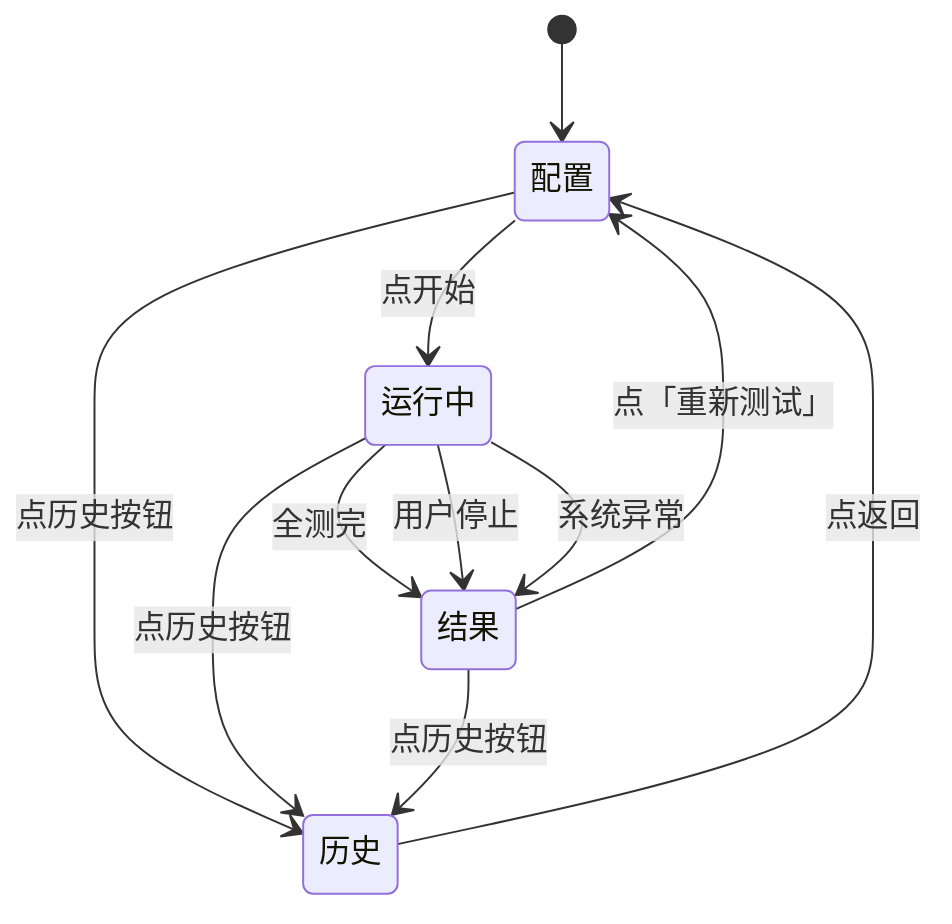

# 工厂老化测试工具 — 需求与设计

> 单机本地运行的桌面硬件体检 + 老化测试工具,跑在被测设备自身。
> 目标平台: **全志 A527** (ARM Cortex-A55 + Mali-G57)

---

## 目录

- [1. 项目目的](#1-项目目的)
- [2. 需求与范围](#2-需求与范围)
- [3. 达到的效果](#3-达到的效果)
- [4. 系统架构](#4-系统架构)
  - [4.1 部署模式](#41-部署模式)
  - [4.1.1 ✅「U 盘版应用」—— 设备上零安装, 插盘即用](#411--u-盘版应用--设备上零安装-插盘即用)
  - [4.2 软件分层](#42-软件分层)
  - [4.3 数据流](#43-数据流)
  - [4.4 启动流程](#44-启动流程)
- [5. 用户场景与典型流程](#5-用户场景与典型流程)
- [6. 测试项设计 — 通过判定的依据](#6-测试项设计--通过判定的依据)
  - [6.1 概述](#61-概述)
  - [6.2 CPU 压力](#62-cpu-压力)
    - [6.2.1 热保护: 不许把板子烤到内核重启](#621-⚠️-热保护-不许把板子烤到内核重启-2026-10-29-新板实测)
  - [6.3 GPU 渲染](#63-gpu-渲染-opengl-es-2-全屏压测)
    - [6.3.1 X 认证文件要去找, 不能只信 env](#631-✅-x-认证文件要去找-不能只信-env-2026-10-29-新板实测)
  - [6.4 WiFi 验证](#64-wifi-验证-软件开关--射频检查--扫描-含环境降级)
  - [6.5 USB 枚举 + 读写](#65-usb-枚举--读写)
  - [6.6 网口](#66-网口-链路--dhcp--ping-通外网-不做吞吐)
  - [6.7 HDMI 输出](#67-hdmi-输出-sysfs-优先-不需-root)
    - [6.7.1 模式切换在本板不可用 — 实测结论](#671-⚠️-模式切换在本板不可用--实测结论-2026-10-23)
    - [6.7.2 当前分辨率改用 xrandr 读真实输出](#672-✅-当前分辨率改用-xrandr-读真实输出-2026-10-23)
    - [6.7.3 断开→恢复一轮: 指令式关屏再开回来, 判定复用基线那套逻辑](#673-✅-断开恢复一轮-指令式关屏再开回来-判定复用基线那套逻辑-2026-10-28)
  - [6.8 风扇 GPIO (主动拉高/拉低轮转)](#68-风扇-gpio-主动拉高拉低轮转--⚠️-必须用裸系统调用-禁用-python-的-open)
  - [6.9 TF 卡读写](#69-tf-卡读写自动检测--未插提示)
  - [6.10 内存压力](#610-内存压力-rc--精确判定)
  - [6.11 eMMC 存储](#611-emmc-存储)
- [7. UI 设计](#7-ui-设计)
  - [7.1 状态机](#71-状态机)
  - [7.2 页面布局](#72-页面布局)
  - [7.3 需要人工介入时, 后端必须真的停住](#73-需要人工介入时-后端必须真的停住)
  - [7.4 画面只能由后端事件推动](#74-画面只能由后端事件推动-hard-rule)
  - [7.5 计时条: 2026-10-23 整块从界面移除](#75-计时条-2026-10-23-整块从界面移除)
  - [7.6 运行态必须能靠快照恢复 —— 事件不许丢](#76-运行态必须能靠快照恢复--事件不许丢)
  - [7.7 没测成的项重测与报告合并](#77-没测成的项重测与报告合并)
  - [7.8 本轮总耗时: 顶栏读秒 + 报告里的时间](#78-本轮总耗时-顶栏读秒--报告里的时间)
- [8. 数据与存储](#8-数据与存储)
  - [8.1 SQLite Schema](#81-sqlite-schema)
  - [8.2 报告呈现规则](#82-报告呈现规则)
    - [8.2.1 PDF 导出的技术选型与「中文静默变空白」的对策](#821-pdf-导出的技术选型与中文静默变空白的对策)
    - [8.2.2 排版: 长表项不许整块跳页, 续页必须重复项名](#822-排版-长表项不许整块跳页-续页必须重复项名)
- [9. 测试通过与否的依据](#9-测试通过与否的依据总规则)
  - [9.1 状态判定](#91-状态判定)
  - [9.2 通过率口径](#92-通过率口径)
  - [9.3 边界与例外](#93-边界与例外)
    - [9.3.1 板子重启的死因要自己留下来](#931-⚠️-板子重启的死因要自己留下来-2026-10-29-新板实测)
    - [9.3.2 板子重启的复现规律](#932-⚠️-板子重启的复现规律-2026-10-30-第二次实测)
    - [9.3.4 时钟倒退: 归档不许乱](#934-⚠️-板子重启后时钟倒跳归档不许乱-2026-10-30-查清机制)
  - [9.4 默认阈值参考](#94-默认阈值参考)
- [10. 可观测性原则](#10-可观测性原则-ux-hard-rule)
  - [10.1 推送频率硬约束](#101-推送频率硬约束)
  - [10.2 前端呈现约束](#102-前端呈现约束)
  - [10.3 过程证据要求](#103-过程证据要求)
  - [10.4 添加测试项时的规约](#104-添加测试项时的规约)
  - [10.5 实时事件类型与生命周期](#105-实时事件类型与生命周期)
- [11. 运行时约束 (产线环境必备)](#11-运行时约束-产线环境必备)
  - (§11.1 ~ §11.6 工具调用 / 权限 / 错误识别 / 策略选择 / 进程生命周期 / 启动脚本;**§11.7 离线预打包必读**)
- [12. 技术栈](#12-技术栈)

---

## 1. 项目目的

### 1.1 业务背景

产线上,每台全志 A527 量产设备在下线前要做**硬件功能体检 + 短期老化跑测**,筛除生产环节出现的问题件。当前痛点:

- 测试靠工人手工 + ad-hoc 脚本,执行不规范
- 结果散落各处,无法沉淀数据做质量分析
- pass / fail 全凭经验,争议无据可查

### 1.2 核心价值

把"测试 + 记录 + 报告"做成一个**单机闭环**,让产线工人:

1. 桌面图标一键启动 → 自动开浏览器
2. 勾选要测的项目 → 点开始 → 等结果
3. 看到一份**明确 pass / fail** 的报告
4. 历史可查、有据可依

### 1.3 解决什么问题

| 维度 | 改进前 | 改进后 |
|---|---|---|
| 操作门槛 | 工人需懂命令 | 勾选 + 点开始 |
| 一致性 | 每人执行手法不同 | 工具统一调度 |
| 记录 | 无 / 散乱 | SQLite 全量存 |
| 申诉凭据 | 无 | 历史详情 + 指标 |

---

## 2. 需求与范围

### 2.1 在做什么

- 单机本地测试工具,跑在被测设备(DUT)自身上
- 11 项硬件测试(按**推荐执行顺序**列, §2.2 有表):内存 / eMMC / TF 卡 / HDMI / USB / 网口 / 风扇 / **WiFi(扫描)** / **蓝牙(判定反过来)** / GPU / CPU
- 极简 Web UI:勾选 + 次数/时长 + 全选 + 开始
- 跑测过程**实时可见**(每项独立面板,见 §10.5 实时事件 / §10.2 前端呈现)
- 报告(每项指标 + 错误信息)+ 历史可查

### 2.2 测试项清单

> **「#」就是推荐执行顺序**(§5 的四阶段: 轻量 → 接口 → 射频 → 重载)—— 2026-11-04 起 WiFi 排在 GPU 之前, **蓝牙紧跟 WiFi**(§6.4.1, 已实现)。

| # | 名称 | 主要工具 | 自动 / 交互 |
|---|---|---|---|
| 1 | 内存压力 | memtester | 自动 |
| 2 | eMMC 存储 | fio | 自动 |
| 3 | TF 卡读写 | fio | 自动(未插则弹提示选「插 / 跳」) |
| 4 | HDMI 输出 | xrandr (x11-xserver-utils) | 自动 |
| 5 | USB 枚举 + 读写 | lsusb + fio | 自动 |
| 6 | 网口 链路 + DHCP + ping | ethtool + udhcpc + ping | 自动 (未插网线提示) |
| 7 | 风扇 GPIO | /proc/rp_gpio/pi5 (**读写双向**: 主动拉低/拉高轮转 + 回读校验; 必须走裸系统调用, 见 §6.8) | 自动 |
| 8 | WiFi 验证 (开关/射频/扫描 3 件套) | iw / rfkill / iproute2 | 自动 |
| 9 | **蓝牙 (应关闭)** —— 判定**反过来**: 蓝牙**不工作** = 合格 | **只读 sysfs**(rfkill / /sys/class/bluetooth / /dev/hci*); **不用 root, 不装任何工具** | 自动 (§6.4.1) |
| 10 | GPU 渲染 | glmark2-es2 | 自动 |
| 11 | CPU 压力 | stress-ng | 自动 |

> 看门狗(WDT)剔除;风扇为 B 类(纯 GPIO 通断,无 tach);**TF 卡自动检测 + 未插提示**(启动该测试时自动探挂载点,没探到则弹提示让用户选「插 / 跳」);**网口未插提示**(链路未起时弹提示选「插 / 跳」);默认全部勾选,工人按需减

**设备身份 (SN) —— 每次运行强制记录**

被测设备 SN 是产线追溯的锚点,**每条 run 记录 + 每份报告 + 每份 PDF 必须携带 SN**。

- **提取命令** —— `cat /proc/cmdline | grep -oP 'snum=\K[^ ]*'`
- **回落源** —— 提取失败(为空)时回落 `cat /proc/cmdline | grep -oP 'androidboot.serialno=\K[^ ]*'`
- **仍为空** —— 记为 `unknown`,报告中照常输出 `unknown` 并在 UI 顶部黄色提示,**不阻断测试**
- **实测样例** —— `snum=31175c3d01850801f56`(同一条 cmdline 里 `androidboot.serialno=` 值一致,双源互为校验)

关联章节:§8.1(入库字段)、§8.2(PDF 报告头)、§7(UI 顶部常驻显示)。

---

## 3. 达到的效果

### 3.1 功能效果

- 一台 A527 新机,从上架到出报告,工人操作 ≤ 30 秒(配置) + 测试时间(默认约 **7 分钟** —— 2026-10-26 按历史库实测重算, **不含**工人插卡/插网线的等待)

> **默认一轮 ≈ 6 分 50 秒的逐项依据(2026-10-26 改为「实测」而不是「按公式估」)** —— 数据取自历史库 `results` 表: 内存/CPU/eMMC/风扇/WiFi/网口/HDMI 取 run 120–124, USB 取 run 105/107/108, GPU 取 2026-10-26 的 run 4。
>
> | 项 | 默认配置 | 实测 |
> |---|---|---|
> | 内存 | `times=1` | 60.4s |
> | eMMC | 1 轮 × (写30s+读30s) | 62.0s |
> | TF 卡 | **卡槽空 → skipped** | 0.0s (见下面「弹框等工人」) |
> | HDMI | — | 0.1s |
> | USB | 3 轮 × 18s | 57.5s |
> | 网口 | — | 6.4s |
> | 风扇 | `cycles=2` | 20.0s |
> | WiFi | 4 步流程 | 11.0s |
> | 蓝牙 | **只读探测**(纯 sysfs 读) | ≈0.1s |
> | GPU | 33 场景 × 3s | 105.2s |
> | CPU | 60s | 60.5s |
> | **逐项小计** | | **383.2s** |
> | 静默期 | **10 个**项间间隔 × 3s(§5) | 30s |
> | **合计** | | **413s ≈ 6 分 53 秒** |
>
> ⚠️ **TF 卡不是「固定 60s」, 是「弹框等工人」** —— 卡槽空时该项 0.0s 判 skipped, 但紧接着弹框让工人插卡重测或跳过(§7.3)。工人插上卡就再跑一轮写30s+读30s=60s, 整轮 → **470s ≈ 7 分 50 秒**。网口同理(未插网线也弹框)。**「人等多久」是这一轮最大的变量** —— `flow.operator_wait_sec=300` 就是这个等待的上限(超时后自动往下走, 不会把整轮挂死)。
> ⚠️ **间隔是 10 个不是 11 个** —— 11 项只有 **10 个间隔**(第一项前不需要)。**静默期 2026-10-26 由 5s 改 3s**(产线: 五秒太长): 10 × 3s = **30s**(原 50s), 整轮省 **20 秒**。⚠️ **10 个是上限, 不是定数**: ①工人少勾几项, 间隔就跟着少; ②**操作员拍过板的那一项后面不走静默期**(§7.3⑥ —— 他已经做过选择, 再等 3 秒就是「点了跳过却像没反应」)。⚠️ 历史整轮 run 124 是**旧口径**(逐项 232.7s + 45s = 277.7s vs 实测 276.1s) —— 那个 45s **只对旧口径成立**, 换算新口径要用 30s。
> ⚠️ **内存这一项 2026-10-26 起计入合计** —— 之前不写, 理由是「事先算不准」(按理论算: 遍数 × 工作集 ÷ **机器内存带宽**, 换板子能差几倍)。**实测之后就不算了**: 本机 A527 / memtester 4.3.0, 一轮 **60.4s**(`times=1` 连跑 12 次都落在 60.4s; `times=2` → 120.9s), 而且换 64MB 工作集**也是 60s 出头** —— 耗时由 memtester **固定的迭代次数**主导, 不是工作集大小主导。所以 **内存 ≈ 60s × `times`**, 默认 `times=1` → 固定项 234s **+ 60s = 294s**。**「算不准」和「没量过」是两回事** —— 量过就不算编数字了(§7.5)。
> **2026-10-23 按产线要求整体压到最短**: CPU 300→180→120→**60s**、USB 2×30→5×24→**3×18s**、TF 2×30s→2×60s→**2×30s**、eMMC 60s×2→**30s×2**。固定项从 660s 压到 **234s**(不含内存与 GPU)。
> 这些**只是出厂默认值** —— 产线觉得不够覆盖, 在配置页把「次数/时长」调大即可(内存项的「次数」会直接反映在测试界面的**进度条**上 —— §7.5)。
> ✅ **GPU 这一项 2026-10-26 起也不再「不可控」** —— §6.3 方案A: 场景集不变(33 个), 每个场景的时长从 10s 压到 **3s**, 一轮 **105.2s(实测)** —— 原先 336s。**这一项现在也有可预期的时长了**(§7.5 表格里 GPU 从「没有」改成「有(实测)」)。它现在占整轮约 1/4(105.2s / 410s), 是单项大头; 产线若还要压节拍, 有效方向是减 GPU 轮数(`gpu.rounds`)或调 `gpu.scene_sec` —— CPU 和存储项已经压到接近下限了, 内存项则根本不该按时间压(见上一条)。想要覆盖强度不变就把 `gpu.scene_sec` 填回 10(→ 336s/轮, 整轮回到约 11 分钟)。
- 任意子项失败立即定位(指标 + 错误信息明文)
- 跑测中**只在必要时**要工人介入(TF 卡没插 / 网口没插网线 —— §7.3), 其余全程自动

### 3.2 易用性效果

- 工人首次接触 < 5 分钟可独立完成
- 不读文档就能完成"勾 → 开始 → 看结果"
- 默认全选 + 默认参数,开箱即用

### 3.3 质量效果

- 测试过程可重放:参数 + 指标 + 日志全部入 SQLite
- 争议可复核:历史详情完整回看

### 3.4 可观测性效果 (hard rule)

- 测试运行中,**工人能实时看到**每一项:向导页**逐项推进**(同一时刻只显示当前项), 状态色 / 进度条 / 关键指标 / 滚动日志
- 点开始后必须 **立即有反馈**,绝不允许 "黑屏" 或 "无任何动静" 的体验
- 静默阶段也要持续推心跳进度,不让用户怀疑工具死锁
- 历史记录可重看完整 `progress` / `metric` / `log` 流

---

## 4. 系统架构

### 4.1 部署模式

被测设备本身就是工具宿主。浏览器、后端、系统工具、待测硬件**全部在同一台机器**,**不**外接、不连远端。

**离线交付 = 依赖预置,不是运行禁网**

本文档中"离线 / 预打包"**只约束依赖的获取时机**:所有测试所需的系统工具 / Python 依赖 / 第三方素材必须在**打包阶段**一次性下载好,集成进出货镜像;目标设备装机后**启动即可跑全套,运行期间一律不得再联网装包**,**不允许出现“测试中才发现某包未装”的产线故障**。清单与打包流程见 §11.7。

⚠️ **这条同样管着前端**:界面框架(Vue)原来是从**公网 CDN**(unpkg.com)在**运行时**取的
⇒ 产线网络上取不到 ⇒ `static/app.js` 第一行就抛 ⇒ **界面整个起不来**
⇒ 而页面里那个「服务已关闭」的全屏卡会盖住整个页面, 让人以为服务死了
(2026-11-06 在 SN `A10000000000010` 上撞到)。⇒ 现在 Vue **本地内置**
(`static/vue.global.prod.js`, Vue v3.5.45, MIT, 许可声明在文件头),
随镜像走 ⇒ 断网也能用。详见 `docs/部署方式对比.md` §13.10。

**产线网络前提(已确认)**

产线**有网络,有线无线均可用**,且工位**接 HDMI 显示器**:

| 条件 | 支撑的测试项 | 说明 |
|---|---|---|
| 有线网络可达 + DHCP 可用 | §6.6 网口(取 IP + ping 外网) | ping 公网目标已验证可达(RTT 约 8-13ms) |
| 无线有 AP 可扫描 | §6.4 WiFi(第 ④ 步扫 SSID) | 产线工位周边有可扫描 AP |
| HDMI 显示器连接中 | §6.3 GPU 全屏渲染 + §6.7 HDMI | 常态连接,不进入"未接显示器"分支 |

即:**依赖不可现场安装,但测试本身用得到网络**。因此 §11.4 的取舍原则相应调整为——**不依赖"不可控的外部条件"**(AP 凭证、临时公网可达性、第三方服务等),而不是"不依赖网络"。

### 4.1.1 ✅ **【2026-11-05 已实现】「U 盘版应用」—— 设备上零安装, 插盘即用**

除 §4.1 的「装在设备上」外, 还有第二种部署形态: **整个工具(代码 / 数据 /
随包工具)都放在一根 U 盘上, 设备上什么都不装**。拔掉 U 盘, 设备上什么都不剩。

> **为什么不是「从 U 盘启动」**: 那要动引导链(U-Boot / 串口 / 可能变砖),
> 而它对「设备上不留东西」的贡献**几乎为零** —— 真正的大头是 deb 的安装痕迹,
> 跟启动介质无关。详见 `docs/部署方式对比.md` §5.3 / §5.4。
> **功能跟装在设备上一样** —— 11 个测试项一个不少, 判据一个字不改。

#### 三条判据(「怎么算 U 盘」)

跟 §8.2.3 的「怎么算 U 盘」是**同一套**(同一份代码 `server/storage.py`):
挂载点不在系统路径里 + 块设备挂在 USB 总线上 + 文件系统可写。
⚠️ **判「在不在 USB 上」不能看路径里有没有 `usb` 字样** —— 本板自己的
USB **控制器**就在 `platform/soc/1f0000.usb` 这个路径下 ⇒ 那种写法会把
板子自己认成 U 盘。判据是祖先链里有 `usbN` 这一层, 或某层的 `subsystem`
指向 `/sys/class/usb`。

#### 「U 盘模式」是怎么触发的

应用根目录旁放一个标记文件 `AGING_USB_MODE`。启动脚本看到它, 就:

| 指向什么 | 变成 | 效果 |
|---|---|---|
| **数据根**(`AGING_DATA_DIR`) | U 盘 | history.db / 报告 PDF / 服务日志 / 加压现场记录**全在 U 盘上** ⇒ 拔盘即走, 设备上不留数据 |
| **工具目录**(`AGING_TOOL_DIR`) | U 盘的 `tools/` | 应用找 fio / glmark2 时**先看盘上那份**(盘上才是这一版的工具, 板子上碰巧也装了一份旧的也不该用它) |
| **配置文件**(`AGING_CONFIG`) | U 盘的 `config.yaml` | 用盘上那份, 不用设备上那份(deb 装的可能更旧) |

设备版(deb 装)的根目录**没有**这个标记 ⇒ 这几行一个字都不生效,
行为跟以前一模一样。

#### 随包工具: 那 10 个运行时库在 U 盘上, 链接器得找得到

fio / glmark2 走 `dpkg-deb -x` 解包(不走 dpkg 的依赖解析)⇒ 搬到 U 盘后,
链接器默认只查 `/lib` `/usr/lib` ⇒ **「error while loading shared libraries」**
(当初 fio 就是这么翻车的)。

⇒ 解出来的工具走一层 **wrapper**: 在 exec 真二进制**之前**把
`LD_LIBRARY_PATH` 指到盘上的 `tools/root/...`。wrapper 是**自定位**的
(从自己的位置算出盘根), 所以 U 盘挂在哪儿都行。

⚠️ **必须在 `sudo` 之后才设这个变量** —— sudo 默认 `env_reset` 会清掉
`LD_LIBRARY_PATH`。⇒ 调用形态是 `sudo -n <wrapper>`,
不是 `sudo -n env LD_LIBRARY_PATH=… <真二进制>`。

⚠️ **核心库一律不许搬上盘** —— `LD_LIBRARY_PATH` 排在系统路径**前面**,
盘上那份会盖住系统那份; 核心库( libc / libstdc++ / ld-linux )要是也搬上来了,
动态链接器会拿盘上那份去启动所有程序。镜像构建脚本在出镜像前会查一遍,
发现就**停手**(不出这个镜像)。

#### GPU 项: 场景数据在盘上, 得显式指过去

glmark2 的场景数据(models / shaders / textures, 8.7MB)放 U 盘。
编译进去的默认路径是 `/usr/share/glmark2` —— 设备上根本没那个目录
⇒ wrapper 自动补 `--data-path <盘>/tools/share/glmark2`
(调用方自己指定了就**不加第二遍**)。

⇒ **应用代码一行没改** —— 差异全在 U 盘那一侧的 wrapper 里。

#### 报告跟着应用自己那根盘走

插两根盘(一根跑应用、一根给 USB 项写测试)时, 报告**必须**落在
**应用自己那根盘**上 —— 否则工人拔错盘, 报告没在手边。
⇒ 选盘顺序: **先看「应用代码根 / 数据根 落在哪根盘上」**, 认不出才退回
「枚举 U 盘取第一根合格的」。

#### 换台设备双击「没反应」—— 三条硬要求(2026-11-05 实测补)

同一根盘, 在**打过镜像的那台设备**上双击秒起, 插到**另一台设备**上双击
**一点反应都没有**(不是报错, 是完全没动静)。已定位 —— **是两个病根**:

| 要求 | 内容 |
|---|---|
| **① 镜像必须「可搬迁」** | 镜像是在**临时构建目录**里打的, venv 里那些 console script(`uvicorn`/`pip`/…)的第一行**写死了构建路径**(`#!/tmp/aging-usb-image/venv/bin/python3`)⇒ 换台设备那个路径不存在 ⇒ 内核报 `bad interpreter`(退出码 126)⇒ 服务起不来。⚠️ 在打过镜像的设备上照样能跑, 纯粹是因为构建目录还没删 —— **是碰巧, 不是设计**。<br>⇒ **应用一律用 `<venv>/bin/python3 -m <模块>`**, 不调 console script(v靠**同目录**的 `pyvenv.cfg` 定位, Python 3.8 用 argv[0] 的目录找它、**不解析符号链接** ⇒ 盘挂在哪儿都能用) |
| **② 失败必须「看得见」** | 桌面双击**没有终端** ⇒ 启动失败对工人等于「没反应」。<br>⇒ 启动失败要落一份 `logs/启动失败.txt`(在盘上, 拔了盘也跟着走)+ 弹桌面通知。⚠️ 启动器**不能 execv 掉自己**(exec 之后 start.sh 失败就没人报了)⇒ `fork` + `waitpid` + 看退出码 |
| **③ 「服务起来了」不能只靠 curl 判** | **2026-11-05 在新设备上实测**: 服务**真的起来了**(日志里有 `Uvicorn running on http://0.0.0.0:8000`), 就绪检查却连着 15 秒说「没起来」⇒ `start.sh` `return 1` ⇒ **打开浏览器那段永远执行不到** ⇒ 工人看到的就是「点了没反应」+ 一个「启动失败」通知。<br>⚠️ **毛毛不在服务, 在检查这一侧** —— 证据: 那台设备的**服务日志里一条 `GET /api/health` 都没进来**。三个坑任一都能踩: 新设备**没装 curl** / 环境里有 **`http_proxy`**(代理把本机也一起带走)/ **`localhost` 解析到 `::1`** 而服务只听 `0.0.0.0`。<br>⇒ 判据分三层: **python 探针**(显式 `ProxyHandler({})` 禁代理 + 只打 `127.0.0.1`)→ curl(`--noproxy '*'`)→ **端口在听就算起来了**;地址一律用 `127.0.0.1`, 不用 `localhost`;等待窗口 15 s → **30 s**;⚠️ **端口在听 ≠ 健康**(进程卡死时端口还开着)⇒ 「已在运行吗」要用严格判据, 「刚起来了吗」才用宽松判据 |

⇒ 构建脚本加了自检: **打好镜像把目录整个挪到别处再跑一遍**, 起不来就**直接拒绝出镜像**。
回归 `tests/test_usb_relocatable.py`(病根①) + `tests/test_usb_startup_ready.py`(病根③)。

#### 挂载点漂移 —— 服务要「**记设备, 不记路径**」(2026-11-05 实测补)

盘拔了再插, udisks2 可能挂到**别的路径**(`/media/User/AGING` →
`/media/User/AGING1`, 因为老目录没被清掉)⇒ 正在跑的服务手里的路径当场作废
⇒ 历史页 500、数据写到设备上 ⇒ 违背「拔盘即无、设备上不留东西」。

⇒ **启动时记下这块盘的设备身份**(`major:minor` + 源设备), 之后按设备找它现在挂在哪儿:
数据根 / 随包工具目录 / 配置文件三处都重新绑定。
⇒ **盘真被拔了 ⇒ 不往设备上写**(锚点不落盘)⇒ 挂载点目录保持空 ⇒
udisks2 会把它清掉 ⇒ **漂移不会自我强化**。
⚠️ **设备版一点不受影响**(数据根是普通目录 ⇒ 永远不记设备)。

⚠️ **光认设备身份还不够 —— 设备名也不是稳定的身份**(2026-11-05 实测):
同一根盘**拔插一次**, 可能从 `/dev/sdb` 变成 `/dev/sda`, `major:minor` 也跟着变
(实测 **8:16 → 8:0**)⇒ **重插之后反而跟丢了这块盘**。
⇒ 再加一道 **文件系统 UUID**(`/dev/disk/by-uuid/` 的软链)兜底 ——
**UUID 跟盘走**, 跟插在哪个口、叫什么名字都无关 ⇒ **它才是这块盘的真身份**。
查找顺序: **快路径 → 设备身份 → UUID**;读不到 `by-uuid` ⇒ 退回按设备身份, 老行为不变。

回归 `tests/test_usb_mount_drift.py` + 变异脚本 `tests/_mutate_usb_mount_drift.py`。

#### 四个前提(缺一个就出不来能用的镜像)

| # | 前提 | 为什么 |
|---|---|---|
| ① | **U 盘必须是 ext4** | venv 的 `bin/python` 是**符号链接**(FAT 不支持); console script 靠**执行位**(FAT 没有 unix 权限位); 还有 10 个 C 扩展 |
| ② | **镜像必须在同款板子上打**(aarch64 + focal + python3.8) | wheels 是 **cp38 aarch64** 的编译件 —— 在别的架构/版本上装不上(构建脚本会直接拒) |
| ③ | ~~产线 sudoers 的免密白名单要**覆盖盘上工具**~~ ⇒ **不需要** | **2026-11-05 实测推翻**: 应用**不会**让 sudo 直接执行盘上的 fio/glmark2 —— `with_sudo()` 一律先包一层 `timeout`, 而 **sudo 只认最外层那条命令**, 盘上的工具只是它的参数(由 root 身份的 timeout 去 exec)⇒ 设备版和 U 盘版**被授权的命令完全一样**(`/usr/bin/timeout` / `/usr/bin/env` / `/usr/bin/ip` …)⇒ **产线现有的白名单一行都不用加**。详见 `docs/部署方式对比.md` §13.4 的实测对照表; 回归测试 `tests/test_usb_app_mode.py`「sudo 被授权的永远是系统路径」 |
| ④ | **镜像必须可搬迁** | 见上面那三条硬要求(2026-11-05 实测: 换台设备双击没反应, 两个病根 = console script 写死了构建路径 + 就绪判定只靠 curl) |

### 4.2 软件分层

自上而下:前端(Vue 3 SPA)→ 后端服务(FastAPI) → 测试运行时(注册表 + 调度器) → 测试实现(11 个模块) → 系统工具与内核驱动。

### 4.3 数据流

跑测期间单向流动:

- **用户 → 后端** —— POST 提交配置
- **后端 → 系统工具** —— `subprocess` 调起 Linux 工具,读 stdout / 退出码
- **后端 → 前端** —— WebSocket 持续推三类事件(进度 / 日志 / 指标)
- **后端 → 持久化** —— 测试结果异步入 SQLite

跑测的完整步骤视角见 §5。

### 4.4 启动流程

**桌面双击图标 → 浏览器显示完整步骤:**

1. 工人双击桌面图标
2. 系统调起启动脚本(**普通用户身份直接启动,启动路径不要求提权**)
3. 脚本后台启动 Web 服务监听 `:8000`
4. 脚本调系统命令自动打开浏览器
5. 浏览器请求主页, 后端返回页面
6. 浏览器加载完成后请求配置接口, 后端返回测试项 + 默认参数
7. 浏览器渲染 UI, 等待工人操作

**权限取得方式 —— 命令级 `sudo`,不靠提权启动**

服务以普通用户身份运行即可;**需要 root 的系统调用一律在测试项内部以 `sudo <命令>` 前缀执行**(完整规则见 §11.2)。因此桌面图标可以直接调起 `start.sh start`,不需要 `pkexec` / `sudo` 包装启动脚本。

**启动时读取 SN**

服务启动即执行 §2.2 的 SN 提取命令,读到的 SN 常驻内存并展示在 UI 顶部;读不到时显示 `SN: unknown` + 黄色提示。SN 随每次 run 写入数据库(§8.1)并印在 PDF 报告头(§8.2)。

---

## 5. 用户场景与典型流程

**核心流程一图通读（PPT 友好，可整张贴进幻灯片）:**

```
                              开始
                               ↓
                  ┌──────────────────────────┐
                  │ ① 开测试工具               │
                  │ ② 勾选要测的项 + 调默认参数   │
                  │ ③ 点「开始」               │
                  └──────────────────────────┘
                               ↓ 建本次运行记录
                               ↓
        ┌── 主循环（每跑一项重复）─────────────────────────┐
   ─→   │ ④ 取下一项 → ⑤ 执行 → ⑥ 判定（5 态之一）→ ⑦ 写结果 │ ──┐
        └──────────────────────────────────────────────┘   │
   ↑                                                       │
   └───────────────── 回到 ④ ─────────────────────────────┘
                               ↓ 全部跑完 / 中途停止
                  中途停止 → 当前项 + 剩余未跑项 = skipped
                  (工人主动叫停; 整轮仍判 stopped, 见 §7.2.1 / §9.3)
                               ↓
                          汇总 → 写总报告 → UI 显示
                               ↓
                  任一 failed / error？
            ├─ 否 → 整机通过，可下架 → 结束 ✓
            └─ 是 → 整机不通过，留厂排查 → 结束 ✗

旁路分支:
  单项重跑 → 报告出后，对单条 failed/error 项点「重跑这一次」
          → 替换该条结果 → 回到「汇总」重新判定
```

**判定 5 态**（完整定义见 §9.1）:

| 状态 | 触发 | 行为 |
|---|---|---|
| `passed`  | 满足该项所有通过条件             | 写指标，继续下一项 |
| `failed`  | 断言不达标（如 CPU 峰值温度超限） | 写失败原因,**不阻断**,继续下一项 |
| `error`   | 工具缺失 / 代码异常              | 写异常详情,**不阻断**,继续下一项 |
| `skipped` | 用户主动跳过（如 TF 卡未插选「跳」/ 按「停止」「下一项」） | 写跳过原因,**不计入**通过率 |
| `stopped` | 该项**没跑完**(服务中途夭折 / 误关窗口) | **不**算 failed，报告里高亮 |

**配套硬规则:**

- **3 秒静默期** —— 每项测完后留 3 s，让 CPU / 温度 / 调度器复位再跑下一项(2026-10-26 由 5 s 改 3 s: 产线嫌五秒太长; 这一段是**纯等待**, 不产出任何结论)
- **推荐执行顺序** —— 固定 4 阶段：轻量（内存 / eMMC / TF） → 接口（HDMI / USB / 网口 / 风扇） → **射频（WiFi + 蓝牙，GPU 之前）** → 重载（GPU / CPU）;⚠️ **2026-10-27 起 UI 上不可拖动、也没有「重置顺序」按钮** —— 这个顺序是算出来的(重载项放最后, 避免热累积污染轻量项), 工人改乱了没有按钮能复位, 反而更容易出问题。⚠️ **2026-10-30: 射频项从第 ③ 阶段挪到最后** —— 射频是**唯一一项会动整机全局状态**的(它要把射频硬件关掉再打开), 而 2026-10-29/30 那块新板**两次都在它后面 3~5 秒当场重启** ⇒ 排在第 8 位时 **CPU 压力项一次都没跑过**, 那一轮等于白跑(板子也没被老化)。挪到最后后, 万一它还是把板子带崩, 崩的也是整轮最后一步, 内存/存储/CPU 压力这些真正的老化负载**早就跑完并落库了**(见 §6.4 / §9.3.2)
- **整机不通过判定** —— 任一项 `failed` 或 `error` → 整机不通过（详见 §9.2 通过率口径）

> ⚠️ **2026-11-04: 射频项(WiFi)又挪回 GPU 之前**(用户原话:「wifi 还是放到 GPU 测试之前, 然后蓝牙放 wifi 后面」)
>
> - **现在的四阶段**: 轻量（内存 / eMMC / TF） → 接口（HDMI / USB / 网口 / 风扇） → **射频（WiFi + 蓝牙）** → 重载（GPU / CPU）
> - 📌 **这不是新决定, 是「回到打包前那个位置」** —— HEAD(`445986d`, 打包前)本来就是 `..., fan, wifi, gpu, cpu`, 那时的注释写的是「③ 射频(**避免被 CPU/GPU 抖动干扰**)」; 打包后(2026-10-30)才被挪到最后(理由见下)。⇒ 用户 2026-11-04 把它摆回去了 —— 跟 §6.2.6「加压执行体还原成打包前的形态」是同一条思路。
> - **蓝牙项紧跟在 WiFi 后面**(§6.4.1, **2026-11-04 已实现**)⇒ 两者一起在重载之前。蓝牙那一项是**只读探测**, 判定反过来(蓝牙**不工作**才算合格)⇒ 它排在 WiFi 后面, 才看得到「WiFi 动完射频之后蓝牙还是不是关着的」这个**最终状态**
> - ⚠️ **代价明说(别把这次挪动当成「无害」)**: 2026-10-30 之所以把射频项挪到**最后**, 就是因为它是**唯一一项会动整机全局状态**的, 而当时那块新板**两次都在射频项结束后 3~5 秒当场重启** ⇒ 「万一它把板子带崩, 崩的也是整轮最后一步, 真正的老化负载早就跑完并落库了」。**挪到 GPU 之前 = 这个保护没有了**: 万一射频项把板子带崩, 后面 GPU / CPU 这两项重载**一次都跑不到**, 这一轮就没有老化结论。⇒ 这个取舍是用户 2026-11-04 认下的(板子在这条产线上的实际表现由用户判断)。
> - 反过来, 有一条旧代价**反而变小**了: 射频项原先跑在板子最热的时候(温度高, 射频扫描会慢一点 —— 扫描有 15s 超时 + 2 次重试)⇒ 现在挪到重载之前, 板子还凉着, 扫描更快更稳。
> - **改动落在哪**: `server/runner.py` 的 `RECOMMENDED_ORDER`(唯一来源) + `server/tests/registry.py` 的导入顺序(清单跟它一致) + `tests/test_test_order.py`(新回归测试, 顺着「常量 → runner → 注册表 → 前端 → 文档」一层层验) + `tests/test_wifi_radio_cycle.py` §8。**页面上的顺序不用改** —— 前端那 11 项的顺序本来就是后端下发的 `recommended_order`(§7.2)。

**流程前置 —— 工位环境自检（run 开始前先做一次）**

> ⚠️ **未实现(2026-10-27 查实)** —— 下面这套「run 开始前先探一次工位网络」
> 的流程**代码里没有**。目前**每一项测试自己判断环境**(WiFi / 网口各自走
> §6.4 / §6.6 的降级通道, 并在结果里带上降级原因码), run 开始前**没有**
> 统一的环境探测, 因此也**没有**「顶部橙色 banner」和「报告首页标红」。
> 本节保留是为了把设计意图记下来; 真正落地前不要当成已有功能引用。
> **别把「每项各自降级」当成「工位环境自检」** —— 前者已经在了, 后者还没有。

网络类测试（WiFi / 网口）的结论**强依赖工位环境**。为了不让工人逐项猜「到底是机子坏了还是网络挂了」，每次 run 开始前先探一次工位网络：

| 检查 | 方式 | 结果标注 |
|---|---|---|
| 默认网关可达 | `ping -c 2 -W 1 <默认网关>` | 不通 → 环境异常 |
| DHCP 可用 | `udhcpc -i <iface>` 试一把（或读上次 DHCP 租约） | 失败 → 环境异常 |
| 周边有 AP | `iw dev <wlan> scan` 数 SSID | 0 个 → 无线环境异常 |

- **环境正常** → 顶部不显示任何异常标记，报告正常呈现
- **环境异常** → UI 顶部**橙色 banner**：「⚠ 当前工位网络异常，以下网络类测试结果仅供参考」;报告首页同步标红
- **不阻断测试** —— 继续跑完，网络类测试项按各自的降级通道(§6.4 / §6.6)出结论
- **作用** —— 让「环境问题」与「设备问题」在报告上一眼可分，避免好机被误判、坏机被漏判

---

## 6. 测试项设计 — 通过判定的依据

### 6.1 概述

11 项默认全选,通过 / 失败 / 错误 / 跳过 / 停止 五档状态。详细判定见 §6.2 - §6.11,数值门槛见 §9.4。

### 6.2 CPU 压力

- **目的** —— 拉满所有核, 验证不崩 + 不超温
- **工具** —— `sudo stress-ng --cpu N --timeout Ds`
- **通过** —— 退出码 0 **且** 峰值温度 ≤ 阈值
- **指标** —— `peak_temp_c`(跨轮最大峰值温度)、`avg_load_pct`(按 `/proc/stat` 两次采样相减算出的平均占用率)、`exit_code`(stress-ng 退出码)、`peak_threads`(本轮加压封顶在几线程)、`peak_threads_configured`(页面/配置里填的原始值, `0` = 自动 = 按核数)、`max_stress_threads`(**加压上限**, 2026-11-04 起 = 6 —— 读者看到这个数才知道「6 核」是**政策**给的封顶, 不是这台板子只有 6 核)、`threads_capped`(这一轮有没有被上限夹住, `是`/`否`);另有逐轮的 `round_{N}_peak_temp_c` / `round_{N}_exit_code` / `round_{N}_load_pct` / `round_{N}_slices` / `round_{N}_slices_done`。**失败与取消时同样留下温度峰值与退出码** —— 超温判不合格时, 那个 91℃ 就是判定的全部依据, 丢了它报告上只剩一句「失败」。⚠️ **一片都没跑成**(起跑前就超温 / 起来就取消)时**不记**峰值与退出码 —— 记成「0℃ / exit 0」看着像"跑完了而且不烫", 实际是压根没跑

#### 6.2.1 ⚠️ 热保护: **不许把板子烤到内核重启** (2026-10-29 新板实测)

**这一项不只是「测板子」, 它同时得「护住板子」。**

**事故**: 2026-10-29 新板那轮, 整轮跑到**最后一项**(CPU 压力)时**板子直接重启** —— 报告上只剩一句「服务重启, 这一轮中途夭折(没跑完)」, **连这一项的记录都没有**(连 `running` 那行都没写下来: 崩在两项之间的空档里)。整轮连同日志一起消失: 没有结论, 也没有证据。

**为什么**: 查这块板子的内核热框架(`/sys/class/thermal`):

| 项 | 实测 |
|---|---|
| thermal zones | `cpul_thermal_zone`(小核) / `cpub_thermal_zone`(**大核**) / `gpu` / `npu` / `ddr` |
| 被动降频 trip | 70℃ / 90℃ |
| **critical trip** | **110℃** —— 到了内核走 emergency shutdown ⇒ **板子当场重启** |
| 冷却手段 | **只有** cpufreq 降频(`cpufreq-cpu0` / `cpufreq-cpu4`);**风扇不在热框架里**(厂商私有 GPIO 驱动, §6.8) —— 风扇转不转, 内核这条热链**完全不知道** |

也就是说: 这块板子**没有任何主动散热**参与内核的热保护, 唯一的护栏是 110℃ 那道 critical trip —— 撞上去就是重启, 不是降频。

**所以这一项必须自己护板子**(四条硬要求):

1. **看最热的那一个核区** —— 只取第一个名字带 `cpu` 的 zone 是**看错簇**: 这块板子上那是 `cpul_thermal_zone`(**小核**), 真正发烫的是 `cpub_thermal_zone`(**大核**)。实测同一场满载: **大核峰值 76.6℃ / 小核峰值 73.8℃** —— 看错簇就少 3℃ 余量, 而 critical trip 就在 110℃。
2. **起跑前就是热的 ⇒ 不加压** —— 板子本来就烫(上一项刚烤过 / 风扇不转 / 工位太热), 硬压下去的结果不是「判不合格」, 是**内核在 110℃ 把板子重启掉**。起跑前温度 ≥ 收手线 ⇒ 直接判 `failed`, **压根不起 stress-ng**。
3. **跑到收手线 ⇒ 主动收手, 不再起下一片** —— 到了 `abort_temp_c` 就停, **不等内核来收**。
4. **分片跑**(⚠️ 2026-11-03 起**默认不分片**了 —— 见 §6.2.6) —— 分片是为了**不用特权 kill 就能中途停**: 上一片自己已经退出了, 我们只要**不再起下一片**。(进程是 `sudo` 起的 root 进程, 服务这个普通用户对它发信号必然 EPERM —— §11.2。)

**两个温度阈值的关系(别搞反)**:

| 阈值 | 默认 | 含义 |
|---|---|---|
| `max_temp_c` | **85℃** | **判定线** —— 峰值超过它 = 判 `failed` |
| `abort_temp_c` | **95℃** | **收手线** —— 到了就**提前收工**, 不再压。必须 **> `max_temp_c`**(配错了会自动抬到判定线之上: 还没到判定温度就先收工, 峰值永远测不到, `failed` 就没了依据)且 **< 110℃**(内核 critical trip), 给内核留余量 |
| 内核 critical trip | 110℃ | **不是我们定的**, 是板子的物理底线 —— 撞上去 = 重启 |

**其它**:
- ⚠️ **逐级加压: 1 → 2 → 3 → 4 → 8**(2026-10-30 改, 2026-11-02 补一级 3; ⚠️ **2026-11-03 起只在「分片模式」下才有** —— 默认改成连续一把满载, 见 §6.2.6) —— 满载那一瞬间的电流台阶是这类板子最容易出事的瞬间; 让板子先稳住再上满。
  - **改过三次**: ① 最早是「**一把满载**」(直接 `--cpu 8`); ② 改成「第一片用**一半**线程」(8 → 4, 后面的片满载) —— 那次新板「一启动就重启」;
  ③ **再改**成「**逐级爬**」(1 → 2 → 4 → 8, 每片之间查一次温度) —— 因为实测**连 4 线程都扛不住**(2026-10-30 三次实测全都死在 CPU 项**起手一秒内**: 第一次一把满载 8 线程, 后两次缓启动到 4 线程, 一样死);
  ④ **2026-11-02 再补一级 3**(1 → 2 → **3** → 4 → 8) —— 实测(SN A10000000000010)板子扛住 1、2 线程, **死在 4 线程起手约 1 秒** ⇒ 「2 活着 4 死」只是个**范围**, 补一级 3 之后「**3 活着 4 死**」才是**天花板**(缺陷特征)。
  - **为什么逐级比「一半线程」好**: 「一半线程」只有**两级** —— 板子要是死在第 2 片(满载那一下), 我们只知道「满载扛不住」; 逐级有**五级**, 板子死在哪一级, 那一级就是它的天花板 —— 这是现场唯一能拿到的、能直接指导生产的数字。
  - 线程数封顶在配置里的 `cpu.threads`; **但还有一道硬天花板: 最多 6 核**(2026-11-04 加, `MAX_STRESS_THREADS`) —— 配置填 0(自动)= 核数、填 8、填 64, **一律夹到 ≤ 6**。
    - ⚠️ **为什么封顶 6 而不是满核 8**(实测, SN A10000000000010): 这块板子**6 核稳、第 7 核档起手约 2 秒硬复位**(不是热 —— 起跑 60.9℃, critical trip 110℃), 而**人工在终端跑 8 线程一样死** ⇒ **跟应用无关**; 同批**好板 8 核没事** ⇒ **个体差异**。⇒ 满核 8 线程是**过应力**: 一块**日常用得好好的**板子(前台业务连 6 核都跑不满)在老化里被压死 ⇒ **工具误杀好板** —— 产线上误杀的代价高于漏判边缘板。
    - ⚠️ **代价, 明说**: 只能扛 6 核的板子现在**判过**了 —— 它的缺陷特征(「7 核就复位」)老化报告里看不出来, 只能靠 `scripts/probe_cpu_ramp.py` 单独测(不受这条限制)。
  - ⚠️ **片数不够时台阶会压缩, 但满载那一片必须留着**(2026-11-02 加) —— 台阶有 5 级, 一轮只有 4 片时(比如只跑 20 秒)照老规矩一级一级爬 ⇒ **最后一片才 4 线程, 满载根本没跑到** ⇒ 「板子在满载下会死」这件事**测不出来** ⇒ 板子**假通过**。⇒ 压缩时丢**中间**那几级(起点还是 1 线程 —— 板子死在**起手一秒内**, 起步必须轻; 离天花板最近那级留着 —— 那才是缺陷特征), **满载那一片必须留着**。例(满载 8 线程): 12 片(产线默认 60 秒)→ 1,2,3,4,8,8,8,8,8,8,8,8; 4 片(20 秒)→ 1,2,4,8。
  - ⚠️ **逐级 ≠ 判温变密** —— 逐级改的是「**上多少**线程」, 判温仍旧 1 秒一拍。加压过程中另有一个**记录用的采样器**(⚠️ 2026-11-03 起是 **2 秒**一行, 打包后是 200ms —— 见 §6.2.6), 但它**只写记录文件**(温度/负载/频率), **不参与判温**: 采样一密, 峰值就采得高, 临界板子会从「过」变成「不过」—— 那是改了产线的判定口径, 不是「加个记录」。详见 §9.3.3。
- 判定: 超温提前收手 = **`failed`**(散热扛不住满载 = 板子不合格), 但**板子没崩** —— 这正是热保护存在的意义: 判不合格, 而不是让内核重启板子。
  - ⚠️ **判定一律看「峰值」, 不看「最后一次读数」** (2026-11-04 补) —— 两条线都按峰值判:
    - **峰值 > 判定线(`max_temp_c`, 85℃) ⇒ 判 `failed`** —— 这是判定线的本义;
    - **峰值 ≥ 收手线(`abort_temp_c`, 95℃) ⇒ 提前收手, 不再起下一片**。
    - 之前只按「最后一次读数」判 ⇒ 板子冲到 93℃ 又落回 88℃ 时, **只留一句「⚠️ 温度过高」, 结果照样判 `passed`** ⇒ 一块烤到 93℃ 的板子被记成「CPU 通过」。**代码和本文档对不上, 以本文档为准**。
    - ⚠️ 「超过」是**严格大于**: 峰值正好 85.0℃ 仍判 `passed`。
    - ⚠️ **半路停的跑, 峰值不作数** —— 工人中途点了「停止」(`stopped`)或 stress-ng 自己挂了(`error`), 那才是那次跑的原因; 峰值判定**不许**把它盖成 `failed`(报告上写的原因得跟实际一致)。
- 指标新增: `start_temp_c`(起跑前温度)、`abort_temp_c`(本次用的收手线)、`slice_sec`(片长)、`round_{N}_slices`(本轮片数)、`temp_zones_now`(逐区当前温度 —— 看得出**是哪个核区**最烫)、`thermal_abort`(是否因超温收手)、`over_temp`(是否峰值超判定线 —— 与 `thermal_abort` 分开: 前者=整轮跑完回头看峰值, 后者=压到收手线才停)。
- 回归测试: `tests/test_cpu_thermal_guard.py`(假热目录 + 假 stress-ng, 不碰真硬件; 【10】【11】【12】【13】四节专门钉「峰值超判定线判 failed」「峰值==判定线不判 failed」「峰值到过收手线就收手」「半路停的不许被温度盖成 failed」) + `tests/test_cpu_evidence.py`(逐级加压 + 现场记录) + `tests/_mutate_cpu_evidence.py`(四条新变异证明上面那几节能咬得动)。

**⚠️ 这套热保护是「护栏」, 不是那次重启的「原因修复」**
    查清了那一轮的时序: CPU 压力项**连代码都没开始跑** —— runner 是先写
    `running` 那行(已提交, 扛得住硬复位)再跑该项, 而那一轮**压根没有
    CPU 那一行** ⇒ 崩在 GPU 项结束到 CPU 项开始之间的那几秒空档里。
    ⇒ **那次重启不是我们的压力负载烤出来的**; 真凶另有其人(热临界 /
    驱动 panic / 卡热插 / 掉电), 要靠板子侧 `journalctl -b -1` 才能定
    (§9.3.1)。
    这套热保护的价值在于: **从今往后 CPU 项真跑起来时, 板子不会被我们
    烤到 110℃ 重启** —— 尤其在 GPU 通过、板子整体更热的场合。

### 6.2.2 加压封顶值可调 (页面上拧) —— 2026-11-03

**这一节是 2026-11-03 新加的。** 它不改变判定口径, 只多一个**能在产线上立刻拧小压力**的旋钮 —— 因为这块板子已经连续五轮死在 CPU 加压项上, 而「终端跑同样的命令没事」。

#### 为什么需要这个旋钮 (板子 A10000000000010 实测)

**先把一个错误的结论改掉**: 早先以为「板子的供电崖在总占用 4.0~4.4 核」——
那是**只看了报告里那几行现场记录**得出的。把**每一轮完整的现场记录**摊开看,
结论不成立:

**板子活着的峰值比死的时候还高。** 11-02 17:15 与 11-03 09:02 两轮, 板子在
4 线程那一片里冲到过 **90.3%** 和 **94.7%**(≈ 7.2 / 7.6 核), **活着**;
然后在「跃升到 8 线程」的那一刻(现场记录最后一行就是「起跑 第 5/12 片(8 线程)」)
**当场硬复位**。另一块板 A10010000000058(10-30 那轮)更极端: 8 线程 / **100% 负载
整整 48 秒**, CPU 一路烧到 76.8℃, CPU 这一项**完整跑完 12 片**, 板子是在
**这一项结束后**才死的。

⇒ **负载水平不是判别变量** —— 板子扛得住 100% 好几秒到几十秒, 也在只有 55%(4.4 核)
的时候死过。**死的地方是「跃升的那一下」和「这一轮的最后一片」**, 不是某个固定的核数。

五轮死亡的真实现场(每轮都是**完整**的现场记录, 不是报告里截出来的那几行):

| 报告 | 活到的最高台阶 | 那一台阶里的峰值负载 | 死在哪 | 死时最热 |
|---|---|---|---|---|
| 11-02 09:37 | 4 线程(这一轮的最后一片) | 82.5%(6.6 核) | 最后一片里(第 3.1 秒) | 73.5℃ |
| 11-02 10:07 | 2 线程(这一轮的最后一片) | 64.4%(5.2 核) | 最后一片里(第 3.1 秒) | 57.7℃ |
| 11-02 11:49 | 4 线程(这一轮的最后一片) | 64.2%(5.1 核) | 最后一片里(第 1.0 秒) | 57.1℃ |
| 11-02 17:15 | 4 线程 | 90.3%(7.2 核) | **跃升到 8 线程的那一刻** | 76.2℃ |
| 11-03 09:02 | 4 线程 | 94.7%(7.6 核) | **跃升到 8 线程的那一刻** | 61.9℃ |

⇒ **同一个「4 线程」台阶, 11-02 11:49 死在 64.2% 那一轮, 11-03 09:02 却扛过了 94.7%。**
⇒ 所以**光调负载不解决问题** —— 这也正是「这些方式改变不了现状」那句话是对的。

⇒ 但**「加压封顶值」仍然是眼下唯一能立刻拧的旋钮**: 它把「跃升到 8 线程」这一步
**整个去掉**(封顶 4 ⇒ 阶梯 1→2→3→4→4→4…), 于是能直接回答一个具体问题:
**「板子在不满载、只跑到 4 线程、而且不发生跃升时, 能不能把这一项完整跑完。」**

##### 顺带量到的一件事: 应用自己的背景**不小**

拿每一轮 1 线程那一片的占用率减去 stress 自己那一条(12.5%), 反推应用自身的占用:
**0.4 ~ 2.7 核**(11-03 那轮尤其明显: 4 个 stress 线程 + 背景 ≈ **5.5 核均值 / 7.6 核峰值**)。

⇒ ⚠️ **应用里的 `--cpu 4` 不等于终端里的 `--cpu 4`** —— 终端是干净的 4.0 核,
应用这边是 4 个线程**叠在自己那 1~2 核背景上**。这条背景里有一份是
**WebSocket 断开后的空转**(§10.5.1): **页面断着, 服务就自己吃满一个核**。
⇒ 所以测「降压力」的时候, **测试期间别关/别刷新那个页面**。

#### 旋钮怎么用

- 页面配置页的 **CPU 压力**那一项多了「**线程数**」输入框(`0` = 全部核 = 原行为)。
- **`static/` 是热的** ⇒ 改完刷新页面就生效, **不用改代码、不用出包、不用重启服务**。
- 阶梯自动压到封顶值: 封顶 **2** ⇒ 阶梯变成 **1 → 2 → 2 → 2 → …**;封顶 4 ⇒ 1 → 2 → 3 → 4 → 4 → …
- **总时长不变**(次数 × 时长), 只是阶梯被压缩 —— 满载那几片变成「封顶值那几片」。
- ⚠️ **判定口径一个字没动**: 仍然是「退出码 0 **且** 峰值温度 ≤ 阈值」。这个旋钮只改**压多狠**, 不改**算不算过**。

##### 装到板子上要动哪些文件 (2026-11-03 核对过 0.1.0-11 的实物)

链路上**只有一环是缺的** —— 页面上的那个输入框。后端这一侧, 板上 0.1.0-11 **本来就已经认 `threads` 这个键**:

| 环节 | 板上 0.1.0-11 现状 |
|---|---|
| `config.yaml` `defaults.cpu.threads` | ✅ 已有(**2026-11-04 起 = `6`**, 加压上限也是 6 核) |
| `/api/config` 把 `defaults` 发下去 | ✅ 已有 |
| 页面把 `defaults` 铺进 `tests[t.name]` | ✅ 已有(`app.js` 与仓库一致) |
| 页面把 `tests` 整体 POST 出去 | ✅ 已有 |
| 后端把发来的 `tests` 灌进本轮配置 | ✅ 已有(`main.py` 的 `/api/test/start`) |
| 后端把 `config["tests"][项名]` 交给该项 | ✅ 已有(`runner.py` 的 `test_config=`) |
| **`cpu.py` 读 `t_cfg["threads"]` 当加压封顶** | ✅ **已有** |
| **页面上的「线程数」输入框** | ❌ **没有 ⇒ 只有这一个文件要补** |

⇒ **只把 `static/index.html` 拷到板子的 `/usr/lib/aging-test/static/index.html`, 刷新页面就能拧** —— 不用出包, 不用重启服务, 不影响正在跑的一轮。
(拷完页面记得**刷新**; 服务端对 `/` 和 `/static` 都发了 `Cache-Control: no-cache`, 刷新就会回源取新的。)

#### 它必须被记下来

板子死在半路时, 报告上唯一能回答「**它这一轮本来要压到几**」的凭据, 就是封顶值:

- 指标 `peak_threads`(实际封顶)与 `peak_threads_configured`(页面填的原始值)⇒ 进报告的指标表;
- **现场记录的文件头**多一行「`# 本轮加压峰值: N 线程`」⇒ 板子死了这一行还在盘上。

#### 回归测试

- `tests/test_frontend_cpu_threads.js` —— ① 页面上真的有这个框且绑对了键; ② 只有带 `threads` 键的项才显示它; ③ **工人拧的那个数真的发到了后端**(请求体里带着它)。
- `tests/test_cpu_evidence.py` §【8】—— **封顶拧小 ⇒ 命令行里的 `--cpu N` 真的不超过它**(阶梯 1→2→2→2), 且指标与文件头都写着封顶值。
- 变异脚本 `tests/_mutate_cpu_threads.js`(前端 6 个变异)与 `tests/_mutate_cpu_evidence.py`(后端 4 个变异)—— 专治「**看着能拧, 其实没接上**」这种坏法: 工人拧小了, 板子照样死在满载, 而报告上什么异常都看不出来。

### 6.2.3 ⚠️ 板子上「别的活」也算功耗 —— 要量出来、写下来、报出来 (2026-11-03 14:33 实测)

**这一节是 2026-11-03 下午新加的。** 它不改变判定口径, 只是把**一直缺着的那个变量**补上:
**板子的死活看的是「总」功耗(加压线程 + 板子上别的活), 不是加压线程数。**

> ⚠️ **2026-11-03 15:54 的第七次死亡把这一节的结论推翻了** —— 干净板子(背景 0.0~1.5 核)
> 照样死在**同一个地方**(8 线程那一级), 而**这块板自己** 10-30 扛住了 8 线程 48 秒。
> ⇒ 「总功耗」**不是**判别变量, 「**8 线程那一级**」才是。
> ⇒ **这一节量背景负载的机制本身仍然有用**(报告里要看得见「板子上还有别的活」),
> 但**别再拿它当判据**。 ⇒ 详见 **§6.2.5**。

#### 第六次死亡 (2026-11-03 14:33:48) 的账是怎么算出来的

| 事实 | 出处 |
|---|---|
| 现场记录**最后一次落盘** 14:33:43.4 | `logs/cpu_evidence_run37.txt` 的 mtime |
| 板子**这次开机** 14:33:48 | `uptime -s` |
| ⇒ 板子死在「起跑 第 5/12 片(8 线程)」之后 **约 4.6 秒** | 上两行相减 |
| 死时最热 **56.6℃**(离内核 critical 110℃ 还差 53℃) | 现场记录最后一行 |
| 死时负载 40~72%、频率 1416MHz、核心供电轨 `axp2202-dcdc1` 刚从 1050 抬到 **1150 mV** | 现场记录最后两行 |
| 阶梯 1 → 2 → 3 → 4 → 8, 每片 5.3 秒 | 现场记录的「起跑」行 |
| **进这一项时板子才开机 1 分 26 秒**, 1 分钟负载均值 **3.00**(15 分钟均值只有 0.35) | 现场记录的文件头 |

⇒ **不是热**(离 critical 还差 53℃), **不是线程数**(见下), 是**总功耗**。

#### 关键对照: 同一块板, 10-30 那次**活着**跑完满载

| | 10-30 跑36 (**活着**) | 11-03 跑37 (**死了**) |
|---|---|---|
| 8 线程那一片 | **均值 91.6%、峰值 100%, 整整 48 秒**, CPU 一路烧到 76.8℃, 这一项**完整跑完** | 进了第 1 个采样点就死了 |
| **只有 1 个加压线程**时板子的占用率 | **23.7% ~ 33.7%**(平的) | **22.7% ~ 93.2%**(狂跳) |
| ⇒ 反推**板子上别的活**占了几核 | **约 0.3 核, 而且是平的** | **约 0.8 ~ 6.4 核, 而且在乱跳** |
| 阶梯 | 1 → 2 → 4 → 8 | 1 → 2 → 3 → 4 → 8 |

⇒ **同样是 8 线程, 板子的总功耗差了好几倍** —— 活着那次别的活只有 0.3 核,
死了那次别的活在 0.8~6.4 核之间乱跳。**死的地方是「总电流到顶的那一刻」,
不是「加压线程数到顶的那一刻」。**

⚠️ **供电轨的摆动也是同一个现象的两面**: 现场记录里核心供电轨
`axp2202-dcdc1` 在 **900 ↔ 1150 mV** 之间来回摆(PMIC 跟着负载调压)——
负载一抖, 轨就跟着抖; 轨一抖, **总电流就在台阶上跳**。

⇒ **推论**: 早先「板子在 N 核就死」的结论全部作废。
**板子的天花板不是一个核数, 是「加压 + 别的活」的总和。**

#### 因此: 这个数必须量出来、写进记录、报进报告

| 落在哪 | 内容 |
|---|---|
| 指标 | `background_load_pct`(起跑时板子占用率)、`background_cores`(折合几核); 高于 25% 时另记 `background_high` = 是 |
| 日志 | 起跑时打一行「起跑时板子背景负载: X% (≈N 核 —— 别的活占的, 不算加压)」; 高于阈值时**明说**:「这一轮『扛不住 N 线程』很可能不是板子自己的天花板, 而是这台机器当时太忙」 |
| **现场记录的文件头** | 多一行「`# 起跑时板子背景负载: X% (≈N 核) —— 这是**别的活**占的…」—— **板子死在半路时, 头是唯一留得下的** |
| **现场记录的每一行** | 多一个 `bg=`(总占用 − 加压线程自己)⇒ 板子死的那一刻板子上还有多少别的活, **一行就看得出来** |
| **报告的「板子死在哪一级加压 —— 结论」** | 多一段「**板子上还有别的活**: 起跑时 … / 加压期间平均 …, 峰值 …」; 背景高时明写「**这一轮的死, 不能只算在板子头上**, 得先把板子上别的活停掉再复测一次才算数」; 背景低时明写「这一次板子的死活**只**取决于加压线程本身」 |

⚠️ **这条不改判定**: 背景高**不判不合格**(那会改产线的口径), 只**记下来、说出来**。

#### 顺带: 应用自己在峰值时的开销也降下来了

> ⚠️ **2026-11-03 再降一档** —— 供电轨现在**加压窗口里一次都不读**了(只剩
> 「加压前 + 加压后」两回), 详见 §6.2.6。

- **供电轨改成 1Hz**(不是每 200ms 一次): `_read_rails()` 一次读 **66 个 sysfs 文件**,
  板子上实测 **13.31ms** —— 那是**阻塞**在 asyncio 事件循环里的读写。
  每 200ms 一次 = 每秒 66ms ⇒ **峰值那一段, 应用自己就占着一颗核的 10%**。
  电压台阶本来就是「慢变量」(PMIC 的调压是秒级的), 1Hz 完全抓得到。
- **「起跑」那一行也不再单独读一次供电轨** —— 那正好是加压起手、电流台阶最陡的那一刻,
  最不该再往事件循环里塞 13ms 的阻塞读写(用缓存里上一次读到的就行)。

### 6.2.4 ⚠️ 两次死亡的日志证据 (2026-11-03 15:39 查「上一次开机」的 journal)

> 这一节把 14:33:48 与 14:59:08 两次硬复位**用系统日志坐实了**, 并且翻出三条
> **以前不知道**的事 —— 其中两条会改变我们看证据的方式。

#### ① 14:33:48 那次确实是**硬复位**(不是应用自己挂了)

上一轮开机的 journal 里有这么一行:

```
Nov 03 14:35:22 ubuntu2004 systemd[1]: Startup finished in 11.394s (kernel)
                 + 1min 23.390s (userspace) = 1min 34.784s.
```

⇒ 内核 **14:33:47** 启动 ⇒ 14:33:48 那次**就是板子硬复位**(系统自己走完了
一次完整开机流程), 不是「应用崩了、板子还活着」。

#### ② ⚠️ `last -x` 会骗人 —— 数板子重启了几次不能靠它

`last -x` 把 **11:04 → 14:59** 记成**一段** `crash`(根登录会话)。
但那一段里其实藏着**两次**复位(14:33:48、14:59:08)—— 因为**硬复位不写
wtmp 的 reboot 记录**, `last` 只知道「登录会话到 crash 结束」。
⇒ **数复位次数的正确办法**: 翻「上一次开机」的 journal, 找每一段
`Startup finished in …` ⇒ **每出现一段就是一次硬复位**。

#### ③ ⚠️ **journald 自己的日志尾巴, 在硬复位时一起没了**

11:05 的内核消息还在, 但 **14:25~14:34 整段是空的** ⇒ 14:33:48 那次复位
**之前**那几秒的系统日志**查不到**。
⇒ **教训(很重要)**: 板子被硬复位打死的那个时刻, **最后写进去的东西就是
最该留住的证据** —— 而系统日志恰恰属于「最后写进去的那份」(写在板子的
文件系统上, 复位时页缓存整个丢)。⇒ **要留证据, 得靠自己写的、每行
`fsync` 过的文件**(就是 §9.3.3 那个「加压现场记录」); **系统日志只能当
旁证**。

#### ④ 14:59:08 那次 = **回归测试自己压死的**

journal 里 14:56:17~14:56:22 之间, 有 **20 个**
`sudo … /usr/bin/timeout -k 5.0 35.0 /usr/bin/stress-ng --cpu N --timeout 5.0s
--metrics-brief` **同时被拉起来**(阶梯 `1,2,3,4,8,8,8,8` 跑了两遍 + 封顶 2 的
`1,2,2,2` 一遍 ⇒ 峰值 **91 条压力线程挤 8 个核**), 每一条的 `PWD` 都是本仓库
⇒ **每一个都是回归测试起的**。应用那会儿**没在跑 CPU 项**(14:56 之后日志里
再没有 stress-ng)。⇒ 详见 **§11.9**(「回归测试不许在板子上造满载」)。

#### ⑤ 厂商看门狗这一轮**仍然没开火**(但还差一条现场命令)

复位前最后一条日志是 **14:58:19** 的那次 `Finished Anfuhua service watchdog check.`
(它**每 35 秒**一拍), 下一拍(约 **14:58:54**)**根本没出现** ⇒ 和 2026-11-02
那轮**一模一样的形态** ⇒ **它不是发起复位的那一方**(至少不是「跑完了才
重启」那种)。
⚠️ 但**死亡窗口(14:58:19~14:59:08)正好卡在那一拍上**, 这个巧合**还不能
彻底排除** ⇒ 还差一条现场命令: 看
`/opt/anfuhua/wireless-cast/scripts/watchdog.sh` 的内容(它到底看什么、
什么条件下会 `reboot -f`)。

### 6.2.5 ⚠️ 第七次死亡 (2026-11-03 15:54:11) 把 §6.2.3 的判据**推翻**了 —— 真正的变量是**「8 线程那一级」**

#### 这一次的账 (run38)

| 事实 | 出处 |
|---|---|
| 用户「**只留了两个终端和测试应用**」跑的 ⇒ 板子上没有别的重活 | 用户口述 + journal(15:53:17 OpenClaw 网关被停掉, 15:53:20 干净退出) |
| 现场记录**最后一次落盘** 15:54:06, 板子**这次开机** 15:54:11 ⇒ 死在「起跑 第 5/12 片(8 线程)」之后 **约 5 秒** | `logs/cpu_evidence_run38.txt` 的 mtime + `uptime -s` |
| 死时最热 **57.3℃**(离 critical 110℃ 还差 53℃) | 现场记录最后一行 |
| 死时**背景负载 `bg=0.0%`**(整轮平均 1.0~1.5 核, 其中**约 1 核是我自己在板上跑分析命令**: `claude` 29% + `node` 15% + `X` 7.4% + `chromium` 3%) | 现场记录每行的 `bg=` + `ps` |
| 死时频率 **1800MHz**(不是塌陷) | 现场记录最后一行 |

⇒ **不是热, 不是别的活, 不是线程数的绝对值(10-30 这块板扛过 8 线程 48 秒)。**

#### ⚠️ 更正一: run36 与 run37/38 是**同一块板** —— §6.2.3 的对照表**建立错了前提**

§6.2.3 那张表把 10-30 跑36 当成「**另一块**板」。**不是。**

| | 值 |
|---|---|
| `logs/cpu_evidence_run36.txt` 的 mtime | **2026-10-30 17:37:47** |
| 这台板上最后一份报告 | `31175c3d01850801f56_20261030_173747.pdf`, mtime **2026-10-30 17:37:47** —— **同一秒** |
| 三次跑的 run 计数器 | **36 → 37 → 38 连号**, 同一个 `logs/` 目录、同一台机器 |
| 板子身份 | `/proc/cmdline` 的 `snum=31175c3d01850801f56` |

⇒ **10-30 那个「8 线程连跑 48 秒、完整扛住」的满载, 就是这块板自己干的。**
⇒ **硬件没变(四天), 变的是应用。** ⚠️ 文档里把 10-30 那轮记成
「另一块板 A10010000000058」是**记错了 SN** —— 本机报告文件名一律是
`31175c3d01850801f56_*`, 10-30 那份报告就在这台板上。

#### ⚠️ 更正二: 「终端里跑没事」这条**证明不了 8 线程也没事**

11-02 用户在终端手工跑的那条(`sudo -n stress-ng --cpu N --timeout 5.0s --metrics-brief`),
阶梯是 **1 → 2 → 3 → 4** —— **最高只到 4 线程, 从没到过 8。**
⇒ 它证明的是「**4 线程**没事」; 应用死在**8 线程**那一级 ⇒ **两者不矛盾**。
⇒ **「终端没事 vs 应用有事」这个对比本身少了一个变量: 峰值线程数。**

#### ⚠️ 更正三: 读供电轨**不打 I²C** —— 不是 PMIC 总线扰动

板子上实测(`/proc/interrupts` 前后对比): 把 **29 个** `regulator.*/microvolts` 扫 **20 遍**
⇒ **I²C 中断变化 0 次**, 耗时 5.4ms/遍 ⇒ 那些电压是**驱动里的静态表**, 不是真去问 PMIC。
⇒ **「读供电轨把 PMIC 总线堵了」这条机制不成立。** 它只是 **5.4ms 的阻塞文件读**
(已降到 1Hz)。

#### ⚠️ 更正四: 死前那 4~5 秒, 应用一个字都没写出来

run37 与 run38 的现场记录**都停在「起跑 第 5/12 片(8 线程)」那一行**(那行是 fsync 过的),
之后 **4~5 秒一片新行都没有**(正常该有 ~24 行 + 每秒一次 fsync)。
⇒ 要么**整个系统冻住了**(fsync 都落不了地), 要么页缓存被硬复位带走
(但 fsync 每秒一次, 那一刻本该有一次落地) ⇒ **更像是「冻住」**。

#### ⇒ 下一步: 决定性实验 —— **在终端里让这块板子单独扛 8 线程**

```bash
sudo -n /usr/bin/timeout -k 5.0 95.0 /usr/bin/stress-ng --cpu 8 --timeout 60.0s --metrics-brief
```

| 结果 | 结论 | 动作 |
|---|---|---|
| **板子也死了** | **这块板扛不住 8 线程**(满核 + 满轨压) ⇒ 应用的判定「被测设备不合格」**是对的**, 老化测试正在干它该干的事 | 不用改应用逻辑; 报告要把「死在 8 线程那一级」说清楚 |
| **板子活了** | 板子能扛 8 线程 ⇒ 是**应用的编排**要了它的命 ⇒ 用 `scripts/probe_app_vs_terminal.py` 的 S1/S2/S3 逐级二分(裸命令 → 加 sudo/timeout 包装 → 再加应用的采样器+fsync) | 改应用 |

⚠️ **跑这个有 reboot 风险** ⇒ 要**点名授权**才能在板上跑(或者由产线自己在终端跑)。
⚠️ **别再拿 11-02 那次「终端跑完没事」当反证** —— 那次**最高只到 4 线程**。

#### ⚠️ 更正五: `/var/log/kern.log` **能扛过硬复位** —— 死亡那次的内核日志还在

`/var/log/kern.log` 落在 **SD 卡**上 ⇒ **硬复位只丢内存, 这个文件不丢**。
(与 §6.2.4 那条「journald 的尾巴在复位时一起没了」不矛盾 —— journald 的尾巴丢,
是因为它**还没落盘**; rsyslog 落到文件里的那部分**还在**。)

⇒ 死亡那次开机(内核时钟 14:59:23 起)的内核日志**完整躺在 kern.log 里**
(第 270557–271876 行), 一直到**下一次开机**才断。

**⇒ 两条新证据**:

1. **死前最后一条内核消息** = `hrtimer: interrupt took 29082 ns`(uptime 1089.6 s) ——
   **没有 panic、没有 oops、没有 thermal 消息、没有 mmc/axp 报错** ⇒ 又一次坐实
   「不是软件崩溃, 是被硬拉死的」。
2. ⚠️ **从那条消息到复位, 内核整整 37 分钟一句话没说**(15:17 → 15:54)——
   期间连 WiFi(`dhd`)、HDMI(`drm`)的例行消息都没有(上一次还是 uptime 92/158 s)。
   ⇒ **要么板子那 37 分钟里本来就没什么事发生, 要么它从那时候起就已经半死不活了**
   (⇒ 8 线程只是最后一根稻草)。**这一条要靠「刚重启完、板子上什么都没有时
   单独扛 8 线程」来分辨。**

#### ⚠️ 附带发现: 板子**每次开机都是 UTC 起手**(与 §9.3.4 的时钟问题同源)

开机时 `fake-hwclock` 的原话:

```
fake-hwclock[198]: Current system time: 2026-11-03 07:54:24
fake-hwclock[198]: fake-hwclock saved clock information is in the past: 2026-11-03 07:49:20
fake-hwclock[198]: To set system time to this saved clock anyway, use "force"
```

⇒ 硬件 RTC 给的是 **UTC**(本地 15:54 ⇒ RTC 记 07:54), 而 `fake-hwclock`
**拒绝**把系统钟往回拨 ⇒ **开机后头十几秒系统钟是 UTC**(差 8 小时), 之后才被拉回本地时间。
⇒ **应用的服务是 15:54:41 才起的(那时钟已经对上了) ⇒ 这一轮的报告时间戳没受影响**;
但**任何在开机头几十秒里写下的时间戳都可能差 8 小时** —— 报告里的时间要以
**单调钟/锚点**为准, 不要直接信 `CLOCK_REALTIME`(§9.3.4 已有这套机制)。

### 6.2.6 ⚠️ 加压执行体**还原成打包前的形态** (2026-11-03) —— 同一块板子, 打包前每次都正常, 打包后每次都硬复位

> **这一节的由来**: 用户指出「**之前测试每次都是正常的, 现在改了之后每次都崩
> 肯定是哪里改出来的问题**」, 而且「**同一个设备上**」——
> ⇒ 差异不在板子上, 在**应用自己改的那几行代码**里。

#### 事实对表: 同一块板子(SN 31175c3d01850801f56)

| | 打包前(HEAD = 445986d, 10-28) | 打包后(0.1.0-5 ~ 0.1.0-11, 10-29 ~ 11-02) |
|---|---|---|
| 加压形态 | **一个 `stress-ng` 一次跑满 `duration_sec`** | 12 片 + 逐级爬 1→2→3→4→8, **每片重起一个进程** |
| 供电轨 | **完全不读**(`git show HEAD:server/tests/cpu.py \| grep -E "rails\|regulator\|dV\|axp"` = 空) | 每秒扫 66 个 sysfs 文件(实测 5.4~13.3ms 一遍) |
| 证据文件 | **没有这个文件** | 每 200ms 一行 + **每 1 秒一次 fsync** |
| 实测结果 | **每次都正常** | **每次都硬复位**(run37/38/39/40) |

⇒ **打包后的 CPU 项相对打包前, 多了三样东西, 且全都跑在加压窗口里** ——
而**加压窗口正是板子电流最高、最吃不消的那几秒**。

#### 三样新增的负担(逐条说清)

| # | 打包后新增的 | 板子上实测 | 为什么可疑 |
|---|---|---|---|
| ① | **供电轨扫描**(每秒一次) | 一次读 **66 个 sysfs 文件**, **5.4~13.3ms**, **阻塞**在 asyncio 事件循环里 | 这是**加压窗口内**的阻塞 I/O; 人工在终端跑老化时板上**没有**这个东西 |
| ② | **证据采样器**(200ms 一行) | 每行要读 `/proc/stat` + **5 个 thermal zone** + **8 个 cpufreq** | 峰值那一段, **应用自己**就占着一颗核的一小截 |
| ③ | **证据文件的周期 fsync**(每秒一次) | 根文件系统在 **SD 卡**(`/dev/mmcblk0p4`)⇒ fsync = 一次真落盘 = **一次写电流尖峰** | 写电流尖峰**正好撞上**板子总电流最高的那一刻 |

⚠️ **三条里最刺眼的是 ① 和 ③**: 一个是「加压窗口里的阻塞读」, 一个是
「加压窗口里的 SD 写电流尖峰」—— 两者都**只在应用里跑**, 终端里没有。

#### 还原成了什么样(2026-11-03)

| 项 | 现在 | 说明 |
|---|---|---|
| 加压形态 | **连续**(不配 `slice_sec` ⇒ 一个进程一次跑满) | 与打包前、与人工终端**完全一致** |
| 逐级爬台阶 | **只在分片模式下有** | 显式配 `slice_sec` 才切回去 |
| 供电轨 | **加压窗口里 0 次**; 只在**加压前**(文件头)和**加压后**(整轮跑完)各读 1 次 | 两点之间的电压台阶 = **整轮**的总变化, 比每秒抄一遍更有用 |
| 证据采样 | **2 秒**一行(打包后是 200ms) | 「起跑」那一行**立刻落盘** ⇒ 「死在第几片/第几秒」这个最关键的凭据一点没丢 |
| 证据 fsync | **周期 10 秒**一次(打包后是每秒); 「起跑」/「结束」行**立刻** fsync | 硬复位最坏丢掉最后 10 秒采样行, 可接受 |
| **判温口径** | **一个字没动** —— 仍是 tick 的 **1Hz** | ⚠️ 采样器降密度 ≠ 判温降密度: 采样一密, 峰值就采得高, 临界板子会从「过」变成「不过」—— 那是改产线的判定口径 |
| 证据文件本身 | **保留** | 报告里的「加压现场记录」「温度曲线」「供电轨」「背景负载」全都还在 |

#### ⚠️ 代价(明说): **连续模式没有「中途收手」**

进程是 `sudo` 起的 **root** 进程, 服务是**普通用户** ⇒ 非 root 对 root 进程
发信号必然 EPERM(§11.2) ⇒ 连续跑起来之后**没法中途停**。
⇒ 超温只能等它自己跑完, 再按峰值判 `failed`(峰值超 `max_temp_c`)。

⇒ **要「跑到收手线就立刻停」就把 `slice_sec` 配回去**(`config.yaml` 的 cpu 段
里有注释说明)。配了就切回分片模式(逐级爬 + 片间收手), 但同时也就回到了
「每片重起一个进程」那个形态 —— **热保护与「还原成打包前」是一对取舍**, 明说在此。

#### 回归测试

`tests/test_cpu_load_shape.py`(8 节, **假热目录 + 假 stress-ng, 一个真进程都不起**):

1. 默认(不配 `slice_sec`)⇒ **只起 1 个** stress-ng, **一次跑满 60 秒**;
2. 默认形态**不逐级爬**(起手就是满载 8 线程);
3. **加压窗口里 0 次供电轨扫描**(打桩计数);
4. 证据采样间隔 **≥ 2 秒**;
5. 证据周期 fsync 间隔 **≥ 10 秒**;
6. **判温 tick 仍是 1 秒**(判定口径没被动过);
7. **分片模式还留着**(显式配 `slice_sec` ⇒ 6 片 + 逐级爬)—— 热保护没被削掉;
8. `config.yaml` 的 cpu 默认里**没有** `slice_sec` ⇒ 默认形态就是连续跑。

#### ⚠️ 但「还原」**不等于**「保证不重启」

**这一条必须写清楚, 别让人误读**: 还原的是**应用这一侧**的形态。
而**用户自己在终端跑 8 线程也没跑完**(用户原话: 「终端的也没跑完」)⇒
**终端形态同样会死** ⇒ 板子这一侧**也**有问题, 两条线要一起查:

- **应用侧**: 本节这三样负担已全部移除/降档 ⇒ 剩下的形态与打包前、与终端**一致**;
- **板子侧**: run39(11-03 16:24)**死在第 1/12 片、也就是 1 个线程**上 ——
  1 个线程的 CPU 功耗**不可能**把板子拉死 ⇒ 「死因 = CPU 满载」这个假设**不成立**,
  板子供电/复位路径这条线**仍然开着**。

⇒ **下一步(需要点名授权才能跑)**: 用 `scripts/probe_app_vs_terminal.py` 的分阶段
探针把①②③**逐个**加回去, 看哪一个把板子带走 —— 或者反过来: 先在**终端**里让
这块板子单独扛一次 8 线程, 确认板子这一侧到底行不行(§6.2.5「决定性实验」)。

### 6.3 GPU 渲染 (OpenGL ES 2 全屏压测)

- **目的** —— 验证 GPU 渲染管线 (GLES2 驱动 + 时钟 + 内存带宽) 在 Wayland 全屏持续渲染压力下稳定不死机、不报错
- **安装** —— `sudo apt install glmark2-es2 glmark2-es2-wayland`(**两个都装**;各提供一个**不同**的二进制,测试按当前会话自动选 —— 见下)
- **工具** —— `sudo <所选变体> --fullscreen`,变体表:

  | 变体 | 二进制 | 需要的会话 | 提供者 |
  |---|---|---|---|
  | Wayland | `glmark2-es2-wayland` | `WAYLAND_DISPLAY` + compositor | `glmark2-es2-wayland` 包 |
  | X11 | `glmark2-es2` | `DISPLAY`(+ `XAUTHORITY`) | `glmark2-es2` 包 |

  默认 `variant: auto` —— **谁的会话环境变量在、且对应二进制装了,就用谁**;两个都在时优先 Wayland(本节原始设计意图)。可强制 `wayland` / `x11`。

  > ⚠️ **2026-10-22 实测更正两处原文错误**:
  >
  > ① 原文称 `glmark2-es2-wayland` 包「提供 `glmark2-es2` 可执行」——**不对**。该包提供的是 `/usr/bin/glmark2-es2-wayland`,与 `/usr/bin/glmark2-es2` 是两个不同文件(md5 不同)。
  > ② `glmark2-es2` 本身 `ldd` 链接的是 **libX11**,是 **X11 变体** —— 与原文「必须有 Wayland 会话」这条前置**互斥**。本机 `XDG_SESSION_TYPE=x11`、无 Wayland,结果 GPU 项在 **GPU 完全正常**的板子上(run 41 / run 48)被自己的前置条件挡死,**一轮都没跑**。
  >
  > 实测本机 GPU 本身健康: `GL_RENDERER: Mali-G57 (Panfrost)` / `GL_VERSION: OpenGL ES 3.1 Mesa 22.2.2`。

**前置条件(缺任一 → 本项 `error` 并明确报错,不做静默降级)**

| # | 前置 | 检查方式 | 缺失后果 |
|---|---|---|---|
| 1 | **HDMI 显示器已连接** | `/sys/class/drm/*HDMI*/status == connected` | EGL 拿不到 native window,glmark2 启动即失败 |
| 2 | **图形会话可用**(前置跟着所选变体走) | wayland: `WAYLAND_DISPLAY` 非空 + compositor 进程在<br>x11: `DISPLAY` 非空 + **实连一次**(xdpyinfo)连得上 | 无 GLES 上下文,直接退出 |
| 3 | **DRM 节点存在** | `/dev/dri/card*` + `/dev/dri/renderD*` | 无渲染设备 |

> ⚠️ **2026-11-02 修正第 2 条的判据 —— 「X 认证文件在不在」不是判据,「连不连得上」才是**。
>
> 原判据是「`XAUTHORITY` 指的那个文件存不存在」, 不存在就判「认证不过」⇒ 判 `error`。新板**第一轮**(刚开机十来秒)就是这样被自己挡死的 —— GPU 完全正常, `glmark2` **一次都没起来过**。查实(同一套镜像的老板):
>
> - X server 是 `/usr/bin/X11/X -nolisten tcp -auth /var/run/slim.auth` —— 真正在用的 cookie 是 **server 自己命令行里那个 `-auth`**(root 独占 0600), 跟 `~/.Xauthority` 是**两份不同的** cookie;
> - `~/.Xauthority` 是厂商那套 x11vnc/xhost 启动脚本**开机十来秒之后**才建的 ⇒ **第一轮跑的时候压根还没有**;
> - **拿一个假 cookie、甚至完全不设 `XAUTHORITY`, `xdpyinfo` 都照样连上** ⇒ 这个 X server 压根没强制 MIT cookie 认证。
>
> ⇒ 「找不到 cookie 文件」**不等于**「连不上」。所以判据改成:
>
> ① **cookie 的权威来源 = X server 自己命令行里的 `-auth`**(扫 `/proc/<pid>/cmdline`, NUL 分隔的精确 argv;认 `X`/`Xorg`/`Xwayland` 等); 拿不到再退回 `env` → `~/.Xauthority` → `XDG_RUNTIME_DIR{,/gdm}` 那一串候选 —— 候选里**真的存在**的那份才算数;
> ② **实连一次才算数**: 有 `xdpyinfo`/`xset` 就用它们连(同样提权、同样透传会话环境 —— 「前置放行、实际连不上」是最坑人的一种错); **连上了就是能用**, 不管有没有 cookie 文件; 连不上就把 **X server 的原话**(如 `No protocol specified`)原样写进报告;
> ③ 本机没有探测工具时才退回静态判断(X server 启动时**没带** `-auth` ⇒ 没开访问控制 ⇒ 不需要 cookie);
> ④ 探测到的那份 cookie **注入**给提权后的子进程(探测不到就把 env 里那个不存在的路径**去掉** —— 传一个根本不存在的路径, 只会让报告里出现一个误导人的路径)。


> 产线**已确认 HDMI 常态连接测试**(见 §4.1),因此本项**不进入"未接显示器 → skipped"分支**;第 1 条不满足属于工位配置问题,应报 `error` 而非 `skipped`,否则等于 GPU 静默漏测。

- **通过** —— **跑完全部轮次, 且每轮都把清单里的场景一个不落地渲染完**: exit code = 0 **且** 输出以 `glmark2 Score: <数字>` 收尾 **且** **渲染出的场景数 = 清单长度 (33)**

  > ⚠️ **2026-10-26 加的第三条(场景数)不是「多余的严格」, 是补一个会骗人的漏洞** —— glmark2 跑到一半被掐断时**照样打印分数**。历史库里的对照:
  >
  > | run | 整轮 | GPU 项 | GPU 轮 | 分数 | 实际渲染的场景数 |
  > |---|---|---|---|---|---|
  > | 50 | passed | passed | passed | 142 | **26/33** ← 被掐断了 |
  > | 57 | passed | passed | passed | 148 | 33/33 ← 跑全了 |
  > | 124 | passed | passed | passed | 198 | **2/33** ← 才跑两个, 分数却最高 |
  >
  > 分数是各场景的**加权平均**, 而被掐断时漏掉的往往正是**分数低的重场景**(terrain 8 分、effect2d 60 分那批排在后面)—— 所以**分数高的那个反而是没跑全的那个**。光看分数根本判断不出这一轮跑全了没有, 于是「工人把全屏窗口关掉 / 按了 Esc」这种半截测试, 报告上写的是「GPU 通过」。
  > 顺带: 原来数场景数的那行是**死的**(`^Scene Number` —— glmark2 从来不打印这行),`scenes_completed` 一直是 0, 想判也判不了。现在数的是真场景行 `[场景] <选项>: FPS: N FrameTime: X ms`。
  >
  > **几种「没跑完」必须分开判**(§9.3: 静默的「通过」比明确的「失败」有害得多;
  > 同样, **冤枉被测设备**比漏判更糟 —— 2026-10-29 补两条):
  >
  > | 情形 | 判 | 依据 | 含义 |
  > |---|---|---|---|
  > | 工人按了页面上的「停止」 | `stopped` | `ctx.is_cancelled()` | 主动中止, **不算失败** |
  > | glmark2 自己退了(exit 0), 场景数是清单的**前缀** | `stopped` | 场景数 < 清单长度且顺序对得上 | **人误关了全屏窗口 / 按了 Esc** —— 打断的是**测试**, 不是板子 |
  > | **一个场景都没渲染出来** | `error` | 场景数 = 0 | **工具/环境没跑起来**(sudo 提权没成 / 图形会话连不上 / 二进制起不来)—— 这一项没测成 |
  > | 渲染过场景之后异常退出 | `failed` | `rc != 0` 且场景数 > 0 | 板子真的崩过 —— **真证据**, 不冤枉也不放过 |
  > | 挂钟到点被 `timeout` 杀掉 | `error` | 超时 | 没有结论, 且**披露**超时前跑了几个 |
  > | 场景和清单对不上(不是前缀) | `error` | 清单与本机 glmark2 不一致 | **清单过时了**, 要重新标定 |
  >
  > 前两种过去都记成了 `passed` —— 产线反馈「停掉的测试也记 pass」就是这个。
  > 而 2026-10-29 把「误关窗口」从 `failed` 改成 `stopped`、把「没跑起来」从
  > `failed` 改成 `error`: 这两种**都不是设备不合格**, 判 `failed` = 好板子被
  > 送去修。改成 `stopped` 之后, 误关窗口那一轮整轮判 🛑「已停止」, 界面上的
  > GPU 项带着**重测**按钮(§7.7.0 —— 没跑完的项该能再测), 重测通过后按
  > §7.7.2 合并进父轮。
  >
  > ✅ **「停止」之后全屏窗口由工具自己关掉 (2026-10-26 补齐, 2026-10-29 修正「打哪一组」)** —— glmark2 是 §11.2 要求**提权起的 root 进程**, 服务(普通用户)对它发信号必然 EPERM。所以以前点了「停止」, 那个全屏窗口**会一直占着屏幕到本轮超时上限**(工人只能按 Esc 手动关 —— 这正是历史上那些 run 的分数是「跑了一半」的分数的原因)。现在: 起进程时用 `start_new_session=True` 建一个**只有我们自己子孙进程在**的新**会话**, 收尾时以 root 身份 `sudo -n kill -TERM/-KILL -<pgid>` 把**真正跑着 glmark2 的那一组**整组收掉, 窗口立刻消失。**授权范围**(用户点名授权): 仅限本机产线板子(SN 31175c3d01850801f56)、**仅 GPU 压测项**调用、**仅我们自己起的那一组**、且组内必须有命令行含 `glmark2` 的进程; 任何一条校验不过 → **绝不动手**(宁可窗口多留一会, 也不能杀错组)。收尾失败时提示语会明说「按 Esc 可以立刻关掉它」。
  >
  > ⚠️ **2026-10-29 修正: 原来杀的那一组是「空组」—— 窗口其实一直没关掉**。真机实测的进程树是:
  > ```
  >     pid    pgid   sid     命令
  >     21788  21788  21788   sudo -n env DISPLAY=… timeout -k 5.0 305 /usr/bin/glmark2-es2 --fullscreen -b …
  >     21794  21794  21788     timeout -k 5.0 305 /usr/bin/glmark2-es2 --fullscreen …
  >     21795  21794  21788       glmark2-es2 --fullscreen -b …   ← 真正占着屏幕的那个
  > ```
  > 整棵树在**同一个会话**里, 但**不在同一个进程组** —— GNU `timeout` 自己 `setpgid(0,0)` 另起了一组。所以「我们起的那个进程的组」里**只有 sudo 一个**: 按它整组杀 = **打空组**, root 的 glmark2 收不到信号, 而工具还照样报「窗口应已消失」(2026-10-26 那次实测把 timeout/glmark2 的 pgid 记成了 sudo 的 pid, 结论就错在这儿)。**现在改成**: ①按**会话**(会话 id 不会过期、不会撞车 —— 里面只有我们自己的子孙进程)找到那棵树; ②在会话里认出**真正跑 glmark2 的那一组**(命令行**以** glmark2 二进制开头的那一个; 次选是 `timeout` 包装层); ③杀**那一组**, 并用**同一组**验证它真的空了 —— 收不掉就**如实说收不掉**, 不再谎报「窗口应已消失」。**安全前提多了一条**: 组里**每个**进程都必须属于我们会话(防 pid 复用撞车)。实测(`tests/_verify_gpu_cleanup_live.py`, 2026-10-29): **不提权**那一遍 —— 按老口径收完占屏进程**还活着**, 而老口径**照样判「窗口应已消失」**(它看的那一组确实空了) ⇒ 「撒谎」那一下是真的; 按新口径收完占屏进程**真的没了**、那一组**真的空了**。**真 root** 那一遍(信号只发向脚本自己起的那一组) —— 占屏进程在**另一组**(73839 ≠ sudo 那一组 73833), 所以它**不可能**是被「组杀」打到的: 这台机器上 **sudo 会把信号转发**给自己的子进程(timeout 再转发给 glmark2), 老口径是**靠转发侥幸**收掉的 —— 「我们那组空了」**证明不了**占屏进程没了; 转发链一断(例如升级成 KILL 时组长先死、来不及转发), 老口径就会一边报「窗口应已消失」一边把窗口留在屏幕上。新口径直接向占屏进程**自己那一组**(73872, 2 个进程)发信号, **不依赖转发**, 再用**同一组**验证它空了。
  >
  > ⚠️ 顺带记一条**当时没量准**的事: 命令实际是 `sudo -n env … timeout … glmark2` —— **`timeout` 在 sudo 里面、以 root 跑**, 所以超时兜底本来就是 root 在收尾 (不是「只能等普通用户的 timeout 收不了」)。这条以前写错过, 现在按真机命令形态更正。

- **超时兜底** —— 单轮理论 2-5 分钟(取决于 `gpu.scene_sec`,见下),配置 `gpu.timeout_sec`(默认 **240 s**,**单轮**上限,不是整项上限),超时即 `error` + 记 stderr 末 N 行,**防止个别机器跑飞挂死整个 run**
  - ⚠️ **这个值是「下限」不是「定值」** —— 实际生效的单轮上限 = `max(配置值, 一轮预计时长 + 20 s)`。理由: 兜底的本意是**防跑飞**, 不是**卡时长**; 配死的 240 s 在 `scene_sec` 调大后会**反过来把每一轮掐断**(填 10 回到历史口径 → 一轮 336 s > 240 s, 于是每轮都超时判 `error`, 兜底成了主因)。代码里自动抬到 `33×scene_sec+6+20`, 并在日志里说明抬到了多少
- **指标** —— `score` (最终评分)、`scenes_completed` / `scenes_expected`、`frames_rendered`、`scene_sec`、`elapsed_sec`、`exit_code`、`precheck_display`、`precheck_session`、`precheck_dri`;失败时记 stderr 末尾 N 行
  - ⚠️ **`rounds_detail` 里只放量化字段, 不放原始输出**(2026-10-26 改, 见 §8.2.2): 每一轮记 `round` / `score` / `scenes` / `scenes_expected` / `elapsed_sec` / `exit_code` / `status` / `error`;**不带** glmark2 的输出文本(以前带的是**每轮末尾 20 行**, 报告里会变成一个几千字符的单元格, 把指标表顶断页 —— 而完整输出本来就在「日志附录」里, 每一行都走 `ctx.on_log`, 一字不少)。另加一个**标量**指标 `rounds_scores`(如 `147` / `147 / 145`), 多轮的分数趋势一眼看得见, 界面上也是个小方块
- **备注** —— glmark2 一轮完整跑完自然结束(无需 `--run-forever`),每场景覆盖不同 GPU 单元(曲面 / 着色 / 纹理 / 光照),老化与功能验证一并兼得

- **轮次 `gpu.rounds`(默认 1, 可手动调大)** ——
  glmark2 以"一轮完整跑完"为最小粒度。**提供 `[次数]` 输入框**:一轮理论只有 2-5 分钟,对"老化"这个定位偏薄,而产线有时需要把 GPU 负载拉起来做加强筛查,或用多轮分数的**衰减趋势**暴露间歇性故障(第 1 轮 800 分、第 3 轮 200 分 ⇒ 有东西在坏 —— 单轮给不了这个信号)。
  - **默认 `rounds: 1`** —— 出货默认行为与本节原描述完全一致,不改变任何既有判定口径
  - 可在 UI 手动调大(返修复测 / 抽检加强);每次 run 之间独立跑完整轮,不共享上下文
  - 每轮独立计时、独立判超时;任一轮失败即整项 `failed`,并记 `failed_round` 指出是哪一轮
  - 逐轮记录分数进 `rounds_detail[]`(每轮一条**量化**记录),`score` 仍取**最后一轮**;`rounds=1` 时 `rounds_detail[]` 长度为 1
  - **多轮 = 多次独立启动**(每轮独立进程 / 挂钟 / 超时),这是 §6.3 方案A 下"加强覆盖"的实现方式

- **单轮时长 `gpu.scene_sec`(默认 3 s, 可调)** —— **§6.3 方案A(2026-10-26)**
  - 原来跑的是 glmark2 的**默认套件**: 33 个场景组合, 每个 10 s → 一轮 **336 s**。产线要求"默认一轮控制在两分钟"
  - 改法: **场景集一个不少**(还是那 33 个), 只把每个场景的渲染时长从 10 s 压到 **3 s** → 一轮 **33 × 3 ≈ 99 s + 装载开销 = 105.2 s(实测, 1 分 45 秒)**
  - 实现: 场景**显式点名**(`glmark2 -b <场景>:<选项>:duration=3` × 33),清单固化在 `server/tests/gpu_benchmarks.py`; 重新标定的脚本是 `scripts/calibrate_gpu_benchmarks.py`
  - **为什么不直接跑默认套件 + 一个总超时**(曾经的方案C): glmark2 被掐断时**照样出分数**(见上面那张对照表),总分不可比、结论也不成立
  - **分数随 `scene_sec` 变, 不能横向比**: 10 s(glmark2 默认)时全屏基线约 **148**; 3 s 时见下面「实测基线」。要跟历史数据同口径就填 10(一轮 5 分半)
  - 场景数少了 → `stopped`(人误关了全屏窗口, 不是板子不合格); 场景集和清单对不上 → `error`(提示重新标定),**不会静默少跑**
  - **实测基线 (2026-10-26, 本机 A527 / Mali-G57, 全屏)**:

    | `scene_sec` | 一轮实测 | 渲染场景数 | 分数 | 说明 |
    |---|---|---|---|---|
    | 10(glmark2 默认) | 336 s | 33/33 | 148 | 历史 run 57 —— 旧口径, 一轮 5 分半 |
    | **3(新默认)** | **105.2 ~ 105.3 s** | **33/33** | **146 ~ 147** | 一轮 **1 分 45 秒**(两次实测) |

    分数几乎没变(148 → 146)—— 因为分数是**各场景的加权平均**, 由场景集决定,
    而场景集一个没少; 压的是每个场景的采样时间(3 s 也足够测出稳定帧率)。
    所以**新基线 146 与历史 148 基本可比**, 但仍以本表为准。

- **UI 参数** —— `[次数]` 输入框(默认 1,可调大) + `[每场景秒数]` 输入框(默认 3,范围 0.5–60,步进 0.5)。与其他可调项在 UI 上区分(见 §7.2)

- **配置 (`config.yaml`)**:
  ```yaml
  gpu:
    enabled: true
    rounds: 1          # 跑几轮 glmark2 (默认 1 = 原单轮行为); 可手动调大
    scene_sec: 3       # 每个场景渲染多久 (秒) —— 33 × 3 ≈ 99s + 装载 ≈ 105s 一轮
    timeout_sec: 240   # 单轮超时**下限**, 非整项上限
                       # 实际生效 = max(这个值, 一轮预计时长 + 20s) —— 兜底只防跑飞
  ```

#### 6.3.1 ✅ X 认证文件要**去找**, 不能只信 env (2026-10-29 新板实测)

**事故**: 2026-10-29 新板那轮, GPU 项判 `error`, 报错写着:

```
GPU 前置条件不满足 (不静默降级, 见 §6.3):
- X11 会话 (DISPLAY) —— DISPLAY=:0.0 但 XAUTHORITY=/home/User/.Xauthority 不存在
```

**根因**: env 里的 `XAUTHORITY` **指向一个不存在的文件**。那台板子的会话是 gdm 起的, cookie 实际放在 `/run/user/<uid>/gdm/Xauthority`; 而 env 里那个 `/home/User/.Xauthority` 压根不存在。旧代码**只信 env**, 于是:

- 前置检查判「认证不过」→ 整项 `error`;
- **glmark2 一次都没起来过** —— GPU 压根没被测到;
- 一台 GPU 完全正常的板子, 被**自己的前置条件**判死。

**规矩(三条)**:

1. **候选路径里"真的存在"的那一份才算数** —— 优先级: env `XAUTHORITY` → `~/.Xauthority` → `$XDG_RUNTIME_DIR` 及其下的 `gdm/` 目录里名字含 `xauthority` 的文件。**判据是"文件在不在", 不是"路径长得像不像"**。
2. **前置检查放行时, 用的必须是探测到的那一份** —— 不是"env 里有个 XAUTHORITY 就算数"。
3. **提权后的子进程要拿到探测到的那一份** —— `sudo` 默认 `env_reset`, 而原样透传一个**不存在的**路径等于没透传(§11.2 的 `env VAR=...` 口径)。所以子进程环境里的 `XAUTHORITY` 换成**探测到的那份真的存在的 cookie**。

**边界**: env 里压根没有 `XAUTHORITY` **不一定是坏** —— X server 未开访问控制时压根不需要 cookie, 这时**放行 + 提醒**(⚠ 找不到 X 认证文件), 不判死; 但**一个都找不到**且 env 里**原本写着**某个路径时 ⇒ 判不过(提权后确实认证不过), 报错里点名那个路径没了。

**回归测试**: `tests/test_gpu_xauthority.py`(只动环境变量和临时目录, 不连 X server)。

### 6.4 WiFi 验证 (软件开关 + 射频检查 + 扫描, 含环境降级)

- **目的** —— 验证 WiFi 子系统工作:**驱动响应 `ip link` 软件开关** + **射频 `rfkill` 未被屏蔽** + **射频通路真的能完成一次扫描**
- **设计哲学** —— 产线**有无线网络、且工位周边通常有 AP 可扫描**,但仍**不连 AP / 不需凭证 / 不需 WPA 交互**:只验证 WiFi 子系统本身能开关、射频能工作。连接 AP 会引入凭证管理 / 握手超时等额外变量,屏蔽这一层换来 **可重复 / 老化阶段纯驱动检查** 的稳定测试。
- **核心原则:环境问题 ≠ 设备问题** —— 判定依据必须是「**设备自己能不能做**」,不能是「**环境有没有配合**」。周边有没有 AP、有没有外网,都是工位条件而非设备能力,因此**必须设计降级通道**:
  - 技术依据:`iw dev wlan0 scan` 在**周边一个 AP 都没有**的环境下,驱动照样正常完成扫描,输出 `bssid / signal / SSID` 表头 + `scan completed`,**退出码 0**,只是结果列表为空。**这条命令成功跑完 = 射频通路已工作**;扫不到 SSID 仅仅是环境里没 AP,**不该判设备坏**。
- **需要 root** (CAP_NET_ADMIN, ip link / iw / rfkill 都要), 通过命令级 `sudo -n` 取得(§11.2);`sudo` 不可用 → 本项判 `error`,不静默降级

**测试逻辑 — 4 步顺序执行 + 第 ④ 步降级通道:**

| 步骤 | 命令 (**全部经 `sudo -n`**) | 通过条件 |
|---|---|---|
| ① 软件开关响应 | `ip link set wlan0 down` → 等 `switch_settle_sec`(默认 1 s) → `ip link set wlan0 up` | 两句都退出 0 (驱动响应 `ip link` 命令)。**射频正关联着 AP 时整步跳过**(见下) |
| ② 状态确认 | **轮询** `ip link show wlan0`(每 0.3 s 一次, 上限 `state_timeout_sec` 默认 10 s) | 轮询到 `state UP` 即过 (操作实际生效) |
| ③ 射频检查 | `rfkill list wifi` | 输出**不含** `blocked: yes` (射频未被软/硬屏蔽) |
| ④ 扫描执行 | `iw dev wlan0 scan` (≤ 15 s 超时) | 优先:**扫到 ≥ 1 个 SSID**;降级:**命令成功完成扫描即过**(见下) |

> ⚠️ **第 ① 步: 射频正关联着 AP 时, 这一步整步跳过** —— 2026-10-30 新板实测:
>
> 同一块板子(SN A10010000000058)**两次**都在「WiFi 项结束之后、CPU 压力项
> 开始之前」**当场重启**。现场捞回来的上一次启动日志把范围收得很紧: 板子死在
> `11:19:52`, 而 WiFi 项的扫描 `11:19:49` 就结束了 —— 中间隔 3 秒, 板子当时
> **空载**; 日志里**没有 panic、没有 thermal 消息、没有任何死因** ⇒ 板子不是
> 软件崩的, 是被**硬复位**的(厂商看门狗复位的样子)。而那两次动这块射频的,
> 正是本项自己的 `ip link set down` → `ip link set up`, 且**两次发生时射频都
> 正关联着 AP**(板子开机后 NetworkManager 自己连上了)。
>
> ⇒ **不变量: 射频正关联着 AP 时, 一条 `ip link set` 都不许发。**
>
> 实现: ① 之前先用**三个只读探针**问「这条射频是不是正连着」——
> `iw dev <iface> link`(准)、`/sys/class/net/<iface>/carrier`(一定读得到,
> 但厂商驱动未必维护)、`ip -o addr show <iface>`(有 IP ⇒ 至少关联成功过
> 一次), **任一个说「连着」就算连着**; 三个都说「空闲」才算空闲;
> **都看不出来 ⇒ 按「连着」处理**(不拿整块板子赌)。
> 射频空闲 ⇒ ① 照做; 射频连着 / 看不出来 ⇒ **① 整步跳过**, 只做 ②③④ 三项
> 只读检查, 并记 `degraded=true` + `degraded_reason` 写明「哪一小段没测」。
>
> `wifi.software_switch: false` 可以把 ① **整个关掉**(连空闲的射频也不碰),
> 整项退化成「只读三项」。
>
> 回归测试: `tests/test_wifi_radio_cycle.py`(8 节); 变异脚本
> `tests/_mutate_wifi_radio_cycle.py`(7 个变异, 逐个验证测试会红)。
>
> ⚠️ **第 ② 步必须轮询, 不能固定 sleep** —— 2026-10-22 实测踩过的坑:
>
> 无线驱动在 `ip link set up` 之后**还要初始化射频**, 这段时间内核报 `state DORMANT`
> (= 接口已 up, 链路未就绪), 是**正常中间态, 不是故障**。本机实测 `DORMANT`→`UP` 要
> **3.22 秒**, 而原实现固定等 `switch_settle_sec`(1.0 s) 就去读 —— 必然读到
> `DORMANT` 判 `failed`。实测 run 43 / 44 / 47 **三次全倒在这一处**, 而同一时刻
> 接口其实是好的(`state UP`、有关联、IP 正常)。
>
> 改成轮询后, 驱动初始化多慢都能过, 只有**真超时**才 `failed`, 且报错能区分
> 「没等到」(超时) 与「等到了但状态不对」。
>
> **`switch_settle_sec` 语义收窄** —— 它现在**只**表示「down 与 up 之间的间隔」,
> 不再兼任「等 up 生效」; 后者由 `state_timeout_sec` 独立管。不要靠调大
> `switch_settle_sec` 来绕过这个问题 —— 那只是把固定等待换成一个同样脆弱的魔数。
>
> **别把 `mode DORMANT` 当成 `state DORMANT`** —— `ip link show` 实际输出形如:
> ```
> 12: wlan0: <BROADCAST,MULTICAST,UP,LOWER_UP> mtu 1500 qdisc fq_codel state UP mode DORMANT ...
> ```
> `state` 后面才是链路状态; `mode` 后面那个 `DORMANT` 是**射频省电模式**(正常)。
> 解析必须锚定 `state` 关键字 —— 已用本机真实输出 + 3 组构造样本逐条验证正则无误。

**第 ④ 步降级链 —— 环境无 AP 时仍能判通过**

| 阶段 | 动作 | 结果 |
|---|---|---|
| 4a 首次扫描 | `iw dev wlan0 scan` | 扫到 ≥1 SSID → 直接 `passed` |
| 4b 重试 | 仍未命中时,**间隔 5 s 重试,最多 2 次** (共最多 3 次) | 排除瞬时抖动 / 射频刚唤醒未稳定 |
| 4c 命令级降级 | 重试仍为 0 SSID,但**退出码 0 且输出含扫描完成标志**(`scan completed` / `bssid` 表头 / `Results:`) | **判 `passed`** + `degraded=true` + `note="环境无 AP,射频通路已验证"` |
| 4d 驱动级失败 | 命令**报错 / 非 0 退出 / 超时 / 输出无扫描完成标志** | `failed` —— 这是真设备问题,无兼底 |

- **4c 是本项的降级通道** —— 判定依据是「驱动能不能完成一次射频扫描」,而非「环境里有没有 AP」
- **4d 不设降级** —— 驱动报错就是驱动坏了,必须暴露
- **`degraded` 必须入库并在 UI / PDF 上可见**(标黄),让产线知道这台是在"无 AP 环境"下测的
- **降级不止 4c 一个来源** —— ① 被跳过(射频正连着)也记 `degraded`, 原因写在 `degraded_reason` 里。**两个来源可以同时成立**(既跳了软件开关, 又环境无 AP) —— 报告里要把**两段**都写出来, 不能只留一条

**通过** —— ①②③ 全过 **且** ④ 走完 4a 或 4c;任一失败 → `failed`,在 `step_failed` 里指出失败步骤编号 (1/2/3/4)

**指标**:
- `ip_link_state` — ② **轮询结束时**的 state (`UP` / `DOWN` / `UNKNOWN` / `DORMANT`)
- `state_wait_ms` — ② 从 `set up` 到 `state` 首次变 `UP` 的耗时 (ms)。正常约 3000±500; 老化时可据此看出驱动初始化有没有随时间变慢
- `rfkill_blocked` — ③ 是否被屏蔽 (`yes` / `no`)
- `scan_ssid_count` — ④ 扫到的 SSID 数 (降级通过时为 `0`)
- `top_ssid` — ④ 第一个命中的 SSID 字符串 (降级时为空)
- `scan_duration_ms` — ④ 扫描实际耗时
- `scan_retry_count` — ④ 实际重试次数 (0-2)
- `scan_cmd_ok` — ④ `iw scan` 是否成功完成 (退出码 0 且输出含扫描完成标志)
- **`degraded`** — 本项**有没有哪一小段没测** (`true` / `false`)。两个来源: ① 射频正关联着 AP → **软件开关整步跳过**; ④ 走 4c 降级通道(环境无 AP)。两者可以同时成立
- `degraded_reason` — 降级原因 (如 `"环境无 AP,射频通路已验证"` / `"射频正关联着 AP, 跳过软件开关(硬拔活着的射频会拖垮整块板子)"`)
- `radio_busy_before` — ① 之前测到射频的状态 (`connected` / `idle` / `unknown`)。`unknown` = **三个探针**都没答上来 ⇒ 按 `connected` 处理
- `radio_cycle_skipped` — ① **软件开关那一步有没有被跳过** (`true` / `false`)。单开一格是因为 `degraded_reason` 里可能混着别的原因(比如 4c 的「环境无 AP」), 读者要能一眼看出 ① 自己测没测
- `radio_cycle_skip_reason` — 跳过 ① 的原因 (`"射频正关联着 AP(硬拔会拖垮整块板子)"` / `"射频状态看不出来(探测命令没答), 不拿整块板子赌"` / `"配置关了软件开关"` / `"(未跳过)"`)
- `step_failed` — 失败时的步骤编号 (1/2/3/4), 成功时为空
- `step_failed_reason` — 失败时的错误输出(命令 stderr 末几行)

**轮次可调 (`wifi.times`, 默认 1)** ——
- **默认 `times: 1`** —— 出货默认行为与本节原描述完全一致, 不改变任何既有判定口径
- 每轮跑**完整 4 步**(开关 → 状态 → 射频 → 扫描)。老化加强时调大, 反复开关射频 + 反复扫描更容易暴露**间歇性**驱动问题 —— 第 2 轮才 scan 不出来 / 第 3 轮 `ip link` 不 UP, 这些单轮给不了信号
- **任一轮 `failed` / `error` / `skipped` 即整项停**, 剩余轮次不再跑 —— 与 §6.3 GPU「任一轮失败即整项 failed」同一口径
- 逐轮指标存 `round_N_*`, 顶层指标取**最后一轮**;`times=1` 时无 `round_*` 前缀(与单轮时完全一致)
- **不提供 `[时长]`** —— 单轮时长由 `switch_settle_sec` / `state_timeout_sec` / `scan_timeout_sec` / `scan_retry_*` 决定, 它们是「每步的上限 / 重试」语义, 不是「跑多久」
- UI: `[次数]` 输入框(默认 1), 与 GPU / 风扇同档(见 §7.2)

**为什么不卡 RSSI 阈值:**
工位周边 AP 的信号强度受产线环境(隔墙、金属工位、同时开着的其他设备)影响很大,卡固定 dBm 阈值会把"设备能用但现场信号弱"误判为不合格。本测试只验证 “**驱动 / 射频 / 扫描能力**” 这三件事全通 —— 扫到 SSID 就说明射频链路真的在工作;扫不到则退到 4c 降级通道,只要扫描命令能完成就过,不卡具体信号强度。强度问题交由出货后现场场景处理, 不进老化判断。

**为什么不连 AP / 验证 WPA 握手:**
工位虽有 AP,但 AP 的凭证管理、超时重连、不同 AP 型号差异都会引入大量额外变量,测试稳定性反而变差。WPA 握手层缺陷率约 5%, 那 5% 出货后现场报修成本可控, 屏蔽这一层反而换来 **不依赖特定 AP / 不依赖凭证 / 可重复 / 老化阶段纯驱动检查** 的稳定测试。

#### 6.4.1 蓝牙: 判定要**反过来** —— 不工作才算合格 ✅ **2026-11-04 已实现**

> **需求原文**: 「新增一个测试模块, 蓝牙的测试, 但是这个判定结果要反过来,
> 因为我们不需要蓝牙, 所以**蓝牙不工作就判定 pass**, 这个模块**放到 wifi 测试模块后面**。」
>
> ✅ **已实现**(2026-11-04): 代码 `server/tests/bluetooth.py`, 回归
> `tests/test_bluetooth_verdict.py` + 变异脚本 `tests/_mutate_bluetooth_verdict.py`。
> 下面这一节既是需求记录, 也是**实现说明** —— 判定口径与代码逐条对得上。
>
> 📋 **产线照着做的那张用例表也补上了**(2026-11-04): `docs/测试用例表.xlsx`
> 的「测试用例表」页里, 蓝牙是 **BT-01 … BT-14** 共 14 条 —— 排在 **WiFi 那一段
> 的后面、USB 前面**, 章节标 `§6.4.1`, 测试项名「蓝牙 (应关闭)」;
> 「判定」列写的是**方向**(不工作 ⇒ `passed` / 在工作 ⇒ `failed` /
> 探测不到 ⇒ `error`), 「判定依据 / 说明」列写的是**为什么**。
> 「总览」页的计数同步改了(单项 97 → **111**、合计 119 → **133**、
> 「按测试项统计」多一行蓝牙 14 条、「按判定结果分布」补上了原先漏掉的
> `warning` 那一行 —— 补完之后分布加起来**正好等于合计**)。
> ⇒ 表跟代码、跟文档对不对得上, 由 `tests/test_case_table_bt.py` 守着:
> 蓝牙用例在不在 / 判定口径对不对 / 总览的每个数字 == 表里实际的行数 /
> 工作簿自己的三处范围(dimension / autoFilter / `_FilterDatabase`)一致。

**为什么判定是反的**: 这台设备**不需要蓝牙** —— 蓝牙模块坏掉 / 根本不存在 /
射频关着, 都是**正常状态**, 判 `failed` 是冤枉它。反过来, **蓝牙还在正常工作
反而是要查的**: ① 跟 WiFi 抢射频(§6.4 已经在 WiFi 上吃过亏); ② 跟产品
「这台设备没有蓝牙」的规格对不上 —— 出了厂还能被扫到, 是个**要解释的事**。

#### 判定表

| 现场情况 | 判定 | 说明 |
|---|---|---|
| 蓝牙**不工作**(适配器不存在 / 射频关着 / 服务没起来 / 没有任何 hci 设备) | **`passed`** | **这就是我们要的状态** |
| 蓝牙**在工作**(射频开着 / 能被扫到 / 有活跃连接) | **`failed`** | ⚠️ 跟产品规格对不上, 要点名 |
| **探不到蓝牙硬件**(板子上压根没有 BT 芯片) | **`passed`** | 同「不工作」—— 这台设备本来就没有 |

⇒ 也就是说: 这一项**几乎总是 `passed`**, 它的作用是**「确保蓝牙确实是关着的」**,
而不是「确保蓝牙是好的」。⚠️ 这一点必须写在报告和 UI 上, 否则工人看到
「蓝牙: 通过」会以为「蓝牙功能正常」—— **恰恰相反**。

#### 位置

**排在 WiFi 验证之后**(§6.4 后面就是它)—— 用户指定。

⚠️ **最终位置(2026-11-04 定并实现)**: 用户把 WiFi 挪到了 **GPU 之前**(§5 的四阶段:
轻量 → 接口 → 射频 → 重载)⇒ 蓝牙项落在 **WiFi 之后、GPU 之前** —— 代码里就是
`RECOMMENDED_ORDER` 里 `wifi` 和 `gpu` 中间插了 `bluetooth`。
⚠️ 蓝牙**不放最后** —— 放最后就跑到重载后面去了, 跟「排在 WiFi 后面」这条
要求冲突, 而且它也就不再是「WiFi 动完射频之后的最终状态」的观测点了。

⚠️ **为什么要放在 WiFi 后面**: WiFi 那一项已经动过整机全局状态(射频开关,
§6.4 的「射频不硬拔」那条教训)⇒ 蓝牙放在它**后面**, 才看得到「WiFi 动完之后
蓝牙还是不是关着的」这个**最终状态** —— 顺序反了, 测的是中间态。

#### ⚠️ 只做**只读探测**, 不许动蓝牙的状态

这一项**只读**: 读 `/sys/class/rfkill/`(type=bluetooth 的那一条的 soft/hard)、
`/sys/class/bluetooth/hci*`、`/dev/hci*`、以及 `bluetooth` 服务有没有被 mask。
**不许** `rfkill unblock`、不许 `bluetoothctl power on`、不许启停 `bluetooth` 服务。

📌 **实现上比这条要求还严一格: 一条命令都不发** —— 读的是 **sysfs 文件**
而不是 `rfkill` / `hciconfig` / `btmgmt` 这几个**命令**。原因是实测这块板子上
**这几个工具一个都没装**(`bluetooth.service` 还被镜像 mask 了)⇒ 走命令的话
这一项在真机上会直接「工具没找到」判 `error`; 走 sysfs 则**任何机器上都能测**,
而且**不需要 root**。

⇒ 理由跟 §6.4 的「射频不硬拔」是同一条: **这台板子被硬复位打死的次数已经
不少**(§9.3.1), 而动射频/无线开关正是最容易在**别人正在用**的时候把它弄挂的
操作 —— 而且这条测试的**目的恰恰是确认蓝牙没在工作**, 你去把它打开再关上
本身就已经改变了被测状态, **测出来的东西不作数**。

⇒ 真的需要打开蓝牙才能判断的, **不做** —— 只按只读能看到的判。

#### 实现时定下来的细节(2026-11-04, 与代码逐条对应)

- [x] **「工作」的判据看哪两个**: **① + ②** —— ① `rfkill` 里 bluetooth 的
      soft/hard block 状态 ② `/sys/class/bluetooth/hci*` 或 `/dev/hci*` 在不在。
      **两个都满足才算「在工作」**(`_judge()`: `working = 有控制器 且 射频没被屏蔽`)。
      ⚠️ **③④ 不用**(③ `btmgmt info` 能不能连上 ④ 有没有 beacon / 主动连接)
      —— 它们依赖周边有没有别的蓝牙设备 ⇒ **不可重复**, 不适合做产线判定。
- [x] **射频 block 但适配器在** ⇒ 算**不工作**(它确实没在工作)⇒ `passed`。
      ⚠️ **但日志必须说清楚是哪一种「不工作」** —— 代码里三种分开写:
      ① 压根没这块硬件 ② 硬件在但射频被屏蔽 ③ 硬件在但没有活动的控制器。
      判据在 `bt_detail` 指标 + 逐条日志里。
- [x] **给工人看的文案**: 「蓝牙: 已关闭(符合本机规格)」——
      ⚠️ **绝不写「蓝牙: 通过」**(那会让人以为蓝牙是好的)。
      代码里的落点: ① `bt_verdict` 指标(合格时 = 「已关闭(符合本机规格)」)
      ② 日志末行「[蓝牙] ✓ 蓝牙: 已关闭(符合本机规格) —— …」。
      ⚠️ **故意不写进 `result.error`** —— 那个字段在页面和报告里是**红字错误**
      (`.summary-row-error` / `.wizard-error` 都是红的), 合格项往那儿塞说明
      等于自己给自己报警。`error` 只在**真的不合格**时写。
      另: 项名写成「**蓝牙 (应关闭)**」, 项说明(配置页每一行都渲染它)是
      「只读探测 · 判定反过来: 蓝牙不工作才算合格」—— 这层意思就靠这两句话
      告诉工人。⚠️ 2026-11-04 版式改版后, 配置页上**不再单独挂**一条提示
      标签了(右列只摆旋钮, 项级别的说明文字都撤掉), 换成项名 + 项说明里
      各说一句 —— 同一层意思, 换个地方说, 没丢。
- [x] **指标**: `bt_present` / `bt_rf_state` / `bt_working` + 补充的
      `bt_hci_devices` / `bt_rf_name` / `bt_service_masked` / `bt_verdict` /
      `bt_detail`。
- [x] **进 §2.2 的测试项清单, 默认勾上** —— `config.yaml` 的
      `defaults.bluetooth.enabled: true`(它是白送的一次确认)。
- [x] **只读**: **一条命令都不发** —— 代码里没有任何 `create_subprocess`,
      不 `rfkill unblock`、不 `bluetoothctl power on`、不启停 `bluetooth` 服务。
      ⇒ **不需要 root, 板上也不需要装任何蓝牙工具**(实测这块板子上
      rfkill / btmgmt / hciconfig / bluetoothctl **一个都没有**, `bluetooth.service`
      还被 mask 了 —— 照样能测, 因为它只读 sysfs)。
- [x] **探测不到系统状态 ⇒ 判 `error` 而不是 `passed`** —— `/sys/class` 读不到
      (sysfs 没挂上)时我们**什么都不知道**, 判 `passed` 就是骗人(§9.3:
      「让人以为测过了」是产线上最危险的一类故障)。

#### 6.4.2 ⚠️ **2026-11-06 实测**: WiFi 项把好板子判失败 —— 四个坑 + 一次自我强化

> 产线原话:「wifi 的检测, 我试了两台机器都不通过, 设备 wifi 是好的, 但是
> 没切换到还是逻辑不对。」

**这块板子的 WiFi 是好的** —— 判 `failed` 是**我们判错了**, 不是设备坏。
把好板子判失败 = 白返修一台本来能出厂的机器(§9.3: 误判和漏判一样有害,
但这一条更贵 —— 被返修的是**好板子**)。

**四个坑**(都是「我们量的不是设备的能力」)

| 坑 | 现象 | 病根 |
|---|---|---|
| ① **接口归 NetworkManager 管** | 我们把无线接口关掉再打开, 打开后它自己又掉回 `DOWN` | NM 一直盯着这个接口, 我们的手动开关**立不住** ⇒ 量到的是 **NM 的状态机**, 不是射频驱动 ⇒ 判 `failed` 是冤枉它 |
| ② **开关前接口还没初始化好** | 开机后第一轮, 接口本来就是 `DOWN` | 本项第一步就是「关掉再打开」—— 对一个**还没起来**的接口做这个, 量到的是「还没起来」, 不是「开关不响应」 |
| ③ **射频被软屏蔽** | 「打开」命令**退出 0**, 但接口还是 `DOWN` | 射频被挡住时命令照样退出 0 ⇒ **退出码 ≠ 成功** |
| ④ **没有载波被当成「起不来」** | 报告写「无线接口 wlan0 起不来(始终 DORMANT)」, 本项判「未测」 | `DORMANT` = 接口**已经起来了**, 只是**没有载波**(没连上 AP) —— **产线上没网的工位必然如此** ⇒ 拿链路状态当判据 ⇒ 这一项永远测不出来(详见下文) |

**还有一个坑是「自我强化」的**(比上面三个更阴)

本项失败的时候**没有把接口恢复原状** ⇒ 接口留在 `DOWN` ⇒ **下一轮**跑同一块
板子, 看到的就是「一个待机的射频」⇒ 又去做一次开关 ⇒ **又失败** ⇒ 每轮都失败,
但**根因只在第一轮**。

实测: 同一块板子连续两轮 WiFi 都判 `failed`, 而它的 WiFi 一直是好的。

**2026-11-06 在这块板子上只读查过一遍, 坑 ① 当场坐实**:

```
$ nmcli -t -f TYPE,DEVICE,STATE dev
wifi:wlan0:connected          ← wlan0 归 NetworkManager 管
```

⇒ 这块板子的 wlan0 **确实是 NM 管的** ⇒ 旧逻辑去手动 `ip link set down/up`,
NM 必然顶回来 ⇒ 测的是 NM 的状态机。
⇒ **查一台板子归谁管, 就上面这一条命令**(只读, 不动网卡); 别急着去
`ip link set` —— 那正是把 NM 顶回去的动作。

**第四个坑: 「没有载波」被当成了「起不来」**(2026-11-06 产线实跑才发现)

`ip link show` 里有**两个**状态, 之前只分了一个:

| | 看什么 | 取值 | 含义 |
|---|---|---|---|
| **管理状态** | flags 里有没有 `UP` | `<BROADCAST,MULTICAST,UP,LOWER_UP>` / `<BROADCAST,MULTICAST,NO-CARRIER,UP>` / `<BROADCAST,MULTICAST>` | 接口**起没起来** |
| **链路状态** | `state` 字段 | `UP` / `DORMANT` / `DOWN` | **有没有载波**(有没有关联上 AP) |

⚠️ **一块没网的板子上, wlan0 的链路状态恒为 `DORMANT`** —— 接口在内核层面
**已经起来了**, 只是没有载波(没关联上 AP)。而 §6.4 的第 ② 步原先拿
「链路状态必须是 `UP`」当「接口起来了」的判据 ⇒ **在产线这种没网的环境里,
这一项永远等不到 UP ⇒ 永远判「未测」⇒ 等于白写**。

**产线实跑证据**(2026-11-06, U 盘上的 `A10000000000010_20261106_162753.pdf`):
未测原因原文「无线接口 wlan0 起不来(**始终 DORMANT**), 而这个接口由
NetworkManager 托管」⇒ 而 ④ 扫描那个「**环境无 AP, 射频通路已验证**」的
降级分支(4c)本来正是给**没网**准备的, 却被 ② 挡在门外, 根本走不到。

⇒ **判「接口起没起来」只能用管理状态**; `DORMANT` / `NO-CARRIER` 都算
**起来了** ⇒ 本项**照样往下测**(③ 射频 + ④ 扫描)—— **扫描是纯射频动作,
不需要网络**: 周边有 AP 就走 4a(扫到 SSID), 一个 AP 都没有就走 4c
(扫描命令成功完成 ⇒ 射频通路已验证 ⇒ 通过 + 降级注明「环境无 AP」)。

⇒ 顺带一条: 判管理状态**不能子串匹配** —— flags 里的 `LOWER_UP` / `NO-CARRIER`
都含 "UP" 这个子串, 必须按逗号切成整块再比。

**修法(六条)**

| | 做法 | 为什么 |
|---|---|---|
| ① | **动手之前先看状态**: 读接口当前状态 + 问一句「这接口归谁管」 | 不该动的时候不动 —— 只读检查照样能给结论 |
| ② | **归 NetworkManager 管 ⇒ 开关这一步不做**(只读检查照做, 报告里写明「这一步没测」) | 跟 NM 抢地盘抢不赢, 硬抢只会测到 NM |
| ③ | **开关之前接口就不是 `UP` ⇒ 这一步不做**(同样只读 + 写明「没测」) | 对「还没起来」的接口做开关, 量不到驱动能力 |
| ④ | **分清「我们动过它」和「我们没动过它」** —— 只有「动过之后还是起不来」才是设备的锅 | 「我们没动过它, 它就是 `DOWN`」⇒ 这不是失败, 是**没测** ⇒ 判 `skipped`(§9.3: 不进通过率分母, 留在「未测项明细」里等人签) |
| ⑤ | **收尾一律把接口恢复成 `UP`**(恢复不了就明确报出来) | 不留「接口停在 `DOWN`」这个状态给下一轮 ⇒ **断掉自我强化** |
| ⑥ | **判「接口起没起来」看**管理状态**(flags 里有没有 `UP`), 不看链路状态** | 没网的工位上链路状态恒为 `DORMANT` ⇒ 拿它当判据 ⇒ 这一项**永远判「未测」** ⇒ 产线上等于白写。**没有载波不是缺陷**, 射频好不好由 ④ 扫描说话 —— **扫描不需要网络** |

⚠️ **② 那一步只做「拉一把」, 不做「关一次再开」** —— 「关一次再开」是 ①
(§6.4 的软件开关), 只有「射频空闲 + 没人管」时才做(§6.4 的「射频不硬拔」
教训)。② 是**只读判定**的那一步: 拉不起来就等 NM 自己把它弄起来, 拉不上
就如实说「没测到」⇒ **NM 管的接口拉不起来是常态**(NM 会把手工拉起来的
接口按回去, 实测)⇒ 那不是缺陷。

**判据变了: 「没测」和「不合格」是两回事**
`skipped` = 这一步没做, **不计入通过率分母**, 列在「未测项明细」里等人工签;
`failed` = 测了, 设备不合格。⇒ **好板子绝不能落在 `failed` 里**。

**分级开关**(`config.yaml` 的 `tests.wifi.software_switch`)

| 值 | 行为 | 谁用 |
|---|---|---|
| `true`(默认) | **只在安全时做**开关; 上面任何一个条件不满足就只做只读检查 | 产线默认 |
| `false` | 连空闲的射频也不碰, 整项退化成只读三项 | 板子不稳时 |
| `"force"` | **无条件做**(明知道 NM 会抢也要开关一次) | 只留给专门复现「NM 抢地盘」那个故障的人, **产线上不要用** |

**回归**: `tests/test_wifi_radio_cycle.py`(NM 托管 ⇒ 不发开关命令 / 开关前
不是 `UP` ⇒ 判 `skipped` 而不是 `failed` / 我们动过它 ⇒ 失败要恢复 /
**通过的那条路也要恢复** / 射频被屏蔽 ⇒ 明确报出来), 变异脚本
`tests/_mutate_wifi_false_fail.py`(6 条: 不认 NM 托管 / 不看开关前状态 /
force 档失效 / 没测的判成不合格 / 失败后不恢复 / 通过后不走收尾)。

### 6.5 USB 枚举 + 读写

- **目的** —— USB 控制器 + 端口 + 连接的 U 盘都活着
- **工具** —— `lsusb`, 块设备上跑 `fio`
- **写入时长** —— 默认 **3 轮 × 每轮 18s = 54s**(config: `usb.times: 3` / `usb.duration_sec: 18`);靠 `fio --time_based=1 --runtime=<sec>` **持续写**,工作集 `usb.size_mb: 32`(MB)反复覆写
  - 📝 `18 × N` 到不了整数个 60 —— 要**正好一分钟**得用 `20s × 3` 或 `15s × 4`, 产线按节拍二选一改 `config.yaml` 即可。
  - ⚠️ **只写不读**,且目标是 `/dev/sdX` **裸块设备** —— 会真的反复擦写 U 盘闪存。这正是老化测试要的(挑坏块 / 挑接触不良),但**别拿唯一一份、有未备份数据的盘来跑**。
  - 📌 与本节历史版本的差异:早期设计写的是「写 30s + 读 30s」(`usb.write_sec` / `usb.read_sec`),但**代码从未实现读**,`config.yaml` 里也没有这两个键。**以本节现文与 `config.yaml` 为准**。
- **通过** —— 枚举到 ≥ 1 个非 root-hub 设备 ∧ (适用时)**每轮 `fio` 退出码为 0**。
  **⚠️ 速度不参与判定**(2026-10-23 产线决定, 见 §6.5.1)
- **指标** —— `device_count`、`round_{N}_write_mbps`、`avg_write_mbps`(均为**仅上报**);失败时列可见设备 vs 期望设备

#### 6.5.1 ⚠️ USB 不再用速度判定通过与否 (2026-10-23)

**现象**: 产线插入一个正常 U 盘, 日志看着一切正常, 结果页却显示「失败」, 而且**没有给出任何原因**。

**两个独立问题, 各查各的**:

**① 阈值不合理 —— 已取消。** 实测三轮写速 `10.9 / 10.7 / 10.9 MB/s`(极稳定, ±1%, 说明盘和链路都健康),
而原阈值 `min_write_mbps: 20`。**20 卡在典型值上沿**: USB 2.0 High-Speed(480 Mbps)链路上
闪存的**写**要经 FTL 擦写, 典型值本就只有 **8~20 MB/s**(读通常 20~35, 写慢一半是常态)。
本板控制器实测 `usb1: 480 Mbps` / `usb2: 10000 Mbps`,该盘走的正是 480 Mbps 那一档。
—— **一个正常 U 盘被判 failed**, 阈值定错了, 不是盘坏了。

> 现口径: **只有 `fio` 退出码决定通过**。读写出错、盘报错(`rc≠0`)、掉盘才算失败;
> 速度仍作为 `round_N_write_mbps` / `avg_write_mbps` 上报, 供产线看趋势、排查慢盘。
> `min_write_mbps` 配置键已删除 —— 不起作用的配置键会让工人以为调它有用
> (与当天 HDMI 的 `times` 死键同一个教训)。

**② 失败原因没写进结果 —— 已修。** 代码只置了 `all_passed = False` 却从未写 `result.error`,
于是结果页只显示「失败」而 `error` 是 `None`, **原因只印在日志里**。
症状极具误导性: fio 跑完了、没崩, 判失败那行是另一条日志, 工人会以为工具或设备坏了。
现改为把失败原因攒进 `fail_reasons` 并写入 `result.error`(如「第 2/3 轮 fio 退出码 5,
读写出错, 盘可能已掉或报坏块」)。

#### 6.5.2 ✅ **【2026-11-05 已实现】USB 写测试不许拿「正在用着的盘」当目标**

**为什么**: fio 写的是**裸块设备**(`--direct=1`, 从 offset 0 起反复覆写 32MB)⇒
如果候选列表里混进了**系统正在用的那块盘**(根文件系统 / 数据根 / 报告目录所在的盘),
这一项会**当场把正在跑的数据写坏** —— 板子崩、系统盘报废、报告被擦成碎屑。

这份风险有两条来路:
① 原本 `dev = block_devs[0]` —— **直接挑第一个**, 没有任何排除逻辑;
② §8.2.3「报告自动存 U 盘」落地之后, **报告所在的盘就是 U 盘** ⇒ 而 U 盘**正是**
这一项要测的盘 ⇒ 同一个冲突又多了一层(报告边写边被擦)。

**规矩**: **正在被系统用着的盘, 这一项直接跳过**(不是「排在报告导出之后」——
顺序不解决问题, 同一根盘先后都会被写)。

**怎么认「在用」**(`server/tests/usb.py`):
- `_protected_disks()` → 认出这四类所在盘, 并记下**为什么**不能碰:
  **根文件系统**(从 `/proc/self/mountinfo` 的主:次设备号反查 ⇒ 根挂的是 `/dev/root`,
  名字里认不出真实设备)、**数据根**、**报告输出目录**、**代码根**;
- `_split_protected()`(纯函数, 可测)把在用盘从候选里剔掉。

**三条不许省的规矩**:
1. **认不出盘名的一律保留** —— 宁可漏剔一个(多写一个没在用的盘), 也不能全剔掉
   (那样这一项就没盘可测, 白白判失败);
2. **剔掉了哪几个、为什么剔, 必须写进测试日志** —— 不许悄悄跳过
   (工人看到「测了 1 个盘」才知道自己插的盘没被测);
3. **一个字节都不往被剔的盘上写** —— 剔除只发生在**候选列表**这一步,
   fio 的目标永远来自剔完之后的列表。

回归: `tests/test_usb_export.py` 第 ⑦ 节(`_split_protected` + `_protected_disks`),
变异脚本 `tests/_mutate_usb_export.py` 里有一条专门把剔除逻辑废掉 ⇒ 必须被咬红。

### 6.6 网口 (链路 + DHCP + ping 通外网, 不做吞吐)

- **目的** —— 验证以太网 PHY + 网线 + DHCP + 外网连通: **物理链路上 → DHCP 拿到 IP → 能 ping 通外网**;**吞吐不在老化测试范围**
- **网络前提(产线已确认,见 §4.1)** —— 工位网线**常态插好**、产线 DHCP 服务可达、外网可达。因此下面 3 步是**主干路径**,"未插网线"仅作异常兼底。
- **需要 root** (ethtool / udhcpc / ip addr / ping 都需), 通过命令级 `sudo -n` 取得(§11.2)

**测试流程 — 3 步顺序执行 + 环境降级通道:**

| 步 | 命令 | 通过条件 | 网络依赖 |
|---|---|---|---|
| ① 链路检测 | `ethtool <iface>` (默认 `eth0`, 见 `config.yaml.eth.iface`) | 输出含 `Link detected: yes` (网线物理接好) + 取 `Speed:` 作为协商速率 | **零依赖**(纯PHY层) |
| ② 取 IP | 先 `udhcpc -i <iface>` (≤ 10 s);失败则**静态兜底** `ip addr add <static_ip>` | DHCP 拿到 lease **或** 静态 IP 配上去 | 依赖 DHCP 服务 |
| ③ 外网连通 | `ping -I <iface> -c <count> -W <sec> <target>` | **三级降级,任一通过即算通过** (见下) | 依赖上游网络 |

> **① 完全不依赖网络** —— PHY 链路能不能建起来是纯物理层事实,交换机 / DHCP / 外网全挂也照样能测。这是本项在网络整体异常时**仍能给出有效结论**的基础。

**第 ② 步环境降级 —— DHCP 挂了还有静态 IP 兜底**

产线 DHCP 服务器故障是常见工位异常,不能因此把好机判成坏机:

| 阶段 | 动作 | 结果 |
|---|---|---|
| 2a DHCP | `udhcpc -i <iface>` (≤ `dhcp_timeout_sec`) | 拿到 lease → `ip_mode = dhcp`,继续 ③ |
| 2b 静态兜底 | DHCP 超时/失败时,`ip addr add <static_ip>` + `ip link set up` | 配上去 → `ip_mode = static`,继续 ③;配不上 → ②③ 一并 `skipped(env: no_ip)` |

**第 ③ 步三级降级 —— 避免单点抖动造成误判**

外网可达性受产线网络波动 / DNS 偶发超时影响,直接 ping 公网会把**网络环境的偶发故障**计到被测设备头上。因此按顺序尝试,**任一级通过即通过**:

| 优先级 | 目标 | 通过条件 |
|---|---|---|
| 1 | **默认网关** (从 `ip route` 取) | c/c 全部 echo,0% loss |
| 2 | **DNS 服务器** (如 `223.5.5.5`) | c/c 全部 echo,0% loss |
| 3 | **公网域名** (`ping_target`,默认 `www.baidu.com`) | c/c 全部 echo,0% loss |

- **优先默认网关**:证明设备 IP 确实可路由出网,且不受 DNS / 公网波动影响
- **三级全败** → 结合 `ip_mode` 定性(见下方判定矩阵)

**最终判定矩阵 —— 环境问题 ≠ 设备问题**

| ① 链路 | ② 取 IP | ③ 出网 | 判定 | 依据 |
|---|---|---|---|---|
| yes | `dhcp` | 任一级过 | **`passed`** | 主干路径,三层全通 |
| yes | `dhcp` | 三级全败 | **`skipped`** (env: `no_egress`) | PHY ✓ DHCP 客户端 ✓,仅出网未验;工位上游问题,**不判 failed**,强制复测 |
| yes | `static` | **网关级过** | **`passed`** + `degraded=true` | DHCP 服务器挂了,但静态 IP 下网路通 → **设备网络栈正常** |
| yes | `static` | 网关都不过 | **`failed`** | 静态 IP 配上了仍 ping 不通网关 → **真设备问题**(网络栈/二层异常),无兼底 |
| yes | 静态也配不上 | — | **`skipped`** (env: `no_ip`) | 环境完全不具备取 IP 条件,不判 failed |
| no | — | — | 走"未插网线"交互分支 → 最终 **`skipped`** (env: `unplugged`) | 见下 |

> **设计要点** —— `failed` 只留给**能明确归因到设备**的情况:**静态 IP 下仍 ping 不通网关**这一种(设备网络栈 / 二层异常,无兜底)。**链路不通不判 failed** —— 网线没插 / PHY 没接上判不出是设备的锅,按环境问题处理。凡是「设备能做的动作都成功了,只是环境没配合」的,一律 `skipped` + 环境原因标记(不计入通过率,见 §9.2)+ UI/PDF 显式披露。

**未插网线分支 (异常兼底, 非主路径):**

`ethtool eth0` 输出含 `Link detected: no` → UI 红色 banner **「请插网线」**, 用户二选一:
- 「已插好(重新检测)」 → 重跑 ①
- 「跳过此项」 → 记 `skipped` (env: `unplugged`), 报告中明示「**未插网线**」, **不计入通过率**(见 §9.2 跳过项规则)

**通过** — 见上方判定矩阵;`passed` 含两种形态:主干通过 / `degraded` 静态 IP 兼底通过,两者都在 UI 与 PDF 上区分显示

**失败模式:**
- `skipped`(env: `unplugged`) — `Link detected: no` 且用户未处理 (物理层不通) → **不判 failed**。网线没插 / PHY 没接上判不出是设备的锅,按**环境问题**处理:走降级通道 + 显式披露「未插网线」,不计入通过率(见 §9.2)
- `failed` — 静态 IP 兼底下**连默认网关都 ping 不通** → 设备网络栈 / 二层异常,**无兼底,真设备问题**
- `passed` + `degraded=true` — DHCP 不可用但静态兼底下出网正常 → **设备网络栈正常**,标 `degraded` 并写明「建议产线核查 DHCP 服务器」,不算失败
- `skipped`(env: `no_egress`) — 已拿到 IP 但三级 ping 全败 → 上游网络问题,**不判 failed**,需复测
- `skipped`(env: `no_ip`) — DHCP 与静态兼底均失败 → 环境不具备取 IP 条件
- `error` — ethtool / udhcpc / ping 命令缺失(出像未预装) → 立即停, *这个属于 §11.7 打包问题*

**指标:**
- `link_detected` — ① yes / no
- `link_speed_mbps` — ① 协商速率 (1000 / 100 / 10) 或 0
- `ip_addr` — ② 实际使用的 IP (DHCP 拿到的 或 静态兼底的)
- `ip_mode` — ② `dhcp` / `static` / `none`
- `dhcp_duration_ms` — ② DHCP 耗时
- `static_fallback_used` — ② 是否走了静态兼底 (`true` / `false`)
- `ping_target` — ③ ping 目标 (例 `www.baidu.com`)
- `ping_level` — ③ 停在哪一级 (`gateway` / `dns` / `public` / `none`)
- `ping_gateway` — ③ 第 1 级实际 ping 的网关地址
- `ping_sent` / `ping_recv` / `ping_loss_pct`
- `ping_avg_ms` / `ping_min_ms` / `ping_max_ms`
- **`degraded`** — 是否走降级通道得出结论 (`true` / `false`)
- `degraded_reason` — 降级原因说明
- `skipped_reason` — 跳过原因 (`unplugged` / `no_ip` / `no_egress`) —— 三个值在 UI 上各有对应中文说明(§8.1 环境原因披露)

**配置 (`config.yaml.eth`):**
- `iface: eth0` — 网口设备名
- `ping_target: www.baidu.com` — 第 3 级降级目标(可配)
- `ping_gateway: auto` — 第 1 级目标,`auto` = 从 `ip route` 自动取默认网关
- `ping_dns: 223.5.5.5` — 第 2 级目标
- `ping_count: 6` — 每级 ping 包数
- `ping_timeout_sec: 2` — 单包超时
- `dhcp_timeout_sec: 10` — DHCP 取 IP 超时,超时转静态兼底
- `static_ip: "192.168.1.50/24"` — **DHCP 失败时的静态兼底地址**

**轮次可调 (`ethernet.times`, 默认 1)** ——
- **默认 `times: 1`** —— 出货默认行为与本节原描述完全一致, 不改变任何既有判定口径
- 每轮跑**完整 3 步**(链路检测 → 取 IP → 出网连通)。老化加强时调大, 反复建链 / 反复续 DHCP 更容易暴露**间歇性**PHY 与网络栈问题 —— 网线插拔留下的震荡、DHCP 服务器偶发不响应, 这些单轮给不了信号
- **任一轮 `failed` / `error` / `skipped` 即整项停**, 剩余轮次不再跑 —— 与 §6.3 GPU「任一轮失败即整项 failed」同一口径。`skipped` 也停: 未插网线 / 环境不具备取 IP 条件, 再跑几轮结论也一样
- 逐轮指标存 `round_N_*`, 顶层指标取**最后一轮**;`times=1` 时无 `round_*` 前缀(与单轮时完全一致)
- **不提供 `[时长]`** —— 单轮时长由 `dhcp_timeout_sec` / `ping_count` / `ping_timeout_sec` 决定, 它们是「每步的上限」语义, 不是「跑多久」
- UI: `[次数]` 输入框(默认 1), 与 GPU / 风扇同档(见 §7.2)

**为什么测试外网 ping 而不是本地:** 本地 ping 只能证明链路+IP 到本机,不证明 IP 可上网;到默认网关的 ping 同时验证 IP 可路由出网,开销最低且不受公网波动影响,作为第 1 级;公网域名 ping 作为第 3 级兼底,兼顾"验证 IP 确实能上网"。每级仅 6 个包,开销低。

### 6.7 HDMI 输出 (sysfs 优先, 不需 root)

- **目的** —— 验证 HDMI 物理链 + EDID 可读(**模式可设 —— 见 §6.7.1, 本板不可用**)
- **工具优先级**:
  1. **`/sys/class/drm/` 读 connector** — 不需 root, 产线工控机也能跑; 读 `status` (connected/disconnected) + `modes` (支持的分辨率列表)
  2. **`xrandr` 读当前实际输出** — 不需 root, 但需 `DISPLAY`(与 §6.3 GPU 同一前提); 读**当前生效**的分辨率/刷新率, 不是 EDID 支持列表。**这才是「现在是什么分辨率」的真值来源**, 见 §6.7.2
3. **`modetest` 切模式 —— 已于 2026-10-23 从代码中整块删除**(本节保留一行占位说明它曾存在过)。删除理由见 §6.7.1: 设备能用 `-M sunxi-drm` 打开, 但切模式被 **DRM master(桌面会话持有)** 挡住, 产线做不成; 它在三种情况下都返回 rc=0, 退出码不可信; 且留着会在无桌面会话的板子上**真的改掉屏幕**。
- **通过** —— sysfs 报告 `connected` ∧ 至少 1 个 mode; ∧ 若 xrandr 跑得通, 则它也须报该输出口 connected 且有当前模式(两者矛盾才 fail, 见 §6.7.2 三态表)
- **指标** —— `connector`、`sysfs_status`、`current_resolution`(xrandr 真值)、`current_refresh`、`screen`、`modes_count`、`target_mode_in_modes`(比的是**分辨率**不含刷新率, 见 §6.7.1)
- **未接显示器** → skipped (不 fail, 避免误报);**xrandr 跑不了(无 DISPLAY / 没装 / 超时)但 sysfs 确认连接** → 仍 pass(读数不可信时不据此误杀好板子, 见 §6.7.2 三态表)
- **断开→恢复一轮(可选, §6.7.3)** —— 基线判完之后, 用 `xrandr --output <口> --off` **自动关掉**这块屏、等几秒、再用 `--auto` **恢复**, 按**同一套三态逻辑**再判一遍; 判定口径与基线一致, **关屏失败不判失败、恢复失败才判失败**; 关屏前**先在进度条底下摆一条大横幅**(3 秒倒计时)告诉工人「马上要黑屏, 属正常现象, 不用操作」—— 只写日志没人来得及看

#### 6.7.1 ⚠️ 模式切换在本板**不可用** —— 实测结论 (2026-10-23)

**结论先行: 模式切换在本板**做不成**, 但原因不是原先记的那个; 调用已整块移除,
当前分辨率改用 `xrandr` 读真实输出。**

> ⚠️ **本节结论在当天被推翻过一次, 记录这个过程本身就是重点。** 初版写的是
> 「modetest 驱动表里没有 `sunxi-drm`, 打不开设备」。**那是错的** ——
> 那份表只是**默认集合**, `-M sunxi-drm` 可以覆盖它。
> 错误结论之所以能存活, 是因为**它同样解释得通观测到的现象**(`-c` 确实报
> `no device found` + rc=255), 而当时没去试那个能证伪它的选项。
> **教训: 一个「能解释现象」的结论不等于「被验证过的结论」。**

产线问「hdmi 的测试怎么也这么快啦」。查下来是两层问题:

**第一层 —— 曾经记为「打不开设备」, 实为漏了 `-M`**:

```console
$ sudo -n modetest -c
no device found
trying to open device 'i915'...failed
... (26 个驱动逐个试, 全 failed)
trying to open device 'sun4i-drm'...failed
$ echo $?
255
```

当时据此断定「驱动表里没有 `sunxi-drm`, 连 `/dev/dri/card0` 都打不开」。
**但那份表只是默认集合, `-M` 可以覆盖**:

```console
$ sudo -n modetest -M sunxi-drm -c
Connectors:
id   encoder  status     name      size (mm)  modes  encoders
133  132      connected  HDMI-A-1  530x300    13     132
```

设备**能打开**。同期还查出 **CRTC 是 94, 不是代码里写死的 0**。

**第二层 —— 切模式仍然做不成, 真因是权限**:

```console
$ sudo -n modetest -M sunxi-drm -s HDMI-A-1@94:#0
failed to set mode: Permission denied
setting mode 1920x1080-60.00Hz on connectors HDMI-A-1, crtc 94
$ echo $?
0                       ← ⚠️ rc=0, 但什么都没发生
```

**DRM master 被桌面会话占着** —— 实测开着 `/dev/dri/card0` 的进程:

| pid | 进程 |
|---|---|
| 900 | `xfce4-session` |
| 998 | `xfwm4` |
| 1232 / 1255 | `chromium-browse` |

有图形会话在跑时它就持有 DRM master, 外部进程**哪怕是 root 也无权 modeset**。
产线工位上桌面是在跑的 → **这条路在产线永远走不通**。
(想让它成立只能退出图形会话, 那样工位上也没人能看测试结果了。)

**⚠️ 另外三条语法/接口事实, 留给下一个要做这件事的人**:

1. **CRTC 不能写死** —— 本板是 **94**, 老代码写死 `@0`。
2. **`-s` 的垂直刷新率前面是减号不是 `@`**:
   `-s <connector_id>[,<connector_id>][@<crtc_id>]:[#<mode index>]<mode>[-<vrefresh>][@<format>]`
   写成 `@0:1920x1080@60` 时结尾 `@60` 被当成 `@<format>` → 报 `unknown format 60`。
3. **connector 名要去掉 `card<N>-` 前缀** —— 老代码 `split("-")[-2]` 对
   `card0-HDMI-A-1` 算出 `A`, 不是合法 connector 名。

**📌 `modetest` 的退出码完全不可信 —— 三种情况都返回 0** (当天全部实测到):

| 情况 | 输出 | 退出码 |
|---|---|---|
| 参数不被接受 | 打一屏 usage | **0** |
| modeset 被拒 | `failed to set mode: Permission denied` | **0** |
| 真正成功 | —— | **0** |

老判定是 `if rc == 0: metrics["modetest_ok"] = True`, **三者会被全记成
「✓ 模式设置成功」**。这跟 §6.5.1 那个 USB「结果说失败、日志说正常」是同一类错误,
**方向相反**: 那次是假失败, 这次是假成功。

> 📌 **通用教训(已并入 §10.2)**: **退出码不等于成功**。当天一天之内在这类地方踩了
> 两次, 方向还正好相反 —— **所以两个方向都得防, 不能因为「上次错在哪个方向」就只防一个**。

**📌 为什么把整块调用移除, 而不只是加个判定**: 产线上它必然失败(桌面在跑), 留着就是
每跑一次 HDMI 白花两次特权命令 + 一屏噪音日志。但更要紧的是**副作用**: 在一台
**没有桌面会话**的板子上(SSH headless)`-s` 会**真的改掉屏幕**, 而工人对此毫无准备。
**测试项不该有这种行为。** 验证当前输出这件事由 `xrandr` 负责(§6.7.2), 它只读。

**因此本项现在的真实覆盖面**:

| 检查 | 是否真的在跑 |
|---|---|
| connector 存在于 `/sys/class/drm/` | ✅ |
| `status == connected`(接了显示器) | ✅ |
| EDID `modes` 列表可读(能抓出坏口 / 坏屏 / 坏线) | ✅ |
| **当前实际分辨率 / 刷新率**(`xrandr` 实时读, 见 §6.7.2) | ✅ |
| **切换显示模式** | ❌ **代码已移除**, 见上 |

#### 6.7.2 ✅ 当前分辨率改用 xrandr 读真实输出 (2026-10-23)

**改的根因**: 老代码把 `current_resolution` 设成 `active["modes"][0]` —— 那是
**EDID 支持列表的第一条**, 不是「现在是什么模式」。本机 EDID 第一条恰好也是
1920x1080, 所以这个错**一直看不出来**; 换一台显示器、或 EDID 变一下, 报出来的
就是一个根本没在显示的分辨率。

**xrandr 查的是 X server 当前 CRTC 的实际输出, 是真值** (实测):

```console
$ xrandr
Screen 0: minimum 320 x 200, current 1920 x 1080, maximum 8192 x 8192
HDMI-1 connected primary 1920x1080+0+0 (normal ...) 527mm x 296mm
   1920x1080_60.00  59.96*+          ← 带 `*` 的那条才是**当前生效**的
```

三个必须注意的点:

| 点 | 说明 |
|---|---|
| **两个名字对不上** | sysfs 叫 `card0-HDMI-A-1`, xrandr 叫 `HDMI-1`。代码按**前缀**(`HDMI`/`DP`)匹配, 不按全名 |
| **刷新率有偏差** | `1920x1080_60.00` 报出来是 **59.96**, 不是 60。与配置 `1920x1080@60` 比对必须留 **±1Hz 容差**, 严格比「60」会永远判不符 |
| **前提是 `DISPLAY`** | 与 §6.3 GPU 同一前提: 服务由桌面图标启动, 继承会话的 `DISPLAY`。**无 `DISPLAY` 时直接跳过, 不 exec** |

**判定规则 (三态)**:

| xrandr 状态 | 判定 | 理由 |
|---|---|---|
| 查到对应输出口**且有当前模式** | **passed** | sysfs 说 connected + xrandr 说实际有输出, 两者一致 |
| 跑不了 / 无 `DISPLAY` / 没装 / 超时 | **passed**(降级) | 按 EDID 判, 日志注明「当前分辨率未验证」。**不因此误杀好板子** —— 拿判不准的读数当失败依据, 比不判更糟 |
| 跑通了, 却说该输出口**未连接或无当前模式** | **failed** | 这是**真矛盾**: sysfs 说连着, X 说没输出, 屏幕可能没真正点亮 |

**当前分辨率与目标模式不一致时, 只提示、不判失败** —— 与 §6.5.1 USB「速度不作判定」
同一口径: 分辨率不符不等于板子坏, 但产线要看得见。

**新增指标**: `current_resolution`(xrandr 真值)、`current_refresh`、`screen`(屏尺寸);
`sysfs_status` 仍在。**实测输出** `1920x1080 @ 59.96Hz`, 屏 `1920x1080`。

**边界处理**: xrandr 带 5s 超时(X server 挂住时它会跟着卡死, 不能拖住整项测试),
超时后 kill; 二进制在 `find_tool` 与 exec 之间消失时捕获 `FileNotFoundError` 降级,
不让整项崩。**已用 9 个端到端用例覆盖上述三态 + 双输出口 + 断开 + 刷新率容差边界**
(`tests/test_hdmi_xrandr.py`; 2026-10-27 新写 —— 此前本节声称「已用 8 个用例覆盖」,
而 `tests/` 下一个 HDMI 用例都没有, 那句话是假的)。

**📌 曾实现过一整套「切完回读校验」, 已按产线选择撤掉**: 完整设计见下,
**代码已删除**。留下的结论对下一个要做这件事的人有价值, 故记录在此。

**若将来要恢复模式切换, 下面三条是踩过的坑**:

**⚠️ 绝不能用 connector 的 `modes` 文件回读**: `/sys/class/drm/<card>-<conn>/modes`
是 EDID 报的**支持列表**(本机 15 条), 切换前后一个字都不变。拿它校验等于
「没切也算切成功」——这比不校验更坏, 它会让真的没切成功的模式报成通过。

**⚠️ `fb0/modes` 不是 KMS 真值, 且本机判定不了它跟不跟随**:
`/sys/class/graphics/fb0/modes` 反映的是 **framebuffer console**(本机 `U:1920x1080p-0`)。
本机实测 `/sys/class/drm/card0-HDMI-A-1/fbdev` **不存在**(`fb0/device` 指向的是
`sunxi-drm` 平台设备本身, 而非某个 connector) —— **判定不了 fbcon 是否跟随 KMS 模式**。
所以「回读对不上就 `failed`」在这种板子上会把好板子**误杀**。
另: 它只能验分辨率, 末尾 `-0` 表示刷新率读不出, `@60` 那一半覆盖不了。

**⚠️ 想要 KMS 真值, 得绕开 `modetest`**: `/sys/kernel/debug/dri/0/state` 是权威来源
(以 root 读取; 实测 `/sys/kernel/debug` 是**已挂载**的 —— 普通用户看是
`Permission denied`, 容易误判成「不存在」, 我就误判过一次)。

**📌 要真正恢复模式切换, 结论已改 (2026-10-23 实测推翻)**: 本节初版写的是
「只有两条路: ① 重编支持 `sunxi-drm` 的 libdrm; ② Python ctypes 直接发 DRM atomic
ioctl」—— **① 是多余的**: `modetest -M sunxi-drm` 就能打开设备(设备能 open),
当初的 `no device found` 只是因为漏了 `-M`。真正卡住的是**权限**: 桌面会话持有
DRM master。所以恢复模式切换只剩两条路: ① **退出图形会话**再切(但那样工位上没人能
看结果); ② Python ctypes 先 `drmSetMaster()` 再发 atomic ioctl。
两条都须产线同意 —— 都会**改动工位上显示器看到的画面**。

> **📌 一条被实测证伪的线索, 记下来是因为它的教训**: 本节初版还写了
> 「usage 里的 `-M <module>` / `-D <device>` 看起来能绕开那份写死的驱动表,
> **我没验证过, 不要据此改判定**」。后来拿到许可一跑, **`-M sunxi-drm` 确实可用**
> —— 整节「打不开设备」的结论因此作废。
> 教训: **把一个未验证的猜测写进文档, 它的读者会把它当既成事实用** ——
> 我自己就是先写下「驱动表里没有 sunxi-drm」, 后来差点被这条自己写的结论带走。
> 未验证的东西要么别写, 要么显眼地标成「未验证 + 谁验证的 + 怎么验」。

**📌 `times` 旋钮已删除**: 原先 `defaults.hdmi.times = 1` 会让配置页渲染一个
「次数」输入框, 而代码并不循环, 填 5 什么都不发生。配置键与输入框已一并删掉
(2026-10-23)。不补循环的原因:

**📌 为什么不做 times 循环**: 切**同一个**模式是幂等的, 第一轮之后每轮都是
no-op, 循环 times 遍多测不出任何东西。真正测 HDMI 老化应是**几个模式之间来回切**,
每轮都回读 —— 这需要在支持的 mode 列表里选一组轮换目标, 是个更大的改动。

#### 6.7.3 ✅ 断开→恢复一轮: 指令式关屏再开回来, 判定**复用基线那套逻辑** (2026-10-28)

**产线要求**: 「hdmi 的测试, 我做一轮断开显示再恢复这样的测试, 加上现有的逻辑来判定
这个通过与否」; 随后又提了一条: 「**不需要工人手动去拔插**, 就是通过指令的方式断开
显示和恢复显示 …… 指令是关闭连接 `xrandr --output HDMI-1 --off` 和恢复连接
`xrandr --output HDMI-1 --auto` …… 但是在执行这个之前要先用几秒时间提示用户可能会
黑屏属于正常现象, 然后先执行黑屏再等三秒再恢复, 加上之前的检测, 最后成功判定通过」。

**这一轮测的是什么**: 基线(§6.7.2)只回答「**接上**的时候输出正不正常」。它答不了
「**断一下再接回来**之后还能不能点亮」—— 产线上真正会遇到的是「显示器/线被碰一下」
这类场景, 所以要**自己制造一次断开**。

**怎么制造断开: 指令, 不是人动手**。第一版是让工人**物理拔线**再插回来, 产线反馈
「这样的逻辑不好」—— 要人配合、要另开一台设备看界面(拔线时界面那块屏是黑的)、
还得分不清「工人没拔线」和「板子测不到热插拔」。改成**指令式**:

```
xrandr --output HDMI-1 --off     # 关掉这个输出口 → 这块屏黑掉
xrandr --output HDMI-1 --auto    # 恢复(按 EDID 的首选模式)
```

工人**全程不用动手**: 工具先提示几秒(「马上要黑屏了, 属正常现象, 不用操作」),
再关屏、等三秒、再恢复, 然后按**基线那套判定逻辑**判通过与否。

**⚠️ 提示必须**摆在屏幕上显眼的位置**, 不能只写进日志框**(2026-10-28 产线
补充: 「光日志提示不行, 得在进度条下面用显眼的字体颜色提示, 提示三秒再进行
操作」)。理由很直白: **马上要黑屏的那一块, 就是工人正盯着的那一块** —— 而日志
框在屏幕**最下面**, 工人还没来得及看到, 屏就黑了; 屏一黑, 连日志框都没了,
只剩一片黑, 现场表现就是「工具卡死了」。所以:

* 提示**同时**走两个地方 —— 界面上: **进度条底下的一条大横幅**(22px 字、红底、
  一明一暗地闪、右侧一个 3→2→1 的倒计时); 日志里: 同一句话留一份档。
* 提示时长 **5 秒**(`replug_warn_sec`, config.yaml 里就是 5), 倒计时走完**立刻**
  执行关屏 —— 工人看清了就动, 不多等。
  ⚠️ **一度设成 3 秒, 产线反馈「提示都看不完」→ 回到 5 秒**; 别再往短里改。
* 横幅**什么时候收起**: 后端在**真的关屏之前**发一条空文字的 alert(屏马上要黑了,
  横幅留着也没人看得见); 换测试项、整轮结束时也收 —— 不许一条提示杵在下一项
  界面上。
* 新的 WS 事件 `alert`: `{type, name, text, level, seconds}` —— **空 text = 收起**。
  测试项调 `ctx.on_alert(text, level, seconds)`, runner 广播给前端。

**判定口径 —— 与基线**同一个函数**、同一张三态表**(`_probe_output`)**:

| 阶段 | 观察到 | 判定 |
|---|---|---|
| ① 提示 | 推 `replug_warn_sec` 秒的进度帧 **+ 界面上一条大横幅**(带倒计时) | 继续(让人看清「马上要黑了」) |
| ② 关屏 | `xrandr --output <口> --off` 返回 0 | 继续 |
| ② 关屏 | 命令**失败**(RANDR 没开 / 没权限 / 只有一个屏不让关) | 降级放行, **不判失败** |
| ③ 保持黑屏 | 等 `replug_off_dwell_sec` 秒 | 继续 |
| ④ 恢复 | `--auto`(不行再 `--mode <原模式>`)返回 0 | 继续 |
| ④ 恢复 | **全部**恢复命令都失败 | **failed** —— 屏可能一直黑着, 后面什么都做不了 |
| ⑤ 恢复后判定 | xrandr 报这个口 connected 且**有当前模式** | **通过**(与基线 ok 同义) |
| ⑤ 恢复后判定 | xrandr 跑通了, 却说这个口**没连 / 无当前模式** | **failed** —— 真矛盾, 与基线 mismatch 同义 |
| ⑤ 恢复后判定 | xrandr **读不到**(无 DISPLAY / 没装 / 超时) | 降级: 按 sysfs+EDID 判, **不判失败**(与基线 unavailable 同义) |

**⚠️ 三个边界, 是这一轮最要紧的设计**:

1. **关屏命令失败 → 不判失败**。`xrandr --off` 关不掉, 是**桌面/X 会话**那边不支持
   (RANDR 没开、没有权限、只有一个屏不让关), 跟板子好坏无关 —— 判失败 = 把一块
   **好板子**送去返修。所以降级放行, 只记指标(`off_failed`)。
   —— 与 §6.7.1 同一个教训: 拿判不准的读数当失败依据, 比不判更糟。
2. **恢复失败 → 判失败**。这一条跟上面**方向相反**, 因为它是**看得见**的事实: 我们
   亲手关了屏, 它没回来。屏一直黑着的话, 后面所有测试都做不了, 产线只能找人去修
   显示器 —— 这种板子本就不该出货。
3. **恢复后「桌面还没认回来」不算失败**。恢复命令成功之后, 桌面要重新读 EDID、给
   CRTC 配模式, 这要一会儿 → xrandr 是**轮询**的(最多 `replug_restore_timeout_sec`),
   **不是读一次就下结论**(读一次必然读不到, 那是把好板子误杀)。

**⚠️ 安全兜底: 屏一定要恢复回来**。只要关过, 就在 `finally` 里**再补一次 `--auto`** ——
哪怕这一轮判失败、哪怕中途被「停止」打断, 也不能把工人留在一块**黑屏**前面(那后面
什么都做不了, 只能找人去修)。

**⚠️ 与第一版的取舍: 这一版不再覆盖「物理热插拔」**。`--off` 只是让 X 别再驱动那个口,
**线还插着** —— 内核不会上报 HPD(热插拔)事件, 所以这一轮验的是「**输出断一下还能
不能自己点亮**」(CRTC 重建 / EDID 重读 / 模式重配), **不是**「拔线能不能被认出来」。
要验后者仍然得物理拔线。

**⚠️ `--auto` 恢复的是 EDID 的**首选**模式, 未必跟断屏前那个一模一样**。所以恢复后的
实际模式要**重新读一遍** xrandr, 不能拿断屏前的值充数; 变了就在日志里写明, 并把报告里
的「当前分辨率」改成恢复后的值(报告不能写一个跟屏上实际显示对不上的数)。

**配置**(代码里的默认值是**关**, 配置文件里是**开**):

| 键 | 默认 | 含义 |
|---|---|---|
| `defaults.hdmi.replug_check` | 代码 `False` / config.yaml `true` | 这一轮开不开 |
| `defaults.hdmi.replug_warn_sec` | 5 | 关屏前提示几秒(同时是横幅上的倒计时) |
| `defaults.hdmi.replug_off_dwell_sec` | 3 | 关屏之后保持黑屏几秒 |
| `defaults.hdmi.replug_restore_timeout_sec` | 10 | 恢复之后等桌面重新认屏的上限 |

> **为什么代码默认是「关」而 config.yaml 里是「开」**: 老机器上的 `config.yaml`
> 没有这个键, 若代码默认是「开」, 产线升级后**每一轮 HDMI 都得多黑一次屏**, 而
> 产线上未必有人盯着 —— 这是个「静默变慢 + 静默黑屏」的坑。代码默认关(老配置不受
> 影响), 新装的机器用仓库里这份 `config.yaml`(开着)。工人忘了刷新页面 → 前端没把
> 新键发上来 → 后端**回落到 config.yaml 的默认值**, 这一轮照样跑(§7.2 的配置是前端
> 整个抄一份发过来的, 不回落就等于「没刷新 = 少测一截」)。

**新增指标**: `replug_check`(enabled/disabled)、`replug_state`(`restored` /
`restored_degraded` / `off_failed` / `restore_failed` / `mismatch` / `skipped`)、
`replug_off_cmd`、`replug_restore_cmd`、`replug_off_sec`、`replug_resolution`、
`replug_refresh`。

**⚠️ 要重启服务才生效**: `server/tests/hdmi.py` 改了(前端 `static/` 那条提示不用
重启, 刷新页面即生效); `config.yaml` 的新键也要重启。

**新增的前端件**(2026-10-28 补充「提示要显眼」时加的):

| 位置 | 改了什么 |
|---|---|
| `server/tests/base.py` | `TestContext` 多一个 `on_alert`(默认 `None` = 这一项不要横幅) |
| `server/runner.py` | `_on_alert()` → 广播 `{"type": "alert", name, text, level, seconds}`; `ctx.on_alert` 接上 |
| `static/app.js` | 收到 `alert` → 摆横幅(`setAlert`); 空 text → 收起; 换项 / 整轮结束也收; 倒计时前端自己数 |
| `static/index.html` | 进度条底下加横幅元素(`v-if="alertBanner"`), 带文字格和倒计时格 |
| `static/style.css` | `.wizard-alert`: 22px 字、红/橙/蓝三档底色、一明一暗地闪 |

**回归测试**: `tests/test_hdmi_replug.py`(20 个场景: 关掉时不跑 / 正常一轮通过 /
**提示阶段确实等了几秒** / **黑屏那几秒确实等了** / 关屏失败 → 不判失败 /
**恢复失败 → failed 且兜底再补一次 --auto** / 恢复走 --mode 兜底 / 恢复后真矛盾 →
failed / 恢复后读不到 → 降级 / 关屏后仍挂旧模式 → 仅记录 / 基线读不到 → 跳过 /
基线矛盾 → 不跑 / 页面没刷新 → 回落 yaml / **中途被停止 → 兜底仍把屏恢复回来** /
恢复后的模式写回指标 / 配置写成字符串也不读反 / 等待期间有心跳帧 /
**桌面慢慢才认回来 → 要轮询等它认出来** /
**提示要显眼: 发了横幅、带倒计时、关屏之前就收起** /
**产线配置里提示就是 5 秒; 没有横幅通道也不影响测试**);
`tests/test_runner_alert.py`(3 个场景: 横幅事件广播得出去 / 文字颜色秒数原样 /
空文字也发出去 = 收起信号);
`tests/test_frontend_alert.js`(前端 29 条断言: 横幅摆在进度条底下 / 字号够大 /
收到就摆出来 / 倒计时自己会走 / 空文字收起 / 换项与整轮结束也收起);
`tests/_mutate_hdmi_replug.py` 变异测试 22 处(含 6 处专盯横幅通道: 不发横幅 /
颜色不是重色 / 没有倒计时 / 不收起 / 没说「黑屏」/ runner 没接上或没广播)——
**全部被抓住**; `tests/_mutate_logarea.js` 里另有 12 处前端变异(横幅删掉 /
挪到进度条上面 / 倒计时不藏 / 不绑颜色 / 收到 alert 不动 / 倒计时不减 /
空文字不收 / 不认颜色 / 换项不收 / 字号缩回 12px / 少一档红色 / 不闪)——
**全部被抓住**。

### 6.8 风扇 GPIO (主动拉高/拉低轮转) —— ⚠️ 必须用裸系统调用, 禁用 Python 的 `open()`

> ⚠️ **本节在 2026-10-22 第三次修订。起因: UI 上单独勾选「风扇」开测会让板子
> kernel panic**, 屏幕弹出 `crashdump now, please connect to tigerdump tool and
> keep power on`。
>
> **两次修订都判错了方向, 这次有实测支撑 —— 触发条件是「Python 的缓冲读」,
> 不是「写这个节点」。**
>
> **2026-10-22 终版实测表** (同一台板子, 逐条跑出来的):
>
> | 操作 | 结果 |
> |---|---|
> | `cat /proc/rp_gpio/pi5` (终端) | ✅ |
> | `echo 0/1 > /proc/rp_gpio/pi5` (终端) | ✅ 能启停风扇 |
> | `os.open(O_RDONLY)` + `os.read(fd, 2..1024)` | ✅ |
> | `os.open(O_WRONLY)` + `os.write(fd, b"0\n")` | ✅ 写后回读一致 |
> | 同一 fd 连读两次 | ✅ |
> | 带 `O_CLOEXEC` / 带 `fstat` | ✅ |
> | `open(p,'rb',buffering=0).read(4)` | ✅ |
> | **`open(p,'rb').read(4)` (Python 缓冲读)** | **💥 kernel panic** |
>
> **已逐条排除**: read 长度 (2~1024 全试过都安全)、同一 fd 二次读、`O_CLOEXEC`、
> `fstat`、过热 (崩时 CPU 43.5°C)、内存 (无 OOM 记录)、Python 本身、
> 「写路径」这个说法本身 —— 终端 `echo` 写 5 次毫发无损。
>
> **❌ 根因仍未定位。** 崩的是 `io.BufferedReader` 的访问方式, 但具体踩到驱动
> 哪个边界说不清 —— **panic 调用栈始终取不到**: 板子每次崩都 `COLD-BOOT`,
> 冷启动把 RAM 一起清掉, `ramoops` 里的 oops 现场随之消失;
> `/var/log/kern.log` 也没有记录(硬 panic 时 rsyslog 来不及落盘)。
> 要拿栈得上 `netconsole` 把内核日志实时发到另一台机器 —— 这是**镜像侧的事**。
>
> **⚠️ 「裸系统调用」这个规避本身还挂着一个未验证的假设**: 我们推断
> `cat` 的 `read()` 长度 ≤ 1024(依据 procfs 的 `st_blksize = 1024`),
> **但从没实测过 `cat` 到底读了多少字节**。如果它实际读 131072 却正常,
> 那说明跟缓冲大小无关, 当前规避和真实机制之间还隔着一层。
> 所以准确说法是: **「加缓冲层就崩、不加就不崩」这个相关性很强**(崩 3/3 vs
> 稳定通过), **但机制不明**。
>
> **❓ 一处仍然说不通**: panic 文案里的 **`tigerdump` 是 Rockchip 的术语**,
> 而本板是**全志 A527** (见下 —— 产品定义为准; `/proc/device-tree/compatible`
> 写的 `allwinner,a523arm,sun55iw3p1` 是**设备树字符串**, 不能当型号依据)。
> Rockchip 内核不会有 sunxi 驱动, 反过来也一样。
> 所以要么这条文案不是这台板子内核打印的, 要么现场还牵涉另一台机器。
>
> **因此本项的实现约束 (硬性)**: `server/tests/fan.py` **一律走
> `os.open`/`os.read`/`os.write` 裸系统调用**, 每个 fd 只读一次、读完立刻关。
> 这是**规避, 不是修复** —— 谁把它改回 `open(p,'rb').read()`, 板子立刻崩,
> 而且代码里没有任何东西会阻止。

- **硬件** —— B 类纯 GPIO 通断, **无 tach**, 接 40-pin 排针 PI5.
  厂家在内核镜像里把 PI5 暴露成普通文件: `/proc/rp_gpio/pi5` (mode `0666`).
  同目录其他脚: `pc2 / pc3 / pc4 / pc7 / pc12 / pi5 / pl8` (通用 GPIO 暴露, 非风扇专用).
  **这台机器上 `/sys/class/gpio/` 不存在**, 也没装 libgpiod ——
  `/proc/rp_gpio/` 是唯一可用路径, 没有备份路径可退。

- **平台: 全志 A527** (产品定义为准)。⚠️ 但**设备树里的字符串都不能当依据** ——
  `/proc/device-tree/model` 写 `A100`, `/proc/device-tree/compatible` 写
  `allwinner,a523arm,sun55iw3p1`, 三者互相矛盾。内核日志是全志驱动
  (`sunxi-rfkill` / `sunxi-wdt` / `sunxi_mmc_host` / `axp2202-gpio`), 与 A527 吻合。
  (排查过程中曾据 `model` 字段误判成 Rockchip, 已订正 —— 引以为戒。)

- **节点缺失的处理不变** —— 节点由**出货内核镜像**提供, apt 包补不了。
  缺失就判 `error` 并报"内核镜像缺 `/proc/rp_gpio/pi5`,非本工具可修复",由镜像侧解决,
  **不允许**用 gpioget 静默兼底成 `skipped`(那是 §9.3 点名的危险失效模式)。

- **IO 接口 (已手工验证可用)**:
  - **读电平** —— `cat /proc/rp_gpio/pi5` 返回 `0` 或 `1`
  - **写高/低** —— `echo 1 > /proc/rp_gpio/pi5` / `echo 0 > ...`, 写后 `cat` 立刻
    读到新电平 (2026-10-22 终端实测通过)

- **实现: 读写双向轮转 + 回读校验** (`server/tests/fan.py`) ——
  1. **节点自检** —— 存在; 缺失判 `error`。
  2. **读起始电平** —— 读不出合法 `'0'`/`'1'` → `error`。
  3. **主动轮转 N 轮** (config `fan.cycles`, 默认 **2**), 每轮两步:
     拉低 → 等 `drive_settle_sec` → 回读校验 → 拉高 → 等 → 回读校验。
     **写什么必须读回什么**, 逐步记录进 `metrics.steps`。
  4. **还原起始电平** —— 在 `finally` 里做, 正常结束 / 判 failed / 用户取消 /
     抛异常都走。产线设备上把风扇留在「停」是实打实的隐患。
  5. **判定** —— 写被拒 → `error`(IO 层先挂了, 后续结果不可信); 步数不足 →
     `error`; 有任何一步回读不一致 → **`error`**(不是 `failed`, 理由见下面
     「为什么 IO 异常不判 failed」); 全部一致 → `passed`。
  6. **只读模式 (`fan.drive=false`)** —— 采样全失败 → `error`; 读回不稳 →
     **`error`**(同上); 采样全稳 → **`skipped`**(不是 `passed`: 风扇**没被
     拉起过**, 「能不能启停」这件事根本没测 —— 判 `passed` 是对没测过的事
     给结论, 正是 §9.3 说的「静默的『通过』」)。`skipped` 不计入 `total`
     (§9.2), 报告里作为「未测项」逐一列出, 质检看得见这一项没测。

- **⚠️ 为什么 IO 异常不判 `failed` (2026-10-29 产线口径拍板)** ——
  **风扇是外接负载 —— 风扇转不转、坏不坏, 都不会改变 GPIO 的读回值。**
  所以 IO 层读出异常 (回读不一致 / 读失败 / 读回不稳) 证明的是**这条 IO
  链路**有问题, **证明不了风扇不合格**。按 §9.3「不冤枉被测设备」:

  | 情形                                | 判        | 含义                          |
  |-------------------------------------|-----------|-------------------------------|
  | 回读不一致 / 读回不稳 / 读失败        | `error`   | 这一项**没测成** —— 查环境、重测 |
  | 写被拒                              | `error`   | 同上                           |
  | 驱动模式全部闭环                    | `passed`  | 控制链闭环                     |
  | 只读模式采样全稳                    | `skipped` | 风扇没被拉起过 → 启停**没测**   |

  以前「回读不一致」判 `failed` —— 那是**冤枉被测设备**: 好板子因为 IO 抖了
  一下被送去修。

- **进度按「轮数」推进, 不按「步数」** ——
  配置页给工人调的是 `cycles`(轮转几轮), 界面上就该看得见轮数在走:
  `第 i/N 轮 · 拉低停转` → `第 i/N 轮 · 拉高运转` → `第 i/N 轮完成`。
  - 以前报的是 `len(steps)/(cycles×2)`, `cycles=2` 时屏幕上显示 **「1/4 步」** ——
    和工人刚在配置页填的「2 轮」对不上, 看着像卡在半路。
  - 轮内的相位(拉低/拉高)**放进文案, 不占百分比**: 每轮有 2×5s 的 settle,
    时间足够看清文案。
  - **`drive: false` 的只读分支同样要报进度**: 以前那个采样循环里一次
    `on_progress` 都没有, 从 0% 直接跳到 100%。采样几秒就完了倒无所谓,
    但把 `cycles` 调大做老化加强时, 看着就是条死条。
  - 通用约束见 §7.5: 风扇项**没有**可预期的时长(每轮时长由
    `drive_settle_sec` 决定, 而那是整机配置不是工人能调的项参数)。
    界面上风扇只有这一根按轮数推进的进度条 —— 全页面现在就这一种进度条。

- **目视确认是设计的一部分, 不是可选项** ——
  `drive_settle_sec` 默认 **5.0s**, 因为这 5 秒里同步发生三件事:
  ① 电平稳定 ~10ms ② 风扇物理启转 ~0.5–1.5s ③ **操作员目视确认启停 ~2s**。
  设成 0.5s 风扇刚起步就回读, 工人根本没时间看。返修场景可调到 8.0s。

- **覆盖缺口 (必须对产线讲清楚)** ——
  「写进去读回来对不对」只能抓到一部分: **驱动只认电平变化、不验证风扇真的转了**。
  所以 `steps` 全绿**不等于**风扇转过 —— 操作员目视/听声音仍是最后一道确认。
  报告里 `metrics.steps` 给出逐步明细供核对。
  ⚠️ 这一条以前被代码的日志文案**说反了** —— 通过时打印「风扇已确认能启停 ——
  虚焊/不转这条被本项覆盖到了」。2026-10-29 改成与本段一致的口径:
  本项证明的是**控制链闭环**(写进去能读回来), **「虚焊/不转」本项覆盖不到**。
  `fan.drive=false` 的只读模式更是只验了读回, 风扇压根没被拉起过 → 记 `skipped`。

- **配置 (`config.yaml.fan`)**:
  ```yaml
  fan:
    procfs_path: "/proc/rp_gpio/pi5"   # 厂家脚位暴露路径
    drive: true                  # true = 主动轮转; false = 只读体检
    active_level: "high"         # "high" = 1 是风扇运行; "low" = 0 是运行
    cycles: 2                    # 轮转轮数 / (drive=false 时) 连读采样次数
    sample_gap_sec: 0.3          # 只读模式下两次采样间隔
    drive_settle_sec: 5.0        # 轮转模式下写完到回读的等待 (含目视时间)
  ```

- **UI 表现** — 勾选即开始, `fan.drive=false` 时自动降级为只读体检并在日志里
  明写「未做主动轮转」。节点不可用时以红色 banner 提示 "`/proc/rp_gpio/pi5` 不可用"。

### 6.9 TF 卡读写(探卡 + 自动挂载 + 未插提示)

- **目的** —— TF 卡槽 + 卡 + 读写速度
- **工具** —— `fio` 顺序写 + 顺序读到自动挂载点
- ⚠️ **探的是「卡在不在」, 不是「挂载点在不在」**(2026-10-27 改) ——
  **「插了卡」和「挂了载」是两件事**。原来这一项只查 `/proc/mounts` 里有没有
  mmcblk 的挂载点, 而**产线这台板子上没有任何东西会自动挂 TF 卡**(没有 udev
  自动挂载规则, `/mnt` 是空的, `/run/media` 压根不存在)⇒ **卡插着也永远探不到**
  ⇒ 工人看到「未检测到 TF 卡, 请插入」, 插好了点「已插好重测」还是同一个框 ⇒
  **死循环**, 而卡明明插着(产线原话: 「我现在是插了卡的, 但是没识别到」)。
- **探卡方式** —— 看**块设备**在不在:
  - `/sys/block/mmcblk*` 里 `device/type` 是 **SD** 的那些(**板载 eMMC 是
    MMC** —— eMMC 焊死在板上, TF 卡是可插拔的 SD 卡, 内核分得很清);
  - 再排除掉**根文件系统所在的那块盘**(根盘从 `/proc/self/mountinfo` 的
    主:次设备号反查 —— ⚠️ `/proc/mounts` 里根挂的是 `/dev/root`, 不是真实设备名,
    从名字里认不出来);
  - 探到 → 用它的分区设备(如 `/dev/mmcblk1p1`)测; 一个都没有 → **卡槽是空的**。
- **挂载(卡在但没挂时, 工具自己挂)** ——
  1. **已经挂着** → 直接用(**测完不动它** —— 那是用户自己挂的, 没资格替人卸);
  2. `udisksctl mount -b <设备>` —— 不用 root、不弹密码, 桌面会话里最干净的一条;
  3. 兜底 `sudo -n mount <设备> /mnt/tfcard` —— §11.2 命令级提权。
  ⚠️ **第 3 步只对点名授权的设备开放**(板子 31175c3d01850801f56 =
  `/dev/mmcblk1p1`, 见 `server/tests/tfcard.py` 的 `AUTHORIZED_MOUNT_DEVICES`)——
  换板子/换槽位时**不提权**, 只走第 2 步, 走不通就判 `error`。
- **交互流程** ——
  - ✅ **卡在** → 挂上 → 跑 fio → **测完把工具自己挂的卸掉**(用户自己挂的不动)
  - ⚠️ **卡在但挂不上** → 判 `error` 或 `failed`(见下), **不弹「请插卡」** ——
    卡就在槽里, 让人再插一遍是把他引到错的方向;
  - ❌ **卡槽空的**(真的一个块设备都没有) → 判 `skipped` + **弹提示**(二选一):
    - 「已插好(重新检测)」— 重测这一项, 探到卡就跑
    - 「跳过此项」— 标记 `skipped`,**报告中明示「未插」**(不计入 total)
- **通过** —— 挂载成功 ∧ 顺序读 ≥ `min_read_mbps` (默认 10 MB/s)
- **失败 / 异常的分工**(§9.1) ——
  - 卡里的文件系统是**烂的**(ntfs 报 `Corrupt` / `Invalid argument`)→ 判
    **`failed`**(这张卡不合格, **换卡**)—— 卡坏了是「设备有病」, 不是「机器有病」;
  - **环境**不行(没装 ntfs 驱动 / 没权限 / polkit 不放行)→ 判 **`error`**(这一项
    没法测, 查环境重测);
  - 挂上了但**只读**(NTFS 上次没正常卸载, dirty)→ 判 `error`, 提示先在电脑上
    安全弹出再重插 —— 卡本身未必坏, 重测比「换卡」更合适。
- **指标** —— `no_card` (bool, **卡槽真的空的**时才置位)、`skipped_reason`
  (固定 `no_card`)、`detection_method` (固定 `block_device_probe`)、`device`
  (测的是哪个设备)、`mount_method` (`existing` / `udisks` / `sudo`)、
  `mount_failed` (bool, 挂载失败时置位)、`round_{N}_read_mbps` /
  `round_{N}_write_mbps` (逐轮读写带宽, MB/s)
  - ⚠️ 顶层**没有** `read_mbps` / `write_mbps` 这两个键 —— 逐轮数据只挂在 `round_{N}_*` 上, 报告里按轮次列。
  - ⚠️ **`no_card` 只在「卡槽真的空的」时置位** —— 卡在但挂不上时**不**置,
    否则前端会弹「请插卡」, 而卡明明在。
- ⚠️ **卡挂死 / 工人中途停止时的判定与收尾见 §6.9.1**。

### 6.9.1 卡对读写没应答 / 用户中途停止: 判定与收尾(2026-10-28)

TF 卡和 eMMC 都是拿 `fio` 去写卡再读回来。**卡坏了的时候最典型的现象不是
「报错」, 而是「一直不结束」** —— 设备对读写**没有应答**, 内核里的请求挂着
不返回。2026-10-28 产线实测就撞上了这个: 工人插卡重测 → fio 开始写 →
**卡不应答了**, 一直不结束出不来结果 → 工人手动按了「暂停」→ 报告上那一轮
变成了 **fail** → 再点一次重测 → **整个服务冻死**了(`/api/health` 都不再响应)。

查下来是**两件事**, 必须分开看:
  · **卡确实坏了** —— CID 的厂商 ID 是白牌卡的 `0xFE`, 第一次 1 MiB 直写就
    永远不返回 ⇒ **这张卡不合格**, 该换卡;
  · 但那个 **fail 是工具给的, 不是卡给的** —— 卡压根还没被判过, 读都还没开始测。

**① 三种「停下来」必须分得开**(以前全是同一句 `RuntimeError`, 于是工人自己
按的暂停在报告里变成了「失败」, §9.3 的口径形同虚设):

| 现象 | 判定 | 依据 |
|---|---|---|
| 工人中途按了「停止」 | **`stopped`**(不计入 total, §9.3) | 没跑完 ≠ 不合格 |
| **设备对读写没应答**(卡死了) | **`failed`** —— 这张卡不合格, 换一张 | 设备本身坏了就是不合格(§9.1) |
| fio 自己报错(参数错、权限…) | `error` | 环境问题, 不是设备问题 |

  - 判「设备没应答」的两个信号: ① `timeout` 到点, **退出码 124**(约定俗成的
    「到点了但没杀掉」); ② 硬上限(挂钟上限 + 30s)到了还没结束。
  - 报错里**必须明说「无响应」并给出产线动作**(「这张卡不合格, 请换一张」)——
    工人分不清是**工具坏了**还是**卡坏了**, 而这两种的产线动作完全相反
    (修工具 / 换卡)。

**② 卡挂死时 fio 是杀不掉的 —— 必须告诉操作员**: fio 被提权成 root, 卡住时进
内核的**不可中断状态(D 态)**, `SIGTERM`/`SIGKILL` 都被内核挂起直到 I/O 返回,
而那张卡永远不返回 ⇒ 连同为 root 的 `timeout` 到点也收不掉它 ⇒ 它变成**孤儿
进程(PPID=1)继续往死卡上写**。
  - 所以「设备没应答」的报错里**要列出没收掉的进程 PID**
    (`server/tests/_tools.py` 的 `leftover_fio_pids()`)—— 操作员必须知道这些
    进程还在写卡, **拔卡复位**才清得掉, 否则会以为工具已经收干净了。
  - **拔卡复位是唯一的解法**: 内核走 card-removed 路径把挂起的 I/O 判失败,
    那个卡住的调用才会返回。

**③ 收尾(删测试文件)必须走子进程 —— 事件循环里绝不许同步摸卡**: 卡一旦挂死,
`os.unlink()` 卡上的文件会卡在内核的写信号量上**永远不返回**(D 态), 而这是
**同步**调用, 跑在 asyncio 的事件循环线程里 ⇒ **整个事件循环冻结 ⇒ 整个服务
死掉**。2026-10-28 实测的内核栈: `unlinkat → vfs_unlink → rwsem_down_write_slowpath`,
从此 uvicorn 不再响应任何请求, 只能拔卡复位才缓过来。
  - 所以删文件一律走 `server/tests/_tools.py` 的 `remove_file_async()` ——
    用 `rm -f` 子进程(文件归 root 时再 `sudo -n rm -f` 补一次), **全程没有同步
    I/O**。卡死的是**那个子进程**, 服务照样活着。
  - 删不掉时**不能**因此把整项判失败 —— 卡挂死时删不掉是常态, 真正该报的
    是「设备无响应」。

**回归测试**: `tests/test_tfcard_hang.py`(35 个断言: 卡无响应 → failed + 明说
无响应 + 列出遗留进程 / 用户按停止 → stopped / fio 三种收尾分得开 / 收尾全程
没有同步摸卡 / 好卡不误判 / 整轮口径 —— 人工暂停的那一轮**不该**判 failed)。
**变异测试** `tests/_mutate_tfcard_hang.py`: 亲手把代码改坏 11 处(暂停判成
error / 无响应判成 error / 报错不说无响应 / 收尾改回同步 unlink / 中止跟没应答
判反 / 不认 124 / 设备没应答退回普通异常 / 遗留进程不提 / 两个异常类搞成继承 /
runner 不认 `TestCancelled` / `remove_file_async` 退回同步 unlink)——
**11 处全部被抓住**。

**④ 事故的尾巴: 那一轮会永远停在「运行中」** —— 服务冻死时进程没了, 但
数据库里那一行的状态**没人收尾**: `runs.status` 停在 `running`, `finished_at`
是空的。历史列表于是**一直显示「▶ 运行中」**, 明明什么都没在跑(那次实测挂
了一整天, 工人以为测试还在跑, 问「现在测试的进程关了吗」)。

所以**服务启动时自动收尾**(`server/db.py` 的 `reconcile_interrupted_runs()`,
由 `server/main.py` 的启动钩子调用):
  · 只处理 `status='running'` 的轮次, 以及它们**父轮**里同样卡在 `running`
    的那一行(mini-run 开跑时会把父轮对应项先写成 `running`);
  · 该轮仍在 `running` 的逐项 → `stopped`, 并写明「服务重启, 本项没跑完」;
  · 轮级: 有 failed/error 的项 → `failed`(**那些结论是真的, 不许被工具的
    死抹掉** —— 抹掉等于放行坏板子); 否则有没跑到的项 → `stopped`(没跑完 =
    没结论, **不得判 passed**); 再否则按 §9.2;
  · ⚠️ **授权边界**(用户点名): 只写 `status` / `summary_json` / `error` /
    `updated_at` 四个字段, **不删**任何数据、**不碰**已判定的轮次(passed /
    failed / skipped / stopped / error)、**不动**任何 PDF。

**回归测试**: `tests/test_interrupted_run_reconcile.py`(30 个断言, 用**真库**
的临时 SQLite 文件, 不碰生产库)。**变异测试**
`tests/_mutate_interrupted_reconcile.py`: 亲手把代码改坏 7 处(不收父轮 /
逐项不改成 stopped / 把有 failed 项的轮次也判成 stopped / 「没跑完」判成
passed / 兜底层整个删掉 / 收尾流程压根不跑 / 列残留轮次的条件放宽)——
**7 处全部被抓住**。

### 6.10 内存压力 (rc + 精确判定)

- **目的** —— DRAM 完整性, 无位翻转
- **工具** —— `sudo timeout <timeout_sec> memtester <size_mb>M 1` (用 `find_tool` 找, 不靠 PATH)
- **配置 (`config.yaml.memory.*`):**
  | 键 | 含义 | 默认 |
  |---|---|---|
  | `times` | **跑几遍** —— memtester 原生接口里真正的旋钮, 配置页上给工人调的就是它 | 1 |
  | `size_mb` | 每遍的工作集 | 1024 |
  | `timeout_sec` | ⚠️ **超时上限, 不是目标时长**。⚠️ 但在生产配置(`size_mb=1024`)下**每一轮都会碰到它** —— memtester 跑不完 18 项, 每次都被掐断(rc=124), 实测一轮 60.4s | 60 |
- ⚠️ **实现是「外层循环 N 次, 每次跑 1 遍」**, 不是 `memtester <量> <遍数>` 一次跑完 —— 效果等价, 但每遍起一个新进程。
- **通过判定**:
  1. `memtester` 退出码 == 0
  2. 输出里搜不到 `FAIL(?:URE)?\b` (大写 FAIL/FAILURE, 词边界) —— ⚠️ **判的是 memtester 4.x 的输出格式**(本机是 4.3.0, 每个测试项一行 `  Stuck Address       : ok`), **不是** 1.x 的 `test N:` 格式
  3. 退出码落在 **timeout 家族** 视为**跑满挂钟**, 不判失败:
     - `124` = `timeout` 到点收尾 (SIGTERM, GNU coreutils 约定)
     - `137` = `timeout` 的 KILL 路径(收尾时进程赖着不走, 被 KILL)
     - `143` = 进程自己收到 SIGTERM
     - ⚠️ 只认这三个, 且 137/143 还要求**确实跑满了挂钟**(≥ 0.9× `timeout_sec`)。以前是「跑了 ≥ 0.9× 挂钟就豁免」, 那样 rc=1(内部错误)、rc=137(被 OOM killer 崩在半路)都能蒙混过关。**其它非 0 退出码一律判 failed**。
- ⚠️ **判失败要同时看「还原后」和「原始」两份输出** —— 还原是把进度重绘的中间态擦掉, 万一失败信息正好落在被擦掉的位置, 也不能让"通过"蒙混过关(§9.3: 静默的「通过」比明确的「失败」有害得多)。原始输出里有、还原后没了, 要在日志里明写出来。
- ⚠️ **一项 ok 都没解析出来 = 判 `error`, 不判 passed** —— 那是「我们根本没能力判定内存好坏」, 不是「内存是好的」(§9.3)。
- **不**用关键字模糊匹配 (FAIL/ERROR/bad substring) — memtester 输出里偶有 "failures" / "fail_count" / "error" 无关字串会导致误判
- **指标** —— `round_{N}_size_mb` (工作集)、`round_{N}_ok_tests` (通过项数); 被挂钟掐断时另有 `round_{N}_unfinished` (开了头但没结论的项数)
  - ⚠️ 顶层**没有** `size_mb` / `ok_tests` / `elapsed_sec` 这几个键 —— 逐轮数据只挂在 `round_{N}_*` 上。
- **进度条按轮次走**(2026-10-26, §7.5): 第 i/N 轮 → i/N 完成, 轮内按挂钟插值(一轮 ≈ 60s, 实测); 跑完一轮用那一轮的**实测**时长校准下一轮的分母。**不是**按 memtester 的百分比 —— memtester 4.x 根本不吐百分比(进度是原地重绘的), 旧代码里那段找百分比的正则从来没匹配上过, 条全程停在 0%。

### 6.11 eMMC 存储

- **目的** —— eMMC 控制器 + 介质 + **顺序读写带宽** + **介质寿命** 综合评估;重点抓持续读写吞吐(闪存颗粒虚焊 / 坏块扩散会先在带宽上体现) + 厂家自带的寿命损耗计数
- **工具** —— `sudo fio` 主 + `cat /sys/block/mmcblk0/device/life_time` 寿命检查

**3 项测试顺序执行:**

| 测什么 | 命令 | 通过条件 |
|---|---|---|
| ① 1M **顺序写** | `sudo fio --name=write --filename=/tmp/aging_test_emmc.bin --ioengine=libaio --direct=1 --bs=1M --rw=write --time_based=1 --size=256M --runtime=30` | exit 0 + `write_mbps` 入库 |
| ② 1M **顺序读** | `sudo fio --name=read --filename=/tmp/aging_test_emmc.bin --ioengine=libaio --direct=1 --bs=1M --rw=read --time_based=1 --size=256M --runtime=30` | exit 0 + **读 `read_mbps` ≥ `min_read_mbps`(默认 80 MB/s)**, 不达标即 `failed` |
| ③ 寿命检查 | `cat /sys/block/mmcblk0/device/life_time` | **已用寿命百分比 ≤ 80%** (节点给的就是已用百分比, 详见下方「`life_time` 含义」) |

> 📌 **2026-10-23 定稿**: 本节此前写的是「4K **随机**读写 + IOPS 判定」, 而代码
> (`server/tests/emmc.py`) 一直跑的是 1M 顺序读写, 两边各说各话。产线拍板:
> **以代码为准 —— 保留顺序读写**。
> **取舍要知道**: 顺序带宽能抓住「慢到不可用」的板子(有明确的 `min_read_mbps` 下限),
> 但**放弃**了「零碎小文件 / 零散写」这一类场景 —— 产线系统调用里那类负载,
> 顺序带宽测不出来。若日后要补, 正确的加法是**另加一项**随机 IO 测试(单独指标、
> 单独阈值), 而不是把顺序这一项换掉 —— 两项测的是不同的失效模式。

**配置 (`config.yaml.emmc.*`):**
- `duration_sec: 30` —— ⚠️ 是**每个阶段**的时长, 写一遍 + 读一遍 = **本项共 60s**
- `times: 1` 轮, `size_mb: 256` (sparse 文件, 不一次占满 eMMC)
- `min_read_mbps: 80` —— 读带宽下限, **只有读有下限, 写只记录不判定**
- 总耗时 ~60s + 寿命检查 < 1s

**通过 (pass)** —— 3 项全过:
- ①② 命令退出码 0 + `read_mbps` / `write_mbps` 入库; 读 ≥ `min_read_mbps`
- ③ **已用寿命百分比 ≤ 80%** (`life_used_pct`); 节点报「未知」(0xFF) 时不判寿命, 放行但指标写「未知」, 需人工确认

**输出利用:**
- `fio` 输出里重点关注 `read_mbps` / `write_mbps` —— 读带宽低于 `min_read_mbps` 即判失败
- 历史趋势可抓带宽衰减 — 同样型号同样工作集的指标应稳定, 偏离 >30% 视为异常

**失败模式:**
- `error` — `fio` 未装 / 权限拒绝 (见 §11.7 打包)
- `error` — `/sys/block/mmcblk0/device/life_time` 读不到 (节点不存在 / 读失败 / 内容为空) —— ⚠️ **不静默放过**:我们根本没能力判这块介质的寿命,拿「读不到」当「好」是比失败更糟的**静默通过**
- `failed` — `read_mbps` < `min_read_mbps` (读带宽不达标)
- `failed` — **已用寿命百分比 > 80%** (`life_used_pct` > 80) — 标记老化风险送修。⚠️ 恰好 80% 放过(**严格大于**才判失败)
- ⚠️ 节点报「未知」(0xFF) → **不判 failed 也不判 error**, 放行并把 `life_used_pct` 写成「未知」, 日志里明写「本项不判寿命, 需人工确认」—— 板子没报数不等于板子坏了, 但也不能悄悄变成「好」

**指标**:
- `round_{N}_read_mbps` / `round_{N}_write_mbps` — fio 顺序读 / 写带宽 (MB/s)
- `life_time_hex` — 寿命节点原始内容 (如 `0x01 0x01`)
- `life_used_pct` — **已用寿命百分比** (0-100 的整数; 节点报「未知」时写字符串「未知」)
  - ⚠️ 叫法统一成「**已用寿命百分比**」: 节点给的就是**已用**多少, 不是还剩多少。别再叫 `health_pct_wear`(健康度) —— 一个说剩余一个说已用, 纸面上必然打架。

**`life_time` 含义** (Hex 16 进制, SD 规范):
- 节点内容形如 `0x01 0x01` —— 两个值, 分别是 **TYPE_A / TYPE_B** 两条通道的**已用寿命百分比**
- 取**两条通道里最差的那条** (各值 × 10%), 一条磨穿了就是磨穿了
- `0x00` = 已用 0% (全新) / `0x01` = 已用 10% / `0x05` = 已用 50% / `0x0A` = 已用 100% (需送修)
- `0xFF` = **未知** (SD 规范里的 predefined) —— 不是 0% 也不是 100%, 按上面「未知」的规则处理
- **通过阈值** = **已用寿命百分比 ≤ 80%** (严格大于 80% 才判 failed)

**写入量说明 —— 消耗的是 eMMC 寿命,不是存储空间**

- `--size=256M` 是**工作集上限**(sparse 文件),`--time_based=1 --runtime=30` 决定实际跑多久;`--direct=1` 绕过 page cache 直接落盘
- 顺序写会**反复覆盖同一片区域**,实际写入量 = 带宽 × 30s(实测几百 MB 量级);**测试结束 `rm -f` 即完全回收空间**
- 真正消耗的是 **wear 寿命**:`life_time` 从 `0x01` 涨到 `0x02` 需累计写掉约 10% 的寿命总量,单次测试差着好几个数量级
- 产线为**每台机单独测试**,各自只磨自己的 eMMC,一次性出厂代价可接受
- **强制收尾** —— 测试结束(无论通过/失败/取消/异常)在 `finally` 里 `rm -f /tmp/aging_test_emmc.bin`,释放空间且避免残留文件被后续测试误用

**为什么只 3 项不更复杂流程:**
产线老化场景**重点抓持续读写带宽 + 介质寿命**, 这两项是 eMMC 老化最敏感的指标:
- 闪存颗粒虚焊 / 坏块扩散, 最先在**持续读写带宽**上体现 —— 慢到低于 `min_read_mbps` 就是废板
- `life_time` 是 eMMC 厂商自带的健康计数, 直接反映介质磨损
- ⚠️ **已知盲区**: 顺序读写**测不出**「零碎小文件」场景的退化(产线的 sqlite/db/log 那类零散写负载)。要覆盖它得**另加一项**随机 IO 测试(独立指标 + 独立阈值), 而不是把顺序这项换掉 —— 两者测的是不同的失效模式。

---

## 7. UI 设计

### 7.1 状态机



### 7.2 页面布局

**配置页:**

```
┌──────────────────────────────────────────────────────────────┐
│ 🏭 工厂老化测试工具  SN: 31175c3d01850801f56  [历史记录]      │
├──────────────────────────────────────────────────────────────┤
│ 测试配置                     [全选][全不选][▶开始测试]        │
├──────────────────────────────────────────────────────────────┤
│  本轮测试人员  [ 张三 ]   (打印到报告的「测试人员」栏)        │
├──────────────────────────────────────────────────────────────┤
│  ☑ 内存 压力          [次数 N]  (只给次数, 不给时长)         │
│  ☑ eMMC 存储         [次数 N]  [时长 S s] (每阶段)           │
│  ☑ TF 卡              [次数 N]  [时长 S s]  (未插时弹提示)   │
│  ☑ HDMI 输出                                  (自动断开/恢复) │
│  ☑ USB 枚举 + 写      [次数 N]  [时长 S s]                   │
│  ☑ 网口 链路+DHCP+ping [次数 N]  (默认 1)                   │
│  ☑ 风扇 GPIO          [轮转 N 次] (默认 2)                  │
│  ☑ WiFi 验证          [次数 N]  (默认 1)                    │
│  ☑ 蓝牙 (应关闭)      (只读探测, 判定反过来)               │
│  ☑ GPU 渲染          [轮次 N] [每场景 S s] (各自带一句说明) │
│  ☑ CPU 压力          [次数 N] [时长 S s] [线程数 N]          │
└──────────────────────────────────────────────────────────────┘
```

> **标题行上只有三个按钮** —— 左边「测试配置」, 最右角并排放
> `[全选] [全不选] [▶ 开始测试]`。**「↺ 重置顺序」2026-10-27 删掉了**。
> 2026-10-27 改: 原来四个按钮在**列表最末尾**另起一行, 而列表有 10 项,
> 工人勾完一轮、滚到最底下才找得到「开始」。
> **「本轮测试人员」输入框是标题行下面的第一块**(不是列表末尾), 顺序是
> 「先签名 → 再挑项 → 最后开始」; 它原来埋在 10 项的最末尾, 工人常常是勾完
> 一轮才发现没填, 报告里只能记「未填写」, 事后追不到人。
> 窄屏下标题行和按钮组会**换行**(`.config-head` / `.config-head-actions` 都是
> `flex-wrap: wrap`), 宁可换行也不把「开始测试」挤没。

> **每一项的旋钮摆在哪儿(2026-11-04 改版式)** —— 现在**每一项自己要填的
> 数**全在**该项所在行的右端**, 与该项的名称、说明**同一行**: 「次数」「时长」
> 「线程数」「轮次」「每场景」「轮转」各带各的 `v-if` 守卫, 哪一项有哪几个框
> 就显示哪几个。原先它们排在名称**下方的第二行**里, 列表长时难以看出某个数字
> 属于哪一项 —— 工人把「次数」调到隔壁那一项上, 报告里也看不出来(那一项的
> 次数就是错的)。改动只涉及 `static/index.html` 与 `static/style.css`, 后端与
> 判定逻辑未变。
> 结构上: `.test-item` 为两列网格(`1fr auto`), `.test-row` 占左列,
> `.test-inline-opts` 占右列并承载这一项的全部旋钮; 名称下面那**第二行整个
> 撤掉了**(`.test-options` 这个容器和它的样式规则都没了)。右列那一格是
> `.test-row` 的**兄弟**节点而非其子节点 —— 置于 `<label>` 内会使点击输入框
> 同时触发复选框。视窗宽度 ≤720px 时网格降为单列, 那几个框换行显示。
> **提示词**: 第二行撤掉时, 挂在那一行的**项级别**说明文字(TF 卡「运行时
> 自动检测 · 未插弹提示」、WiFi「4 步直测 …」、蓝牙「只读探测 · 判定反过来:
> 关着才算合格」、网口「3 步 · 未插网线弹提示 …」、HDMI「含 1 轮自动断开/恢复
> …」)一并撤掉 —— 这些话**本来就是各项自己的说明**, 而项说明每天都在配置页
> 每一行渲染(`{{ t.description }}`), 同一件事说两遍只会把列表撑长。**GPU 例外**:
> 「轮次」「每场景」这两个输入框**紧挨着**自己的提示(「每轮独立跑一遍, 能看
> 分数衰减」「33 个场景 × 这个值 = 一轮时长」), 因为这两个数不解释就不知道
> 是干嘛的。**CPU 的「默认 6 核(上限 6); 0 = 自动」**也从版面上撤了, 但没
> 丢 —— 那六个字挪进了「线程数」输入框的 `title`(鼠标悬停才看得到): 六核封顶
> 是反直觉的(框上写着 6, 后端也只给 6), 工人拧 8 以为板子真挨 8 核的压就
> 麻烦了。
> **HDMI 的黑屏警告**换了个地方说: 它原来挂在配置页 HDMI 那一行, 现在由
> **跑测试时**进度条底下那条大横幅负责(5 秒倒计时, 「马上要黑屏, 不用操作」)
> —— 那才是真正要黑屏的那一刻, 工人正盯着的那块屏; 横幅的行为由
> `tests/test_frontend_alert.js` 守。
> 相关测试: `tests/test_frontend_config_row.js`(52 条断言)、
> `tests/_mutate_config_row.js`(22 条变异)、
> `tests/test_frontend_layout.js`(HDMI/蓝牙那两节跟着改了)。

> ⚠️ **10 项的顺序是**固定**的, UI 上拖不动** —— 2026-10-27 起**同时**去掉了
> 拖拽排序和「↺ 重置顺序」按钮。理由: ①顺序不是随便定的, 是 §7.6 算出来的
> 4 阶段(轻量 → 接口 → **射频** → 重载; 2026-11-04 起 WiFi 排在 GPU 之前),
> **重载项必须放最后**(先跑 CPU/GPU 会把
> 机器烤热, 后面那些轻量项的读数就被热累积污染了); ②工人一旦拖乱, 界面上的
> 顺序就是**这一轮的执行顺序**(前端原样发给后端), 而没有复位按钮的话,
> 乱了的顺序**回不来** —— 产线只能重启服务, 重启也不会重置(顺序来自后端
> 下发的推荐顺序, 只有重新加载页面才回到推荐值)。既然顺序错了代价这么大而
> 工人又看不出 4 阶段的意义, 就干脆**不给乱的机会**。
> ⚠️ 这条改的是**界面**, 不是**后端**: `server/runner.py` 的 `RECOMMENDED_ORDER`
> 一个字没动, 后端仍然按推荐顺序跑(前端传的 `order` 恒等于它)。**拖拽功能
> 是删了, 不是坏了** —— `dragStart` / `dragOver` / `dropAt` / `resetOrder`
> 四个函数连同 `.drag-handle` / `.dragging` 样式一并从 `static/` 清掉了,
> 不留死代码。

> **SN 常驻显示** —— 顶部一直显示当前被测设备 SN(来源见 §2.2)**整串, 不截断**;读不到时显示 `SN: unknown` 并转黄,提醒工人核对设备。
> SN 排在标题右边、按钮组左边(header 走三段式 `.header-left` / 间隔 / `.header-right`)—— 挤在按钮组里横向空间不够,只能截成前 8 位,而 **SN 是工人要照着念去核对机器的编号**, 截掉的那一段正是最容易念错的地方。超长 SN 由 CSS ellipsis 兜底, 不在 JS 里按长度截。
> **参数粒度按项区分** —— 只给真正可调的项暴露输入框,避免工人调了不生效的参数。
> ⚠️ **输入框是「按配置里有没有那个键」自动生成的**(前端 `v-if="'times' in tests[t.name]` / `'duration_sec' in ...` / `'rounds' in ...` / `'scene_sec' in ...`), 不是前端写死的清单 —— 所以**改 `config.yaml` 的键名就等于改界面上有哪些输入框**。
> - **GPU 的键叫 `rounds` 不叫 `times`** —— 界面上显示的是「**轮次**」, 不是「次数」; 它跟 CPU/内存的「次数」不是同一个旋钮(§6.3)。
> - **只给 `[次数]`、不给 `[时长]`** —— 风扇(轮转次数)/ **WiFi(每轮 4 步,单轮时长由各步超时定)/ 网口(每轮 3 步,单轮时长由各步超时定)/ 内存(`timeout_sec` 是**超时上限**不是「本项跑多久」—— 给了输入框工人会以为调它能控制运行时长, 实际调了没用; §6.10)**
> - **次数 + 时长都给** —— CPU / USB / TF / eMMC
>   - ⚠️ **eMMC / TF 的「时长」是每个阶段** —— 写一遍 + 读一遍 = `duration_sec × 2`, 默认 30 → 本项共 60s。**一个输入框, 不是「写 30s / 读 30s」两个**(配置页只暴露一个 `duration_sec`)。
> - **GPU 给 `[轮次]` + `[每场景秒数]`** —— ⚠️ 键名是 `rounds`, 界面显示「**轮次**」, 不是「次数」(见上面一条)。2026-10-26 起单轮时长**可预期**了(§6.3 方案A: 33 个场景 × 每场景秒数, 默认 3s → 一轮 105s), 所以时长可以给工人调; 注意它不是「本项跑多久」而是「**每个场景渲染多久**」, 一轮时长是这两者的乘积

> **「本轮测试人员」是每轮手输的, 不是写死在配置里的** —— 同一个工位上多个人轮班, 写死的那一个名字对不上当班的人, 报告就追不到人。输入框是**「测试配置」标题行下面的第一块**(不是列表末尾, 也不是按钮行里 —— 按钮行是操作区, 塞输入框会被当成按钮的一部分)。初值取 `config.yaml` 的 `report.operator`(工人不用手输就能跑), 改了就以手填的为准。**留空不拦停** —— 报告头写「未填写」照样跑完整轮, 产线不能因为没人写名字就做不出判定。

**进度页(运行中 / 已结束):**

```
┌──────────────────────────────────────────────────────────┐
│ 🏭 工厂老化测试工具  SN: 31175c3d01850801f56   ⏱ 00:04:12 │
│                                    [历史记录] [⏻ 关闭服务] │
├──────────────────────────────────────────────────────────┤
│  当前测试                                                 │
│  GPU 渲染                                    ● 运行中     │ ← 名字在左,
│  [████████░░░░░░░░░] 60%  场景 10/33 (shading)          │   结果在右
│  ⚠ 屏幕马上要黑了, 3 秒后自动恢复      (需要人工时的大横幅) │
├──────────────────────────────────────────────────────────┤
│  实时日志                                                 │
│  [12:00:05] [gpu] opening ...                             │ ← 日志区吃掉
│  [12:00:06] [gpu] using hw decode                         │   剩下的**全部**
│  [12:00:07] [gpu] scene 10/33 shading  score 412           │   高度, 顶到屏幕底
└──────────────────────────────────────────────────────────┘

结束后:
┌────────────────────────────────────────────────┐
│  ✅ 测试通过 (8/8 实测)                        │
│  SN: 31175c3d01850801f56 · 2026-10-21 10:34    │
│  总耗时 12m10s                                  │
├────────────────────────────────────────────────┤
│  ✅ CPU  ✅ GPU  ✅ WiFi(扫到 7 个 AP)          │
│  ✅ USB  ✅ 网口  ✅ HDMI  ✅ 风扇              │
│  ⏭ TF (未插 · 已跳过)  ✅ 内存  ✅ eMMC        │
├────────────────────────────────────────────────┤
│ [🔁 重新测试] [🔂 重测失败/跳过/没跑到(2)] [📄 打开 PDF 报告] [📋 历史记录] │
└────────────────────────────────────────────────┘
```

**报告入口排在按钮排里, 不另起横幅** —— 「📄 打开 PDF 报告」与「重新测试」「重测没测成的项」「历史记录」同排(报告是**这一轮的产物**, 不是另一个页面的事; 单独摆一个横幅在页面中段会把「看结果」和「取报告」拆成两处)。已导出过就显示「打开」(`<a>` 直接指向下载端点), 没有就显示「导出」(`<button>` 手动补导) —— **二选一, 不同时出现**。
**顶部的「X 通过 / Y 失败 / Z 跳过」汇总不因报告入口的挪动而改动** —— 它是工人看结果的第一眼, 位置和口径都不能被无关的改动带着跑。
**导出失败说明排在按钮排下方, 用橙色不用红色** —— 红色会被工人当成「设备不合格」; 且必须写明**「测试结果已正常保存, 本轮判定不受影响」**, 再指向同一个「导出」按钮补导 —— **不用重跑整轮老化**。
**下载链接用 `reportRunId` 不用 `runId`** —— 重测失败项(mini-run)时 `runId` 指向**父轮**, 而刚导出的 PDF 属于 mini-run 自己那一份; 用错会让工人下到**上一轮**的报告, 一份内容对不上的纸质件进了归档。同理, 每开一轮必须清掉上一轮的报告状态, 否则第二轮的汇总页会挂着第一轮的报告按钮。

**跳过项必须显式高亮** —— `skipped` 项在结果页用**独立颜色(灰 / 橙)+「未测」字样**渲染,**不得**与绿色 `passed` 视觉混淆;当 `skipped > 0` 时汇总行额外显示 `⚠ 本次有 N 项未测`并列出具体项名。
**不允许工人只看「通过率」就以为全测过** —— 这是产线漏测的第一道防线。

> **顶栏右上角摆本轮读秒** —— `⏱ 00:04:12`。放**顶栏**不放测试画面里: 顶栏是**每一屏都在**的地方(配置页 / 测试中 / 总结页 / 历史页), 工人随时抬头就能看到这一轮花了多久, 不用翻到哪个画面去找。口径见 §7.8。
> **测试画面里, 当前测试的名字在左、这一项的结果在右(同一行)** —— 结果药丸原来**另起一行**摆的, 白占一整行高度, 而这一屏下面就是日志框, 高度都得让给日志(§7.8.5)。
> **日志区往上挪, 不留大片空白** —— 工人盯着这块屏干活, 中间那一大片白就意味着真正要看的日志被挤到屏幕最底下, 得低头才能看到(§7.8.5)。

**历史页:**

```
┌──────────────────────────────────────────────────────┐
│  历史记录                                              │
├──────────────────────────────────────────────────────┤
│  #   SN               开始时间    耗时   状态 通过/已测 PDF │
│ ▸ 121 31175c3d…0925  09:25:09  12m10s  通过  1/1   📄 │
│ ▾ 120 31175c3d…0942  09:42:23   8m02s  失败  0/1   📄 │  ← 刚点开的这条
│   ┌────────────────────────────────────────────────┐   │
│   │ 报告 #120   SN 31175c3d…   测试人员: 张三      │   │
│   │ [📄 打开 PDF]  [📄 重新导出]                   │   │
│   │ ❌ USB 枚举 + 写   0.2s   设备未枚举            │   │
│   └────────────────────────────────────────────────┘   │
│ ▸ 119 31175c3d…0903  09:03:17  15m30s  停止  3/8   📄 │   ← 「3/8」= 通过 3 / 已测 8
└──────────────────────────────────────────────────────┘
```

> **详情就地插在它自己那一行下面, 不挂到页面最底下** —— 产线反馈的原话是「点一项历史记录就在这项历史记录下面展开, 不要搞到最下面去, 记录多了不好找」。挂最底下有两个毛病, 而且是**叠加**的: ①点第 3 条得往下滚半屏才看得见; ②滚下去之后**分不清哪块详情是刚点的** —— 上一条还开着, 眼前就是两段详情, 只能靠内容猜哪段对得上刚点的编号。展开就地贴着, 视线不用离开刚才点的那个编号。
> **同时只展开一条** —— 展开两处的话视线要在两个地方来回跳, 而且分不清哪块是刚点的。同一条**再点一次 = 收起**(否则想收起来还得去别处找按钮)。
> **展开的是 run id, 不是列表下标** —— 下标会随列表刷新错位(新记录插到列表最前, 原来第 3 条变成第 2 条), 展开的内容会张冠李戴, 而且是**静默**的: 界面看着正常, 只是详情属于另一轮。
> **只有数据行可点** —— 展开行里装着「打开 PDF / 重新导出」按钮, 那一行整体可点的话, 点按钮会连带触发行上的展开 / 收起, 工人点了「导出」结果详情自己关上了。
> **离开历史页就收起** —— 回到历史页时是干净的列表, 不留着一个上次打开着的详情(同一原则见 §7.6「恢复时别把工人从他正在看的地方拽走」)。
> **慢的请求后到不能盖掉当前展开的那条** —— 详情是异步拉取的, 期间工人可能已经点了别的行; 迟到的响应必须被丢掉, 否则会出现「点的是 121, 看到的是 119」。
> **历史列表一行 = 一条归档记录, 重测轮不单独占一行** —— 重测轮(mini-run)是**过程**, 不是归档对象(§7.7.4)。要是把它也列出来, 工人重测两次就会在列表里看见**四条**带「重测」字样的行(两条是原来那两条记录, 两条是重测这个过程本身), 看着像"四条记录都重测过" —— 而实际只重测过两条(工人原话:「我只重测了两次的记录, 有四个记录都显示有重测」)。所以列表只列归档记录, 重测轮的信息挂在它那一轮的**详情**里(「重测记录」那一块: 哪一轮、什么时候、重测了哪几项、结果如何、那一轮的日志)。
> **角标的主语是「这一条记录」** —— 写「重测 N 轮后通过」, 不写「第 N 次重测通过」: 后者会被读成「这条记录是第 N 次重测」, 跟「重测轮」混在一起时正是让人看不懂的原因。

#### 7.2.1 两个操作键: 「下一项」和「停止」(2026-10-29)

产线的原话: 「应该要有两个操作键, 一个停止一个下一项的按钮, 停止是停止当前和所有的测试项然后直接跳到结果界面, 当前项和后续项都标记的是跳过; 下一项就是停止当前的测试项进入到下一项测试, 当前项标记跳过。」

测试画面顶栏(`.wizard-header` 右边)摆**两个**键:

```
│ [1/10] [████████░░░░░░░░] 60%      [⏭ 下一项] [⏹ 停止] │
```

| 键 | 动作 | 记什么 | 后面那些项 |
|---|---|---|---|
| **⏭ 下一项** | 中止**当前这一项**, 接着测下一项 | 当前项 `skipped`(标记 `skipped_by_user`) | **照常测** |
| **⏹ 停止** | 中止**整轮**, 收尾后直接跳结果页 | 当前项 + 后面所有项**都**记 `skipped`(标记 `aborted_by_user`) | **都不测** |

**两个键都要弹确认框**, 确认框里写清后果 —— 「停止」是不可逆的(那一轮剩下的项都不测了)。

**当前项一律记 `skipped`** —— 它没跑完, 关于被测设备**没有任何结论**(§9.3: 没测成 ≠ 不合格)。但**已经测出来的 `passed` / `failed` 原样保留**: 工人点按钮的那一瞬间这一项刚好跑完了, 它的结论是真证据, 不许被按钮盖掉(§9.3: 静默的「通过」比明确的「失败」有害得多)。

**「停止」之后整轮判 `stopped`, 不是 `passed`** —— 这是最容易出错的一处: 跳掉的项记的是 `skipped`, 而 `skipped` 按 §9.2 **不进 `total`** ⇒ 光看计数, 「3 项测过都过了 + 工人按了停止剩下 7 项」会落进「没有失败项」那一档判成 `passed` —— **假通过**。所以整轮判定多看一个 `aborted` 计数(§9.2 / §9.3)。⚠️ **环境原因的跳过不算 `aborted`** —— 「TF 卡没插」那种跳过**不该**把整轮判成「已停止」。

**「下一项」按在两项之间的静默期里** = 「别等了, 直接进下一项」—— 静默期立刻结束(不等那 3 秒), 没有「当前项」可跳, 也没有任何项被跳过。静默期还照等的话, 工人按了键看着像没反应。

**结果页要把「谁跳的」写出来** —— 跳过的项在汇总行里带一行提示, 把「用户中止整轮」和「用户跳过此项」分开说(跟「环境原因跳过」也分开): 工人自己按的按钮, 提示语却让他去查网线/查工位环境, 那是**指错方向**。

### 7.3 需要人工介入时, 后端必须**真的停住**

有些结果不是「测完了」, 而是「**设备没问题, 但料没到位**」: TF 卡槽是空的、网线没插 (§6.9 / §6.6)。工人能做的只有两个动作 —— 把料插上重测, 或者跳过。**这两个动作必须由人来做**, 所以整轮测试要真的停在那一项等, 而不是弹个框就接着往下跑。

> **为什么必须是后端停, 前端弹框不算** —— 前端弹框只能挡住**画面**, 挡不住**后端**。
> 后端不停的话实际发生的是:
>
> ```
> 时刻 0s   后端: tfcard 结束(skipped) → 静默 3s → hdmi 开跑 ┐   两边各走各的
> 时刻 1s   前端: 弹框弹出, 工人正在读/犹豫                  ┘
> 时刻 3s   后端: hdmi 已跑完 → usb 开跑, 画面已推进到 usb
> 时刻 6s   工人点「跳过」→ 前端再推一格 → 连跳两项
> ```
>
> 结果就是工人点「跳过 TF 卡」时看到的是 USB 的界面, 日志里 HDMI 的结果
> 早就写完了 —— **画面与实际跑的项目对不上**。

**规则:**

| # | 规则 |
|---|---|
| ① | 哪些结果需要停, 由**测试项自己声明**(`TestCase.operator_prompt()`), runner 不硬编码测试名。默认返回 `None` = 不需要停。 |
| ② | 停 = 后端 `await` 卡住, **不发**下一项的 `test_started`。当前项的 `test_finished` 照常发, 结果照常入库。 |
| ③ | 停住时广播 `waiting_operator`, 前端据此弹框。弹框只是**把既成事实告诉工人**, 不负责推进 —— 画面只由 `test_started` 驱动 (§7.4)。 |
| ④ | 「已插好重测」= **原地重跑同一项**(同一个 run、同一个 DB 行), 不新开 mini-run。开着跑会被 `status == "running"` 直接拒掉, 表现为「点了没反应」。 |
| ⑤ | 重测后若仍未就位, **再问一次**; 最多 3 次, 达上限自动放行 —— 插三次都不认, 多半是卡本身的问题, 再点一百次只是耗老化时长。 |
| ⑥ | 操作员拍板后**跳过 §5 的 3 秒静默期**, 下一项立刻开始。静默期是留给「结果出来没来得及看」的工人的, 他已经做过选择, 再等 3 秒就是「点了跳过却像没反应」。 |
| ⑦ | 必须有**超时**(config.yaml 的 `flow.operator_wait_sec`, 默认 300s)。工人去拿卡了、页面被他关掉了 —— 没人操作时不能把整轮挂死, 超时后自动往下走并在日志里记一笔。 |
| ⑧ | 「停止」要能唤醒等待。没有子进程可杀时, 唤醒它的只有这一下。 |
| ⑨ | 页面刷新/重连后靠 `snapshot()` 里的 `waiting_operator` **恢复弹框**。不恢复的话工人刷新一下, 后端还在等, 界面上却什么提示都没有, 只能干等到超时。 |

**当前声明要停的项:**

| 测试项 | 触发条件 | 停? | 理由 |
|---|---|---|---|
| TF 卡 (§6.9) | `skipped` + `metrics.no_card` | ✅ 停 | 插上卡就能继续的纯物理动作(⚠️ 只有**卡槽真的空的**才停 —— 卡在但挂不上是 `error`, 不停) |
| 网口 (§6.6) | `skipped` + `metrics.skipped_reason == "unplugged"` | ✅ 停 | 插上网线就能继续的纯物理动作 |
| 网口 | `skipped_reason == "no_ip"` | ❌ 不停 | 工位没有 DHCP, 插一百根网线也没用, 停下来纯白等 |
| 网口 | `skipped_reason == "no_egress"` | ❌ 不停 | 上游网络坏了 —— 工位的问题, 应该直接跳过往下走 |
| 其它项 | — | ❌ 不停 | 默认返回 `None` |

### 7.4 画面只能由后端事件推动 (hard rule)

进度页当前显示哪一项, **只认后端发来的 `test_started` 事件** —— 收到 `test_started{name}` 就把 `currentTestIndex` 置为该项下标。**前端不得用 `当前下标 + 1` 之类的运算自己推进。**

理由同 §7.3: 前端自己猜下一项, 就等于多了一套独立于后端的进度推进。只要有一处没对齐(弹框、停止、超时、重测), 画面就会跑到后端前面去, 而日志仍在写真正在跑的那一项 —— 这类不一致极难定位, 因为两边看起来都「在正常工作」。

推论:

- **「已插好重测」→ 屏幕停在原地**: 后端原地重跑同一项, 会再发一次**同名** `test_started`, 下标不变, 画面自然不动。
- **「跳过」→ 屏幕立刻跟上**: 后端立即开下一项, 下一条 `test_started` 就是它。
- **总结页只在 `run_finished` 出现**: 后端在**所有测试项跑完之后**才发这个事件, 所以报告不可能提前出现 —— 最后一项(CPU 压测)还在跑时, 报告绝不会先出。越界时**不得**由前端自行切总结页。
- 中途重测**不产生** `run_finished` (它不是 mini-run), 所以 `run_finished` 到达即意味着整轮真的跑完了。

### 7.5 计时条: 2026-10-23 整块从界面移除

进度页**只剩一根进度条** —— 后端报的 `pct`(实测进度)。原先并列的「本项预计 60s · 已过 12s · 剩余 48s」方块已删除, **所有项一律不显示**, CPU / eMMC / TF / USB 也不例外。

**为什么删:**

| 问题 | 说明 |
|---|---|
| **两根条并排** | 配了 `duration_sec` 的项会同时出现方块和进度条, 屏幕上两个框 |
| **两个数常常对不上** | 方块按挂钟估秒数, 进度条按 `pct` 实测 —— fio 收尾、写回读、工具退出都要时间, `pct` 停在 95% 而秒数已归零是常态 |
| **工人据此判断工具坏了** | 数字打架时, 产线工人不会认为是显示问题, 会认为是设备或工具的问题 |

**保留下来的判断标准(仍然有效, 只是不再显示):** 界面上的任何数字都必须来自**后端算出来的、基于实际配置**的值 —— 宁可不给, 也不能给一个编出来的数字。这条当初就是为内存项定的(见下), 现在适用于全部项。

| 项 | 有没有**可预期**的时长 | 界面表现 |
|---|---|---|
| CPU / eMMC / TF / USB | 有 —— `duration_sec` 是 fio/stress-ng 的 `--runtime`, 实打实跑满 | 只显示 `pct` 进度条 |
| **内存** | **有(实测)** —— 一轮 ≈ 60s, 见下 | 只显示 `pct` 进度条(按**轮次**推进; 文案带「已用 Ns / 预计 Ns」, 与条同一比例) |
| WiFi / 网口 / HDMI / 风扇 | 没有 —— 时长由驱动和工位环境决定 | 只显示 `pct` 进度条 |
| **GPU** | **有(实测)** —— 一轮 = 33 个场景 × `gpu.scene_sec` + 每轮约 6s 装载开销; `scene_sec=3` 实测 **105.2s**, 见 §6.3 | 只显示 `pct` 进度条 |

> **内存这一项 2026-10-26 改过 —— 上面的「没有」是当时的结论, 现在是「有(实测)」。**
>
> ① 当时说「事先算不出来」, 那是**按理论算的**(遍数 × 工作集 ÷ 机器内存带宽), **没有实测**。
>    2026-10-26 实测(本机 A527 / memtester 4.3.0 / `size_mb=1024`): `times=1` 连跑 12 次,
>    每轮**都是 60.4s**; `times=2` → **120.9s**。换 64MB 工作集**也是 60s 出头** ——
>    因为 memtester 的耗时由**固定的迭代次数**主导(比如 Random Value 固定 8192 次随机读写),
>    **不是**由工作集大小主导。所以「一轮 ≈ 一分钟」跟 `size_mb` 基本无关 ——
>    这正是产线工人凭经验说的那句(「我看一次差不多就是一分钟」)。
> ② 内存项的进度条因此改成**按轮次走**: 第 i/N 轮 → i/N 完成, **轮边界是精确刻度**,
>    轮内按挂钟插值。轮次就是 §7.2 配置页上给工人调的那个「次数」。
> ③ 分母**自校准**: 跑完一轮就用那一轮的**实测**时长当下一轮的分母。换板子、内存带宽
>    不同, 分母会自己纠正 —— 本节那条「宁可不给, 也不能给一个编出来的数字」,
>    用**测出来的数**来兑现, 而不是拿一个公式硬套。
> ④ `expected_seconds()` 相应不再返回 `None`, 而是 `times × timeout_sec`
>    (仍是接口上的机器可读估值 —— §7.5 删掉的那块计时区**没有**回来)。
> ⑤ ⚠️ 顺带纠正一个**当时就写错了**的说法: 「工人看的是 memtester 自己吐出来的进度百分比」。
>    **memtester 4.x 根本不吐百分比** —— 它的进度是**原地重绘**的
>    ("setting 0"/"testing 0" 用退格符反复擦改), 还原成日志之后每个测试项只剩
>    一行「名字 : ok」, **一个 % 都没有**。旧代码里那段找百分比的正则因此**从来没
>    匹配上** —— 内存项的进度条**全程停在 0%**, 直到最后一下跳到 100%, 工人看着
>    像卡死了。**这才是产线 2026-10-26 提「进度条按次数显示」的真正起因。**
>
> ⑥ **2026-11-06: 文案里补上时间, 而且百分比与时间必须是同一个比例** ——
>    产线反馈「内存测试的进度条不对, 没按照实际的进度百分比和显示时间」。
>    **查下来的结论**: 那根**条本身是对的**(实测: `pct` 0→100 单调、一秒一跳、
>    跑满 60.4s 收在「第 1/1 轮完成」), 前端也是**照后端报的 `pct` 画的**
>    (前端没问题)。**真正的毛病在这一项的文案是全场唯一一个不带时间的** ——
>    只有一句「第 1/1 轮」。别的项都在文案里带「已用 Ns / 预计 Ns」
>    (eMMC「写 14s / 30s」/ CPU「运行中 12s / 60s」/ GPU「已用 12s / 预计 99s」/
>    USB「写 6s / 18s」/ 风扇「等待电平稳定 (1.0/2.0s)」/ HDMI「已等 3.2/10.0s」),
>    工人拿那两个数就能核对条有没有走慢 —— **只有内存这一项没有第二个数可对**,
>    「条是不是不对」只能靠猜, 于是怀疑落到工具/板子头上。
>    **改法**: 文案统一带上**整项**的「已用 Ns / 预计 Ns」——
>    开场「准备开始 · 预计 60s」、过程「第 1/1 轮 · 已用 12s / 预计 60s」、
>    收尾「完成 · 共 60s」。
>    ⚠️ **必须是整项的尺度, 不能是本轮的** —— 本轮走完是 100%, 而条才走了
>    1/times ⇒ 两个数对不上, 工人照样会怀疑条坏了。
>    改完之后二者**永远是同一个比例**: 「已用 30s / 预计 60s」⇒ 条就该在 50%
>    (实测 `times=2`: 第 1 轮走完时条在 **50%**, 文案是「已用 60s / 预计 120s」)。
>    **回归**: `tests/test_memory_progress.py` 加【6】(文案必须带时间 / 时间换算
>    出来的百分比 == 条上的百分比 / `times=2` 也对得上 / 开场报预计、收尾报总耗时);
>    变异脚本 `tests/_mutate_memory_progress.py` **6 条全被抓住**。
>
> 因此内存项在 §7.2 配置页上**仍然只给「次数」不给「时长」** —— 遍数是 memtester 原生接口
> `memtester <量> <遍数>` 里真正的旋钮。配置键也因此从 `duration_sec` 改名为
> **`timeout_sec`**: 那个键名会被 §7.2 渲染成「时长」输入框, 让工人以为调它能控制
> 运行时长, 而实际调了没用。**键名要如实描述它是什么。**

**后端的 `expected_seconds()` 保留** —— 它是接口上的**机器可读估值**(`test_started.expected_sec`、`snapshot.current_expected_sec`), 供排障与接口调用方使用, 与界面显示无关。删除的只是前端那一层: `timing` computed、每秒的 ticker、以及 `resultList` 上的 `expected_sec` / `started_at_ms` 字段。

**后端 `expected_seconds()` 的实现约束(这些仍然有效):**

- **预计秒数由测试自己回答**, 不在前端复制时长公式。`TestCase.expected_seconds(test_config)` 由**拥有这段时长逻辑的那个类**实现(CPU 是 `轮数 × 单轮`; eMMC/TF 是 `轮数 × 单轮 × 2`, 因为写一遍+读一遍; USB 是 `轮数 × 单轮`; 内存是 `times × 一轮` —— 一轮取挂钟上限 `timeout_sec`, 生产配置下它**同时也是实测值** 60.4s, 见上面那条)。
  - 理由: 每项 `duration_sec` 的语义都不一样, 前端复制一份公式, 改配置时必然漏掉一处 —— 于是又变成「说 60s、实际 120s」。
- **由后端经 `test_started` 下发**, 值取自**用户提交的那份配置**。产线在配置页把「时长」改成多少, 接口里就是多少, 改完立即生效。
- **算不出来就返回 `None`** —— WiFi / 网口 / HDMI / 风扇(时长由驱动和工位环境决定)属于这一类。**返回一个编出来的数字比返回 `None` 更糟。**
> GPU 2026-10-26 起不再属于这一类 —— 方案A 之后场景集和每场景时长都是我们自己定的, 预计时长**算得出来**(实测 105.2s)。**「算不出」和「没量过」是两回事**: 以前那栏写「由驱动决定」, 实际是没人量过。
  - 内存一度也在这一列(当时认为"耗时取决于机器内存带宽, 换板子差几倍")。**2026-10-26 拿实测数据把它挪了出来**: 一轮就是 ≈60s, 与 `size_mb` 基本无关(耗时由 memtester 固定的迭代次数主导)。**"算不出来"和"没量过"是两回事** —— 量过就不算"编出来的数字"了。
- **估算是纯展示/诊断用途, 绝不影响测试本身** —— 抛异常就当 `None` 处理(`runner._run_one` 已经这么兜)。

### 7.6 运行态必须能靠快照恢复 —— 事件不许丢

后端推的 WebSocket 事件是**尽力而为的, 不是可靠投递**。前端的每一项界面状态都必须在**丢事件的情况下也能从快照恢复**, 而不是只在事件恰好到达时才对。

**为什么不能假设事件一定会到:** `POST /api/test/start` 的实现是 `create_task(跑测试)` 之后**立刻返回**, 测试任务下一轮事件循环就开始广播 `test_started`; 而前端要等 HTTP 响应**回到浏览器**才建 `resultList`。这两条消息走的是**两条不同的 TCP 连接**(HTTP 响应 vs WebSocket), 谁先到**没有任何保证**。

实测(本机, HDMI 单项, 连跑 5 次):`test_started` **每一次都比 POST 响应早到 4–10ms**, 5/5 命中。旧前端此刻 `resultList` 还是空的, `findIndex` 返回 `-1`, 事件被静默丢掉, 于是:

| 症状 | 直接原因 |
|---|---|
| **单项测试**完全没有进度条 | 唯一一条 `test_started` 丢了 —— 进度条、当前项下标全都挂在它上面 |
| **全测试**时只有第一项没有进度条 | 只有第一条 `test_started` 落在窗口期里, 后面几项事件都赶得上 |
| 短测试跑完**不跳结果页** | 整轮可能在补查之前就跑完并把 `run_finished` 推完了 |

**规则:**

- **`snapshot()` / `GET /api/test/status` 必须能重建全部运行态**: 当前项、逐项状态与结果、`waiting_operator`、**本轮的测试队列 `test_queue`**(见下面「权威是队列」那条)、**本轮的 `pdf_path`**(§8.2 报告按钮二选一靠它恢复)、**本轮的 `sn` 与 `error`**(总结页要写明「哪台机器、什么时候、出的什么事」)(以及 §7.5 的 `current_expected_sec` / `current_started_at`, 供接口调用方使用)。前端任何一个界面元素都不许只挂在事件上而没有恢复路径。
- **启动后必须主动补查一次**: 前端建好 `resultList` 之后, 立刻拉一次运行态快照把窗口期里丢的事件补回来。**这不是可选的优化 —— 没有它, 单项测试必现无进度条。**
- **恢复逻辑只写一份**: WS 收到 `snapshot` 和启动后的补查走**同一个** `applySnapshot()`。曾经两处各写一份, 结果刷新恢复只补了一半(逐项结果没恢复), 工人刷新一次, 前面跑完的几项全变成「等待」。
- **快照里不恢复 `pct`**: 那是瞬时值, 下一条 `progress` 就会覆盖。硬塞一个陈旧数字反而让人以为卡在某个百分比上。
- **快照与 §7.4 不矛盾**: §7.4 禁的是前端**自己推断**下一项(「下标 + 1」), 那才是第二套独立于后端的推进。快照是**后端自己的状态**, 用它恢复是服从后端, 不是违背。
- **布尔状态必须双向写**: 「是不是在跑」这种标志位, **只写 `true` 不写 `false` 等于埋雷** —— 它的出口通常是「收到结束事件」, 而事件会丢。丢一次, 标志位**永远**卡在 `true`, 于是依赖它的界面(比如「⏻ 关闭服务」按钮的 `disabled`)跟着卡死。**凡是只有「进入」没有「退出」的标志位, 都是同一个雷。** 快照处理里必须**两个方向都写**: 收到运行态就置 `true`, 收到终态就置 `false`。
- **「这一轮有哪些项」的权威是队列, 不是结果集**: `results` 只装**已经跑出结果**的项, 只靠它重建列表的话, **还没跑到的项会整个消失** —— 进度条分母不对、总结页少几行, 而界面上一点异常都看不出来。快照里必须单带一份**开跑前就定下来的队列**(含执行顺序), 重建时以它为准。
- **恢复的判据不能依赖「要恢复的那个东西本身」**: 曾经跳总结页的条件写成 `跑完了 && 列表非空`, 而「列表为空」**正是要恢复的场景** —— 条件自相矛盾, 等于把恢复路径自己堵死了。判据只能用**后端给的状态**(`status` / `run_id`)。
- **恢复时别把工人从他正在看的地方拽走**: 工人主动翻历史记录时收到终态快照, 页面不该被抢回总结页 —— 那是他在**主动看别的东西**。恢复只负责「没人管的时候把界面摆正」。

> **附一条实现纪律**: 事件处理函数里**任何一行都不能假设某个变量已存在**。
> 这里踩过一个很难查的坑: `run_finished` 处理函数里写了 `hasResult.value = true`,
> 而 `hasResult` **全文件从未声明** —— 一执行就 ReferenceError, 后面两行
> (`lastStatus` / `view.value = 'summary'`) 永远轮不到。现象是「跑完了停在向导页、
> 永远不跳结果页」, 而 WebSocket 本身没断、后续消息照收, **别处看着全都正常**,
> 极易误判成「后端没推 finish 事件」。它来自 2026-10-21 的提交 d2f4014,
> 引入时就漏了声明, `index.html` 也从未读过它 —— 属于纯死代码, 已删除。
> **判据: 一个变量如果只写不读, 它就是 bug 的温床 —— 要么真有人读, 要么删掉。**

---

### 7.7 没测成的项重测与报告合并

> 2026-10-27 新增。需求(工人原话):「测试失败的历史记录能不能点开之后在右边
> 显示一个重新测试的按钮, 专门测试失败项, 如果通过了就更新报告和记录为通过,
> 和之前通过项目的报告合并, 历史记录刷新到最上面, 标记上第几次测试通过。」
>
> 2026-10-28 扩到**跳过项**:「测试出现跳过的项目, 也要在历史记录中可以重测,
> 包括在测试结果界面, 这个逻辑可以做成和测试失败重测一样。」
>
> 2026-10-28 再扩到**没跑到(stopped)**的项:「既然重测一轮没通过, 那应该还是要
> 保留重测按钮吧, 不然怎么测试。」

#### 7.7.0 哪些项能重测

| 状态 | 能重测? | 为什么 |
|---|---|---|
| `passed` | ❌ | 已经过了 —— 再跑一遍是白跑 |
| `failed` | ✅ | 没测合格, 修好了该再试一次 |
| `error` | ✅ | 这一项压根没测成(工具自己炸了), 当然要再试 |
| `skipped` | ✅ | **没测成**(没接显示器 / 没插网线 / 卡槽是空的 / 环境不具备条件)—— 补上料、补上环境之后就该能测 |
| `stopped` | ✅ | **没测成**(中途没跑到)—— 工人按了暂停(多半就是那一项卡住了), 或者上一轮服务中途夭折(§6.9.1 / §9.3)。补上料、把板子复位之后就该能再测一次 |

⚠️ **跳过的项恰恰是最该重测的那批**: 它们不是「测出问题」, 是「**没测到**」
—— 补上料再跑一遍就能出结论。而 §9.2 的口径里 `skipped` **不计入** `total`,
所以一台机器「8 项全过 + 2 项跳过」在通过率上跟「8 项全过」长得一模一样 ——
要是跳过项不能重测, 这两台机器在报告上就**分不出高下**, 那 2 项等于白跳。

⚠️ **`stopped` 也得能重测**(2026-10-28 改)。旧规则把它排除在外, 理由是
「工人主动叫停的, 不该由这个入口接管」—— 那条只对「工人不想再测这一轮」成立;
而工人按暂停恰恰是**因为那一项坏了**(卡挂死), 按完他要的就是「再测一次这张卡」。
更要命的是那条规则在**架构上**根本行不通:

    重测轮开跑 → 把父轮对应项先写成 `running`(让界面别停在旧状态上)
                 —— ⚠️ 2026-10-28 再改: 父轮那一项**已经有结论**的**不许**写成
                   `running`(首测那条结论不许被抹掉, 见 §7.7.2「结论只能被结论替换」)
    重测那一轮中途夭折 → 那一行永远停在 `running`
    而 `running` / `stopped` 从来不在重测集合里
    ⇒ 父轮那一项**永远重测不了**, 「🔂 重测…」按钮直接消失

也就是说: **只要重测那一轮没跑完, 那一轮就再也测不了了** —— 这正是 2026-10-28
TF 卡挂死那次暴露出来的。§9.3 的收尾逻辑把残留的 `running` 记成 `stopped`,
按钮就必须跟着在, 否则「收尾」只是把「卡在运行中」换成了「没法重测」。

两个入口(总结页 / 历史页)**用同一套口径**挑项 —— 一套口径一处实现
(`retestableItemNames` / `historyRetestableNames`), 不是两处各写一遍。

**改动落在哪**(2026-10-28):

| 位置 | 改了什么 |
|---|---|
| `static/app.js` | `failedCount` 改成**只数 failed**; 新增 `retestableItemNames` / `hasRetestableItems` / `retestableCount`; `historyFailedNames` → `historyRetestableNames`(加上 `skipped`); `retestFailed` → `retestFailedOrSkipped` → **`retestNotPassed`**(名字跟着口径走) |
| `static/index.html` | 两个按钮的文案改成「🔂 重测失败/跳过/没跑到(N)」; 总结页的守卫改成 `hasRetestableItems` |
| 后端 | **一个字没改** —— `start_mini()` 收的就是一份显式的项名清单, 它不关心这些项上一轮是什么状态 |

> ⚠️ **前端改动不用重启服务**, 刷新页面即生效; 但 `static/` 与产线上跑着的那份
> 要是同一份文件, 就得**确认浏览器没拿缓存的旧版**(硬刷新)。

#### 7.7.1 两个入口, **一个**功能

「重测没测成的项」有两个入口:

| 入口 | 目标轮次 | 什么时候用 |
|---|---|---|
| 总结页的「🔂 重测失败/跳过/没跑到(N)」 | **当前这一轮** | 刚跑完, 眼前就摆着不合格/没测成的项 |
| 历史记录详情右上角的「🔂 重测失败/跳过/没跑到(N)」 | **被点开的那条记录** | 可能是刚跑完, 也可能是过了一会儿、期间还开了别的测试 |

两条路走**同一个后端接口**(`POST /api/test/retest`), 请求体形状也一样
(`{run_id, test_names}`) —— 只有 `run_id` 指向的目标不同。前端是**同一个函数**
(`retestRun`), 不是两套各写一遍的代码: 两套迟早会走歪(一处合并、另一处不合并,
或者一处更新报告、另一处不更新)。

> 后端**不用改**:`start_mini(parent_run_id, test_names)` 收的就是一份**显式
> 的项名清单**, 它只校验「这些项还在注册表里」, 不关心它们上一轮是什么状态。
> 跳过、没跑到的项名字跟别的项没两样, 于是**原样就能重测**。
>
> ⚠️ **点名的项一定得真的跑**(2026-10-28 加)。重测用的是父轮那一项的配置
> (参数照抄), 但 **`enabled` 一律置 `true`** —— 父轮那份 `enabled` 说的是
> 「**首测那一轮**勾没勾这一项」, 而重测的挑项是**工人当场点名**的。照抄
> 的话, 父轮配置里没有这一项(老库 / 配置结构变过)或写着 `enabled=false`
> 时, 这一项会被队列**悄悄滤掉** ⇒ 重测一轮**什么都没跑** ⇒ 没有任何结果
> 合并回父轮 ⇒ 界面永远停在「⏳ 等待」。**静默地什么都不做比报错糟糕得多**
> —— 工人以为在重测, 机器上其实什么都没发生。

重测轮(mini-run)只把**逐项结果**就地写回被重测的那一轮 —— 父轮自己的
`status` / `summary_json` 还停在重测前那一份, 它的 PDF 也还是失败那版。
于是界面上逐项写着「✅ 通过」、汇总却写着「❌ 失败 3/5」, 报告更是直接错。
**报告是要归档的纸面件** —— 归档的人不会去猜哪一份是对的。所以 §7.7.2 的
「合并」是这功能的**主体**, 不是附属动作。

> **跳过的项重测通过之后, 它在父轮里就从 `skipped` 变成 `passed`** ——
> §7.7.2 的「重算父轮」按 §9.2 重新算一遍 `total = passed + failed + error`,
> 于是这一轮的 `total` **变大了**(跳过的项现在计入已测), 通过率也跟着重算。
> 这是对的: 那项**确实测过了**, 不该再占着「未测」的名额。
> **没跑到(stopped)的项也一样**: 重测通过 → 父轮那一项 `stopped` → `passed`。
> 那一轮里**每一项**都测过之后, 整轮才从 `stopped` 变成 `passed`
> (只要还有一项没跑到, 就仍然是 `stopped` —— 见 §7.7.2 第 2 条)。

#### 7.7.2 合并算法(重测轮跑完后, 按顺序做)

> ⚠️ **逐项写回的口径: 结论只能被结论替换**(2026-10-28 加, 见下面第 0 步)。
> 这是这一节**最容易被改坏**的地方 —— 改坏了就是**假通过**: 坏板子被当
> 合格品放行。

0. **逐项写回父轮**: 重测轮把每一项的结果写回父轮对应的那一行, 但**只写
   「结论」那几个字段**(`status` / `error` / `metrics` / `duration_sec` /
   `attempt`; `log` 一个字都不许动 —— 首测的原始日志是返修时最要看的证据)。
   ⚠️ **一个项的结论只能被另一个结论替换**:
   - 「结论」= `passed` / `failed` / `error` —— 这一项测过了, 对设备有话可说;
   - 「没测成」= `skipped`(用户主动跳) / `stopped`(中途没跑到) ——
     关于设备**没有任何**结论;
   - **只许用真结论(`passed` / `failed`)去换结论**。重测那一轮要是「没测成」
     (`skipped` / `stopped`)或者**工具自己崩了**(`error`), 父轮原来的结论
     **原样保留**, **一个字都不改**。
   - 同理, 重测**开跑**的时候父轮那一行也**不许**被写成 `running` ——
     首测那条 `failed`(卡真的挂死过)是**真证据**, 写成 `running` 等于当场
     蒸发; 万一这一轮中途夭折, 收尾逻辑还会把它记成 `stopped` ⇒ 失败结论
     就这么没了。
   - 为什么这么严: 父轮判过 `failed` 的项, 一旦被「没测成」洗掉, 父轮就
     **不再有失败项** ⇒ 整轮判 `passed` ⇒ **假通过**。2026-10-28 实测过这条
     路: 工人重测 TF 卡时卡槽是空的, 操作员超时没接话(默认按「跳过」)⇒
     那一项记 `skipped` ⇒ 父轮的 `failed` 被洗掉。
   - 「重测没测成」这件事**没有丢**: 它记在**重测轮自己那一行**里, 报告的
     「重测日志附录」那一节也印得出来(§7.7.2 末尾)。
1. **清残留的 `running` 行**(`fix_stale_running`): 重测轮开跑时会把父轮**没有
   结论**的那些项先写成 `running`; 万一中途被停, 那一行永远停在 `running`
   —— 而 `running` 不落在 §9.2 的任何一档里, 父轮的计数会**凭空少一项**,
   汇总对不上账。残留的 `running` 一律改成 `stopped`(§9.3: 中途停止 = 没跑到)。
2. **按 §9.2 重算父轮**(`recompute_run`): 口径与 runner 算 summary 时**完全
   一样**(同一个定义, 不许各算各的)—— 2026-10-28 起, 两处调的是**同一个
   函数**(`db.decide_run_status()`), 不会再各写一份各算各的:
   - `total = passed + failed + error` —— `skipped` / `stopped` **不计入**
   - 有 `failed` / `error` → `failed`(**排在最前面**: 已经测出来的失败是
     **真证据**, 工具自己的死 —— 服务中断、工人按了暂停 —— **不许**盖掉它;
     盖掉 = 坏板子被当成「没失败」放行, §9.3)
   - **有没跑到的项 → `stopped`** —— 没测过的项合不合格谁也不知道, 不能因为
     别的项过了就宣布整体通过。**直到每一项都测过为止**: 剩下那些没跑到的
     项也重测过之后, 整轮才判 `passed`
   - `total == 0` → `skipped`(**不得**判 `passed` —— 否则全跳过能拿一张空报告)
   > ⚠️ **「有没跑到的项 → `stopped`」不许挂在「这一轮上一回是什么状态」上**
   > (2026-10-28 修)。挂在 `old_status` 上时, 「父轮判 `failed` + 重测那一轮
   > 中途夭折(那一项记 `stopped`)」这一种会**判不出来** ⇒ 整轮落进 `passed`
   > —— **假通过**。父轮上一回是什么状态, 跟「这一轮有没有没跑到的项」
   > **无关**。
   > ⚠️ **「工人按了暂停」也不许盖掉已测出来的失败**(2026-10-28 修)。以前
   > runner 收尾时把 `cancelled` 排在最前面, 于是「测出失败之后工人按了暂停」
   > 那一轮判的是 `stopped` —— 板子真不合格的结论被工具的死盖住; 而重测
   > 合并时 `recompute_run` 算出来是 `failed` ⇒ **同一个轮次两个说法**, 界面
   > 和报告打架。现在两处用同一个函数 ⇒ 说法只有一个。
3. **写回父轮**(`apply_merge`): 更新 `status` / `summary_json`, 刷 `updated_at`,
   `retest_count += 1`。
   > ⚠️ 父轮那一列 `error`（「系统级错误」)**留着不动** —— 它记的是「这一轮
   > **出过**系统级事件」(历史事实: 这一轮确实被服务中断过)。但**报告和
   > 界面不许拿它跟合并后的结论打架**: 合并之后这一轮的结论已经重新判过,
   > 那句话**过期了** —— 留着硬印出来的话, 报告头写「✅ 全部通过」、底下挂着
   > 一个「系统级错误」框, **同一页纸上自相矛盾**, 归档的人不知道该信哪个。
   > 所以: **被重测过的轮次, 报告里不印「系统级错误」框**(「本报告含 N 轮
   > 重测」那行照旧印 —— 这一轮被重测过这件事没丢), 总结页也不挂那条
   > 「⚠ 本轮异常终止」横幅。
4. **重导父轮的 PDF**(`export_pdf`): 新报告 = 原来通过的项 + 这次新通过的项
   (逐项结果本来就在父轮的行里, **重导即是合并**)。同时把**重测轮**
   (`get_retest_runs`)一起交上去, 好让报告能多印一节「重测日志附录」。
   父轮的 PDF **原地覆盖**
   (文件名按父轮结束时间, 和原来那份同名) —— 不另存新文件, 否则 `reports/pdf/`
   里会多出一份「失败版」旧报告, 归档脚本可能捡走错的那一份。
   > §8.2 硬规则: 报告导不出来**不许**掀翻合并 —— 结果已经进库了, 报告可以在
   > 历史页手动重导。只广播一条 `report_failed`。
   > 手动重导(`/api/history/{id}/pdf`)也要把重测轮一起交上去 —— 不然手动补导
   > 出来的那份会比自动导的那份**少一节**, 读者会以为重测日志没了。

   **日志怎么合(多项一起测、其中一项失败的情况)**: **父轮那一行的 log 一个字
   都不许动** —— 它是**首测的原始日志**, 是返修时最要看的证据(「当初为什么
   失败」)。重测那一轮的日志留在**重测轮自己的行**里(`mini_of` 指回父轮),
   报告要印它的时候从那边读(`Database.get_retest_runs(parent_id)`)。

   报告里因此分成**两节**, 顺序不能反:

   ```
   ┌─ 日志附录 ────────────────────┐   ← 首测原始日志, 原样不动
   │ <每一项的完整日志>            │
   └───────────────────────────────┘
   ┌─ 重测日志附录 ────────────────┐   ← 另起一节, 排在后面
   │ <重测那一轮的完整日志>        │
   └───────────────────────────────┘
   ```

   ⚠️ **不许把两段混进同一节**: 事后申诉时读者要分得清哪段是当初的、哪段是后来
   补的 —— 混在一段里这个分界就没了, 而这正是归档报告最要紧的事。所以「日志附录」
   那节**一个字都不许动**, 重测的另起一节、排在它**后面**。

   没被重测的项, 日志**原样不动**。合并后的报告里, 「第一次为什么失败」和
   「重测为什么过了」两段证据**都在**, 只是分属两节。

   > 这一节**不需要改数据库结构** —— 重测轮的日志本来就在重测轮自己的行里,
   > 读它不写它。父轮那行只更新「结论」那几个字段(状态/次数/attempt),
   > `log` 压根不参与写回。
5. **runner 的「当前这一轮」切到父轮**: 合并之后, 工人看到的应该是**合并后**的
   那条记录 —— 完整的逐项结果、合并后的计数、合并后的报告。切过去之后快照
   (§7.6, 刷新页面 / WS 重连都靠它)天然就是合并后的状态, 前端一行特判都不用写;
   总结页也自动显示「5 通过 / 0 失败」而不是重测那 2 项。
6. **广播 `parent_merged`**: 父轮 id、合并后的 status/summary、PDF 路径、
   `retest_count`。前端据此刷新历史列表(父轮跳到最上面)、刷新正展开着的详情、
   把报告按钮指向**合并后**的那一份。

**事件顺序是承重的**: 重测轮自己的 PDF 导出 → 合并 → `parent_merged` →
`run_finished`(带的是**合并后**的 status/summary/run_id)。`parent_merged` 必须
排在 `report_ready` 的处理**之前** —— 重测轮自己的 `report_ready` 先到, 要是
顺序反了, 界面的报告会指向只含两项的重测轮那份。

#### 7.7.3 「第 N 次测试通过」与历史排序

- **尝试次数**(`results.attempt`): 首测 = 1, 第一次重测 = 2, 再重测 = 3。
  §7.3 的**原地**重试(插卡重试那种)也算进去 —— 累计口径:
  `父轮已存的值 + 本轮尝试次数`。父轮那一份和重测轮那一份记的是**同一个**数。
- **历史排序**: `ORDER BY COALESCE(updated_at, started_at) DESC`。被合并过的那条
  记录内容刚刚才更新过 —— 它是列表里**最新的状态**, 该排在最上面; 可它的
  `started_at` 还是当初那轮老时间, 按它排的话这条记录会永远沉在老位置,
  工人刚合完却找不到它。
- **界面角标**: 逐项「第 N 次测试通过 / 仍未通过」; 记录上「**重测 N 轮后通过 /
  重测 N 轮后未过**」(主语是**这一条记录** —— 写「第 N 次重测通过」会被读成
  「这条记录是第 N 次重测」, §7.2); 报告里同样印出来(§8.2 报告要能当证据用)。

#### 7.7.4 边界

- **有测试在跑时不能重测**: runner 是**单例** —— 一次只能跑一轮。别的测试正跑着
  的时候插队重测, 会把正在跑的那一轮的状态搅乱(当前项、结果、日志全是同一份)。
  所以是**阻塞**(弹提示「当前有测试在运行, 结束后才能重测」), 不是排队 ——
  排队要给单例加一套待启动状态机, 收益不值。
- **重测轮自己不摆这个按钮**: 重测轮是过程, 归档对象**始终是最初那一轮** ——
  在重测轮上再重测, 只会套出一串套娃记录。后端也兜底: 目标本身是 mini 时,
  沿 `mini_of` 一路往上找到最初那一轮, 合并永远回到最初那轮。
- **重测轮不单独占历史列表的一行**: 同一件事的另一面 —— 重测轮是过程, 列表是
  归档。列出来的话, 工人重测两次就会看见**四条**带「重测」字样的行, 实际只
  重测过两条(§7.2 历史页)。所以 `list_runs()` 默认过滤掉 `mini_of` 非空的行,
  重测轮的信息挂在它那一轮记录的**详情**里(`get_run()` 的 `retest_runs`),
  排障时可以用 `?include_mini=1` 看原始行。
- **注册表里已经没了的测试项**(后来被删掉的)不能重测, 但**不能**因此把整次
  重测打回: 其余项照测, 把丢掉的项报给前端显示出来 —— 否则工人会以为
  「说好的 3 项怎么只测了 2 项」。
- **`stopped` 的项不进重测清单**: 用户中途叫停, 那些项**压根没轮到** ——
  工人是主动叫停的(可能整台机器已经测出问题了), 不该由重测入口替他们决定
  「再跑一遍」。`skipped` 则是另一回事: 那是**这一项自己**没测成(没料/没环境),
  补上条件就该能测(§7.7.0)。
- **改的是历史数据**: 合并会更新 `history.db` 里那一轮的 `runs` 行与被重测项的
  `results` 行, 并**原地覆盖**那一轮**同名**的 PDF(文件名 = SN + 该轮结束时间,
  所以只覆盖它自己那一份)。不删任何文件、不动别的轮次。

---

### 7.8 本轮总耗时: 顶栏读秒 + 报告里的时间

> 2026-10-28 新增。需求(工人原话):「测试的时候加一个时间读秒, 就是记录测试
> 花的时间在右上角做一个记录, **不管选择多少项, 就读秒记录最后一个总的时间**,
> 然后最后这个时间在测试界面和报告中都要体现, 报告中**既要有测试总时间, 也要
> 每一项上展示单项测试的时间**。」

同一天还改了两处**版式**(也在这一节里记, 因为它们跟这一条是同一句话里的两件事):
「测试时候日志的显示占比可以往上面多移动一点, 不要留太多空白」+「测试结果展示的
一些信息可以移动到测试项文字的右边」。

#### 7.8.1 口径: **整轮一个数**, 不是每项各记一个

「不管选择多少项, 就读秒记录最后一个总的时间」—— 工人要的是**「这台机器一共测了
多久」**, 不是「每项分别多久」。所以:

| | 口径 |
|---|---|
| **顶栏读秒** | **整轮**从开跑到结束的时长。**换项不归零** —— 从 CPU 换到 GPU, 读秒接着走 |
| **报告的总耗时** | 同一个数(整轮), 印两处: 报告头那张表 + 汇总段(§8.2) |
| **报告的每一项耗时** | **该项自己**的耗时, 印在「逐项结果」段的每一项上; 未测项在「未测项明细」表里另有一列 |

⚠️ **每项的耗时之和 ≠ 总耗时** —— 项与项之间有静默期(§5), 加上开跑/收尾的开销。
总耗时是「从开始到结束」的**墙钟时长**, 报告里两个数并存, 不是同一个数, 也**不许**
让人以为它们该相等。

#### 7.8.2 起点用**后端**记的 `started_at`, 不用浏览器自己的时间

| 做法 | 结果 |
|---|---|
| ❌ 前端记「我这页是什么时候开的」 | 工人中途按 F5 → 计时**归零** → 屏幕上的总时间比实际短一大截, 而且**没有任何提示** |
| ✅ 取后端 `run_started` 事件 / 快照里的 `started_at` | 刷新页面、断线重连, 计时**接着走**; 屏幕上的数跟报告里印的那个**必然是同一个** |

这跟 §7.6 是同一条规矩: **界面状态必须能从快照恢复, 不能只挂在事件上**。本轮的
起点在 `run_started` 事件和 `snapshot()` 里都带着(`server/runner.py` 两处广播都带
`started_at`), 前端两条路都能拿到。

**两条路都要能起表**(踩过的坑): `run_started` 事件只在开跑那一刻广播一次, 工人跑到
一半刷新页面, 这条事件不会再来 —— 所以**快照里 `status == 'running'` 也要起表**;
反过来, 快照可能报的还是 `idle`(后端还没把这一轮标成 running), 这时 `run_started`
事件那条路必须能起表。**两条都留着, 缺一条就有一半场景读秒不动。**

**`run_finished` 必须带 `started_at` 和 `finished_at` 这一「对」** —— 界面上的总耗时
是「结束 − 起点」算出来的, 两个数得来自**同一轮**。踩过的坑: 原来那条事件**只带
`finished_at`**, 前端于是拿「上一条 `run_started` 里的起点」去配它 ——
普通轮次没事(两条本来就是同一轮), 但**合并重测**(§7.7)就错位了:
`run_started` 报的是**重测轮**的起点, `run_finished` 报的却是**父轮**的结束时间
(合并时 runner 已切到父轮) ⇒ 界面上那个总耗时 = 「父轮结束 − 重测轮起点」,
大得离谱, 要等后面那次快照来纠正 —— 工人刚好在这中间抬头看一眼, 看到的就是
一个假数。现在两个数一起发, 前端拿到的才是同一轮的一对。

#### 7.8.3 报告里怎么体现

| 位置 | 印什么 | 为什么在这儿 |
|---|---|---|
| 报告头表 | 「总耗时」一行 | 跟「开始时间 / 结束时间」挨着, 是一眼能扫到的元信息 |
| **汇总段** | 「总耗时」**再说一遍** | 汇总段才是读者真正会盯的那一块(通过率就在它旁边); 只在页眉的小表里写一个数, 多数人翻过去根本看不见 |
| 逐项结果段 | 每项的 `case-meta` 里印「耗时 12.5s」 | 每一项自己花了多久 —— 返修时能看出是哪一项慢/哪一项卡 |
| 未测项明细表 | **一列「耗时」** | 未测项也要有时间: 「压根没跑(0 秒)」和「跑了 12 秒才被跳过」在放行时是**不同的结论** |

⚠️ **「耗时」两个字不能省** —— 光一个孤零零的 `12.5s` 摆在一堆指标值里, 读者
不知道那是耗时还是某个指标。

#### 7.8.4 屏幕上的写法跟报告里的写法**必须是同一个**

工人盯着屏幕记个数, 又翻报告对一眼 —— 两个写法不一样, 他会以为其中一个是错的。

- 不到 1 分钟 → `58.2s`; 到了 1 分钟 → `2m00s` / `61m01s`。
- ⚠️ **四舍五入到一半要往上进(「五入」), 不是「五成双」** —— Python 的
  `f"{x:.1f}"` 是「五成双」(58.25 → 58.2), JS 的 `toFixed(1)` 是「五入」
  (58.25 → 58.3)。两边原本会差 0.1 秒。报告那边(`server/report.py` 的
  `_round_half_up`)改成跟浏览器一样。
- 两边的**对照表是同一张**: `tests/fixtures/duration_formats.json` —— 前端的
  `fmtDur` 和报告的 `_fmt_dur` 都拿它钉一遍, 谁改歪了谁红。

#### 7.8.5 版式: 日志往上挪 + 结果挪到名字右边

「日志的显示占比可以往上面多移动一点, 不要留太多空白」+「测试结果展示的一些信息
可以移动到测试项文字的右边」—— 这两件事**根子是同一件**: 这一屏里**白占高度**的
东西都得让给真正要看的日志。

| 改动 | 做法 | 根因 |
|---|---|---|
| **日志区往上挪** | `.wizard-current` 从 `flex: 1` 改成 **`flex: 0 0 auto`** | 两个区都 `flex: 1` 的话, 剩下的高度被**平分** —— 日志框被推到下面, 中间空出一大片白 |
| **结果药丸挪到名字右边** | 名字和药丸并排进 `.wizard-title-row`(`display: flex` + `space-between`) | 药丸原来**另起一行**, 白占一整行高度 |

⚠️ **`.wizard-current` 必须是 `0 0 auto`** —— 跟 `.wizard-log` 的 `flex: 1` 配对。
改回 `flex: 1` 的话白就回来了(这条被 `tests/test_frontend_wizard_layout.js` 钉住)。

#### 7.8.6 有重测时: 原时间**保留**, 重测的那三项**接在后面**

> 2026-10-28 追加。工人原话:「如果有重测的情况, 可以在报告的开始时间结束时间
> 和总耗时**在保留原先的数据的前提下**把重测的这三项时间填进去, **在原时间后面**。」

报告头那三行(开始时间 / 结束时间 / 总耗时)在**这一轮被重测过**时, 长这样:

```
开始时间   2026-10-28 09:12:03
           重测第 1 轮: 2026-10-28 10:31:47
结束时间   2026-10-28 09:47:20
           重测第 1 轮: 2026-10-28 10:33:12
总耗时     35m17s
           重测第 1 轮: 1m25s
```

汇总段的「总耗时」那一行也跟一句「重测第 1 轮: 1m25s」(跟头表一个口径)。

**三条规矩**:

| | 规矩 | 为什么 |
|---|---|---|
| ① | **原值一个字都不改** | 首测那一次是什么时候跑的, 那是**事实**; 替换掉就等于篡改记录 |
| ② | 重测的那三项**接在原值后面**, 各带「重测第 N 轮」 | 读者一眼分得清哪个是首测、哪个是返修; 挤在前面就分不清了 |
| ③ | **不累加** | 10m00s + 2m00s = 12m00s 那个数**既不是首测的、也不是重测的**, 谁都对不上 —— 跟 §7.8「每项之和 ≠ 总耗时」同一个道理 |

- 重测轮的三个数从 `Database.get_retest_runs()` 拿(那一行本来就记着
  `started_at` / `finished_at`), 不另存一份。
- 重测轮自己没记上时间(极少见) → 写「—」, **不编**。
- 重测那几行用 `.rt-line` 样式(字号比正文小一号) —— 原值是**主数**, 重测的
  是补充说明; 两个印得一样大, 读者会以为是两行平级的「总耗时」。
- ⚠️ **屏幕上的总耗时仍然是「原值」那个** —— 界面显示的是这一轮(合并后)
  的总时间, 跟报告头表里第一行那个数**永远是同一个**; 重测的时间只在
  **纸面报告**上补记(工人在界面上要的是「这一轮一共花了多久」)。

#### 7.8.7 ⚠️ **2026-11-06 实测**: 顶栏读秒跟报告对不上 —— 跨时间尺度相减

> 产线原话:「测试的总时间对不上, 每次都是**开头一直是 0**, 后面**变两个
> 多小时**, 然后**测试结果上的时间又对得上**。」

**「报告对得上、界面对不上」就是这个病根的指纹** —— 报告只用后端的时间戳,
界面读秒拿的是浏览器自己的墙钟。两个数**不在同一个时间尺度上**, 拿一个
减另一个就是**跨尺度相减**。

**两个尺度分别是什么**

| | 时间从哪来 | 板子上是什么样 |
|---|---|---|
| **后端**(报告 / 落库) | `clock.now()` —— 系统时钟可信就用它; 被硬复位后退回几十天前, 就用「锚点 + 单调钟」**推算**(§9.3.4) | 推算值 ⇒ **绝对时刻**可能跟真实时间差几十天, 但**时长是对的** |
| **前端**(顶栏读秒) | 浏览器看到的**系统时钟** | 硬复位后退回 51.8 天前(实测) |

**跨尺度相减的两种症状**(都实测到过):

| 症状 | 算式 | 为什么 |
|---|---|---|
| **整轮 00:00:00** | `墙钟(慢 51.8 天) − 推算起点` = 负数 ⇒ 被 `Math.max(0, …)` 夹成 0 | 板子的墙钟比后端的推算时间**早**(硬复位退回 51.8 天前) |
| **「2 个多小时」** | `墙钟 − 推算起点` 多出 2 小时 28 分 | 后端的推算基准(锚点)**停在几小时前** —— 下一段 |

**症状二还有一层病根: 锚点会「冻着」**

`server/clock.py` 的锚点(`logs/clock_anchor.json`)本来记的是「**最后一次有人
问过时间**」那个值。而那个值**只在有人调 `clock.now()` 时才往前走** ⇒ 服务
空转的那段时间它冻着 ⇒ 每分钟写一次的锚点也跟着冻着。

实测: 服务 11:44 起, 最后一轮跑完是 11:56(锚点文件里写着 `11:56:21`), 之后
没再跑过测试 ⇒ 锚点一直冻在 `11:56:21` ⇒ 14:24 那轮开机拿它当基准 ⇒
**整个应用的时间比真实时间慢 2 小时 28 分** ⇒ 顶栏读秒就成了「2 个多小时」。

**2026-11-06 16:07 从 U 盘上把锚点文件原样读回来, 当场坐实**(不用推测):

```json
{"last_wall": 1793937381.759, "updated_at": "2026-11-06 11:56:21", "mode": "estimated"}
```

真实墙钟是 `16:07:45` ⇒ 锚点**冻了 4 小时 11 分**; 倒推回 14:24 那轮开跑的时刻
⇒ 正好差 **2 小时 28 分** = 工人说的「两个多小时」⇒ **「报告对得上、界面慢两小时」
这个症状与锚点文件的内容一一对上**。
⇒ **以后再见到「时间对不上」, 先 `cat` 盘上那个 `logs/clock_anchor.json`**,
别先去怀疑 runner 或报告 —— 那个文件几十行就能给出答案。

⇒ **锚点必须记「此刻最可信的墙钟」, 不是「最后一次有人问时间」**。

**修法三头一起, 缺一头就还会犯**

| | 做法 | 少了它会怎样 |
|---|---|---|
| ① **后端** | 锚点存「此刻」(不是「最后一次有人问时间」) | 服务空转 ⇒ 锚点冻着 ⇒ 整个应用慢几小时 |
| ② **后端 → 前端** | 每条 WS 事件 + 快照都带 `server_now`(后端自己的「现在」) | 前端没有基准 ⇒ 只能退回本机墙钟 ⇒ 又跨尺度 |
| ③ **前端** | 用 `server_now` 打底, 再用**浏览器的单调钟**往前推 | 系统时钟被校正那一刻读秒猛地跳一下 |

**判据: 屏幕上那个数必须跟报告里印的那个数一致** —— 顶栏读秒、总结页的
「总耗时」、报告头表的「总耗时」, 三个是**同一个数**。

**界面上的时钟状态标签**(§9.3.4): 系统时钟歪着(推算值)时, 顶栏挂一个
「⚠ 时钟 推算值 · 差 51.8 天」的标签 —— 工人一眼就知道该看的是**时长**不是
绝对时刻, 不用怀疑报告坏了。

**回归**: `tests/test_clock_anchor_fresh.py`(锚点记此刻 / 后端带 `server_now` /
**写锚点不许反过来读锚点**)、`tests/test_frontend_server_clock.js`(墙钟歪
51.8 天、快 2 小时 28 分两种情形下读秒都照旧), 变异脚本
`tests/_mutate_clock_anchor_fresh.py`、`tests/_mutate_frontend_server_clock.js`。

**⚠️ 「锚点记此刻」带出来的两个绕圈的坑**(改的时候当场踩到, 已堵)

| 坑 | 绕在哪 | 怎么堵 |
|---|---|---|
| **写锚点 → 读锚点** | `save_anchor()` 去取「此刻」⇒ 走 `now()` ⇒ 模块还没判定过时 `now()` 去调 `init()` ⇒ 而 `init()` 是**读锚点**判时钟的 ⇒ 存进去的值取决于**上一轮**的锚点, 不是此刻 | 模块还没判定过时用**原始墙钟**顶上; 服务启动时 `init()` 先跑, 末尾用判完的值重写一遍 ⇒ 落盘的最终值永远是对的 |
| **认下真时间又被推翻** | `note_wall_clock()`(NTP / 手动校时那条路)的目的是**结束推算模式**; 若写锚点时又走 `now()`, `now()` 会拿板子自己的墙钟去比 —— 刚认下的真时间比墙钟靠后 ⇒ 被判成「时钟又倒退了」⇒ **又回到推算模式 ⇒ 推算模式永远结束不了** | `note_wall_clock()` **显式**把那个真时间写进锚点, 不走「此刻」那条路 |

⇒ 两条都写进了 `tests/test_clock_anchor_fresh.py`【5】(回归时是红的 ⇒ 证明
它们守得住)。

---

## 8. 数据与存储

### 8.1 SQLite Schema

一次 run = 1 行 `runs` + N 行 `run_tests`(每行一项测试结果)。

**runs 表(每次汇总):**

| 字段 | 类型 | 说明 |
|---|---|---|
| `id` | int | 主键 |
| **`sn`** | text | **被测设备 SN**(来源 §2.2;取不到记 `unknown`);**与 PDF 文件名 / 报告头保持一致** |
| **`operator`** | text | 测试人员**姓名**(取不到记 `unknown`),产线责任追溯 —— ⚠️ 填的是**姓名不是工号**: 产线核对人靠名字, 工号是人事系统的编号, 纸面报告上没人认。**每轮手输**: 配置页「本轮测试人员」框(§7.2)的值优先, 没填才回落到 `config.yaml` 的 `report.operator`, 再没有才记 `unknown` |
| **`batch`** | text | 批次号(可选,手工录入或扫码带出) |
| `started_at` / `finished_at` | datetime | 起止时间 |
| `status` | text | 见 §9.1 |
| `summary_json` | text | 各项计数(passed/failed/error/skipped/total) |
| `config_json` | text | 测试时的配置快照 |
| **`pdf_path`** | text | 本次导出的 PDF 路径(见 §8.2);导出失败则留空 |
| **`updated_at`** | real | **内容最近一次变更的时间** —— 被重测合并过就刷成合并那一刻(见 §7.7.3)。历史列表按 `COALESCE(updated_at, started_at) DESC` 排: 刚合完的那条是列表里**最新的状态**, 该排在最上面; 按 `started_at` 排的话它会永远沉在老位置, 工人刚合完却找不到它 |
| **`retest_count`** | int | 这一轮被重测合并过几轮(「第 N 次重测通过」),见 §7.7 |
| `error` | text | 系统级错误(若有) |

> **SN 是必填追溯字段** —— 没有 SN 的 run 在产线视为无法对应到具体机器;UI 顶部常驻显示(§7.2)、历史列表每行展示(§8.2)、PDF 报告头打印(§8.2)。

**run_tests 表(每项一次):**

| 字段 | 类型 | 说明 |
|---|---|---|
| `id` | int | 主键 |
| `run_id` | int | 外键 → runs.id |
| `test_name` | text | 测试项内部名(cpu / gpu / wifi / ...) |
| `status` | text | 见 §9.1 |
| `started_at` / `finished_at` | datetime | 单项起止 |
| `duration_sec` | real | 耗时 |
| `metrics_json` | text | 该项指标(供过程可见性,见 §10.3) |
| `log` | text | 过程日志关键行。⚠️ **被重测合并时, 父轮这一行的 `log` 一个字都不许动**(它是首测的原始日志);重测那一轮的日志留在**重测轮自己**的行里, 报告里另起一节印(见 §7.7.2) |
| `error` | text | 失败原因(若有) |
| **`attempt`** | int | 这一项是第几次尝试(1 = 首测, 2 = 第一次重测……)。累计口径见 §7.7.3 |

`status` 字段取值见 §9.1。

### 8.2 报告呈现规则

- 1 run = 1 行汇总 + N 行逐项结果
- 汇总: `{total, passed, failed, error, skipped}` + 整体 `status`
- 历史列表展示 **SN + 起止时间 + 整体状态 + 汇总计数**,**点行进详情**才逐项展开;详情**就地展开在那一行下面**(版式见 §7.2),不挂到页面最底下

**每次 run 结束必须导出一份独立 PDF**

| 项 | 规定 |
|---|---|
| **导出时机** | 每次 run 正常结束 / `stopped` 后**自动导出**,不等工人点任何按钮 |
| **存放目录** | `reports/pdf/` —— 专门文件夹,与运行数据隔离,便于产线批量归档 / 拷贝 |
| **文件名** | `{SN}_{YYYYmmdd_HHMMSS}.pdf`,例 `31175c3d01850801f56_20261021_103412.pdf`;SN 为 `unknown` 时用 `unknown_...` |
| **报告头** | SN / 起止时间 / **测试人员(姓名)** / 批次 / 整体 `status` / 汇总计数 / 本次配置快照 |
| **本次配置快照** | **只列本轮勾选并执行的项目**(判据: 该项配置里 `enabled` 为真; 老库的 run 若配置里没有 `enabled` 键,则以「该轮实际跑出过结果」兜底),**没勾选的项目一律不出现**。表上方另有一行说明「仅列本轮勾选并执行的项目(未勾选的项目不在此表内)」—— **必须说清楚**,否则纸面读者会以为报告漏了内容。一项都没勾时印「本次未勾选任何测试项」,与「未记录配置快照」(压根没有配置)区分开 |
| **测试人员来源** | ① 配置页每轮手填的「本轮测试人员」(§7.2)② 没填则回落 `config.yaml` 的 `report.operator` ③ 再没有则印「未填写」。**手填的优先于配置文件** —— 轮班换人时写死的值对不上当班的人 |
| **汇总段** | `passed / failed / error / skipped / total` + 明确的整机结论,**并逐一列出所有未测项** |
| **未测项明细** | **每一项都要点名**,不只给个数 —— 两类都列: ① 有记录的 `skipped` / `stopped`; ② **「勾了但连一行记录都没留下」的项**(服务/板子重启前它还没开始, 连 `running` 那行都没写下来)。②这一类在 `results` 里**压根没有行**,汇总段的「未跑到」是**按算术补上去的**(`planned - 实际跑过的`) —— 不点名的话, 读者只看到一个数字, **查不出是哪一项没跑**, 纸面上看着像"这轮全测了"(2026-10-29 新板那轮: 「未跑到 1」而明细表是空的, CPU 压力压根没跑)。补上之后, 明细表的行数 == 汇总段「未测 skipped + 未跑到 stopped」两列之和 |
| **逐项段** | 每项:状态色块 / 耗时 / **§6 各小节定义的全部核心指标** / `failed` 与 `error` 的完整原因 / `skipped` 的跳过原因 / 一句「本项完整日志见文末『日志附录』」的指路。**逐项段里不放日志摘录** —— 摘录是同一份日志的残缺副本, 纸面读者看着有一段日志会以为那就是全部 |
| **排版(分页)** | **长表项不许整块跳到下一页** —— 一项放不下当前页剩余空间时, 它**接着上一项排**, 超出部分顺延到下一页; 续页顶上**重复「项名 + 状态 + 耗时」和列头**, 纸面读者撕页后仍认得出是哪一项; **失败原因也不许落单** —— 原因框跟着表走, 不会出现「一页孤零零的失败原因、看不出是哪一项」。详见 §8.2.2 |
| **日志附录** | **每一项的完整日志**(独立分页)。**要么全, 要么没有** —— 报告里只允许有一处日志, 且必须是全的: ①每一项的日志**一行不少**(不截断、不删节); ②一项都没产生日志时,把原因写清楚(「本项被跳过, 未执行」/「本项没有产生任何日志」),**不许写「(无日志)」**这种分不清"没记"还是"没跑"的含糊占位; ③真被上限截断时(极端情况),**必须写明**「只保留了末尾 N 行, 前面 M 行已丢弃」—— 悄悄少一段比多几页糟糕得多; ④模板里**不许**用 `max-height` / `overflow:hidden` 去"塞进一页" —— 那会把超出部分**静默剪掉**, 而报告上一点看不出来, 被剪掉的恰恰是尾巴(报错、失败原因都在尾巴上); ⑤测试工具用**退格符原地重绘**进度时(memtester 4.x 的 `-\|/` 转轮), 落库前按**终端**规矩还原成最终状态(退格符擦前一个字符、回车清整行)—— 擦掉的是**重绘的中间态**不是内容, 还原后每个测试项一行、结论一字不少; 还原这件事要在该项日志开头**写明** |
| **导出失败处理** | **不阻断**测试流程:结果已入库,PDF 失败仅记一条 warning 事件 + `pdf_path` 留空,并在 UI 顶部提示"PDF 导出失败,可在历史页手动重导";**不允许因 PDF 问题丢失测试结果** |
| **手动重导** | 历史页每条 run 提供「重新导出 PDF」入口(补打 / 重打纸质件用) |
| **板子为什么死** | 这一轮是在板子重启中夭折的, 报告里多一节「板子为什么死」, 内容是**上一次启动的内核日志原文**(§9.3.1)。**没有这段原文就不画这一节** —— 编一段「疑似原因」比没有更糟。**并在这一节里点名是「哪一项」把板子带走的** —— 读者不用自己翻明细表去对(§9.3.3) |
| **加压现场记录** | CPU 压力项加压时**每 2 秒**(⚠️ 2026-11-03 起; 打包后是 200ms —— 见 §6.2.6)记下的现场(经过秒数 / 线程数 / 各核区温度 / 负载 / 频率), 报告里多一节「加压现场记录 —— 板子死前最后看到的画面」(§9.3.3)。这一项的指标是**跑完**才落库的 ⇒ 板子死在加压半路时那些数字一条都没有, **这份边跑边写的文件是唯一的证据**。**没有记录就不画这一节** |
| **时钟推算值横幅** | 这一轮的**时间戳是推算值**(板子硬复位过, 系统时钟被退回「上次干净关机」那一刻 —— 实测倒跳 42 天)时, 报告顶部多一条黄条, 写明倒退了多少、归档顺序可信但**不能当准点用**(§9.3.4)。**没有旁挂文件就不打这条横幅**(别给正常轮次也挂个黄条) |

> 理由:产线要**纸质归档 / SPC 抽检 / 质量部留档**,只在 UI / SQLite 里看不算交付(呼应 §3.3 "争议可复核")。

### 8.2.1 PDF 导出的技术选型与「中文静默变空白」的对策

**选型:浏览器(chromium headless),不是 reportlab。**

| | chromium `--headless --print-to-pdf` | reportlab |
|---|---|---|
| 新增依赖 | **0**(chromium 是 §11.7 必装项) | 需 pip 装 reportlab |
| 中文字体 | 浏览器走 fontconfig,能认 `.ttc` 之外的一切系统字体 | **不认本机唯一的 `wqy-zenhei.ttc`** —— 那是个 TTC 集合(`ttcf` magic,3 个子字体),得先抽成单字体 TTF,反而多一道工序 |
| 排版 | 完整 CSS(`break-inside: avoid` 之类直接可用) | 手工分页 |

**⚠️ 这个选型带来一个必须防的失败形态 —— 中文静默变空白。**

实测(2026-10-23,本机 aarch64 / Ubuntu 20.04):

```
fc-match sans-serif          → DejaVu Sans
fc-match sans-serif:lang=zh  → DejaVu Sans      ← 加 :lang=zh 也救不了
fc-list ':charset=5de5' family                   → (空)   ← 没有字体含「工」这个字形
```

DejaVu Sans **零 CJK 字形**。浏览器遇到缺字形**既不报错也不换字体**,直接画成空白,
**然后照样 rc=0 输出一份格式完全合法的 PDF**。表现是:产线把一份全空白的中文报告
当合格品打印归档 —— 而这份 PDF 从文件大小、格式、退出码、PDF 阅读器打开来看
**全都正常**,没有任何一个常规信号能暴露它。

**对策(三条,缺一不可):**

1. **模板 CSS 里 `font-family` 必须显式写中文字体全名**(WenQuanYi Zen Hei),
   **不能只写 `sans-serif`**。写全名 + 兜底族名, 换机器上字体名不同还能落到某个
   CJK 字体。
2. **每份 PDF 导出后必须回头验**:解 PDF 的 `ToUnicode` CMap, 数里面映射到的
   **CJK 码位数**, 为 0 即判导出失败。判据**字体无关** —— 不认字体名(子集化后名字
   带 `BAAAAA+` 前缀,认名字太脆), 只问「这份 PDF 里的字有没有落在 CJK 基本区」。
   实测坏样本 **CJK 码位 = 0**、好样本 **= 11**, 判据干净。
   ⚠️ 不能拿"ToUnicode 非空"当判据 —— 坏样本里也有几百个拉丁码位。
3. **打包自检**:`fc-list ':charset=5de5'`(工)非空 + `chromium --headless --version`
   真能起,两条都是**阻断项**(§11.7), 缺任一即拒绝出货。

**为什么不把 `sans-serif` 配进 fontconfig 就完事** —— 那要改系统配置, 出货镜像
一旦重装就丢;而报告模板是**我们自己的文件**, 把字体名写死在里面能跟着代码走。

> 呼应 §6.7.1:**「能解释现象的结论」不等于「被验证的结论」**。这个坑之所以值得单独立
> 一节, 正是因为它在开发机上"看起来完全正常" —— 我是在真机导出一份才发现的, 之前
> 所有的"PDF 导出成功"信号(rc=0、文件非空、能打开)**全部**在坏样本上照样成立。

### 8.2.2 排版: 长表项不许整块跳页, 续页必须重复项名

**现象(产线原话)**: 「如果一项测试表格很长就直接到下一页展示」。

**根因**: 模板里 `.case { break-inside: avoid; }` —— 那一项(整块)不许跨页。
于是只要它放不下当前页的剩余空间, **整块**被推到下一页: 当前页底部空掉一大截,
整份报告还多一页。

**为什么不能靠"禁止跨页"来解决"撕页时认不出项"**: 那条规则的用意没错,
但**解法选错了**。真正要做的是让**项名跟着表一起重复**, 而不是禁止表跨页。

**改法**(`server/templates/report.html.j2`):

| 改什么 | 怎么改 | 为什么 |
|---|---|---|
| 允许这一项跨页 | `.case { break-inside: auto; }`(原 `avoid`) | 长表接着上一项排, 排不下就顺延 |
| 标题/状态色块不跟内容分家 | `.case-head { break-after: avoid; }` | 绿块不会孤零零留在页尾 |
| 一行不被撕成两半 | `table tr { break-inside: avoid; }` | 一行 = 一个数据。**巨大的行**(一个单元格塞进几千字符的原始输出)超一页时浏览器只能切开, 这条对它无效 —— 所以更要**别把原始输出塞进单元格**, 见下面「指标表里不许塞原始输出」 |
| **项名跟着表重复** | 项名 + 状态 + 耗时挪进**指标表的 `<thead>`** | `<thead>` 是分页媒体里**唯一**能被浏览器逐页重画的内容 —— 表拆到哪页, 那页顶上就有一份 |
| **失败原因进表** | 原因框从「表外的独立块」改成「指标表的最后一行」(`.case-fail` / `.fail-reason`) | 见下面「失败原因不许落单」 |

#### 失败原因不许落单(改分页时带出来的连带问题)

上面那条改动**引入**了一个新的坏落位: 失败原因框原本是**表外**的一个独立块
(`.warn-box`)。改版之前 `.case { break-inside: avoid }` 让「标题 + 表 + 原因框」
整块走, 框永远甩不掉; 允许跨页之后就不成立了 ——

> 指标表刚好在第 1 页排完、原因框放不下 → 框被推到第 2 页,
> 而那一页顶上**既没有项名也没有状态** —— 纸面读者看到一页孤零零的
> 「失败原因: ...」, 根本认不出是哪一项失败。

实测 48 种内容长度组合里有 3 种能复现。**复现用的旋钮是「GPU 项的指标表有多高」**
(现在用「给 GPU 项加 nrows 行填充指标」来调高度): 把原因框改回「表外」那版之后,
**nrows=1 和 nrows=29 两档**会让原因框孤立在某一页(顶上既没项名也没状态);
改版之后 0~39 档**全部不孤立**。

**改法**: 原因框变成**指标表的最后一行**, 于是它属于表, 跟着
`<thead>` 一起重复 —— 续页上必然是「项名 + 状态 + 列头 + 原因」一整套。

几何核对(实测第 2 页, PDF 点): 表格列区 x 37→576, 橙色原因框 x 43→570
(左右各留 6pt), 正上方就是重复抬头(y 736→763)和重复列头(y 712→736) ——
框**落在表里**、又不像普通数据行。

⚠️ **没有指标的项**(例如 HDMI)原因框仍在表外 —— 那类项都很短、不会跨页,
而且它的标题块上有 `break-after: avoid`, 标题不会被甩到上一页、框不会跟标题分家。

#### 指标表里不许塞原始输出(「rounds_detail 没跟前面连上」的根因)

现象(产线原话): 「测试报告 pdf gpu 渲染那里 `rounds_detail` 那项是太多内容了吗,
没跟前面的连接上」。

**根因**: `rounds_detail` 这个指标存的是**每轮的记录, 末尾还带着 20 行 glmark2
输出**。报告把它 `repr` 成**一个巨大的单元格** —— 实测**产线刚跑的那一轮**
(run 1, 16:01 那份 PDF)那个单元格 **1857 字符**; 换成 35 行输出的合成样本
是 **2868 字符** —— 一行几千字符、**比一页还高**。于是:

| | 改之前 | 改之后 |
|---|---|---|
| 那一行落在哪 | 整行**被推到下一页**(它比剩下的版面高), 自己占掉一页 | 一条一行的**子表**, 跟前面的行一起排 |
| 指标表跟前面的行 | **断开**: 前面几行(`rounds` / `score` / `scenes_completed`)留在上一页, `rounds_detail` 跑到下一页 | 连着 |
| 那一格的内容 | Python repr: `[{'round': 1, 'score': 147.0, ..., 'tail': '…'}]` | 「轮次 / 分数 / 场景数 / 应跑场景 / 耗时 / 退出码 / 状态」, 一轮一行 |

**而且那份内容本来就不该在指标表里** —— 它是**截断副本**(每轮只留末尾 20 行),
而**完整**的 glmark2 输出早就在「日志附录」里了(每一行 stdout 都走
`ctx.on_log` → runner 抓取 → 附录, 一行不少)。同一份东西两处、一处还是截断的:
读者会把指标表里那份当成这一项的完整输出 —— §8.2 早有规矩
「报告里日志只有一处, 残缺副本比没有更糟」。

**改法**(两半):

| 改什么 | 怎么改 | 为什么 |
|---|---|---|
| 指标里不存原始输出 | `server/tests/gpu.py`: `rounds_detail` 只存量化字段(`round`/`score`/`scenes`/`scenes_expected`/`elapsed_sec`/`exit_code`/`status`/`error`), `tail` 剔掉 | 根因在数据侧 —— 不存, 就不会有几千字符的单元格 |
| 多轮分数单独给个标量 | 新指标 `rounds_scores`(如 `147` / `147 / 145`) | 多轮的衰减趋势一眼看得见, 界面上也是个小方块 |
| 报告里渲染成子表 | `server/report.py` 的 `_metric_views()`: 值是「一串字典」→ **每条一行**的子表; **整列都是长文本**(原始输出)的那一列不印; 整列都是 `None` 的不印 | 兼容**老库里已存的旧数据**(带 `tail` 的那种)—— 老 run 重新导出也是干净的样子 |
| **界面上也不许糊 JSON** | `static/app.js` 新增 `fmtMetricValue()`, `static/index.html` 两处指标显示改用它 | 指标方块里 Vue 默认把数组渲染成 `JSON.stringify(v, null, 2)` —— 十几行缩进 JSON 挤在一个小方块里, 工人既看不清、也没法一眼比分数。压成**一行摘要**(`1 条 · 分数 147`); 完整明细在报告里有子表。⚠️ **只动显示, 不动数据** —— 少字段或算错分数是 §9.3 点名的最危险失效模式 |

⚠️ **子表的列名是人话**(轮次 / 分数 / …), 不是字段名(`round` / `score` / …) ——
报告是给纸面读者看的。

⚠️ **「整列都是原始输出」时不退回 `repr`** —— 那正是把「几千字符一个单元格」
请回来的路。这种情况只印一句「(原始输出见日志附录)」。

**回归测试**: `tests/test_report_metric_subtable.py`(纯函数, 16 组: 标量不动 /
一串字典 → 子表 / **老库的 tail 被剔掉** / 全 None 的列不印 / 全是原始输出时不退回
repr / 非字典列表不当成子表 / 空值)、`tests/test_gpu_scene_judgement.py`
加 4 组(指标里没有 `tail` / 留着量化字段 / 有 `rounds_scores`)、
`tests/test_report_pagination.py` 加 3 组(**原始输出没混进指标表所在的页** /
它**还在**日志附录里 / **子表所在的那一页带着项名** —— 没跟前面的断开)、
`tests/test_frontend_metrics.js`(界面显示 21 组: 标量的显示跟以前一模一样 /
列表压成一行摘要 / 边界形状 / **模板两处都走格式化函数**)。
**已验证这些测试真能抓住回归**: 把 `_DETAIL_RAW_KEYS` 清空, GPU 那条立刻失败
并把整段输出打在失败信息里; 把模板改回 `{{ v }}`, 前端那条测试立刻报 3 条失败。

**实测(真实 GPU 那一轮, run 4)**: 改前 **5 页**(第 1 页只剩报告头, 底部空掉约 1/3,
GPU 整块在第 2 页才开始) → 改后 **4 页**(GPU 项直接接在第 1 页后面, 续页顶上重复
「1. GPU 渲染 [passed] 1m45s」和列头「指标 | 值」)。

⚠️ **表头里为什么不写「(续)」**: 浏览器**没有**"仅在续页出现"的机制 ——
`<thead>` 在首页和续页画的是**同一份**内容, 写死「(续)」会在第 1 页也出现
「(续)」, 自相矛盾。所以表头那一行只写**恒真的信息**(项名/状态/耗时):
第 1 页它就是标题, 续页它就是续表抬头。

⚠️ **有指标的项, 标题从"表格上方的独立块"变成了"表格第一行"** —— 这是上面那条
改动的直接代价, 换来的是每一页(首页和所有续页)顶上都有项名。**没有指标的项**
(例如 HDMI)没有表、也就没有表头组, 标题仍是独立块 —— 那些项都很短, 不会跨页。

**回归测试**: `tests/test_report_pagination.py` —— **真跑 chromium 打印 PDF**,
再**逐页取字**回答三个问题: ①长表项有没有整块跳页(项名所在页 == 上一项所在页);
②续页顶上有没有重复项名和列头; ③**失败原因所在的那一页有没有项名**
(不许落单)。配套 `tests/_pdftext.py`(按每个字体自己的
ToUnicode 解字形码 —— chromium 给每个子集字体各自编号, 合成一张表会解出乱码)。

> ③那条断言不是摆设: 把模板改回「原因框在表外」那版, 同一个测试立刻报
> **3 条失败**(结构 1 条 + nrows=1 / nrows=29 各 1 条 —— 这两档就是实测会
> 踩页边界的档位), 改回来全绿。

### 8.2.3 ✅ **【2026-11-05 已实现】测试结束后报告**自动存到 U 盘**

> **需求原文**: 「我在设备上插一个 u 盘, 测试结果最后都自动保存到 u 盘上,
> 可以在 u 盘创建一个指定的文件夹放报告, 这个可以的话, 文件夹名称和格式你来定,
> 就是最后我可以选择打开看不看报告, 但**只要测试完之后报告主动加到 u 盘的指定位置**。」
>
> ✅ **2026-11-05 已实现**(代码 `server/usb_export.py` + `server/storage.py`,
> 接线 `server/runner.py` / `server/main.py`, 界面提示 `static/`)。
> 回归测试 `tests/test_usb_export.py`(67 项) + `tests/test_frontend_usb_report.js`
> (13 项); 变异脚本 `tests/_mutate_usb_export.py`(14 条全被抓住)。
>
> 📌 **2026-11-05**: 这个需求被并入一个更大的需求一起分析过了
> (「插 U 盘 → 从 U 盘启动 → 报告进 U 盘 → 拔盘后设备不留数据」),
> 拆成了「报告进 U 盘 / 不留数据 / 从 U 盘启动」三块。
> ⇒ 结论与四方案对比见 **`docs/部署方式对比.md`**。

**要解决的问题**: 现在报告只落在板子自己的 `reports/pdf/` 里 ⇒ 工人要走一趟
把文件拷出来。插了 U 盘就**应该自动落过去** —— 拔盘走人。

#### 规矩(定死的部分)

| 项 | 规定 |
|---|---|
| **拷不拷, 要不要问工人** | **不问** —— 自动。工人插了 U 盘, 测完就**主动**把报告放进去。原话:「**只要测试完之后报告主动加到 u 盘的指定位置**」 |
| **拷的是哪一份** | **同一份 PDF** —— run 结束 → 导出 PDF(§8.2)→ 拷那份文件。**不重新生成**(免得两份对不上) |
| **拷贝时机** | run 结束、PDF 导出**成功之后**。PDF 都没导出来 ⇒ 没东西可拷 ⇒ 记一条 warning |
| **U 盘上的目录名** | **`AGING-REPORTS/`**(U 盘根目录下)—— 名字定为这个: 一眼看出是本工具产的, 不会跟工人自己拷的东西混在一起 |
| **U 盘上的文件名** | **`{SN}_{YYYYmmdd_HHMMSS}.pdf`** —— **与板子上 `reports/pdf/` 的命名完全一致**(§8.2「每次 run 结束必须导出一份独立 PDF」那一行)⇒ 两边对得上, 不会认错哪份是哪轮 |
| **再带一份索引** | 同一目录写 **`INDEX.csv`**(表头 `SN,起止时间,整体状态,汇总,文件名`;**UTF-8 带 BOM** ⇒ Excel 双击直接能开, 不会乱码)。⇒ U 盘插回电脑, 一眼看清里面每一轮是什么, 不用逐个点开 PDF |
| **索引怎么维护** | **追加**, 不覆盖 —— 每轮拷完就往末尾加一行(同一条 run 重导时按「SN+开始时间」去重/替换那一行) |
| **没插 U 盘** | **不阻断** —— 只记一条 warning 事件 + UI 上提示一句「未检测到 U 盘, 报告仍在本机 `reports/pdf/`」; **绝不影响本轮结果** |
| **U 盘插着但写不进去** | 同上 —— **不许因为拷不进 U 盘就丢测试结果**(与「导出失败处理」同一个规矩) |
| **拷完给不给工人看见** | UI 上给一条提示:「报告已存到 U 盘: `/media/xxx/AGING-REPORTS/`」—— 让工人**知道**它在哪, 但**不弹窗打断** |

#### ⚠️ 「怎么算 U 盘」—— **别把报告写进板子自己**(这条最容易写错)

**不能只看「有没有多出一个可写挂载点」** —— 板子上 `root` 挂在 `/`(SD 卡)、
`/boot`、还有 eMMC 上的分区, 这些**都是可写的** ⇒ 判据写松了, 报告会写到
**板子自己身上**, 工人拔了 U 盘空手而归。

⇒ 认 U 盘要**同时**满足:

1. 挂载点**不在**系统路径里(`/`、`/boot`、`/var`、`/home` … 一律排除);
   ⚠️ **`/media` 和 `/run/media` 不在排除表里** —— 那正是可移动介质该待的
   地方(udisks 就挂在那儿), 把它们排除掉等于把整个功能判死;
2. 这个块设备**挂在 USB 总线上** —— 顺着 `/sys/block/<dev>` 一路往上走,
   **必须经过一个 `usbN` 总线目录**(或某一层的 `subsystem` 指向
   `/sys/class/usb`)。
   ⚠️ **不能拿「路径里有没有 usb 这个子串」当判据** —— 板子上 USB
   **控制器**自己就在 `platform/soc/1f0000.usb` 这条路径上, 子串搜法
   分不清「控制器」和「挂在总线上的设备」;
3. 文件系统**可写**(能建目录 ⇒ 真的能写); 只读挂载的一律不算。

⇒ 找不到符合条件的挂载点 ⇒ 当「没插 U 盘」处理(不阻断)。

#### ⚠️ 「打开看不看报告」是**另一件事**(待确认)

原话里「最后我可以选择打开看不看报告」指的是**要不要自动弹出预览**, 跟
「自动拷到 U 盘」是**两件事**:

- **拷贝 = 自动, 不问**(上面已定);
- **预览 = 默认**不自动弹(产线上一个工人守着几十台机器, 弹窗只会挡路),
  但保留一个「打开报告」的入口(UI 上点一下就开)。

⚠️ **「打开」具体怎么开, 待实现时定**(板子上有没有图形环境 / 能不能起
浏览器 / 只给个路径让工人自己去电脑上开)—— 需求先记在这。

#### 实现时定下来的细节(留个清单, 别到时候拍脑袋)

- [x] U 盘挂载点的**扫描顺序**(多个 U 盘时用哪个? 建议按 `/sys` 里的枚举顺序, 并在 UI 上显示实际写到哪个路径)
      ⇒ **已定**: 按 `/sys/block` 里的枚举顺序取**第一个**合格的; 实际写到哪个
      路径**报给工人**(界面上那一条提示里写着)。
- [x] **U 盘里的旧报告要不要清理**(建议**不清理** —— 产线归档是累积的, 清理是工人自己的事)
      ⇒ **已定: 不清理**。只增不删(重导同一轮时**替换那一行**, 不追加重复行)。
- [x] `INDEX.csv` 的**列**定稿(SN / 起止时间 / 整体状态 / 汇总 / 文件名 —— 先按这五个)
      ⇒ **已定: 就这五列**, UTF-8 **带 BOM**。
- [x] **文件名里的时间戳**用**板子的墙钟**还是**推算时间**(§9.3.4 那套)? ⚠️ 建议用**报告里已经在用的那套**(和 PDF 文件名保持一致), 别一个用墙钟一个用推算 ⇒ 同一轮两份文件名对不上
      ⇒ **已定**: 跟 PDF 文件名**完全同一套**(报告里怎么算, U 盘上就怎么算);
      U 盘上的文件名 = 板子上那份的**原样文件名**, 一个字节都不改。
- [x] 拷**大文件**(PDF 几 MB)时要不要显示进度
      ⇒ **已定: 不显示**。PDF 几 MB, 拷一下就完事; 进度条会让人以为这一步
      跟别的「跑一项测试」一样有等待的必要。

#### 实现时补的几条(需求原文里没写, 但不定下来会出错)

1. **U 盘插着但没挂 ⇒ 工具自己挂**, 用 `udisksctl`(不用 root)。
   这块板子上**没有任何东西会自动挂 U 盘**(没有 udev 自动挂载规则,
   `/run/media` 压根不存在, `/mnt` 是空的)⇒ 不主动挂, 这个功能就永远是死的。
   ⚠️ **只走 udisks 这一条路**(不用 root 的那条): 挂载是改共享主机状态的动作,
   而 U 盘设备是**插什么就是什么**, 没有固定的那一个 ⇒ 只用不用提权的那条路。
2. **「怎么算 U 盘」的判据写在代码里, 三条同时满足**(见上面的表)。
   ⚠️ 认 USB 盘**不能靠「路径里有没有 usb 子串」** —— 板子上 USB **控制器**
   自己就在 `platform/soc/1f0000.usb` 这条路径上, 子串搜法分不清控制器和设备。
   代码里认的是祖先链里的 **`usbN` 总线目录**(或 `subsystem` 指向
   `/sys/class/usb` 的那一层)。
3. **「合并重测」时父轮那份也要同步到 U 盘** —— 不然盘上留着的是重测
   **之前**那版(判 failed 的旧文件), 而库里已经是合并后的 passed ⇒
   盘上那份和库里那份对不上。父轮的结束时间没变 ⇒ 文件名一样 ⇒ **原地覆盖**,
   `INDEX.csv` 里那一行也按「SN+开始时间」替换掉。
4. **手动补导 PDF(历史页「重新导出」)也存 U 盘** —— 自动导出失败时
   (缺 chromium / 当时磁盘满), 工人装完依赖补导, 报告同样该落到盘上。
5. ⚠️ **USB 写测试要避开「板子自己正在用的盘」** —— 报告(乃至整个应用)
   可以**就在 U 盘上**, 拿那块盘往死里写(fio 是**裸块设备写**)就等于
   **一边写报告一边把报告所在的盘擦掉**。`server/tests/usb.py` 现在会剔除:
   应用代码所在盘 / 数据根所在盘 / 报告输出目录所在盘 / 根文件系统所在盘。
   ⚠️ 被剔除时**要在日志里说清楚是「盘在用」还是「压根没盘」** —— 这两种
   排查方向完全不同。

---

## 9. 测试通过与否的依据(总规则)

### 9.1 状态判定

| run 级状态 | 条件 |
|---|---|
| `passed` | `total > 0` 且全部已执行项都 `passed` |
| `failed` | ≥ 1 个 `failed` **或 ≥ 1 个 `error`** |
| **`skipped`** | **`total = 0`(勾选项全被跳过)—— 不得判 `passed`(见 §9.2)** |
| `stopped` | 用户按「停止」中止了整轮(§7.2.1) |
| `error` | **整轮级**异常: 测试循环抛异常(Python 崩 / 未捕获异常)、或**一项都没勾**(未选择任何测试) |

> ⚠️ **项级 `error` ≠ run 级 `error`** —— 工具缺失 / `sudo` 失效这类是**单项** `error`, 它把整轮判成 **`failed`**(不合格, 需返修), **不是** `error`。
> `error` 这个 run 级状态只留给「**整轮根本没跑起来**」的情形(§9.3 里的「一项都没勾」「测试循环崩了」)。
> 这么分是因为: `failed` = 「测了, 不合格」→ 机器要返修; `error` = 「没测成」→ 机器状态未知, 得重测。**工具缺失是「这一项没法测」, 不是「机器有病」** —— 但它也**绝不能**算通过。

| 单项状态 | 触发条件 |
|---|---|
| `passed` | 满足该项所有通过条件(§6.2 ~ §6.11) |
| `failed` | 不满足任一通过条件 |
| `error` | 测试实现本身异常(工具未装、抛异常) |
| `skipped` | 未勾 / 前置不满足(如 TF 卡未插入,用户选「跳过」)/ **用户按「停止」或「下一项」把这一项掐了**(§7.2.1) |
| `stopped` | 该单项**没跑完**: 服务中途夭折(§9.3) / 工人误关全屏窗口导致场景数不足(§6.3) |

### 9.2 通过率口径

- **项级** —— 满足 §6 各小节"通过"清单的所有条目
- **run 级** —— `passed / total`,**分母是 `total` = 实际执行并出结论的项数**(`passed + failed + error`)
- 另有两个数必须一起摆出来(否则只看到一个百分比会误读, §7.2): **`total`**(已测)与 **`planned`**(共勾选 N 项)
- TF 卡未插时跳过(工人选「跳」), 不计入 `total`

**`total` 的精确口径**

| 项是否 | 计入 `total` | 理由 |
|---|---|---|
| `passed` / `failed` / `error` | ✅ 计入 | 实际跑了,无论结果好坏都算数 |
| `skipped`(未插 / 未接线 / 工人主动跳 / **工人按「停止」或「下一项」** / 风扇只读模式没测启停) | ❌ 不计入 | 没跑,不该拉低通过率 |
| `stopped`(没跑完: 服务中途夭折 / 误关窗口) | ❌ 不计入 | 没跑完,等同未执行 |

**全部跳过 (`total = 0`) 的强制规则**

- `total = 0` **不得判 `passed`** —— 否则工人把所有项都选「跳过」就能拿到一个漂亮的「100% 通过」假报告
- `total = 0` → run 整体状态判 **`skipped`**,UI 显示 `⚠ 本次无任何项目实际执行`(橙色),**不产出「测试通过」结论**
- PDF 报告头同步标 `⚠ 本次未实际执行任何测试项`

**`skipped > 0` 的披露规则**

- 汇总行必须显示 `⚠ 本次有 N 项未测` 并列出具体项名(§7.2)
- PDF 汇总段必须逐一列出所有未测项(§8.2)
- 通过率旁同时展示 `(已测 M / 共勾选 K)`,避免只看百分比产生误读

**`aborted`(工人中止过整轮)的强制规则**(2026-10-29, §7.2.1)

- 工人按「停止」时, **当前项和后面所有项都记 `skipped`**。它们跟「TF 卡没插」那种跳过**在状态上分不出来** —— 所以每一行自己带一个标记: `aborted_by_user`(工人中止整轮)/ `skipped_by_user`(只跳了当前项)/ 其余(环境原因)。
- 整轮判定多看一个数: **`aborted > 0` ⇒ 整轮判 `stopped`**, 不是 `passed`。少了这一条, 「3 项测过都过了 + 工人按了停止剩下 7 项」会判成 `passed` —— **假通过**(§9.3: 只测了三项的机器拿着「整体通过」出货)。
- **环境原因的跳过不算 `aborted`** —— 那一项本来就没法测, 别的项测完了就是测完了, 不该把整轮拖成「已停止」。
- 这条口径**只有一处**: `db.decide_run_status()` —— 收尾算 summary 时和重算父轮时用的是**同一个函数**(§7.7.2 第 2 条)。两处各写一遍, 迟早走歪: 走歪的后果是「这一轮判 `stopped`, 重测合并时又被重算成 `passed`」—— 界面和报告当场打架。

### 9.3 边界与例外

| 场景 | 判定 |
|---|---|
| 工人没勾任何项 | 整体 `error`(测试不开) |
| **所有勾选项都被跳过(`total = 0`)** | 整体 **`skipped`**,**不得判 `passed`**(见 §9.2) |
| `skipped` 项 | 不计入 pass/fail 统计,但必须在汇总行 + PDF 中显式列出 |
| **网络类项因环境异常未验完** (WiFi 降级过 / 网口 `no_egress`、`no_ip`) | `skipped` 或 `passed+degraded`,**不得判 `failed`**;报告标记环境原因,建议复测(判定规则见 §6.4 / §6.6) |
| **风扇 IO 层异常**(回读不一致 / 读失败 / 读回不稳) | `error`,**不得判 `failed`** —— 风扇是**外接负载**, 它坏不坏**不会**改变 GPIO 读回;IO 异常证明不了风扇不合格(§6.8) |
| **风扇只读模式**(`fan.drive=false`)采样全稳 | `skipped`,**不得判 `passed`** —— 风扇没被拉起过, 「能不能启停」**根本没测**(§6.8) |
| **GPU 一个场景都没渲染出来**(工具/环境没跑起来) | `error`,**不得判 `failed`** —— 板子还没被驱动过, 没有不合格的证据(§6.3) |
| **GPU 场景数是清单的前缀**(工人误关全屏窗口 / 按了 Esc) | `stopped`,**不得判 `failed`** —— 人打断了**测试**, 不是板子不合格;该项可重测(§6.3 / §7.7.0) |
| **工位网络整体异常** | run 开始前环境自检标红(§5),网络类结果仅供参考,**不阻断其余测试项** |
| `stopped` 项(没跑完: 服务中途夭折 / 工人误关全屏窗口) | 不计入 `total`,不判 `failed`;**能重测**(§7.7.0 —— 没跑到的项补上料/复位之后就该能再测, 按钮不能因为它没跑到就消失)。⚠️ **工人按「停止」/「下一项」的那一项记 `skipped`, 不记 `stopped`**(2026-10-29, §7.2.1) —— 用户主动叫停是「让它别测」, 「没跑完」是「它没测成」, 两者含义不同 |
| **重测那一轮「没测成」**(`skipped` / `stopped`) | **不许**把父轮那一项**已有的结论**(`passed` / `failed` / `error`)洗掉 —— **结论只能被结论替换**(§7.7.2 第 0 步)。父轮判过 `failed`(卡真的挂死过)的项被洗成「没测成」⇒ 父轮不再有失败项 ⇒ 整轮判 `passed` ⇒ **假通过**(坏板子被当合格品放行)。首测那条结论是**真证据**, 原样留着; 「重测没测成」记在**重测轮自己那一行**里(报告的「重测日志附录」印得出来) |
| **用户按「停止」/「下一项」**(2026-10-29 改, §7.2.1) | 已完成的项各按自身判定;**被按到的那一项记 `skipped`**(它没跑完 ⇒ 关于被测设备没有任何结论), 按「停止」时**后面所有项也记 `skipped`**(每一行带标记 `aborted_by_user` / `skipped_by_user`)。⚠️ **已经测出来的 `failed` / `error` / `passed` 不许被按钮盖掉**(2026-10-28 修): 那一项的结论是**真证据**(卡真的挂死过), 盖掉 = 坏板子被当成「没失败」放行 —— 「静默的『通过』比明确的『失败』有害得多」; 所以整轮判 `failed`, 不是 `stopped`。⚠️ **整轮判 `stopped`, 不是 `passed`**: 跳掉的项记 `skipped`, 而 `skipped` 按 §9.2 **不进 `total`** ⇒ 光看计数, 「3 项测过都过了 + 工人按了停止剩下 7 项」会落进「没有失败项」那一档判成 `passed` —— **假通过**(只测了三项的机器拿着「整体通过」出货, 连申诉的由头都没有)。所以整轮判定额外看一个 `aborted` 计数: 工人中止过 ⇒ 整轮 `stopped`。**环境原因的跳过(没插卡)不算 `aborted`** —— 那种跳过**不**牵连整轮(那一项本来就没法测, 别的项测完了就是测完了) |
| **服务中途夭折**(设备卡住把事件循环冻死 / 被 kill / 断电) | 那一轮会永远停在 `running` ⇒ 界面一直显示「▶ 运行中」, 明明什么都没在跑(2026-10-28 实测: 挂了一整天)。**服务启动时自动收尾**(§6.9.1 ④): 该轮仍在 `running` 的逐项 → `stopped`(写明「服务重启, 本项没跑完」); 轮级: 有 failed/error 的项 → `failed`(**那些结论是真的, 不许被工具的死抹掉** —— 抹掉等于放行坏板子), 否则有没跑到的项 → `stopped`(没跑完 = 没结论, **不得判 passed**), 再否则按 §9.2。重测轮(mini-run)被中断时**父轮里那一行也要收**(mini-run 开跑时把父轮**没有结论**的那些项写成了 `running`; 父轮**已经有结论**的项原样留着 —— 首测的结论不许被工具的死抹掉, §7.7.2)。⚠️ **父轮只收那一行, 它的轮级结论一个字都不许动**(2026-10-28 修): 夭折的是**重测轮**, 父轮自己好好地跑完了 —— 给父轮盖上「服务重启, 这一轮中途夭折」是**张冠李戴**, 父轮原来那条 `error`(整轮异常终止的原因)会当场蒸发, 而父轮多半是**已判定**的轮次(重测只能从跑完的轮次发起), 它的结论不该被工具顺手改掉。**不冤枉被测设备**: 没跑完就是没跑完, 既不判 passed 也不判 failed |
| **板子被硬复位**(2026-11-02 新增; 上一次启动的日志里**没有关机序列** ⇒ 掉电 / PMIC 复位 / 看门狗复位 / `reboot -f` 这类不经过 systemd 的强制重启) | 那一轮**正在跑的那一项** → **`failed`**, 不是 `stopped` —— 板子死在**这一项**上 = **板子没扛住** = **被测设备不合格**; 逐项写明「板子在这一项上硬复位(掉电 / PMIC 复位 / 看门狗复位) —— 被测设备不合格」, 轮级写明「板子在这一轮中途硬复位…… —— 被测设备不合格」, 轮级按 §9.2 重算(有 failed ⇒ `failed`)。⚠️ **2026-11-02 之前这里写的是「服务重启, 本项没跑完 —— 不代表被测设备不合格」—— 方向是反的**: 板子死在加压里(硬复位), 报告却说不代表不合格 ⇒ 等于**放行一块扛不住加压的板子**。⚠️ **还要过两关才敢赖到板子头上**: ①「没有关机序列」只说明**板子**被硬拉死, 还得**死的时候我们的测试正在它上面跑**(上一次启动的日志**尾巴**里看得见 `stress-ng` / `fio` / `chromium` 这些测试自己拉起来的进程) —— 否则「**服务自己冻死了**, 板子后来才被硬拉死」也会被赖到板子头上(**冤枉一块好板子**); ②**判不出软硬**(日志读不到 / 尾巴里没有我们的测试)⇒ **先走第二条通道**(见 §9.3.3): 「加压现场记录」里「起跑」在、「加压结束」不在 ⇒ 板子**死在加压途中** ⇒ 那一项同样判 `failed`; 这条也判不出来 ⇒ 一律按老口径 `stopped`。**父轮只收那一行**, 收成 `stopped`(**不**判 `failed` —— 硬复位打死的不是父轮), 父轮的轮级结论一个字都不动(见上一行) |
| 工具缺失 | 该项 `error`, run 整体 **`failed`**(不是 `error` —— `error` 只留给「整轮没跑起来」, §9.1) |
| `sudo` 不可用 / 密码交互卡住 | 该项 `error` + 明确报"sudo 需免密配置"(见 §11.2),**不静默降级成 `skipped`**; run 整体 `failed` |
| SN 提取失败 | 记 `unknown`,测试照常;UI / PDF 黄色提示核对设备 |
| PDF 导出失败 | 不影响测试结果(已入库),仅 warning + 允许手动重导(见 §8.2) |
| 跑测中浏览器关闭 | 后端继续跑; 重连可见进度 |
| eMMC 满 | 用稀疏文件 + `filesize` 限制, 绕过此风险 |

#### 9.3.1 ⚠️ 板子重启的**死因**要自己留下来 (2026-10-29 新板实测)

**问题**
    整轮跑到最后一项时**板子当场重启** —— 报告上只剩一句「服务重启, 这一轮
    中途夭折(没跑完)」, **看不出板子为什么死**。而死因(kernel panic /
    thermal critical trip / watchdog reset)只留在**上一次启动**的内核日志里:
    那一轮测试的日志跟死因一起被重启动作带走了。

**做法**
    服务启动时若发现有夭折的轮次 ⇒ 读「上一次启动」的日志尾巴 ⇒ 存成
    **旁挂文件** ⇒ 之后导出的报告里多一节「板子为什么死」。

| 环节 | 规定 |
|---|---|
| 证据来源(按顺序) | `journalctl -b -1` → `journalctl -k -b -1` → `/var/log/kern.log` → `/var/log/syslog`; 每一种来源先按提权的方式读一次, 读不到再按不提权的方式读一次 |
| **窗口多大**(2026-11-02) | **取 3000 行**(原来 40 行)—— 死因往往**不在**最后几行: 新板实测死前最后一条内核消息是 10:03:58 的 HDMI, 板子死在 10:06:32, 中间**两分半一句日志都没有**。只看尾巴看不出这段静默。⚠️ **尾巴留 8000 字符(≈60 行), 不是 2000(≈15 行)** —— 厂商那个看门狗是**周期性**跑的: 只看最后 15 行, 往往只看得见它「最后一次检查成功」那一行, 看不见它**本该再跑一次却没跑**的那个空档(那正是「看门狗把我们这个服务判成卡死」的现场) |
| **pstore / ramoops**(2026-11-02 加) | 硬复位前内核要是崩过, `/sys/fs/pstore/` 里**还留着崩溃记录**(`dmesg` 早没了, 只有它还在)⇒ 一并捞进证据文件, 每份标成 `===== <文件名> =====`。读不到就算了, 不影响别的 |
| **软硬判定从哪读**(2026-11-02 加) | 证据文件的**头部**已经写着判定(「【上一次是硬复位】」)⇒ 后面要用, 直接**读那一行**, **不重新扫一遍日志** —— 重新扫会扫到**再上一次**重启留下的 "Rebooting" 之类的字样, 把判定整个翻过来(而且窗口越大越容易翻) |
| **死的时候我们的测试在不在上面跑**(2026-11-02 加) | 判「硬复位」之外还要过这一关: 证据的**尾巴**里得看得见**测试自己拉起来的进程**(`stress-ng` / `fio` / `ffmpeg` / `chromium` / `ethtool` / `smartctl` / `lsusb` / `wpa_supplicant`)。⚠️ **不认程序目录名**(`aging-test`)—— 那个名字服务**平时**也在日志里留痕(每 5 分钟存一次时钟, sudo 的会话行里带着 `PWD=…`), 拿它当证据等于「服务还活着」也算「测试在跑」⇒ 板子平时被硬拉死也会赖到测试头上 |
| **噪音收拢**(2026-11-02) | 厂商那个 `brcm_patchram_plus.service` 每 8.25 s 失败一次、每失败一次切一次 WLAN/BT 的电源轨 ⇒ 日志里几百行全是它, 真死因整个淹在里面。捞上来之后**把连续的 BT 噪音收成一行**, 但**末尾那 4 行原样留着** —— 板子死之前最后一次电源轨切换就在那儿, 那是最关键的一票证据 |
| **上次是软重启还是硬复位**(2026-11-02) | 每一份证据的头部先给一句判定: 日志里有**完整的关机序列**(systemd 的 `Reached target Shutdown.` / `Finished Reboot.` / `Journal stopped` 等)⇒ **软重启**(有人/有服务执行了 reboot, 板子**没崩**, 该去查是谁重启的); **没有**这串行 ⇒ **硬复位**(被硬拉死: 掉电 / PMIC 复位 / 看门狗复位), 该去查死因。⚠️ 这两者混为一谈, 排查方向会整个跑偏 —— 报告里写「板子死了」而它其实是被人重启的, 就是误导 |
| 存哪儿 | `<数据目录>/logs/boot_evidence_run<N>.txt` —— **旁挂文件**, 跟 `history.db` 无关 |
| **不许** | 往历史库里写一个字(改历史记录要单独授权, 这个机制不碰 `runs` / `results` 表) |
| 报告里怎么呈现 | 单独一节「板子为什么死 —— 上一次启动的内核日志」; **捞不到就不画这一节** |
| 什么时候去捞 | **只在真的收尾了残留轮次时** —— 没有夭折就没有死因可捞, 白跑一次还可能捞到开机 banner 误导人 |
| 这个功能默认 | **开** —— 取的是**这一台设备上一次启动**的日志尾巴, 只取尾巴, 落在数据目录的 `logs/` 下, **不写历史库**、不碰当前这次启动的日志。现场写 `report.capture_boot_evidence: false` 就能关掉 |

**为什么「捞不到就不画」**
    没有证据时编一段「疑似原因」比没有更糟 —— 真凶是驱动 panic 时, 报告写
    「疑似过热」会把排查方向带偏。所以报告要么给**原文**, 要么什么都不给。

**为什么每条导出路都自动带上**
    证据是按 run_id 存的, `export_pdf` 自己按 run id 去读 ⇒ 自动导出、
    手动重导、父轮合并重导三条路拿到的是同一份证据, 不会有一条路漏掉
    (漏掉就会出现「自动导出的报告有死因、手动补导的没有」这种打架)。

**注意**: 这一项要在**板子上**读上一次启动的日志, 前提是 `/var/log/journal`
是**持久化**的(不是每次重启清空的 volatile 目录)。捞不到时, 死因得人工上
板子看: `journalctl -b -1 -n 60` 或 `dmesg -T | tail -60`。

**跨重启累积的日志文件(兜底)有个坑**
    rsyslog 的 `kern.log` / `syslog` 是**跨重启累积**的 —— 重启之后新一次
    开机的消息接在后面, **文件尾巴是开机 banner, 不是死因**。直接贴尾巴
    出去 = 把开机 banner 当成「板子为什么死」, 读者照着它白查半天。
    所以这一路是「取窗口 → 按关键字挑可疑行 → 一条都挑不出来就**不贴**」。
    「挑不出来」本身是个信息: 那次重启可能连内核日志都没留下(直接掉电 /
    硬复位)。

#### 9.3.2 ⚠️ 板子重启的**复现规律** (2026-10-30 第二次实测)

新板(SN A10010000000058)已经**两次**在同一处夭折, 两次的现场不一样:

| | 第一次 | 第二次 |
|---|---|---|
| 内存 / eMMC / HDMI / USB / 风扇 | 全过 | 全过 |
| TF 卡 | 跑到一半热插 | **没插**(skipped) |
| 网口 | 10.3s | 6.6s(第 2 次) |
| WiFi | **failed** 11.6s | **passed** 9.9s(扫到 46 个 SSID) |
| GPU | error 0.1s(X 认证) | error 0.1s(X 认证, **同一个原因**) |
| **CPU 压力** | **连一行都没有** | **连一行都没有** |
| 夭折位置 | GPU 之后 / CPU 之前 | **GPU 之后 / CPU 之前** |

**由此能确定的三件事**
1. **CPU 压力项两次都没跑起来** ⇒ 那两次重启**不是我们的压力负载烤出来的**。
2. **glmark2 两次都没起来**(GPU 项都死在 X 认证前置检查) ⇒ 也不是 GPU 渲染负载。
3. **WiFi 这次过了、TF 卡这次没插, 照样崩在同一处** ⇒ 「WiFi 驱动 panic」
   「TF 卡热插」这两个候选**被大幅削弱** —— 第二次它们根本没发生, 板子
   还是死了。

**还没排除的**: 热临界(110℃ critical trip, 风扇的 IO 闭环证明不了它真的
在转)、掉电/棕断、厂商 thermal 驱动报出假值。**要分开只能靠板子侧上一次
启动的内核日志**(§9.3.1)。

**第三次证据: 现场捞回来的上一次启动日志(2026-10-30 11:19 那次)**

`journalctl -b -1 -n 80` 捞回来的尾巴, 把范围收得比前两次紧得多:

| 观察 | 内容 | 说明什么 |
|---|---|---|
| 死的时刻 | **11:19:52** | 整轮开始 11:16:29 ⇒ 死在**第 3 分 23 秒** |
| 死前最后一段 | WiFi 项的 `iw scan` 在 **11:19:49** 结束(扫到 181 个 AP), 之后只有 GPU 项的 `sudo -n true` | 板子死在 WiFi 项结束**之后 3 秒** |
| 死时板子在干嘛 | **空载**(GPU 项 0.1 s 就因 X 认证失败退出了) | 不是被我们的压力负载压死的 |
| 日志里有什么 | **没有 panic、没有 thermal 消息、没有 watchdog 复位消息 —— 一个死因都没有** | 不是软件崩溃, 是被**硬复位**的(厂商看门狗复位的样子) |
| 最后一次动射频的 | **正是 WiFi 项自己的 `ip link set wlan0 down` → `ip link set up`** | 触发源跟这一项对上了 |
| 板上还有个什么 | `anfuhua-watchdog.service`(厂商看门狗)在 **11:19:46~47** 跑过一次并报成功 | 板子死在它**之后 5 秒** —— 硬件看门狗超时的典型窗口 |
| 射频当时的状态 | 11:19:45 关联上了 AP 'AVWA'(拿到 192.168.1.132, ntpd 随即在 wlan0 上醒来) | **射频是「正工作着」的时候被硬拔的** |

**再对一次时间**: 两次崩溃的**项目用时**差了 67 秒(235 s vs 168 s), 但两次
都崩在**同一个项目位置**(WiFi 之后、CPU 之前) ⇒ 触发源跟**执行顺序**绑定,
跟**墙钟时长**无关 —— 不是「板子跑久了会死」, 是「跑到那一步会死」。

**⇒ 当时的结论(2026-10-30 上午): 触发源锁定在 WiFi 项的「软件开关」—— 硬拔一条正关联着的射频。**

> ⚠️⚠️ **这个结论已被后面的实测推翻, 别拿它当定论**(见 §9.3.2.1)。
> 错在哪: 「WiFi 之后、CPU 之前」这个**位置**, 被当成了「**WiFi 项**干的」。
> 实际上 GPU 项 0.1 秒就退出了(GPU 两次都死在 X 认证前置检查上), 那 3 秒
> 空档里 **WiFi 项自己早就结束了** —— 板子死在 **CPU 项**的位置上。
> **「位置」跟「谁干的」是两回事。**

**为此改了三处**:
1. **WiFi 项不再硬拔活着的射频**(§6.4)—— 射频正关联着 AP(或状态看不出来)
   时, **一条 `ip link set` 都不发**, 整步跳过并记 `degraded`; 只读的三项
   (状态 / rfkill / 扫描)照做。回归测试 `tests/test_wifi_radio_cycle.py` +
   变异脚本 `tests/_mutate_wifi_radio_cycle.py`。
2. **射频项挪到整轮最后**(§5 / §7.2)—— 就算它还是把板子带崩, 崩的也是最后
   一步, 内存/存储/CPU 压力这些真正的老化负载**早就跑完并落库了**。在这之前
   它排第 8 位 ⇒ **CPU 压力项一次都没跑过**, 那一轮等于白跑。
   ⚠️ **2026-11-04: 这一条已经被改回去了** —— 射频项现在排在 **GPU 之前**,
   「崩的也是最后一步」这层保护**没有了**(用户定的取舍, 见 §5 的那条说明)。
3. **死因证据机制**(§9.3.1)—— 板子重启之后, 服务自己把上一次启动的日志
   尾巴捞下来存好, 报告里多一节「板子为什么死」, 下次不用再跑现场。

**还没排除的**: 掉电/棕断; 厂商 thermal 驱动报出假值; 硬件看门狗本身的
机制(它到底看什么、多久喂一次 —— 要看板上 `anfuhua-watchdog.service` 那个
`watchdog.sh` 的内容才能定)。**这三样都不影响上面三处改动成立**: 无论死因
是什么, 「不硬拔活着的射频」+「射频项排最后」+「死因自己留下来」都是对的。

⚠️ **注意板子上跑的是旧代码**: 那两次的 GPU 报的是同一个 X 认证错误 ——
新的「去找 X 认证文件」逻辑(§6.3.1)在工作区里, **没部署到板子上**。
同理, §6.2.1 的热保护、§8.2 的「未测项明细」点名、§9.3.1 的死因证据
机制、以及本节的 WiFi 项改动 + 顺序改动, **都还没上板子** —— 板子上要
**重启服务**才生效(§11.x)。

> ✅ **这一条已经过期了**(2026-10-30 下午): 0.1.0-2 已经装到那块板上, 新逻辑
> **都生效了** —— GPU 项**通过了**(新的 X 认证查找逻辑在工作), 射频项**不再
> 硬拔**。但板子**还是死在 CPU 加压的起手一秒内** ⇒ 见 §9.3.2.1。
> ⚠️ 装完包**一定要重启服务**(`bash /usr/lib/aging-test/start.sh restart`),
> 否则浏览器连到的还是**旧进程** —— `start.sh` 见到 `/api/health` 有应答就
> 说「服务已在运行」, 整段启动被跳过(§11.x)。

#### 9.3.2.1 ⚠️ 第四次实测(2026-10-30 14:35): 板子死在 **CPU 加压的起手一秒内** (2026-10-30)

新包(0.1.0-2, 含「不硬拔活着的射频」+「射频排最后」+「死因证据机制」)装上去之后, 板子**还是重启了** —— 但这次死因变了, 报告里看得很清楚:

| | 前三次 | **第四次** |
|---|---|---|
| GPU 项 | error 0.1s(X 认证前置失败) | **passed**(新的 X 认证查找逻辑生效了) |
| 射频 | 硬拔活着的射频(第二次) | **不再硬拔**(新逻辑生效), 排在最后 |
| **死在哪儿** | 「WiFi 之后、CPU 之前」(说不清是谁干的) | **CPU 压力项** —— 它的 `stress-ng --cpu 4 --timeout 5.0s` 起来之后**第 1 秒** |
| 日志里有什么 | 一个死因都没有 | **一个死因也没有**(没有 panic、没有 thermal 消息) |

**⇒ 板子死在 CPU 加压的起手一秒内, 而且是硬复位(不是软件崩溃)。**

**⇒ 之前的 WiFi 结论作废**: 射频已经不硬拔了, 板子还是死在同一个位置 ⇒
触发源**不在射频**; 也不在 GPU(这轮 GPU 过了, 板子照样死)。

**⇒ 这是「板子个体」的问题, 不是「代码」的问题**
    同一台**老板子**(SN 31175c3d…)跑**一模一样**的序列(GPU 105 s →
    `stress-ng --cpu 8` 60 s)**照过** —— 峰值 79℃ / 负载 99.6%。

**⇒ 热这条基本出局**
    实测升温度约 **0.9℃/s**, 而 `stress-ng` 起来到复位**不到 1 秒** ——
    0.9℃ 填不满那 ~30℃ 的差距; 而且 2026-10-29 那块板子**满载 30 秒才到
    76.6℃**, 一直没重启。

**⇒ 现在的头号嫌疑: 供电(棕断 / PMIC 复位)或这块板子特有的硬件复位路径**
    —— 不是热、不是射频、不是 GPU。厂商 `anfuhua-watchdog.service` 在新的
    那次死前 **16 秒**跑过一次并报成功(但**老板子也有同一个看门狗, 照样活着**)。

**为此又加了三处**(这三处是**为了拿到证据**, 不是为了修死因):

| # | 改了什么 | 在哪 |
|---|---|---|
| 1 | **逐级加压** 1 → 2 → 3 → 4 → 8 —— 板子死在哪一级, 那一级就是它的天花板 | §6.2.1 |
| 2 | **加压现场记录** —— 每 **2 秒**落一行文件(含频率; ⚠️ 2026-11-03 起, 打包后是 200ms —— §6.2.6), **板子死了行还在** | §9.3.3 |
| 3 | **报告点名死在哪一项** —— 不用读者自己翻明细表 | §9.3.3 |

**还缺的证据(只有现场能给)**: 上一次启动的完整 journal(找 thermal / watchdog /
reset / under-voltage); 板上 `anfuhua-watchdog.service` 的 `watchdog.sh` 内容;
`nproc` / `cpu/online`; 全部 thermal zone 的 trip point; 风扇 GPIO 电平;
以及**分级加压实测**(`--cpu 1` → `2` → `4`, 每级 10~20 秒, 盯着温度) ——
最后这一项会**故意把板子再压死一次**, 得单独授权才做。

#### 9.3.2.2 在**老板子**上把新机制真跑了一遍(对照组, 2026-10-30 16:00)

新板不在这台机器上, 但**老板子**(SN 31175c3d01850801f56, 就是本机)是**同型号**的
板子 —— 它是**对照组**: 同样的 thermal zone、同样的 trip point、同样的
`ondemand` governor、同样的厂商看门狗。新机制**在它身上真跑一遍**, 能验两件事:
① 机制本身在**真硬件**上靠不靠得住; ② 老板子的「扛得住」曲线长什么样
(新板那条曲线才是要对比的)。

**分级加压实测(老板子, 1/2/4/8 线程, 每级 15 秒, 采样 100ms)**

| 线程 | 平均负载 | 最热核区 | 峰值 | 升温速率 |
|---|---|---|---|---|
| 1 | — | cpub | 48.9℃ | +0.25℃/s |
| 2 | — | cpub | 53.2℃ | +0.24℃/s |
| 4 | — | cpub | 62.5℃ | +0.58℃/s |
| 8 | — | cpub | 76.5℃ | +0.98℃/s |

- **全程没有一次读数 ≥ 95℃** ⇒ 这块板子上**测不出「thermal 驱动报假值」**
  (至少在 100ms 采样下测不出; 新板还没测过)。
- cpufreq **840 → 1800MHz** ⇒ governor 是 `ondemand` 时, **电流台阶跟负载台阶
  是同一瞬间** —— 这正是「棕断 / PMIC 复位」最可能发力的时刻。
- 老板子的 **critical trip 也是 110℃**、被动 trip 70/90℃, 跟新板一致 ⇒
  新板的热配置大概也是这套。

**新机制在老板子上的端到端验证**(真 `stress-ng` / 真温度, 数据目录指向临时目录,
**产线的 `history.db` / `reports/` 一个字节没动**):
- 逐级加压真的逐级了: 日志里依次是 `--cpu 1` → `2` → `4` → `8`;
- 现场记录文件真的写出来了: 40 秒的加压落下 **209 行**, 每行带**真温度、真负载、
  真频率**(起跑那一行的频率 1800MHz, 下一行 1488MHz —— **频率爬升过程都看得见**);
- 报告 HTML 里真的印出了「加压现场记录」那一节, 且**点名**了「板子死在 CPU 压力」;
- **真的导出了 PDF**(chromium 本机有), 逐页抽文本确认: PDF 里**也**有那一节和那句点名。

⇒ **新板换上新包之后, 板子再死一次, 现场一定留得住。**

#### 9.3.3 ⚠️ 板子死在加压半路时, **现场要留下来** (2026-10-30 新板实测)

**问题**
    CPU 压力这一项的指标是**跑完**才落库的 —— 板子死在加压半路时(实测死在
    **起手一秒内**), 那些温度、负载**一条都没落库**, 跟着进程一起没了。
    报告上只剩一句「服务重启, 本项没跑完」: **死在第几秒、几线程、多少度、
    负载多少 —— 全都不知道。**

**做法**
    这一项加压时**边跑边写**一份逐秒的现场记录(独立文件), 报告里多印一节。

| 环节 | 规定 |
|---|---|
| 记什么 | 一行记一次: 经过秒数 / 线程数 / 最热核区温度 / **全部**核区温度 / 负载(口径同 `avg_load_pct`: `/proc/stat` 相邻两次采样相减) / **当前最高频率** |
| **文件头(2026-11-02 加)** | 第一行起先写一段**头**: 板子型号(读 `/sys/firmware/devicetree/base/model`)、**起始温度**、内核 thermal 驱动报的**过热阈值**(每个核区: passive@XX℃ / critical@XX℃)、**起始供电轨电压**(每条轨的名字 + mV)。⇒ 后面每一行都是**相对这个基线**的数, 不用回头去猜「多少度算高」「哪条轨该是多少伏」 |
| **电压台阶(2026-11-02 加)** | 每采样一行带上 `dV=<轨名>:<旧>→<新>` —— **只记变了的轨**(没变的不写)。⇒ 能看出「哪条供电轨在加压开始后**掉下去了**、什么时候掉的、掉了多少」 |
| 为什么不记**全部**轨的电压 | `microvolts` 是 regulator 的**当前设定值**, 不是万用表读数 —— 2026-11-02 老板子实测: 小核稳定在 1416MHz 时, 那条轨在 900~1150mV 之间乱跳 ⇒ 它跟频率**不是**一一对应的。记它不是为了当万用表用, 是为了看**电压台阶**跟**负载台阶**是不是同一瞬间(频率台阶已经在记了)。⚠️ 但**要记全部的轨**(不只 CPU 那几根) —— 厂商那个 BT 固件失败循环每 8.25 s 切一次 **WLAN/BT 共用的那根轨**(`axp2202-aldo3`, 3300mV), 只记 CPU 的轨就看不见它被切 |
| **采样多密** | ⚠️ **2026-11-03 起改成每 2 秒一行**(`EVIDENCE_SAMPLE_INTERVAL_SEC`; 打包后是 200ms —— §6.2.6)。**为什么从 200ms 退回来**: 那个密度是打包后才有的, 而它**本身就是「应用比人工老化更重」的一部分**(每 200ms 读 `/proc/stat` + 5 个 thermal zone + 8 个 cpufreq ⇒ 加压窗口里应用自己就占着一颗核的一小截)。**「起跑」那一行是立刻落盘的** ⇒ 「死在第几秒/第几片」这个最关键的凭据一点没丢; 2 秒一行照样看得见死在哪一秒。⚠️ **判温的口径一个字没动**(仍是 tick 的 1Hz) —— 采样器只写记录, 不参与判温 |
| **判温不受影响** | 采样器**只写记录文件**, **不参与判温**。判温仍旧 1 秒一拍 —— 采样一密, 峰值就采得高, 临界板子会从「过」变成「不过」, 那是**改了产线的判定口径**, 不是「加个记录」 |
| 为什么要记**频率** | governor 是 `ondemand` 时, 负载一上来频率立刻往上跳 ⇒ **电流的台阶跟负载的台阶是同一瞬间** —— 那正是「棕断 / PMIC 复位」最可能发力的时刻。只记温度看不出「电流突然上来了」 |
| 存哪儿 | `<数据目录>/logs/cpu_evidence_run<N>.txt` —— **旁挂文件**, 跟 `history.db` 无关(跟 §9.3.1 的死因证据一个套路) |
| **不许** | 往历史库里写一个字(改历史记录要单独授权, 这个机制不碰 `runs` / `results` 表) |
| **必须立刻落盘** | ⚠️⚠️ **2026-11-02 13:50 实测把这条改成了 `fsync`** —— 光 `flush()` **不够**。`flush()` 只是把字节**交给内核的页缓存**, 真正的落盘要靠 `fsync()`。板子是被**硬复位**打死的(掉电 / PMIC 复位)⇒ **内存里的页缓存整个丢失** ⇒ 只 flush 过的数据**跟着板子一起没了**。实测: 板子上 `cpu_evidence_run3.txt` 是 **0 字节** —— 文件**建出来了**(inode 的元数据落盘了), 但**一行数据都没落盘** ⇒ 报告里「加压现场记录」**整节不见**, 恰恰是最该有证据的一次。⇒ 规矩: **「起跑」那一行**和**文件头**必须**立刻 fsync**; **采样行最多 1 秒 fsync 一次**(SD/eMMC 上 fsync 要几毫秒到几十毫秒, 每行都做会把采样拖垮); 收尾 `close()` 前也 fsync 一次 |
| **起跑前也要写一行** | 板子死得太快时采样一次都来不及跑 ⇒ 只靠采样会**一行都留不下** |
| 写不进去怎么办 | **当没有** —— 记录是加分项, **绝不能因为写记录失败把整个测试搞挂**(那才是真事故) |
| 采样器**跑完要停** | 一片一个采样 task, 不停就是漏一个 task 泄漏一片(八片八个), 还在背后偷偷写 ⇒ 收尾时必须**显式停掉** |
| 报告里怎么呈现 | 单独一节「加压现场记录 —— 板子死前最后看到的画面」; **没有记录就不画这一节** |
| 报告还多说什么 | 「板子为什么死」那一节旁边**点名**是**哪一项**把板子带走的(从「服务重启, 本项没跑完」那一行读出来, **只读**, 不改历史) |
| 回归测试 | `tests/test_cpu_evidence.py` + 变异脚本 `tests/_mutate_cpu_evidence.py`(15 个变异) —— 2026-11-02 13:50 那次实测后又加了 **fsync 三条**、**空文件两条**、**兜底两条** ⇒ 共 **30 个变异**; 另有 `tests/test_boot_evidence.py` + `tests/_mutate_boot_evidence.py`(**21 个变异**)守「日志兜底结论」+「起跑温度」+「板子状态」那一套 |
| **台阶加一级 3**(2026-11-02 加) | 加压台阶从 1→2→4→8 改成 1→**2→3→4**→8 —— 实测(新板 SN A10000000000010, 2026-11-02)板子扛住了 1 线程和 2 线程, **死在 4 线程那一片起手约 1 秒**(现场记录最后一行 `t=+11.9s threads=4 hot=57.1℃`)⇒「2 还是 4」之间到底卡在哪, 报告上**只能猜**。补一级 3 之后, 「**3 线程活着、4 线程死**」才是这块板子的**天花板**(缺陷特征); 「2 活着 4 死」只是个范围。⚠️ 对扛得住的板子**没有风险**: 台阶只是**多花 5 秒**爬到满载, **总时长不变**(还是 n 片 × 5 秒), 峰值负载不变; 满载那一片少一片(9 片 → 8 片, 45 秒 → 40 秒)—— 拿 5 秒满载换「天花板卡在几线程」这个缺陷特征, 值得 |
| **片数不够时台阶压缩, 满载那一片必须留着**(2026-11-02 加) | 台阶 5 级, 一轮只有 4 片时(比如只跑 20 秒)照老规矩一级一级爬 ⇒ **最后一片才 4 线程, 满载根本没跑到** ⇒ 「板子在满载下会死」这件事**测不出来** ⇒ 板子**假通过**。⇒ 片数不够时**压缩台阶**: 丢**中间**那几级(起点仍 1 线程 —— 板子死在**起手一秒内**, 起步必须轻; 离天花板最近那级留着 —— 那才是缺陷特征), **满载那一片必须留着**。例(满载 8 线程): 12 片(产线默认 60 秒)→ 1,2,3,4,8,8,8,8,8,8,8,8; 4 片(20 秒)→ 1,2,4,8 |
| **文件头里记调速策略**(2026-11-02 加) | 头里多一行「调速策略(governor/频率上限)」—— 实测频率**一上来就贴着上限**(t=+0.4s 就已经 1800MHz, 那会儿负载才 66%; 后面负载掉到 22% 频率还是 1800MHz)⇒ 板子的调速策略**根本没往下调**(`performance`, 或者 `ondemand` 但采样间隔太长)。这跟「电流台阶跟负载台阶是不是同一瞬间」直接相关: 板子**一直**满电流 |
| **报告给一句结论**(2026-11-02 加) | 现场记录是**一屏原始数据**(现在 2 秒一行, 打包后 200ms 一行)—— 读者得自己翻到最后一行、看线程数、看温度、再回头找「起跑 第 N/M 片」那几行才能拼出结论。报告里直接给结论: **死在第几级加压 / 几线程 / 起手后多少秒 / 死前最热多少度、多少频率、负载多少、哪条轨的电压台阶 / 前面几级扛住了 ⇒ 这一级就是天花板 / 热是不是原因**(拿内核的 critical 阈值比 —— 57.1℃ 离 110℃ 还差 52.9℃ ⇒ 明写「**热不是原因**」; 死时真到了 critical 才反过来说「**热可能就是原因**」)。⚠️ **只在「板子确实死在 CPU 这一项上」时给** —— 跑完了也有这个文件(那时最后一行是「跑完了」而不是「死了」), 硬套一句「板子死在第 N 片」就是**编造** |
| **读它要容错**(2026-11-02 加) | 这份文件是**板子死的那一刻**写的 ⇒ 最后一行很可能只写了一半, 甚至把一个多字节字符(℃)劈成两半 ⇒ **严格 UTF-8 解码会抛 `UnicodeDecodeError`** ⇒ 早先的写法是 `try/except` 一把兜住 ⇒ **整份证据全丢**。⚠️ **2026-11-02 13:50 实测就踩了**: 新板死在 **2 线程**那一片, 而报告里「加压现场记录」**整节不见了** —— 恰恰是最该有证据的一次, 证据却没了。⇒ 读字节 + `errors="replace"`: **尾巴缺一截就缺一截, 前面的行照样读得到**。同一份「上一次启动的日志」也这么读(它同样是死的那一刻捞的, 尾巴同样可能是半行) |
| **结论要有兜底来源**(2026-11-02 加) | 现场记录读不出来时, 报告不能就啥也不说 ⇒ **兜底**: 从**上一次启动的日志**里读 sudo 命令行里的 `stress-ng --cpu N` —— 那是 sudo 记的, **板子死后还在**。**最后一条 `--cpu N` 就是板子死在的那一片**(下一片的命令行没出现 ⇒ 板子没活到下一片)。⚠️ 三个坑: ① sudo 的长命令行在报告里**被折成两行**, `--cpu N` 落在**没有时间戳的续行**上 ⇒ 时间戳**沿用上一行**; ② 日志尾巴里可能混着**上一轮**的残留 ⇒ 相邻两片间隔 **> 30 秒**就当跨轮, 不并进本轮的台阶; ③ 尾巴可能是**由新到旧**排的 ⇒ 一律**按时间戳排**再取最后一片。**两个来源都没有 ⇒ 一句都不编**(宁可没结论, 也不写个错的) |
| **「没有」和「有但是空的」是两回事**(2026-11-02 加) | ⚠️ **2026-11-02 13:50 实测踩过**: 报告里「加压现场记录」那一节**整节不见了**, 一开始当成「文件没生成」; 实际上文件**在**, 只是 **0 字节**(见上面「必须立刻落盘」)。⇒ **静悄悄什么都不说 = 把 bug 藏起来了** —— 读代码的人会以为是「没触发记录」, 而不是「记录被硬复位吃掉了」。⇒ 三态: `none`(压根没这个文件) / **`empty`(文件在, 一个字节都没有)** / `content`(有内容)。**空的时候报告里必须明说**: 「文件存在, 但一个字节都没有 —— 板子被硬复位的时候, 还没写进存储的那几行跟着内存一起没了」, 并指向「板子死在哪一级加压」那一节(那里有日志兜底的结论)。⇒ 三态**不能混**: 「没有」和「空的」指向的根因完全不同 |
| **报告里这一节空着也要解释**(2026-11-02 加) | 兜底结论 + 空文件解释**同时**出现在报告里 ⇒ 读者既知道「死在几线程」(日志兜底), 也知道「为什么没现场数据」(fsync 那次的锅), 不用猜。⚠️ 兜底结论**不许编造片数**: 日志里只读得到「几线程」, 读不到「第 3/12 片」 ⇒ 只说线程数 |
| **结论里要带上**起跑温度(2026-11-02 加) | ⚠️ **2026-11-02 现场实测逼出来的**: 板子 **A10000000000010 单独跑 CPU 加压**(1→2→3→4, 满核 60 秒)**扛住了**, 而**整轮老化**跑下来**死在 CPU 项** ⇒ 「CPU 负载本身」**不是**触发条件 ⇒ 触发条件是**进这一项时板子已经是什么状态** ⇒ **起始温度就是那个状态**。而这一项的指标是**跑完**才落库的 ⇒ 死在半路时 `start_temp_c` **跟着进程一起没了** ⇒ **只有文件头里那一份还在**(fsync 之后硬复位也带不走)。⇒ 结论里**明写起跑温度**: 「**起跑温度 92.4℃**(全板最热 cpub_thermal_zone; 取自证据文件头)—— 板子**进这一项的时候就已经这么热**」; 若起跑时离内核 critical 只剩 20℃ 以内, 再加一句「⚠️ **裕量本来就薄** …这一项的判定**跟进这一项之前板子被烤到什么程度直接相关**」。⚠️ 取**全板最热核区**(2026-11-02 又修了一次口径 —— 见下面「起跑温度的口径」那一行); 头里读不出来 ⇒ **一句都不编** |
| **起跑温度的口径 = 全板最热核区**(2026-11-02 改) | ⚠️ **口径必须跟每行的 `hot=` 一致**: 采样行里的 `hot=` 是 `max(所有核区)` ⇒ 「起跑温度」也必须是**全板最热**, 否则「起跑 46.9℃」跟「死时最热 57.1℃」**不是一个口径**, 读者会拿它们相减。⚠️ **而且不能只看 CPU 核区**: 前面那一项(GPU 渲染 105 秒)烤热的**可能是 GPU 核区** —— 只取 CPU 核区就把它**藏起来**了, 读者会误判成「板子进这一项的时候是凉的」⇒ **全板最热才是那个状态**; CPU 核区的值**另外点出来**(它是跟 `_read_cpu_temp()` 同一个口径的数, 读者要对比时用) |
| **文件头里记「进这一项时板子的状态」**(2026-11-02 加) | ⚠️ **「热」只是状态里的一个维度**: 2026-11-02 那次拿到的**起跑温度是凉的**(46.9℃, GPU 核区才 44.2℃)⇒ **「板子被烤热了才死」这条线出局** ⇒ 要判「进这一项时板子已经是什么状态」, 光看温度不够, 还得看**已经连续压了多久 / 系统里堆着多少负载**。⇒ 头里多一行「# 进这一项时的板子状态: 核数 8 \| 开机 3分45秒 \| 负载均值(1/5/15分) 4.62/3.15/1.88 \| 可用内存 2874MB」: **核数**(加压台阶封顶在几线程全看它 —— 这块 A527 是 **8 核**)、**开机时长**、**1/5/15 分钟负载均值**(累积压力的直接度量, 5 分钟那个正好盖住前面的那几个项)、**可用内存**(前面的项留了多少占用)。⇒ 结论里多一节「**进这一项时板子的状态**」。⚠️ 读不出来 ⇒ **一行都不写**(老版本包里没有这一行) |
| **这份记录还兼着「死因归属」的第二条通道**(2026-11-04 加) | ⚠️ **它不只给报告看, 还用来判「板子是不是死在加压途中」**。§9.3 那张表里「板子被硬复位」这一行的判据原本只有一条: 上一次启动的日志**尾巴**里得看得见我们自己的测试(`stress-ng` / `fio` / …)。⚠️ **但硬复位时 journald 还没来得及落盘的那几秒, 尾巴里是没有的** —— 而那几秒**正好**是「加压刚起手」的窗口(实测板子死在起手约 2 秒) ⇒ 尾巴里连一条 stress-ng 都没有 ⇒ 照旧判 `stopped` ⇒ **不计入通过率分母** ⇒ 一块在满载下硬复位的板子, 只要其它项都过, 报告上看着像**合格**的 ⇒ **产线会放行它**。⇒ 于是改用这份文件当**第二条通道**: 它**逐行 fsync 落盘**, 硬复位**带不走**; 「**起跑**」那一行**每次起跑都写**(而且立刻 fsync), 「**加压结束**」那一行**只在正常跑完时才写** ⇒ 「起跑在、加压结束不在」= 加压**没跑完** = 板子**死在加压途中** ⇒ 那一项判 `failed`(被测设备不合格)。**口径**: 看**最后一个**标记 —— 一轮跑完几轮之后又死在下一轮里时, 文件里会同时有「加压结束」(上一轮)和「起跑」(这一轮) ⇒ 最后一个是「起跑」才算。⚠️ **认的是「起跑」带一个空格**: 文件**头**里那行是「# 起跑时板子背景负载: …」—— 那是「起跑**时**」(加压**之前**量的背景负载), 不是「加压起跑」⇒ 认错会把「压根没加压」当成「起手了」。**没有这份记录 / 没起跑 / 跑完了 / 读不出来 ⇒ 一律 False** —— **绝不编** |

**为什么必须落文件而不是加指标**
    指标 = 这一项**跑完**才有的东西; 板子死在跑完之前 ⇒ 指标一条都没有。
    文件是**边跑边写**的 ⇒ 板子死了, 已经写下去的行还在。这是「板子死了之后
    还能拿到什么」的唯一答案。

**为什么每条导出路都自动带上**
    跟 §9.3.1 同一个理由: 记录按 run_id 存, `export_pdf` 自己按 run id 去读
    ⇒ 自动导出、手动重导、父轮合并重导三条路拿到同一份, 不会有一条路漏掉。

#### 9.3.4 ⚠️ 板子重启后**时钟倒跳**, 归档不许乱 (2026-10-30 查清机制)

**问题**
    产线板子**开机时的系统时钟是假的**。同型号板子上实测出来的机制:

    | 环节 | 实测 |
    |---|---|
    | 开机时谁在设时钟 | `fake-hwclock`(`/sbin/fake-hwclock load`)—— 读 `/etc/fake-hwclock.data`, `date -u -s` 设成那个时刻 |
    | 那个文件**什么时候**写 | **只在「干净关机」时**(`fake-hwclock.service` 的 ExecStop = `fake-hwclock save`)—— **硬复位 / 掉电走不到关机流程** |
    | ⇒ 后果 | 板子每硬复位一次, 下次开机就回到「上次干净关机」那一刻 —— **新板实测: 倒跳 42 天** |
    | 谁能把时间扳回来 | 只有 `ntp.service`(实测 stratum 2, `time.nju.edu.cn`)。**产线网通不了外网 ⇒ 就没人扳** |
    | 板子上其实有 RTC | 有(`/dev/rtc0` = `sunxi-rtc 7090000.rtc`)且 `hwclock` 已装 —— 但**开机流程没人用它** |

    ⇒ **报告上的时间是错的** —— 归档按时间排序会倒挂, 纸质追溯对不上,
    SPC 拿这批数据算出来的过程能力是废数。

**修法: 三层**

| 层 | 做什么 | 要什么权限 | 状态 |
|---|---|---|---|
| **A1** | 让「最后一次已知正确时间」**持续**保存(每 5 分钟 `fake-hwclock save` 一次)⇒ 硬复位最多丢 5 分钟, 不是 42 天 | 需 `/sbin/fake-hwclock save` 进 §11.2 的命令级免密清单 | ✅ **服务侧已实现**(`clock.save_hwclock()`, 每 5 分钟调一次); **免密那条待管理员配**(规则见 §11.2)。不配也不影响 —— 失败只提示一次, 一切照常 |
| **A2** | 让时间**绝对准**: 产线内网给一台 NTP; 或开机跑 `hwclock --hctosys`(util-linux 已装, RTC 也在) | 都要 root; 且**新板 RTC 里有没有有效值得现场查一条命令** | ⚠️ **产线连不上 NTP**(2026-10-30 用户确认) ⇒ NTP 这条路**封死**; 只剩「用板子自带的 RTC」这一条, **待现场查新板 RTC 有没有有效值** |
| **B** | **产品侧兜底**(不依赖 root、不依赖网络): 服务自己记锚点、判倒退、推算时间、报告打横幅 | 无 | ✅ **已实现** |

**B 具体做了什么** (`server/clock.py`)

| 环节 | 规定 |
|---|---|
| **锚点** | `<数据目录>/logs/clock_anchor.json` —— 存「最近一次见到的墙钟」。服务运行期间**每分钟存一次** ⇒ 硬复位最多丢「关机前一分钟」那点时间, 而不是 42 天 |
| **判倒退** | 开机拿锚点比墙钟; 运行中拿「见过的最大墙钟」比。**判据只有一处**(`_skewed()`) ⇒ 不会出现「开机认得出、运行中认不出」 |
| **容差** | 300 秒。NTP 校时拨零点几秒是正常现象, 不该把真时间标成不可信 |
| **推算** | 倒退后, 所有时间戳用 `锚点 + (单调钟 − 锚点时的单调钟)` 往后推 ⇒ **单调不减** |
| **时长** | 一律用 `time.monotonic()` 算 —— 墙钟中途跳变算不出**负数时长** |
| **落库** | `db.py` / `runner.py` / `report.py` 的时间戳**一律走 `clock.now()`**, 不许直接 `time.time()` |
| **按轮留旁挂** | 推算值时留 `logs/clock_skew_run<N>.txt` —— 报告据此打横幅。**时钟正常时一个文件都不留** |
| **报告横幅** | 顶部一条黄条: 「本报告的时间戳是推算值, 不是系统时钟的真实时间」+ 倒退了多少 + 「归档顺序可信, 但**不能当准点用**」。**没有旁挂文件就不打** |
| **文件名** | PDF 文件名用推算值 ⇒ 按文件名排序归档也是对的 |
| **不许** | **不改系统时钟**(那是 root 的事, 要单独授权); **不猜「真实时间」** —— 板子关机那段时间有多长**猜不出来** |
| **不写历史库** | 锚点跟旁挂文件都在 `logs/` 下 —— **跟 `history.db` 无关**(改历史记录要单独授权) |
| **只读不写** | 锚点由**服务进程**维护(`clock.enable_anchor()`); 库里默认**只读不写** ⇒ **回归测试跑完, 仓库里一个文件都不多** |
| **A1 的服务侧** | 每 5 分钟调一次 `sudo -n /sbin/fake-hwclock save`(`clock.save_hwclock()`)。⚠️ **只在时钟可信时才存** —— 系统时钟歪着的时候存进去就是越歪越歪; 存不上**只提示一次**, 绝不影响测试 |
| 回归测试 | `tests/test_clock.py`(58 项) + 变异脚本 `tests/_mutate_clock.py`(**18** 个变异, 全被抓住) |

**这套东西保证什么、不保证什么**

* ✅ **保证**: 时间戳**单调不减** ⇒ 归档序列不倒挂; **哪一轮的时间不可信, 报告上明写** ⇒ 没人拿错时间去签字; **时长永远是对的**。
* ❌ **不保证**: 时间的**绝对正确**。板子关机那段时间(比如 5 分钟)有多长, 锚点里没有 ⇒ 推算值会**少**这一段。
  ⇒ 所以报告上写的是「**归档顺序可信**」而不是「时间正确」。

**新板上跑这几条就能确认属于哪种情况**

```
cat /etc/fake-hwclock.data; date; timedatectl | head -5
sudo hwclock --show          # RTC 里有没有有效值 (产线连不上 NTP ⇒ 只剩这一条路)
systemctl status ntp | head -3   # 确认确实连不上 (2026-10-30 用户已确认)
# A1 的免密规则配完之后, 验一下「板子自己存时间」这条链:
sudo -n /sbin/fake-hwclock save && cat /etc/fake-hwclock.data
```

### 9.4 默认阈值参考

(可在 `config.yaml` 调整, 这里只列基线)

| 项 | 默认阈值 |
|---|---|
| CPU 最高温度 | 85°C |
| GPU 渲染 | glmark2-es2 **每轮**把清单里 33 个场景**全部**渲染完 + exit code 0 + 终端以 `glmark2 Score:` 收尾;**场景数不足(且是清单前缀) → stopped**(人误关了窗口, 不是 failed);**一个场景都没渲染出来 → error**(工具没跑起来);渲染过之后异常退出 → failed;轮数 `gpu.rounds` 默认 1,任一轮失败即整项 failed(详见 §6.3) |
| **WiFi 信号** | **②③ 全过(state UP + rfkill 不阻塞)且 ④ 扫描成立**;**① 软件开关只在射频空闲时做** —— 射频正关联着 AP(或状态看不出来)时 ① **整步跳过**并记 `degraded`(硬拔活着的射频会拖垮整块板子, §6.4 / §9.3.2)。扫到 ≥1 SSID → 直接过;**扫到 0 个但 `iw scan` 退出码 0 且输出含扫描完成标志 → 降级过**(`degraded=true`,最多重试 2 次);`iw scan` 报错/超时/无完成标志 → `failed`。详见 §6.4 |
| USB 顺序写 | `fio` 对裸块设备**持续写** `usb.times`(默认 3)轮 × `usb.duration_sec`(默认 18s)= 54s,工作集 32MB 反复覆写;**每轮 `fio` 退出码为 0 即通过**,读写出错才 `failed`;速度(`round_N_write_mbps` / `avg_write_mbps`)只作指标上报,不作判定依据(见 §6.5.1)。**只写不读** |
| 网口 | **环境无关部分:** `ethtool link detected yes`;**IP 层:** DHCP 拿 IP(失败转静态 IP 兜底)+ ping 三级降级任一通过(默认网关 → DNS → 公网);DHCP 挂但静态 IP 下网关能 ping 通 → **降级过**;静态 IP 下网关都不通 → `failed`。详见 §6.6 判定矩阵 |
| HDMI | EDID 可读 + 读得到当前输出分辨率(`xrandr`,见 §6.7.2); 模式可设 —— ⚠️ 本板实测不可用(见 §6.7.1) |
| 风扇 GPIO | `fan.cycles` 轮轮转均通过(默认 2 轮;写 1 读到 1, 写 0 读到 0)→ `passed`;**回读不一致/读失败 → `error`**(IO 层问题, 不判 failed —— 风扇是外接负载);**`fan.drive=false` 只读模式采样全稳 → `skipped`**(风扇没被拉起过, 启停没测)。⚠️ 无论哪种判定, **本项都验不了「风扇有没有真的转」** —— 驱动只认电平变化, 虚焊/不转仍靠工人目视(§6.8) |
| TF 卡顺序读 | ≥ 10 MB/s(未插时弹提示选「插 / 跳」, 选了跳则该项 skipped) |
| 内存 | `memtester <size_mb>M 1` 跑 `times` 遍, 无 error; **timeout 家族退出码 124 / 137 / 143 视为「跑满挂钟」, 不判失败**(§6.10 —— 认这三个, 且 137/143 还要求确实跑满了挂钟; 其它非 0 退出码一律 `failed`)。**时长不可预期, 不在界面显示预计时长**(§7.5), `timeout_sec` 只是超时上限 |
| eMMC 综合 3 项 | `fio` 1M 顺序写 + 1M 顺序读 (各 256M sparse, direct=1, `--time_based`+`--runtime=30`) + `life_time` **已用寿命百分比 ≤ 80%**; **总耗时 ~60s** (duration_sec 是每阶段时长, ×2; 详见 §6.11) |

---

## 10. 可观测性原则 (UX hard rule)

> 产品级不可妥协的需求。架构里实时事件机制本就具备, 本节要求**任何新加的测试项**都必须遵守下面这些约束。

### 10.1 推送频率硬约束

- 单项测试期间, 每 **≤ 2 秒** 至少推 1 帧 progress 或 log 事件
- 静默阶段(调工具启动、长任务等待)也要周期性推 "心跳进度", 避免假死
- 实时数值指标(温度、吞吐、信号强度等)按需推, 用于实时指标面板

> ⚠️ **「等一段时间」也是测试项的一部分 —— 别让它变成静默**。最容易踩的是**风扇项**:
> 写完电平到回读之间要等 `drive_settle_sec`(默认 **5 秒** —— 风扇要真的转起来、
> 工人还要看得见它转), 这段等待以前**一帧都不推** —— 默认 2 轮 × 2 相 = **4 段 × 5 秒
> = 20 秒屏幕一动不动**, 看着像卡死。
> 现在等待期间推心跳帧(文案带「第 i/N 轮 · 拉高/拉低 · 等待电平稳定 (已等/总时长)s」),
> 回归测试 `tests/test_fan_heartbeat.py` 守着它 —— **把心跳删掉那个测试会红**。

### 10.2 前端呈现约束

- **界面起不来的时候, 必须如实报, 不许说谎**(2026-11-06 加, 见 §4.1 / `docs/部署方式对比.md` §13.10)
  - 「服务已关闭」这句话**只准**在工人真的点了「关闭服务」时出现
    (`app.js` 里 `shuttingDown` 全局只有那一处被置 true)。
  - 没 Vue 时**原始模板一个字都不许露**: 模板里那个 `v-if="shuttingDown"` 的
    **全屏告别卡**(`position:fixed` + 白底 + `z-index:2000`)会盖住整页 ⇒
    **服务好好的, 界面却写着「服务已关闭」**。
    ⇒ `#app` 挂 `v-cloak` + CSS `[v-cloak]{display:none}`(Vue 挂载时会自己摘掉)。
  - 起不来时露**纯 HTML** 的兜底提示「界面没能加载出来」(纯 HTML ⇒ 不依赖 Vue ⇒
    它自己一定显示得出来), 配 8 秒看门狗(Vue 没加载到 / `app.js` 没跑起来, 两种都报)。
  - ⚠️ `v-cloak` 只在 **in-DOM 模板**这条路上靠得住(运行时挂载容器时明确
    `removeAttribute`); **编译模板**那条路上它是个空指令 ⇒ 别拿它当万能遮蔽。
  - 回归 `tests/test_frontend_offline.js`(21 项) + 变异 `tests/_mutate_offline_ui.js`(8 条)。
- 每项测试 **独立面板**: 状态色 / 进度条 / 当前指标 / 关键日志
- 全局滚动日志区: **缓冲区 500 行 / 屏幕显示的行数跟着日志框高度走**
  - 前端 `logs` 数组超过 500 行就从尾部截断(`app.js`: `logs.length > 500 → slice(-500)`)。
  - **显示**时取的行数是**按日志框的实际高度算出来的**(`index.html`: `logs.slice(-logVisibleLines)`;
    `app.js`: `computeLogLines(el.clientHeight)`), **不是写死的行数** —— 框多高就显示多少行。
    下限 30 行(框太矮也不至于一行都不显示); 算式**往多了估**(×1.4 再 +5), 行会换行时宁可
    多渲染几条让框里滚 —— **框空着比框滚着难看**。
  - 日志框**撑到接近屏幕底**(2026-10-27 产线要求「日志显示拉长一点, 顶到界面底部」): 跑测试
    这一屏撑满视口高度, 日志区吃掉剩下的所有高度 —— 1080 的屏上实测框高 **812px**、框底在
    **1060**(`bottomGap = 20`)。**底边留 20px, 不贴死屏幕**(产线原话: 「也不用完全顶到底部,
    稍微留一点点空间, 更美观一点」)—— 完全贴死看着像被切掉一截, 留一截更稳; 留白跟左右
    两边一样宽(`#app` 的 `padding: 20px`), 看着是**故意留的**而不是漏的。
  - ⚠️ 「500」是**内存里的缓冲上限**, 不是屏幕上的行数 —— 说成「显示最近 500 行」会让人
    以为屏幕上有 500 行, 实际显示的是「框高能装下的那些」。**完整的逐项日志在 PDF 报告里**(§8.2), 不在屏幕上。
  - ⚠️ **撑满视口的高度必须给「确定值」, 不能只有 `min-height`** —— flex 容器高度不确定时,
    flex-basis 的百分比会退化成「**内容高度**」: 日志框会长到内容那么高(实测 90 行 → **1644px**),
    整页被顶到 **1893px**, 1080 的屏根本看不到底, 离「顶到界面底部」正好相反。
    所以跑测试这一屏给的是 `height: 100vh`(`#app:has(> main.main-fill)`, 需要 Chrome 105+ ——
    板子上是 chromium 112), 链上每一节都是 `flex: 1; min-height: 0`。
    回归测试 `tests/test_frontend_logarea.js` 守着这条(把确定高度改回 `min-height`, 测试立刻红)。
- 浏览器关闭重连后, **必须补一帧当前快照**, 不能让用户丢失当前进度
- **本轮总耗时摆在顶栏右上角, 读秒**(2026-10-28 加, §7.8)
  - 口径是**整轮一个数**: 换项不归零, 跑完锁死。起点取**后端**记的 `started_at`
    (不是浏览器自己记的页面打开时间) ⇒ 刷新页面、断线重连都接着走, 跟报告里印的
    「总耗时」**必然是同一个数**。
  - `run_started` 事件和 `status == 'running'` 的快照**两条路都要能起表** ——
    缺一条就有一半场景读秒不动(事件只在开跑那一刻广播一次, 快照可能还报 `idle`)。
  - **`run_finished` 必须带 `started_at` + `finished_at` 这一「对」** —— 两个数得
    来自**同一轮**。只带结束时间的话, 前端会拿上一条事件的起点去配它; 而合并
    重测(§7.7)时那两条事件分属两轮 ⇒ 界面上那个数大得离谱。
  - **写法跟报告里的 `_fmt_dur` 必须逐字相同** —— 工人盯着屏幕记个数又翻报告对一眼,
    两个写法不一样他会以为其中一个是错的。两边共用一张对照表
    (`tests/fixtures/duration_formats.json`), 谁改歪了谁红。
  - ⚠️ **四舍五入到一半是「五入」** —— Python 的 `f"{x:.1f}"` 是「五成双」, JS 的
    `toFixed(1)` 是「五入」; 报告那边已改成跟浏览器一致。
- **报告里有重测时: 原时间保留, 重测的那三项接在后面**(2026-10-28 加, §7.8.6)
  - 报告头的「开始时间 / 结束时间 / 总耗时」三行, 每一行**原值在前**, 后面
    接着印「重测第 N 轮: …」—— 原值一个字都不改(首测那一次是什么时候跑的,
    那是**事实**), 重测的时间**不累加**(加起来那个数既不是首测的也不是重测的)。
  - 汇总段的「总耗时」那行也跟一句, 跟头表一个口径。
  - ⚠️ **屏幕上的总耗时仍然是原值那个** —— 界面跟报告头表第一行**永远是同一个
    数**; 重测的时间只在**纸面报告**上补记。
- **跑测试这一屏不许留大片空白**(2026-10-28 加, §7.8.5)
  - `.wizard-current` 是 `flex: 0 0 auto`, `.wizard-log` 是 `flex: 1` —— **两个区
    不能都是 `flex: 1`**(那会把剩下的高度平分, 日志框被推下去, 中间空一大片白)。
  - 当前测试的**名字在左、结果药丸在右**(同一行) —— 药丸原来另起一行, 白占一整行高度。
  - 回归测试 `tests/test_frontend_wizard_layout.js` 守着这两条。
- 进度条带百分比 + 当前阶段描述(如 "第 2/3 轮 / 1m30s")
- **不可逆动作(关闭服务)全页面只允许一个入口, 且不在动作按钮排里**
  - 「关闭服务」**只出现在页面顶部**, 所有视图常驻; **结果页底部那一排不重复提供**。
    那一排是工人跑完一轮后顺势点下去的一串(「重测没测成的项」「历史记录」「重新测试」),
    把关服务这种**点了就退出、页面当场失效**的动作混在里面极易误触。
    - 同理适用于未来任何**不可逆 / 会中断当前工作**的动作: 单独放置、远离常用按钮,
      **不得**因为「这里最顺手」就加一份。
  - 顶部的那个跑测试时禁用, 并在 `title` 里说明原因(§7.2)。

- **⚠️ 外部命令的退出码不等于成功 —— 判定必须看输出内容** (2026-10-23 加)
  - `modetest` 参数解析失败时**打一屏 usage 然后 `exit(0)`**。判定只看 `rc == 0`
    就会把「什么都没做」记成 `modetest_ok: True`, 即**假成功**。
    (`modetest` 本身已于同日整块移除, 见 §6.7.1; **规则留着** —— 这类工具还会再来。)
  - 反方向的坑同一天也踩过: USB 置了 `all_passed = False` 却没写 `result.error`,
    工人看到「失败」而原因只印在日志里, 即**假失败**(§6.5.1)。
  - **两个方向都要防**: 凡是「参数/运行出错时仍返回 0」或「出错却不反映在状态里」
    的工具, 判定必须同时看**退出码 + 输出内容 + 错误是否落到结果页**。
    不能因为「上次错在哪个方向」就只防一个。

- **「工人中途停止」在界面上是 `stopped`, 不是「失败」**(2026-10-28 加, §6.9.1)
  - 工人自己按的「暂停」被记成 `error` → 那一轮在报告上就成了 **fail**, 而
    **卡压根还没被判过** —— 纸上写着「失败」, 实物却还没测。
  - 口径(§9.3): 工人中途停止 → 正在进行的那一项记 **`stopped`**(不计入
    total), 其余未跑到的项也 `stopped`; **已完成的项各按自身判定**。
  - 屏幕和报告**本来就把 `stopped` 跟 `failed` 分开显示**(🛑 vs ❌, 报告里
    「未跑到 stopped」单列一栏)—— 这套呈现一直是对的, 错的是**后端压根没
    产出过 `stopped`**。所以这条约束的落点是: **后端判 `stopped`, 前端不改**。
  - ⚠️ **但「设备没应答」不是 `stopped`** —— 那是 `failed`(不合格, 换卡),
    见 §6.9.1 的三态表。两个都不许混。

- **事件循环里不许做可能卡死的同步 I/O**(2026-10-28 加, §6.9.1 ③)
  - 「设备卡住」的表现是**某个文件系统调用永远不返回**, 而不是报错。凡是碰
    被测介质的同步调用(`os.unlink` / `os.stat` / `open().read()`), 都必须
    挪到**子进程**里去跑 —— 卡住的只是那个子进程, 事件循环照跑, 服务活着。
  - 这条不是「优化」, 是**生死线**: 违反它, 一张坏卡就能把整台机器带走
    (2026-10-28 实测: 主线程死在 `rwsem_down_write_slowpath`, 服务从此
    不响应任何请求, 只能拔卡复位)。

### 10.3 过程证据要求

任何判定为 pass / failed 的项, 必须有可观测的过程证据(可入库 + 历史可重看):

- 含 ≥ 1 个核心指标
- 含 ≥ 1 条过程日志(进度 / 关键状态)
- `failed` 必须有 `error` 字段 + 错误上下文

> ❌ **不允许** "工具退出码 0 就当 pass, 中间啥也不记录"。必须有过程数据可复查。

### 10.4 添加测试项时的规约

实现测试项时, **必须**:

- 在长循环里周期性回报 进度 + 日志
- 在静默等待前先推一条"工具启动..."再执行
- 取消路径中也要回报"用户取消", 便于事后追溯

### 10.5 实时事件类型与生命周期

跑测期间, 三类事件持续推向前端:

- **进度事件** —— 每项的百分比 + 当前阶段描述(如 "第 2/3 轮 / 1m30s")
- **日志事件** —— 每个测试工具输出的关键行
- **指标事件** —— 实时数值(温度、吞吐、信号强度等)

推送频率要求见 §10.1(每 ≤ 2s 至少 1 帧)。

**另有一条「大横幅」事件**(2026-10-28, §6.7.3):

- `alert` — 界面上摆一条**显眼的大横幅**: `{name, text, level, seconds}`。
  **空 text = 收起**。目前只有 HDMI 的「马上要黑屏」在用 —— 那种「屏马上要变黑」
  的事, 光写日志没人来得及看(日志框在屏幕最下面), 必须抢那一眼(§6.7.3)。
  测试项调 `ctx.on_alert(text, level, seconds)`, runner 广播; 前端在**进度条底下**
  摆横幅, 倒计时自己数。

**生命周期事件:**

- `run_started` / `run_finished` — 整体开始 / 结束
- `test_started` / `test_finished` — 单项开始 / 结束
- `tests_planned` — 开跑前的完整测试清单(后端广播, 带每项的 `name` / `display_name`)
  - ⚠️ **前端当前不消费这个事件** —— 逐项列表的**唯一权威来源是快照里的 `test_queue`**(§7.6)。
    这个事件只作留痕/排查用(WS 抓包能看出这一轮到底要跑哪几项)。
    **别为了「用上它」而让前端改成以事件为准** —— 事件与 HTTP 响应走两条连接、没有先后保证,
    事件早到/晚到都会让列表和实际队列对不上(§7.6 踩过的坑)。
- `between_tests` — §5 的 3 秒静默期, 带下一项的名字与剩余秒数
- `waiting_operator` — **后端已停住**, 等工人选「已插好重测 / 跳过」(§7.3)
- `operator_wait_timeout` — 等待超时, 自动往下走
- `test_retesting` — 操作员选了「已插好」, 即将原地重跑该项(带第几次 / 上限)

> ⚠️ **`test_started` 是画面唯一的推进依据** —— 前端收到它才切换当前显示项, 不得自行做下标运算(§7.4)。
> ⚠️ **`run_finished` 只在整轮全部跑完后发** —— 中途的原地重测不产生它, 所以它到达即意味着整轮真的结束, 总结页只在此处出现。

前端订阅 `/ws`, 按 `type` 字段路由到对应 UI(进度条 / 日志流 / 指标芯片 / 状态色)。浏览器关闭重连时, 后端会补发当前 snapshot, 确保前端不丢状态 —— snapshot 里带 `waiting_operator`, 刷新页面后弹框会重新出现, 不会「后端在等、界面却空着」。

> ⚠️ **snapshot 不只用于「刷新/重连」, 启动后也必须主动拉一次**。事件与 HTTP 响应走两条连接、没有先后保证, `test_started` 可能早于启动接口的响应到达而被前端丢弃 —— **实测 5/5 命中, 单项测试必现无进度条**。详见 §7.6。
> 因此: 任何界面状态**都不得只挂在事件上**, 必须有从快照恢复的路径。

#### 10.5.1 WebSocket 连接的生命周期 (hard rule) —— 断开必须**真的断开**

> **这条是从「板子被硬复位」倒查出来的 (2026-11-02)**, 详见 §11.8。

- **页面断开 ⇒ 服务端的 handler 必须自己退出**, 不许停在原地空转。
- **「页面断开」这件事不许被 `except Exception: pass` 咽掉** ——
  starlette 在页面断开时抛 `WebSocketDisconnect`, 之后再调 `receive_text()`
  抛 `RuntimeError`; 一旦被咽掉, 收包循环每一圈都「秒完」⇒
  **一个 handler 吃满一整核**, 而收尾的 `unsubscribe` 永远走不到
  (订阅队列跟着一起漏, 每断一次连接就多一个吃核的 handler)。
- **发送任务要常驻, 不要每轮循环新建** —— 新建的话, 上一轮那个任务在
  `send_json()` 写到一半时被取消, **已经从队列里取出来的那条事件就丢了**
  ⇒ 页面偶尔少一条日志/一次进度。
- **收尾要有**: 取消任务后**等它真的结束**(别留「悬着的任务」刷屏)。

---

## 11. 运行时约束 (产线环境必备)

这些是在**真实 A527 产线环境**跑下来总结的坑, 写进 spec 防复发:

### 11.1 工具调用健壮性
- **必须用 `find_tool(name)`** 找二进制, 搜 `PATH + /sbin + /usr/sbin + /usr/local/sbin`. 禁 `os.system("which ...")` (普通用户 PATH 不含 /sbin, 会误报"未安装")
- 每个 test 内部**先 find_tool**, 找不到时**清晰报错 + 修复提示** (如 "未找到 xrandr. 解决: sudo bash scripts/install_deps.sh")

### 11.2 权限处理 (命令级 `sudo` 取 root, 启动不提权)

**总原则** —— 服务以**普通用户身份**正常启动(桌面图标直接调 `start.sh start`,不提权);**所有需要 root 的系统调用,一律在测试项内部以 `sudo <命令>` 前缀执行**。

**预置前提(打包阶段必须完成,否则 `sudo` 会卡在密码输入)**

- 出货镜像内**普通用户必须在 `sudo` 组**,且 `sudo` 配 **`NOPASSWD`**(实测开发机 `sudo -n true` = YES)
- 打包自检时执行 `sudo -n true`,失败即**拒绝签出**(见 §11.7)
- 本项是"加 `sudo` 就能拿 root"方案成立的前提,不可省略

**命令级规则**

- 需 root 的命令:`ip link set ...` / `ip addr` / `udhcpc` / `stress-ng` / `glmark2-es2 --fullscreen` / `memtester` / `fio` / `ethtool` / `rfkill` / `iw ... scan`
  - `xrandr` **不在此列** —— 它通过 X server 连接,权限由会话本身决定,不需要 root(§6.7.2)
- **时钟保存**:`/sbin/fake-hwclock save` —— §9.3.4 的 A1, 2026-10-30 用户点名加
  - 板子的系统时钟是 `fake-hwclock` 在**干净关机时**存的 ⇒ 硬复位后开机退回
    「上次干净关机」那一刻(实测**倒跳 42 天**)。工具每 5 分钟存一次 ⇒ 硬复位
    最多丢 5 分钟。这条要 root, 所以要进上面那份命令级免密清单。
  - ⚠️ **单独放一个 sudoers 文件**, 别覆盖产线现有的规则; 改完**必须过一遍
    `visudo -c`** —— sudoers 写坏了整个 sudo 都废, 要 root 的测试项会全判
    error(下面「失败处理」那节)。
  - ⚠️ **不配也能跑** —— 没这条免密规则时 `sudo -n` 失败, 服务**当没有**
    (只提示一次), 一切照常; 只是板子开机时钟会退回 42 天前, 由 §9.3.4 的
    产品侧兜底顶住。
- **无论是否真需要 root,文档与实现一律显式加 `sudo` 前缀** —— 避免"忘了加"导致整项被跳过
- 子进程调起统一走 `["sudo", "-n", <cmd>, ...]`(`-n` = 非交互),**绝不弹密码提示**,否则产线会卡死在密码输入
- `/proc/rp_gpio/pi5` 本身 0666, 无需 root —— **读写都可以**(2026-10-22 终端 + Python 裸调用双向实测通过)。
  但**必须走 `os.open`/`os.read`/`os.write`**, 不能用 Python 的 `open(p,'rb')` —— 缓冲读会 kernel panic (见 §6.8)

**失败处理 —— 不静默降级为 skipped**

- `sudo` 不可用 / `-n` 执行失败 → 该项判 **`error`** + 明确报 "sudo 需免密配置(NOPASSWD)",**绝不标 `skipped`**
- **理由**:静默跳过会让工人看到「通过」而实际没测(WiFi / 网口 / eMMC 等整项漏测),这是产线上最危险的一类故障(见 §9.3)
- `/api/health` 暴露 `sudo_available: bool` + `is_root: bool`;UI 顶部在 `sudo_available = false` 时显示**红色 banner 阻断测试**

**⚠️ 「sudo 不可用」的判定必须真跑一次 `sudo -n true`**(2026-10-27 查实):
以前只查 `find_tool("sudo")` —— 那只说明**装了 sudo 二进制**, 不说明**配了免密**。
sudo 在、但没配 NOPASSWD 时照样放行, 于是问题要等到运行期 `sudo -n <cmd>` 才爆,
那时该项已经判成 **`failed`**(设备不合格)—— **工人会把产线的权限配置的锅算到板子上**。
现在 `sudo_available()` 真跑一次 `sudo -n true`(开销 ~10ms, 一项一次), 免密没配就直接判 `error`。

**⚠️ runner 层还有一道兜底: `failed` + sudo 密码特征 → 改判 `error`**(2026-10-27 加)
各测试项开头都有 `sudo_hint_if_unavailable()` 先探一次, 所以这条路径平时走不到;
但**万一某一项漏了那个预检**, 运行期 `sudo -n` 要密码就会以 `failed` 收场。
判据是 stderr 的 4 个特征串(`a password is required` / `a terminal is required` /
`no tty present` / `sorry, try again`), 命中就把该项从 `failed` 改判 `error`,
并换成统一文案:「sudo 需免密配置(NOPASSWD) …… 这是**产线环境配置问题**, 不是被测设备不合格」。
回归测试 `tests/test_sudo_nopasswd.py` 守着它(也守着「温度超了这种正常 failed 不能被改」)。

**唯一的「反向提权」: 收尾时以 root 身份杀进程组 (2026-10-26, 用户点名授权)**

- **场景**: GPU 全屏渲染的 glmark2 是 §11.2 提权起的 **root** 进程, 而服务是普通用户 —— 非 root 对 root 发信号必然 EPERM。所以「工人按了停止」之后, 服务方**自己**收不掉那个全屏窗口, 以前只能等命令里的 `timeout`(它在 sudo 里面、以 root 跑)到点收尾, 窗口一直占着屏幕。
- **做法**: 起进程时 `start_new_session=True`, 建一个**只有我们自己子孙进程在**的新**会话**; 收尾时在这个会话里认出**真正跑着 glmark2 的那一组**, 执行 `sudo -n kill -TERM/-KILL -<pgid>`, 以 root 身份整组收掉, 再用**同一组**验证它真的空了。
  - ⚠️ **2026-10-29 更正: 「打哪一组」以前打错了 —— 那个组是空的**。真机实测: 那棵树在**同一个会话**里, 但**不在同一个进程组**里 —— GNU `timeout` 自己另起了一组, 所以「我们起的那个进程的组」里只有 `sudo` 一个。按它整组收 = **打空组**, root 的 glmark2 收不到信号, 而工具还照样报「窗口应已消失」—— 窗口其实一直没关掉。**会话**才是那棵树的可靠标识(会话 id 不会过期、不会撞车 —— 里面只有我们自己起的子孙进程)。
- **授权范围(不得超出)**: 仅限**本机产线板子**(SN 31175c3d01850801f56, 工具就跑在这块板子上)、**仅 GPU 压测项**调用、**仅我们自己起的那一组**、且组内必须有命令行含 `glmark2` 的进程。
- **安全前提(少一条就不许动手)**: ① pgid 必须是**我们自己起的**那个进程的组; ② 不能是 0 / 1 / **服务自己的组**(`os.getpgrp()`, 否则等于自杀); ③ 组里必须**确实有**活进程, 且命令行含 `glmark2`(防 pid 复用撞车); ④ **组里每个进程都必须属于我们自己的那个会话**(2026-10-29 加 —— 组 id 会过期、会被系统分给毫不相干的新进程, 会话 id 不会); ⑤ 必须说明是**哪个会话**, 说不清就不动手。任何一条不满足 → **什么都不做**, 宁可窗口多留一会, 也不能杀错组。
- **实现位置**: 收尾函数放在 `server/tests/gpu.py` 里(**不进 `_tools.py`**)—— 放进去就等于其它测试项也能调, 超出授权范围。
- **兜底**: 收尾失败时, 取消提示语会明说「工具没能收掉, 按 Esc 可以立刻关掉它」; 每轮结束时还有一道安全网 —— 那个 root 的 glmark2 **绝不能活过它那一轮**(否则窗口一直占着, 下一轮也起不来)。

### 11.3 错误识别 — 不被无关文本误判
- **不用 substring 模糊匹配** (e.g. `if "error" in log.lower()`). 文本里偶有 "failures" / "error_count" / "fail" 等无关字串
- 改用**退出码 + 精确正则** (e.g. memtester: `re.search(r"^\s*test\s+\d+:...FAIL\b", log, MULTILINE)`)

### 11.4 测试策略选择 (按产线场景)
> 注:产线**有网络**(§4.1),因此这里的取舍原则是「**不依赖不可控的外部条件**」,而非「不依赖网络」。

- **优先选择不依赖外部设备/网络的测法**:
  - WiFi: 走 §6.4 软件开关 + 射频检查 + 实际扫描三件套,不连 AP、不需凭证(工位周边有 AP 可扫即可)
  - 网口: 走 §6.6 链路 + DHCP + **三级降级 ping**(网关 → DNS → 公网),公网抖动不误判
  - HDMI: 首选 `/sys/class/drm/` 读 connector(不需 root,不渲染);`xrandr` 读当前实际输出(需 DISPLAY)。**已不再用 modetest**(§6.7.1)
  - 风扇: 主动 `/proc/rp_gpio/pi5` echo 拉高/拉低轮转验证,不读 tach(无 tach 硬件)
  - GPU: `<所选变体> --fullscreen` 全屏跑,不需要外部视频素材;**依赖工位接 HDMI 显示器**(§6.3 前置条件)
- RF / 显示 / 传感器等"必须外部"的功能, 退化为可选 (failed 变 skipped)

### 11.5 进程生命周期
- 用 `asyncio.wait_for(proc.wait(), timeout=...)` 不用 `readline()` 阻塞 — glmark2-es2 等压测工具**不写 stdout** 时,readline 也会永远等,需用 wait+timeout 模式
- 超时硬杀 (`proc.kill()`) + 2s grace, 然后再 `await proc.wait()`
- `cancel()` 方法必杀子进程, 防测试中途停导致僵尸

### 11.6 启动脚本 (start.sh) 健壮性
- **PID 文件僵尸处理**: `kill -0 <PID>` 失败就删 PID 文件
- **端口占用清理**: 启动前 `lsof -t -i :8000` 找占端口进程, 软杀 + 硬杀
- **启动失败回滚**: 服务起来但 `/api/health` 不可达 → 删 PID 文件, 避免下次误判
- `restart` = `stop` + `start`, 保证干净状态

### 11.7 工具 / 依赖预打包 (离线安装, hard rule)

**原则** —— **"离线"只约束依赖的获取时机,不约束运行时联网**(产线有网,见 §4.1):所有 apt 包、pip 包、第三方素材必须在**打包机**上一次性下载完成,集成进出货镜像;目标设备装好后,**测试启动前 / 跑测中 / 中途补依赖一律不许**去镜像源拉包。

**违反即产品质量事故** —— 如果产线跑测时出现 “`module 'xxx' not found`” / “`fio: command not found`” / “`glmark2-es2: command not found`” 等任意一项工具或依赖缺失,**视为打包脚本缺陷**,不接受后补依赖临时解决。

**打包必装清单** (与 §12 技术栈 对应,缺一拒绝出货):

| 测试项 | 需要的包 / 文件 |
|---|---|
| CPU | `stress-ng` (apt) |
| **GPU** | `glmark2-es2` + `glmark2-es2-wayland` (apt) — **两个都装**;前者是 X11 变体(需 `DISPLAY`),后者是 Wayland 变体(需 `WAYLAND_DISPLAY`),测试按当前会话自动选一个(§6.3) |
| 内存 | `memtester` (apt) |
| eMMC / TF / USB | `fio` (apt);`lsblk` 随 `util-linux` 一并装上 |
| 网口 | `ethtool` (apt)、**`iputils-ping`** (apt,提供 `ping`)、**`busybox`** (apt,提供 `udhcpc`;**不依赖"镜像自带"这种侥幸**) |
| HDMI | **`x11-xserver-utils`** (提供 `xrandr`;`sysfs` 主路径不需它,作兼底) |
| WiFi | `iw` (apt)、**`rfkill`** (apt,**独立包,不由 util-linux 提供**)、`iproute2` (apt,提供 `ip`) |
| USB 枚举 | `usbutils` (apt,提供 `lsusb`) |
| 风扇 | `/proc/rp_gpio/pi5` —— **由出货内核镜像提供,apt 包补不了**;列为**逐台自检项**(见下),不作为包依赖。**读写都验**: 写电平 → 回读校验。⚠️ **必须用 `os.open`/`os.read`/`os.write` 裸系统调用** —— Python 的 `open()` 缓冲读会 kernel panic (§6.8) |
| Python | `requirements.txt` 全量, 用 `pip wheel` 打成 wheel 包,现场 `pip install --no-index` 装 |
| 依赖补位 | `python3-libgpiod`, `libgpiod-tools` — ⚠️ **定位是「排查/诊断工具」, 不是本项的备份路径**。本板风扇由**厂商私有内核驱动**直接控制, 标准 gpiod 接口看不到它(§6.8: `/sys/class/gpio/` 不存在), 代码里也**明确禁止**拿 `gpioget` 静默兼底成 `skipped`(`fan.py` 的错误文案里写着)—— 那会让工人看到「跳过」而实际是镜像有问题。装它们是为了 `scripts/find_pi5_label.py` 能查 PI5 的 gpiod 标签, 不是为了兜底 |
| **权限前提** | **`sudo` + 普通用户入 `sudo` 组 + `NOPASSWD` 配置** —— §11.2 命令级提权的前提,缺此项整条方案失效 |
| **启动依赖** | **`xdg-utils` + `chromium-browser`** —— §4.4 需 `xdg-open` 自动打开 UI,**缺浏览器工人打不开界面**。⚠️ **2026-10-23 收紧**:原写「firefox / chromium / epiphany **任一**」,现**改为 chromium 必装** —— 出货镜像实测就带 chromium(产线确认),且 §8.2 的 **PDF 报告导出走 `chromium --headless --print-to-pdf`**,换成 firefox/epiphany 就没有这条命令。**「任一浏览器」这种宽松写法正是让交付物依赖环境细节的根源**(呼应 §6.7.1: 能解释现象的结论 ≠ 被验证的结论) |
| **PDF 报告导出** | **`chromium-browser`**(上同一条,不再单列包)+ **一个含 CJK 字形的字体** —— 实测本板 `sans-serif` 默认解析到 **DejaVu Sans(零 CJK 字形)**,浏览器会**静默**把报告里的中文画成空白而仍返回 rc=0。详见 §8.2.1 |
| 工具定位兜底 | `find_tool()` 依赖的常见 bin 路径 (`/usr/sbin/ethtool` 等),打包后保留软链接 / PATH |
| 图形会话 | Wayland compositor(§6.3 前置),`/dev/dri/card*` + `/dev/dri/renderD*` 可访问 |

> **包名校验提醒** —— `xrandr` 属于 **`x11-xserver-utils`**(不是 `x11-utils`/`xorg-x11-utils`)。此前本项依赖的是 `modetest` 所在的 `libdrm-tests`,而 **`libdrm-tools` 这个包在 Ubuntu(focal) 仓库中不存在**,写错会让 `apt-get download` 直接失败 —— 这条教训对任何新依赖都成立:新增前必须在**同架构 aarch64 的打包机**上先 `apt-cache policy <包>` 确认存在。

**非包类逐台自检项**(不属于 apt,靠 `check_deps.sh` 逐台验证):

| 自检项 | 检查方式 | 失败处理 |
|---|---|---|
| `sudo` 免密可用 | `sudo -n true` | 拒绝签出(§11.2 前提) |
| 厂商 GPIO 节点 | `test -r /proc/rp_gpio/pi5` (可读可写, §6.8 **读写双向**) | 拒绝签出,报"内核镜像缺该节点"(§6.8)。节点是 0666,**不要用 `test -w` 替代真轮转** —— 权限位只说明"内核允许写",不说明"控制链通";真正的双向验证在 `fan.py` 里: 写完必须回读到同一电平才算闭环 |
| `/dev/dri` 可用 | `ls /dev/dri/card* /dev/dri/renderD*` | GPU / HDMI 项将 `error`,拒绝签出 |
| HDMI 已连接 | `/sys/class/drm/*HDMI*/status == connected` | 拒绝签出(§6.3 前置条件 1) |
| 图形会话 | 按 `gpu.variant`:`auto` → **wayland 优先**(要 `WAYLAND_DISPLAY` 非空且装了 `glmark2-es2-wayland`), 退而求其次走 x11(要 `DISPLAY` 非空且装了 `glmark2-es2`);强制 `wayland` / `x11` → 按配置强制, 对应前置不满足就拒 | 会话环境完全不具备 → 拒绝签出(§6.3 前置条件 2)。⚠️ **`auto` 选到 x11 只是**非阻断告警** —— 设计稿是 Wayland, 而本机是 X11 会话, 这是**已知的产线现状**, 不是缺陷; 缺 `DISPLAY` 本身才是阻断项 |
| eMMC 健康节点 | `cat /sys/block/mmcblk0/device/life_time` | **拒绝签出** —— 读不到时该项判 `error`(§6.11), 而这一项现在**直接决定出货合格与否**, 缺节点等于这一轮出厂判不了 |
| SN 可读 | `grep -oP 'snum=\K[^ ]*' /proc/cmdline` | 非阻断,但提示核对(§2.2) |
| **chromium 可用** | `command -v chromium-browser` + 能跑 `--headless --version` | **拒绝签出** —— §8.2 的 PDF 导出走它 |
| **有含 CJK 字形的字体** | `fc-list ':charset=5de5'`(工)非空 —— 查的是**字体真有这个字形**,不是「装没装中文字体包」 | **拒绝签出** —— 实测本板 `sans-serif` 解析到 **DejaVu Sans,零 CJK**,浏览器会静默把报告中文画成空白却仍 rc=0(§8.2.1) |

**打包流程** (`scripts/build_deb.sh` → `dist/aging-test_<版本>_arm64.deb`):

> ⚠️ **2026-10-29: 打包脚本本轮落地** —— 原计划里的 `build_bundle.sh` / `install.sh`
> **这两个文件从来没存在过**(README 引的也是它们), 改成一个标准 deb:
> `scripts/build_deb.sh` 打包 → `scripts/verify_deb.sh` 校验 → 目标机上
> `sudo dpkg -i aging-test_*.deb` 一步装完, **全程不联网**。

**deb 里的目录布局**:

| 路径 | 内容 | 属主 / 权限 |
|---|---|---|
| `/usr/lib/aging-test/` | 代码 (`server/` + `static/` + `scripts/` + `start.sh` + `config.yaml` + `requirements.txt`) | root:root 0755 —— **工人只读** |
| `/usr/lib/aging-test/deps/` | **27 个 .deb**(17 个工具 + 10 个运行时共享库,见下「运行时闭包」) | root:root 0644 |
| `/usr/lib/aging-test/wheels/` | **23 个 python wheel**(离线仓, cp38 / aarch64) | root:root 0644 |
| `/etc/aging-test/config.yaml` | 配置 (**dpkg conffile** —— 升级不覆盖工人改过的) | root:root 0644 |
| `/etc/default/aging-test` | `AGING_DATA_DIR=/var/lib/aging-test`(Debian 惯例, `start.sh` 会 source 它) | root:root 0644 |
| `/var/lib/aging-test/` | **数据**: 历史库 / 报告 PDF / 服务日志(装机时建, 按工人用户 chown) | **工人可写** |
| `/usr/share/applications/aging-test.desktop` | 桌面图标 | root:root 0644 |
| `/usr/bin/aging-test` | 启动命令 | root:root 0755 |

**⚠️ 数据与代码必须分家** —— 这是打包后最要命的一处:
代码在 `/usr/lib/aging-test/` 归 root, 而跑测试的是普通用户, **写不进去**;
可历史库、报告 PDF、服务日志恰恰是产线**天天要写**的东西。
所以 `Config.data_root()` 的口径是: 环境变量 `AGING_DATA_DIR` > 代码根(写得动时) > `/var/lib/aging-test`。
开发机上代码根写得动 ⇒ **行为一个字不变**(回归套件不用跟着改);
装成 deb 后代码根写不动 ⇒ 自动落到 `/var/lib/aging-test`, 不需要谁记得设环境变量。
这条有回归测试盯着(`tests/test_packaging_layout.py` 第 ⑤ 节)。

**装机流程** (postinst, **全程不联网**):

1. 认清工人用户(`AGING_USER` > `SUDO_USER` > 第一个 uid≥1000 的账号);
2. **建数据目录**(`/var/lib/aging-test/{reports,reports/pdf,logs}`)并 chown 给工人
   —— ⚠️ **必须排在铺工具前面**: 铺工具要往这儿写清单(`.tmp`), 目录不先建好
   清单就写不出来, purge 时永远收不干净;
3. **铺工具**: 随包 27 个 .deb 用
   `dpkg-deb --fsys-tarfile | tar -x --keep-directory-symlink -C /` 解到 `/`
   —— **只在目标机上没装该包时装**,
   已装且版本不低于随包这份的**一律跳过, 绝不降级**;
   ⚠️ **为什么不解 `dpkg -i`**: dpkg 跑 postinst 时**持有 dpkg 库锁**
   (`/var/lib/dpkg/lock`), postinst 里再调 dpkg 会撞锁死锁 —— 所以走解包,
   **不进 dpkg 数据库**。代价: `dpkg -l` 里看不到这些工具(装了什么全记在日志里,
   `check_deps.sh` 会逐项复验); 好处: 绝对不会碰目标机上已有的包, 不会有降级/覆盖事故;
   ⚠️⚠️ **为什么不能用 `dpkg-deb -x`** —— 那是裸 tar, 会把 usrmerge 的
   `/lib` `/bin` 软链换成真目录, 动态链接器当场消失, 板子直接废掉
   (**§11.7.3** —— 2026-10-29 新机装机失败就是这个);
   ⚠️ **busybox 的 applet 链接**(`udhcpc`)是它**自己 postinst** 建的, `.deb` 里只有
   `/bin/busybox` —— 光解包网口项会判 error, 所以额外补那一个链接
   (**不跑 `busybox --install -s`** —— 那会把几十个 applet 铺进 `/usr/bin`, 把系统命令盖掉);
4. 写 `/etc/default/aging-test` 与 `/etc/aging-test/config.yaml`;
5. **离线建虚拟环境**: `pip install --no-index --find-links=wheels -r requirements.txt`,
   装完再 `import` 验一次 —— **venv 存在 ≠ 能用**;
6. 装桌面图标(系统目录 + 工人 `~/Desktop`, 顺带标 `metadata::trusted`, 否则 GNOME 弹「不受信任」);
7. `sudo -n true` 自检(缺免密只警告不阻断 —— 但需 root 的项会判 error, §11.2);
8. 跑一次 `check_deps.sh --packages-only` —— **只查包类**: 逐台自检要在**有图形会话**
   的机器上才测得准, 装机时可能连 X 都没有, 按逐台自检的标准判「拒绝出货」是胡判。

**卸载** (prerm / postrm):

- `prerm`: 只停**本包自己起的**服务(读 pid 文件并核对命令行确实是本服务,
  **绝不 `pkill -f uvicorn`** —— 那会连带杀掉产线自己的采集代理);
- `postrm`: `purge` 时收回自己解包铺出去的工具文件 —— **要两条独立证据同时成立才删**
  (① 装机时记的内容指纹与磁盘上这份一模一样 ② 这个包在目标机上不是正式安装状态;
  判据与为什么不能用 `dpkg -S` 见 **§11.7.2**); **数据目录保留** —— 里面是产线的
  历史记录与报告 PDF, 那是这台板子过没过货的证据, 不是缓存, 要清请手工清。

**打包机要求** (缺一不可):

- **aarch64 + Ubuntu 20.04 (focal) + python3.8** —— 随包的 wheel 是 **cp38 编译件**,
  换到 3.10 就装不上(`build_deb.sh` 会直接拒绝, 而不是打个装不上的包出来);
- **dpkg-deb**;
- 联网 —— 但**只**用于 `apt-get download` 那 27 个包; python 依赖是从**本机 pip
  缓存**里离线收出来的(`deb/collect_wheels.py`, 纯静态算依赖闭包, **不执行 wheel
  里的代码**), 不联网。

**校验闸** (`scripts/verify_deb.sh`, 打完必跑, 过了才准发):

- **禁入**: 产线数据(历史库 / 报告 PDF / 服务日志)、开发垃圾(`__pycache__` / `.venv` /
  仓库根的 `tests/` / `docs/` / `imageio_ffmpeg`)、chromium、GPIO 写探针
  (`probe_rp_gpio_write.py` 写 `/proc/rp_gpio/pi5` 会 kernel panic, §6.8);
- **必入**: 11 个测试项的实现、UI 三件套、报告模板、配置、两个离线仓
  (27 个 .deb **逐个点名** / wheel **逐个点名**且必须是 cp38 能用的);
- **禁入核心库**: `libc6` / `libstdc++6` / `libgcc-s1` / `zlib1g` / `libcrypt1` / `dpkg`
  一律不许出现在 `deps/` 里 —— 解过去会覆盖目标机的核心库(glibc 换版本能把板子搞挂);
- **元数据**: Depends 有 python3 系、无 chromium、维护脚本齐全且带可执行位。

**工具清单 (17 个 .deb, 与上表逐条对应)**:
`stress-ng` / `fio` / `memtester` / `ethtool` / `iw` / `rfkill` / `busybox` /
`util-linux` / `iproute2` / `usbutils` / `iputils-ping` / `x11-xserver-utils` /
`xdg-utils` / `fonts-wqy-zenhei` / `glmark2-es2` / `glmark2-es2-wayland` / `glmark2-data`。

**运行时共享库清单 (10 个 .deb, 不是工具, 是让工具能起来的那些 `.so`)**:
`librbd1` / `librados2` / `libtirpc3` / `libboost-iostreams1.71.0` / `libgfapi0` /
`libgfrpc0` / `libgfxdr0` / `libglusterfs0` / `librdmacm1` / `libatm1`

### ⚠️ 11.7.1 运行时闭包: 工具装上了却跑不起来 (2026-10-29 实测挖出)

**这是本轮最要命的一条, 而且开发机上永远发现不了。**

工具是 `dpkg-deb -x` 解过去的 —— **不走 dpkg 依赖解析**, 所以
「工具 NEEDED 的那些 `.so` 在目标机上有没有」**没人替我们保证**。
`fio` 就是这么翻车的:

- `fio` 的 ELF 里 **NEEDED `librbd.so.1`**(硬链, 缺了连启动都不行);
- 而 `librbd1` / `librados2` / `libtirpc3` / `libgfapi0` / `libgfrpc0` / `libgfxdr0` /
  `libglusterfs0` / `librdmacm1` / `libboost-iostreams1.71.0` 全是**开发期
  `apt install fio` 时才拖进来的**(2026-10-19);
- 出货镜像 **2026-10-16 烤的** ⇒ **这些库镜像里一个都没有**;
- ⇒ 干净板子上 fio 装上了, 一跑就
  `error while loading shared libraries: librbd.so.1` ⇒
  **eMMC / TF 卡 / USB 三项测试全废**。

**开发机上为什么发现不了** —— 本机 2026-10-19 装过 fio, 那些库**早就在**了,
`fio` 跑得好好的。**只有没装过 fio 的干净板子才会翻车。**

**两条对策(都要长期生效)**:

1. **出货镜像基线固化成文件** —— `deb/image-baseline.txt`
   (1213 个包 = 镜像自带的; 由 `deb/gen_image_baseline.py` 生成, 判据是
   dpkg files-list 的时间戳早于镜像烤制日 **2026-10-16**)。
   它是「镜像自带什么」的**契约** —— 闭包里在这个表里的 = 目标机上已经有了,
   不在的 = 必须随包带走。
2. **出包前过闭包闸** —— `deb/check_runtime_closure.py`:
   逐个读随包二进制的 ELF NEEDED 表(`readelf -d`, **只读不执行**),
   逐个核对落在「镜像自带 ∪ 随包带走」里; **缺一个就拒绝出包**。
   `build_deb.sh` 的第 ③ 步就跑它。

> **⚠️ 靠 apt 的包级 Depends 不够** —— apt 会把 `python2.7` 一串也拖进来
> (fio 的**包级** Depends, 那是给 librbd1 的 python 绑定用的, `.so` 运行时不碰它),
> 而 `libtirpc-common` 只带一个 `/etc/netconfig`(解过去会**覆盖目标机配置**)。
> **我们走解包不解析依赖, 这两个都不需要** —— 但「用 apt 闭包算要带什么」这个思路
> 本身会把 python2.7 和 `/etc/netconfig` 一起带进来, 所以闭包**必须按 ELF 算**。

**升级路径** —— 以后**新增任何工具**, 必须做两件事:
① 把它的 ELF NEEDED 闭包里「镜像基线之外」的包加进 `RUNTIME_PKGS`;
② 跑一遍 `build_deb.sh` —— 闭包闸会把漏的揪出来, 打不出包就别想发。

> ⚠️ **chromium 刻意不在清单里** —— 它由出货镜像自带(上表「启动依赖」那行)。
> Ubuntu 20.04 仓库里的 `chromium-browser` 是个 48KB 的 **snap 过渡包**
> ("Transitional package - chromium-browser -> chromium snap"), 装上会让 PDF 报告
> **静默变成空白** —— 比没有还糟(§8.2.1)。`build_deb.sh` 里有断言盯着这件事。
>
> ⚠️ `libgpiod-tools` 也在清单外 —— 它是**诊断工具**不是备份路径(见上表),
> 缺了只警告不阻断。

**自检约束** —— postinst 跑完立即调一次 `check_deps.sh --packages-only`(包类检查);
若发现任一关键工具缺位,**安装整体报错退出**,不允许溜进产线用户手里。
逐台自检项(上表)由**点桌面图标启动时**的完整 `check_deps.sh` 负责 —— 那时才在有
图形会话的机器上。

**升级路径** —— 新增 / 升级某测试项时,同步更新本清单 + `requirements.txt` +
`check_deps.sh` 三处, 再跑一遍 `scripts/build_deb.sh` —— 它会连带跑
`verify_deb.sh`, 依赖链路少一件就直接打不出包。

### ⚠️ 11.7.2 purge 时的归属判据: 别把产线板子拆了 (2026-10-29 实测挖出)

工具是 `dpkg-deb -x` 解过去的, **不进 dpkg 数据库** ⇒ 卸载时得自己收拾。
但「哪些文件是我们铺的」这个问题, **判错了就是事故** —— 把人家 apt 正式装的
文件删掉, 板子直接残废(而 dpkg 库里还写着那个包拥有这个文件)。

**原来的判据是错的** —— 查「这个文件有没有主人」(`dpkg -S`)。实测这台板子:

| 查的文件 | `dpkg -S` 的答复 | 真相对不对 |
|---|---|---|
| `/bin/ls` | `coreutils: /bin/ls` | ✅ 对 |
| `/usr/bin/ls` | **查不到** | ❌ 索引记的是**打包时**的旧路径(`/bin/ls`), 文件系统上已合并成 `/usr/bin/ls` |
| `/usr/sbin/ethtool` | **查不到** | ❌ 明明属于 `ethtool` 包 |
| `/usr/bin/dpkg` / `/usr/bin/stress-ng` | 查得到 | ✅ |

⇒ **这个索引是半废的**: ① 记的是打包时的路径, 与合并后的路径两种写法混着来;
② 有的包(`guvcview` / `libguvcview-2.0-2`)files-list 直接丢了, 索引建不全,
对**真实存在的系统文件**也答「找不到」。
拿这种答复当「这是我们铺的, 可以删」⇒ **会连人家 apt 正式装的文件一起删掉**。

**改成两条独立证据, 缺一不删**:

1. **内容指纹** —— 装机时记下每个铺出去的文件的 sha256(软链记链接目标),
   卸载时重算一遍对得上 ⇒ **证明「磁盘上这份还是我们铺的那份, 没被谁换过」**。
   目标机后来用 apt 装了新版本 → 文件被换掉 → 对不上 → 不碰。
2. **包状态** —— `dpkg-query -W` 查 `/var/lib/dpkg/status`(**状态库**, dpkg 的核心库,
   不受上面两个坑影响)。状态是 `ok installed` ⇒ 这个包是目标机上正式装着的 ⇒
   文件是**人家的** ⇒ 不碰。

> **两条缺一不可** —— ① 挡「文件被人换过」, ② 挡「包本身是人家正式装的」:
> 目标机上装的是**旧版本**时我们照样会解包盖上去, 那时内容指纹是**我们的**
> (① 通过), 但包状态是 `ok installed` (② 挡住) ⇒ 保留, 否则就是把人家的包装拆了。

**判据不可用时一律不删** —— 状态库整个读不出来 ⇒ 一个文件都不删(宁可留几个
残留文件, 也不能误删系统文件); 清单里没有指纹(老版本装的) ⇒ 也不删。
日志里会说清楚保留了几个、什么原因。

**路径白名单** —— 只收 `/bin` / `/sbin` / `/usr/{bin,sbin,lib,lib64,share}` 下的,
`/etc` 一律不碰(配置文件不归我们管)。

**可测** —— postrm 的落点带 `DESTDIR` 前缀(标准打包惯例, 正常装机恒为空),
所以 `tests/test_postrm_purge.py` 能在**沙箱里真跑一遍** purge: 该删的删掉了、
该留的一个没动、无指纹的没动、状态库坏掉时一个都没删。

---

### ⚠️ 11.7.3 解包不许踩坏 usrmerge 的软链 (2026-10-29 新机装机失败挖出)

**现象** —— 在**新设备**上 `sudo dpkg -i aging-test_*.deb` 失败:

```
dpkg: error processing package aging-test (--install):
      installed aging-test package post-installation script subprocess
      returned error exit status 1
```

日志里一路是 `"/usr/bin/grep: No such file or directory"` 这种**看着莫名其妙**的报错
—— 明明 grep 就在那儿, 却是「文件不存在」。

**根因: `dpkg-deb -x` 把 usrmerge 的软链换成了真目录**

Ubuntu 20.04 是 usrmerge —— `/lib` → `usr/lib`、`/bin` → `usr/bin`、
`/sbin` → `usr/sbin`、`/lib64` → `usr/lib64`, **四个都是软链**,
而**动态链接器**(`/lib/ld-linux-aarch64.so.1`)就挂在 `/lib` 底下。

而 `dpkg-deb -x` 底下就是**裸 tar**: 它遇到 tar 包里的 `./lib/` 这种
**目录成员**时, 会**把软链删掉、换成一个真目录**!

```
解包前: lrwxrwxrwx  /lib -> usr/lib
解包后: drwxr-xr-x  /lib          ← 软链没了, 变真目录
```

⇒ `/lib/ld-linux-aarch64.so.1` 解析不到了 ⇒ **整台板子上所有动态链接的
程序全部 `execve` 报 ENOENT**。bash 打印的是**绝对路径**(所以看着像
"grep 不存在"), 而**已经在内存里**的 dpkg / bash 还能接着跑 ⇒

* 后面每个包都**静默跳过**(`dpkg-deb -f` 读不到包名 ⇒ `continue`);
* 最后 postinst 死在 `python3 -m venv` 上 ⇒ dpkg 报 "post-installation
  script ... error exit status 1"。

**受影响的是哪些包** —— 随包 27 个 .deb 里, **凡是带 `./bin/`、`./sbin/`、
`./lib/` 目录成员的**(共 8 个)都会踩雷:
`busybox` `./bin/`、`ethtool` `./sbin/`、`fio` `./lib/systemd/`、
`iproute2` `./bin/`、`iputils-ping` `./bin/`、`iw` `./sbin/`、
`libtirpc3` `./lib/aarch64-linux-gnu/`、`util-linux` `./bin/`。
(new 板上 busybox / ethtool 恰好已装所以被跳过, **fio 成了第一个动手的**。)

**修法: `tar --keep-directory-symlink`**

GNU tar(≥1.15)的这个选项: 目录成员碰到「指向目录的软链」时, **保留软链**,
把内容解到软链指向的地方。于是 fio 的 `./lib/systemd/system/fio.service`
落到 `/usr/lib/systemd/system/fio.service`, `/lib` **还是软链**。

```
解包后: lrwxrwxrwx  /lib -> usr/lib                        ← 软链保住了
        /usr/lib/systemd/system/fio.service               ← 内容落到该落的地方
        /usr/lib/ld-linux-aarch64.so.1                     ← 加载器还在
```

⇒ postinst 的解包改成:

```bash
dpkg-deb --fsys-tarfile "$deb" | tar -x --keep-directory-symlink -C /
```

**三条配套的硬规矩**:

1. **前置检查** —— 目标机的 tar 不认 `--keep-directory-symlink` ⇒ **宁可不装**
   (相关测试项判 error), 也不退回 `dpkg-deb -x` 拿动态链接器赌一把。
2. **只读安全网** —— 装之前记下哪些是软链, **每解一个包就核一遍**;
   发现被踩坏就**立刻停手**(`die`), 把修复方法原样打给操作员。
   ⚠️ 脚本**不擅自**去删改 `/lib` `/bin` —— 那是操作员自己的地盘, 由人决定。
3. **清单记真实落点** —— usrmerge 板子上 `./lib/xxx` 实际在 `/usr/lib/xxx` ⇒
   清单里必须记**绝对路径的真实落点**, 不然 postrm 的白名单一个都匹配不上,
   那些文件就永远收不回来(§11.7.2)。

**出包闸** —— `deb/check_extract_safety.py`: ①**纯 Python** 读 ar + tar 头
(**不解包、不执行、不安装**), 列出哪些包带这种「目录成员」;
②查 postinst 的**代码**里是不是真的用了 `--keep-directory-symlink`
(注释里提到不算数) —— 不是就不许出包。`build_deb.sh` 第 ③ 步就跑它。

**回归测试** —— `tests/test_extract_safety.py`(**22 项**):
①先拿老解法解一遍, 断言**确实**踩坏软链(证明这道闸抓得住, 不是空闸);
②新解法保住软链、加载器还解析得到、内容落到 `/usr/lib/…`;
③postinst 代码里没有 `dpkg-deb -x` 调用、没有 `rm -rf`;
④数据目录排在装工具**前面**(否则清单写不出来, purge 永远收不干净)。

**⚠️ 已经被弄坏的板子怎么修** —— 装机失败的那台板子 `/lib` 已经变成真目录,
动态链接器没了, **所有动态链接的程序都跑不起来**。修法(人工):

```bash
ls -ld /lib /bin /sbin /lib64        # 这四个都该是软链 (指向 usr/…)
# 若 /lib 变成了真目录:
mkdir -p /usr/lib/systemd/system
[ -f /lib/systemd/system/fio.service ] && \
    mv /lib/systemd/system/fio.service /usr/lib/systemd/system/
mv /lib /lib.broken && ln -s usr/lib /lib
```

修完板子就能用了(不必重装); 要重装就先
`dpkg --remove --force-remove-reinstreq aging-test` 再 `dpkg -i`。

### ⚠️ 11.7.4 U 盘版的库**不在顶层** ⇒ 「在这台板子上好好的, 换台就起不来」(2026-11-06 实测挖出)

**现场**(SN `A10010000000058`, 另一台板子): 存储项 **error**, 报

```
fio write 失败: rc=127 · .../fio.bin: error while loading shared libraries: libceph-common.so.2
```

而**开发板上的同一根盘**跑得好好的 ⇒ 典型的「在我这儿是好的」。

**病根**: Debian 的共享库**不都放在顶层** —— `librados2` 把
`libceph-common.so.2` 放在 `usr/lib/aarch64-linux-gnu/ceph/` 里(不是顶层),
而盘上那份 `librados.so.2` 的 **RUNPATH 写的是目标机上的绝对路径**
`/usr/lib/aarch64-linux-gnu/ceph`:

* 开发板**恰好**装过 ceph ⇒ 有这个目录 ⇒ 链接器找得到 ⇒ 绿灯;
* 0058 那台**没装** ⇒ 哪儿都找不到 ⇒ `fio` **rc=127「起不来」** ⇒
  存储项 error ⇒ **一台好板子被当成坏板子返修**。

而 U 盘版的 wrapper 给的 `LD_LIBRARY_PATH` **只列了顶层目录**
(`usr/lib/*/`、`lib/*/` …)⇒ 少列了 `ceph/` 这一层 ⇒ 断。

⚠️ **为什么构建时没拦住**: 镜像自检是「在**构建机上**跑一下 `fio --version`」
⇒ 构建机碰巧有那个目录 ⇒ 绿灯 ⇒ **坏镜像出厂**。
⇒ 自检问的问题就错了: 该问的是「**每个库到了别的板子上还找得到吗**」,
不是「在**这台**构建机上起得来吗」。

**修法**(三条):

| 修法 | 做什么 | 为什么 |
|---|---|---|
| ① wrapper 的搜索路径带上**子目录** | `LD_LIBRARY_PATH` 加 `usr/lib/*/*/`、`lib/*/*/`(再深一层) | 库住在 `ceph/` 里, 少这一层就断 |
| ② wrapper **只有一份来源** | `scripts/usb_wrapper.sh.tpl` 是唯一模板; 构建新镜像、给现成的盘打补丁**都**从它生成 | 两边各写一份 ⇒ 迟早漂 ⇒ 盘上的 wrapper 悄悄少一层 ⇒ 同样的毛病再犯一次(2026-11-06 的教训) |
| ③ 构建时做**静态**检查, 不通过就**停手** | `scripts/check_usb_selfcontained.py`: 静态解析 ELF 的 `DT_NEEDED`/`DT_RUNPATH`, 分「盘上自带 / 出厂镜像提供 / **只能靠写死的绝对路径** / 哪儿都找不到」四档; `scripts/build_usb_image.sh` §⑩b 调它, 不通过 `die` | 「只能靠写死的绝对路径」那一档**最危险**: 那个路径是**目标板子**的, 换个没这目录的板子就 rc=127 |

③ 全部**静态**解析, **不执行**盘里的任何二进制 ⇒ 不引入外来代码的执行上下文,
构建机上也不会「碰巧有那个目录」而误判成绿灯。

**顺带修掉的「误报」**(同一场事故的第二半): 配置页把「**工具起不来**」
报成了「**缺失 fio**」⇒

1. `/api/deps/check` 原来用**另一套** PATH 找工具(`_which()`), 跟
   `server/tests/_tools.py:find_tool()` 不是一套 ⇒ **盘上自带的 fio 看不见**;
2. 原来只判「找不找得到」, 不判「**起不起来**」⇒ 现在会**真的起一下**
   (`fio --version` / `glmark2-es2 --help`): rc=127 或
   `error while loading shared libraries` ⇒ 报「**起不来**」;
3. 文案写清「**工具起不来(缺共享库), 不是板子坏了**」⇒
   **别把好板子送去返修** —— 这是产线上最贵的一种误判。

**验证**(同一根盘、同一份 `fio.bin`, 只差搜索路径):

| 搜索路径 | `libceph-common.so.2` 从哪儿来 | 换台没装 ceph 的板子 |
|---|---|---|
| 只有顶层(旧) | `/usr/lib/aarch64-linux-gnu/ceph/` ← **板子上的** | ❌ rc=127 |
| 带子目录(新) | `…/AGING1/tools/root/usr/lib/aarch64-linux-gnu/ceph/` ← **盘上的** | ✓ |

回归 `tests/test_usb_stick_selfcontained.py`(21 项) / `tests/test_deps_check_tool_resolve.py`(32 项);
变异 `tests/_mutate_usb_stick_selfcontained.py`(6 条) / `tests/_mutate_deps_check.py`(12 条) ——
**变异全被抓住才算数**(断言写松了, 测试就只是绿的, 什么也证明不了)。

### 11.8 服务自己不许空转吃核 (hard rule) —— 老化时板子上多占的每一个核都要算账

> **这条是从「新板每次跑 CPU 项都被硬复位」倒查出来的 (2026-11-02)。**

**现象**: 同样的加压命令, **终端**里手跑板子没事; **应用**里跑, 板子每次
都被**硬复位**(掉电/PMIC 复位那种, 没有关机序列, pstore 空的)。

**查出来的差别**: 应用的进程占用里, **服务自己**就吃着一整个核:

```
$ ps -eo pid,pcpu,comm --sort=-pcpu | head
  2836 94.6 uvicorn          ← 服务自己吃满一核
$ cat /proc/2836/syscall
running                      ← 纯 CPU 空转, 不是在等 I/O
```

**真凶**: `server/main.py` 的 WebSocket 处理函数。页面一断, starlette 抛
`WebSocketDisconnect`(之后抛 `RuntimeError`), 而那段代码把异常咽进了
`except Exception: pass` ⇒ 收包循环每一圈都「秒完」⇒ **空转** ⇒
一个 handler 吃满一整核, 收尾的 `unsubscribe` 也永远走不到
(每断一次连接就多一个吃核的 handler)。
详见 §10.5.1。

**为什么这能要板子的命**:
- 应用 = 服务已经占住 1~2 个核 + 浏览器那点开销 ⇒ **进 CPU 项之前**,
  板子就不是闲的(实测 1 线程那一片的占用率是 21.8~40.4%, 8 核里本该是
  12.5% ⇒ **多出 0.75~2.2 个核的常驻背景**);
- CPU 项再逐级加压到 4/8 线程 ⇒ **整板满载** ⇒ 电流台阶踩在电源/PMIC 的
  临界点上 ⇒ **硬复位**(不是过热: 起跑才 57℃, 离 critical(110℃)差得远)。

⇒ **所以「服务不许自己吃核」是一条产线硬约束**:
1. **任何常驻循环都必须能被「连接断了」打断** —— 断了就退出, 不许空转;
2. **不许用 `except Exception: pass` 盖住「环境变了」这类信号** ——
   断开、EOF、超时这类异常**必须**能走到收尾逻辑;
3. **老化跑测期间, 服务自己的 CPU 占用要算进板子的预算里** ——
   板子只有 8 个核, 服务占一个就少一个。
4. **回归**: `tests/test_ws_disconnect_spin.py` —— 页面断开后 handler
   必须自己退出(`receive_text` 的调用次数不许飙升)、订阅队列不许漏。

### ⚠️ 11.9 回归测试不许在板子上造满载 (hard rule) —— 这条板子替我们付了两次代价

> **这条是从 2026-11-03 14:59:08 那次硬复位倒查出来的。**

**现象**: 2026-11-03 14:59:08, 板子**硬复位**(没有关机序列)。查上一轮开机的
系统日志, 14:56:17~14:56:22 之间有 **20 个** `sudo … /usr/bin/timeout -k 5.0 35.0
/usr/bin/stress-ng --cpu N --timeout 5.0s --metrics-brief` **同时被拉起来**
(阶梯 `1,2,3,4,8,8,8,8` 跑了两遍 + 封顶 2 的 `1,2,2,2` 一遍 ⇒ 峰值 **91 条压力
线程挤 8 个核**), 每一条的 `PWD` 都是本仓库 ⇒ **每一个都是回归测试起的**。
应用那会儿**没在跑 CPU 项**(日志里 14:56 之后再没有 stress-ng)。

**根因**: 回归测试把「读 stdout / 推进度」(`run_proc_with_progress`)换成了
假的, **却没换「起进程」这一步** ⇒ 生产代码里的 `create_subprocess_exec` 照旧
把 `stress-ng` 拉起来了; 而假的 progress **不等子进程退出** ⇒ 一片接一片地叠
⇒ 八个片变成八个 8 线程 stress-ng 同时在板上跑(叠加起来 91 条线程)。

**为什么这特别危险**: 板子只有一块, 而且它**本来就扛不住满载**(§11.8、
§6.2.3)。回归测试本来是「保护产品」的, 结果它自己成了压垮板子的那个负载 ——
而且**看起来还是绿的**(断言只看得见自己的假进程)。

⇒ **产线硬约束**:

1. **凡是会起真进程的代码路径, 必须留一个「可替换的口子」** —— 把「起进程」
   单独拎成一个函数(`server/tests/cpu.py` 的 `_spawn_proc(cmd)`), 回归测试把
   它换成假的 ⇒ **测试一个真进程都不起**。
2. **光有可替换的口子还不够, 还要有「绊线」** —— 测试里把
   `asyncio.create_subprocess_exec` 套一层: 命令里带 `stress-ng` 就**当场
   报错拦下**。⇒ 万一哪天生产代码绕开了那个口子, 后果是**测试当场变红**,
   而不是**板子掉电**。
3. **不许拿「测试是绿的」当「没碰硬件」的证明** —— 断言要**盯着**两件事:
   「起进程走的是那个可替换的口子」+「整项跑完绊线一次都没被踩」。
4. **回归/变异脚本跑之前先看一眼**: `pgrep -a stress-ng` —— 有残留说明上一次
   没收干净, 别急着跑下一轮。
5. **变异脚本自己不能成为凶器**: 每个变异一个**全新目录**、只改副本; 那个
   「故意绕开可替换口子的」变异**不做**(除非先确认绊线拦得住)。

**回归**: `tests/test_cpu_evidence.py` §【9】末尾三条 ——
「起进程走的是可替换的口子」、「整项跑完, 绊线一次都没被踩」、
「绊线真的拦得住 stress-ng(自己试一次)」。

---

## 12. 技术栈

| 层 | 选型 |
|---|---|
| 后端 | Python **3.8.10** + FastAPI(出货镜像实测版本; ⚠️ 别按 3.11 的语法习惯写代码 —— 产线上跑的是 3.8) |
| 前端 | Vue 3 (CDN, 单文件 JS) |
| 数据库 | SQLite |
| 实时 | WebSocket |
| 报告 | 自动导出 PDF(§8.2) |
| 提权 | 命令级 `sudo -n`(NOPASSWD,§11.2) |
| 系统工具 | stress-ng / glmark2-es2 / memtester / fio / ethtool / iputils-ping / udhcpc(busybox) / iw / rfkill / iproute2 / usbutils(lsusb) / util-linux(lsblk) / x11-xserver-utils(xrandr) / libgpiod(⚠️ **诊断工具, 不是风扇的备份路径**, §11.7) / ffmpeg(资产生成,dev only) |

---

## 变更记录

| 日期 | 变更 |
|---|---|
| 2026-11-06 | **顶栏读秒跟报告对不上 —— 跨时间尺度相减(§7.8.7)**(用户: 「测试的总时间对不上, 每次都是**开头一直是 0**, 后面**变两个多小时**, 然后**测试结果上的时间又对得上**」)。**病根**: 前端拿浏览器的**墙钟**去减后端的**推算**时间戳 —— 系统时钟被硬复位后退回 51.8 天前(实测)⇒ 两个数不在同一个尺度上 ⇒ ① 墙钟慢 ⇒ 差值是负数 ⇒ 被夹成 00:00:00(「开头一直是 0」); ② 后端的推算基准(锚点)**停在几小时前** ⇒ 多算那几小时(实测 2 小时 28 分)。**报告对得上、界面对不上**正是这个指纹 —— 报告只用后端时间戳。**锚点还会「冻着」**: `server/clock.py` 存的是「最后一次有人问过时间」那个值, 而它只在有人调 `now()` 时才往前走 ⇒ 服务空转的那段时间冻着 ⇒ 每分钟写一次的锚点也跟着冻(实测: 锚点停在 `11:56:21`, 14:24 那轮拿它当基准 ⇒ 整个应用慢 2 小时 28 分)。**改**: ① `server/clock.py` 的 `save_anchor()` 存「此刻」而不是「最后一次有人问时间」; ② `server/runner.py` 每条广播事件 + 每份快照都带 `server_now`; ③ `static/app.js` 拿 `server_now` 打底、用浏览器的**单调钟** `performance.now()` 往前推(墙钟被校正时读秒不跳); ④ 顶栏挂一个「⚠ 时钟 推算值 · 差 51.8 天」的标签, 工人一眼知道该看时长不是绝对时刻。**回归**: `tests/test_clock_anchor_fresh.py`(27 项)/ `tests/test_frontend_server_clock.js`(15 项)/ 变异脚本 `tests/_mutate_clock_anchor_fresh.py`(8 条)+ `tests/_mutate_frontend_server_clock.js`(6 条), **全部被抓住**。⚠️ **顺带堵了两个绕圈的坑**(改锚点时踩出来的, `tests/test_clock.py` 变红才发现): 「写锚点 → 读锚点」(模块没判定过时 `save_anchor()` 会绕去 `init()` ⇒ 存的值取决于上一轮锚点)与「认下真时间又被推翻」(`note_wall_clock()` 写锚点时又走 `now()` ⇒ 推算模式永远结束不了)。⚠️ **`server/*.py` 改了要重启服务才生效**; `static/` 是热路径, 刷新即生效 |
| 2026-11-06 | **WiFi 项把好板子判失败(§6.4.2)**(用户: 「wifi 的检测, 我试了两台机器都不通过, 设备 wifi 是好的, 但是没切换到还是逻辑不对」)。**三个坑**: ① **接口归 NetworkManager 管** ⇒ 我们手动开关**立不住**, 量到的是 NM 的状态机不是射频驱动; ② **开关前接口还没初始化好**(开机后第一轮本来就是 `DOWN`)⇒ 对「还没起来」的接口做开关, 量到的是「还没起来」; ③ **射频被软屏蔽时「打开」命令照样退出 0** ⇒ 退出码 ≠ 成功。**还有一个「自我强化」的坑**: 本项失败时**没把接口恢复原状** ⇒ 接口留在 `DOWN` ⇒ 下一轮看到的是「一个待机的射频」⇒ 又开关一次 ⇒ **又失败**(实测同一块板子连续两轮都 `failed`, 而它的 WiFi 一直是好的)。**改**: ① 动手前先读接口状态 + 问「这接口归谁管」; ② 归 NM 管 / 开关前不是 `UP` ⇒ **这一步不做**, 只做只读检查并在报告里写明「这一步没测」; ③ **分清「我们动过它」和「我们没动过它」** —— 只有动过之后还起不来才是设备的锅, 没动过就判 `skipped`(**不进通过率分母**, 留在「未测项明细」里等人工签)而不是 `failed`; ④ 收尾一律把接口恢复成 `UP`(恢复不了就明确报出来)⇒ **断掉自我强化**。**分级开关**(`config.yaml` 的 `tests.wifi.software_switch`): `true`(默认, 只在安全时做)/ `false`(整项退化成只读)/ `"force"`(无条件做, **产线上不要用**)。**回归**: `tests/test_wifi_radio_cycle.py`(NM 托管 ⇒ 不发开关命令 / 开关前不是 `UP` ⇒ 判 `skipped` / 我们动过它 ⇒ 失败要恢复 / **通过的那条路也要恢复** / 射频被屏蔽 ⇒ 明确报出来), 变异脚本 `tests/_mutate_wifi_false_fail.py`(6 条)。⚠️ **`server/*.py` 改了要重启服务才生效** |
| 2026-11-06 | **§6.4.2 补第四个坑: 「没有载波」被当成了「起不来」⇒ 没网的工位上这一项永远判「未测」**; 同时**撤掉顶栏那个「⚠ 时钟 推算值」标签**(工人要求)。**产线实跑暴露的**: U 盘上 `A10000000000010_20261106_162753.pdf`(用当天的新代码跑的)里 WiFi 项判 `skipped`, 未测原因原文「无线接口 wlan0 起不来(**始终 DORMANT**), 而这个接口由 NetworkManager 托管」⇒ 同一份报告里 `failed` 的是 **11. CPU 压力**(老问题), WiFi 是**未测**。**根因**: `ip link show` 有**两个**状态 —— **管理状态**(flags 里有没有 `UP`: 接口起没起来)与**链路状态**(`state` 字段: 有没有载波/关联上 AP); 第 ② 步原先拿**链路状态必须是 `UP`** 当「接口起来了」的判据 ⇒ **一块没网的板子上 wlan0 恒为 `DORMANT`**(接口已起来, 只是没载波)⇒ 在产线这种没网的环境里**这一项永远等不到 UP ⇒ 永远判「未测」⇒ 等于白写**; 而 ④ 扫描那个「**环境无 AP, 射频通路已验证**」的降级分支(4c)本来就是给**没网**准备的, 却被 ② 挡在门外根本走不到。**改**: ① `server/tests/wifi.py` 新增 `_link_states()`(一次 `ip link show` 同时读出管理状态与链路状态)+ `_RE_LINK_FLAGS`(flags 按逗号切整块再比 —— **不能子串匹配**, `LOWER_UP`/`NO-CARRIER` 都含 "UP"); ② `_wait_state_up()` 的**退出条件**改成**管理状态 UP**(DORMANT / NO-CARRIER 都算起来了), 链路状态照样一路读到并记进报告(`ip_link_state` 记链路、`ip_link_admin` 记管理, 两件事分开记); ③ ② 步的判定、跳过/失败分支全部改用管理状态; ④ ① 步的跳过原因**分开说** `DORMANT`(没有载波)与 `DOWN`(管理态就是关着的)。**这一项现在不需要网络也能测**: 周边有 AP 走 4a(扫到 SSID), 一个 AP 都没有走 4c(扫描成功完成 ⇒ 射频通路已验证 ⇒ 通过 + 降级注明「环境无 AP」)。**顺带撤掉的**: 顶栏那个「⚠ 时钟 推算值 · 差 51.8 天」小标签(工人: 「取消那个时间对不上的提示」)—— 撤的是**提示**不是**修法**: 时钟照样走「后端基准 + 浏览器单调钟」, 顶栏读秒/总结页「总耗时」/报告头表「总耗时」三个数**仍是同一个数**; 「系统时钟倒退过」由**报告正文里的黄条**说明(那儿本来就有)。**回归**: `tests/test_wifi_radio_cycle.py` 14 节 → **16 节**(【7】的期望从「DORMANT ⇒ 未测」改成「DORMANT ⇒ 照样测下去」; 新增【15】**没网的工位也能测**(DORMANT + 周边零 AP ⇒ 通过 + 降级注明「环境无 AP」, **不是** skipped)、【16】**管理态真的 DOWN ⇒ 仍然判未测** —— 防判据放宽过头); 假板子的 `ip link show` 改成**flags 跟着状态走**(DORMANT ⇒ `NO-CARRIER,UP`, DOWN ⇒ flags 里没有 `UP`), 不再一律回 `UP`; 变异脚本 `tests/_mutate_wifi_false_fail.py` 6 条 → **9 条**(新增: ② 又拿链路状态当判据 / flags 不切整块 / 管理态恒判 UP)。⚠️ **`server/*.py` 改了要重启服务才生效**; `static/` 是热路径, 刷新即生效 |
| 2026-11-06 | **§7.8.7 与 §6.4.2 两个修复已上板(U 盘版)**。**改了什么**: `server/clock.py`(锚点存「此刻」+ `save_anchor(cur=)` 显式传值, 堵住「写锚点→读锚点」和「认下真时间又被推翻」两个绕圈的坑)/ `server/runner.py`(每条广播事件 + 每份快照都带 `server_now`)/ `server/tests/wifi.py`(先问「这接口归谁管」+ 读开关前状态, NM 托管或不是 `UP` ⇒ 不做开关; 没动过它 ⇒ 判 `skipped` 不判 `failed`; 收尾一律恢复成 `UP`)/ `static/app.js`+`index.html`+`style.css`(读秒拿 `server_now` 打底 + 单调钟往前推; 顶栏挂「⚠ 时钟 推算值 · 差 51.8 天」标签)。**上板动作**: 旧版备份到 U 盘上的 `.bak-20261106-1612/`, 覆盖那 4 处, `bash start.sh start` 重启服务(起来后 PID 43980)。**板子上只读核验**: `/api/health` 的 `clock.mode=wall / skew=0`; `/api/test/status` 的 `server_now` 与真实墙钟**差 0.06 秒**; 浏览器拿到的 `app.js` 里 `syncServerClock` 出现 4 次(旧版 0 次); 盘上锚点被重写成 `updated_at 16:10:13 / mode=wall` ⇒ **锚点不再冻着**; `nmcli -t -f TYPE,DEVICE,STATE dev` → `wifi:wlan0:connected` ⇒ 这台板子的 wlan0 **确实归 NM 管**(坐实坑 ①)。**验证**: 回归 `tests/test_wifi_radio_cycle.py`(14 节)/ `tests/test_clock_anchor_fresh.py`(27 项)/ `tests/test_frontend_server_clock.js`(15 项) 全绿; 变异 `tests/_mutate_wifi_false_fail.py` **6/6 全抓住** + `tests/_mutate_clock_anchor_fresh.py` 8/8; 锚点体检 33 脚本 463 条 **0 失效 0 不唯一**。⚠️ **两件事没做**: ① **没在板上跑整轮测试** —— 跑一轮会写 `history.db`, 超出当次授权的边界 ⇒ **真正的验收得由产线跑一轮**(WiFi 项看它还判不判 `failed`); ② 板子此刻是 `wall` 模式(系统时钟准), **光看现在的界面看不出差别** ⇒ 差别要等「系统时钟再被硬复位」时才现形(§9.3.4 的推算模式) |
| 2026-11-06 | **§6.4.2 第四个坑的修法 + 撤掉顶栏标签, 第二次上板(U 盘版)**。**覆盖的文件**: `server/tests/wifi.py`(管理状态判据)+ `static/app.js` + `static/index.html` + `static/style.css`(撤掉顶栏那个时钟标签)—— 旧版备份到 U 盘上的 `.bak-20261106-1706/`, 覆盖后逐个 `cmp` 校验**一致**。**服务重启**: `bash start.sh restart`(起来后 PID 66297, `/api/health` → `clock.mode=wall / skew=0`)。**板子上只读核验**: 盘上 `wifi.py` 里 `_link_states` / `_RE_LINK_FLAGS` / `ip_link_admin` 都在, `py_compile` 通过; 浏览器拿到的 `index.html` 里 `clock-tag` **0 处**、`app.js` 里 `clockTagText` **0 处**、`syncServerClock` **4 处**, 且发出去的 `app.js` 跟仓库那份**逐字节一致**。**验证**: 回归 `tests/test_wifi_radio_cycle.py` **16 节全绿**; 变异 `tests/_mutate_wifi_false_fail.py` **9/9 全抓住** —— 其中「② 又拿链路状态当判据」那条**第一次跑没被抓住**(只改了第一处 `if admin != "UP":` ⇒ 后果只是多发一条开关命令、状态没变 ⇒ 仍是绿的)⇒ 改**用例**去钉「不该发的命令一条都不发」, 变异立刻变红(⇒ **变异没被抓住往往不是变异太弱, 是测试钉得不够死**); 锚点体检 33 脚本 463 条 **0 失效 0 不唯一**。⚠️ **仍然没在板上跑整轮测试**(跑一轮会写 `history.db`)⇒ **验收还得靠产线跑一轮** —— 看那块没网的板子 WiFi 项还判不判「未测」 |
| 2026-11-06 | **内存这一项的进度条: 文案里补上时间, 而且百分比与时间必须是同一个比例**(用户: 「内存测试的进度条不对u盘上的, 没按照实际的进度百分比和显示时间, 之前不是改过」)。**先查清楚是不是条坏了**: 那根**条本身是对的** —— 实测 `pct` 0→100 单调、一秒一跳、跑满 60.4s 收在「第 1/1 轮完成」(真 memtester, 1024M/60s); 前端也是**照后端报的 `pct` 画的**(用 Vue 脚手架喂事件流验过: `currentTest.pct` 一路 0→100, `progress_msg` 同步更新); U 盘上的 `server/`+`static/` 跟仓库**逐字节一致** ⇒ 不是「板子上跑的是老代码」。**真正的毛病在这一项的文案是全场唯一一个不带时间的**: 只有一句「第 1/1 轮」—— 而 eMMC「写 14s / 30s」/ CPU「运行中 12s / 60s」/ GPU「已用 12s / 预计 99s」/ USB「写 6s / 18s」/ 风扇「等待电平稳定 (1.0/2.0s)」/ HDMI「已等 3.2/10.0s」**全都带时间** ⇒ 工人拿那两个数就能核对条有没有走慢, **只有内存这一项没有第二个数可对** ⇒ 「条不对」只能靠猜, 怀疑落到工具/板子头上(用户说的「之前不是改过」= 2026-10-26 那次「按轮次走」的改造 —— 它让条**动起来了**, 但没给这一项补上别项都有的时间显示)。**改法**(`server/tests/memory.py`): 文案统一带上**整项**的「已用 Ns / 预计 Ns」—— 开场「准备开始 · 预计 60s」、过程「第 1/1 轮 · 已用 12s / 预计 60s」、收尾「完成 · 共 60s」; ⚠️ **必须是整项的尺度, 不能是本轮的**(本轮走完是 100%, 而条才走了 1/times ⇒ 两个数对不上, 工人照样会怀疑条坏了); 改完之后二者**永远是同一个比例**: 「已用 30s / 预计 60s」⇒ 条就该在 50%(实测 `times=2`: 第 1 轮走完时条在 **50%**, 文案是「已用 60s / 预计 120s」)。**顺带修了一处测试自身的错**: `tests/test_memory_progress.py` 里三处断言写的是 `"第 1/2 轮完成" in msgs` —— 那是**列表成员判断**(要整条一模一样), 不是子串判断 ⇒ 文案一加时间就红 ⇒ 已改成 `any(... in m for m in msgs)`(**断言的意图本来就是子串**, 这次是钉子钉错了地方)。**回归**: `tests/test_memory_progress.py` 加【6】(文案必须带时间 / 时间换算出来的百分比 == 条上的百分比 / `times=2` 也对得上 / 开场报预计、收尾报总耗时); 变异脚本 `tests/_mutate_memory_progress.py`(**新增**, 6 条**全部被抓住**: 文案不带时间 / 「预计」用一轮的时长 / 「已用」不是真实经过的时间 / 开场不报预计 / 收尾不报总耗时 / 轮内刻度不封顶); 锚点体检 **34 脚本 469 条 0 失效 0 不唯一**。**已上板(U 盘版)**: 覆盖 `/media/User/AGING1/server/tests/memory.py`(旧版备份到 `.bak-20261106-1751/server/tests/memory.py`, 覆盖后 `cmp` 逐字节一致) + 重启服务(`bash start.sh restart` ⇒ PID **85794**, 起来后 `/api/health` → `clock.mode=wall / skew=0`); **真机核对**(真 memtester 1024M/60s, 跑满 60.5s): 上报 67 次, `pct` 0→100 单调、65 个不同取值(一秒一跳)、**文案跟百分比对不上的条数 = 0**、每一条(除开场「准备开始 · 预计 60s」与收尾「完成 · 共 60s」)都带上了「已用 Ns / 预计 Ns」; 收尾是「第 1/1 轮完成 · 已用 60s / 预计 60s」@100%。⚠️ **验收还差最后一步** —— 板上没跑整轮(跑一轮会写 `history.db`)⇒ 「那根条跟时间对得上」最终得**由产线真跑一轮**来看 |
| 2026-11-05 | **§4.1.1「U 盘版应用」已实现** —— 整个工具(代码 / 数据 / 随包工具)装在一根 U 盘上跑, 设备上零安装, 拔盘即无, **功能跟装在设备上一样**(11 个测试项一个不少, 判据一个字不改)。**新代码**: `scripts/build_usb_image.sh`(镜像构建: 拷代码 + 离线建 venv + 解 14 个 deb 到 `tools/root/` + 生成自定位 wrapper + 写 `AGING_USB_MODE` 标记 + `怎么启动.txt`; 架构 / python 版本对不上**直接拒出镜像**; **核心库守卫**(libc / libstdc++ / ld-linux)发现就**停手**; 自检可关(`--no-self-check`)); `start.sh` 的 U 盘模式自举(看到标记 ⇒ 数据根 / 工具目录 / config.yaml 全指到 U 盘); `server/tests/_tools.py` 的 `AGING_TOOL_DIR`(**随包工具目录优先于系统 PATH** —— 盘上那份才是这一版的工具)。**跟着应用走的三件事**: ① **那 10 个运行时库在盘上** ⇒ wrapper 在 exec 真二进制**之前**设 `LD_LIBRARY_PATH`(⚠️ sudo 默认 `env_reset` 会清掉它 ⇒ 这层变量只能在 `sudo` 之后设); ② **glmark2 的场景数据在盘上** ⇒ wrapper 自动补 `--data-path`(调用方自己指定了就**不加第二遍**)—— ⇒ **应用代码一行没改**; ③ **报告跟着应用自己那根盘走**(插两根盘时不会落到另一根去)。**顺带补了一条报错口径**: 「sudo 免密配了, 但白名单没覆盖到这一条命令」⇒ 那一项判 **error**(产线环境配置问题, 不是板子坏了)而不是 failed(§11.2 的口径不能混)。**回归**: `tests/test_usb_app_mode.py`(22 项)+ `tests/test_usb_image_anchors.py`(17 项)+ 变异脚本 `tests/_mutate_usb_app_mode.py`(8 条全被抓住); 全套回归 62/62 绿; 锚点体检 25 脚本 402 条 0 失效 0 不唯一。⚠️ **还没在真板子上跑过** —— 设备版 vs U 盘版的逐项对比验收**要由人在真板子上做**(见 `docs/部署方式对比.md` §13.7 第 3 步) |
| 2026-11-05 | **§8.2.3「报告自动存 U 盘」已实现** + **USB 写测试避开「板子正在用的盘」**。**新代码**: `server/storage.py`(认盘 / 认挂载点 / 认「在不在 USB 总线上」—— 只读 `/proc/mounts` 和 `/sys/block`)、`server/usb_export.py`(找 U 盘 → 拷 PDF → 写 `INDEX.csv`)。**接线**: `server/runner.py` 收尾导完 PDF 就拷(并把**合并重测后父轮那份**也同步过去 —— 不然盘上留着的是重测**之前**那版, 跟库里对不上); `server/main.py` 手动补导 PDF 也拷。**界面**: `static/` 加一条提示(存成了写清路径; 没插盘说清「报告还在本机」)—— 不弹窗、不改本轮判定。**规矩落地**: 目录 `AGING-REPORTS/`; 文件名跟板子上那份**一模一样**(拷的是**同一份** PDF, 不重新生成); 索引 `INDEX.csv`(UTF-8 带 BOM, 五列 SN / 起止时间 / 整体状态 / 汇总 / 文件名), 只增不删, 同一轮重导**替换**那一行; 「怎么算 U 盘」三条判据同时满足(不在系统路径 + 块设备在 USB 总线上 + 可写); 没插盘 / 写不进去**只提示不阻断**。**顺带修掉一个自伤**: 报告(乃至整个应用)可以就在 U 盘上, 而 USB 写测试是**裸块设备 fio 覆写** ⇒ 现在会剔除「应用代码 / 数据根 / 报告目录 / 根文件系统」所在的盘, 并在日志里说清是「盘在用」还是「压根没盘」。**回归**: `tests/test_usb_export.py`(67 项) + `tests/test_frontend_usb_report.js`(13 项); 变异脚本 `tests/_mutate_usb_export.py`(14 条全被抓住); 全套回归 60/60 绿 |
| 2026-11-05 | **部署方式对比: 「设备本地安装」 vs 「从 U 盘启动」**(用户提出:「设备插入 U 盘然后进入 U 盘启动, 最后报告也生成到 U 盘中的目录, 这个拔掉之后不在设备留下数据」)。⇒ **新文档 `docs/部署方式对比.md`**(可行性分析 + 四方案对比表 + 风险清单 + 待拍板问题)。**结论**: 这个需求其实是**三件独立的事** —— **① 报告进 U 盘**(§8.2.3, 应用层, **设计已定 → 同日已实现**, 见本表上一行)、**② 拔盘后设备不留数据**(数据落地位置)、**③ 从 U 盘启动**(引导链层面)。**① ② 都不需要 ③**; 而 ③ 消不掉「设备上留着的东西」的大头(装包留下的代码与工具在系统分区里, 与启动介质无关), 却要付**变砖风险**、**要串口刷引导链**、**发布流程从「一个 deb」变成「一整套系统镜像」**三重代价。⚠️ **③ 还会自伤 USB 测试项**: 从 U 盘启动时那根盘自己就是 `/dev/sdX`, 而 USB 项直接挑第一个块设备用 fio 反复覆写 ⇒ 会把正在运行的系统写坏。⇒ **建议**: 先做 ① ②; 想达到「设备上不留东西」可以走「**应用跑在 U 盘上**」(不动引导链, 效果几乎一样)。**本次只出分析文档, 没有改产品代码**。另: USB 项「排除系统盘/报告盘」的保护, 在做 ① ② 时也要一并加(报告盘与 USB 项的测试盘是同一根时, 报告会被写坏) |
| 2026-11-04 | **配置页版式: 「次数 / 时长」挪到每一项的右侧, 跟该项平齐**(用户:「次数和时长这个设置的位置能不能放到配置项右侧, 跟配置项平齐, 这样能更好的把所有配置项展示清楚」)。**原来**: 这两个输入框与「线程数」「轮次」「每场景」「轮转」一起排在名称**下方的第二行**里, 列表长时看不出某个数字配哪一项, 工人容易把「次数」调到隔壁那一项上。**现在**: 每个测试项的「次数 / 时长」位于**该项所在行的右端**, 一行一项。**改动范围**: `static/index.html`(新增 `.test-inline-opts` 容器并把两个输入框移进去) + `static/style.css`(`.test-item` 改为两列网格 `1fr auto`, 新增 `.test-inline-opts { grid-column: 2 }`, `.test-options` 改为 `grid-column: 1 / -1`, 并给窄屏 ≤720px 加了单列降级)。⚠️ **一个坑**: 该容器是 `.test-row`(<label>)的**兄弟**而非子节点 —— 放进 <label> 内会使点击输入框同时触发复选框, 工人拧数时顺带把该项勾上/取消。**验证**: 新增 `tests/test_frontend_config_row.js`(32 条断言)与变异脚本 `tests/_mutate_config_row.js`(11 条, 全部被抓住); 全套回归 58/58 绿; 另用 chromium 按真实 CSS 渲染配置列表核对过宽屏(右列对齐)与窄屏(换行)两种效果。**后端与判定逻辑未改动** |
| 2026-11-04 | **配置页版式(第二版): 每一项的旋钮**全都**挪到该项的右侧, 名称下面那第二行整个撤掉; 项级别的提示词也一并撤掉**(用户:「就是跟我的想法还是有一些出入, 就是凡是这些要自己填的次数也好时间也好, 最好全都是放到右边去, tf 卡下面的那个运行时自动检测的那个字样去掉, 这些位置的提示词全都去掉, gpu 那个只需要在右边放轮次和场景时间这两个输入框和对应提示就可以了」)。**第一版**(把「次数 / 时长」挪到右端)被打回来了 —— 用户要的是**全部**旋钮都到右边, 不是只有两个。**现在**: 每一行右边一格摆**该项自己的全部**旋钮(「次数」「时长」「线程数」「轮次」「每场景」「轮转」, 各带各的 `v-if` 守卫), `.test-options` 那第二行(容器 + CSS 规则)整个没了 ⇒ **一行一项**, 不用上下扫。**提示词**: 第二行撤掉时挂在那里的**项级别**说明文字(TF 卡「运行时自动检测 · 未插弹提示」、WiFi「4 步直测 · 不连 AP …」、蓝牙「只读探测 · 判定反过来: 关着才算合格」、网口「3 步 · 未插网线弹提示 · 不测吞吐」、HDMI「含 1 轮自动断开/恢复 …」)一并撤掉 —— 这些话**本来就是各项自己的说明**, 而项说明(`{{ t.description }}`, 后端 `/api/config` 下发)每天都在配置页每一行渲染 ⇒ 同一件事说两遍, 只把列表撑长。**GPU 例外**(用户点名): 「轮次」「每场景」两个框**紧挨着**自己的提示(「每轮独立跑一遍, 能看分数衰减」「33 个场景 × 这个值 = 一轮时长」)—— 这两个数不解释就不知道是干嘛的。**CPU 的「默认 6 核(上限 6); 0 = 自动」**也从版面上撤了, 但**没丢**: 那六个字挪进了「线程数」输入框的 `title`(鼠标悬停才看得到) —— 六核封顶是反直觉的(框上写 6, 后端也只给 6, 拧 8 会被夹回 6), 工人以为真按 8 核压就麻烦了。**两条「换了地方说」的信息没丢**: ① **HDMI 的黑屏警告**从配置页挪到**跑测试时**进度条底下那条大横幅(§6.7.3, 5 秒倒计时, 「马上要黑屏, 不用操作」)—— 那才是真正要黑屏的那一刻, 工人正盯着的那块屏; 横幅的行为由 `tests/test_frontend_alert.js` 守。② **蓝牙的「判定反过来」**不再单独挂一条标签, 改由**项名**(「蓝牙 (应关闭)」)与**项说明**(「只读探测 · 判定反过来: 蓝牙不工作才算合格」)各说一句 —— 那两个字后端下发, 配置页每一行都渲染。**改动范围**: `static/index.html` + `static/style.css`(`.test-item` 仍是两列网格 `1fr auto`, `.test-inline-opts { grid-column: 2 }` 不变, 删掉 `.test-options` 的规则, 给右列的提示补了灰小字的样式, 窄屏 ≤720px 单列降级加 `flex-wrap`)。**后端与判定逻辑一个字没动**。**验证**: `tests/test_frontend_config_row.js` 重写(32 → **52 条断言**: 六个旋钮全在右列 / 各自的守卫与范围 / 右列不在 `<label>` 里 / `.test-options` 连 CSS 规则都不许留 / 撤掉的六条提示词逐条查 / GPU 两条提示紧挨着自己的框 / CPU 那六个字在 `title` 里); `tests/_mutate_config_row.js` 重写(11 → **22 条变异**, **全部被抓住**: 老类名 / 第二行复活 / 裹进 `<label>` / 键名写错 / 范围改坏 / 守卫改坏 / 六个旋钮逐个删 / GPU 两条提示逐条删 / 把撤掉的提示词加回来 / CPU 的 `title` 被删 / CSS 四处); `tests/test_frontend_layout.js` 的【6】【7】两节跟着改(HDMI 与蓝牙那两条**信息都还在**, 只是换了地方 —— 这两节守的就是「换了地方, 但没说没了」); `tests/test_frontend_cpu_threads.js` 的「默认 6 核」那条改成盯 `title` 属性(守的强度没降)。⚠️ **顺带修了一个工具的盲区**: `tests/_sweep_anchors.py`(静态体检所有变异脚本的锚点)之前**只扫 `.py`** ⇒ 前端那几个 `.js` 变异脚本的锚点**没人扫** ⇒ 这次一并扫了, 扫出**真问题**: `_mutate_cpu_threads.js` 的锚点还停在六核封顶**之前**(老文案 + `max="64"`)⇒ 那条变异**从来没被验过**; `_mutate_timer.js` 有两条锚点不唯一(字面量出现在两个地方)⇒ 已改长到唯一。三条**已失效** + 两条**不唯一**全部修好 ⇒ 现在 **23 个脚本 380 条变异, 0 失效 0 不唯一**。**全套回归 58/58 绿**; 另用 chromium 按真实 CSS 渲染配置列表核对过: 宽屏右列在卡内(实测最右 1196px / 卡边 1220px, **不溢出**)、窄屏(≤720px)右列换行落到下一行 |
| 2026-11-04 | **报告把「死亡时刻」当事实写出来了 ⇒ 改成「框」出来; 顺带堵了两个测试覆盖漏洞, 并给所有变异脚本装了一个静态锚点体检**。**问题**: `A10000000000010_20261104_161513.pdf` 的「板子为什么死」那节写着「**板子死在 t=+0.2s**」—— 那是**把上界当事实**。⚠️ 采样行**每 `EVIDENCE_FSYNC_INTERVAL_SEC`(=10)秒才 fsync 一次**, 两次 fsync 之间的采样点**跟着板子一起没了**(硬复位把页缓存带走)⇒ 盘上最后一行只证明「板子**那时**还活着」, **死时刻只能框在 (t_last, t_last+10s]**。⇒ **改了产品一处**(`server/boot_evidence.py` 的 `summarize_cpu_death()`): ① 连续加压那支改成「**板子死在第 i/N 片** … 最后一份**落在盘上**的记录停在 t=+X s(这一片起手后 a 秒)⇒ 板子**那时还活着**, 之后就再没动静了」; ② 加一句「⚠️ **死亡时刻只能框在 起手后 a 秒 ~ 起手后 b 秒**: 采样行每 10 秒才 fsync 一次, 两次之间的采样点**跟着板子一起没了**(硬复位把页缓存带走)⇒ **更精确的死时刻这份记录答不了**」; ③ 逐片那支同样改成框; ④ **不再出现「板子死在 t=+X s」这种句子**(回归断言直接盯这句话不许出现)。**回归**: `tests/test_boot_evidence.py`【11】改成 22 条断言(框的下界/上界/「落在盘上」/「死在 t=+11.9s」**不许出现**) + 新增一段**连续加压**的真实证据样本(`t=+0.2s threads=6 hot=50.2℃`, 照抄 11-04 那台板子的)⇒ 断言 `t=+0.2s ~ t=+10.2s`; `tests/_mutate_boot_evidence.py` 21 → **26** 处(新增: 删掉「只能框在」那句 / 上界不算 fsync 间隔 / 连续那支又写回「死在 t=+X s」/ 连续那支上界写错 / `fs = 0.0`)—— **26 处全部被抓住**。⚠️ **顺带发现两个测试覆盖漏洞**(都是变异脚本报了「测试还是绿的!」才暴露的 —— **测试全绿说明不了什么**, 只有变异能说明断言咬不咬得住): ① `tests/test_runner_finished_timing.py` 只测了「逐项的 try 接住的异常」和「一项都没勾选」两条收尾广播, **没测外层护栏**(`_run_tests` 那个 except)—— 而护栏恰恰是「无论如何都会发出 `run_finished`」的最后一道保险 ⇒ 补【4】(把 `_run_tests_body` 换成一个会炸的, 断言护栏那条也带 `started_at`/`finished_at`); ② `tests/test_clock.py` 只测了 `render_html` 自己按轮次 id 读旁挂文件, **没测 `export_pdf` 这一层** ⇒ 把「自动带上旁挂文件」改成「一律传空串」时, 导出出来的 PDF 上的「推算值」黄条会**静悄悄地没了**(而 `export_pdf` 是自动导出 / 手动重导 / 父轮合并重导三条路共同走的最后一个关口)⇒ 补【10】(不真跑 chromium, 只把「打印成 PDF」那一步换掉, 断言导出的 HTML 里有黄条)。**新增 `tests/_sweep_anchors.py`(常驻工具)**: 静态扫**所有** `tests/_mutate_*.py` 的锚点 —— 出现 **0 次** = 锚点失效(那条变异**从来没被验过**, 而脚本会把它当成「没抓住」报出来, 很容易混过去); 出现 **>1 次** = 锚点不唯一(`orig.replace` 会把**所有**出现处一起改 ⇒ 变异比说明里写的更宽, 「测试红了」可能是因为别处坏了)⇒ 首次扫出 **9 条不唯一**(report.py 两处 / db.py 两处 / runner.py 三处)⇒ 重锚 6 条 + 3 条声明「**故意多改**」(模板的两个布局分支 / wifi 三处同义分支)⇒ **17 个脚本 266 条变异, 0 失效 0 不唯一**。**已出包 `dist/aging-test_0.1.0-15_arm64.deb`**(31MB, 106 文件, 离线打出, 校验过闸; 0.1.0-1..14 十五个旧包**一律保留**)。⚠️ **这个包只改了「报告怎么描述死亡时刻」+ 两个测试, 产品判定口径一个字没动** |
| 2026-11-04 | **更正一条已经写进代码注释和记忆里的结论: 「这块板子 6 核稳」—— 应用只跑 6 线程时, 它照样硬复位了**。**新数据点**(`A10000000000010_20261104_161513.pdf`, 装的是带六核封顶的 0.1.0-14): **天花板确实生效了** —— 配置快照 `CPU 压 力 times=1, duration_sec=60, threads=6, max_temp_c=85, abort_temp_c=95`、证据文件头「# 本轮加压峰值: 6 线程」、采样行 `t=+0.2s threads=6 hot=50.2℃` ⇒ **压根没跑 8 核**; ⚠️ **但板子照样硬复位了**(没有「加压结束」⇒ 死在加压途中 ⇒ **判 failed, 不放行** —— 上一条那次的「死因归属第二条通道」在真实板子上验证通过)。**⇒ 「6 核稳」这个结论站不住**, 三个原因: ① 那个结论是拿 `scripts/probe_cpu_ramp.py` 的**短跑台阶**(每级几秒)测出来的, **不是**应用这一轮「连续加压 60 秒」的条件 —— **两个不是同一个实验**, 拿前者给后者背书是错的; ② 应用这一轮**不只有 CPU 负载**: 起跑前会往 SD 卡写+fsync「起跑」那一行, 加压期间每 2 秒采样、每 10 秒 fsync, 再叠上板子上**别的活**(起跑时背景负载 14.8% ≈ 1.2 核)⇒ 手工那一条 `sudo -n stress-ng --cpu 6 --timeout 5.0s` **不是等价的对照**(时长 5 秒 vs 60 秒, 而且没有那些写入); ③ **板子可能在退化** —— 那一轮是 **Run ID 4**, 而这次开机的日志尾巴里应用自己在 16:13:48 跑过 `journalctl -b -1` ⇒ **上一次启动也是硬复位死的** ⇒ 这块板子**之前已经死过至少 3 次**。⇒ **产品改动只有一个**: `server/tests/cpu.py` 的注释和 docstring 把「6 核稳 / 7 核死」这个前提**改成实话**(注明天花板为什么仍留 6、但那个结论不成立、以及需要板子侧补两个实验才能定论)—— **天花板仍然是 6**: 「误杀好板」的代价高于「漏判边缘板」, 这条不变。⚠️ **结论还没定论**: 「应用 6 线程死」与「终端 6 线程不死」**到底是不是同一个现象**, 要板子上补两个实验才能分清 —— ① 用**应用的完整时长**跑一次: `sudo -n /usr/bin/stress-ng --cpu 6 --timeout 60.0s --metrics-brief`(死了 = 负载本身就能杀死它 ⇒ 应用无罪; 活了 = 应用额外做的事是触发条件); ② 把 fsync 安排在加压起手那一刻(测 SD 写入电流台阶的假设)。⇒ **顺带记一条**: **不能靠「报告里写着死了」下结论** —— 死亡时刻只能框在 fsync 间隔里(见上一条), 要定死时刻得靠**自己 fsync 过的文件**, 不能靠 journald 的尾巴 |
| 2026-11-04 | **板子死在加压途中却被判「没跑完」⇒ 报告上看着像合格 ⇒ 产线会放行它 —— 改成判 failed**(接着上一条那台 `A10000000000010` 的死查出来的)。**问题**: §9.3「板子被硬复位」这一行原本只有**一条**判据 —— 上一次启动的日志**尾巴**里得看得见我们自己的测试(`stress-ng` / `fio` / …)才敢赖到板子头上; ⚠️ **但硬复位时 journald 还没来得及落盘的那几秒, 尾巴里是没有的** —— 而那几秒**正好**是「加压刚起手」的窗口(实测板子死在起手约 2 秒)⇒ 尾巴里只有上一项的 `sudo … ip link show wlan0` 和厂商看门狗 ⇒ **一条 stress-ng 都没有** ⇒ 那一项判 `stopped`(「服务重启, 本项没跑完」)⇒ **不计入通过率分母** ⇒ **其它项都过的话这份报告就是「合格」⇒ 产线放行一块扛不住加压的板子**(方向跟 2026-11-02 修的那处**正好相反**: 那次是「死在加压里却说不代表不合格」, 这次是「死在加压里却压根不判不合格」)。⇒ **改了四处**: ① `server/boot_evidence.py` 新增 `cpu_evidence_cut_short(run_id)` —— 读「加压现场记录」(§9.3.3), 「**起跑**」在、「**加压结束**」不在 ⇒ 加压**没跑完** ⇒ 板子**死在加压途中**; 口径三条: 看**最后一个**标记(跑完一片又死在下一片起手, 最后一个标记仍是「起跑」); 认的是「起跑 **」**带空格**(文件头那行「# 起跑时板子背景负载: …」是「起跑**时**」= 加压**之前**量的背景负载, 不是「加压起跑」⇒ 认错会把「压根没加压」当成「起手了」); **没有这份记录 / 没起跑 / 跑完了 / 读不出来 ⇒ 一律 False —— 绝不编**; ② `server/main.py` 启动收尾: journal 尾巴认不出我们的测试时**改看**这份记录 ⇒ 认出来就把正在跑的那一项判 `failed`(被测设备不合格), 认不出来仍按老口径 `stopped`; ③ `server/boot_evidence.py` 的 `__all__` 补上新名字; ④ §9.3 的表 + §9.3.3 写上这条通道的口径。**不冤枉板子**: 「加压结束」在(跑完了) / 没有这份记录 / 只有文件头 ⇒ 照旧 `stopped`。**回归**: `tests/test_interrupted_run_reconcile.py`【13】五个场景(死在加压途中 ⇒ failed; 跑完了 ⇒ stopped; 没有记录 ⇒ stopped; 跑完一片又死在下一片 ⇒ 看最后一个标记 ⇒ failed; 只有文件头那行「起跑时板子背景负载」⇒ 不算起手 ⇒ stopped) + 变异脚本 `tests/_mutate_interrupted_reconcile.py` 七个新变异(第二条通道压根不走 / 查到了也不改判 / 「起跑」不认空格 / 「加压结束」认不出来 / 有标记就算死在加压途中 / 只看文件第一行 / 压根不读文件) ⚠️ **还有一处没堵**: journal **压根读不到**(板子没持久化日志)⇒ 连软硬都判不出来 ⇒ 那还是老口径 `stopped`(这种板子只能人工上板子看); 好在 `stopped` 的项**可以重测**(§7.7)⇒ 复测再死一次就会判 failed ⇒ 这条路是通的。**已出包 `dist/aging-test_0.1.0-14_arm64.deb`**(31MB, 106 文件, 全程离线打出 —— 工具 .deb 用 `build/deps/` 里已有的 27 个 focal 包, wheel 从本机 pip 缓存取, **一个字节都没联网**; 校验过闸: 包名/架构/Depends/五个 DEBIAN 文件/conffile/内容概览全过; 0.1.0-1..13 十三个旧包**一律保留**)。这个包同时带着**六核封顶**和**死因归属第二条通道**, 还带着 11-04 早上定的**峰值温度判定线**(峰值 > `max_temp_c` ⇒ 判 `failed`)和蓝牙项。⚠️ **装机后必须重启服务才跑新代码** —— `sudo dpkg -i` 只换文件, 常驻的服务进程还在跑旧的: `bash /usr/lib/aging-test/start.sh restart`(用跑服务的那个用户, 别用 root) |
| 2026-11-04 | **CPU 加压封顶 6 核 —— 满核 8 线程是「过应力」, 会把日常用得好好的板子压死**(用户: 「先改成六核测试最高, 不然很多正常使用的板子也抗不过」)。**实测依据**(SN A10000000000010 + 同批另一台好板): ① 这块板子**6 核稳, 第 7 核档起手约 2 秒硬复位**(报告 `A10000000000010_20261104_140033.pdf`: 现场记录最后一行 `t=+0.2s threads=8 hot=62.3℃ freq=1344MHz`, 下一行该在 +2.2s 没写出来; journal 末行 13:43:46.27; **起跑 60.9℃ ⇒ 不是热**, critical trip 110℃); ② **人工在终端跑 8 线程一样死** ⇒ **跟应用无关** ⇒ 2026-11-03 那轮「还原成打包前形态」**不是病因、也不是解药**(应用侧减负救不回来); ③ 同批**好板 8 核没事** ⇒ **个体差异**而非型号上限 ⇒ 这块板按 SN 返修。⇒ **改了四处**: ① `server/tests/cpu.py` 新增 `MAX_STRESS_THREADS = 6` + `_requested_threads()` / `_resolve_threads()` —— **默认 6 核, 且任何配置/页面输入都夹到 ≤ 6**(不只是默认值: 页面旋钮拧到 8 也会被夹回 6 ⇒ 「测试最高 = 6 核」是硬约束); ② `config.yaml` 的 `defaults.cpu.threads` `0`(全部核)→ **`6`**; ③ 页面旋钮 `max="64"`→`max="6"`, 提示改成「默认 6 核(上限 6); 0 = 自动」; ④ 指标加 `max_stress_threads`(=6, 让读者知道 6 是**政策**给的封顶, 不是这台板子只有 6 核)与 `threads_capped`(=是/否), 日志里明说「被加压上限夹住」。⚠️ **顺带修了一个会误导人的文案**: 现场记录的**文件头**原来把「阶梯从 1 逐级爬到它」**写死**了, 而默认形态是**连续加压**、压根没有阶梯 ⇒ 产线看报告会被「阶梯」两个字带偏去查爬坡逻辑 ⇒ 头里改成按**实际形态**出文案(`_format_evidence_header(load_mode=…)`)。⚠️ **代价, 明说**: 只能扛 6 核的板子现在**判过**了 —— 它的缺陷特征(「7 核就复位」)老化报告里看不出来, 只能靠 `scripts/probe_cpu_ramp.py` 单独测(那个脚本不受这条限制)。**回归测试**: `tests/test_cpu_load_shape.py`【9】(上限常量 / `0`=自动 / **填 8 也只压 6** / 填 64 / 填 2 / 负数 / 非法值 / 最少 1 线程 / config 默认 = 6 / **端到端**: 填 8 ⇒ stress-ng 真的拿到 `--cpu 6` + 三个指标 + 日志明说夹住)与【10】(文件头按实际形态出文案); `tests/test_cpu_evidence.py` §【8】(阶梯 1→2→3→4→**6**→6→6→6、指标 `peak_threads`=6 / `configured`=8、文件头「6 线程」、**没有 8 线程**)与 §【7】(现场记录里 `threads=6`、**没有 `threads=8`**); `tests/test_cpu_thermal_guard.py` §【6】(满载那一片是 6 线程、**没有 8 线程**); `tests/test_frontend_cpu_threads.js`(默认值 6 进框、`max="6"`、框旁写着「默认 6 核」)。⚠️ **判定口径一个字没动**(「峰值 > `max_temp_c` 判 failed」那条是今天早先那版定的, 本次不碰)。**全套 57/57 绿** |
| 2026-11-04 | **CPU 项的判定线没实现 ⇒ 烤过头的板子会被记成「通过」**(用户: 「现在打包一个看看其他设备上 cpu 测试能不能通过了」⇒ 打包前顺手核了一遍判定口径, 发现的)。**症状**: §6.2 白纸黑字写着「`max_temp_c` 85℃ = **判定线** —— 峰值超过它 = 判 `failed`」, 但代码里 `max_temp_c` **只在日志里留一句「⚠️ 温度过高」**, 从来没进过判定 —— 真正会判 `failed` 的只有两条「≥ 收手线(95℃)」的路径(起跑前超温 / 片后超温)。⇒ **峰值落在 85℃ 和 95℃ 之间的板子照样判 `passed`**: 实测脚本化温度(起跑 70℃ → 冲到 93℃ → 末次读到 87℃)跑出来是 `status=passed, peak_temp_c=93.0`。**为什么现在才发现**: 这条判定线从 2026-10-29 写下 §6.2 起就没实现过, 之前一直靠「收手线 95℃」兜着 —— 板子只要没冲到 95℃ 就一路绿。⇒ **用户正要拿这个包去别的设备上验「CPU 能不能过」**, 拿着这个包会把烤到 93℃ 的板子记成「通过」。**改了四处**: ① `server/tests/cpu.py` —— 整轮结束后按**峰值**判: `peak_temp_c > max_temp_c` ⇒ `failed`(新指标 `over_temp`, 报错里带峰值和判定线); ② **收手检查也改看峰值**(原来只看**末次**读数: 板子冲到 97℃ 又落回 88℃ 时会被当成「没事」又起一片); ③ 「超过」是**严格大于** —— 峰值正好 85.0℃ 仍判 `passed`; ④ **半路停的跑峰值不作数** —— 工人点了「停止」(`stopped`)或 stress-ng 挂了(`error`)时, 峰值判定不许把原因盖掉。**判温口径一个字没动**(仍是 tick 的 1Hz), **加压形态一个字没动**(仍是 2026-11-03 还原的连续模式) —— 只改了「拿峰值去比」这一步。**回归**: `tests/test_cpu_thermal_guard.py` 加【10】【11】【12】【13】四节(峰值 93℃ ⇒ failed 且**不是** `thermal_abort` / 峰值 85.0℃ ⇒ 仍 passed / 峰值 97℃ ⇒ 收手且第 2 片没起 / 中途停止 ⇒ 仍判 stopped —— 假热目录 + 假 stress-ng, 不碰真硬件); `tests/_mutate_cpu_evidence.py` 加**四条变异**并把 `test_cpu_thermal_guard` 挂进要跑的测试里(变异点没找到 ⇒ 算失败, 免得以后改代码改到点歪了还自以为验过)。**包**: 版本跟着代码走 ⇒ `deb/control` 从 `0.1.0-12` 抬到 **`0.1.0-13`**。 |
| 2026-11-04 | **老化测试用例表补上蓝牙用例**(用户: 「在老化应用测试用例表中也加上蓝牙测试的测试用例项」)。`docs/测试用例表.xlsx` 是**产线照着执行的那张表** —— 蓝牙模块落地(下一行)时只改了代码 / 文档 / 回归, **这张表一直漏着**。**这次补的内容**: ①「测试用例表」页新增 **BT-01 … BT-14** 共 14 条 —— 排在 **WiFi 那一段的后面、USB 前面**(§6.4.1 是 §6.4 的子节 ⇒ 按章节排就得挨着 WiFi), 分组「单项」, 测试项名「蓝牙 (应关闭)」, 章节「§6.4.1」; 每条把**判定方向**写进「判定」列(**不工作 ⇒ `passed`** / 在工作 ⇒ `failed` / 探测不到 ⇒ `error`), 把**为什么**写进「判定依据 / 说明」列 —— 其中 5 条是**约束**(只读 · 一条命令都不发 / 不采用 ③④ 信号 / 文案绝不写「蓝牙: 通过」/ 合格项不写 `result.error` / 位置紧跟 WiFi)。②「总览」页的计数同步改: 单项 97 → **111**、合计 119 → **133**、「按测试项统计」多一行「蓝牙 (应关闭) §6.4.1 = 14 条」。⚠️ **顺带修了一个老账**: 「按判定结果分布」里**原先漏了 `warning` 这一行**(G-08 PDF 导出失败 —— 表里有、分布表里没有)⇒ 那张分布表自己加起来的 **118 ≠ 它自己写的合计 119**; 补上之后分布**正好等于合计**, 合计行也标清楚了「另含 §6.4 WiFi 1 条边界备注行(**不计入条数**)」。③ 工作簿自己的三处范围(`dimension` / `autoFilter` / `_xlnm._FilterDatabase`)**一起往后挪**(A1:H121 → A1:H135)—— 漏了任何一处, Excel 的筛选和命名区域就跟表脱节。**改动落在哪**: `docs/测试用例表.xlsx`(**唯一改动的文件**)+ `tests/test_case_table_bt.py`(**新增**, 75 项: 蓝牙用例在不在 / 位置对不对 / 判定口径(在工作 ⇒ failed、探测不到 ⇒ error、不工作 ⇒ passed、failed 要点名「对不上」)/ 8 个 `bt_*` 指标一个都不少 / **总览的每个数字 == sheet1 里实际的行数** / 三处范围一致 / 表 ↔ 代码 ↔ 文档三边说同一件事)+ `tests/_mutate_case_table.py`(**新增**, 9 条变异**全部被抓住**: 删掉一条用例 / 判定方向写反 / 章节写错 / 用例挪错位置 / 总览合计写错 / 分项条数写错 / 分布写错 / autoFilter 没跟着挪 / `_FilterDatabase` 没跟着挪)+ `docs/需求设计.md`(§6.4.1 加一段说明 + **两处「10 个测试项」改成 11** —— 蓝牙是第 11 项, §4.2 的「测试实现(10 个模块)」与 §11.7 的「必入: 10 个测试项」都是旧口径)+ `README.md`(「包里有什么」那行同理改成 11)。**⚠️ xlsx 是二进制, 改它没走 openpyxl 写回**(openpyxl 会把整份包重写一遍: inline string 变 sharedStrings、`_FilterDatabase` 这类 Excel 自己的东西可能丢)⇒ 直接改 OOXML, **只重写 3 个 part**(sheet1 / sheet2 / workbook.xml), 其余 8 个 part **逐字节原样搬过去**(脚本里有断言)。**顺带修的两个跟蓝牙同源的漏**: ④ `scripts/verify_deb.sh` 的「必入清单」**漏了 `bluetooth.py`** —— 蓝牙是**新模块**, 而那份清单之前只有 10 项 ⇒ 出包闸**根本不看蓝牙在不在包里**; 已补上(清单同时改成 11 项)。⑤ `tests/test_packaging_layout.py` 原来「拿 `dist/` 里最新那个包」是**按文件名字符串排序**取的 ⇒ 实际取到的是 `-9` 而不是 `-11`(`-10` < `-1_` < `-2` …); 已改成按**文件时间**取; 并且包比源码旧时**跳过内容闸并说明原因**(那个包验的是旧代码, 不是现在这份)⇒ 免得每次改代码都红一条没用的。**⚠️ 未做**: **没重打包** —— `dist/` 里那个 `-11` 是 2026-11-02 打的, **在蓝牙之前** ⇒ 要出带蓝牙的包得重跑 `build_deb.sh`(要点名授权); `verify_deb.sh` 已经把 `bluetooth.py` 列进必入 ⇒ 下次出包自然就齐了。**回归**: 新测试对着**改之前的表**跑会红 22 项(蓝牙用例不在、分布表 118 ≠ 119、文档没提 BT-01 …)⇒ 证明它**咬得动**。 |
| 2026-11-04 | **蓝牙测试模块实现**(§6.4.1 —— 2026-11-03 只记了需求, 今天落地)。**判定是反的**: 这台设备**不需要蓝牙** ⇒ 蓝牙**不工作**(`passed`)才是合格; 蓝牙**在工作**(`failed`)才要点名(跟「这台设备没有蓝牙」的规格对不上)。**「在工作」的判据 = 两个信号都要满足**: ① 射频没被屏蔽(`/sys/class/rfkill/` 里 type=bluetooth 那条的 soft=0 且 hard=0) ② 有活动的控制器(`/sys/class/bluetooth/hci*` 或 `/dev/hci*` 在)。⚠️ **不采用**「能不能连上 / 有没有 beacon」那两个信号 —— 它们依赖周边有没有别的蓝牙设备 ⇒ 不可重复, 不适合产线判定。**只读**: 读 sysfs, **一条命令都不发**(不 `rfkill unblock` / 不 `bluetoothctl power on` / 不启停 `bluetooth` 服务)—— 这一项的**目的恰恰是确认蓝牙没在工作**, 去把它打开再关上测出来的东西不作数(还可能把板子带崩, §6.4 的教训)。⇒ 附带好处: **不需要 root, 板上也不用装任何蓝牙工具**(实测那块板子上 rfkill / btmgmt / hciconfig / bluetoothctl 一个都没有、`bluetooth.service` 还被镜像 mask 了 —— 照样能测)。**位置**: 紧跟在 WiFi 后面(`RECOMMENDED_ORDER` 里 `wifi` 和 `gpu` 中间)⇒ 看得到「WiFi 动完射频之后蓝牙还是不是关着的」这个**最终状态**。**文案**: 项名「**蓝牙 (应关闭)**」+ 指标 `bt_verdict` = 「已关闭(符合本机规格)」+ 日志末行「[蓝牙] ✓ 蓝牙: 已关闭(符合本机规格)」; ⚠️ **故意不写进 `result.error`** —— 那个字段在页面和报告里是**红字错误栏**, 合格项往那儿塞说明等于自己给自己报警(`error` 只在真的不合格时写)。⚠️ **探测不到系统状态 ⇒ 判 `error` 而不是 `passed`**(§9.3: 「让人以为测过了」是产线上最危险的一类故障)。**改动落在哪**: `server/tests/bluetooth.py`(**新增**)+ `server/tests/registry.py` 的导入顺序 + `server/runner.py` 的 `RECOMMENDED_ORDER`(第 11 项 ⇒ 11 项 10 个间隔, 静默期 30s, 整轮 ≈ 413s)+ `config.yaml` 的 `defaults.bluetooth.enabled: true` + `static/index.html`(提示标签「只读探测 · 判定反过来: 关着才算合格」)+ `tests/test_bluetooth_verdict.py`(**新增**, 12 节: 三种「不工作」都 passed 但要说清是哪一种 / 「在工作」failed 且报错点名 / 屏蔽优先 / rfkill 按 type 过滤 / sysfs 读不到判 error / **只读纪律的动态 + 静态双重检查**(不许起子进程、代码里不许出现开/关蓝牙的命令字样) / 合格项不写 `result.error` / 位置 / 指标齐全)+ `tests/_mutate_bluetooth_verdict.py`(**新增**, 16 条变异**全部被抓住**: 判定两个方向各错一次 / 屏蔽不看 / 不按 type 过滤 / `bt_present` 恒真 / 指标恒假 / sysfs 读不到也往下走 / 合格项也写 error / 文案退回「通过」/ 不合格不写报错 / 「不工作」说不清是哪一种 / 日志里混进命令字样 / 偷偷起子进程 / 位置掉了 / 位置挪到最后)。**文档同步**: §2.1 / §2.2 的清单(第 9 项)/ §5 的四阶段 / §6.4.1(改成「实现说明」)/ §7.2 的示意图 / §3.1 的时长表 / README 的测试项表。**全套 56/56 绿**。⚠️ **`server/*.py` 改了要重启服务才生效**(重启由产线自己执行); `static/` 是热路径, 刷新即生效 |
| 2026-11-04 | **WiFi 项挪到 GPU 之前**(§5 的四阶段: 轻量 → 接口 → **射频** → 重载)。用户原话:「wifi 还是放到 GPU 测试之前, 然后蓝牙放 wifi 后面」⇒ **蓝牙项将来紧跟在 WiFi 后面**(§6.4.1, **同日已实现** —— 见上一行), 两者一起在重载之前。**改动落在哪**: `server/runner.py` 的 `RECOMMENDED_ORDER`(顺序的**唯一来源**: `memory, emmc, tfcard, hdmi, usb, ethernet, fan, wifi, gpu, cpu`)+ `server/tests/registry.py` 的导入顺序(给人的那份清单跟它一致)+ `tests/test_test_order.py`(**新增**回归测试, 顺着「常量 → `_build_test_list` 真的按它排 → 注册表清单 → `/api/config` 下发 → 前端取用 → 文档一致」**一层层验**)+ `tests/test_wifi_radio_cycle.py` §8(断言从「射频排最后」改成「射频在 GPU 之前」)+ 变异脚本 `tests/_mutate_test_order.py`(**新增**, 9 条变异**全部被抓住**: 挪回最后 / 队列里掉了 / GPU 与 CPU 颠倒 / 轻量项挪到重载后面 / `_build_test_list` 改成按字母排 / 注册表退回老顺序 / `/api/config` 不下发常量 / 前端改用 `data.tests` 的顺序 / 文档没跟着改)。⚠️ **代价明说**: 2026-10-30 把射频项挪到**最后**是为了一条实打实的保护 —— 它是**唯一一项会动整机全局状态**的, 而当时那块新板**两次都在射频项结束后 3~5 秒当场重启** ⇒「万一它把板子带崩, 崩的也是最后一步, 老化负载早就落库了」。**挪到 GPU 之前 = 这层保护没有了**: 万一射频项把板子带崩, 后面 GPU / CPU **一次都跑不到**, 这一轮就没有老化结论。⇒ 这个取舍是用户 2026-11-04 认下的。反过来, 射频项原先跑在板子最热的时候(扫描会慢一点)⇒ 现在挪到重载之前**板子还凉着**, 这条旧代价反而变小。**页面不用改** —— 前端各项的顺序本来就是后端下发的 `recommended_order`(§7.2) |
| 2026-11-03 | **加压执行体还原成「打包前」的形态**(§6.2.6) + **两个新需求只记录未实现**(§6.4.1 蓝牙 / §8.2.3 报告自动存 U 盘)。① **还原**: 用户指出「**同一块设备**上, 打包前每次都正常, 打包后每次都崩」⇒ 差异在应用自己这几行上。打包后的 CPU 项比打包前**多了三样**、且**全都跑在加压窗口里**: **供电轨每秒扫 66 个 sysfs 文件**(实测 5.4~13.3ms 阻塞读)、**证据采样 200ms 一行**、**证据文件每秒一次 fsync**(根文件系统在 SD 卡上 ⇒ 一次写电流尖峰)。⇒ 现在: **连续加压**(不配 `slice_sec` ⇒ 一个 `stress-ng` 一次跑满, 与打包前、与人工终端完全一致)/ **供电轨加压窗口里 0 次**(只在加压前 + 加压后各读 1 回)/ **采样 2 秒一行**/ **周期 fsync 10 秒**; **判温口径一个字没动**(仍是 tick 的 1Hz)。⚠️ **代价明说**: 连续模式**没有「中途收手」**(root 进程 ⇒ EPERM, §11.2)⇒ 要热保护就把 `slice_sec` 配回去(取舍写在 `config.yaml` 里)。② **回归**: 新增 `tests/test_cpu_load_shape.py`(8 节: 连续/爬台阶/窗口 0 次供电轨/采样间隔/fsync 间隔/判温口径/分片模式还在/配置默认)+ `tests/test_cpu_evidence.py` 两条断言改口径 + **变异脚本 35 条全部被抓住**(新加 5 条守着「还原」这批规矩; 两条供电轨的旧变异作废 —— 规则已改成「窗口里 0 次」, 那两个旋钮观察不到了)。全套 **54/54 绿**。③ **新需求(只记录, 未实现)**: **蓝牙测试模块**(§6.4.1 —— 判定**反过来**: **不工作 = `passed`**, 因为这台设备不需要蓝牙; 排在 WiFi 之后; **只做只读探测**, 不许动蓝牙状态)/ **报告自动存 U 盘**(§8.2.3 —— 插了 U 盘, 测完**自动**拷到 `AGING-REPORTS/`, 文件名与本机一致 `{SN}_{YYYYmmdd_HHMMSS}.pdf`, 另带 `INDEX.csv`; **不问工人**; 没插或写不进**不阻断**; 认 U 盘要**确认挂在 USB 总线上**, 别把报告写进板子自己) |

| 2026-11-02 | **「终端好好的, 一进应用就重启」—— 抓到真凶: WebSocket 断开后的**空转死循环**。**用户只勾了 CPU 压力一项, 板子**照样**硬复位(死在 4 线程那一片, 17:14:36)⇒ **前面那些项全部洗清**, 触发条件就在 CPU 项**自己**里面 ⇒ 顺着「应用 vs 终端」的差别往下查。**先量后台**: 新板那轮报告的证据头里写着「负载均值 1.92」(测试**还没开始**就已经有将近两个核的常驻背景; 1 线程那一片占用率 21.8~40.4%, 而 8 核里本该是 12.5%)。**再查是谁在吃**: `ps -eo pid,pcpu,comm --sort=-pcpu` 逮到 **uvicorn 94.6%**, `/proc/<pid>/syscall` 一直是 `running` ⇒ **纯 CPU 空转**, 不是等 I/O。**定位到 `server/main.py` 的 `/ws` 处理函数**: 页面一断, starlette 抛 `WebSocketDisconnect`(之后再调 `receive_text()` 抛 `RuntimeError`), 而代码里 `except Exception: pass` **把「页面断了」也咽了** ⇒ `while True` 每一圈都「秒完」⇒ **一个 handler 吃满一整核**, 且 `finally: runner.unsubscribe(q)` **永远走不到**(订阅队列一起漏, **每断一次连接就多一个吃核的 handler**)。⇒ **这正是「终端没有服务在吃核 / 应用已经占住 1~2 个核」的差别**: CPU 项再加压到 4/8 线程时整板满载 ⇒ 电流台阶 ⇒ 板子被拉死(**不是过热**: 起跑才 57℃, 离 critical 110℃ 差得远)。**修法**: ① **断开必须让它出去**(不再 `except Exception: pass`); ② 发送任务改成**一个常驻的**(原来每轮循环新建一个, 上一轮被 cancel 时**已经从队列里取出来的那条事件就丢了** ⇒ 页面偶尔少一条日志/一次进度 —— 顺带修掉); ③ 收尾 `cancel` 之后**等它真的结束**(别刷「Task was destroyed but it is pending!」)。**证据**: ① 单元回归 `tests/test_ws_disconnect_spin.py`(8 项: 断开后 handler 必须自己退出 / `receive_text` 调用次数不许飙升 / 订阅队列不许漏 / 连断 5 次不许留下空转 handler)—— **修前 4 项红**(0.5 秒里空转 **1923** 圈), 修后全绿; ② **端到端对照**(真 uvicorn + 真 starlette, 连 5 次再断开, 量 CPU): 旧代码 **100.0%**, 新代码 **0.3%**; ③ 全套 **52/52 绿**。**文档**: §10.5.1「WebSocket 连接的生命周期 (hard rule)」+ §11.8「服务自己不许空转吃核 (hard rule)」。**另附板子对照脚本** `scripts/probe_app_vs_terminal.py`(四个阶段: 终端基线 → +sudo/timeout 包装 → +200ms 采样器与写文件 → +后台负载; 每个阶段的标记**都 fsync 落盘** ⇒ 硬复位之后还能看出它死在第几阶段)。⚠️ **判定口径一个字没动** |
| 2026-11-02 | **「为什么终端跑没事、应用跑就重启」—— 三处更正 + 一处加料**。① **更正: 这块板子是 8 核, 手工那一轮没跑到应用的峰值负载**: A527 是 4×A55(上限 1416000)+4×A76(上限 1800000), 两个 cpufreq policy + 两个 cooling_device(`cpufreq-cpu0`/`cpufreq-cpu4`)是证据 ⇒ 应用里的台阶 `threads: 0` = `os.cpu_count()` = **8** ⇒ 加压台阶最后几片是 **8 线程 = 整机满载**; 而当时给用户的**手工脚本封顶在 4 线程**(一半机器)⇒ **手工那次跟应用不是同一个负载**。⚠️ 但两次死亡都发生在 **2 / 4 线程**(都在手工脚本覆盖的范围内)⇒ 「应用跑得更猛」**解释不了**那两次死亡, 差别仍然在**前置状态**。② **更正: 「板子被 GPU 烤热了才死」这条线出局** —— 11:48 那轮**证据文件头里**的起跑温度是 **cpub 46.9℃ / GPU 核区 44.2℃**(GPU 区比 CPU 区**还凉**), 死时最热才 57.1℃ ⇒ 离 critical(110℃)差 52.9℃ ⇒ **热出局**, 这也是「起跑温度」这个字段真正的价值(它把一个**猜错的假设**当场否掉)。③ **加料: 证据文件头里多记「进这一项时板子的状态」** —— 既然「热」出局, 判「进这一项时板子已经是什么状态」就得看别的维度 ⇒ 头里多一行「# 进这一项时的板子状态: 核数 8 \| 开机 3分45秒 \| 负载均值(1/5/15分) 4.62/3.15/1.88 \| 可用内存 2874MB」(核数 / 开机时长 / 1-5-15 分钟负载均值 / 可用内存), 结论里多一节「**进这一项时板子的状态**」⇒ **下一轮不用再猜**。④ **口径修正**: 「起跑温度」从「最热的 CPU 核区」改成「**全板最热核区**」—— 必须跟采样行里的 `hot=`(`max(所有核区)`)**同一个口径**, 两个数才能相减; 只看 CPU 核区会把 **GPU 核区烤的那部分藏起来**, 读者会误判成「板子进来的时候是凉的」(**这次就差点误判**); CPU 核区的值**另外点出来**(跟 `_read_cpu_temp()` 同口径, 读者要对比时用)。**回归测试**: `tests/test_boot_evidence.py` 第 16 节改写 + **新增第 17 节**(板子状态); `tests/test_cpu_evidence.py` **新增【3d】**(文件头那一行)。**变异测试**: `tests/_mutate_boot_evidence.py` 17 处 → **21 处**(新增: 取最热 CPU 核区而不是全板最热 / 最热的是 GPU 核区时不提 CPU 核区 / 结论里不说板子状态 / 读不出板子状态就编一个 / 负载均值读出来也是 0)—— **21 处全部被抓住**。**全套 51/51 绿**。⚠️ **判定口径一个字没动** —— 老化的目的就是找出会死的板子, 只是让报告**看得见**触发条件。**已出包 `dist/aging-test_0.1.0-11_arm64.deb`**(31MB, 105 文件, 过闸; 0.1.0-1..10 十个旧包**一律保留**) |
| 2026-11-02 | **手工把 CPU 加压单独跑一遍 —— 板子扛住了** ⇒ 「CPU 负载本身」**不是**触发条件, 触发条件是**进这一项时板子已经是什么状态** ⇒ 报告的结论里**必须带上「起跑温度」**。现象: 用户在板子终端手工跑了我们 CPU 项的同一条命令(`sudo -n stress-ng --cpu N --timeout 5.0s --metrics-brief`, 台阶 1→2→3→4, 满核 60 秒), **全程跑完, 板子正常**。而 13:50 那轮**整轮老化跑下来死在 CPU 项**(死在 2 线程那片起手 0.8 秒)。⇒ **同一块板子, 同样的 CPU 负载, 单独跑不死、跑在前面那一串项目(memtester / fio eMMC / fio TF / HDMI / USB / 网口 / GPU 105 秒)之后会死** ⇒ 触发条件是**前一项把板子推进的那个状态**, 不是 CPU 负载本身。⚠️ 手工这一轮**比真实测试更狠**: 手工版片与片之间**没有间隔**(真实测试每片之间要读温度 + 写证据 + fsync), 是背靠背 ⇒ **间隔不是保护** ⇒ 差异只可能来自「前置状态」。⇒ **改了产品一处**(`server/boot_evidence.py`): **结论里加上「起跑温度」** —— ① 从**文件头**的「# 起始温度: cpub_thermal_zone=46.9℃ …」那一行读出来(这一项的指标是**跑完**才落库的 ⇒ 死在半路时 `start_temp_c` 跟着进程一起没了 ⇒ **只有文件头里那一份还在**); ② 结论里明写「**起跑温度 92.4℃**(cpub_thermal_zone; 取自证据文件头)—— 板子**进这一项的时候就已经这么热**」; ③ 起跑时离内核 critical 只剩 20℃ 以内 ⇒ 再加一句「⚠️ **裕量本来就薄** …这一项的判定**跟进这一项之前板子被烤到什么程度直接相关**」; ④ 取**最热的 CPU 核区**(大核 cpub 才是热点, ddr 再烫也不算 —— 跟 `_read_cpu_temp()` 同一个口径); ⑤ 头里读不出来 ⇒ **一句都不编**(不许拿一个常见值顶)。⚠️ **没有改测试本身的判定口径** —— 不因为「板子热」就收手或放行: 老化的目的就是找出会死的板子, 但报告必须让产线看得见「这一项的判定**跟前面烤到什么程度有关**」。**回归测试**: `tests/test_boot_evidence.py` 新增第 16 节(起跑温度: 结论里带上了 / 点名是哪个核区 / 非 CPU 核区不顶替 / 裕量薄时明说 / 没有头时不编 / 取最热 CPU 核区 / 认不出 CPU 核区时的退路 / 空文本与乱码)。**变异测试**: `tests/_mutate_boot_evidence.py` 13 处 → **17 处**(新增: 结论里不说起跑温度 / 取最热核区而不是最热 CPU 核区 / 「裕量本来就薄」那句没了 / 读不出就编一个 47℃)—— **17 处全部被抓住**。**全套 51/51 绿**。**已出包 `dist/aging-test_0.1.0-10_arm64.deb`**(31MB, 105 文件, 过闸; 0.1.0-1..9 九个旧包**一律保留**) |
| 2026-11-02 | **现场证据把上一条「证据整节不见」的诊断推翻了 —— 真凶是「只 flush 没 fsync」, 板子上那个文件是 **0 字节**, 不是「读不出来」**。现象: 上一条记的是「报告里两节证据不见了 ⇒ 是严格 UTF-8 解码抛了 `UnicodeDecodeError` ⇒ 整份证据被 `try/except` 兜住丢了」。用户把板子上的现场贴了出来(`ls -l /var/lib/aging-test/logs/` / `head -5 cpu_evidence_run3.txt` / `systemctl cat anfuhua-watchdog.service` / `cat /usr/bin/watchdog.sh` / `ls -l /dev/watchdog` / `sudo cat /sys/fs/pstore/*` / `cat /sys/devices/system/cpu/cpu*/cpufreq/scaling_{governor,max_freq}` / `sudo journalctl -b -1 -n 200 --no-pager`)⇒ **诊断被推翻**: ① `cpu_evidence_run3.txt` 和 `run2.txt` 都是 **0 字节**(`head -5` 什么也没有), `run1.txt` 才有 11521 字节 ⇒ **不是解码问题**(0 字节的文件**没有半个坏字节**, 容错解码对它一点用都没有)⇒ **是「写下去的东西压根没落盘」**。⇒ **根因**: 之前每写一行只 `flush()` —— `flush()` 只是把字节**交给内核的页缓存**, 真正落盘要 `fsync()`; 而板子是被**硬复位**打死的(掉电 / PMIC 复位)⇒ **页缓存整个丢失** ⇒ 只 flush 过的数据**跟着板子一起没了**; 文件的 **inode 元数据落盘了**(所以文件在), **数据没落盘**(所以 0 字节)。⚠️ run1 有 11 KB 是因为它跑了 12 秒, 中间有几次**回写**恰好落到盘上; run2/run3 死得更早(6 秒), 一次都没轮到。⇒ **改了四处**: ①(`server/tests/cpu.py`)**写进去的东西必须 fsync** —— 新增 `_fsync()`: **文件头**和**「起跑」那一行**立刻 fsync(它们是「死在第几片」的唯一凭据), **采样行最多 1 秒 fsync 一次**(SD/eMMC 上 fsync 几毫秒到几十毫秒, 每行都做会把 200ms 的采样拖垮), 收尾 `close()` 前也 fsync 一次; ②(`server/boot_evidence.py`)**「没有」和「有但是空的」分三态**(`none` / `empty` / `content`)—— 之前只有「有内容」和「没有」两态, **0 字节的文件被当成「有内容」**, 于是报告上「那一节不见了」**静悄悄地什么都不说** ⇒ 把 bug 藏起来了; ③(`server/report.py` + 模板)**空的也要解释**: 报告里明写「文件存在, 但一个字节都没有 —— 板子被硬复位的时候, 还没写进存储的那几行跟着内存一起没了」, 并指向「板子死在哪一级加压」那一节(日志兜底的结论还在)⇒ 读者一眼就知道**是工具的锅还是板子的锅**; ④(文档 §9.3.3)「必须立刻落盘」那条规矩**改成 fsync**, 并补了两行新规矩(三态 / 空的也要解释)。**顺带三个现场结论**(推翻/收窄了旧嫌疑): ① **厂商看门狗基本出局** —— `anfuhua-watchdog.service` 是 `Type=oneshot` + `WorkingDirectory=/opt/anfuhua/wireless-cast` ⇒ 它看的是 **wireless-cast 那个服务, 不是我们的老化测试**; 它每 ~35 秒跑一次**全部成功**(13:44:45 … 13:50:30), 板子死在 **13:50:40** ⇒ 下一次(约 13:51:05)**根本没出现** ⇒ **它没开火**(⚠️ `/usr/bin/watchdog.sh` 不在那儿, 脚本在 `/opt/anfuhua/wireless-cast/scripts/`, **内容还没看到** —— 还差一条现场命令); ② **`/sys/fs/pstore/` 是空的** ⇒ 内核**没有 panic 过** ⇒ 复位是**内核以下**层面的(供电 / PMIC), 不是软件崩溃; ③ 调速策略 `ondemand`, 大核上限 1800000 / 小核 1416000 ⇒ 频率**一上来就贴着上限**, 跟上一轮观察到的完全一致。**⇒ 头号嫌疑仍是「供电/电流」, 但现在排除了看门狗和内核崩溃。**⚠️ **这一轮板子比两小时前更脆弱**: 13:50 那轮**只扛住 1 线程**(死在 2 线程那片起手 0.8 秒), 11:48 那轮扛住的是 1、2 线程(死在 4 线程那片)⇒ 同样的项目顺序、能扛的负载从 4 线程掉到 2 线程 ⇒ **不是固定阈值, 是边缘状态**(和「供电/电流」完全吻合)。⚠️ **缺的正好是「起始温度」** —— run3 的文件是 0 字节, 起始温度、频率爬升、电压台阶**全没了**; 而 fsync 这个修复**下一次就能把它救回来**。**回归测试**: `tests/test_cpu_evidence.py` 新增第 5d 节三小节(5d-1 **fsync 计数**: 「起跑」那行必须 fsync、1 秒内的采样行不得再 fsync; 5d-2 **文件头创建时必须 fsync**; 5d-3 **空文件**: 0 字节 ⇒ 报告里有「为什么这一节是空的」+「一个字节都没有」+ 兜底结论仍在; 文件压根没有 ⇒ 不画那一节)、`tests/test_boot_evidence.py` 第 14/15 节(日志兜底 + 容错解码, 用 2026-11-02 的**真实日志尾巴**)。**变异测试**: `tests/_mutate_cpu_evidence.py` 25 处 → **30 处**(新增: 不 fsync / 每行都 fsync / 一次都不 fsync / 0 字节当成有内容 / 空文件不解释)—— **30 处全部被抓住**; `tests/_mutate_boot_evidence.py` **13 处全部被抓住**。**全套 51/51 绿**。**已出包 `dist/aging-test_0.1.0-9_arm64.deb`**(31MB, 105 文件, 过闸; 0.1.0-1..8 八个旧包**一律保留**) |
| 2026-11-02 | **装了 0.1.0-7 之后再测一轮(报告 `A10000000000010_20261102_135211.pdf`)—— 判定**对了**(CPU 项 `failed` + 「板子在这一项上硬复位 —— 被测设备不合格」, 轮级 `failed`), 但报告里**两节证据整个不见了**, 而且**板子这次死得更靠前**。**① 判定这一关过了**: 上一轮(11:49)的报告里 CPU 项是 `stopped` + 「服务重启, 本项没跑完 —— 不代表不合格」⇒ 等于**放行一块扛不住加压的板子**; 这一轮改成 `failed` + 「被测设备不合格」⇒ 方向对了。**② 死法变了 —— 而且变严重了**: 这一轮板子**只扛住了 1 线程**, **死在 2 线程那一片**(13:50:40.227 起手, 之后再没有下一片的命令行 ⇒ 板子没活到 3 线程那片); 上一轮(11:48)扛住的是 1、2 线程, **死在 4 线程那片**。⇒ **两轮之间, 这块板子能扛的负载**从 4 线程**掉到 2 线程**(掉了一半), 而**两轮的项目顺序完全一样**、起始温度都是 50℃ 上下 ⇒ **不是「超过某个线程数就死」这种固定阈值**, 是**边缘状态**: 同样的负载, 这一轮扛得住、下轮扛不住。⇒ 这跟「供电/PMIC 复位」「厂商看门狗误判我们卡死」这两个嫌疑**都不冲突**(都解释得了「同样的负载, 时好时坏」)。**③ 这一轮看门狗没有开火**: 最后一次检查 `Finished Anfuhua service watchdog check.` 在 13:50:30.47(死前约 10 秒), 下一次(约 13:51:05)**根本没出现** ⇒ 看门狗**不是**在死前把我们判成卡死(至少这一轮不是)。**④ 报告里两节证据不见了 —— 这是产品自己的锅, 已修**: (a)「加压现场记录」**整节不见** —— 那份文件是板子死的那一刻写的, 最后一行只写了一半(把一个多字节字符劈成两半)⇒ 严格 UTF-8 解码抛 `UnicodeDecodeError` ⇒ 早先的 `try/except` 一把兜住 ⇒ **整份证据全丢**; (b)「板子死在哪一级加压 —— 结论」**只依赖那份文件** ⇒ 报告**一个字都没说板子死在几线程**, 而日志尾巴里明明有 `stress-ng --cpu N` 的命令行。⇒ **改了两处**: ① 读那两份文件改成**容错解码**(读字节 + `errors="replace"`: 尾巴缺一截就缺一截, 前面的行照样读得到); ② 结论**加兜底来源** —— 现场记录读不出来时, 从**上一次启动的日志**里读 `stress-ng --cpu N`: **最后一条就是死在的那一片**(下一片的命令行没出现 ⇒ 板子没活到下一片)。⚠️ 兜底有三个坑都处理了: sudo 的长命令行在报告里**被折成两行**, `--cpu N` 落在**没有时间戳的续行**上(时间戳**沿用上一行**); 日志尾巴里可能混着**上一轮**的残留(相邻两片间隔 **> 30 秒**就当跨轮); 尾巴可能是**由新到旧**排的(一律**按时间戳排**再取最后一片)。③ 顺手把日志附录里那一项的说明改了口径: 硬复位那一项原来写的是「(本项没有产生任何日志 —— 属异常: 跑过的项都该有日志)」—— **误导**, 让人以为工具出了 bug; 改成「(本项被板子硬复位打断 —— 这一项的日志还没来得及落库, 跟着进程一起没了。死因看上面「板子为什么死」那两节……)」。**回归测试**: `tests/test_boot_evidence.py` 新增第 14 节(兜底: 用 **2026-11-02 两份真实日志尾巴**(13:50 死在 2 线程 / 11:48 死在 4 线程)断言结论; 折行的命令行; 跨零点; 跨轮不串; 没有 `--cpu` 就不下结论)与第 15 节(容错解码: 半截文件读得到前面的行)、`tests/test_cpu_evidence.py` 新增第 5c 节(报告层面: 现场记录没有时兜底那一节**照样在**、日志附录的新口径、两个来源都没有时**一句都不编**)。**变异测试**: 新增 `tests/_mutate_boot_evidence.py`(**13 处**: 又是严格解码 / 解码失败整份丢 / 读现场记录不走容错 / 读日志不走容错 / 兜底整个不干 / 时间戳只在匹配行上记 / 按时间倒着排 / 跨轮的残留也串进来 / 跨轮判定形同虚设 / 报出来的线程数多一级 / 取最早那片 / 扛住的级也算进天花板 / 时间戳只算时分秒 —— **13 处全部被抓住**); `tests/_mutate_cpu_evidence.py` 23 处 → **25 处**(新增: 报告没有兜底 / 硬复位那一项的日志说明还是「属异常」—— **两处全部被抓住**)。**全套 51/51 绿**。**已出包 `dist/aging-test_0.1.0-8_arm64.deb`**(31MB, 105 文件, 过闸) |
| 2026-11-02 | **CPU 加压仍然把板子打死了(SN A10000000000010)—— 现场记录把死因钉到「第 3/12 片(4 线程)起手 1.0 秒」, 并把「板子死了」从 `stopped` 改成 `failed`**。现象: 换了新包之后 **GPU 已经正常了**, 但 **CPU 压力这一项仍然把板子打重启**(报告 `A10000000000010_20261102_114907.pdf`)。**现场记录给出的死因**: 板子扛住了 1 线程(5 秒)和 2 线程(5 秒), **死在 4 线程那一片起手约 1.0 秒**(最后一行 `t=+11.9s threads=4 hot=57.1℃ freq=1800MHz load=63.5% dV=axp2202-dcdc1:1000→1150`)。⇒ **热不是原因**(死时最热 57.1℃, 离内核 critical 阈值 110℃ 还差 52.9℃); ⇒ **频率一上来就贴着上限**(t=+0.4s 就已经 1800MHz, 那会儿负载才 66%, 后面负载掉到 22% 频率还是 1800MHz)⇒ 板子的调速策略**根本没往下调**; ⇒ 死前最后一个电压台阶是 CPU 核心轨 `axp2202-dcdc1` 在 900~1150mV 之间来回跳。**⚠️ 顺带推翻了一个旧结论**: 之前记着「死因是 BT 固件失败循环」—— 这一轮**日志里一条 brcm / sunxi-rfkill 都没有**(这个镜像**不加载 BT 驱动**)⇒ 同样的死法在**有 BT 驱动**和**没有 BT 驱动**两种镜像上都出现 ⇒ BT **不是**唯一原因, **还有一个跟 BT 无关的原因**; 现在头号嫌疑是**供电/电流**(大核同时满频, 频率全程贴着上限)和**厂商那个看门狗**(日志里 `Finished Anfuhua service watchdog check.` 出现在死前 34 秒 —— 它有可能把我们的服务判成卡死, 用 `reboot -f` 那种不经过 systemd 的方式硬拉死板子)。**改了七处**: ①**判定改了方向**(§9.3): 上一次启动的日志里**没有关机序列**(= 硬复位)⇒ 那一轮**正在跑的那一项**判 **`failed`**, 写明「板子在这一项上硬复位(掉电 / PMIC 复位 / 看门狗复位) —— 被测设备不合格」; 轮级写明「板子在这一轮中途硬复位…… —— 被测设备不合格」, 按 §9.2 重算(有 failed ⇒ `failed`)。⚠️ **以前这一轮写的是「服务重启, 这一轮中途夭折(没跑完) —— 不代表被测设备不合格」—— 方向是反的**, 等于放行一块扛不住加压的板子。⚠️ **两处把关**: 「没有关机序列」之外, 还要**死的时候我们的测试正在它上面跑**(日志尾巴里看得见 `stress-ng` 这类测试进程) —— 否则「服务自己冻死了、板子后来才被硬拉死」也会被赖到板子头上(**冤枉好板子**); 判不出软硬 ⇒ 一律按老口径 `stopped`。**父轮只收那一行**(收成 `stopped`, 不判 `failed`), 父轮的轮级结论一个字都不动。②**报告给一句结论**: 「板子死在哪一级加压 —— 结论」(死在第几片/几线程/起手后几秒/死前最热多少度、多少频率、负载、电压台阶/前面几级扛住了 ⇒ 这一级就是天花板/热是不是原因)。③**加压台阶加一级 3**(1→2→**3**→4→8)—— 「**3 线程活着、4 线程死**」才是这块板子的天花板(缺陷特征), 「2 活着 4 死」只是个范围; 总时长不变, 峰值负载不变; ⚠️ **片数不够时台阶会压缩, 但满载那一片必须留着**(只跑 20 秒 = 4 片时, 照老规矩爬到最后一片才 4 线程 ⇒ 满载压根没跑到 ⇒ **板子假通过**): 丢**中间**那几级(起点仍 1 线程 —— 板子死在起手一秒内, 起步必须轻; 离天花板最近那级留着), 满载那一片必须留着(4 片 → 1,2,4,8)。④**现场记录的头里记调速策略**(governor + 频率上限)—— 频率为什么一上来就贴着上限, 从此有据可查。⑤**死因证据加 pstore**(`/sys/fs/pstore/`: 硬复位前内核崩过的话, 崩溃记录还在那儿)。⑥**日志尾巴留 8000 字符**(原来 2000 ≈15 行)—— 厂商那个看门狗是周期性跑的, 只看 15 行看不见它「本该再跑一次却没跑」的那个空档。⑦**取日志与收尾的顺序倒了**: 先取「上一次启动」的日志(判软硬), **再**收尾(收尾要靠这个判定), 收尾完再把**同一份**证据存盘(不捞第二次)。**代码**: `server/boot_evidence.py`(新增 `classify_evidence_text` / `our_run_at_death` / `summarize_cpu_death` / `previous_pstore` + 两条硬复位的文案常量; `previous_boot_evidence` 的尾巴从 2000 放到 8000 字符)、`server/db.py`(`finalize_interrupted_run` 加 `hard_reset`: 硬复位 ⇒ 正在跑的那一项 `failed` + 「被测设备不合格」, 轮级 error 换一句; `reconcile_interrupted_runs` 把这个标志传下去)、`server/main.py`(启动钩子: 先取日志 → 判软硬 → 判「死的时候我们的测试在不在上面跑」→ 收尾 → 存同一份证据)、`server/report.py` + `server/templates/report.html.j2`(报告多一节「板子死在哪一级加压 —— 结论」; 硬复位那一支明写「被测设备在这一项上不合格」)、`server/tests/cpu.py`(台阶加 3; 读 cpufreq 的 governor + 频率上限; 头里记调速策略)。**回归测试**: `tests/test_interrupted_run_reconcile.py` 9 节 → **12 节**(新增: 硬复位 ⇒ 那一项 `failed` + 「被测设备不合格」+ 轮级 `failed`; 默认仍是 `stopped`; 硬复位时父轮那一行仍只收成 `stopped`; 启动钩子的三种接线: 拿不到日志 → `stopped` / 死在我们的测试里 → `failed` / 硬复位但死的时候不是我们的测试 → `stopped`)、`tests/test_boot_evidence.py` 新增第 13 节(`classify_evidence_text` / `our_run_at_death`, 用 2026-11-02 的实样本)、`tests/test_cpu_evidence.py` 新增第 3c 节(调速策略)与第 5b 节(报告里那句结论 + 硬复位那一支)。**变异测试**: `tests/_mutate_interrupted_reconcile.py` 8 处 → **13 处**(新增: 硬复位分支整个不走 / 父轮也判 failed / 硬复位的逐项文案换成软重启那句 / 硬复位的轮级文案换掉 / `hard_reset` 没传下去)—— **13 处全部被抓住**; `tests/_mutate_cpu_evidence.py` 15 处 → **23 处**(新增: 台阶里没有 3 / 台阶不压缩(短跑满载不到 ⇒ 假通过) / 满载那一片被挤掉 / 压缩时把起步那级丢掉 / 头里不记调速策略 / 报告不给那句结论 / 结论把「热不是原因」说反 / 硬复位的文案被换回软重启那句)—— **23 处全部被抓住**。⚠️ **要重启服务才生效**(改的是 `server/*.py`; 重启由产线自己执行) |
| 2026-11-02 | **GPU 第一轮「自己把自己挡死」这个坑修掉了 —— 判据从「认证文件在不在」改成「连不连得上」**。现象: 新板**第一轮**(刚开机十来秒) GPU 项直接 `error`, 报告写着「X 认证」, 而 **glmark2 一次都没起来过** —— GPU 明明是好的, 是我们的**前置检查**把它挡死了。**根因**: 原来的判据是「`XAUTHORITY` 指的那个文件存不存在」, 找不到就判「认证不过」。而 `~/.Xauthority` 是厂商那套 x11vnc/xhost 启动脚本**开机十来秒之后**才建的 ⇒ **第一轮跑的时候压根还没有**; 真正在用的是 **X server 自己命令行里的** `-auth /var/run/slim.auth`(root 独占 0600), 跟 `~/.Xauthority` 是**两份不同的** cookie。而且**这个 X server 压根没强制 MIT cookie 认证** —— 实测拿一个假 cookie、甚至完全不设 `XAUTHORITY`, `xdpyinfo` 照样连上。⇒ **「找不到 cookie 文件」不等于「连不上」**。**修法**: ① cookie 的权威来源改成 **X server 自己命令行里的 `-auth`** —— 扫 `/proc/<pid>/cmdline`(NUL 分隔的**精确** argv, 0444 普通用户也读得到; 认 `X`/`Xorg`/`Xwayland` 等), 拿不到才退回 `env` → `~/.Xauthority` → `XDG_RUNTIME_DIR{,/gdm}` 那一串候选, 候选里**真的存在**的那份才算数; ② **实连一次才算数** —— 用 `xdpyinfo`(没有就退 `xset q`)真去连, **跟 glmark2 一样提权、一样透传会话环境**; **连上了就是能用**, 不管有没有 cookie 文件; 连不上就把 **X server 的原话**(如 `No protocol specified`)原样写进报告; ③ 探测到的那份 cookie **注入**给提权后的子进程(探测不到就把 env 里那个不存在的路径**去掉** —— 传一个根本不存在的路径, 只会让报告里出现一个误导人的路径); ④ 本机没有探测工具时才退回静态判断(X server 启动时**没带** `-auth` ⇒ 没开访问控制 ⇒ 不需要 cookie)。⚠️ 关键一条: **cookie 只是用来让探测连上的, 判据是「连不连得上」, 不是「cookie 在不在」** —— 「前置放行、实际连不上」才是最坑人的一种错。回归 `tests/test_gpu_xauthority.py`(13 例) + 变异 `tests/_mutate_gpu_xauth.py`(6 个变异, 全被抓住) |
| 2026-11-02 | **「板子为什么死」那一节读得懂了 —— 三处**, 外加**加压现场记录**加了头与电压台阶。① **窗口从 40 行开到 3000 行**: 死因往往**不在**最后几行 —— 新板实测死前最后一条内核消息是 10:03:58 的 HDMI, 板子死在 10:06:32, 中间**两分半一句日志都没有**, 只看尾巴看不出这段静默; ② **BT 噪音收成一行**: 厂商那个 `brcm_patchram_plus.service` 每 8.25 s 失败一次、每失败一次切一次 WLAN/BT 的电源轨 ⇒ 几百行下来把真死因整个淹掉。捞上来之后**把连续的 BT 噪音收成一行**, 但**末尾那 4 行原样留着** —— 板子死之前最后一次电源轨切换就在那儿, 那是最关键的一票证据; ③ **先分清上一次是软重启还是硬复位**: 日志里有**完整的关机序列**(systemd 的 `Reached target Shutdown.` / `Finished Reboot.` / `Journal stopped` 等)⇒ **软重启**(有人/有服务执行了 reboot, 板子**没崩**, 该去查是谁重启的); 没有这串行 ⇒ **硬复位**(掉电 / PMIC 复位 / 看门狗复位), 该去查死因。⚠️ 这两者混为一谈, 排查方向会整个跑偏 —— 报告里写「板子死了」而它其实是被人重启的, 就是误导。**顺带**: 「加压现场记录」的文件**加了头**(板子型号 / 起始温度 / 内核 thermal 驱动的**过热阈值** / 起始供电轨电压)⇒ 后面每一行都是**相对这个基线**的数, 不用回头去猜「多少度算高」「哪条轨该多少伏」; 每一行再带上 `dV=<轨名>:<旧>→<新>` 的**电压台阶**(**只记变了的轨**)⇒ 能看出「哪条供电轨在加压后掉下去了、什么时候掉的」。⚠️ `microvolts` 是 regulator 的**设定值**、不是万用表读数(小核稳在 1416MHz 时那条轨在 900~1150mV 之间乱跳)⇒ 记它是为了看**台阶**, 不是当电压用; 但**要记全部的轨** —— 厂商那个 BT 失败循环每 8.25 s 切一次 **WLAN/BT 共用的那根轨**(`axp2202-aldo3`, 3300mV), 只记 CPU 的轨就看不见它被切。回归 `tests/test_boot_evidence.py`(9 节) + `tests/test_cpu_evidence.py`(含头与台阶) + 变异 `tests/_mutate_cpu_evidence.py`(15 个变异) |
| 2026-10-30 | **新板连着三次死在同一处 —— 第四次实测把死因改写成「死在 CPU 加压的起手一秒内」, 并围绕它改了六处**。现象: 板子(SN A10010000000058)**三次**都在同一个项目位置**当场重启**, 日志里**一个死因都没有**(无 panic / 无 thermal / 无 watchdog 复位消息)⇒ 不是软件崩溃, 是被**硬复位**的。**⚠️ 过程中判断错过一次, 记下来**: 我曾把「WiFi 之后、CPU 之前」这个**位置**当成了「**WiFi 项**干的」—— 实际上 GPU 项 0.1 秒就退出了(两次都死在 X 认证前置检查上), 那 3 秒空档里 WiFi 项自己早就结束了 ⇒ 板子死在 **CPU 项**的位置上。**位置 ≠ 谁干的。**装了新包(射频不硬拔 + 射频排最后)之后板子**还是死在同一处** ⇒ 「WiFi 硬拔活着的射频」这个结论**被实测推翻**。**第四次实测(2026-10-30 14:35)**: GPU 项**过了**、射频**不再硬拔**, 板子仍然死在 **CPU 压力项** —— `stress-ng --cpu 4` 起来后**第 1 秒**。⇒ **板子死在 CPU 加压的起手一秒内**。**这是「板子个体」问题, 不是代码问题**: 老板子(SN 31175c3d…)跑**一模一样**的序列(GPU 105s → `stress-ng --cpu 8` 60s)**照过**(峰值 79℃ / 负载 99.6%)。**热基本出局**: 实测升温 ~0.9℃/s, 起手到复位**不到 1 秒**, 填不满那 ~30℃; 且 2026-10-29 那块板满载 30 秒才到 76.6℃ 一直没重启。**⇒ 头号嫌疑: 供电(棕断 / PMIC 复位)或这块板子特有的硬件复位路径。**为此改了**六处**: ① **WiFi 项不再硬拔活着的射频**(`server/tests/wifi.py`: 三个只读探针取并集, 连着/看不出来 ⇒ 一条 `ip link set` 都不发, 整步跳过并记 `degraded`); ② **射频项挪到整轮最后**(`server/runner.py` 的 `RECOMMENDED_ORDER`)—— 射频是**唯一一项会动整机全局状态**的, 排在最后万一它把板子带崩, 崩的也是整轮最后一步, 真正的老化负载早就跑完落库了; ③ **死因证据机制**(§9.3.1)—— 服务启动时捞「上一次启动」的日志, 存旁挂文件, 报告多一节「板子为什么死」; ④ **逐级加压**(`_ramp_threads()`: 1 → 2 → 4 → 8, 封顶在 `cpu.threads`)—— 实测**连 4 线程都扛不住**, 逐级的好处是「板子死在哪一级, 那一级就是它的天花板」; ⑤ **加压现场记录**(§9.3.3)—— 边跑边落文件、每行立刻 flush、起跑前也写一行, 采样 **200ms** 一次(板子死在起手一秒内, 1 秒一拍会漏掉厂商 thermal 驱动只报 100ms 的假高温)⚠️ 但**采样器只写记录不参与判温**(判温仍旧 1 秒一拍 —— 采样一密峰值就高, 临界板子会从「过」变成「不过」, 那是**改了产线的判定口径**, 不是「加个记录」); ⑥ **报告点名死在哪一项**(只读, 不改历史)。**另修时钟倒跳**(§9.3.4, 机制**查清了不是猜的**): 板子上**有**真 RTC(`sunxi-rtc 7090000.rtc`)但**开机流程没人用它** —— 真正在设时钟的是 `fake-hwclock`, 而它**只在干净关机时存** ⇒ **硬复位/掉电走不到关机流程** ⇒ 每次硬复位后开机就回到「上次干净关机」那一刻(实测**倒跳 42 天**); 而**产线连不上 NTP**(用户确认)⇒ 只剩「用板子自带的 RTC」这条待现场查。⇒ 修法分三层: **A1** 板子每 5 分钟 `fake-hwclock save`(服务侧已实现, sudoers 那条待管理员配, 不配也不影响) / **A2** 用 RTC 校时(待现场查新板 RTC 有没有有效值) / **B** 产品侧兜底(`server/clock.py`: 锚点 + 倒退判定 + 推算时间 + 时长一律用单调钟 + 报告黄条)⚠️ **推算值只保证「不倒退」, 不保证绝对准** —— 板子关机那段时间多长猜不出来。**验证**: 全套 50/50 绿; 变异脚本 wifi 9/9 + cpu-evidence 13/13 全被抓住; **真机端到端验证**(2026-10-30 16:00, 老板子上)—— 真 `stress-ng` + 真温度跑通, 逐级 1→2→4→8 生效, 40 秒加压落下 **209 行**现场记录(频率爬升 1488→1800MHz 都看得见), 报告 HTML **和导出的 PDF 里**都有「加压现场记录」那一节 + 「板子死在 **CPU 压力**」的点名; 数据目录指向临时目录 ⇒ **产线 `history.db` / `reports/` 一个字节没动** |
| 2026-10-29 | **⚠️ 新机装机失败的真正原因: `dpkg-deb -x` 把 usrmerge 的 `/lib` 软链换成了真目录 —— 动态链接器当场消失, 整台板子全死**。现象: 在**新设备**上 `sudo dpkg -i aging-test_*.deb` 报 "post-installation script subprocess returned error exit status 1", 日志里一路是 `"/usr/bin/grep: No such file or directory"` 这种**看着莫名其妙**的报错(明明 grep 就在那儿)。**根因**: Ubuntu 20.04 是 usrmerge —— `/lib` → `usr/lib`、`/bin` → `usr/bin`、`/sbin` → `usr/sbin`、`/lib64` → `usr/lib64` **四个都是软链**, 而**动态链接器**(`/lib/ld-linux-aarch64.so.1`)就挂在 `/lib` 底下; 而 `dpkg-deb -x` 底下就是**裸 tar** —— 它遇到 tar 包里的 `./lib/` 这种**目录成员**时, 会**把软链删掉、换成一个真目录**! 实测: 解包前 `lrwxrwxrwx /lib -> usr/lib` → 解包后 `drwxr-xr-x /lib`。⇒ 动态链接器解析不到 ⇒ **整台板子上所有动态链接的程序全部 `execve` 报 ENOENT**(bash 打印的是**绝对路径**, 所以看着像「文件不存在」); 只有**已经在内存里**的 dpkg / bash 还能接着跑 ⇒ 后面每个包都**静默跳过**(`dpkg-deb -f` 读不到包名 ⇒ `continue`) ⇒ 最后 postinst 死在 `python3 -m venv` 上 ⇒ dpkg 报 "post-installation script ... error exit status 1"。**受影响的是 8 个包**(带 `./bin/`、`./sbin/`、`./lib/` 目录成员): `busybox` `./bin/`、`ethtool` `./sbin/`、`fio` `./lib/systemd/`、`iproute2` `./bin/`、`iputils-ping` `./bin/`、`iw` `./sbin/`、`libtirpc3` `./lib/aarch64-linux-gnu/`、`util-linux` `./bin/`(新板上 busybox/ethtool 恰好已装所以被跳过, **fio 成了第一个动手的**)。**修法**: 改用 GNU tar 的 `--keep-directory-symlink`(≥1.15): 目录成员碰到「指向目录的软链」时**保留软链**, 把内容解到软链指向的地方 —— 实测 fio 的 `./lib/systemd/system/fio.service` 落到 `/usr/lib/systemd/system/fio.service`, `/lib` **还是软链**, 加载器还在。**三条配套硬规矩**: ①**前置检查** —— 目标机 tar 不认这个选项就**宁可不装**(相关测试项判 error), 也不退回 `dpkg-deb -x` 拿加载器赌一把; ②**只读安全网** —— 装之前记下哪些是软链, **每解一个包核一遍**, 发现被踩坏就**立刻停手**(`die`)并把修复方法打给操作员; ⚠️ 脚本**不擅自**去删改 `/lib` `/bin`(那是操作员的地盘, 由人决定 —— 这条也是被拒过一次才定下来的); ③**清单记真实落点** —— usrmerge 板子上 `./lib/xxx` 实际在 `/usr/lib/xxx`, 清单里必须记**绝对路径的真实落点**, 不然 postrm 的白名单一个都匹配不上, 那些文件就永远收不回来(§11.7.2)。**顺带修掉一个顺序 bug**: 数据目录 `$DATA_DIR` 原来**建在铺工具之后**, 而铺工具要往它里面写清单(`.tmp`) ⇒ 新机首次装机清单根本写不出来 ⇒ purge 永远收不干净 ⇒ 把建目录提到**最前面**。**出包闸**: 新增 `deb/check_extract_safety.py` —— ①**纯 Python** 读 ar + tar 头(**不解包、不执行、不安装**), 列出哪些包带这种「目录成员」; ②查 postinst 的**代码**里是不是真的用了 `--keep-directory-symlink`(注释里提到不算数) —— 不是就不许出包; `build_deb.sh` 新增第 ③ 步跑它。**回归测试**: 新增 `tests/test_extract_safety.py`(**22 项**, **22/22 全过**): ①先拿老解法解一遍, 断言**确实**踩坏软链(证明这道闸抓得住, 不是空闸); ②新解法保住软链、加载器还解析得到、内容落到 `/usr/lib/…`; ③postinst 代码里没有 `dpkg-deb -x` 调用、没有 `rm -rf`; ④数据目录排在装工具**前面**; `tests/test_packaging_layout.py` 加 9 条不变式(**152 → 167 项**)。回归 **45/45 全过**(33 个 Python 模块 + 12 个前端 JS)。**文档**: 新增 §11.7.3「解包不许踩坏 usrmerge 的软链」(现象 / 根因 / 受影响的 8 个包 / 修法 / 三条硬规矩 / 出包闸 / 回归测试 / **已经被弄坏的板子怎么修**), §11.7 装机八步的第 2、3 步改写(建数据目录提到最前 + 解包方法换成 `--keep-directory-symlink`)。**⚠️ 那台已经装坏的板子要人工修**(`/lib` 已经是真目录了): `ls -ld /lib /bin /sbin /lib64` 看这四个是不是软链, 若 `/lib` 变了真目录 → `mkdir -p /usr/lib/systemd/system` + 把 `/lib/systemd/system/fio.service` 挪进 `/usr/lib/systemd/system/` + `mv /lib /lib.broken && ln -s usr/lib /lib` —— 修完板子就能用(不必重装)。 ⚠️ **要重启服务才生效**(改的是 `server/*.py`; 重启由产线自己执行) |
| 2026-10-29 | **⚠️ 又一个会流到产线的坑: purge 时会把目标板子上「人家 apt 正式装的文件」删掉**。上一条(运行时闭包)把「装上去跑不起来」堵住了, 这条是**卸载那侧**的。工具走 `dpkg-deb -x` 解过去的、**不进 dpkg 数据库** ⇒ 卸载时得自己收拾铺出去的文件; 而原来的判据是「查这个文件有没有主人(`dpkg -S`), 查不到就是我们铺的、可以删」—— **这个判据在真实板子上是错的**。实测这台板子: `dpkg -S /bin/ls` 查得到(`coreutils: /bin/ls`)、`dpkg -S /usr/bin/ls` **查不到**、`dpkg -S /usr/sbin/ethtool` **也查不到**(它明明属于 `ethtool` 包)。原因两条: ①dpkg 的文件索引记的是**打包时**的路径(focal 的包记 `/bin/ls`), 文件系统上却是合并后的(`/usr/bin/ls`), 两种写法混着来; ②有的包(`guvcview` / `libguvcview-2.0-2`)**files-list 直接丢了**, 索引建不全, 对**真实存在的系统文件**也答「找不到」。⇒ 拿这种答复当「可以删」⇒ **会把人家 apt 正式装的文件一起删掉, 板子直接残废**(而 dpkg 库里还写着那个包拥有这个文件)。**改成两条独立证据, 缺一不删**: ①**内容指纹** —— 装机时记下每个铺出去的文件的 sha256(软链记链接目标), 卸载时重算对得上 ⇒ 证明「磁盘上这份还是我们铺的那份、没被谁换过」(后来 apt 装了新版本 → 换掉了 → 对不上 → 不碰); ②**包状态** —— `dpkg-query -W` 查 `/var/lib/dpkg/status`(**状态库**, dpkg 的核心库, 不受上面两个坑影响), 状态是 `ok installed` ⇒ 这个包是目标机上正式装着的 ⇒ 文件是**人家的** ⇒ 不碰。**两条缺一不可**: ①挡「文件被人换过」, ②挡「包本身是人家正式装的」—— 目标机上装的是**旧版本**时我们照样会解包盖上去, 那时内容指纹是**我们的**(①通过), 但包状态是 `ok installed`(②挡住)⇒ 保留, 否则就是把人家的包装拆了。**判据不可用时一律不删**: 状态库整个读不出来 ⇒ **一个文件都不删**(宁可留几个残留文件, 也不能误删系统文件); 清单里没有指纹(老版本装的)⇒ 也不删; 日志里会说清楚保留了几个、什么原因。**路径白名单**: 只收 `/bin` `/sbin` `/usr/{bin,sbin,lib,lib64,share}` 下的, `/etc` 一律不碰。**代码**: `deb/postinst`(清单每行多记两项: **来自哪个包** + **内容指纹**; 软链用伪包名 `aging-test-self` 标记 —— 那是它自己造的, 不属于任何包)、`deb/postrm`(两条证据 + 状态库探针 + 落点带 `DESTDIR` 前缀 —— 标准打包惯例, 正常装机恒为空, 只给测试用)。**回归测试**: 新增 `tests/test_postrm_purge.py`(**19 项**, 在**沙箱里真跑一遍 purge**: 该删的删掉了 / 正式装着的包的文件没动 / 内容被换过的没动 / 软链按链接目标判 / 白名单外的路径根本没碰 / 无指纹的没动 / **状态库坏掉时一个都没删**), `tests/test_packaging_layout.py` 加 8 条不变式(postinst 记指纹 / postrm 用状态库 / **代码里一次都没用 `dpkg -S`** / 认 `ok installed` / 白名单里没有 `/etc` …)。**产物**: `dist/aging-test_0.1.0-1_arm64.deb`(**31MB / 103 个文件 / deps 27 个 / wheels 23 个**), `verify_deb.sh` 全绿, 回归 **44/44 全过**(生产 `reports/history.db` 与 `reports/pdf/` 一根手指没碰)。**未做**: 在本机 `dpkg -i` 装一遍。⚠️ **要重启服务才生效**(改的是 `server/*.py`; 重启由产线自己执行) |
| 2026-10-29 | **⚠️ 挖出一个会流到产线的坑: 工具装上了却跑不起来 —— fio 缺 `librbd.so.1`**。同日那个 deb 包看起来是齐的, 但那是因为**开发机上 2026-10-19 装过 fio**, 那些库**早就在**了 —— **开发机永远发现不了这个洞**。真去查才发现: 工具是 `dpkg-deb -x` 解过去的, **不走 dpkg 依赖解析** ⇒「工具 NEEDED 的那些 `.so` 在目标机上有没有」**没人替我们保证**; 而 `fio` 的 ELF 里 **NEEDED `librbd.so.1`**(硬链, 缺了连启动都不行), `librbd1`/`librados2`/`libtirpc3`/`libgfapi0`/`libgfrpc0`/`libgfxdr0`/`libglusterfs0`/`librdmacm1`/`libboost-iostreams1.71.0` 全是**开发期 `apt install fio` 时才拖进来的**(2026-10-19), 出货镜像 **2026-10-16 烤的** ⇒ **一个都没有** ⇒ 干净板子上 fio 一跑就 `error while loading shared libraries: librbd.so.1` ⇒ **eMMC / TF卡 / USB 三项测试全废**。**查法(四个坑都踩了)**: ①用 dpkg 的 files-list mtime 把 1373 个包分成「镜像自带(1213) / 开发期才装(160)」两簇(厂商基线 2025-09-27 + 厂商离线烤制 2026-10-16); ②对 10 个测试项真正会调的每个外部命令做**递归 ldd 运行时闭包** —— **不信 `dpkg -S`**, 这块板子的 dpkg 库缺了 guvcview / libguvcview-2.0-2 两个包的 files-list, `dpkg -S` 直接吐 warning + 空结果, 改成自己扫 info 列表建索引; ③**usrmerge 陷阱** —— dpkg 记的是 `/usr/lib/...` 而 `ldd` 报的是 `/lib/...`, 不归一化的话 **41 个库匹配不上归属** → 一片假警报; ④`glob("libc6*.list")[0]` 会取到 **`libc6-dev:arm64.list`**(`-` 的 ASCII 码比 `:` 小, 排序在前)⇒ 误判「libc6 的共享库不在镜像里」, 必须按包名**精确**匹配。**两条对策(长期生效)**: ①**出货镜像基线固化成 `deb/image-baseline.txt`**(1213 个包, 由 `deb/gen_image_baseline.py` 生成, 判据 = files-list mtime 早于镜像烤制日 2026-10-16)—— 它是「镜像自带什么」的**契约**; ②**出包前过闭包闸 `deb/check_runtime_closure.py`** —— 逐个读随包二进制的 ELF NEEDED 表(`readelf -d`, **只读不执行**), 逐个核对落在「镜像自带 ∪ 随包带走」里, **缺一个就拒绝出包**, `build_deb.sh` 第 ③ 步就跑它。**⚠️ 靠 apt 的包级 Depends 不够** —— apt 会把 `python2.7` 一串也拖进来(fio 的**包级** Depends, 是给 librbd1 的 python 绑定用的, `.so` 运行时不碰它), `libtirpc-common` 只带一个 `/etc/netconfig`(解过去会**覆盖目标机配置**)—— 走解包不解析依赖, 这两个都**不需要**, 但**闭包必须按 ELF 算**, 用 apt 闭包会把它们一起带进来。**新增 10 个运行库包**(约 5MB): `librbd1` / `librados2` / `libtirpc3` / `libboost-iostreams1.71.0` / `libgfapi0` / `libgfrpc0` / `libgfxdr0` / `libglusterfs0` / `librdmacm1` / `libatm1`。**新增文件**: `deb/check_runtime_closure.py`(闭包闸)、`deb/gen_image_baseline.py`(基线生成器)、`deb/image-baseline.txt`(基线契约); `build_deb.sh` 拆出 `TOOL_PKGS`(17 工具)与 `RUNTIME_PKGS`(10 运行库)两张清单 + ③ 闭包闸 + 断言「核心库 libc6/libstdc++6/libgcc-s1/zlib1g 一律不许随包带」; `verify_deb.sh` 必入清单扩到 27 个 .deb **且新增「核心库禁入」**; `tests/test_packaging_layout.py` 扩到 **152 项**(新增运行库清单逐个点名 / 核心库禁入 / python2.7 与 libtirpc-common 不在清单里 / 镜像基线里**不该**有那 14 个开发期才装的包 / 闭包闸真的被 build_deb.sh 调用)。**闭包闸实测**: 先拿**没修的** deps 撞闸 → 报出 5 个真缺口 + 16 个假警报(修完两个匹配 bug 后归零); 补齐 10 个包后 → **74 个 soname 需求全部有着落**(随包 11 + 镜像 63), 闭包完整。**产物**: `dist/aging-test_0.1.0-1_arm64.deb`(**31MB / 103 个文件 / deps 27 个 / wheels 23 个**), `verify_deb.sh` 全绿, 回归 **43/43 全过**(152 项打包测试含在内, 数据根指临时目录跑, 生产 `reports/history.db` 与 `reports/pdf/` 一根手指没碰)。**未做**: 在本机 `dpkg -i` 装一遍。⚠️ **要重启服务才生效**(改的是 `server/*.py`; 重启由产线自己执行) |
| 2026-10-29 | **整个应用连同测试工具打成一个 deb —— 换台板子解包就能用**。产线的要求: 「现在这个应用加上这些测试工具要全部打包生成一个 deb 包用于生产, 当前测试数据历史记录这些不用打包进去」。**打包前先把地基改了**: ①**数据与代码分家** —— 代码装到 `/usr/lib/aging-test/` 归 root, 跑测试的是普通用户, **历史库 / 报告 PDF / 服务日志写不进去**; 所以新增 `Config.data_root()`(环境变量 `AGING_DATA_DIR` > 代码根写得动时 > `/var/lib/aging-test`)与 `Config.config_path()`(环境变量 > `/etc/aging-test/config.yaml` > 代码根), `server/db.py` 的历史库、`server/report.py` 的报告输出目录、`server/main.py` 的 pid/日志全部改挂到数据根。**开发机行为一个字不变**(代码根写得动 ⇒ 还是代码根), 回归套件不用跟着改。②**python 环境查 provenance** —— 本机 python3.8.10 是**镜像自带**的(dpkg info 文件 mtime 聚在 2025-09-27 的厂商基线与 2026-10-16 的厂商离线烤制两个簇), 开发期只补装了 fio / glmark2 三个; 于是打包机硬约束落成: **必须是 aarch64 + focal + python3.8**(wheel 是 cp38 编译件, 升到 3.10 就装不上)。③**chromium 一个字节都不碰** —— 出货镜像自带, 而 Ubuntu 20.04 仓库里的 `chromium-browser` 是 48KB 的 **snap 过渡包**, 装上 PDF 报告会静默变成空白(§8.2.1) —— 比没有还糟; 打包脚本里有断言盯着。**打包产物**: `dist/aging-test_0.1.0-1_arm64.deb` (26MB, 93 个文件) —— 代码在 `/usr/lib/aging-test/`, 配置在 `/etc/aging-test/`(dpkg conffile, 升级不覆盖), 数据在 `/var/lib/aging-test/`, **随包两个离线仓**: `deps/` 17 个系统工具 .deb + `wheels/` 23 个 python wheel。**关键设计**: ①**工具走 `dpkg-deb -x` 解包, 不走 `dpkg -i`** —— dpkg 跑 postinst 时**持有 dpkg 库锁**, postinst 里再调 dpkg 会撞锁死锁; 代价是这些工具不进 dpkg 数据库(`dpkg -l` 看不到, 由 check_deps.sh 逐项复验), 好处是**绝对不会碰目标机已有的包**; 装机时**只在目标机没装该包时装, 已装且版本不低于随包这份的一律跳过, 绝不降级**。②**busybox 的 applet 链接是它自己 postinst 建的** —— `.deb` 里只有 `/bin/busybox`, 光解包 `udhcpc` 并不存在, 网口项会判 error; 所以额外补那一个链接, 但**不跑 `busybox --install -s`**(那会把几十个 applet 铺进 `/usr/bin` 把系统命令盖掉)。③**python 依赖离线收**: `deb/collect_wheels.py` 从**本机 pip 缓存**里把 wheel 捞出来 —— pip 的 HTTP 缓存只存响应体不存 URL, 靠 wheel 内部的 `.dist-info/WHEEL` 的 Tag 行按 PEP 425 压缩 tag 组规则还原文件名; 依赖闭包用**纯静态**解析算出来(读 `Requires-Dist` + 按**目标机**环境算 marker, **不执行 wheel 里的任何代码**)。④**python 依赖比 requirements.txt 多 5 个** —— `uvicorn[standard]` 的 extras(httptools / uvloop / watchfiles / websockets / python-dotenv)一开始被漏掉, 是 marker 的 extra 上下文算错才查出来的: 依赖的 marker 写的是 `extra == "standard"`(指**父包**的 extra), 拿空 extra 去算就把标准版依赖全判成「不需要」。**新增**: `scripts/build_deb.sh`(8 步: 前置检查 → 备工具 .deb → 备 wheel → 铺目录 → 生成 DEBIAN/ → `dpkg-deb --build` → 校验)、`scripts/verify_deb.sh`(出货前的闸: **禁入**产线数据与开发垃圾与 chromium 与 GPIO 写探针 / **必入** 10 个测试项与两个离线仓(逐个点名)与元数据)、`deb/{control,conffiles,postinst,prerm,postrm,aging-test.desktop,collect_wheels.py}`、`scripts/check_deps.sh` 加 `--packages-only`(装机时**只查包类** —— 逐台自检要有图形会话才准, 装机时可能连 X 都没有, 按那个标准判「拒绝出货」是胡判)。**回归测试**: 新增 `tests/test_packaging_layout.py`(112 项: ①代码白名单 10 个测试项一个不少 ②禁入清单(打包脚本不搬 reports/ logs/ docs/ tests/ .venv/, 且校验脚本真的盯着那些模式) ③工具离线仓 17 个逐个点名 + chromium 不在清单 + postinst 真的按「补缺不降级」装 ④Debian 元数据(Depends 有 python3 系、无 chromium、无工具包) ⑤**数据与代码分家**(用临时目录当数据根, 真跑一遍看历史库与报告目录落点; 代码根写不动时回落到系统数据目录) ⑥check_deps.sh 两种模式 ⑦已打出的包过得了 verify_deb.sh 且包里没有产线数据)。**实测**: 本机打出一个包 → 解包到临时目录 → **用随包 wheel 离线建 venv 装齐 23 个依赖** → `import server.main` 通过 → `/api/health` 与 `/api/config` 返回正常 → 数据根正确落在临时目录。**未做**: 在本机 `dpkg -i` 装一遍(用户没放行这一步)。**文档**: §11.7 的「打包流程」整段重写(deb 目录布局表 / 装机八步 / 卸载两条 / 打包机要求 / 校验闸 / 17 个工具清单)、README 的打包章节与项目结构。⚠️ **要重启服务才生效**(改的是 `server/*.py`; 重启由产线自己执行) |
| 2026-10-29 | **测试界面加两个操作键: 「下一项」和「停止」—— 一件事拆成两件, 不再只有一个「停止」**。产线的原话: 「应该要有两个操作键, 一个停止一个下一项的按钮, 停止是停止当前和所有的测试项然后直接跳到结果界面, 当前项和后续项都标记的是跳过; 下一项就是停止当前的测试项进入到下一项测试, 当前项标记跳过。」**为什么以前只有一个键是个问题**: 工人只想跳过一项(那一项的设备明显有问题, 后面还有 9 项要测), 以前只能硬着头皮跑完或者整轮重来 —— 而「停止」是**不可逆**的, 按错了那一轮剩下的项都不测了。**两个键的动作**: 「⏭ 下一项」= 只中止**当前这一项**(记 `skipped`), 后面各项**照常跑**; 「⏹ 停止」= 中止**整轮**(当前项 + 后面所有项**都**记 `skipped`), 收尾后直接跳结果页。两个键都弹确认框(「停止」不可逆, 误按代价太大)。**口径跟着改的三处**: ①**用户主动叫停的那一项记 `skipped`, 不再记 `stopped`** —— 它没跑完, 关于被测设备**没有任何结论**(§9.3: 没测成 ≠ 不合格); `stopped` 从此只留给「服务中途夭折 / 误关窗口」这类「**没跑成**」的项(§9.1 / §9.3)。②**整轮判定多一个 `aborted` 计数** —— 跳掉的项记 `skipped`, 而 `skipped` 按 §9.2 **不进 `total`** ⇒ 光看计数, 「3 项测过都过了 + 工人按了停止剩下 7 项」会落进「没有失败项」那一档判成 `passed` ⇒ **假通过**(只测了三项的机器拿着「整体通过」出货, 连申诉的由头都没有)。所以整轮判定加一条: 工人中止过(`aborted > 0`)⇒ 整轮 `stopped`。**环境原因的跳过不算 `aborted`** —— 「TF 卡没插」那种跳过**不**牵连整轮(那一项本来就没法测, 别的项测完了就是测完了)。两种跳过靠每一行自己写的标记区分: `aborted_by_user`(中止整轮)/ `skipped_by_user`(只跳当前项)。③**已经测出来的结论不许被按钮盖掉**: 工人点按钮的那一瞬间这一项刚好跑完了, 它的 `passed` / `failed` 是**真证据**, 原样保留(§9.3: 静默的「通过」比明确的「失败」有害得多)。**代码**: `server/runner.py`(新增 `_skip_current` 标志 —— 只对**当前这一项**有效, 每项开跑时清零; 新增 `skip_current()` —— 打断当前项 / 唤醒等操作员的弹框 / 在静默期里则表示「别等了」; `_inter_test_interval` 分辨两个键(「停止」→ 中止整轮, 「下一项」→ 立刻进下一项); `_mark_not_run_stopped` → `_mark_remaining_skipped`, 补的行带 `aborted_by_user` 标记; summary 加 `aborted`)、`server/db.py`(`decide_run_status` 加 `aborted` 那条; `recompute_run` 数同样的标记 —— 父轮被中止过、重测只补了一部分时, 整轮**不能**被重算成 `passed`)、`server/main.py`(新增 `/api/test/next`; `/api/test/stop` 改成中止整轮)、`static/index.html` + `static/app.js` + `static/style.css`(两个键 + 确认框 + 结果页把「谁跳的」写出来)。**回归测试**: 新增 `tests/test_skip_next.py`(9 节, 用**真库**(临时 SQLite)+ **假 report** —— 逐项行是真的落库的, 报告导出在这里挡掉: ①「下一项」当前项 skipped + 后面照常跑 + 整轮 passed; ②标志不漏到下一项; ③「停止」当前项 + 后面全部 skipped + 整轮 **stopped**(不是 passed, 也不是 skipped)+ 库里三行都在; ④已测出的 failed 不被盖掉(整轮仍 failed); ⑤「停止」按在静默期里 → 一样 stopped; ⑥ `decide_run_status` 的六种组合; ⑦ `recompute_run` 数 `aborted_by_user`(含「环境原因的跳过不牵连整轮」的对照); ⑧ 两个 API 端点各自打到 `skip_current()` / `stop()`; ⑨「下一项」按在静默期里 → 静默期立刻结束)、`tests/test_frontend_skip_next.js`(5 节 34 断言: 两个键都在顶栏 / 有样式 / 各自打各自的接口 / 都弹确认框(点「取消」不发请求)/ 跳过原因的措辞把「用户主动」和「环境原因」分开)、`tests/test_summary_total.py` 第 4/6 节改口径(中途停止 → 补 `skipped` 行 + `aborted` 计数)。**变异测试**: 新增 `tests/_mutate_skip_next.py`(13 处: 按钮按了不改标签 / 不分两种跳过 / 标志不按项清零 / 补的行又记回 stopped / 补的行不写标记 / 压根不补行 / `aborted` 恒为 0 / 判定里去掉 `aborted` 那条 / 重算时不数标记 / 「下一项」把整轮也停了 / 静默期照等 / 端点打到 `stop()`)—— **13 处全部被抓住**; 新增 `tests/_mutate_skip_next.js`(10 处: 「下一项」打到 `/api/test/stop` / 两个确认框各去掉一个 / 跳过原因的标签与说明混了 / 键面提示删了 / `.btn-next` 样式删了 / 两个键绑到同一个动作)—— **10 处全部被抓住**。**文档**: §5 流程图与五态表 / §7.2.1 新增「两个操作键」/ §9.1 两张表 / §9.2 加 `aborted` 口径 / §9.3「用户中途停止」行重写。⚠️ **要重启服务才生效**(改的是 `server/*.py`; 重启由产线自己执行) |
| 2026-10-29 | **风扇 + GPU 两项的判定口径改三处 —— 核心是「不冤枉被测设备」**。起因: 重点排查风扇/GPU 两个模块。**风扇是外接负载 —— 风扇转不转、坏不坏, 都不会改变 GPIO 的读回值**, 所以 IO 层读出异常证明的是**这条 IO 链路**有问题, **证明不了风扇不合格**。①**风扇 IO 异常 → `error`**(原 `failed`): 回读不一致 / 读回不稳 / 读失败一律改判 `error` —— 以前判 `failed` = 好板子因为 IO 抖一下被送去修; 写失败本来就是 `error`, 保持。②**风扇只读模式(`fan.drive=false`)→ `skipped`**(原 `passed`): 只读模式**没让风扇转过**, 「能不能启停」根本没测 —— 判 `passed` 是对没测过的事给结论(§9.3 说的「静默的『通过』」); 改判 `skipped` 后不计入 `total`(§9.2), 报告里作为「未测项」逐一列出, 质检看得见这一项没测。③**GPU「误关全屏窗口」→ `stopped`**(原 `failed`): 场景数正好是清单的**前缀** + exit 0 = 按顺序渲染到第 N 个时被外力打断, 产线上最常见的是**工人误关了窗口 / 按了 Esc** —— 那是**人打断了测试, 不是板子不合格**; 改判 `stopped` 后整轮判 🛑「已停止」而不是 ❌「失败」(不用送修), 界面上的 GPU 项带着**重测**按钮(§7.7.0), 重测通过后按 §7.7.2 合并。④**GPU「一个场景都没渲染出来」→ `error`**(原 `failed`): 那是**工具/环境没跑起来**(sudo 提权没成 / 图形会话连不上 / 二进制起不来), 板子还没被驱动过, 没有不合格的证据。**渲染过场景之后才异常退出 → 仍判 `failed`** —— 那是真证据, 不冤枉也不放过。**代码**: `server/tests/fan.py`(三处判定 + 通过时的日志文案改口 —— 以前打印「风扇已确认能启停 —— 虚焊/不转这条被本项覆盖到了」, 与 §6.8 的覆盖缺口段**说反了**, 现在改成「本项证明的是控制链闭环, 虚焊/不转本项覆盖不到」)、`server/tests/gpu.py`(`_judge_round` 加「0 场景 → error」那条, 排在 `rc != 0` 前面; 前缀截断那条 `failed` → `stopped`; 顺带修掉 `_judge_round` 文档表里过时的三种判定)。**回归测试**: 新增 `tests/test_fan_verdict.py`(8 节: 回读不一致/中途读失败/写失败 → error; 全闭环 → passed 且不再声称覆盖了虚焊; 只读模式 → skipped 且一个电平都没写; 只读采样不稳/全失败 → error; 连带效果: skipped 不计入 total、全项 skipped 时轮级不得判 passed)、`tests/test_gpu_scene_judgement.py` 改 2 处既有断言(前缀截断 → stopped)并新增 3 节(0 场景 → error; 渲染过之后崩 → 仍是 failed; 端到端 0 场景 → error)。**顺带**: 修掉 4 处 U+FFFD 乱码字符(`server/tests/fan.py` 的报错文案、`server/tests/gpu.py` 的注释、`tests/test_frontend_logarea.js` / `tests/test_report_durations.py` 的注释)。**文档**: §6.3 / §6.8 / §9.2 / §9.3 / §9.4 同步。⚠️ **本次只改判定口径, 没动 GPU 提权收尾那条路** —— 「整组杀打到了空组」那个缺陷仍然在, 见 §6.3 的授权段 |
| 2026-10-29 | **GPU 提权收尾:「整组杀」一直打在**空组**上 —— 窗口其实从来没被工具关掉过(上一条留下的那个缺陷, 现在修掉)**。**缺陷**: 收尾按「我们起的那个进程」的**进程组**发信号, 但真机实测的进程树是 —— `sudo`(pid 21788 / pgid **21788** / sid 21788) → `timeout`(pid 21794 / pgid **21794** / sid 21788) → `glmark2`(pid 21795 / pgid **21794** / sid 21788): 整棵树在**同一个会话**里, 却**不在同一个进程组**里 —— GNU `timeout` 自己 `setpgid(0,0)` 另起了一组。于是 sudo 那一组里**只有 sudo 一个**, 按它整组收 = **打空组**, root 的 glmark2 收不到信号 —— 而工具还会照报「窗口应已消失」(**撒谎**: 工人以为不用按 Esc, 屏幕就一直占着, 下一轮也起不来)。2026-10-26 那次实测把 timeout/glmark2 的 pgid 记成了 sudo 的 pid(表里那一列空着), 结论就错在这儿。**改法**: ①按**会话**找那棵树(`start_new_session=True` 建的新会话里**只有我们自己的子孙进程**, 别的进程进不来; **会话 id 不会过期、不会撞车**, 组 id 会); ②在会话里认出**真正跑着 glmark2 的那一组**(命令行**以** glmark2 二进制开头的那一个; 次选 `timeout` 包装层 —— 它还在就说明 glmark2 还能被拉起来); ③杀**那一组**, 并用**同一组**验证它真的空了; ④**收不掉就如实说收不掉**, 绝不报「窗口应已消失」(提示语改说「没能收掉 / 可能还占着屏幕, 按 Esc 可以立刻关掉它」); ⑤每轮末尾那道安全网「root 的 glmark2 绝不能活过它那一轮」改成**按会话**找 —— 原来按组找, 而那个组里根本没有 glmark2 ⇒ 这道网**永远不可能触发**; ⑥提权的安全前提加两条(必须说明是**哪个会话**; **组里每个进程都必须属于那个会话** —— 组 id 过期后会被系统分给毫不相干的新进程, 会话 id 不会)。**实测**(`tests/_verify_gpu_cleanup_live.py`, 用与产线同形的假树 —— `timeout` 必须是**孙子进程**才会另起一组, 直接当会话组长的话 `setpgid` 是空操作、测出来会是「同组」, 与产线不符): ①**不提权**那一遍: 按老口径收完**占屏进程还活着**, 而老口径**照样判「窗口应已消失」**(它看的那一组确实空了) ⇒ 撒谎那一下是真的; 按新口径收完**真的没了**、那一组**真的空了**(所以「窗口应已消失」这句话终于是真的)。②**真 root** 那一遍(信号只发向脚本自己起的那一组): 占屏进程在**另一组**(73839 ≠ sudo 那一组 73833) ⇒ 它**不可能**是被组杀打到的 —— 这台机器上 **sudo 会把信号转发**给子进程(timeout 再转发给 glmark2), 老口径是**靠转发侥幸**收掉的; 转发链一断(升级成 KILL 时组长先死、来不及转发)老口径就会撒谎并把窗口留在屏幕上。新口径直接杀占屏进程**自己那一组**(73872, 2 个进程), **不依赖转发**, 并用**同一组**验证它空了。**代码**: `server/tests/gpu.py`(`/proc` 扫描抽成 `_scan_proc()` 并读出会话 id; 新增 `_session_members()` / `_sid_of()`; `_adopt_pgid` → `_adopt_session()`; 新增 `_glmark_target_group()`; `_glmark_left_alive()` 改按会话找; `_kill_glmark_tree()` 重写 —— 每一轮**重新发现**目标组、TERM→KILL、用同一组验证; `_sudo_kill_group()` 加会话校验)。**回归测试**: `tests/test_gpu_scene_judgement.py` 改 1 处既有断言(杀的那一组必须是 4300 而不是 sudo 的 4242)并新增 2 节(【14】按会话找那棵树: 找到的必须是 payload 那一组、安全网认得出占屏进程; 【15】收不掉就如实说收不掉: 不许谎报「窗口应已消失」), 【13】的安全前提从 4 种扩到 6 种(新增「组里混进别的会话的进程」和「没给会话」)。**变异测试**: `tests/_mutate_fan_gpu_verdict.py` 7 → **13 处**(新增 6 处: 又杀空组 / 安全网又按组找 / 不验证就报成功 / 去掉会话校验两道前提 / 找树又按组找)—— **13 处全部被抓住**。**文档**: §6.3 与 §11.2 更正「打哪一组」并补上实测的进程树。⚠️ **要重启服务才生效**(改的是 `server/*.py`; 重启由产线自己执行) |

| 2026-10-28 | **§7.7 + §9.3 修两条**假通过**的路: 重测没测成, 不许把父轮的结论洗掉**。查「还有没有 bug」查出来的 —— 两条路都能让**坏板子被当合格品放行**, 而 §9.3 明令「静默的『通过』比明确的『失败』有害得多」。①**轮级**: `recompute_run` 里「有没跑到的项 → `stopped`」那条**挂在「这一轮上一回是什么状态」上**(只有上一回是 `stopped` 才生效) —— 于是「父轮判 `failed` + 重测那一轮中途夭折(那一项记 `stopped`)」这一种**判不出来** ⇒ 整轮落进 `passed` = **假通过**。改法: 那条**不挂任何前提** —— 父轮上一回是什么状态, 跟「这一轮有没有没跑到的项」无关。②**逐项级**: 重测轮把结果写回父轮时, `skipped` / `stopped`(**没测成**)会**覆盖掉**父轮原来的结论 —— 首测判 `failed`(卡真的挂死过)的项被洗成「没测成」⇒ 父轮不再有失败项 ⇒ 整轮判 `passed` = **假通过**。这条**实测走过**: 工人重测 TF 卡时卡槽是空的, 操作员超时没接话(默认按「跳过」)⇒ 那一项记 `skipped` ⇒ 首测的 `failed` 当场蒸发。改法: **结论只能被结论替换**(§7.7.2 第 0 步)—— 「结论」= `passed`/`failed`/`error`, 「没测成」= `skipped`/`stopped`; 只许用真结论(`passed`/`failed`)去换结论, 重测没测成就把父轮原来的结论**原样保留**(状态/原因/日志/次数一个字都不改); 同理, 重测**开跑**时父轮那一行也**不许**写成 `running`(首测那条结论是真证据, 写成 `running` 等于当场蒸发 —— 中途夭折时收尾逻辑还会把它记成 `stopped`)。「重测没测成」这件事**没丢**: 记在重测轮自己那一行里, 报告的「重测日志附录」印得出来。**代码**: `server/db.py`(`recompute_run` 的轮级判定不再挂 `old_status`; 删掉 `finalize_interrupted_run` 里那段已成空操作的「兜底」—— 口径只留一处; 新增 `get_result_status()`)、`server/runner.py`(新增 `CONCLUSION_STATUSES` / `MEASURED_STATUSES` 两个常量 + 写回父轮前先看父轮那一项有没有结论)。**回归测试**: `tests/test_history_retest_merge.py` 第 8 节改口径(整轮**不许**判 `passed`)、第 17 节重写(父轮的 `failed` 原样保留, 整轮判 `failed`)、新增第 18/19/20 节(重测记 `skipped` 时结论照样保住 / 父轮本来没结论时整轮判 `stopped` / 重测**跑到一半**时父轮那一项不许被抹成 `running`)。**变异测试**: `tests/_mutate_merge.py` 加 3 处(轮级 `stopped` 改成 `passed` / 写回时取消「保住结论」的判断 / 开跑时取消「不抹掉结论」的判断)—— **21 处全部被抓住**; `tests/_mutate_interrupted_reconcile.py` 里 3 处指向已删掉的「兜底」的变异改成指向新的轮级判定 —— **7 处全部被抓住**。**文档**: §7.7.2 加第 0 步(逐项写回的口径)+ 第 2 条改口径 + §9.3 加一行(「重测没测成」不许洗掉结论)+ §9.3「服务中途夭折」行补一句(父轮**有结论**的项原样留着)。⚠️ **要重启服务才生效**(改的是 `server/*.py`; 重启由产线自己执行) |
| 2026-10-28 | **接着上一条再修 4 处**: 查「还有没有 bug」查出来的尾巴 —— **① 启动收尾不许改父轮的结论**(§9.3「服务中途夭折」行): 以前重测轮夭折时, 父轮跟它走**同一条路**(整轮收尾)⇒ 父轮(多半是**已判定**的轮次 —— 重测只能从跑完的轮次发起)的轮级 `status`/`error` 被盖成「服务重启, 这一轮中途夭折」—— **张冠李戴**(夭折的是重测轮), 父轮自己那条 `error`(整轮异常终止的原因)当场蒸发, 而一个已经判定的轮次, 它的结论不该被工具顺手改掉。改法: 父轮**只收那一行**(running → stopped), 父轮自己的轮级结论一个字都不动。**② 合并后的报告不许自相矛盾**(§7.7.2 第 3 条): 父轮那一列 `error` 留着不动(那是「这一轮**出过**系统级事件」的历史事实), 但**被重测过的轮次, 报告里不再印「系统级错误」框**, 总结页也不再挂「⚠ 本轮异常终止」横幅 —— 否则报告头写「✅ 全部通过」、底下挂着「系统级错误」, **同一页纸上自相矛盾**。**③ 轮级口径只留一处**(§9.2 + §9.3): 以前 runner 收尾时判一遍、`recompute_run` 重算时再判一遍, 两份迟早走歪; 而且 runner 那份把 `cancelled` 排在最前 ⇒ 「测出失败之后工人按了暂停」那一轮判 `stopped` —— 板子真不合格的结论被工具的死盖住, 而合并时又重算成 `failed` ⇒ 同一轮两个说法。改法: 抽成 `db.decide_run_status()` 一个函数, 两处都调它; `failed`/`error` 排在**最前面**。**④ 重测点名的项一定得真的跑**(§7.7): 重测照抄父轮那项的参数, 但 `enabled` **一律置 true** —— 父轮那份 `enabled` 说的是「首测那一轮勾没勾」, 照抄的话父轮配置里没有这一项 / 写着 `enabled=false` 时, 那一项会被**悄悄滤掉** ⇒ 重测一轮什么都没跑 ⇒ 界面永远停在「⏳ 等待」。**代码**: `server/db.py`(新增 `decide_run_status()`; `recompute_run` 改调它; `finalize_interrupted_run` 加 `is_parent`, 父轮只收那一行; `reconcile_interrupted_runs` 区分「夭折的那一轮」和「它的父轮」)、`server/runner.py`(收尾改调唯一口径; `start_mini` 强制 `enabled=True`; 合并后不再挂着过期的那条 `error`)、`server/main.py`(启动日志区分父轮/本轮)、`server/templates/report.html.j2`(被重测过的轮次不印「系统级错误」框)。**回归测试**: `tests/test_history_retest_merge.py` 新增第 21 节(合并后总结页/报告不许再挂那条过期错误)、第 22 节(父轮配置里没有这一项 / 写着 `enabled=false` 时, 点名的项照样跑)、第 23 节(测出失败之后按「暂停」→ 整轮判 `failed` 不是 `stopped`); `tests/test_interrupted_run_reconcile.py` 第 3 节改成「父轮里那一项没有结论」的现实形状、新增第 9 节(父轮的轮级 `status`/`error`/汇总**原样保留**); `tests/test_report_summary_section.py` 新增第 7 节(报告里那个框)。**变异测试**: `tests/_mutate_merge.py` 21 → **26 处**(新增: 删掉「有 failed → failed」那条 / 收尾时不用唯一口径 / 重测不强制 `enabled` / 报告又印「系统级错误」框)—— **26 处全部被抓住**; `tests/_mutate_interrupted_reconcile.py` 7 → **8 处**(新增: 父轮也按「整轮收尾」处理)—— **8 处全部被抓住**。⚠️ **要重启服务才生效**(改的是 `server/*.py`; 重启由产线自己执行) |
| 2026-10-28 | **§7.7 扩到**没跑到(stopped)**的项: 重测按钮不许消失**。需求(工人原话):「有一个逻辑不对吧, 既然重测一轮没通过, 那应该还是要保留重测按钮吧, 不然怎么测试」。**问题出在两处**: ①**规则**: §7.7.0 原来把 `stopped` 判为「不能重测」, 理由是「工人主动叫停的, 不该由重测入口接管」—— 那条只对「工人不想再测这一轮」成立; 而工人按暂停恰恰是**因为那一项坏了**(TF 卡挂死), 按完他要的就是「再测一次这张卡」。②**更要命的是架构上的**: 重测轮开跑会把父轮对应项先写成 `running`(让界面别停在旧状态上), 而 `running` / `stopped` **从来不在**重测集合里 ⇒ **只要重测那一轮没跑完, 父轮那一项就永远重测不了, 「🔂 重测…」按钮直接消失** —— 2026-10-28 那次 TF 卡挂死就是这么把重测入口弄丢的(§9.3 的收尾逻辑把 `running` 记成 `stopped` 之后, 按钮**还是**不在)。**改法**: 前端两个入口的挑项口径(`retestableItemNames` / `historyRetestableNames`)都加上 `stopped` —— 它跟 `skipped` 一样是「**没测成**」, 补上料、把板子复位之后就该能再测; `pending` / `running` 仍然**不进**(那是「还没测」, 不是「没测成」—— 那一轮还在跑, 按钮本来就是灰的); `passed` 仍然不进(过了就别白跑)。按钮文案从「🔂 重测失败/跳过项(N)」改成「**🔂 重测失败/跳过/没跑到(N)**」—— 范围变了文案不跟着变, 工人按字面理解会以为漏了东西; 总结页的函数 `retestFailedOrSkipped` → **`retestNotPassed`**(名字跟着口径走)。**后端一个字没改**: `start_mini(parent_run_id, test_names)` 收的是一份**显式的项名清单**, 只校验「这些项还在注册表里」, 不关心它们上一轮是什么状态 ⇒ `stopped` 的项原样就能重测; 重测通过 → 父轮那一项 `stopped` → `passed`, §7.7.2 的「重算父轮」照旧按 §9.2 算(那一轮里**每一项**都测过之后, 整轮才从 `stopped` 变成 `passed` —— 只要还有一项没跑到, 就**仍然是** `stopped`, 不能因为重测了一个项就宣布整体通过)。**文档**: §7.7 整节改名「没测成的项重测与报告合并」+ §7.7.0 的表加一行(`stopped` ✅)+ §7.7.2 第 2 条补一句「直到每一项都测过为止」+ §9.3 的 `stopped` 行注明「能重测」+ §9.3「用户中途停止」行注明「`skipped`/`stopped` 的区别是**谁**叫停的, 与能不能重测无关」。**回归测试**: `tests/test_frontend_retest_history.js` 新增第 14 节(72 断言: stopped 的项被挑中 / 发进 `test_names` / 铺成「等待」/ 过了的不重测)、`tests/test_frontend_summary.js` 第 10/11/12 节改口径(60 断言: 可重测 4 项 = 失败+出错+跳过+没跑到 / stopped 进清单而 pending 不进 / 按钮文案与新函数名)、`tests/test_history_retest_merge.py` 新增第 15/16 节(**后端这一半**: `stopped` 的项照收、重测通过后父轮那一项 `stopped`→`passed`、整轮判通过、计数重算、报告重导; 还有别的项没跑到时整轮**仍然是 stopped**)。**变异测试** `tests/_mutate_retest_history.js` 加 3 处(历史页不挑 stopped / 总结页不挑 stopped / 按钮文案回退)—— **22 处全部被抓住**(变异测试还逮到我一个**真 bug**: 新加的 stopped 项一开始跟 fixture 里已有的 `tfcard` **重名**, 于是「tfcard 被挑中」那条断言在丢掉 stopped 之后**照样成立**(它是被那个 status=error 的 tfcard 挑中的)—— 断言咬不住东西, 改名 `emmc` 之后才真的咬住了) |
| 2026-10-28 | **§9.3 + §6.9.1 ④ 新增: 服务中途夭折的轮次, **启动时自动收尾**(事故的尾巴)**。上一条(§6.9.1)那个事故还有半截没办: 服务冻死之后, **进程确实没了**(拔卡复位把 D 态解开了, 三个进程全退), 但**数据库里那一行的状态没人收尾** —— `runs.status` 停在 `running`, `finished_at` 空着 ⇒ 历史列表**一直显示「▶ 运行中」**, 明明什么都没在跑。工人看到的就是「测试还在跑」+「进程关了吗」两件怪事(实测: 那一行挂了一整天)。根因: 服务**压根没有**「清理残留 running 轮」的逻辑 —— `fix_stale_running` 只处理**逐项**结果, 而且只在「重测合并」那一步被调用(§7.7), **服务自己死在半路**这条路没人管。**代码**: ①`server/db.py` 新增三个方法 —— `list_interrupted_runs()`(**只读**, 列出卡在 running 的轮次)、`finalize_interrupted_run(run_id)`(收尾一个: 该轮仍在 `running` 的逐项 → `stopped` 并写明「服务重启, 本项没跑完」; 轮级按 §9.3 判 —— 有 failed/error 的项 → `failed`(**那些结论是真的, 不许被工具的死抹掉, 抹掉等于放行坏板子**), 否则有没跑到的项 → `stopped`(没跑完 = 没结论, **不得判 passed**), 再否则按 §9.2)、`reconcile_interrupted_runs()`(把所有残留轮次收掉, **重测轮(mini-run)被中断时父轮也要一起收** —— mini-run 开跑时会把父轮对应项先写成 `running`, 不收的话父轮永远有一项卡在 running 且汇总对不上)。②`server/main.py` 的启动钩子调用它, 并把收尾结果打进启动日志(操作员一眼看得见「上一轮是中途夭折的」)。**⚠️ 授权边界**(用户点名): 只处理 `status='running'` 的轮次 + 它们父轮里同样卡住的行; 只写 `status` / `summary_json` / `error` / `updated_at` 四个字段; **不删**任何数据、**不碰**已判定的轮次、**不动**任何 PDF。**回归测试**: `tests/test_interrupted_run_reconcile.py`(30 个断言, 用**真库**的临时 SQLite 文件 —— 计数口径是这次要验的主体, 用假库抄一遍等于没验; **不碰**生产库与 `reports/pdf/`, 其中一个用例走**真正的启动流程**验接线没漏)。**变异测试**: `tests/_mutate_interrupted_reconcile.py`(7 处 —— 不收父轮 / 逐项不改成 stopped / 把有 failed 项的轮次也判成 stopped / 「没跑完」判成 passed(**假通过**, 比假失败更坑: 好板子被当合格品放行) / 兜底层整个删掉 / 收尾流程压根不跑 / 列残留轮次的条件放宽)—— **7 处全部被抓住**。⚠️ **要重启服务才生效**(这条本身就是启动时干的活) |
| 2026-10-28 | **§6.9.1 新增: 卡对读写没应答 / 用户中途停止 —— 判定与收尾(产线事故闭环)**。现场实况: 工人插 TF 卡重测 → fio 开始写 → **卡不应答了**, 一直不结束出不来结果 → 工人手动按了「暂停」→ 报告上那一轮变成 **fail** → 再点一次重测 → **整个服务冻死**(`/api/health` 都不再响应), 现场还留着两个杀不掉的 fio 进程在往那张死卡上写。**查下来是两件事, 必须分开看**: ①**卡确实坏了**(CID 厂商 ID 是白牌卡的 `0xFE`, 第一次 1 MiB 直写永远不返回, `mmc/sunxi` 驱动报 `cmd 13, RTO !!` ×4 后 `card removed`, `mmcblk1/stat` 的 `in_flight` 长时间是 2, 写队列时间累计 76 831 ms) ⇒ **这张卡不合格, 该换卡**; ②但那个 **fail 是工具给的, 不是卡给的** —— 卡压根还没被判过, 读都还没开始测。**代码改了四处**: (a) `server/tests/base.py` 新增两个异常类把「停下来」分成三态 —— `TestCancelled`(**工人中途按了停止** → 记 `stopped`, §9.3) / `DeviceUnresponsive`(**设备对读写没应答** → 记 `failed`, 设备本身坏了就是不合格) / fio 自己报错 → 记 `error`; 以前三种全是同一句 `RuntimeError`, 于是工人自己按的暂停在报告里变成了「失败」, 那一轮被判 fail, 合并重测(§7.7)后连累整轮。(b) `server/tests/emmc.py` 的 `_run_fio_test` 按 fio 的三种收尾分别抛不同的异常: `reason == "cancelled"` → `TestCancelled`; `reason == "hard_limit"`(挂钟上限 + 30s 到了还没结束)或 `rc == 124`(`timeout` 到点的约定退出码) → `DeviceUnresponsive`; 其余非零 → `RuntimeError`。(c) **`server/tests/_tools.py` 新增 `remove_file_async()`** —— 删测试文件一律走 `rm -f` 子进程(文件归 root 时再 `sudo -n rm -f` 补一次), **全程没有同步 I/O**; 以前是在事件循环里直接 `os.unlink()` 卡上的文件, 卡挂死时那个调用永远不返回(D 态), 实测内核栈 `unlinkat → vfs_unlink → rwsem_down_write_slowpath` ⇒ **整个事件循环冻结, 整个服务死掉**。另加 `leftover_fio_pids()`: 卡挂死时 fio 进内核不可中断状态(D 态), `SIGTERM`/`SIGKILL` 都被内核挂起直到 I/O 返回, 连同为 root 的 `timeout` 也收不掉它 ⇒ 它变成孤儿进程(PPID=1)继续往死卡上写 ⇒ **报错里必须列出没收掉的 PID**, 操作员才知道要**拔卡复位**(内核走 card-removed 路径把挂起的 I/O 判失败, 那个卡住的调用才会返回 —— **这是唯一的解法, 任何信号都杀不掉它**)。(d) `server/runner.py` 增加 `except TestCancelled` → 记 `stopped` 而不是 `error`。**文档**: §6.9.1 新增本节(三态表 + D 态进程 + 收尾走子进程), §10.2 新增两条通用约束(「工人中途停止」在界面上是 `stopped` 不是失败; **事件循环里不许做可能卡死的同步 I/O** —— 这条是生死线: 违反它, 一张坏卡就能把整台机器带走)。**回归测试**: `tests/test_tfcard_hang.py`(35 个断言, 卡/挂载/fio/清理全是假的, 不碰真硬件)。**变异测试**: `tests/_mutate_tfcard_hang.py`(11 处, **全部被抓住**)。⚠️ **要重启服务才生效** —— 产线上跑的还是旧代码 |
|---|---|
| 2026-10-28 | **§6.7.3 新增: HDMI 断开→恢复一轮 —— 指令式关屏再开回来, 判定**复用基线那套逻辑**。产线要求: 「hdmi 的测试, 我做一轮断开显示再恢复这样的测试, 加上现有的逻辑来判定这个通过与否」; 随后又提: 「**不需要工人手动去拔插** …… 指令是 `xrandr --output HDMI-1 --off` 和 `xrandr --output HDMI-1 --auto` …… 先用几秒时间提示用户可能会黑屏属于正常现象, 然后先执行黑屏再等三秒再恢复」。**第一版是让工人物理拔线**, 产线反馈「这样的逻辑不好」(要人配合、要另开设备看界面、分不清「工人没拔线」和「板子测不到热插拔」) → **改成指令式**: 工具自己 `--off` 关屏 → 等三秒 → `--auto` 恢复, 工人全程不用动手。**判定口径 = 基线那套逻辑, 一个字没改**: 用**同一个函数**(`_probe_output`)、**同一张三态表**(§6.7.2) —— 恢复后 xrandr 有当前模式 → 通过 / 说这个口没输出 → **failed**(真矛盾) / 读不到 → 降级按 sysfs+EDID 判, **不判失败**。**⚠️ 三个边界**: ①**关屏命令失败 → 不判失败**(RANDR 没开/没权限/只有一个屏不让关, 与板子无关 —— 判失败 = 把好板子送去返修); ②**恢复失败 → 判失败**(亲手关了屏它没回来, 屏一直黑着后面什么都做不了); ③**恢复后桌面还没认回来不算失败** —— xrandr 是**轮询**的(读一次必然读不到 = 误杀)。**⚠️ 兜底**: 只要关过, `finally` 里**再补一次 `--auto`** —— 哪怕判失败、哪怕中途被「停止」打断, 也不能把工人留在一块**黑屏**前面。**⚠️ 取舍**: `--off` 只是让 X 别再驱动那个口, **线还插着** → 这一版验的是「输出断一下还能不能自己点亮」, **不再覆盖物理热插拔检测**。**⚠️ `--auto` 恢复的是 EDID 首选模式**, 未必跟断屏前一样 → 恢复后重新读一遍 xrandr, 变了就在日志写明并把报告的「当前分辨率」改成恢复后的值。**代码**(`server/tests/hdmi.py`, ⚠️ **要重启服务才生效**): 新增 `_run_xrandr_cmd`(跑写命令)/ `_restore_output`(先 `--auto` 再 `--mode <原模式>`, 每种重试一次)/ `_replug_round`(提示 → 关屏 → 黑屏保持 → 恢复 → 轮询判定), 删掉第一版的 `_wait_status`(指令式没有「等 HPD」这回事)。**§10.1 的静默期**: 提示/黑屏/等认屏三段等待期间**每 ≤2 秒推一帧 progress**。**配置**(`config.yaml`, ⚠️ **要重启才生效**): `replug_check` / `replug_warn_sec` / `replug_off_dwell_sec` / `replug_restore_timeout_sec`。⚠️ **代码里默认关、config.yaml 里默认开**(老配置不受影响); 前端忘了刷新 → 后端**回落到 config.yaml 的默认值**, 这一轮照样跑。**前端**(`static/index.html`, 不用重启): 配置页 HDMI 那行挂一条提示「含 1 轮自动断开/恢复 · 期间这块屏会黑几秒(正常现象), 不用操作」。**回归测试**: `tests/test_hdmi_replug.py`(18 个场景, 含「提示阶段确实等了几秒」「黑屏那几秒确实等了」「中途被停止 → 兜底仍把屏恢复回来」「桌面慢慢才认回来 → 要轮询等它」)。**变异测试** `tests/_mutate_hdmi_replug.py`: 亲手把代码改坏 16 处(恢复失败也放过 / 真矛盾也放过 / 读不到就判失败 / 关屏失败也判失败 / 这一轮永远不跑 / 无视开关一直跑 / 不回落 yaml / 不等提示就关屏 / 不等黑屏保持就恢复 / 关的是别的口 / 只读一次就下结论 / 中断不兜底恢复 / 不试 --mode 兜底 / 编假的预计时长 / 字符串 "false" 读成开 / 恢复后不更新指标) —— **16 处全部被抓住**。**同日补充: 提示从「日志里一行」升级成**界面上一条显眼的大横幅**。产线要求: 「光日志提示不行, 得在进度条下面用显眼的字体颜色提示, 提示三秒再进行操作」。理由: **马上要黑屏的那一块, 就是工人正盯着的那一块** —— 提示写在屏幕最下面的日志框里, 工人还没来得及看, 屏就黑了, 现场表现是「工具卡死了」。改法: 提示**同时**走两处 —— 进度条底下**大横幅**(22px 字、红底、一明一暗地闪、右侧倒计时)+ 日志留档; 新增 WS 事件 `alert`(`{name, text, level, seconds}`, **空 text = 收起**)+ `TestContext.on_alert` + runner 广播; 横幅在**真的关屏之前**就收起(屏马上要黑, 留着也没人看得见), 换项 / 整轮结束也收 —— 不许一条提示杵在下一项界面上。**提示时长**: 一度设成 3 秒, 产线反馈「提示都看不完」→ 回到 **5 秒**(`replug_warn_sec`, 横幅上的倒计时也是这 5 秒)。**后端**(`server/tests/base.py` + `server/runner.py` + `server/tests/hdmi.py`, ⚠️ **要重启服务才生效**); **前端**(`static/app.js` + `index.html` + `style.css`, 刷新页面即生效)。**新测试**: `tests/test_runner_alert.py`(3 场景: 横幅广播得出去 / 文字颜色秒数原样 / 空文字也发出去)、`tests/test_frontend_alert.js`(29 断言: 横幅摆在进度条底下 / 字号够大 / 收到就摆出来 / 倒计时自己会走 / 空文字收起 / 换项与整轮结束也收起)。**变异清单扩到 22 处**(后端, 加 6 处专盯横幅通道: 不发横幅 / 颜色不是重色 / 没有倒计时 / 不收起 / 没说「黑屏」/ runner 没接上或没广播)+ **12 处**(前端, 加在 `tests/_mutate_logarea.js` 里: 横幅删掉 / 挪到进度条上面 / 倒计时不藏 / 不绑颜色 / 收到 alert 不动 / 倒计时不减 / 空文字不收 / 不认颜色 / 换项不收 / 字号缩回 12px / 少一档红色 / 不闪) —— **全部被抓住** |
| 2026-10-28 | **§7.7 扩到**跳过项**: 「跳过的项」也能重测 —— 历史记录和测试结果界面两个入口, 跟失败项走**同一套**逻辑**。需求(工人原话):「测试出现跳过的项目, 也要在历史记录中可以重测, 包括在测试结果界面, 这个逻辑可以做成和测试失败重测一样」。**为什么跳过项值得单列**: 跳过的项**不是「测出问题」, 是「压根没测到」** —— 没接显示器 / 网口没插 / TF 卡槽是空的 / 环境不具备条件。这类项恰恰是**补上料、补上环境之后就能测出结论**的项, 而 §9.2 的口径里 `skipped` **不计入** `total` ⇒ 一台「8 项全过 + 2 项跳过」的机器在通过率上跟「8 项全过」长得**一模一样**。跳过项要是不能重测, 这两台机器在报告上分不出高下, 那 2 项等于白跳。**能重测的项**: `failed` ✅ / `error` ✅ / `skipped` ✅ / `passed` ❌(过了就别白跑) / `stopped` ❌(用户中途叫停, 那些项**压根没轮到** —— 工人主动叫停的, 不该由重测入口接管)。**两个入口同一套口径、同一套实现**: 总结页 → `retestableItemNames`(新 computed) + `retestFailedOrSkipped()`; 历史页 → `historyRetestableNames()` + `retestHistoryRun()` —— 两者都汇到**同一个** `retestRun()` → **同一个** `POST /api/test/retest` → **同一个** `start_mini()`。按钮文案从「🔂 重测失败项(N)」改成「**🔂 重测失败/跳过项(N)**」—— 数字变了、范围变了, 文案不跟着变, 工人按字面理解会以为漏了东西。**后端一个字没改**: `start_mini(parent_run_id, test_names)` 收的就是一份**显式的项名清单**, 只校验「这些项还在注册表里」, 不关心它们上一轮是什么状态 ⇒ 跳过的项原样就能重测; 重测通过后它在父轮里从 `skipped` 变成 `passed`, §7.7.2 的「重算父轮」按 §9.2 重算一遍, 那一轮的 `total` 随之变大、通过率跟着重算(对 —— 那项**确实测过了**, 不该再占「未测」的名额)。**顺手修掉一处老 bug**(改这块时撞见的): `failedCount` 本来数的是「failed + error」(它原本是给重测按钮用的), 而汇总标题写的是 `failedCount + errorCount`、通过率写的是 `passed + failedCount + errorCount` ⇒ **每个出错的项被数了两遍**: 1 通过 + 1 失败 + 1 出错 → 界面上显示「**3 失败**」「**1/4** 通过」(真实的已测数是 3)。改成 `failedCount` 只数 `failed`, 「能重测的项数」另开一个 `retestableCount` 承担。**前端**(`static/app.js` + `static/index.html`, 刷新页面即生效): `failedCount` 只数 failed / 新增 `retestableItemNames` / `hasRetestableItems` / `retestableCount` / `historyFailedNames` → `historyRetestableNames`(加上 `skipped`)/ `retestFailed` → `retestFailedOrSkipped` / 两处按钮文案与守卫。**回归测试**: `tests/test_frontend_retest_history.js`(详情那条记录加了一行 `skipped`, 65 断言: 跳过的项在历史页被挑中 / 发出去的 `test_names` 里有它 / 摆成「等待」/ 已过的项不重测 / 总结页跟历史页**一套口径**)、`tests/test_frontend_summary.js`(新增第 9/10/11/12 节, 57 断言: 四种状态各一项时通过率是「**1/3**」而不是「1/4」/ 可重测 3 项 / `stopped` 不进清单 / 模板挂着新 computed)。**变异测试** `tests/_mutate_retest_history.js` 加了 4 处(挑项时漏掉「跳过」×2 / `failedCount` 又把 error 数进去 / 总结页按钮守卫与数字写死)—— **20 处全部被抓住** |
| 2026-10-28 | **§7.8 新增: 本轮总耗时 —— 顶栏右上角读秒 + 报告里的总耗时和每一项的单项耗时; 顺带修两处版式(日志往上挪、结果挪到测试项名字右边)**。需求(工人原话):「测试的时候加一个时间读秒, 就是记录测试花的时间在右上角做一个记录, **不管选择多少项, 就读秒记录最后一个总的时间**, 然后最后这个时间在测试界面和报告中都要体现, 报告中**既要有测试总时间, 也要每一项上展示单项测试的时间**」+「测试时候日志的显示占比可以往上面多移动一点, 不要留太多空白」+「测试结果展示的一些信息可以移动到测试项文字的右边」。**① 口径是「整轮一个数」** —— 换项**不归零**(工人要的是「这台机器一共测了多久」, 不是每项各记一个); 报告里**总耗时**(整轮)印两处(报告头表 + **汇总段**, 后者是读者真正会盯的那块, 只写在页眉的小表里多数人根本看不见), **每一项自己的耗时**印在「逐项结果」段的每项上(「耗时 12.5s」, 「耗时」两个字不能省 —— 光一个孤零零的数摆在指标堆里, 读者不知道那是什么), 未测项在「未测项明细」表里另有一列(「压根没跑(0 秒)」和「跑了 12 秒才被跳过」在放行时是**不同的结论**)。⚠️ **每项之和 ≠ 总耗时**(项间有静默期 + 开跑收尾开销), 报告里两个数并存, 不许让人以为它们该相等。**② 起点用后端记的 `started_at`, 不用浏览器自己的时间** —— 前端记的是「我这页什么时候开的」, 工人中途按 F5 就归零, 屏幕上的总时间比实际短一大截且**没有任何提示**; 取后端的值则刷新页面/断线重连都接着走, 跟报告里印的那个**必然是同一个数**(§7.6 同一条规矩)。**两条路都要能起表**: `run_started` 事件只在开跑那一刻广播一次(刷新页面它不会再来), 快照里 `status == 'running'` 也要起表; 反过来快照可能还报 `idle`, 那时得靠事件那条路 —— 缺一条就有一半场景读秒不动。**③ 屏幕上的写法跟报告里的写法必须是同一个** —— 工人盯着屏幕记个数又翻报告对一眼, 两个写法不一样他会以为其中一个是错的。⚠️ **四舍五入到一半要往上进(「五入」)**: Python 的 `f"{x:.1f}"` 是「五成双」(58.25 → 58.2), JS 的 `toFixed(1)` 是「五入」(58.25 → 58.3) —— 原本两边会差 0.1 秒, 报告那边(`server/report.py` 新增 `_round_half_up`)改成跟浏览器一样; 两边的**对照表是同一张**(`tests/fixtures/duration_formats.json`), 前端 `fmtDur` 和报告 `_fmt_dur` 都拿它钉一遍。**④ 两处版式**: 「日志往上挪」的根因是 `.wizard-current` 和 `.wizard-log` **都是 `flex: 1`** ⇒ 剩下的高度被**平分**, 日志框被推下去、中间空出一大片白 —— 改成 `.wizard-current { flex: 0 0 auto }`(只占内容该占的高度), 剩下的全给日志框; 「结果挪到名字右边」是把结果药丸从**另起一行**挪进 `.wizard-title-row`(`display:flex` + `space-between`)—— 药丸原来白占一整行高度, 而这一屏下面就是日志框, 高度都得让给日志(药丸和名字各自的下边距也一并去掉, 否则同行里药丸会往下坠一点、字比药丸高半格)。**⑤ 顺手修掉两处真 bug**: ①报告里 `total_dur` 的判空写的是 `if started and finished` ⇒ **`started_at` 正好是 `0.0` 时**(0.0 是假值)总耗时整行变成「—」; 改成 `is not None` 判空。②**`run_finished` 原来只带 `finished_at`** —— 前端于是拿「上一条 `run_started` 的起点」去配它; 普通轮次没事(两条本来就是同一轮), 但**合并重测**(§7.7)就错位了: `run_started` 报的是**重测轮**的起点, `run_finished` 报的却是**父轮**的结束时间(合并时 runner 已切到父轮) ⇒ 界面上那个总耗时 = 「父轮结束 − 重测轮起点」, **大得离谱**, 要等后面那次快照来纠正 —— 工人刚好在这中间抬头看一眼, 看到的就是一个假数。现在 `run_finished` **把这一对一起发**(正常收尾/出错收尾/一项都没勾选 **三条路径都补上**), 前端拿到的才是同一轮的一对。**⑥ 有重测时, 报告头那三行「原值保留、重测的那三项接在后面」**(同日追加, 工人原话:「如果有重测的情况, 可以在报告的开始时间结束时间和总耗时在**保留原先的数据的前提下**把重测的这三项时间填进去, **在原时间后面**」)—— 报告头的「开始时间 / 结束时间 / 总耗时」三行, **原值一个字都不改**(首测那一次是什么时候跑的, 那是**事实**, 改了等于篡改记录), 重测轮的那三项**另起一行接在原值后面**, 各带「重测第 N 轮」的标签; 汇总段的「总耗时」那行也跟一句(跟头表一个口径)。⚠️ **不累加** —— 10m00s + 2m00s = 12m00s 那个数**既不是首测的、也不是重测的**, 谁都对不上(跟「每项之和 ≠ 总耗时」同一个道理)。重测轮的三个数从 `Database.get_retest_runs()` 拿(那一行本来就记着 `started_at`/`finished_at`), 不另存一份; 重测轮自己没记上时间 → 写「—」不编。⚠️ **屏幕上的总耗时仍然是原值那个** —— 界面跟报告头表第一行**永远是同一个数**, 重测的时间只在**纸面报告**上补记。实现: `server/report.py` 的 `retest_times` + `server/templates/report.html.j2` 的三行/汇总段/`.rt-line` 样式(字号比正文小一号 —— 原值是**主数**, 重测的是补充说明; 两个一样大, 读者会以为是两行平级的「总耗时」)。**回归测试**: `tests/test_report_durations.py` 加第 7 个场景(原值保留 / 重测的三项接在后面 / **不累加**(12m00s、13m00s 都不许出现) / 没重测时一行都不多 / 重测轮没记时间写「—」 / 重测那几行有专门的样式且字号更小)+ `tests/test_history_retest_merge.py` 加一段**端到端**(真库里的重测轮时间 → `get_retest_runs` → 渲染 → 纸面那三行)。**前端**(`static/app.js` + `static/index.html` + `static/style.css`, 刷新页面即生效): 新增 `runStartedAt` / `clockNow` / `startClock` / `stopClock` / `fmtHms` / `fmtDur` / `elapsedSec` / `elapsedText` / `totalDurationText`, 顶栏加 `.run-timer`, 总结页加「总耗时」。**后端**(`server/runner.py` + `server/report.py` + `server/templates/report.html.j2`, ⚠️ **要重启服务才生效**): 两处 `run_started` 广播都带上 `started_at`; 报告的汇总段加「总耗时」行 + 未测项明细加「耗时」列 + 逐项的 `case-meta` 加上「耗时」二字。**回归测试**: `tests/test_frontend_timer.js`(48 断言: 读秒在右上角且排在按钮前 / 起点取自快照的 `started_at` / **换项不归零** / 跑完锁死 / 写法与报告逐字相同 / 总结页有「总耗时」/ 时钟真的每秒走一格 / **光靠 `run_started` 事件也起表** / **`run_finished` 带来的那一对时间整体盖掉之前的**(合并重测那一下))、`tests/test_frontend_wizard_layout.js`(26 断言: `.wizard-current` 是 `0 0 auto` 且**没有**跟 `.wizard-log` 同时 `flex: 1` / 名字与药丸同在 `.wizard-title-row` 且药丸在右边 / 两个下边距都为 0 / 读秒在 `.header-right` 里且在按钮前 / 日志框自己 `flex: 1` 且没写死 `height`)、`tests/test_report_durations.py`(8 个场景: 总耗时在头表**和**汇总段两处 / 每项的「耗时 12.5s」/ 未测项明细的「耗时」列 / 算不出时间时写「—」而不是 0.0s / 总耗时是整轮而不是各项之和 / 跟前端**共用同一张对照表** / **有重测时原值保留、重测的那三项接在后面、不累加** / **真导一份 PDF 把字抠出来对一遍**(纸上真的有那些字 —— HTML 对了不代表纸上对))、`tests/test_runner_finished_timing.py`(后端 3 个场景: 正常收尾的 `run_finished` **带** `started_at` 且跟 `finished_at` 是同一轮的一对 / 出错收尾那条也带 / 一项都没勾选那条也带 —— 只碰内存里的假 Database 和假 report, 不写生产库)、新增 `tests/run_all.py`(一次跑完 37 个测试)。**变异测试**: `tests/_mutate_timer.js`(前端 23 处: `.wizard-current` 退回 `flex: 1` / `.wizard-log` 不再长 / 日志框退回写死 `height:180px` / 药丸退回 `display:block` / 不再 `space-between` / 两个下边距加回来 / `.run-timer` 规则删掉 / 不再 `nowrap` / 读秒挪到左边 / 读秒挪到按钮后 / 读秒绑错变量 / 快照不取 `started_at` / **换项时把起点也改了** / 两处不起表 / `fmtDur` 改成「五成双」/ `fmtHms` 的分钟算错 / 总耗时改成从现在倒推 / **`run_finished` 不更新起点**(合并重测后总耗时错位) / `run_finished` 不写结束时间)、`tests/_mutate_report_durations.py`(后端 22 处: 头表总耗时删掉 / 汇总段总耗时删掉 / 逐项的「耗时」二字删掉 / 未测项明细的「耗时」列删掉或不填数 / 四舍五入退回「五成双」/ 秒数用 `ceil` 拆 / 分钟数用 `round` 拆 / 负数不挡 / 判空退回 `and` / 每项耗时都不填 / **三行里各删一次重测轮的时间** / **汇总段不跟着说重测轮的耗时** / **重测的时间排到原值前面** / **重测那几行不带轮次号** / **重测那几行没有自己的样式** / **CSS 里没有 `.rt-line`** / **重测轮的时间压根不收** / **重测轮的起止写反** / **重测轮的耗时写成整轮的耗时**)、`tests/_mutate_runner_finished_timing.py`(后端 4 处: 正常收尾 / 出错收尾 / 一项都没勾选 三条路径各删一次 `started_at` / 起点写死成 0)—— **23 + 22 + 4 = 49 处全部被抓住**。两个变异脚本都加了「**红了但一个 ✗ 都没有 = 是崩了不是被咬住**」的判据(踩过: 变异把代码改到语法都不对, 那种红是假的 —— 崩了只能证明「跑不起来」, 证明不了「断言抓得住这个缺陷」) |
| 2026-10-27 | **§7.2 历史列表: 一行 = 一条归档记录 —— 重测轮不单独占一行, 重测过程挂到它那一轮的详情里**。工人原话:「历史记录这个信息都很乱了, 我都有点看不懂, 我只重测了两次的记录, 有四个记录都显示有重测」。**根因**: 重测轮(mini-run)自己也是 `runs` 表里的一行, 而历史列表把**每一行**都列了出来 ⇒ 重测两次 = **2 条原记录 + 2 条重测轮 = 4 条**带「重测」字样的行, 看着像"四条记录都重测过" —— 实际只重测过两条。(现场核对过: 那 4 行是 #7/#12 与 #8/#11, 其中 #12、#11 的 `mini_of` 指向 #7、#8 —— 它们是**过程**, 不是归档记录。) **改法**: ①`Database.list_runs()` **默认过滤掉 `mini_of` 非空的行** —— 列表一行 = 一条归档记录; 排障时 `GET /api/history?include_mini=1` 仍看得到原始行(界面不用)。②重测轮的信息**不丢**, 挂到它那一轮记录的**详情**里: `Database.get_run()` 带上 `retest_runs`(哪一轮、什么时候、重测了哪几项、结果如何、那一轮的日志), 详情页新增「**重测记录**」区块 —— 逐轮列出来, 每一轮还能就地展开看那一轮的日志(不用去开 PDF)。③**角标改措辞**: 「第 N 次重测通过」→「**重测 N 轮后通过 / 重测 N 轮后未过**」—— 主语必须是**这一条记录**; 原来那句会被读成「这条记录是第 N 次重测」, 跟「重测轮」混在一起时正是让人看不懂的原因。④详情头的「已重测 N 次」同步改成「重测 N 轮」。⑤列表里的「重测轮」行内标记(`.mini-tag`)整个删掉 —— 重测轮已经不列了, 留着是死代码。⑥**前端也自己滤一道**(`static/app.js` 的 `loadHistory`) —— 同一套规则, 而 `static/` 是**热路径**: 后端要等产线重启服务才生效, 前端这道**刷新页面就生效**, 工人当下就能看到「一行 = 一条记录」, 不用等。**回归测试**: `tests/test_history_retest_merge.py` 加第 14 个场景(列表里**没有**重测轮的行 / `include_mini=True` 还在 / 列表条数 = 全部行数 - 重测轮数 / 父轮那行的角标照旧 / 刚合并过的那条排最上面 / 详情里认得出重测的是哪一项、翻得到那一轮的日志); `tests/test_frontend_retest_history.js` 加三节(第 11 节: 列表里没有「重测轮」标记 + 详情里有「重测记录」区块; 第 12 节: 角标措辞; 第 13 节: 前端自己滤掉重测轮)。**顺手修好一处测试自身的漏洞**: 第 5 个场景原来把「先建的那条」和「后建的那条」排反了 —— 两边都是先建后合, 排序键写错了也看不出来, 变异测试一打就露馅(已改成**合并先建的那条**, 这样才区分得出 `updated_at` 排序和 `started_at` 排序)。**变异测试**: 后端 19 处 + 前端 14 处, **33 处全部被抓住**。⚠️ **要重启服务才生效**: `server/db.py` / `server/main.py` / `server/runner.py` 改了(前端 `static/` 那三处不用重启, 刷新页面即生效) |
| 2026-10-27 | **§7.7 失败项重测与报告合并 —— 历史记录里点开就能重测, 通过后**合并回原来那一轮**并更新那一份报告**。需求(工人原话):「测试失败的历史记录能不能点开之后在右边显示一个重新测试的按钮, 专门测试失败项, 如果通过了就更新报告和记录为通过, 和之前通过项目的报告合并, 历史记录刷新到最上面, 标记上第几次测试通过。」**问题出在哪**: mini-run 只把**逐项结果**就地写回被重测的那一轮, 父轮自己的 `status`/`summary_json` 还停在重测前那一份, 它的 PDF 也还是失败那版 ⇒ 界面上逐项写着「✅ 通过」、汇总却写着「❌ 失败 3/5」, 报告更是直接错 —— 而**报告是要归档的纸面件**, 归档的人不会去猜哪一份是对的。**改法**: ①**两个入口, 一个功能** —— 总结页那个「🔂 重测失败项」和历史记录详情右上角新加的那个是**同一个前端函数 + 同一个后端接口**(`POST /api/test/retest`, 体形状也一样 `{run_id, test_names}`), 只有目标轮次不同(总结页 = 当前这一轮, 历史页 = 被点开的那条记录)。两套各写一遍迟早会走歪(一处合并另一处不合并)。②**合并算法**(§7.7.2, 六步): 清残留的 `running` 行 → 按 §9.2 重算父轮(口径与 runner 算 summary 时**完全一致**)→ 写回父轮并 `retest_count += 1` → **重导父轮的 PDF**(新报告 = 原来通过的项 + 这次新通过的项, **重导即是合并**; 父轮的 PDF **原地覆盖**, 文件名按父轮结束时间所以同名 —— 不另存新文件, 否则 `reports/pdf/` 里会多一份「失败版」旧报告被归档脚本捡走) → **runner 的「当前这一轮」切到父轮**(快照天然是合并后的状态, 总结页自动显示「5 通过 / 0 失败」而不是重测那 2 项) → 广播 `parent_merged`。③**事件顺序是承重的**: 重测轮自己的 PDF 导出 → 合并 → `parent_merged` → `run_finished`(带**合并后**的 status/summary/run_id); `parent_merged` 必须排在 `report_ready` 处理**之前**, 否则报告按钮会指向只含两项的重测轮那份。④**「第 N 次测试通过」**: 新增 `results.attempt`(首测 1 / 第一次重测 2 / 再重测 3; §7.3 的原地重试也算进去, 累计口径 = 父轮已存的值 + 本轮尝试次数)。⑤**历史排序**改成 `ORDER BY COALESCE(updated_at, started_at) DESC` —— 被合并过的那条刚动过, 是列表里**最新的状态**, 该排在最上面; 按 `started_at` 排的话它会永远沉在老位置, 工人刚合完却找不到它。⑥**边界**: 有测试在跑时**阻塞**(runner 是单例, 插队会把正在跑的那一轮搅乱)不排队; 重测轮自己不摆这个按钮(归档对象始终是最初那一轮, 后端也沿 `mini_of` 往上兜底); 注册表里已经没了的项不能重测但**不因此打回整次重测**(丢掉的项要报给工人看)。⑦§8.2 硬规则照样成立: **报告导不出来不许掀翻合并**, 只广播 `report_failed`, 结果已经在库里了。⑧**日志分两节**: 父轮那一行的 `log` **一个字都不许动** —— 那是**首测的原始日志**, 是返修时最要看的证据(「当初为什么失败」); 重测那一轮的日志留在**重测轮自己的行**里(`mini_of` 指回父轮), 报告里**另起一节「重测日志附录」**, 排在「日志附录」**后面** —— 两段证据各归各的, 事后申诉时读者分得清哪段是当初的、哪段是后来补的。**不用改数据库结构**(读重测轮的行而已, 不写它)。
**前端**(`static/`, 不用重启): 详情头拆成「标题在左 + 操作在右」, 新按钮摆在右边(挤在下面的 PDF 那一行里工人多半看不见); 运行中禁用; 逐项「第 N 次测试通过」角标 + 记录上「第 N 次重测通过」角标; 总结页顶部「已合并到记录 #N」横幅。**后端**(`server/db.py` / `server/runner.py` / `server/report.py`, ⚠️ **要重启服务才生效**): 新增 `runs.updated_at` / `runs.retest_count` / `results.attempt` 三列(幂等 `ALTER TABLE ADD COLUMN`, 老库直接升)、`fix_stale_running` / `recompute_run` / `apply_merge` 三个新方法、`_merge_into_parent` 合并流程。**回归测试**: 新增 `tests/test_history_retest_merge.py`(真库 + 假 report, 14 个场景: 计数口径 / error 也占 total / 合并后变通过 / 报告是合成的 / 尝试次数 1→2→3 / 排到最上面 / 只修好一部分 / 报告导出不掀翻合并 / 残留 running / runner 切父轮 / 注册表里没了的项 / 报告纸上认得出「第 2 次」/ **多项里一项失败 → 重测日志单独一节印在日志附录后面, 前面那节原样不动**)与 `tests/test_frontend_retest_history.js`(两个入口同源 / 插队阻塞 / 取消不发请求 / 启动失败解锁 / 合并后刷新列表与详情 / 报告指向合并版 / 模板结构), 另有 `tests/_mutate_merge.py` 与 `tests/_mutate_retest_history.js` 两份**变异测试** —— 亲手把代码改坏 27 处, 断言必须全红(证明这测试咬得动, 而不是写着玩的) |
| 2026-10-27 | **§6.9 TF 卡项重写: 探「卡在不在」而不是探「挂载点在不在」—— 插了卡却认不出来的 bug 修掉了, 顺带把挂载/卸载的收尾做进工具**。产线原话: 「tf卡的检测是否插了卡是有问题吧, 我现在是插了卡的, 但是没识别到」。**根因(两条, 叠在一起)**: ①这一项探的是「`/proc/mounts` 里有没有 mmcblk 的**挂载点**」, 而不是「**卡**在不在」; ②**产线这台板子上根本没有任何东西会自动挂 TF 卡**(没有 udev 自动挂载规则, `/mnt` 是空的, `/run/media` 压根不存在)⇒ **卡插着也永远探不到挂载点**。于是工人看到「未检测到 TF 卡, 请插入」, 插好了点「已插好重测」→ **还是同一个框** ⇒ **死循环**, 而且弹的那句话本身是错的(卡明明插着)。**改法(`server/tests/tfcard.py`, ⚠️ **要重启服务才生效**; `static/` 那两处不用重启)**: ①**探卡看块设备**: `/sys/block/mmcblk*` 里 `device/type` 是 **SD** 的那些(板载 eMMC 是 **MMC** —— 焊死在板上 vs 可插拔的 SD 卡, 内核分得很清), 再排除掉**根文件系统所在的那块盘**(根盘从 `/proc/self/mountinfo` 的主:次设备号反查 —— ⚠️ `/proc/mounts` 里根挂的是 **`/dev/root`**, 不是真实设备名, 从名字里认不出来; 本板是 `179:4` → `mmcblk0p4` ⇒ 盘是 `mmcblk0`); 探到卡就用它的分区设备(本板 `/dev/mmcblk1p1`)。②**挂载交给工具自己**: 已经挂着 → 直接用(**测完不动它**, 那是用户自己挂的); 否则 `udisksctl mount -b <设备>`(不用 root、不弹密码)→ 失败再 `sudo -n mount <设备> /mnt/tfcard`(§11.2 命令级提权); **测完把工具自己挂的卸掉**(用户自己挂的不动)。③**三种「卡有问题」分得清清楚楚**(§9.1): **卡槽真的空的**(一个块设备都没有)→ `skipped` + `metrics.no_card` + **弹框**让工人选「已插好重测 / 跳过」; **卡在但挂不上** → 判 `error` / `failed` 且**不弹「请插卡」**(卡就在槽里, 让人再插一遍是把他引到错的方向 —— 这正是原来那个 bug 的另一半); **卡里的文件系统是烂的**(ntfs 报 `Corrupt` / `Invalid argument`)→ 判 **`failed`**(这张卡不合格, **换卡** —— 卡坏了是「设备有病」, 不是「机器有病」), 其它环境原因(没装驱动 / 没权限 / polkit 不放行)→ 判 **`error`**(这一项没法测, 查环境重测); 挂上了但**只读**(NTFS dirty)→ `error` + 提示先在电脑上安全弹出再重插。④**特权边界**: 挂载是改共享主机状态的动作, 所以 `sudo` 兜底**只对点名授权的那个设备开放**(`AUTHORIZED_MOUNT_DEVICES = /dev/mmcblk1p1`, 板子 31175c3d01850801f56)—— 换板子/换槽位时**不提权**, 只走 udisks, 走不通就判 `error`。⑤**挂载原因两边都带上**: udisks 的报错是「Unknow error when mounting ...」这种废话, 真正的原因在 `mount.ntfs` 的输出里 —— 只报 udisks 那句的话, 连「卡是不是坏了」都判不出来。**前端(`static/app.js` + `static/index.html`, 不用重启)**: `ENV_REASON_TEXT` 的 `no_mount: '未检测到 TF 卡挂载点'` → **`no_card: '未检测到 TF 卡 —— 卡槽是空的'`**(旧键名说的是「挂载点」, 已经是错的概念了); 弹框里的「检测不到 TF 卡挂载点」→「卡槽里没检测到 TF 卡(设备不在)」。**真机实测(本板)**: 探卡正确认出 `mmcblk1`(type=SD) 且排除根盘 `mmcblk0`; udisks 挂载**失败**(报 Unknow error), `sudo -n mount` 兜底把真原因抖了出来 —— **`ntfs_mst_post_read_fixup_warn: magic: 0x43425355 ... Invalid argument` + `Corrupt index block signature`** ⇒ **插着的那张卡(62.7GB / NTFS / UUID E4F8CD73F8CD4510)里的文件系统本身是坏的**, 挂不上是**卡的问题**不是工具的问题 —— 改完之后这一项会如实报「这张卡不合格, 请换一张」(改之前只会永远弹「没插卡」)。**新增回归测试 `tests/test_tfcard_detection.py`(44 项)** —— 守的是: 探卡只认 SD 卡 / 根盘永远不在卡列表里 / 读不到 type 时退回按根盘排除 / 挂载点查得到、只读认得出 / **特权挂载只对名单里的设备开放** / **卡槽空 → skipped + no_card + 弹框** / **卡在但环境挂不上 → error + 不弹框** / **卡坏了 → failed + 报错里说「换一张」** / 卡在且挂上了 → 真跑 fio、**用户自己挂的测完不卸载**、**工具挂的测完卸载** / 设备节点没出来 → error; 外加一节**真板子活体检**(只读: 根盘不在卡列表里、探到的卡 type 是 SD)。**全部 21 个 python 模块 + 7 个前端 JS 测试全绿**。⚠️ **重启提示**: `server/tests/tfcard.py` 的改动**要重启服务才生效**(重启由产线自己执行); `static/` 的两处**不用重启**(刷新页面即生效) |
| 2026-10-27 | **§10.2 跑测试这一屏: 日志框拉长到「顶到界面底部」, 显示行数跟着框高走**。产线原话: 「测试界面可以把日志显示拉长一点, 顶到界面底部最好是」。**改前的问题(两条)**: ①`.wizard-log-stream` 写死 `height: 180px` —— 屏是 **1080 高**, 日志框底下空着七八百像素; ②§10.2 写「屏幕上只显示最后 30 行」(`index.html`: `logs.slice(-30)`) —— 就算把框拉高, **30 行也只占一半**, 下面还是空的。**改法(`static/index.html` + `static/style.css` + `static/app.js`, 不用重启)**: ①**高度靠 flex 链传下来, 不写死「视口高减去多少像素」** —— `#app` → `main.main-fill` → `.wizard-panel` → `.wizard-log` → `.wizard-log-stream`, 链上每一节 `flex: 1; min-height: 0`(`min-height: 0` 少一个, flex 子项就缩不下去); `.wizard-log-stream` 去掉 `height: 180px`, 改成 `flex: 1; overflow-y: auto` —— **高度由 flex 决定, 不由内容决定**, 所以来多少行日志都不会把框撑高(内容多了在框内滚动)。②**显示行数改成量出来的**(`app.js`: `computeLogLines(el.clientHeight)`, 下限 30, ×1.4 再 +5 往多了估), 模板用 `logs.slice(-logVisibleLines)`; 框高变了要重量 —— 用 **ResizeObserver** 盯着框本身, 不只听 `window.resize`(**顶栏「当前测试」标题一换行, 框就矮了, 而窗口一动没动**)。③`#app` 在跑测试这一屏给**确定高度** `height: 100vh`, **下留白保留 20px 不抵掉**。**⚠️ 这里踩了一个反直觉的坑(差点改反)**: 一开始只写了 `min-height: 100vh`, 结果**日志框撑到了 1644px、整页被顶到 1893px** —— flex 容器高度**不确定**时, flex-basis 的百分比会退化成「内容高度」, 框反而越长越高, 离「顶到界面底部」正好相反。是靠板子上 chromium 的**实测几何**(不是肉眼看截图)才发现的: `bottomGap` 算出来是 **-812**。改法是 `#app:has(> main.main-fill) { height: 100vh; padding-bottom: 0; }`(`:has()` 要 Chrome 105+, 板子上是 chromium 112; 不支持时退回到「框按内容长、整页滚动」, 不白屏不少字)。**验证**: ①板子上 chromium 无头渲染, 在真实分辨率 **1920×1080**(iframe + `transform:scale` 缩进画布)下量几何 —— `innerH 1080 / preTop 249 / preBottom 1060 / bottomGap 20 / preH 812 / 渲染 69 行 / 框内滚动` ⇒ **框底离屏幕底 20px(留白跟左右一样宽), 框里没有空白**; ②配置页截图确认**没被这次改动影响**(`:has()` 只在向导页生效, 配置/总结/历史三屏照旧撑开、整页滚动)。**产线随后追加**: 「也不用完全顶到底部, 稍微留一点点空间, 更美观一点」—— 所以**没有**把 20px 留白抵掉: 贴死屏幕边缘看着像被切掉一截, 留一截更稳; 留白跟 `#app` 左右两边同宽, 看着是故意留的。回归测试里也钉住了这一条(「不抵掉下留白」)。**新增回归测试 `tests/test_frontend_logarea.js`(37 项)** —— 守 HTML 结构(`main-fill` / `logs.slice(-logVisibleLines)` / 不许再有 `slice(-30)` / `ref="logEl"`)、CSS 结构(**确定高度 `height: 100vh` 在 / 链上每一节 `flex:1`+`min-height:0` / 日志框不许有写死的像素高度 / 内部滚动**)、JS 结构(**真 `new ResizeObserver` / 真 `computeLogLines(h)` / 行数下限**)以及**算式本身**(832px → 70 行; 量不到高度退回 30; **框高 × 行数必须铺满框, 不留空白**)。**已验证它真能抓住回归**: `tests/_mutate_logarea.js` 逐个把 9 处改坏(拿掉确定高度 / 删掉整条 `:has()` 规则 / 退回 `height:180px` / 少一节 `min-height:0` / 退回 `slice(-30)` / 去掉 `main-fill` / 删掉 ResizeObserver / 行数写死 30 / 算式少算一半) —— **9 个变异全部被抓住, 每一个都报红**。⚠️ **不用重启** —— `static/` 是 `no-cache` 热路径, 刷新页面即生效 |
| 2026-10-27 | **§7.2 配置页改版式: 按钮全挪到「测试配置」标题行, 「↺ 重置顺序」删掉, 10 项的顺序固定**。产线原话(三次): ①「测试配置的界面修改一下, 测试配置右边放开始测试按钮, 然后测试人员填写框放在测试配置下面第一个, 全选和全部选以及重置顺序按钮并排放到右上角, 跟测试配置同一行」; ②「开始测试就放测试配置旁边, 其他的往右移」; ③「测试配置的重置顺序的按钮去掉吧, 下面的测试项就按现在的固定不动, 开始测试的按钮还是放到现在重置顺序的位置看着更协调」。**改前的问题(两条, 都是「找东西」而不是「功能不对」)**: ①`[全选][全不选][↺重置顺序][▶ 开始测试]` 四个按钮在**10 项列表的最末尾**另起一行 —— 工人勾完一轮、**滚到最底下**才找得到「开始」; ②「本轮测试人员」输入框也埋在列表末尾 —— 常常是勾完才发现**没填**, 报告里只能记「未填写」, 事后追不到人(§8.2 的「每轮手输」等于白做)。**最终版式(`static/index.html` + `static/style.css` + `static/app.js`, 不用重启)**: ①新增 `.config-head` 标题行(`display:flex; justify-content:space-between`) —— 左边 `<h2>测试配置</h2>`, 最右角 `.config-head-actions` 里三个按钮 **`[全选] [全不选] [▶ 开始测试]`**(开始测试顶了「重置顺序」原来的位置); ②`.tester-row` 整块**移到标题行下面第一块**(列表之前), 加了浅灰底 + 圆角把它和测试项列表分开; ③**删掉配置页末尾那条 `.actions` 按钮行**(**弹窗里的 `.actions` 保留** —— 那是 TF 卡 / 网口弹窗的按钮, 不该被一起删); ④**删掉「↺ 重置顺序」按钮, 并把 10 项的顺序改成固定**: `.test-item` 上的 `draggable` / `@dragstart` / `@dragover` / `@drop`、`.drag-handle` 把手、`dragging` 高亮态全部去掉, `app.js` 里 `dragStart` / `dragOver` / `dropAt` / `resetOrder` 四个函数连同 `draggedIdx` 一起删掉(**不留死代码**)。**为什么顺序也一并固定**: ①§7.6 那个 4 阶段顺序是**算出来的**(轻量 → 接口 → 射频 → 重载, 重载项必须放最后 —— 先跑 CPU/GPU 会把机器烤热, 后面轻量项的读数被热累积污染); ②工人一旦拖乱, 界面顺序就是**这一轮的执行顺序**(前端原样发给后端), 而没有复位按钮的话**乱了就回不来**(重启服务也不重置 —— 顺序来自后端下发的推荐值, 只有重新加载页面才回到推荐值); ③拖拽功能是**删了不是坏了**, 后端 `server/runner.py` 的 `RECOMMENDED_ORDER` 一个字没动, 后端仍按推荐顺序跑(前端传的 `order` 恒等于它)。**保留不动的**: `testOrder` 这个 ref 留着 —— 它是**这一轮执行顺序**的唯一来源, 开始测试时原样发给后端; `selectAll` / `startTest` 的绑定、`:disabled="!hasAnyEnabled"`(一项没勾不许开跑)原样。**窄屏保护**: `.config-head` / `.config-head-actions` 都是 `flex-wrap: wrap`, 挤不下时宁可换行也不把「开始测试」挤没。**验证**: 用板子上自带的 `chromium-browser` **无头渲染真实页面**(`http://localhost:8000/`), ①`--dump-dom` 确认 Vue **编译挂载成功**(`data-v-app` 在)且 DOM 里就是「标题行 → 测试人员 → 列表」这个顺序; ②按产线 HDMI 的真实分辨率 **1920×1080** 截图(用 iframe + `transform:scale` 把整页缩进画布), 确认三个按钮在最右角、开始测试在重置顺序原来的位置、测试人员框在标题下第一块、**列表里没有拖拽把手**; ③`index.html` 标签闭合平衡校验通过; ④全量搜索 `draggedIdx` / `dragStart` / `dragOver` / `dropAt` / `resetOrder` / `drag-handle` —— `static/` 下**零残留**。**新增回归测试 `tests/test_frontend_layout.js`(26 项)** —— 守的是 **HTML 结构**(现有前端测试都走 `_vue_harness` 跑 `app.js` 的逻辑, 碰不到 `index.html`): 标题行容器在 / 「测试配置」和三个按钮的分组 / 按钮顺序 全选→全不选→开始测试 / **「重置顺序」按钮不存在** / **没有残留的 `resetOrder` 绑定** / **没有多余的 `.config-head-left` 包裹层** / **10 项不可拖**(无 `draggable`、无 drag 事件、无 `.drag-handle`、无 `.dragging`) / `tester-row` 排在 `test-list` **前面** / 输入框 `id="tester-name"` 与 `v-model="testerName"` 还在 / 配置页里不再有 `.actions` 行(但弹窗里的还在) / 三个绑定一个没丢。**已验证它真能抓住回归**: 把页面改回旧版式(按钮挪回末尾、测试人员挪回末尾、拖拽和重置加回来)跑同一个测试, 立刻报 **9 条失败、退出码 1**; 改回来全绿、退出码 0。**文档同步**: §7.2 示意图改成最终版式 + 加「10 项顺序固定」那段说明(写明为什么不能乱、乱了回不来、后端顺序没动); §5 的「推荐执行顺序」那条删掉「工人在 UI 可拖动调整」并改成「⚠️ UI 上不可拖动」; `README.md` 三处「拖动排序」的说法一并删掉(特性行 / 项目结构注释 / API 表的「workers 拖动后的顺序」→ 「按 §7.6 推荐顺序」); 顺带更正 §7.2 同段一处**自相矛盾**(参数粒度那条写「GPU 给 `[次数]`」, 而上一条和示意图都写 GPU 的键叫 `rounds`、界面是「**轮次**」—— 已统一成「轮次」)。⚠️ **不用重启** —— `static/` 是 `no-cache` 热路径, 刷新页面即生效 |
| 2026-10-27 | **文档 ↔ 代码全面对账(第 1 轮): 产线拍板 5 条口径, 改掉 11 处「文档说一套、代码做另一套」, 补 8 套回归测试**。做法: 先**只读**比对 `docs/需求设计.md` 与代码, 把差异列成清单交产线拍板, 再按拍板结果改代码 + 改文档 + 补回归测试 —— **不先改任何一方**。**产线拍板的 5 条(本轮全部按这个执行)**: ①网口**物理层不通 → 保留 `skipped` + 降级披露, 不判 `failed`**; ②§5 工位环境自检 → **本轮不实现**, 文档里如实标「未实现」;③内存挂钟豁免 → 认 **124 / 137 / 143** 三个码(不再「跑了 ≥0.9× 挂钟就豁免」—— 那样 rc=1 内部错误、rc=137 被 OOM killer 崩在半路都能蒙混过关); ④eMMC 寿命叫法 → 两边统一成「**已用寿命百分比**」(`life_used_pct`), 阈值 **> 80% 判 `failed`**(恰好 80 放过); ⑤**打包脚本(`build_bundle.sh` / `install.sh`)单列一轮**, 本轮不碰(§11.7 已写明「不假装做了」)。**代码改动(⚠️ 标了「要重启」的都属于 `server/*.py` —— 重启由产线自己执行)**: ①**`server/report.py` + `server/templates/report.html.j2`(要重启 / 模板不用)**: 汇总口径改成「**已测 total = passed+failed+error**, skipped/stopped 不计入」; 补 `planned`(共勾选)与**老轮回落**(老库里没有 planned 时用 total+skipped+not_run 算); 整体结论给中文说法(✅/❌/⚠/⏭/🛑); 汇总段改成 **7 列**(通过/失败/错误/未测/未跑到/已测/共勾选)+ **通过率**行 + 「已测 M / 共勾选 K」; **未测项明细同时列 `skipped` 和 `stopped`**(原来只有 skipped, 中途停止的项在纸面上消失)。②**`static/app.js` + `static/index.html` + `static/style.css`(不用重启)**: 总结页加 `executedCount` / `plannedCount` / `passRateText` / `notTestedItems`; **跑测期间「← 返回配置」禁用**(以前能点, 点完逐项列表被清空, `run_finished` 到达时是一张 0/0/0 的空页); **历史表头「通过/失败」→「通过/已测」**(格子里是 `passed / total`, 分母是已测项数, 写成「失败」会让人把 `1/8` 读成「1 通过 / 8 失败」)。③**`scripts/check_deps.sh`(不用重启)**: **GPU 前置检查改成「跟着当前会话走」** —— `auto` 时 wayland 优先、再退 x11, 强制变体按配置强制; 以前写死「必须有 Wayland + `glmark2-es2-wayland`」, 而**本机会话就是 X11**(`DISPLAY=:0.0`, 两个二进制都装了) ⇒ 一台完全正常的板子被自己的前置条件挡死(`glmark2-es2` 其实是 X11 变体, 跟 wayland 变体互斥)。改完在本板实测**退出码从 1 变 0**(不再误拒签出); `auto` 选到 x11 时给**非阻断告警**(设计稿是 Wayland, 但这是产线现状); **eMMC `life_time` 节点检查从告警升为阻断**(它现在直接决定出货合格与否, 缺节点 = 这一轮出厂判不了)。④**`server/tests/cpu.py`(要重启)**: 补 §6.2 文档早就在写、代码却没产的三个指标 —— `exit_code`(**失败/取消时同样留下**)、`avg_load_pct`(`/proc/stat` 两次采样算 busy 占比, **不是** loadavg)、`peak_temp_c`(跨轮峰值, **失败路径原来把温度峰值整个丢了**)。⑤**`server/tests/fan.py`(要重启)**: `drive_settle_sec`(默认 5s)那段等待原来**一帧都不推** —— 默认 2 轮 × 2 相 = **20 秒屏幕一动不动**, 违反 §10.1「每 ≤2 秒至少推 1 帧」。现在等待期间推心跳帧(带「第 i/N 轮 · 拉高/拉低 · 等待电平稳定 (已等/总时长)s」)。⑥**`server/runner.py` + `server/tests/_tools.py`(要重启)**: `sudo_available()` 改成**真跑一次 `sudo -n true`**(以前只查 `find_tool('sudo')` —— 装了 sudo 不等于配了免密, 免密没配时问题拖到运行期才爆, 那时该项已经判 `failed` = 设备不合格, **工人把产线的锅算到板子上**); runner 层再兜一道底: `failed` + stderr 命中 4 个 sudo 密码特征串 → 改判 `error` 并换成统一文案「这是**产线环境配置问题**, 不是被测设备不合格」。⑦**`config.yaml`(要重启才生效)**: 补三个**代码在读、配置里没声明**的键 —— `tfcard.times` / `tfcard.size_mb` / `emmc.size_mb`(调它们的人翻遍 config.yaml 找不到); GPU 时长注释改成实测值(33 场景 × 3s + 装载开销 = **105.2 秒**, 原来写「34 场景 / 102 秒」)。⑧**`server/tests/gpu_benchmarks.py`**: 文件头「34 个场景组合」改 **33**(代码里 `len(BENCHMARKS)` 就是 33, 文档数字是旧的)。⑨**`README.md`**: `libgpiod-tools` 的定位从「风扇备份路径」改成「**诊断工具**」(本板风扇是厂商私有内核驱动, 标准 gpiod 接口看不到它, §6.8; 代码里也明确禁止拿 `gpioget` 静默兼底成 skipped)。**文档更正 11 处(与代码对不上, 全按代码改或按拍板改)**: §3.1(「无 UI 交互」/「(§7.8)」→「(§7.3)」/间隔 9 个是上限不是定数)、§3.4、§5(**工位环境自检标注「未实现」**, 并写明「别把『每项各自降级』当成『工位环境自检』」)、§6.2(CPU 指标口径)、§6.3(33 场景 / 105.2s)、§6.6(**物理层不通 → `skipped`; `failed` 只留给「静态 IP 下仍 ping 不通网关」**; `dhcp_unavailable` 其实是 `passed`+`degraded` 不是 skipped)、§6.7(端到端用例数)、§6.8(A523→A527 / libgpiod 定位)、§6.9 / §6.10(**指标名** —— TF 顶层**没有** `read_mbps`/`write_mbps`, 内存顶层**没有** `ok_tests`/`elapsed_sec`, 逐轮数据只在 `round_N_*` 上)、§6.11(**`life_time` 措辞与阈值**)、§7.2(示意图: 内存**不给时长框**、eMMC **一个框不是两个**、GPU 的键叫 `rounds` 所以界面写「轮次」、场景数 17→33)、§9.1(**run 级 `error` 只留给「整轮没跑起来」** —— 工具缺失这种**项级** `error` 让整轮判 **`failed`**, 不是 `error`)、§9.2(`total` 口径写精确)、§9.3(工具缺失 → `failed`)、§9.4(内存 / eMMC 阈值行)、§10.1(风扇静默)、§10.2(**缓冲 500 行 / 屏幕显示 30 行** —— 原来写成「显示最近 500 行」)、§10.5(`tests_planned` 前端**不消费**, 逐项列表的唯一权威是快照里的 `test_queue`)、§11.2(sudo 真跑 `sudo -n true` + runner 兜底)、§11.7(libgpiod 定位 / 图形会话自检口径 / eMMC 节点阻断 / **打包脚本单列一轮**)、§12(**Python 3.11 → 3.8.10**, 产线跑的是 3.8)。**新增回归测试 8 套**(每套都先确认「真能抓住回归」): `tests/test_summary_total.py`(总/已测/共勾选/未测的口径、全跳过不许判 passed、stopped 与 skipped 分得开)、`tests/test_usb_root_hub.py`(**lsusb 的 root hub 不算设备** —— 不剔掉的话「没检测到 USB 设备 → failed」那道闸门永远不触发, 空口会接着走「跳过读写 → **passed**」)、`tests/test_emmc_life_time.py`(`life_time` 解析 / **80% 边界** / 缺节点判 error / 0xFF 未知)、`tests/test_sudo_nopasswd.py`(4 个 sudo 特征串 / `sudo -n true` 真跑 / runner 兜底改判 / **正常 failed 不许被改**)、`tests/test_report_summary_section.py`(报告里 7 列 / 通过率分母 / 未测明细 / total=0 的黄框)、`tests/test_frontend_summary.js`(前端已测·共勾选·通过率 / 未测项点名 / 跑测期间不许回配置页 / `run_finished` 后列表不能是空页)、`tests/test_hdmi_xrandr.py`(**§6.7.2 那句「已用 8 个端到端用例覆盖」是假的 —— `tests/` 下一个 HDMI 用例都没有, 本轮补上 9 个**: 三态 ok/unavailable/mismatch / 双输出口按前缀认 / 断开 / 无 connector / connected 但无 mode / 刷新率容差)、`tests/test_fan_heartbeat.py`(等电平稳定期间必须有心跳帧, 相邻间隔 ≤ 2 秒)。**全套 20 个 python 模块 + 5 个前端 JS 测试全绿**。⚠️ **重启提示**: `server/report.py` / `server/runner.py` / `server/tests/*.py` / `config.yaml` 的改动**要重启服务才生效**(重启由产线自己执行); `static/` / `server/templates/` / `scripts/` / `docs/` 不用重启 |
| 2026-10-26 | **§5 每项之间的静默期 5s → 3s**。产线原话: 「每项测试之间间隔5s改成3s吧, 五秒有点长了」。改法: `server/runner.py` 的 `INTERVAL_BETWEEN_TESTS_SEC` 由 **5 改成 3**(模块级常量, **没有配置键** —— 原来那句注释「可设但默认 5」与代码不符, 一并更正)。**为什么敢砍**: 这一段是**纯等待**, 不产出任何测试结论, 它的作用只有「让 CPU / 温度 / 调度器复位再跑下一项」—— 3 秒够复位; 而「让工人读完上一项结果」并不靠它(总结页和报告里随时能翻, 真正需要他当场看的项走 §7.3 的弹框, 那条路**本来就不等静默期**)。**省多少**: 10 项 9 个间隔 → 整轮省 **18 秒**; 默认一轮 428s → **410s ≈ 6 分 50 秒**(工人插上 TF 卡 470s ≈ 7 分 50 秒)。**前端不用改**: `between_tests` 事件带的是 `duration_sec`, 界面上那个倒计时自己跟着变。**新增回归测试** `tests/test_inter_test_interval.py`(9 组: 默认值就是 3 秒 / **事件里的 `duration_sec` 跟实际等待的秒数一致**(前端倒计时靠它) / 事件里说的是下一项的名字 / 第二项确实隔了才开跑 / 也没有多等 / **第一项之前不等待** / 整轮没有多等一段)—— 已验证它真能抓住回归: 把常量改回 5, 同一个测试立刻报失败。⚠️ **`server/runner.py` 要重启服务才生效** |
| 2026-10-26 | **§6.3 / §8.2 GPU 那一项的 `rounds_detail` 改成「每轮一行的子表」—— 指标表里不再塞原始输出**。现象(产线原话): 「测试报告 pdf gpu 渲染那里 `rounds_detail` 那项是太多内容了吗, 没跟前面的连接上」。**根因**: `rounds_detail` 这个指标存的是**每轮记录 + 末尾 20 行 glmark2 输出**, 报告把它 `repr` 成**一个巨大的单元格** —— 实测**产线刚跑的那一轮**(run 1, 16:01 那份 PDF)那个单元格 **1857 字符**(35 行输出的合成样本是 2868 字符), **比一页还高**; `table tr { break-inside: avoid }` 对它无效(行比版面高时浏览器只能切开), 于是**整行被推到下一页**, 指标表跟前面几行(`rounds` / `score` / `scenes_completed`)**断开** —— 这正是产线看到的「没跟前面的连接上」。**而且那份内容本来就不该在指标表里**: 它是**截断副本**(每轮只留末尾 20 行), 而**完整**的 glmark2 输出早在「日志附录」里(每一行 stdout 都走 `ctx.on_log` → runner 抓取 → 附录, 一行不少) —— 同一份东西两处、一处还是截断的, 违反 §8.2「报告里日志只有一处, 残缺副本比没有更糟」。**改法(三处)**: ①`server/tests/gpu.py`: `rounds_detail` **只存量化字段**(`round` / `score` / `scenes` / `scenes_expected` / `elapsed_sec` / `exit_code` / `status` / `error`), `tail` 剔掉; 另加一个**标量**指标 `rounds_scores`(如 `147` / `147 / 145`), 多轮的衰减趋势一眼看得见; ②`server/report.py` 新增 `_metric_views()`: 值是「一串字典」→ 渲染成**每条一行**的子表, 列名是**人话**(轮次 / 分数 / 场景数 / 应跑场景 / 耗时 / 退出码 / 状态), **整列都是长文本**(原始输出)的那一列不印 —— **老库里已存的旧数据**(带 `tail` 的那种)重新导出也是干净的样子; 整列都是 `None` 的不印; 整张表都是原始输出时只印一句「(原始输出见日志附录)」, **不退回 `repr`**(那正是把「几千字符一个单元格」请回来的路); ③模板 `server/templates/report.html.j2`: 指标值那格支持子表;④**界面这一侧也有一份** —— `static/app.js` 新增 `fmtMetricValue()`、`static/index.html` 两处指标显示改用它: Vue 默认把数组渲染成 `JSON.stringify(v, null, 2)`, **十几行缩进 JSON 挤在一个小方块里**, 工人既看不清也没法一眼比分数; 现在压成**一行摘要**(`1 条 · 分数 147`), 完整明细在报告里有子表。⚠️ **只动显示、不动数据** —— 少一个字段或把分数算错, 是 §9.3 点名的最危险失效模式(静默的「通过」)。**回归测试**: 新增 `tests/test_report_metric_subtable.py`(纯函数, 16 组: 标量不动 / 一串字典→子表 / **老库的 tail 被剔掉** / 全 None 的列不印 / 全是原始输出时不退回 repr / 非字典列表不当成子表 / 空值)、`tests/test_frontend_metrics.js`(界面显示 21 组: 标量的显示跟以前一模一样 / 列表压成一行摘要 / 边界形状 / **模板两处都走格式化函数**)、`tests/test_gpu_scene_judgement.py` 加 4 组(指标里没有 `tail` / 留着量化字段 / 有 `rounds_scores`)、`tests/test_report_pagination.py` 加 3 组(**原始输出没混进指标表所在的页** / 它**还在**日志附录里 / **子表所在的那一页带着项名** —— 没跟前面的断开)。⚠️ 排版测试的「长表项」从此**改用 CPU**(GPU 的表变短了)—— 长表项要验的是「一行不高、表自然跨页、续页重复抬头」那个形状。**已验证这些测试真能抓住回归**: 把 `_DETAIL_RAW_KEYS` 清空, GPU 那条立刻失败并把整段输出打在失败信息里; 把模板改回「原因框在表外」那版, 排版测试立刻报 3 条失败(结构 1 条 + nrows=1 / nrows=29 各 1 条)。⚠️ **`server/report.py` 和 `server/tests/gpu.py` 的改动要重启服务才生效**(模板是每次渲染现读的, 不用重启) —— 重启由产线自己执行 |
| 2026-10-26 | **§8.2 报告排版补一处: 失败原因不许落成一个「没有项名」的页**。这是**上一条(长表项不跳页)带出来的连带问题**: 改版之前 `.case { break-inside: avoid }` 让「标题 + 表 + 原因框」整块走, 原因框永远甩不掉; 允许跨页之后就不成立了 —— **指标表刚好在第 1 页排完、原因框放不下**时, 框被推到第 2 页, 而那一页顶上**既没有项名也没有状态**: 纸面读者看到一页孤零零的「失败原因: ...」, 根本认不出是哪一项失败(报告是**纸面归档**用的, 归档后没人再回头查数据库)。实测 **48 种内容长度组合里有 3 种**能复现; 用 `rounds_detail` 的 21~28 行连续 8 档**都会**踩到。**改法**(模板 `server/templates/report.html.j2`): 原因框从「表外的独立块」改成「**指标表的最后一行**」(`.case-fail` / `.fail-reason`, 橙边浅黄底不变, 左右各留 6pt)—— 于是它属于表, 跟着 `<thead>` 一起重复, 续页上必然是「项名 + 状态 + 列头 + 原因」一整套。**几何核对**(实测第 2 页, PDF 点): 表格列区 x 37→576, 橙色原因框 x 43→570, 正上方 y 736→763 就是重复抬头、y 712→736 是重复列头 —— 框**落在表里**、又不像普通数据行。⚠️ **没有指标的项**(如 HDMI)原因框仍在表外 —— 那类项都很短不会跨页, 且它的标题块上有 `break-after: avoid`, 标题不会被甩到上一页、框不会跟标题分家(两种分支各扫 48 组, 均无孤立)。**回归测试** `tests/test_report_pagination.py` 加两条断言: ①**结构**上原因必须在 `<table class="case-metrics">` 里面(模板层面防回退);②**渲染**上「印着失败原因的那一页必须带该项项名」, 在 nlines=21/24/28 三档上各验一次(不押宝在单一长度上 —— 那三档是实测会踩页边界的区间)。**已验证这个测试真能抓住回归**: 把模板改回「原因框在表外」那版, 同一个测试立刻报 **4 条失败**(结构 1 条 + 三档各 1 条), 改回来全绿 |
| 2026-10-26 | **§8.2 报告排版: 长表项不再整块跳到下一页, 续页重复「项名 + 状态」**。产线原话: 「如果一项测试表格很长就直接到下一页展示」。**根因**: 模板里 `.case { break-inside: avoid; }` —— 那一项(整块)不许跨页, 于是放不下当前页剩余空间时**整块**被推到下一页, 当前页底部空掉一大截, 整份报告还多一页。**为什么不能靠「禁止跨页」解决「撕页时认不出项」**: 那条规则用意没错, 但**解法选错了** —— 真正该做的是让**项名跟着表一起重复**。**改法**(模板 `server/templates/report.html.j2`): ①`.case { break-inside: auto }`(原 `avoid`)—— 长表接着上一项排, 超出部分顺延; ②`.case-head { break-after: avoid }` —— 状态色块不跟内容分到两页; ③`table tr { break-inside: avoid }` —— 一行 = 一个数据, 不撕成两半(超一页的巨大行浏览器只能切开, 这条对它无效); ④**项名 + 状态 + 耗时挪进指标表的 `<thead>`** —— `<thead>` 是分页媒体里**唯一**能被浏览器逐页重画的内容, 表拆到哪页那页顶上就有一份, 撕页后仍认得出是哪一项。**实测(真实 GPU 那一轮, run 4)**: 改前 **5 页**(第 1 页只剩报告头、底部空约 1/3, GPU 整块在第 2 页才开始) → 改后 **4 页**(GPU 项直接接在第 1 页后面, 续页顶上重复「1. GPU 渲染 [passed] 1m45s」和列头「指标 | 值」)。⚠️ **表头里不写「(续)」**: 浏览器**没有**「仅在续页出现」的机制 —— thead 在首页和续页画的是同一份内容, 写死「(续)」会在第 1 页也出现「(续)」, 自相矛盾; 所以那一行只写**恒真的信息**(项名/状态/耗时): 第 1 页它就是标题, 续页它就是续表抬头。⚠️ **代价**: 有指标的项, 标题从「表格上方的独立块」变成「表格第一行」; 没指标的项(如 HDMI)没有表就没有表头组, 标题仍是独立块。**新增回归测试** `tests/test_report_pagination.py` —— **真跑 chromium 打印 PDF**(不碰真库、不碰 `reports/pdf/`, PDF 落临时目录), 再**逐页取字**回答两个问题: ①长表项有没有整块跳页(项名所在页 == 上一项所在页) ②续页顶上有没有重复项名和列头; 配套 `tests/_pdftext.py`(按**每个字体自己的** ToUnicode 解字形码 —— chromium 给每个子集字体各自编号, 合成一张表会解出乱码)。**已验证这个测试真能抓住回归**: 把 CSS 临时改回 `break-inside: avoid`, 两条断言立刻失败 |
| 2026-10-26 | **§6.3 GPU 压测: 一轮从 336s 压到 105s(方案A) + 「跑了一半」不再记成通过(判定加场景数)**。产线原话: 「gpu 的压力测试现在要跑完整个测试的过程差不多要 300 多秒, 时间有点长了, 看下能不能默认一轮控制在两分钟, 不跑完全部的测试, 选择多轮测试就多次启动」, 以及「有很多次是我主动暂停的测试, 所以你读出来只渲染一个场景不奇怪」。**① 「主动暂停」反而挖出一个真判错 bug**: 查历史库发现**那些被掐断的测试全都被记成了 passed** —— run 50/52/54/56/57/59/78/100/112/120/122/123/124, 整轮/GPU 项/GPU 轮**全是 passed, rc=0**, 但实际只渲染了 1~26 个场景。**根因**: glmark2 跑到一半被掐断时**照样打印 `glmark2 Score:`**(工人关窗口 / 按 Esc 都会让它优雅退出), 而分数是各场景的**加权平均** —— 被掐断时漏掉的往往正是分数低的重场景(terrain 8 分、effect2d 60 分那批排在后面), 所以**分数高的那个反而是没跑全的那个**(run 124 只跑 2 个场景出分 198, 跑满 33 个的 run 57 出分 148)。**光看分数根本判断不出跑没跑全** —— §9.3 点名的最危险失效模式(静默的「通过」连申诉的由头都没有)。而且**数场景数的那行是死的**: 旧代码数 `^Scene Number`, glmark2 从来不打印这行, `scenes_completed` 一直是 0, 想判也判不了。**改法**: ①数**真场景行** `[场景] <选项>: FPS: N FrameTime: X ms`;②场景集**显式点名**(`-b`, 清单固化在 `server/tests/gpu_benchmarks.py`, 标定脚本 `scripts/calibrate_gpu_benchmarks.py`)—— 于是「这一轮该跑几个」我们自己知道, 分数也**跨轮可比**(场景集和时长都固定);③**三种「没跑完」分开判**: 工人按「停止」→ `stopped`(主动中止, 不算失败)/ glmark2 自己退了 → **`failed`**(这一轮没有结论)/ 挂钟超时 → `error`(没有结论, 且**披露**超时前跑了几个)/ 场景与清单对不上 → `error`(清单过时了, 要重新标定)。**② 方案A(缩短时长、场景集一个不少)**: 标定出默认套件共 **33 个场景组合**, 原来每个 10s → 一轮 336s; 现在每个 **`scene_sec`(默认 3s)** → 一轮 **33×3+6s 装载开销 = 105.2s(实测)**, 正好落在「两分钟」里; **实测分数 146**(duration=10 时是 148 —— 分数由场景集的加权平均决定, 场景一个没少, 所以基本可比)。**顺带修掉两处**: 进度条的分母从「超时上限」改成「本轮预计时长」(否则 600s 的上限让条永远停在 20%), 多轮时每轮各占进度条一段(以前每轮都从头冲到 90%)。**新配置 `gpu.scene_sec`**(默认 3)与 UI 上的 `[每场景秒数]` 输入框, `gpu.timeout_sec` 600→**240**, 且改成**下限**语义 —— 实际生效的单轮上限 = `max(配置值, 一轮预计时长 + 20s)`(兜底只防跑飞, 不卡正常时长; 否则 `scene_sec` 填回 10(一轮 336s)时, 240s 的兜底会把**每一轮**都掐断判 `error`, 兜底反而成了主因)。**验证**: 标定跑(`glmark2-es2 --off-screen`, 33 行场景行)与历史**完整跑完**那次(run 57, fullscreen)的尾巴**逐行对上**, 证明离屏标定与全屏运行的场景集一致; 重建的 33 条 `-b` 参数跑出来的场景序列与清单**逐条完全一致**; 新增回归测试 `tests/test_gpu_scene_judgement.py`(13 组: 场景行解析 / 被掐断→failed / 用户取消→stopped / 超时→error+披露 / 清单对不上→error / 跑全→passed / `-b` 参数自洽 / 端到端半截测试不再 passed / 端到端跑全才 passed / **轮内**按停止→stopped / 超时兜底跟着 `scene_sec` 走 / **按停止→以 root 身份整组收掉全屏进程** / **提权收尾的安全前提: 校验不过就绝不动手**) |
| 2026-10-26 | **§6.3 「按停止」之后全屏窗口由工具自己关掉 —— 全项目唯一一处「反向提权」(用户点名授权)**。**起因**: 上一条做完后剩下的最后一个缺口 —— glmark2 是 §11.2 提权起的 **root** 进程, 而服务是普通用户; POSIX 规定非 root 进程对 root 进程 `os.kill` 一律 EPERM, 所以「工人按了停止」之后, 服务方**自己**收不掉那个全屏窗口, 只能等命令里的 `timeout` 到点(默认 240s), 窗口一直占着屏幕, 工人只能按 Esc 手动关 —— **这正是历史上那些 run 的分数是「跑了一半」的分数的原因**。**做法**: ①起进程时 `start_new_session=True`, 把这一组(sudo → timeout → glmark2)圈进**我们自己新建的**进程组(组 id == 那个进程的 pid)—— **必须自己建**: GNU timeout 事后也会 `setpgid`, 但那是竞态, 早一步读到的是**服务自己的组**, 那样整组杀会连服务一起杀掉;②收尾时 `sudo -n kill -TERM/-KILL -<pgid>` **以 root 身份**整组收掉(TERM 不死再 KILL);③每轮结束还有一道安全网 —— 那个 root 的 glmark2 **绝不能活过它那一轮**(否则窗口一直占着屏幕, 下一轮也起不来)。**授权范围(不得超出)**: 仅限**本机产线板子**(SN 31175c3d01850801f56, 工具就跑在这块板子上)、**仅 GPU 压测项**调用、**仅我们自己起的那一组**、组内必须有命令行含 `glmark2` 的进程。**安全前提(少一条就不许动手)**: ①pgid 必须是**我们自己起的**那个进程的组; ②不能是 0 / 1 / **服务自己的组**(`os.getpgrp()`, 否则等于自杀); ③组里必须**确实有**活进程且命令行含 `glmark2`(防 pid 复用撞车)。任何一条不满足 → **什么都不做**(宁可窗口多留一会, 也不能杀错组)。**实现位置**: 收尾函数放 `server/tests/gpu.py` 里、**不进 `_tools.py`** —— 放进去就等于其它测试项也能调, 超出授权范围。**验证**: ①**真机实跑**(SN 31175c3d01850801f56): 跑到 12s 模拟按「停止」→ 日志「已以 root 身份向进程组 167798 发出 TERM」→「全屏渲染进程已收掉, 窗口应已消失」→ **收尾后那一组里一个活进程都不剩**(root 的 glmark2 本体确实没了), 这一项判 `stopped`, 提示语改成「已整组收掉, 不用再按 Esc」(**只有收尾失败时**才提示按 Esc);②真机跑完整一轮(`scene_sec=3`): **passed、33/33、147 分、105.3s(预计 105.0s)、无残留进程** —— 证明 `start_new_session` 没影响全屏渲染;③**顺带更正一条以前写错的事实**: 命令实际形态是 `sudo -n env … timeout … glmark2` —— **`timeout` 在 sudo 里面、以 root 跑**, 所以超时兜底本来就是 root 在收尾(文档原写「只能等普通用户的 timeout 收不了」是错的);④新增回归测试 2 组(按停止→整组收掉 / 提权收尾的四条安全前提校验不过时**一条提权命令都不发出去**), 全套 **13 组** |
| 2026-10-26 | **§7.5 / §6.10 内存这一项的进度条改成「按设置的次数」走 —— 产线原话: 「内存测试那个进度条能不能就是按照设置的次数来显示进度情况, 我看一次差不多就是一分钟, 按这个来显示进度情况」**。**根因比想的还干脆: memtester 4.x 根本不吐百分比** —— 它的进度是**原地重绘**的("setting 0"/"testing 0" 用退格符反复擦改), 还原成日志之后每个测试项只剩一行「名字 : ok」, **一个 % 都没有**。旧代码里那段找百分比的正则(`^\s*(\w[\w\s]+?)\s*:.*?(\d+%)`)因此**从来没匹配上过** —— 内存项的进度条**全程停在 0%**, 直到最后一下跳到 100%, 工人看着像卡死了。⚠️ **顺带发现文档里当时就写错了一句**: §7.5 写着「工人看的是 memtester 自己吐出来的进度百分比(那是真实的)」—— 那个百分比**从来就不存在**; 而 §7.5/§6.10/§3.1 三处「内存项时长事先算不准」的结论, 当时是**按理论算的**(遍数 × 工作集 ÷ 机器内存带宽), **没有实测**。**实测(本机 A527 / memtester 4.3.0)**: `times=1` 连跑 12 次, 每轮**都是 60.4s**; `times=2` → **120.9s**; 换 64MB 工作集**也是 60s 出头** —— 耗时由 memtester **固定的迭代次数**主导(Random Value 固定 8192 次随机读写), **不是**工作集大小主导。所以「一轮 ≈ 一分钟」跟 `size_mb` 基本无关, 正是产线工人凭经验说的那句。**改法(`server/tests/memory.py`)**: ①进度**以轮次为主轴** —— 第 i/N 轮 → i/N 完成, **轮边界是精确刻度**(不随写回读/收尾漂移), 轮内按挂钟插值; ②**分母自校准** —— 跑完一轮就用那一轮的**实测**时长当下一轮的分母, 换板子/内存带宽不同会自己纠正, 而不是拿一个编出来的数字硬套(§7.5 那条「宁可不给, 也不能给一个编出来的数字」, 用**测出来的数**兑现); ③**本轮真跑完之前不许显示 100%**(§9.3: 提前显示"完成"是骗人); ④`expected_seconds()` 相应**不再返回 `None`**, 改为 `times × timeout_sec`(仍是接口上的机器可读估值, §7.5 删掉的那块计时区**没有**回来); ⑤文案写明「第 i/N 轮」。**顺带修一处会自己乱跳的隐患**: 原来把 memtester 的百分比直接当进度用, 那是「**某个测试项**」的百分比而不是「**一轮**」的 —— 一轮有 18 项, 两个刻度不是一回事, 混起来条会乱跳; 现在百分比只当文案, 条只按轮次走。**文档同步更正三处**: §7.5(内存从「没有可预期时长」改成「有(实测)」+ 补上自校准与「算不准 ≠ 没量过」)、§6.10(`timeout_sec` 那行「正常情况碰不到它」是错的 —— 生产配置下**每一轮都被它掐断**; 通过判定补上 4.x 的 `FAIL(?:URE)?\b`、判失败要同时看原始输出、一项 ok 都没解析出来判 error)、§3.1(内存**计入**总时长: 固定项 234s **+ 60s × `times`**, 默认 294s)。**新增回归测试** `tests/test_memory_progress.py`(五组: times=1 条一直在走且不倒退/本轮跑完前不显示 100% / times=2 第 1 轮结束正好 50% / 分母自校准(第 2 轮用第 1 轮实测时长, 自己那一半能走满) / `expected_seconds` 的值 / 失败那轮不许报「轮完成」刻度)—— 用**假挂钟**驱动(真等一分钟一轮没法测), 断言的是**行为**不是实现 |
| 2026-10-26 | **§8.2 内存这一项的日志: memtester 的「转轮」从报告里去掉 —— 落库前按终端规矩还原**。现象: 产线反馈「内存测试有很多 Random Value, 能不能不显示在日志中, 好几页都是这个」。查下来根因是 **memtester 4.3.0 画进度是「原地重绘」的**: 它不换行, 而是用**退格符**(`\b`)把刚写的几个字擦掉重画 —— "Stuck Address" 反复写「setting N / testing N」再擦掉, "Random Value" 画的是一个 `-\|/` 的转轮, 每转一格就用退格符擦掉上一格。**后果是「一行」原始输出里能塞进几万个字符**(1024MB 那轮整轮下来 18MB), 报告的 `<pre>` 一行行折下去, 就是好几页的 `-\|/` —— 一个信息都没有, 却把真正要看的部分挤到后面去。**为什么不能简单「把那几行删掉」**: 那一行**就是** "Random Value" 这一项的结论行(memtester 4.x 一个测试项就一行, 不是"很多行"), 删了等于把这一项的结论删了; 而 FAILURE 恰好也印在同一行上, 删了就变成**静默的通过**(§9.3 点名的最危险失效模式)。**修法: 落库前按「终端」自己的规矩还原** —— 退格符擦掉前一个字符、回车清空整行、换行收尾; 还原后每个测试项就剩干净的一行(`  Random Value        : ok`)。**被擦掉的是重绘的中间态(同一件事的反复显示), 不是内容, 每个测试项的结论一字不少**; 实测真机 16MB 那轮: 原始 62361 字符 → 还原后 744 字符 / 29 行, 报告 10 页 → 2 页。**三处配套(都是不做就会出事的)**: ①**判失败要同时看原始输出** —— 还原是把中间态擦掉, 万一失败标记正好落在被擦掉的位置, 也不能判 passed; 原始输出里命中、还原后没了的, 报告里要**明写**出来。②**被挂钟掐断的那一项没有结论** —— 还原后那一行是空的(`  Random Value        : `), 不说清楚的话读者会以为日志坏了; 现在日志里明写「N 项没有结论(点名是哪几项)」+ 指标里记 `round_N_unfinished`(**判定本身不改** —— 跑满挂钟是配置里写明的预期行为, 但没跑完这件事必须写在脸上)。③**子进程行长上限从 64KB 抬到 4MB** —— memtester 的原始行本来就可能超过 asyncio 的默认 64KB, 超了 `readline()` 直接抛 `ValueError`, 会被 `except Exception` 吃掉, **这一项被判成 error**(白挂一台好机器); 顺带一个坑: 原始文本**不能先 `rstrip()`** —— Python 认为 `\b` 是空白字符, rstrip 会把行尾的退格符吃掉, 还原就还原不对了。**新增回归测试** `tests/test_memory_log_demangle.py`(七组): fixture 是**真机 memtester 4.3.0 的原始输出逐字节**(`tests/fixtures/memtester_4_3_0_sample.txt`), 断言转轮/退格符不进日志 / 每个测试项还原成一行 / 几万字符压回几百字符 / FAILURE 照样判 failed / **被擦掉的失败靠原始输出兜住** / 掐断时明写「没跑完」/ ok 项数不变(18 项还是 18 项) / 报告附录里也没有转轮 |
| 2026-10-26 | **§8.2 报告的日志改成「**要么全, 要么没有**」—— 产线裁定「我推荐是显示全」**。现象: 打开产线刚跑的那份报告, 「日志附录」里只有一行 `===== USB 接口 [passed] =====` 底下跟着 `(无日志)`。查下来报告里的日志是**三种半成品混在一起**: CPU 是末尾 400 行(源头就被截了)、GPU 是末尾 20 行、内存是末尾 200 行、WiFi/USB/网口/HDMI/风扇/TF/eMMC **全空**(明明都有实时日志); 外加逐项段里还印着「stderr 末若干行」—— 同一份日志的**残缺副本**。**为什么"半截"比"没有"更糟**: 报告是**纸面归档**, 事后拿它复盘/申诉。残缺的日志看着像日志, 纸面读者会以为那就是全部, 不会想到要去别处找; 而"没有日志"他至少知道没记录 —— **缺了头的日志比没有日志更危险**。**四处改动**: ①**抓点挪到 runner**(`server/runner.py`): `_on_log()` 是各项推日志的**唯一出口**, 每一行都从那里过 —— runner 留一份全的, 写库时用它, 各项自己写的那份(截断的)就不再算数。**不用逐个改十项**: 改十项的话下回加新测试项, 又得记得补一遍。②**§7.8 的重试日志要连着留** —— 插卡后原地重试时, 头一次为什么不行(卡槽空的)恰恰是复盘时最要看的东西, 只留最后一次等于把前几次的证据扔了; 现在用分隔线隔开, 几次的日志都在。③**mini-run 写父轮是「追加」不是「覆盖」** —— 覆盖掉的话父轮报告里这一项的原始日志就没了, 父轮那份报告的日志也是残缺的(父轮同样要能当证据用); 实现上追加的是「**基准** + 本项到目前为止的**全部**尝试」, 每次重写一遍, 不是一次次往后接(不然头一次尝试的日志会在父轮里出现两遍)。④**⚠️ 抓到最阴的一个: 模板 CSS 里的 `max-height: 235mm; overflow: hidden`** —— 那是"把日志塞进一页"的取巧写法, 代价是日志超过一页, 超出部分被**静默剪掉**, 而报告上一点看不出来; 被剪掉的恰恰是**尾巴** —— 报错、失败原因都在尾巴上。**剪掉的日志比半截日志更坏**: 半截至少还看得出是半截, 剪掉的看起来是完整的。已去掉, 改成让 `<pre>` 自然长高、由 chromium 自己分页(2000 行日志 → 29 页, 一行不少)。**顺带修一处真判错 bug**: 内存那一项判 FAIL 跑的是**被截断的** 200 行缓冲, memtester 前面报的 FAILURE 要是落在被丢掉的那段里, **内存真坏了照样判 passed** —— §9.3 点名的最危险失效模式(静默的「通过」连申诉的由头都没有); 现在判定用完整输出, ok 项数也不再数少。**报告里日志只有一处** —— 逐项段的半截副本删了(那是残缺副本, 读者会当成全部), 换成一句「本项完整日志见文末『日志附录』」的指路; 一项都没产生日志时把原因写清楚(「本项被跳过, 未执行」/「本项没有产生任何日志」), **不再写「(无日志)」** 这种分不清"没记"还是"没跑"的含糊占位; 附录上方明写「每一项的完整日志(未截断、未删节)」。**留了一个上限但让它说话**: 单项日志超过 10000 行(防某个测试进死循环把内存吃光 / 把 PDF 撑爆)时截断, 但**报告里必须写明**「只保留了末尾 N 行, 前面 M 行已丢弃」—— 悄悄少一段比多几页糟糕得多。**新增三套回归测试**: `tests/test_report_full_log.py`(八组: 100 行一行不少 / 十项的日志全在 / 没日志要说清楚原因 / 逐项段没有残缺副本 / 截断了要写出来 / 附录上方有说明 / 失败原因完整保留 / **CSS 里不许再有 `max-height`+`overflow:hidden`**)、`tests/test_runner_log_capture.py`(五组: 落库 100 行一行不少 / 各项自己写的半截不算数 / §7.8 重试几次的日志都留着且不重复 / mini-run 写父轮是追加不是覆盖 / 超上限要在指标里留痕)、`tests/test_memory_fail_detection.py`(用**假的 memtester** 喂「FAIL 在第 3 行、后面还有 300 行」的输出, 看这一项判成什么)。**验证**: 真导一份 PDF 到临时目录(不碰生产的 `reports/pdf/`), **从 PDF 字节里抽文字**逐行比对 —— 2000 行日志一行不少、跨 29 页、「本项被跳过, 未执行」在纸上、旧的「stderr 末若干行」不在纸上(不只信自己的检查器) |
| 2026-10-26 | **§7.2 / §8.2 历史记录: 点一条就在**那一行下面**就地展开详情, 不再挂到页面最底下**。产线反馈原话: 「点击一项历史记录就在这项历史记录下面展开这次的测试结果, 不要搞到最下面去, 这样记录多了不好找」。**挂最底下为什么是真问题**(不是排版洁癖): 两个毛病是**叠加**的 —— ①点第 3 条得往下滚半屏才看得见; ②滚下去之后**分不清哪块详情是刚点的**: 上一条还开着, 眼前就是两段详情, 只能靠内容去猜哪段对得上刚点的编号。**记录一多, 详情就从「顺手一点就能看到」变成「得找一会儿」**。改法(纯前端, `static/index.html` + `static/app.js` + `static/style.css`): ①历史表格的 `v-for` 从「一行一 run」改成「一行一 **`<template>`**」—— 里面装**数据行 + 展开行**两行, 展开行 `colspan=7` 铺满整表宽, 详情块**在 `</table>` 之前**; ②新增 `expandedId` 状态, 存的是 **run id 而不是列表下标** —— 下标会随列表刷新错位(新记录插到最前, 原来第 3 条变第 2 条), 展开的内容会**静默**张冠李戴, 界面看着一切正常只是详情属于另一轮; ③`toggleHistoryDetail(id)`: 同一条再点一次 = 收起, 点别的条 = 旧的收起新的展开(**同时只开一条** —— 开两处的话视线要在两个地方来回跳, 而且分不清哪块是刚点的); ④**慢的请求后到必须被丢掉** —— 详情是异步拉取的, 期间工人可能已经点了别的行, 迟到的响应会盖掉当前展开的那条(症状: 点的是 121, 看到的是 119), 加 `expandedId.value !== id` 守卫; ⑤展开行里装着「打开 PDF / 重新导出」按钮, 所以**只有数据行可点**, 展开行整体 `@click.stop` —— 否则点按钮会连带触发行上的展开/收起, 工人点了「导出」结果详情自己关上了; ⑥离开历史页 / 重新进入历史页时**展开状态清空**, 回来是干净的列表(同一原则见 §7.6「恢复时别把工人从他正在看的地方拽走」)。**新增三套回归测试**(`tests/_vue_harness.js` 抽出共用脚手架: 把 `static/app.js` 丢进 vm context、把 Vue 换成 `ref`/`reactive`/`computed`/`watch`/`onMounted` 的假实现, **不起服务、不碰数据库、不碰真硬件**就能驱动前端逻辑): `tests/test_frontend_history.js`(19 条断言: 展开的是那一条 / 再点收起 / 切条只开一个 / 详情跟着走 / **竞态: 慢的 121 后到不能盖掉快的 119** / 离开与重进都清空 / 存的是 id 不是下标)、`tests/test_frontend_template.js`(16 条断言: 拿**真的 Vue 3 模板编译器**把 `static/index.html` 编译一遍 —— 编译不过就是白屏, 直接判失败; 再在**原始 AST** 上断言结构: 7 列 / `colspan=7` / 展开行紧跟数据行 / 详情块在 `</table>` 之前 / `v-for` 挂在 `<template>` 上且带 `key`)。⚠️ 编译器装在**仓库外面**(默认 `/home/User/.claude/vue-tools`), 不往项目里塞 `node_modules`; 没装的话测试**跳过并说明怎么装**, 不假装通过。**JS 那套断言和模板那套是分开的两个层次**: 前者验「点了之后状态对不对」, 后者验「模板结构有没有写错」—— 模板少个标签 / `colspan` 对不上列数, 页面直接白屏, 而 JS 的断言照样**全绿** |
| 2026-10-26 | **§8.2 报告的「本次配置快照」只列本轮勾选的项目 —— 未勾选的不再出现在报告里**。现象: 一轮**只勾了 USB**, 打开报告却看到「本次配置快照」里并排摆着 CPU / GPU / WiFi / 网口 / HDMI / 风扇 / eMMC / TF 卡 / 内存 —— **十项**。**为什么这不是排版洁癖**: `config["tests"]` 装的是**整份配置**(勾选的、没勾选的全在里面), 直接整个列出来, 纸面上读起来像「这轮测了十项」, 实际只测了一项; 而报告是**纸面归档**用的, 归档后没人再回头对数据库, 事后翻报告的人(质量 / 返修)分不清「这一轮测了这些」和「这机器支持这些」—— 两种解读导出**完全相反**的结论。改法(`server/report.py`): 配置项按 **`enabled` 为真**过滤, 每项的参数列表里**去掉 `enabled=True`**(它出现在这张表里本身就是「勾了」的证据); **外加一条兜底** —— 实际跑出过结果的项也要列出来, 因为老库的 run 配置里可能压根没有 `enabled` 键(按 `_build_test_list` 的 `cfg.get("enabled", False)` 判定, 没键 = 没勾), 只按 `enabled` 过滤会让**老报告的配置快照整个空掉**。**「空」要分两种**: 记了配置但一项都没勾 → 印「本次未勾选任何测试项」; 压根没有配置段 → 印「未记录配置快照」—— 写同一个占位符会把「没选」说成「快照丢了」。模板另加一行说明「仅列本轮勾选并执行的项目(未勾选的项目不在此表内)」—— **必须说清楚**,否则纸面读者会以为报告漏了内容。**验证**: 拿产线刚跑的那轮真 run 重渲 PDF, **从 PDF 字节里抽文字**逐项比对(改动前 PDF 里在的「网口 / HDMI 输出 / 风扇 / 内存」改动后都不在了,「USB 接口」在),并确认新加的那句说明也真的印进了 PDF(不靠 `verify_cjk` 那种「有中文字形就算过」的粗判)。新增回归测试 `tests/test_report_config_snapshot.py`(八个场景: 只勾一项 / 勾了但被跳过 / 老库没 `enabled` 键 / 一项没勾 / 压根没配置 / 参数里去掉 `enabled` / mini-run 只列重测项 / 说明句在不在) |
| 2026-10-26 | **§7.6 快照恢复的根因根治: 断线重连后页面不跳结果页 / 「关闭服务」按钮点不了 —— 两个症状一个根因**。现象: 一轮跑完后页面**停在向导页不动**, 顶部「⏻ 关闭服务」按钮**一直是灰的**点不了, 看着像还在跑。查下来两个症状**同源**: `applySnapshot()` 里 `isRunning` **只会置 true、从不清回 false** —— 它唯一的两个出口是 `run_finished` 事件和「← 返回配置」按钮, 而这两个**都要 WS 活着**。于是 WS 一断(刷新、切网、笔记本休眠), `isRunning` 永远卡在 true ⇒ 按钮灰着; 同一个断连也让 `run_finished` 事件丢了, 总结页的内容(通过/失败数)**只由那个事件带**, 事件没到就永远跳不过去。**这正是 §7.6「任何界面状态都不得只挂在事件上」那条规则被违反的样子**。修法(前端): ①`isRunning` **两个方向都写** —— 收到终态快照就置 false, 不再依赖事件; ②新增 `rebuildResultList(msg)`, 按快照**重建**「这一轮有哪几项」的列表 —— 以前是「往已有列表上贴」, 而刷新/重连时列表**本来就是空的**, 贴了个寂寞, 前面跑完的几项一个都没恢复, 整页全是「等待」; 重建的权威来源是**队列**(`test_queue`)而不是 `results` —— `results` 只装**已跑出结果**的项, 只靠它的话「还没跑到的项」会整个消失(进度条分母不对、总结页少几行); ③跳总结页的判据从 `ended && resultList.length > 0` 改成 `ended && msg.run_id` —— 旧判据里那个 `length > 0` **注定不成立**(空列表正是要恢复的场景), 等于把恢复路径自己堵死了; ④**工人正在翻历史记录时别把他拽走** —— 加 `view !== 'history'` 守卫, 否则他看一眼历史, 页面就被抢回总结页。**后端配套**: `snapshot()` 新增 `test_queue` / `pdf_path` / `sn` / `error` 四个字段(§8.2 的报告按钮二选一也要靠 `pdf_path` 在重连后恢复, 否则重连完按钮退化成「导出」, 工人以为这轮没出过报告; ⚠️ `pdf_path` 为空时**不清掉**已有的路径, 否则 `report_ready` 到达前按钮会闪回「导出」); `run_finished` 事件补上 `sn` / `finished_at` / `error` 三个字段。**总结页据此说人话**: 顶部加一行「这一轮是哪台机器、什么时候跑的」(快照恢复出来的总结页**可能是上一轮的结果**, 不标出来工人会以为刚刚又测了一遍)、整轮异常终止时加黄条说明原因(`0 通过 / 0 失败 / 0 跳过` 没人看得出出了什么事)、结论词把 `stopped` / `error` 从「已完成 (部分跳过)」里**拆出来**单独说。**顺带修一处潜伏 bug**: `start_mini()` 里 `config.update(Config.all())` 排在父轮测试项**之后**, 全局 `config.yaml` 要是也有 `tests:` 段就会把父轮那几项**冲掉** —— mini-run 变成「把整套再跑一遍」, §7.7 的意义全没了, 而且是**静默**的(界面显示只重测了 2 项、机器上跑了 12 项); 现在 `tests` 在 `update()` 之后重新定死。**新增两套回归测试**: `tests/test_frontend_snapshot.js`(用 node 加载 `static/app.js`, 把 Vue 换成够用的假实现, 拿合成快照喂 `applySnapshot()`, 36 条断言覆盖: 刷新时逐项结果恢复 / 终态快照跳总结页 / 空列表也跳(旧代码在这里不跳) / idle 不跳 / 不抢历史页 / 报告按钮恢复 / mini 轮 runId 与报告分开 / 老后端没 `test_queue` 时回落 `results` 键序)、`tests/test_snapshot_fields.py`(后端四个新字段 + 队列必须与**真正要跑的**列表一致 + mini 队列只含重测项 + 导出失败不掀翻整轮)。⚠️ **这两套测试是本条的护栏**: 前端那套逻辑全是浏览器侧的, 不起服务、不碰数据库、不碰真硬件就能跑 |
| 2026-10-26 | **§8.2 测试人员改成「每轮手输」—— 补上前一条留下的那个坑**。上一条把报告头的「工位号」改成了「测试人员(姓名)」, 但姓名仍然**写死在 `config.yaml`** 里, 每台产线机器改一次。产线裁定: 同一个工位上多个人轮班, 写死的名字对不上当班的人, 报告就追不到人 —— 要能按人追溯, 名字必须**一轮一记**。改法: 配置页加一个「本轮测试人员」文本框(§7.2, 放在「▶ 开始测试」按钮**上方**一行, 不塞进按钮排 —— 按钮排是操作区, 输入框放那儿会被当成按钮的一部分); 前端新增 `testerName` ref, `loadConfig()` 拿后端下发的 `report.operator` **预填**它(工人不用手输就能跑), `startTest()` 把它作为 `tester_name` 随 `POST /api/test/start` 带上; 后端 `StartRequest` 加 `tester_name` 字段, 填了就写进本轮的 `config["report"]["operator"]`。**优先级: 手填 > `config.yaml` 的 `report.operator` > 报告头「未填写」**。**两处必须写死的实现细节**: ①后端合并手填值**必须在 `config.update(Config.all())` 之后** —— `update()` 会用 yaml 里的整个 `report` 段盖掉前面拼好的 config, 提前写会被**静默冲掉**(症状: 填了姓名, 报告里还是「未填写」, 日志上一点异常都没有); ②`runner.start()` 必须**先读本轮 config 的 `report` 段**再回落全局 yaml —— 只读全局的话拿不到本轮手输的值, 走的是同一条静默兜底路。**留空不拦停**: 报告头写「未填写」照样跑完整轮, 产线不能因为没人写名字就做不出判定。**重测轮(mini-run)沿用父轮的测试人员** —— 重测的是同一轮里的失败项、还是同一个人在测, 换成别人反而让「这一轮谁负责」对不上 |
| 2026-10-26 | **§8.2 报告头的「工位号」改成「测试人员」—— 填姓名, 不填工号**。产线要求: 报告里那个记人的字段现在填的是工号, 要改成填**测试人员姓名**。改法: 报告头那行标签 `工位号` → `测试人员`(`server/templates/report.html.j2`); `server/db.py` 的 `operator` 列注释、`config.yaml` 的 `report.operator` 注释同步改成「测试人员姓名」。**⚠️ 配置键名 `operator` 刻意没改**: 产线上已经装好的 `config.yaml` 里写的就是这个键, 改名的话老配置会被**静默忽略** —— 姓名那栏变空, 而且因为「本来就是空的」没人会发现; DB 列同理, 改名要动 schema 迁移, 收益不抵风险。键名留着, 靠注释和文档说清它现在装的是姓名。**顺带修一处过期注释**: `config.yaml` 里写着「留空字符串 = 报告里显示成 `—`」, 但 10-23 那次已经把两个占位符统一成「未填写」(当时工位号写 `unknown`、批次号写 `—`, 看着像两种状态其实都是「没填」) —— 注释没跟着改, 会照着去文档里找一个已经不再出现的 `—`。**本轮没做的事**: 姓名目前仍是**写死在 `config.yaml` 里**(每台产线机器改一次), 没有做「每轮手输」的输入框 —— 产线要的是「报告上写谁测的」, 但同一个工位上多个人轮班时, 写死的那个名字对不上当班的人; 要真按人追溯, 需在配置页加一个本轮测试人员输入框(存进 `runs.operator`, 一轮一记)。这一条要不要做, 听产线的 |
| 2026-10-23 | **§7.2 微调: 报告按钮从页面中段挪到结果页按钮排, 与「重新测试 / 历史记录」并排; 顶部「X 通过 / Y 失败 / Z 跳过」汇总保持原样**。产线要求把「打开报告」放到下面那排按钮旁边, 并在该处补一个按钮。改法: 汇总页原有两个 `.report-banner` 块整块删掉, 按钮排里改成「📄 打开 PDF 报告」(`<a>`, 已有 `pdf_path` 时) / 「📄 导出 PDF 报告」(`<button>`, 没有时) 二选一, 与「重新测试」「重测失败项」「历史记录」同排; 导出失败说明从横幅改成按钮排**下方**的 `.report-inline-note`(橙色, 不是红 —— 红的会被工人当成「设备不合格」), 写明「测试结果已正常保存, 本轮判定不受影响」, 并指向同一个按钮补导, **不用重跑整轮老化**。**顶部汇总一个字没动**。**实现时抓到两个真 bug**: ①`run_started` **没清上一轮的报告状态** —— 连着跑两轮时, 第二轮的汇总页会挂着**第一轮**的「打开 PDF 报告」按钮, 点开是上一轮的报告; ②**重测失败项(mini-run)时 `runId` 是故意指向父轮的**(见 `run_started` 处理), 而刚导出的 PDF 属于 mini-run 自己那一份 —— 于是「重测完点打开报告」会下到**父轮**(更早那轮)的报告, **一份内容对不上的纸质件进了归档**。修法: 另记一份 `reportRunId`, 只在 `report_ready` / 手动导出成功时写入; 下载链接一律用 `reportRunId` 而不是 `runId`。**同批修一处模板占位符不一致**: 工位号写 `unknown`、批次号写 `—`, 同一张表里两个占位符不一样、看着像两种状态, 其实都是「没填」—— 统一改成「未填写」; SN 那行的 `unknown` **保留**, 它是**有语义的哨兵值**(读不到 SN 要触发黄条告警), 不能换成中文 |
| 2026-10-23 | **§8.2 落实: 每轮自动导出 PDF 报告, 并把「中文静默变空白」这个坑做成硬校验**。接上上一条 SN 那条里标为「仍未实现」的三个载体。**①选型**: 走 **chromium `--headless --print-to-pdf`** 而非 reportlab —— **新增依赖 0**(chromium 本就是 §11.7 必装), 且 reportlab **不认本机唯一的中文字体 `wqy-zenhei.ttc`**(那是 TTC 集合, `ttcf` magic 3 个子字体), 得先抽 TTF, 反而多一道工序。**②挖到一个必须写进规格的坑**: 实测本板 `fc-match sans-serif` 与 `fc-match sans-serif:lang=zh` **都**解析到 **DejaVu Sans, 零 CJK 字形**; 浏览器缺字形时**不报错也不换字体**, 直接画成空白, **然后照样 rc=0 输出一份格式完全合法的 PDF** —— 文件大小、格式、退出码、阅读器打开, **全部信号都正常**。对策三条(新增 **§8.2.1**): 模板 CSS 显式写中文字体全名; **每份导出后解 PDF 的 `ToUnicode` CMap 数 CJK 码位, 为 0 即判失败**(实测坏样本 **0** / 好样本 **11**; ⚠️ 不能拿「ToUnicode 非空」当判据, 坏样本里也有几百个拉丁码位); §11.7 两条阻断自检。**③不把字体名配进 fontconfig** —— 那要改系统配置, 镜像重装就丢; 写在自己模板里才能跟着代码走。**④§8.1 落库**: `runs` 补 `sn` / `operator` / `batch` / `pdf_path` 四列 + 幂等迁移(老库 `ALTER` 补齐, 二次 `init()` 不改列集合), `create_run` / `create_mini_run` 收 `meta`; 重测轮**沿用父轮记的 SN**而不是回读 `/proc/cmdline`(父轮才是「当时测的是哪台机器」的权威)。**⑤前端**: 历史列表加 SN 列(等宽字体, `unknown` 转橙)、详情页「打开 PDF」/「导出 PDF」按 `pdf_path` 二选一、汇总页一条导出条。**三处刻意的设计**: ①**报告导出失败绝不改本轮判定** —— 结果早在 `finish_run` 里写完库了, 失败只推 `report_failed` + 橙色条(橙不用红: 红的会被工人当成「设备不合格」), 并引导去历史页补导, **不用重跑整轮老化**; ②**`export_pdf` 一律抛异常不用「空串代表失败」的返回值** —— 那要靠约定才懂; `runner._export_pdf` 兜住 `Exception`(不是只兜 `ReportError`: 渲染模板的 KeyError / 磁盘满同样不该掀翻收尾), **回写 DB 失败时明确不删已生成的报告**(文件在, 论文档靠文件系统找得到); ③**`server/report.py` 不删任何文件** —— 半成品写 `.staging-*` 点开头的临时名, **验过 CJK 才 `os.replace` 成正式名**, 宁可留一个隐藏垃圾也不写「删掉归档目录里某个像正式报告的 PDF」这种代码。**⑥下载端点边界取 `report.output_dir()` 而非项目根** —— 产线常把 `output_dir` 指到 U 盘/网络盘(绝对路径, 在项目根外), 拿项目根当边界会把刚导出的 PDF 全 403; 边界只认报告目录则**比「项目根之内」更严**(仓库里别的文件不会被这个端点读出去), 两边都 `resolve()` 过所以 `<root>/../etc` 绕不过去。验证: ①真跑 chromium 导出 223KB / **CJK 码位 95** 的 PDF 并**截图肉眼确认中文正常**(不只信自己的检查器); ②好/坏样本判别; ③`autoescape` 实测(`<script>` 未泄漏 —— run 的 error 字段会流进 HTML); ④`db.py` 迁移在**老库**上幂等、老调用点不带 `meta` 不炸; ⑤三个端点 11 例(含 403 越界 / `../` 绕路 / 文件已丢); ⑥runner 收尾 5 例(正常 / 导出失败不阻断 / 模板 KeyError 也兜住 / 回写失败不删文件 / 无 staging 残留); ⑦模板绑定逐个核对能在 `setup()` 导出对象里找到。**⚠️ 遗留**: `README.md` 的安装说明仍列 `libdrm-tests`(需授权动 README 安装步骤, 见 10-23 第三条); `reports/pdf/` 下有我冒烟测试留下的两份假 SN 报告(`SN-TEST-0001_*` / `unknown_*`), **删除被权限拦下, 需手工清** |
| 2026-10-23 | **§7.2 落实: 页面顶部加 SN 常驻显示**(新增 `server/identity.py`)。此前 §2.2 的 SN 机制**只有文档、没有实现** —— 全仓库 grep 不到任何 SN 提取代码。现状: 启动钩子读一次 `/proc/cmdline` 常驻内存(§4.4), 经 `/api/config` 一并下发(页面本来就要拉它, 不单开接口), 顶部显示**整串 SN**。**读不到时显示 `SN: unknown` 并转黄加粗**(§2.2「不阻断测试」+ §7.2「提醒工人核对设备」) —— 这一轮的报告里会记 unknown, 事后追不回来, 所以要显眼。提取按 §2.2 的两级优先 `snum=` → `androidboot.serialno=`, 等价于文档那两条 `grep -oP`, 但直接在 Python 里按空白切, 不为一个 `-P` 正则依赖 GNU grep。三个刻意的选择: ①**NUL→空格的归一化放在 `extract_sn` 里而不是读取函数里** —— 它是对外唯一入口且要能被测试直接喂文本, 放在调用方等于「只有走真实读取那条路才对」, 我第一版就写错了, 被 `snum=AAA\x00androidboot.serialno=BBB` 那条用例当场打出来(提出来是一整串); ②**整 token 前缀匹配而不是 `in` 子串找** —— 追溯字段认错机器比读不到严重得多; ③等宽字体 —— 18 位十六进制用比例字体会把 `0/O`、`1/l` 糊在一起, 工人照着念编号容易念错。验证: 15 条纯逻辑用例(含回落、空值、NUL、误命中、值里带 `=`)全过; `/api/config` 直调确认带 `sn` 且原有四个字段未丢; header 模板绑定逐个核对能在 `setup()` 导出对象里找到(绑到不存在的名字 Vue 不报错, 只会静默渲染空白)。**⚠️ §2.2/§8.1/§8.2 的其余三个载体仍未实现**: `runs` 表**还没有 `sn` 列**(每条 run 记录不带 SN)、**PDF 报告头还没印 SN**、**历史列表每行还没显示 SN** —— 本次只做了 §7.2 要求的顶部显示, 另三处要另做(**已在上一条全部补上**) |
| 2026-10-23 | **§7.2 微调: SN 挪到标题右边并整串显示, 不再截断**。产线看完第一版反馈「往左边移动一点吧, 这样能看清 sn 全貌」—— 原先把 SN 放进 `.header-right` 和「历史记录/关闭服务」抢横向空间, 只能显示 `31175c3d…` 靠悬停看全串。改法: header 走**三段式**(`.header-left` 装标题+SN / 间隔 / `.header-right` 装按钮), SN 单独占左半边就放得下整串 18 位。**为什么值得改**: SN 是工人**照着念**去核对机器的编号, 藏在悬停提示里的那一半在现场没有任何用处 —— 而 `31175c3d…` 恰恰是**最容易念错**的形态(念到省略号就停了, 后面的位数全丢)。同时删掉 JS 里的 `SN_PREVIEW_LEN` 截断常量: 截到第几位是个魔数, 且截断是**无声的**, 没人说得清界面上那个 `…` 后面还有几位。真遇超长 SN(某些板子塞完整序列号)改由 CSS `max-width: 42ch` + `text-overflow: ellipsis` 兜底, 悬停 title 里仍有全串。配套加 `.header-left { min-width: 0 }` 与 `.header-right { flex-shrink: 0 }` —— 缺前者的话超长 SN 会把右侧按钮顶出屏幕, 缺后者按钮会被 SN 挤扁 |
| 2026-10-23 | **修一处漏改: `/api/deps/check` 的阻断清单里还留着 `modetest`**。上一条把 `modetest` 从代码和两个依赖脚本里清干净了, 却漏了 `server/main.py` 的 `REQUIRED` 与 `CRITICAL_BINS` 两处 —— 清单里的每个名字都会拿去做「找不到就阻断」的判定, 而模式切换早已整块删除, 于是**在一台没装 libdrm-tests 的干净镜像上, UI 会因为一个根本不用的工具报「缺关键依赖」并阻断开始测试**。同批修掉 `scripts/deploy.sh` 里还在装 `libdrm-tests` 的问题, 一并换成 `x11-xserver-utils`。**教训记在这**: 上一条我给用户的结论是「仓库内除文档外已无 modetest/libdrm」, 那是**错的** —— 我的核验命令是 `grep -rn "hdmi" … \| grep modetest`, 中间那个 `hdmi` 过滤器把命中藏了, 于是漏报了。**核验「某个东西已不存在」时, 过滤条件本身就成了盲区**; 该做的是不带任何前置过滤的全量搜索。⚠️ 改完后**又用不带过滤的全量搜索复查了一遍, 又抓出两处漏网** —— `README.md` 的测试表和安装说明仍在说 `modetest` / `libdrm-tests`。测试表已改; **安装说明那一行改不动(需产线授权动 README 的安装步骤), 目前 README 内部自相矛盾**: 上方表格说用 `xrandr`, 下方安装清单还装 `libdrm-tests`。待授权后补上 |
| 2026-10-23 | **§6.7.1 重写: 推翻当天早些时候写下的 HDMI 结论, 并把 `modetest` 整块移除**。核心发现: **「modetest 打不开 sunxi-drm 设备」是错的** —— 那份编译时写死的驱动名列表只是**默认集合**, `-M <module>` 可覆盖。实测 `sudo -n modetest -M sunxi-drm -c` **正常打开设备**并列出 `Connector 133`(ID **不是** 0, 也不是代码里假设的值), `-p` 再查出 **CRTC 94**。**但切模式在本板依然做不成, 真因换了**: 桌面会话持有 **DRM master**(实测持有 `/dev/dri/card0` 的有 pid 900 `xfce4-session` / 998 `xfwm4` / 1232·1255 `chromium-browse`), 外部进程**哪怕是 root** 也只拿到 `failed to set mode: Permission denied` —— 产线工位上桌面是在跑的, 所以这条路**永远**走不通。⚠️ 又一次栽在**退出码**: modetest 在「参数错 / modeset 被拒 / 真成功」三种情况下**全都返回 rc=0**(实测 `-s` 失败那次的 rc 也是 0), **退出码完全不可信**。**移除的理由不只是「反正也会失败」** —— 留着的话, 在一台**没有桌面会话**的板子上(SSH headless)`-s` 会**真的改掉屏幕**, 而工人对此毫无准备; 测试项不该有这种副作用。已删: `hdmi.py` 里的 modetest 调用、`_find_crtc_id()` / `_run_modetest()`、Step 2 整块(431 → 319 行), 以及**随之变成死代码**的 `cancel()` / `__init__` / `self.proc`(本项已无长驻子进程, 唯一的外部命令 xrandr 自带 5s 超时)。依赖同步换掉: `install_deps.sh` / `check_deps.sh` 里 `libdrm-tests` → **`x11-xserver-utils`**(`check_deps.sh` 阻断清单里 `modetest` → `xrandr`, 失败提示也改成「modetest 已不再需要」)。**顺带修一个死指标**: `target_mode_in_modes` 拿 `1920x1080@60` 去做 `in active["modes"]` —— 而 sysfs 的 `modes` 文件**只有分辨率、没有刷新率**(实测 15 行全是裸值), 这个指标**一直是 False**, 还每跑一次就误报一条 ⚠️「目标模式不在支持列表」。现改为只比分辨率, 刷新率那一半交给 xrandr 真值单独比。文档同步更正: §4 一览表、§6.7 工具优先级与「未接显示器」行、§10.2(标注 modetest 案例已移除但**规则留着**)、§11.2 特权命令清单(去掉 `modetest -s`, 补一句 `xrandr` 不需要 root)、§11.7 依赖表、§11 系统工具清单、包名校验提醒。验证: 实跑 xrandr 读回 `1920x1080 @ 59.96Hz`、CRTC 发现、8 个 HDMI 端到端用例 |
| 2026-10-23 | **§6.7.2 新增: HDMI 改用 xrandr 读当前实际分辨率 —— 并挖出 modetest 的一个「假成功」**。产线提议「用 xrandr 测当前分辨率 + cat sysfs 的 status」, 判断正确, 且指向一个**现存缺陷**: 老代码把 `current_resolution` 设成 `active["modes"][0]`, 那是 **EDID 支持列表的第一条、不是「现在是什么模式」** —— 本机两条恰好都是 1920x1080 所以一直看不出来, 换显示器就露馅。改用 xrandr 读 X server 当前 CRTC 的实际输出(实测 `1920x1080 @ 59.96Hz`, 屏 `1920x1080`)。三个坑: **两个名字对不上**(sysfs `card0-HDMI-A-1` vs xrandr `HDMI-1`, 按前缀匹配); **刷新率有偏差**(`1920x1080_60.00` 报成 **59.96**, 与配置 `@60` 比对必须留 **±1Hz 容差**, 严格比会永远判不符); **前提是 `DISPLAY`**(同 §6.3 GPU, 无则跳过不 exec)。判定三态: 查到输出口且有当前模式 → pass; 跑不了/无 DISPLAY → **降级按 EDID 判 pass**(拿判不准的读数当失败依据比不判更糟); 跑通了却报未连接/无模式 → fail(真矛盾)。当前分辨率与目标不符**只提示不判失败**(同 §6.5.1 口径)。**② 顺带挖出 `modetest` 的两个真 bug**: (a) 垂直刷新率**前面是减号不是 @** —— usage 明写 `...<mode>[-<vrefresh>]`, 原代码拼的 `@0:1920x1080@60` 里 `@60` 被当成 `@<format>`, 报 `unknown format 60`, **参数根本没被接受**; (b) ⚠️**参数不被接受时 modetest 打一屏 usage 然后 `exit(0)`**, 而判定只写 `if rc == 0: modetest_ok = True` —— 于是把一次**什么都没做的空跑**记成「✓ 模式设置成功」。**这与 §6.5.1 那个 USB「假失败」是同一类错误、方向相反**, 故 §10.2 同步新增通用规则: **外部命令退出码不等于成功, 判定必须看输出内容, 且正反两个方向都要防**。③新增 §6.7.2 记录 xrandr 的三个坑与三态表。④(本条的 ④ 当天即被下一条 changelog 推翻: `-M <module>` / `-D <device>` **确实**能绕开那份写死的驱动表, 不是「看起来」。当日先按「验证前不要据此改判定」标注, 随后拿到实测许可才下结论 —— **顺序保留, 提醒: 「未验证」只能拖一时, 必须回去验。**)⑤清掉 hdmi.py 未使用的 `time` / `is_root` import(今天第二次因死代码返工)。边界: xrandr 带 5s 超时 + kill, 二进制消失捕获 `FileNotFoundError` 降级; **已用 8 个 HDMI 端到端用例 + 4 个 modetest 判定用例 + 解析器双输出口/断开用例覆盖** |
| 2026-10-23 | **§6.5.1 新增: USB 取消「速度判定通过」+ 补上失败原因**。现象: 产线插一个正常 U 盘, 日志一切正常, 结果页却显示「失败」且不给原因 —— **两个独立问题**。①**阈值定错了**: 实测三轮写速 `10.9 / 10.7 / 10.9 MB/s`(±1%, 盘和链路都健康), 而原阈值 `min_write_mbps: 20` —— **20 卡在典型值上沿**: USB 2.0 High-Speed(480 Mbps)链路上闪存的**写**要走 FTL 擦写, 典型值本就只有 **8~20 MB/s**(读 20~35, 写慢一半是常态); 本板控制器实测 `usb1: 480 Mbps` / `usb2: 10000 Mbps`, 该盘走的正是 480 那档。**正常 U 盘被判 failed**, 不是盘坏了。现口径: **只有 `fio` 退出码决定通过**(rc≠0 / 掉盘 / 报坏块才算失败); 速度仍作为 `round_N_write_mbps` + **新增 `avg_write_mbps`** 上报供产线看趋势、排查慢盘。`min_write_mbps` 配置键一并删除 —— 不起作用的键会让工人以为调它有用(与当天 HDMI `times` 死键同一教训)。**实测对比**: 同一块盘 #107 `10.9/10.7/10.9` → failed, #108 `10.0/11.0/11.2`(avg 10.7) → passed 且 `avg_write_mbps` 出现, 证明走的是新路径。②**失败原因从未写进结果**: 代码只置 `all_passed = False` 不写 `result.error`, 结果页只显示「失败」而 `error` 是 `None`, **原因只印在日志里** —— fio 跑完了、没崩, 判失败那行是**另一条**日志, 工人会以为工具或设备坏了。现改为攒进 `fail_reasons` 并写入 `result.error`(如「第 2/3 轮 fio 退出码 5, 读写出错, 盘可能已掉或报坏块」)。§6.5「通过」规则、§9 判定汇总表 USB 行同步更正 |
| 2026-10-23 | **§6.7.1 初版重写: 认定 HDMI 模式切换「从来就没工作过」—— ⚠️ 本条的核心结论当天被推翻, 见上一条; 保留下来的只有下面②③**。产线问「hdmi 的测试怎么也这么快啦」, 查下来是**两层问题** —— 第一层是 connector 名算错(`active["name"].split("-")[-2]` 对 `card0-HDMI-A-1` 算出 `A`, 而 `modetest -s` 收的是完整 connector 名), **但修完发现根本没走到那一步**: 实测 `sudo -n modetest -c` 返回 `no device found` + **rc=255**, 26 个驱动名逐个试全 failed。当时据此下的结论是「modetest 靠编译时写死的驱动名列表 open 设备, 表里没有 `sunxi-drm`, 所以打不开」。**这个结论是错的** —— 那份表只是**默认集合**, `-M sunxi-drm` 可以覆盖(当日实测能打开, 见上一条)。**「能解释观测现象」不等于「被验证过」**, 这条留在记录里。**所以本项实际只做 sysfs 检查**(connector 存在 + connected + EDID 可读), 模式切换从未执行过, 一直靠 EDID 判通过 —— 这一半是真的。②**`times` 死旋钮删除**(结论不变): `defaults.hdmi.times = 1` 会让 §7.2 渲染一个能填的「次数」输入框, 而代码并不循环 —— 工人填 5 什么都不发生, 比不显示更糟。配置键 + 输入框 + 代码一并删掉(不循环的理由: 切同一模式幂等, 第 2 轮起全是 no-op; 真要测老化应是几个模式之间来回切, 那是更大的改动)。③**期间建过一整套「切完等 2 秒回读校验」, 已按产线选择撤掉**, 但**结论留下**并写进 §6.7.1: ❌**绝不能用 connector 的 `modes` 回读**(那是 EDID 支持列表, 本机 15 条, 切前后一字不变, 拿它校验等于「没切也算切成功」, 比不校验更坏); ⚠️**`fb0/modes` 不是 KMS 真值**, 它反映 framebuffer console, 本机 `card0-HDMI-A-1/fbdev` **不存在**(`fb0/device` 指向 `sunxi-drm` 平台设备本身), **判定不了它跟不跟随 KMS**, 拿「回读对不上就 failed」会把好板子误杀; ✅**KMS 真值在 `/sys/kernel/debug/dri/0/state`** —— ⚠️ 顺带记一个我自己踩过的坑: debugfs **是挂着的**, 普通用户看是 `Permission denied`, **极易误判成「不存在」**(我就误判过一次, 差点漏掉这条路)。④~~要真正恢复模式切换只有两条路: 重编一版支持 `sunxi-drm` 的 libdrm, 或用 Python ctypes 直接发 DRM atomic ioctl~~ —— **前者多余的**(实测 `-M sunxi-drm` 即可, 不必重编); 真要恢复只剩 ctypes 一条, 会**改动工位上显示器看到的画面**, 须产线同意。代码上另修(现已随 modetest 一并删除): `modetest_ok` 指标原设在那句「✓成功」日志**之后**才赋值(顺序反了); Step 2 的 `if A and B` / `else` 混在一个分支, 已拆成 `if not (...)` + `else` |
| 2026-10-23 | **结果页底部移除「⏻ 关闭服务」按钮, 只保留顶部入口**。产线反馈底部那个**极易误触** —— 底部是工人跑完一轮后顺势点下去的一排按钮(「重测失败项」「历史记录」「重新测试」), 把「点了就退出服务、页面当场失效」这种不可逆动作混在里面, 一次误点整轮白跑。关闭服务**只在页面顶部有一个入口**(所有视图常驻, 跑测试时禁用并在 title 说明原因)。据此在 §10.2 补一条通用规则: **不可逆动作全页面只允许一个入口, 且不在动作按钮排里**; 同理适用于未来任何不可逆 / 会中断当前工作的动作 —— 单独放置、远离常用按钮, 不得因为「这里最顺手」就加一份。`.btn-shutdown` 样式保留(顶部仍在用) |
| 2026-10-23 | **§7.5「本项预计 / 已过 / 剩余」方块从界面整块移除 —— 所有项, 不只 eMMC**。上一轮只删掉了方块里的进度条、留下文字, 产线看过后要求整个方块都不要。**理由**: ①屏幕上两个框(方块 + 进度条)并排; ②两个数常常对不上 —— 方块按挂钟估秒数、进度条按后端 `pct` 实测, 而 fio 收尾、写回读、工具退出都要时间, **`pct` 停在 95% 而秒数已归零是常态**; ③数字打架时产线工人不会认为是显示问题, 会认为是设备或工具坏了。**现在页面上只有一根进度条, 数据源是 `pct`。** 代码改动: `index.html` 删 `.wizard-timing` 元素; `app.js` 删 `timing` computed / `nowMs` / `startTicking` / `stopTicking` 以及 `resultList` 上的 `expected_sec` / `started_at_ms` 字段与全部赋值点; `style.css` 删 `.wizard-timing*` 全部规则(留一段注释记录当初为什么删)。**后端 `TestCase.expected_seconds()` 与 `test_started.expected_sec` / `snapshot.current_expected_sec` 保留** —— 那是接口上的机器可读估值, 供排障与接口调用方使用, 与界面显示无关。§7.5 改写为「已移除 + 为什么」, 原先「显示与否」那张表的三行表现全部改为「只显示 `pct` 进度条」; 目录锚点、§6.5 / §6.8 / §6.10 / §9.4 里提到计时条的四处表述同步更正 |
| 2026-10-23 | **新增 §7.6「运行态必须能靠快照恢复」—— 单项测试无进度条 / 跑完不跳结果页两处根因**。现象一: **勾选单项测试时完全没有进度条**, 勾多项才有。现象二: **跑完停在向导页, 永远不跳结果界面**。两者**根因不同**, 查清各修各的 —— ①现象二的真凶是一个老 bug: `run_finished` 处理函数里写了 `hasResult.value = true`, 而 **`hasResult` 全文件从未声明**(来自 2026-10-21 的提交 d2f4014, 引入时就漏了), 一执行就 ReferenceError, 后面 `lastStatus` / `view.value='summary'` 两行永远轮不到; WebSocket 本身没断、后续消息照收, **别处看着全都正常**, 极易误判成「后端没推 finish 事件」。`index.html` 从未读过它, 属纯死代码, 已删除。②现象一是**真竞态**: `POST /api/test/start` 里 `create_task` 后**立刻 return**, 测试任务下一轮事件循环就广播 `test_started`, 而前端要等 HTTP 响应**回到浏览器**才建 `resultList` —— 两条消息走**两条不同的 TCP 连接**, 谁先到没有保证。**实测(HDMI 单项, 连跑 5 次) `test_started` 5/5 比 POST 响应早到 4–10ms**, 旧前端此刻 `findIndex` 返回 `-1`, 事件被静默丢掉; 全测时只有第一项落在窗口期里, 所以「只有全测才有进度条」。修法: 建好 `resultList` 后**主动 `GET /api/test/status` 补查一次**, 并把 WS 的 `snapshot` 与该补查**收敛到同一个 `applySnapshot()`** —— 恢复逻辑只写一份(此前两处各写一份, 刷新恢复只补了一半, 工人刷新一次, 前面跑完的几项全变成「等待」)。据此新增 §7.6 定规则: 任何界面状态都不得只挂在事件上, 必须有从快照恢复的路径; 快照不恢复 `pct`(瞬时值)。③**CPU 出现两个进度条**: §7.5 的计时区里画了一根按挂钟的条, 下面原有进度条又按后端 `pct` 画了一根, 两个百分比常对不上 —— 已删掉计时区里的条, **全页面统一一根进度条**(看 `pct`), 计时区只留「预计/已过/剩余」文字。④**风扇进度改为按轮数推进**: 以前报 `len(steps)/(cycles×2)`, `cycles=2` 时屏幕显示「1/4 步」, 和工人刚填的「2 轮」对不上; 现为「第 i/N 轮 · 拉低停转 → 拉高运转 → 第 i/N 轮完成」, 且 `drive:false` 的只读分支**原先一次进度都不报**(0% 直接跳 100%), 已一并补上。⑤顺带修文档自身的**悬空引用**: §7.6 / §7.7 在 2026-10-20 章号重排时已被删除, 但 §7.3⑥ 和 §10.5 仍在引用(「§7.6 静默期」), 已改指 §5.1; 目录补回 §7.1 / §7.2 / §7.5 / §7.6 |
| 2026-10-23 | **§6.11 eMMC 规格定稿(以代码为准)+ §7.5 计时条支持刷新恢复**。①**eMMC 定为顺序读写**: 本节原文写「4K 随机读写 + IOPS 判定」, 而 `emmc.py` 一直跑 1M 顺序读写, 两边各说各话。产线拍板**以代码为准** —— 保留顺序读写 + `min_read_mbps: 80` 的读带宽下限。**取舍**: 顺序带宽能抓住「慢到不可用」的板子, 但放弃了「零碎小文件」场景; 日后要补应**另加一项**随机 IO 测试(独立指标+独立阈值), 而不是把顺序这项换掉 —— 两者测的是不同的失效模式。§6.11 全文按此重写(目的/命令表/配置/判定/输出利用/指标), §9.4 同步。②**§7.5 补刷新恢复**:`snapshot()` 新增 `current_expected_sec` + `current_started_at`, 工人跑到一半刷新页面时计时条接着走; 起点必须用**后端记下的**开始时刻而非前端 `Date.now()`, 否则会凭空多出刷新前已跑的那几十秒。③`tests/test_operator_pause.py` 四个场景复跑全部通过(等待决定才开跑 / 原地重测 / 重测有上限 / 超时不挂死) |
| 2026-10-23 | **内存项撤掉「时长」改回「次数」, 且不在界面显示计时条**。①**发现计时条会说谎**: `memtester <量> <遍数>` 是**跑完就自己退出**的, `timeout_sec` 只是封顶的安全网, 正常根本碰不到 —— 而上一轮照着它给内存报了固定 60s, 于是界面写着「预计 60s · 剩余 48s」而它 20 秒就跑完了。实际耗时 = 遍数 × 工作集 ÷ **机器内存带宽**, 换板子能差几倍, 事先算不出来。**这正是 §7.5 禁止的那类假数字**, 故 `MemoryTest.expected_seconds()` 改为返回 `None`, 内存项不显示计时条; 工人看的是 memtester 自己吐出的进度百分比(真实的), 跑完有 `elapsed_sec` 入库。②**配置键 `memory.duration_sec` → `timeout_sec`**: 键名要如实描述它是什么 —— `duration_sec` 会被 §7.2 渲染成「时长」输入框, 让工人以为调它能控制运行时长, 而实际调了没用。③**配置页内存项只给「次数」**: 遍数是 memtester 原生接口真正的旋钮, 老化要加强就调大它。④代码里 `duration` 变量一并改名 `timeout_sec`, 免得日志里「跑满挂钟 60s」继续误导。⑤§3.1 总时长把内存从合计里**剔除**(此前虚记 60s), 固定项 354s → **234s**; §6.10 补配置表并写明「外层循环 N 次 × 每次 1 遍」这个实现细节 |
| 2026-10-23 | **产线要求: 默认时长整体压到最短 + 测试界面加计时条**。①**默认值全部调低**(这些只是出厂基线, 产线要加在配置页自己改): CPU `300→180→120→**60s**`、eMMC `60s×2→**30s×2**`(写30+读30)、TF `60s×2→**30s×2**`、USB `5×24s→**3×18s=54s**`。固定项 660s → **354s**, 整轮 12 分钟 → **9–12 分钟**。⚠️ USB 的 `18×N` **到不了整数个 60**, 要正好一分钟得用 `20s×3` 或 `15s×4`, 产线按节拍二选一改配置。②**新增 §7.5 测试界面计时条**: 只对**配置里设了时长**的项(内存/CPU/eMMC/TF/USB)显示「本项预计 60s · 已过 12s · 剩余 48s」+ 按挂钟走的进度条; WiFi / 网口 / HDMI / 风扇 / GPU 时长由驱动和工位环境决定, **一律不显示, 绝不编秒数**。③**预计秒数由测试自己回答**(`TestCase.expected_seconds()`), 不在前端复制时长公式 —— 每项 `duration_sec` 语义都不同(内存/CPU/USB 是 `轮数×单轮`, eMMC/TF 是 `轮数×单轮×2`), 前端复制一份必然漏一处, 于是又变成「界面 60s、实际 120s」。值经 `test_started` 下发, 取自**用户提交的那份配置**, 所以配置页改完时长, 界面立刻跟着变。超时如实显示「已超时, 仍在收尾」而不是让秒数停住; 非 running 状态冻住秒数。④**发现并记录 §6.11 与代码脱节**: 文档写 4K **随机**读写 / 1G / iodepth=16, 代码实际跑 1M **顺序**读写 / 256M。本次只改了时长, **测什么的差异原样留着待产线拍板** —— 要么改代码回随机读, 要么改文档成顺序读。⑤§3.1 总时长、§6.5 / §6.11 / §9.4 的时长数字同步更正 |
| 2026-10-23 | **存储/压力类测试「配了时长却不跑」根治 + 时长按产线重定**。①**根因**: eMMC / TF / USB 的 fio 命令只给了 `--size` 没给 `--time_based` + `--runtime`,fio 写完一次就退出 —— UI 上标的时长是**假的**(实测:同一条命令,旧的 1.2s vs 新的 8.9s 才对应请求的 8s)。②**进度与运行时间不再说谎**: 这三项原来用阻塞式 `communicate()` 等结束,进度条全程不动;现改为 `run_proc_with_progress()` —— stdout 由独立 task 抽干、主循环只按挂钟计时并逐秒回调 `on_tick`,百分比与「运行中 Ns / Ms」都是真值。CPU 压测同病:`stress-ng --metrics-brief` 大部分时间**不吐行**,而进度循环挂在 `readline()` 上等它 —— 于是进度条僵住、温度停止采样,工人看着像卡死而 CPU 其实已满载一分钟;同样改为按挂钟驱动,温度采样与 stdout 解耦。③**产线定档**: CPU `300s→180s→120s`(温度爬到平台用不了两分钟,而老化总时长逐项累加);USB 改 `5 轮 × 24s = 120s 整`,与 CPU 对齐;TF `2×30s → 2×60s`。④**配置键全面改名**: USB 原文档写的 `usb.write_sec`/`usb.read_sec` **代码从未实现**,实际只写不读,统一为 `usb.times` / `usb.duration_sec` / `usb.size_mb` / `usb.min_write_mbps`;§6.5、§7.2 示意图、§9.4 阈值表、§3.1 总时长四处同步更正。⑤**§3.1 总时长重算**: 固定项 600s + GPU 120–300s + 50s 静默期 = **770–950s(13–16 分钟)**,并标注**产线此前确认的是 12 分钟口径、需重新对一次节拍**。三个共用件沉淀进 `_tools.py`: `fio_runtime_args()`(强制 `--time_based` + `--runtime` 成对出现)、`fio_timeout_sec()`、`run_proc_with_progress()` |
| 2026-10-22 | **多项目流程「跳项」错位根治**。现象: 勾多项测试时, TF 卡选「跳过」后**看不到 HDMI 的界面, 直接就是 USB 的界面**, 后面全部乱套, 日志与画面对不上, 且最后一项 CPU 压测未结束就出了报告。**根因不在前端** —— 前端的弹框确实挡住了画面推进, 但**后端从来不等人**: `test_finished → 静默 5s → 下一项 test_started` 一路跑到底, 工人还在弹框前犹豫, HDMI 已经跑完并把它自己的 `test_finished` 也发了, 画面顺势推进到 USB。所以「跳两项」不是前端跳了两次, 而是**后端在工人犹豫的这几秒里跑完了一整项**; 报告提前出现则是越界时前端自行切了 summary。新增 **§7.3** 定规则: ①哪些结果要停由测试项自己声明(`TestCase.operator_prompt()`, runner 不硬编码测试名); ②停 = 后端真 `await` 卡住, 不发下一项的 `test_started`; ③广播 `waiting_operator`, 弹框只负责告知不负责推进; ④「已插好」= **原地重跑同一项**(同 run 同 DB 行) —— 原先走 mini-run 会被 `status == "running"` 直接拒掉, 表现为「点了没反应」; ⑤重测最多 3 次; ⑥拍板后跳过 §7.6 静默期(否则「点了跳过像没反应」); ⑦必须设超时 `flow.operator_wait_sec`(默认 300s)防挂死; ⑧「停止」能唤醒等待; ⑨`snapshot()` 带 `waiting_operator`, 刷新页面后弹框会恢复。新增 **§7.4 定 hard rule**: 画面**只由 `test_started` 推动**, 前端禁用「下标 + 1」自推进 —— 自推进等于多了一套独立于后端的进度, 只要有一处没对齐画面就会跑到后端前面。据此删掉 `advanceTest()` 与 `advancedFor` 去重(那两个正是在给「前端自己猜下一项」打补丁)。网口只对 `unplugged` 停, `no_ip`/`no_egress` 属工位环境问题不停。另修一个**潜伏 bug**: 超时值原为 `int()`, 配 `0.5` 被截成 `0` 会让 `wait_for` 立即超时、现象与「没实现」一模一样 —— 改 `float()`。新增回归测试 `tests/test_operator_pause.py`(四个场景: 等决定才开跑 / 原地重测 / 重测有上限 / 超时不挂死) |
| 2026-10-22 | **两项实测纠错**(均已改完并跑通):①**§6.8 风扇** —— 起因是 UI 上单独勾「风扇」开测必崩(屏显 `crashdump now, please connect to tigerdump tool and keep power on`)。逐条实测定位到触发条件是 **Python 的缓冲读**(`open(p,'rb').read()` / `io.BufferedReader`),**不是**驱动不能用: 同机 `cat` 正常、`echo 0/1 >` 写也正常且能真正启停风扇。已排除 read 长度(2~1024 全试)、同 fd 二次读、`O_CLOEXEC`、`fstat`、过热、内存、Python 自身。**根因仍未定位** —— 每次崩都 COLD-BOOT, 冷启动把 ramoops 调用栈一起清掉, 拿不到 oops 现场; 要根治需 netconsole 把内核日志实时打到另一台机器, 属**出货镜像侧**的事。故 fan.py 改为全程 `os.open`/`os.read`/`os.write`(每个 fd 只读一次即关), `drive_settle_sec` 默认 **5.0s**(同时覆盖电平稳定 ~10ms + 风扇启转 0.5~1.5s + 操作员目视确认 ~2s), 跑完在 `finally` 还原起始电平, 风扇确定为 1 是运行, 每步写后回读校验闭环。**同时作废一条旧错误结论**:「写这个节点会 kernel panic」是从权限位 0666 **推断**的、无任何实测依据。②**§6.4 WiFi 第 ② 步** —— run 43/44/47 三次全 fail, 报错「操作后 state 是 'DORMANT'」; 根因是**固定 `sleep(switch_settle_sec=1.0s)` 太短**, 而无线驱动 `set up` 后要初始化射频, 这段时间报 `state DORMANT`(接口已 up、链路未就绪, **正常中间态**), 本机实测 `DORMANT`→`UP` 要 **3.22 秒** ⇒ 必然读到 DORMANT 判 fail, 而接口当时其实是好的。改为**轮询** `ip link show` 直到 `state UP`(每 0.3s, 上限新增 `state_timeout_sec` 默认 10s), `switch_settle_sec` 语义收窄为只管 down↔up 间隔; 新增指标 `state_wait_ms`(驱动就绪耗时, 老化可看初始化是否变慢)。另澄清 `mode DORMANT`(射频省电模式) ≠ `state DORMANT`(链路状态), 解析须锚定 `state` 关键字 —— 已用本机真实输出逐条验证正则无误。同日清理 3 个作废探测脚本(libgpiod / sysfs 抢已被 `rp_gpio` 持有的引脚), 保留只读的 `probe_fan_driver.py` |
| 2026-10-22 | **§6.3 GPU 修正两处原文错误 + 改为按会话自动选变体**。run 41 / run 48 均 `error`, 报错「Wayland 会话 —— WAYLAND_DISPLAY 为空」, 一轮没跑; 但实测 GPU **完全正常**(`Mali-G57 (Panfrost)` / `OpenGL ES 3.1 Mesa 22.2.2`, FPS 数百)。逐条查出四个错叠在一起:①原文称 `glmark2-es2-wayland` 包「提供 `glmark2-es2` 可执行」—— **不对**, 该包提供 `/usr/bin/glmark2-es2-wayland`, 两者 md5 不同;②`/usr/bin/glmark2-es2` 时间戳 2026-10-16 且 **不属于任何 dpkg 包**, 是手工放入的孤儿文件, 重刷镜像即丢;③该二进制 `ldd` 链接 **libX11**, 是 **X11 变体**, 与原文「必须有 Wayland 会话」这条前置**互斥**;④本机 `XDG_SESSION_TYPE=x11`、无 Wayland, 前置条件永远不满足 ⇒ GPU 项在好板子上被自己的前置挡死。**修法**: 新增 `_pick_variant()` —— `gpu.variant: auto`(默认)按「谁的会话变量在且对应二进制装了就用谁」选, 两个都在时优先 Wayland(原始设计意图), 可强制 `wayland`/`x11`; 前置条件表改为**跟着所选变体走**(wayland 查 `WAYLAND_DISPLAY` + compositor, x11 查 `DISPLAY` + `/tmp/.X11-unix/X<n>` + `XAUTHORITY`), metric key 由 `precheck_wayland` 改为 `precheck_session`, 新增 `glmark_variant` / `glmark_bin`; `_session_env()` 原已透传 `DISPLAY`/`XAUTHORITY`, 无需改。同步 `install_deps.sh` 由只装 `glmark2-es2-wayland` 改为**两个都装**, 并实测 `apt install glmark2-es2` 把手工孤儿文件换成包管理的版本(装完 `dpkg -S` 可归属, 重启后二进制仍能拿到 GL 上下文) |
|---|---|
| 2026-10-21 | **轮次可调、默认值不变**(GPU / 风扇):上一条同日变更把 GPU 的 `[次数][时长]` 一并取消了,但保留 `[次数]`、只取消 `[时长]` 更合理 —— glmark2 以「一轮完整跑完」为最小粒度,单轮时长由驱动决定,给工人调时长确实没意义;但**一轮只有 2-5 分钟、对「老化」这个定位偏薄**,产线需要时能手动拉起来,多轮分数还能暴露衰减趋势(第 1 轮 800、第 3 轮 200 ⇒ 有东西在坏,单轮给不了)。故 ①§6.3 GPU 新增 `gpu.rounds`(默认 **1**,即原单轮行为,不改任何既有判定口径)+ `[次数]` 输入框,`timeout_sec` 明确为**单轮**上限而非整项,逐轮分数进 `rounds[]`、`score` 取最后一轮、任一轮失败记 `failed_round`;②§6.8 风扇补「轮次可调」说明 —— `fan.cycles` 默认 **2**(文档基线)可手动调大,仍**不提供 `[时长]`**(每步等待由 `step_settle_sec` 承担,那是电平稳定+启转+目视确认的语义,不是跑多久);③§7.2 配置页示意与粒度说明改为三分档:**无输入框**(WiFi/网口)/ **只给次数**(GPU/风扇)/ **次数+时长**(CPU/内存/USB/TF/eMMC);④§9.4 GPU 行改「每轮」口径、风扇行改跟随 `fan.cycles` 实际值。**两项默认值均与变更前一致,出货行为不变** |
|---|---|
| 2026-10-21 | **网络类测试环境降级**(应对产线网络异常时仍能正常测试):①确立核心原则「**环境问题 ≠ 设备问题**」—— 判定依据必须是「设备自己能不能做」而非「环境有没有配合」;②§6.4 WiFi 第④步降级链 `4a 首扫 → 4b 重试 2 次(间隔 5s) → 4c 命令级降级 → 4d 驱动级失败`:技术依据是 `iw scan` 在零 AP 环境下同样退出 0 并输出 `scan completed`,所以**扫到 0 个 SSID 但扫描命令成功完成 → 判 `passed` + `degraded=true`**,仅当命令报错/超时/无完成标志才 `failed`;③§6.6 网口新增**静态 IP 兜底**(DHCP 超时 → `ip addr add` 静态地址),并给出 6 行判定矩阵——**`failed` 只留给能归因到设备的情况**(① 链路不通 / 静态 IP 下 ping 不通网关),凡是「设备动作都成功只是环境没配合」的一律 `skipped` + 环境原因标记;④§5 新增**流程前置:工位环境自检**(网关可达 / DHCP 可用 / 周边有 AP),异常时 UI 顶部橙色 banner + 报告首页标红,**不阻断测试**;⑤§9.3 / §9.4 同步补充降级相关边界与阈值口径 |
| 2026-10-21 | **按产线实情全面对齐**(开发机自检后修订):①§2.2 新增 SN 机制(`/proc/cmdline` 提 `snum=`,回落 `androidboot.serialno=`,实测验得 `31175c3d01850801f56`);②§3.1 总时长 10min → **12min**(逐项累加 680s + 50s 静默期,产线已接受),附计算依据;③§4.1 「离线交付」重定义为**依赖预置 ≠ 运行禁网**,补产线网络前提表(有线 + 无线 + 接 HDMI);④§4.4 启动流程明确**不提权**,服务普通用户身份启动,启动时读 SN;⑤§6.3 GPU 补 3 条前置条件(接 HDMI / Wayland 会话 / `/dev/dri`)+ `gpu.timeout_sec` 默认 600s 超时兜底 + 取消 `[次数][时长]` UI 参数;⑥§6.4 WiFi 「产线无 AP」→ **「产线有无线网络且工位有 AP 可扫」**,§11.4 同步调整取舍原则;⑦§6.6 网口第 ③ 步改 **三级降级 ping**(默认网关 → DNS → 公网,任一过即通过),避免公网抖动误判;⑧§6.8 补实测确认(`/proc/rp_gpio/pi5` 实测存在且 0666),节点缺失判 `error` 不静默降级;⑨§6.11 补「写入量说明」(消耗 wear 非空间)+ 测完 `rm -f /tmp/fio_test`;⑩§7.2 UI 顶部常驻 SN、参数粒度按项区分、**`skipped` 必须高亮为「未测」**;⑪§8.1 `runs` 表新增 `sn` / `operator` / `batch` / `pdf_path`;⑫**§8.2 删除「不做 PDF/HTML 导出」,改为每次 run 自动导出单份 PDF 到 `reports/pdf/{SN}_{时间戳}.pdf`**,失败不阻断结果;⑬§9.2 补 `total` 精确口径 + **`total=0` 不得判 passed** + `skipped>0` 必须披露;⑭§9.3 补全跳过/停止/ sudo 失效/SN 失败/PDF 失败等边界;⑮**§11.2 改为命令级 `sudo -n` 提权**(服务不提权启动),补 NOPASSWD 预置前提 + 「sudo 失效判 `error` 不静默降级」;⑯§11.7 清单修正 **`libdrm-tools` → `libdrm-tests`**(前者不存在)、补 `rfkill`/`iputils-ping`/`busybox`/`usbutils`/`sudo`+NOPASSWD/浏览器,并新增「非包类逐台自检项」表;⑰§12 技术栈对齐 |
| 2026-10-20 | §6.11 eMMC 重设回 3 项极简方案: `fio --name=randwrite` (4K 随机写) + `fio --name=randread` (4K 随机读) + `cat /sys/block/mmcblk0/device/life_time`; 各 1G sparse 文件 size=1G (从 256M 提升, sample 表量), 各跑 60s (随机必须跑够才能稳定出 IOPS), 健康度阈值 life_time < 0x08 (损耗 < 80%); 不含顺序读/写(那些在 USB/TF 测试覆盖); 总耗时 ~120s, IOPS 作为评估主要依据 |
| 2026-10-19 | 加 §7.6 推荐执行顺序(含 5 秒静默期) + §7.7 失败重测 / 单项重跑(mini-run 模式) |
| 2026-10-19 | TF 卡交互改:启动时探挂载点,没探到则弹提示让用户选「插 / 跳」 |
| 2026-10-19 | 删"不做什么"章节;TF 卡改为自动检测;加目录(TOC) |
| 2026-10-19 | 还原到上一版(539 行);准备用此版生成 PPT |
| 2026-10-19 | 重画一版, 增加 8 个图 |
| 2026-10-19 | 删除 §13 部署 / §14 添加新测试项规约 / §15 后续方向 |
| 2026-10-19 | §7.3 / §7.4 改文字 + 表格(去 mermaid); §8.1 改 Markdown 表格; §12.1 / §12.4 改文字列表 |
| 2026-10-19 | 去重: §3.3 删 WiFi 重复, §7.5 mermaid, §9.5 报告产出 |
| 2026-10-20 | GPU: `mpv/ffplay` 视频 → `glmark2-es2 --fullscreen`(`sudo apt install glmark2-es2-wayland`);跑完一轮 + exit 0 判通过 |
| 2026-10-20 | 网口: 删 iperf3 吞吐;改为链路 + ping 通即可;未插网线提示「插 / 跳」 |
| 2026-10-20 | USB: 明确写 30s + 读 30s,读写都判 |
| 2026-10-20 | 风扇: 默认 `cycles=2`,「先查电平 → echo 切 → 读回验证」;删 §6.8 降级段(指令已确定可行) |
| 2026-10-20 | eMMC: 64K 块 / 256M 文件 / 各 15s = 总 ~30s;读 ≥ 80 ∧ 写 ≥ 30 MB/s |
| 2026-10-20 | §5 改写 mermaid 流程图(含中断 / 重跑 虚线分支);关键节点说明补 failed/error/skipped 4 态处理 |
| 2026-10-20 | §7 关键流程拆分并入 §4.4 启动 / §5.2 通用骨架 / §5.3 执行顺序 / §5.4 失败重测 / §6.4 扫描流程 / §10.5 实时事件;§7 留为指针章 |
| 2026-10-20 | WiFi (§6.4) 增加 4 步扫描流水线;on/off 循环改为第二步 |
| 2026-10-20 | 新增 §11.7 工具/依赖离线预打包(hard rule)+ §4.1 补「离线交付」说明 |
| 2026-10-20 | 文档统一:状态名 cancelled → stopped;§9.1 单项状态表补 stopped 行;TOC 全面重写 |
| 2026-10-20 | §5.1 mermaid 流程图改为「文字 + 箭头」形式(可读性提升);§7 关键流程章彻底删除(原指针章也清理),章号跳 6 → 8 |
| 2026-10-20 | 章号全连续化:§8→§7、§9→§8、§10→§9、§11→§10、§12→§11、§13→§12(标题/TOC/锚链/交叉引用同步);§5 大幅瘦身,只保留「流程图一图通读」+ 4 态表 + 硬规则,适合整张贴进 PPT;原 §5.2 - §5.5 (单项骨架 mermaid / 推荐执行顺序表 / mini-run 详情 / 场景示例) 一并移除 |
| 2026-10-20 | §6.8 风扇: `step_settle_sec` 默认 2.0 → 3.0,新增「这三秒里同步发生三件事」说明(电平稳定 ~10ms + 风扇物理启转 ~0.5-1.5s + **操作员目视确认启停 ~2s**);明示 3s 偏短时可在 config.yaml 调到 5.0(产线) / 8.0+(返修) |
| 2026-10-20 | §6.4 WiFi 简化: 去掉旧 4 步流水线 + 5 轮 on/off 压力,改成 **4 步命令直测**(`ip link set wlan0 down→up` 响应 + `ip link show` state UP + `rfkill list` 不 blocked + `iw dev wlan0 scan \| grep SSID` ≥ 1 命中);**取消 RSSI 阈值**(产线屏蔽室信号随意)、**取消 on/off 循环**(单次响应即够);§9.4 阈值表 WiFi 行同步更新为「4 步全过 + 扫到 ≥ 1 SSID」 |
| 2026-10-20 | §6.6 网口重写: 加入 DHCP 取 IP 步(`sudo udhcpc -i eth0`),链路 → DHCP → ping 外网 3 步顺序;ping 包数 5→6(使用用户例验证),目标默认 `www.baidu.com`(可配),不撞本地网关是因本地只能测链路+IP、不能验可路由上网;未插网线提示保留;§2.2/§9.4 同步、§11.7 补 udhcpc(busybox 常在) |
| 2026-10-20 | 所有测试项工具调用统一加 `sudo` 前缀(`stress-ng` / `glmark2-es2 --fullscreen` / `memtester`),**安全优先**,默认 `sudo bash start.sh` 起服务后这些命令都被 root 执行;无论需不需要 root,文档上一律显式 `sudo` 以避免跱点 |
| 2026-10-19 | 新增「可观测性原则」§11 |
| 2026-10-19 | 同步 4 段测试设计 (WiFi→开/关、HDMI→sysfs、内存→精确正则、风扇→多方法探测); 新增 §12 运行时约束 (6 小节) |
| 2026-10-19 | WiFi 改「仅扫描」 |
| 2026-10-19 | 重写: 增加图形表达, 移除版本标注 |
| 2026-10-16 | 工厂 AP / kiosk 路线撤回; 10 项实现 |
| 2026-10-16 | 多设备并行 → 单台体检校准 |
| 2026-10-16 | 初稿 |
