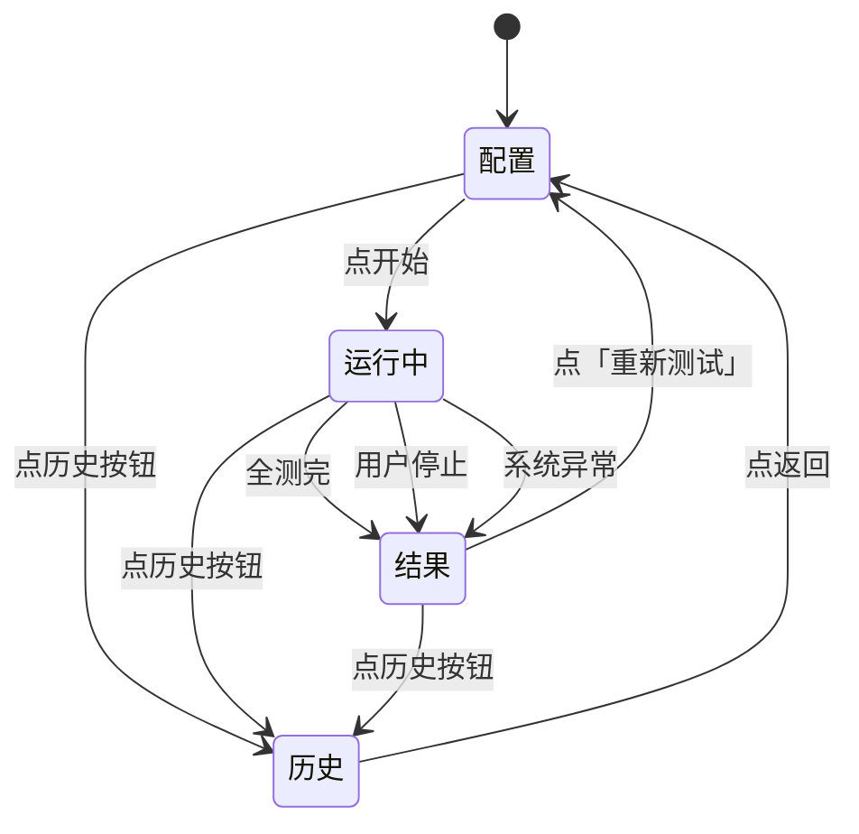

# 工厂老化测试工具 — 需求与设计

> 单机本地运行的桌面硬件体检 + 老化测试工具,跑在被测设备自身。
> 目标平台: **全志 A527** (ARM Cortex-A55 + Mali-G57)

---

## 目录

- [1. 项目目的](#1-项目目的)
- [2. 需求与范围](#2-需求与范围)
- [3. 达到的效果](#3-达到的效果)
- [4. 系统架构](#4-系统架构)
  - [4.1 部署模式](#41-部署模式)
  - [4.2 软件分层](#42-软件分层)
  - [4.3 数据流](#43-数据流)
  - [4.4 启动流程](#44-启动流程)
- [5. 用户场景与典型流程](#5-用户场景与典型流程)
- [6. 测试项设计 — 通过判定的依据](#6-测试项设计--通过判定的依据)
  - [6.1 概述](#61-概述)
  - [6.2 CPU 压力](#62-cpu-压力)
  - [6.3 GPU 渲染](#63-gpu-渲染-opengl-es-2-全屏压测)
  - [6.4 WiFi 验证](#64-wifi-验证-软件开关--射频检查--扫描-含环境降级)
  - [6.5 USB 枚举 + 读写](#65-usb-枚举--读写)
  - [6.6 网口](#66-网口-链路--dhcp--ping-通外网-不做吞吐)
  - [6.7 HDMI 输出](#67-hdmi-输出-sysfs-优先-不需-root)
    - [6.7.1 模式切换在本板不可用 — 实测结论](#671-⚠️-模式切换在本板不可用--实测结论-2026-10-23)
    - [6.7.2 当前分辨率改用 xrandr 读真实输出](#672-✅-当前分辨率改用-xrandr-读真实输出-2026-10-23)
  - [6.8 风扇 GPIO (主动拉高/拉低轮转)](#68-风扇-gpio-主动拉高拉低轮转--⚠️-必须用裸系统调用-禁用-python-的-open)
  - [6.9 TF 卡读写](#69-tf-卡读写自动检测--未插提示)
  - [6.10 内存压力](#610-内存压力-rc--精确判定)
  - [6.11 eMMC 存储](#611-emmc-存储)
- [7. UI 设计](#7-ui-设计)
  - [7.1 状态机](#71-状态机)
  - [7.2 页面布局](#72-页面布局)
  - [7.3 需要人工介入时, 后端必须真的停住](#73-需要人工介入时-后端必须真的停住)
  - [7.4 画面只能由后端事件推动](#74-画面只能由后端事件推动-hard-rule)
  - [7.5 计时条: 2026-10-23 整块从界面移除](#75-计时条-2026-10-23-整块从界面移除)
  - [7.6 运行态必须能靠快照恢复 —— 事件不许丢](#76-运行态必须能靠快照恢复--事件不许丢)
  - [7.7 失败项重测与报告合并](#77-失败项重测与报告合并)
- [8. 数据与存储](#8-数据与存储)
  - [8.1 SQLite Schema](#81-sqlite-schema)
  - [8.2 报告呈现规则](#82-报告呈现规则)
    - [8.2.1 PDF 导出的技术选型与「中文静默变空白」的对策](#821-pdf-导出的技术选型与中文静默变空白的对策)
    - [8.2.2 排版: 长表项不许整块跳页, 续页必须重复项名](#822-排版-长表项不许整块跳页-续页必须重复项名)
- [9. 测试通过与否的依据](#9-测试通过与否的依据总规则)
  - [9.1 状态判定](#91-状态判定)
  - [9.2 通过率口径](#92-通过率口径)
  - [9.3 边界与例外](#93-边界与例外)
  - [9.4 默认阈值参考](#94-默认阈值参考)
- [10. 可观测性原则](#10-可观测性原则-ux-hard-rule)
  - [10.1 推送频率硬约束](#101-推送频率硬约束)
  - [10.2 前端呈现约束](#102-前端呈现约束)
  - [10.3 过程证据要求](#103-过程证据要求)
  - [10.4 添加测试项时的规约](#104-添加测试项时的规约)
  - [10.5 实时事件类型与生命周期](#105-实时事件类型与生命周期)
- [11. 运行时约束 (产线环境必备)](#11-运行时约束-产线环境必备)
  - (§11.1 ~ §11.6 工具调用 / 权限 / 错误识别 / 策略选择 / 进程生命周期 / 启动脚本;**§11.7 离线预打包必读**)
- [12. 技术栈](#12-技术栈)

---

## 1. 项目目的

### 1.1 业务背景

产线上,每台全志 A527 量产设备在下线前要做**硬件功能体检 + 短期老化跑测**,筛除生产环节出现的问题件。当前痛点:

- 测试靠工人手工 + ad-hoc 脚本,执行不规范
- 结果散落各处,无法沉淀数据做质量分析
- pass / fail 全凭经验,争议无据可查

### 1.2 核心价值

把"测试 + 记录 + 报告"做成一个**单机闭环**,让产线工人:

1. 桌面图标一键启动 → 自动开浏览器
2. 勾选要测的项目 → 点开始 → 等结果
3. 看到一份**明确 pass / fail** 的报告
4. 历史可查、有据可依

### 1.3 解决什么问题

| 维度 | 改进前 | 改进后 |
|---|---|---|
| 操作门槛 | 工人需懂命令 | 勾选 + 点开始 |
| 一致性 | 每人执行手法不同 | 工具统一调度 |
| 记录 | 无 / 散乱 | SQLite 全量存 |
| 申诉凭据 | 无 | 历史详情 + 指标 |

---

## 2. 需求与范围

### 2.1 在做什么

- 单机本地测试工具,跑在被测设备(DUT)自身上
- 10 项硬件测试:CPU / GPU / WiFi(扫描) / USB / 网口 / HDMI / 风扇 / TF 卡 / 内存 / eMMC
- 极简 Web UI:勾选 + 次数/时长 + 全选 + 开始
- 跑测过程**实时可见**(每项独立面板,见 §10.5 实时事件 / §10.2 前端呈现)
- 报告(每项指标 + 错误信息)+ 历史可查

### 2.2 测试项清单

| # | 名称 | 主要工具 | 自动 / 交互 |
|---|---|---|---|
| 1 | CPU 压力 | stress-ng | 自动 |
| 2 | GPU 渲染 | glmark2-es2 | 自动 |
| 3 | WiFi 验证 (开关/射频/扫描 3 件套) | iw / rfkill / iproute2 | 自动 |
| 4 | USB 枚举 + 读写 | lsusb + fio | 自动 |
| 5 | 网口 链路 + DHCP + ping | ethtool + udhcpc + ping | 自动 (未插网线提示) |
| 6 | HDMI 输出 | xrandr (x11-xserver-utils) | 自动 |
| 7 | 风扇 GPIO | /proc/rp_gpio/pi5 (**读写双向**: 主动拉低/拉高轮转 + 回读校验; 必须走裸系统调用, 见 §6.8) | 自动 |
| 8 | TF 卡读写 | fio | 自动(未插则弹提示选「插 / 跳」) |
| 9 | 内存压力 | memtester | 自动 |
| 10 | eMMC 存储 | fio | 自动 |

> 看门狗(WDT)剔除;风扇为 B 类(纯 GPIO 通断,无 tach);**TF 卡自动检测 + 未插提示**(启动该测试时自动探挂载点,没探到则弹提示让用户选「插 / 跳」);**网口未插提示**(链路未起时弹提示选「插 / 跳」);默认全部勾选,工人按需减

**设备身份 (SN) —— 每次运行强制记录**

被测设备 SN 是产线追溯的锚点,**每条 run 记录 + 每份报告 + 每份 PDF 必须携带 SN**。

- **提取命令** —— `cat /proc/cmdline | grep -oP 'snum=\K[^ ]*'`
- **回落源** —— 提取失败(为空)时回落 `cat /proc/cmdline | grep -oP 'androidboot.serialno=\K[^ ]*'`
- **仍为空** —— 记为 `unknown`,报告中照常输出 `unknown` 并在 UI 顶部黄色提示,**不阻断测试**
- **实测样例** —— `snum=31175c3d01850801f56`(同一条 cmdline 里 `androidboot.serialno=` 值一致,双源互为校验)

关联章节:§8.1(入库字段)、§8.2(PDF 报告头)、§7(UI 顶部常驻显示)。

---

## 3. 达到的效果

### 3.1 功能效果

- 一台 A527 新机,从上架到出报告,工人操作 ≤ 30 秒(配置) + 测试时间(默认约 **7 分钟** —— 2026-10-26 按历史库实测重算, **不含**工人插卡/插网线的等待)

> **默认一轮 ≈ 6 分 50 秒的逐项依据(2026-10-26 改为「实测」而不是「按公式估」)** —— 数据取自历史库 `results` 表: 内存/CPU/eMMC/风扇/WiFi/网口/HDMI 取 run 120–124, USB 取 run 105/107/108, GPU 取 2026-10-26 的 run 4。
>
> | 项 | 默认配置 | 实测 |
> |---|---|---|
> | 内存 | `times=1` | 60.4s |
> | eMMC | 1 轮 × (写30s+读30s) | 62.0s |
> | TF 卡 | **卡槽空 → skipped** | 0.0s (见下面「弹框等工人」) |
> | HDMI | — | 0.1s |
> | USB | 3 轮 × 18s | 57.5s |
> | 网口 | — | 6.4s |
> | 风扇 | `cycles=2` | 20.0s |
> | WiFi | 4 步流程 | 11.0s |
> | GPU | 33 场景 × 3s | 105.2s |
> | CPU | 60s | 60.5s |
> | **逐项小计** | | **383.1s** |
> | 静默期 | **9 个**项间间隔 × 3s(§5) | 27s |
> | **合计** | | **410s ≈ 6 分 50 秒** |
>
> ⚠️ **TF 卡不是「固定 60s」, 是「弹框等工人」** —— 卡槽空时该项 0.0s 判 skipped, 但紧接着弹框让工人插卡重测或跳过(§7.3)。工人插上卡就再跑一轮写30s+读30s=60s, 整轮 → **470s ≈ 7 分 50 秒**。网口同理(未插网线也弹框)。**「人等多久」是这一轮最大的变量** —— `flow.operator_wait_sec=300` 就是这个等待的上限(超时后自动往下走, 不会把整轮挂死)。
> ⚠️ **间隔是 9 个不是 10 个** —— 10 项只有 **9 个间隔**(第一项前不需要)。**静默期 2026-10-26 由 5s 改 3s**(产线: 五秒太长): 9 × 3s = **27s**(原 45s), 整轮省 **18 秒**。⚠️ **9 个是上限, 不是定数**: ①工人少勾几项, 间隔就跟着少; ②**操作员拍过板的那一项后面不走静默期**(§7.3⑥ —— 他已经做过选择, 再等 3 秒就是「点了跳过却像没反应」)。⚠️ 历史整轮 run 124 是**旧口径**(逐项 232.7s + 45s = 277.7s vs 实测 276.1s) —— 那个 45s **只对旧口径成立**, 换算新口径要用 27s。
> ⚠️ **内存这一项 2026-10-26 起计入合计** —— 之前不写, 理由是「事先算不准」(按理论算: 遍数 × 工作集 ÷ **机器内存带宽**, 换板子能差几倍)。**实测之后就不算了**: 本机 A527 / memtester 4.3.0, 一轮 **60.4s**(`times=1` 连跑 12 次都落在 60.4s; `times=2` → 120.9s), 而且换 64MB 工作集**也是 60s 出头** —— 耗时由 memtester **固定的迭代次数**主导, 不是工作集大小主导。所以 **内存 ≈ 60s × `times`**, 默认 `times=1` → 固定项 234s **+ 60s = 294s**。**「算不准」和「没量过」是两回事** —— 量过就不算编数字了(§7.5)。
> **2026-10-23 按产线要求整体压到最短**: CPU 300→180→120→**60s**、USB 2×30→5×24→**3×18s**、TF 2×30s→2×60s→**2×30s**、eMMC 60s×2→**30s×2**。固定项从 660s 压到 **234s**(不含内存与 GPU)。
> 这些**只是出厂默认值** —— 产线觉得不够覆盖, 在配置页把「次数/时长」调大即可(内存项的「次数」会直接反映在测试界面的**进度条**上 —— §7.5)。
> ✅ **GPU 这一项 2026-10-26 起也不再「不可控」** —— §6.3 方案A: 场景集不变(33 个), 每个场景的时长从 10s 压到 **3s**, 一轮 **105.2s(实测)** —— 原先 336s。**这一项现在也有可预期的时长了**(§7.5 表格里 GPU 从「没有」改成「有(实测)」)。它现在占整轮约 1/4(105.2s / 410s), 是单项大头; 产线若还要压节拍, 有效方向是减 GPU 轮数(`gpu.rounds`)或调 `gpu.scene_sec` —— CPU 和存储项已经压到接近下限了, 内存项则根本不该按时间压(见上一条)。想要覆盖强度不变就把 `gpu.scene_sec` 填回 10(→ 336s/轮, 整轮回到约 11 分钟)。
- 任意子项失败立即定位(指标 + 错误信息明文)
- 跑测中**只在必要时**要工人介入(TF 卡没插 / 网口没插网线 —— §7.3), 其余全程自动

### 3.2 易用性效果

- 工人首次接触 < 5 分钟可独立完成
- 不读文档就能完成"勾 → 开始 → 看结果"
- 默认全选 + 默认参数,开箱即用

### 3.3 质量效果

- 测试过程可重放:参数 + 指标 + 日志全部入 SQLite
- 争议可复核:历史详情完整回看

### 3.4 可观测性效果 (hard rule)

- 测试运行中,**工人能实时看到**每一项:向导页**逐项推进**(同一时刻只显示当前项), 状态色 / 进度条 / 关键指标 / 滚动日志
- 点开始后必须 **立即有反馈**,绝不允许 "黑屏" 或 "无任何动静" 的体验
- 静默阶段也要持续推心跳进度,不让用户怀疑工具死锁
- 历史记录可重看完整 `progress` / `metric` / `log` 流

---

## 4. 系统架构

### 4.1 部署模式

被测设备本身就是工具宿主。浏览器、后端、系统工具、待测硬件**全部在同一台机器**,**不**外接、不连远端。

**离线交付 = 依赖预置,不是运行禁网**

本文档中"离线 / 预打包"**只约束依赖的获取时机**:所有测试所需的系统工具 / Python 依赖 / 第三方素材必须在**打包阶段**一次性下载好,集成进出货镜像;目标设备装机后**启动即可跑全套,运行期间一律不得再联网装包**,**不允许出现“测试中才发现某包未装”的产线故障**。清单与打包流程见 §11.7。

**产线网络前提(已确认)**

产线**有网络,有线无线均可用**,且工位**接 HDMI 显示器**:

| 条件 | 支撑的测试项 | 说明 |
|---|---|---|
| 有线网络可达 + DHCP 可用 | §6.6 网口(取 IP + ping 外网) | ping 公网目标已验证可达(RTT 约 8-13ms) |
| 无线有 AP 可扫描 | §6.4 WiFi(第 ④ 步扫 SSID) | 产线工位周边有可扫描 AP |
| HDMI 显示器连接中 | §6.3 GPU 全屏渲染 + §6.7 HDMI | 常态连接,不进入"未接显示器"分支 |

即:**依赖不可现场安装,但测试本身用得到网络**。因此 §11.4 的取舍原则相应调整为——**不依赖"不可控的外部条件"**(AP 凭证、临时公网可达性、第三方服务等),而不是"不依赖网络"。

### 4.2 软件分层

自上而下:前端(Vue 3 SPA)→ 后端服务(FastAPI) → 测试运行时(注册表 + 调度器) → 测试实现(10 个模块) → 系统工具与内核驱动。

### 4.3 数据流

跑测期间单向流动:

- **用户 → 后端** —— POST 提交配置
- **后端 → 系统工具** —— `subprocess` 调起 Linux 工具,读 stdout / 退出码
- **后端 → 前端** —— WebSocket 持续推三类事件(进度 / 日志 / 指标)
- **后端 → 持久化** —— 测试结果异步入 SQLite

跑测的完整步骤视角见 §5。

### 4.4 启动流程

**桌面双击图标 → 浏览器显示完整步骤:**

1. 工人双击桌面图标
2. 系统调起启动脚本(**普通用户身份直接启动,启动路径不要求提权**)
3. 脚本后台启动 Web 服务监听 `:8000`
4. 脚本调系统命令自动打开浏览器
5. 浏览器请求主页, 后端返回页面
6. 浏览器加载完成后请求配置接口, 后端返回测试项 + 默认参数
7. 浏览器渲染 UI, 等待工人操作

**权限取得方式 —— 命令级 `sudo`,不靠提权启动**

服务以普通用户身份运行即可;**需要 root 的系统调用一律在测试项内部以 `sudo <命令>` 前缀执行**(完整规则见 §11.2)。因此桌面图标可以直接调起 `start.sh start`,不需要 `pkexec` / `sudo` 包装启动脚本。

**启动时读取 SN**

服务启动即执行 §2.2 的 SN 提取命令,读到的 SN 常驻内存并展示在 UI 顶部;读不到时显示 `SN: unknown` + 黄色提示。SN 随每次 run 写入数据库(§8.1)并印在 PDF 报告头(§8.2)。

---

## 5. 用户场景与典型流程

**核心流程一图通读（PPT 友好，可整张贴进幻灯片）:**

```
                              开始
                               ↓
                  ┌──────────────────────────┐
                  │ ① 开测试工具               │
                  │ ② 勾选要测的项 + 调默认参数   │
                  │ ③ 点「开始」               │
                  └──────────────────────────┘
                               ↓ 建本次运行记录
                               ↓
        ┌── 主循环（每跑一项重复）─────────────────────────┐
   ─→   │ ④ 取下一项 → ⑤ 执行 → ⑥ 判定（5 态之一）→ ⑦ 写结果 │ ──┐
        └──────────────────────────────────────────────┘   │
   ↑                                                       │
   └───────────────── 回到 ④ ─────────────────────────────┘
                               ↓ 全部跑完 / 中途停止
                  中途停止 → 当前项 + 剩余未跑项 = stopped
                               ↓
                          汇总 → 写总报告 → UI 显示
                               ↓
                  任一 failed / error？
            ├─ 否 → 整机通过，可下架 → 结束 ✓
            └─ 是 → 整机不通过，留厂排查 → 结束 ✗

旁路分支:
  单项重跑 → 报告出后，对单条 failed/error 项点「重跑这一次」
          → 替换该条结果 → 回到「汇总」重新判定
```

**判定 5 态**（完整定义见 §9.1）:

| 状态 | 触发 | 行为 |
|---|---|---|
| `passed`  | 满足该项所有通过条件             | 写指标，继续下一项 |
| `failed`  | 断言不达标（如 CPU 峰值温度超限） | 写失败原因,**不阻断**,继续下一项 |
| `error`   | 工具缺失 / 代码异常              | 写异常详情,**不阻断**,继续下一项 |
| `skipped` | 用户主动跳过（如 TF 卡未插选「跳」） | 写跳过原因,**不计入**通过率 |
| `stopped` | 用户中途点「停止」               | **不**算 failed，报告里高亮 |

**配套硬规则:**

- **3 秒静默期** —— 每项测完后留 3 s，让 CPU / 温度 / 调度器复位再跑下一项(2026-10-26 由 5 s 改 3 s: 产线嫌五秒太长; 这一段是**纯等待**, 不产出任何结论)
- **推荐执行顺序** —— 固定 4 阶段：轻量（内存 / eMMC / TF） → 接口（HDMI / USB / 网口 / 风扇） → 射频（WiFi） → 重载（GPU / CPU）;⚠️ **2026-10-27 起 UI 上不可拖动、也没有「重置顺序」按钮** —— 这个顺序是算出来的(重载项放最后, 避免热累积污染轻量项), 工人改乱了没有按钮能复位, 反而更容易出问题
- **整机不通过判定** —— 任一项 `failed` 或 `error` → 整机不通过（详见 §9.2 通过率口径）

**流程前置 —— 工位环境自检（run 开始前先做一次）**

> ⚠️ **未实现(2026-10-27 查实)** —— 下面这套「run 开始前先探一次工位网络」
> 的流程**代码里没有**。目前**每一项测试自己判断环境**(WiFi / 网口各自走
> §6.4 / §6.6 的降级通道, 并在结果里带上降级原因码), run 开始前**没有**
> 统一的环境探测, 因此也**没有**「顶部橙色 banner」和「报告首页标红」。
> 本节保留是为了把设计意图记下来; 真正落地前不要当成已有功能引用。
> **别把「每项各自降级」当成「工位环境自检」** —— 前者已经在了, 后者还没有。

网络类测试（WiFi / 网口）的结论**强依赖工位环境**。为了不让工人逐项猜「到底是机子坏了还是网络挂了」，每次 run 开始前先探一次工位网络：

| 检查 | 方式 | 结果标注 |
|---|---|---|
| 默认网关可达 | `ping -c 2 -W 1 <默认网关>` | 不通 → 环境异常 |
| DHCP 可用 | `udhcpc -i <iface>` 试一把（或读上次 DHCP 租约） | 失败 → 环境异常 |
| 周边有 AP | `iw dev <wlan> scan` 数 SSID | 0 个 → 无线环境异常 |

- **环境正常** → 顶部不显示任何异常标记，报告正常呈现
- **环境异常** → UI 顶部**橙色 banner**：「⚠ 当前工位网络异常，以下网络类测试结果仅供参考」;报告首页同步标红
- **不阻断测试** —— 继续跑完，网络类测试项按各自的降级通道(§6.4 / §6.6)出结论
- **作用** —— 让「环境问题」与「设备问题」在报告上一眼可分，避免好机被误判、坏机被漏判

---

## 6. 测试项设计 — 通过判定的依据

### 6.1 概述

10 项默认全选,通过 / 失败 / 错误 / 跳过 / 停止 五档状态。详细判定见 §6.2 - §6.11,数值门槛见 §9.4。

### 6.2 CPU 压力

- **目的** —— 拉满所有核, 验证不崩 + 不超温
- **工具** —— `sudo stress-ng --cpu N --timeout Ds`
- **通过** —— 退出码 0 **且** 峰值温度 ≤ 阈值
- **指标** —— `peak_temp_c`(跨轮最大峰值温度)、`avg_load_pct`(按 `/proc/stat` 两次采样相减算出的平均占用率)、`exit_code`(stress-ng 退出码);另有逐轮的 `round_{N}_peak_temp_c` / `round_{N}_exit_code` / `round_{N}_load_pct`。**失败与取消时同样留下温度峰值与退出码** —— 超温判不合格时, 那个 91℃ 就是判定的全部依据, 丢了它报告上只剩一句「失败」

### 6.3 GPU 渲染 (OpenGL ES 2 全屏压测)

- **目的** —— 验证 GPU 渲染管线 (GLES2 驱动 + 时钟 + 内存带宽) 在 Wayland 全屏持续渲染压力下稳定不死机、不报错
- **安装** —— `sudo apt install glmark2-es2 glmark2-es2-wayland`(**两个都装**;各提供一个**不同**的二进制,测试按当前会话自动选 —— 见下)
- **工具** —— `sudo <所选变体> --fullscreen`,变体表:

  | 变体 | 二进制 | 需要的会话 | 提供者 |
  |---|---|---|---|
  | Wayland | `glmark2-es2-wayland` | `WAYLAND_DISPLAY` + compositor | `glmark2-es2-wayland` 包 |
  | X11 | `glmark2-es2` | `DISPLAY`(+ `XAUTHORITY`) | `glmark2-es2` 包 |

  默认 `variant: auto` —— **谁的会话环境变量在、且对应二进制装了,就用谁**;两个都在时优先 Wayland(本节原始设计意图)。可强制 `wayland` / `x11`。

  > ⚠️ **2026-10-22 实测更正两处原文错误**:
  >
  > ① 原文称 `glmark2-es2-wayland` 包「提供 `glmark2-es2` 可执行」——**不对**。该包提供的是 `/usr/bin/glmark2-es2-wayland`,与 `/usr/bin/glmark2-es2` 是两个不同文件(md5 不同)。
  > ② `glmark2-es2` 本身 `ldd` 链接的是 **libX11**,是 **X11 变体** —— 与原文「必须有 Wayland 会话」这条前置**互斥**。本机 `XDG_SESSION_TYPE=x11`、无 Wayland,结果 GPU 项在 **GPU 完全正常**的板子上(run 41 / run 48)被自己的前置条件挡死,**一轮都没跑**。
  >
  > 实测本机 GPU 本身健康: `GL_RENDERER: Mali-G57 (Panfrost)` / `GL_VERSION: OpenGL ES 3.1 Mesa 22.2.2`。

**前置条件(缺任一 → 本项 `error` 并明确报错,不做静默降级)**

| # | 前置 | 检查方式 | 缺失后果 |
|---|---|---|---|
| 1 | **HDMI 显示器已连接** | `/sys/class/drm/*HDMI*/status == connected` | EGL 拿不到 native window,glmark2 启动即失败 |
| 2 | **图形会话可用**(前置跟着所选变体走) | wayland: `WAYLAND_DISPLAY` 非空 + compositor 进程在<br>x11: `DISPLAY` 非空 + `/tmp/.X11-unix/X<n>` 可达 + `XAUTHORITY` 有效 | 无 GLES 上下文,直接退出 |
| 3 | **DRM 节点存在** | `/dev/dri/card*` + `/dev/dri/renderD*` | 无渲染设备 |

> 产线**已确认 HDMI 常态连接测试**(见 §4.1),因此本项**不进入"未接显示器 → skipped"分支**;第 1 条不满足属于工位配置问题,应报 `error` 而非 `skipped`,否则等于 GPU 静默漏测。

- **通过** —— **跑完全部轮次, 且每轮都把清单里的场景一个不落地渲染完**: exit code = 0 **且** 输出以 `glmark2 Score: <数字>` 收尾 **且** **渲染出的场景数 = 清单长度 (33)**

  > ⚠️ **2026-10-26 加的第三条(场景数)不是「多余的严格」, 是补一个会骗人的漏洞** —— glmark2 跑到一半被掐断时**照样打印分数**。历史库里的对照:
  >
  > | run | 整轮 | GPU 项 | GPU 轮 | 分数 | 实际渲染的场景数 |
  > |---|---|---|---|---|---|
  > | 50 | passed | passed | passed | 142 | **26/33** ← 被掐断了 |
  > | 57 | passed | passed | passed | 148 | 33/33 ← 跑全了 |
  > | 124 | passed | passed | passed | 198 | **2/33** ← 才跑两个, 分数却最高 |
  >
  > 分数是各场景的**加权平均**, 而被掐断时漏掉的往往正是**分数低的重场景**(terrain 8 分、effect2d 60 分那批排在后面)—— 所以**分数高的那个反而是没跑全的那个**。光看分数根本判断不出这一轮跑全了没有, 于是「工人把全屏窗口关掉 / 按了 Esc」这种半截测试, 报告上写的是「GPU 通过」。
  > 顺带: 原来数场景数的那行是**死的**(`^Scene Number` —— glmark2 从来不打印这行),`scenes_completed` 一直是 0, 想判也判不了。现在数的是真场景行 `[场景] <选项>: FPS: N FrameTime: X ms`。
  >
  > **三种「没跑完」必须分开判**(§9.3: 静默的「通过」比明确的「失败」有害得多):
  >
  > | 情形 | 判 | 依据 | 含义 |
  > |---|---|---|---|
  > | 工人按了页面上的「停止」 | `stopped` | `ctx.is_cancelled()` | 主动中止, **不算失败** |
  > | glmark2 自己退了(exit 0) | `failed` | 场景数 < 清单长度 | 这一轮**没有结论** |
  > | 挂钟到点被 `timeout` 杀掉 | `error` | 超时 | 没有结论, 且**披露**超时前跑了几个 |
  > | 场景和清单对不上(不是前缀) | `error` | 清单与本机 glmark2 不一致 | **清单过时了**, 要重新标定 |
  >
  > 前两种过去都记成了 `passed` —— 产线反馈「停掉的测试也记 pass」就是这个。
  >
  > ✅ **「停止」之后全屏窗口由工具自己关掉 (2026-10-26 补齐)** —— glmark2 是 §11.2 要求**提权起的 root 进程**, 服务(普通用户)对它发信号必然 EPERM。所以以前点了「停止」, 那个全屏窗口**会一直占着屏幕到本轮超时上限**(工人只能按 Esc 手动关 —— 这正是历史上那些 run 的分数是「跑了一半」的分数的原因)。现在: 起进程时用 `start_new_session=True` 把这一组圈进**我们自己新建的**进程组(组 id == 那个进程的 pid), 收尾时以 root 身份 `sudo -n kill -TERM/-KILL -<pgid>` **整组收掉**, 窗口立刻消失。**授权范围**(用户点名授权): 仅限本机产线板子(SN 31175c3d01850801f56)、**仅 GPU 压测项**调用、**仅我们自己起的那一组**、且组内必须有命令行含 `glmark2` 的进程; 任何一条校验不过 → **绝不动手**(宁可窗口多留一会, 也不能杀错组)。收尾失败时提示语会明说「按 Esc 可以立刻关掉它」。
  >
  > ⚠️ 顺带记一条**当时没量准**的事: 命令实际是 `sudo -n env … timeout … glmark2` —— **`timeout` 在 sudo 里面、以 root 跑**, 所以超时兜底本来就是 root 在收尾 (不是「只能等普通用户的 timeout 收不了」)。这条以前写错过, 现在按真机命令形态更正。

- **超时兜底** —— 单轮理论 2-5 分钟(取决于 `gpu.scene_sec`,见下),配置 `gpu.timeout_sec`(默认 **240 s**,**单轮**上限,不是整项上限),超时即 `error` + 记 stderr 末 N 行,**防止个别机器跑飞挂死整个 run**
  - ⚠️ **这个值是「下限」不是「定值」** —— 实际生效的单轮上限 = `max(配置值, 一轮预计时长 + 20 s)`。理由: 兜底的本意是**防跑飞**, 不是**卡时长**; 配死的 240 s 在 `scene_sec` 调大后会**反过来把每一轮掐断**(填 10 回到历史口径 → 一轮 336 s > 240 s, 于是每轮都超时判 `error`, 兜底成了主因)。代码里自动抬到 `33×scene_sec+6+20`, 并在日志里说明抬到了多少
- **指标** —— `score` (最终评分)、`scenes_completed` / `scenes_expected`、`frames_rendered`、`scene_sec`、`elapsed_sec`、`exit_code`、`precheck_display`、`precheck_session`、`precheck_dri`;失败时记 stderr 末尾 N 行
  - ⚠️ **`rounds_detail` 里只放量化字段, 不放原始输出**(2026-10-26 改, 见 §8.2.2): 每一轮记 `round` / `score` / `scenes` / `scenes_expected` / `elapsed_sec` / `exit_code` / `status` / `error`;**不带** glmark2 的输出文本(以前带的是**每轮末尾 20 行**, 报告里会变成一个几千字符的单元格, 把指标表顶断页 —— 而完整输出本来就在「日志附录」里, 每一行都走 `ctx.on_log`, 一字不少)。另加一个**标量**指标 `rounds_scores`(如 `147` / `147 / 145`), 多轮的分数趋势一眼看得见, 界面上也是个小方块
- **备注** —— glmark2 一轮完整跑完自然结束(无需 `--run-forever`),每场景覆盖不同 GPU 单元(曲面 / 着色 / 纹理 / 光照),老化与功能验证一并兼得

- **轮次 `gpu.rounds`(默认 1, 可手动调大)** ——
  glmark2 以"一轮完整跑完"为最小粒度。**提供 `[次数]` 输入框**:一轮理论只有 2-5 分钟,对"老化"这个定位偏薄,而产线有时需要把 GPU 负载拉起来做加强筛查,或用多轮分数的**衰减趋势**暴露间歇性故障(第 1 轮 800 分、第 3 轮 200 分 ⇒ 有东西在坏 —— 单轮给不了这个信号)。
  - **默认 `rounds: 1`** —— 出货默认行为与本节原描述完全一致,不改变任何既有判定口径
  - 可在 UI 手动调大(返修复测 / 抽检加强);每次 run 之间独立跑完整轮,不共享上下文
  - 每轮独立计时、独立判超时;任一轮失败即整项 `failed`,并记 `failed_round` 指出是哪一轮
  - 逐轮记录分数进 `rounds_detail[]`(每轮一条**量化**记录),`score` 仍取**最后一轮**;`rounds=1` 时 `rounds_detail[]` 长度为 1
  - **多轮 = 多次独立启动**(每轮独立进程 / 挂钟 / 超时),这是 §6.3 方案A 下"加强覆盖"的实现方式

- **单轮时长 `gpu.scene_sec`(默认 3 s, 可调)** —— **§6.3 方案A(2026-10-26)**
  - 原来跑的是 glmark2 的**默认套件**: 33 个场景组合, 每个 10 s → 一轮 **336 s**。产线要求"默认一轮控制在两分钟"
  - 改法: **场景集一个不少**(还是那 33 个), 只把每个场景的渲染时长从 10 s 压到 **3 s** → 一轮 **33 × 3 ≈ 99 s + 装载开销 = 105.2 s(实测, 1 分 45 秒)**
  - 实现: 场景**显式点名**(`glmark2 -b <场景>:<选项>:duration=3` × 33),清单固化在 `server/tests/gpu_benchmarks.py`; 重新标定的脚本是 `scripts/calibrate_gpu_benchmarks.py`
  - **为什么不直接跑默认套件 + 一个总超时**(曾经的方案C): glmark2 被掐断时**照样出分数**(见上面那张对照表),总分不可比、结论也不成立
  - **分数随 `scene_sec` 变, 不能横向比**: 10 s(glmark2 默认)时全屏基线约 **148**; 3 s 时见下面「实测基线」。要跟历史数据同口径就填 10(一轮 5 分半)
  - 场景数少了 → `failed`;场景集和清单对不上 → `error`(提示重新标定),**不会静默少跑**
  - **实测基线 (2026-10-26, 本机 A527 / Mali-G57, 全屏)**:

    | `scene_sec` | 一轮实测 | 渲染场景数 | 分数 | 说明 |
    |---|---|---|---|---|
    | 10(glmark2 默认) | 336 s | 33/33 | 148 | 历史 run 57 —— 旧口径, 一轮 5 分半 |
    | **3(新默认)** | **105.2 ~ 105.3 s** | **33/33** | **146 ~ 147** | 一轮 **1 分 45 秒**(两次实测) |

    分数几乎没变(148 → 146)—— 因为分数是**各场景的加权平均**, 由场景集决定,
    而场景集一个没少; 压的是每个场景的采样时间(3 s 也足够测出稳定帧率)。
    所以**新基线 146 与历史 148 基本可比**, 但仍以本表为准。

- **UI 参数** —— `[次数]` 输入框(默认 1,可调大) + `[每场景秒数]` 输入框(默认 3,范围 0.5–60,步进 0.5)。与其他可调项在 UI 上区分(见 §7.2)

- **配置 (`config.yaml`)**:
  ```yaml
  gpu:
    enabled: true
    rounds: 1          # 跑几轮 glmark2 (默认 1 = 原单轮行为); 可手动调大
    scene_sec: 3       # 每个场景渲染多久 (秒) —— 33 × 3 ≈ 99s + 装载 ≈ 105s 一轮
    timeout_sec: 240   # 单轮超时**下限**, 非整项上限
                       # 实际生效 = max(这个值, 一轮预计时长 + 20s) —— 兜底只防跑飞
  ```

### 6.4 WiFi 验证 (软件开关 + 射频检查 + 扫描, 含环境降级)

- **目的** —— 验证 WiFi 子系统工作:**驱动响应 `ip link` 软件开关** + **射频 `rfkill` 未被屏蔽** + **射频通路真的能完成一次扫描**
- **设计哲学** —— 产线**有无线网络、且工位周边通常有 AP 可扫描**,但仍**不连 AP / 不需凭证 / 不需 WPA 交互**:只验证 WiFi 子系统本身能开关、射频能工作。连接 AP 会引入凭证管理 / 握手超时等额外变量,屏蔽这一层换来 **可重复 / 老化阶段纯驱动检查** 的稳定测试。
- **核心原则:环境问题 ≠ 设备问题** —— 判定依据必须是「**设备自己能不能做**」,不能是「**环境有没有配合**」。周边有没有 AP、有没有外网,都是工位条件而非设备能力,因此**必须设计降级通道**:
  - 技术依据:`iw dev wlan0 scan` 在**周边一个 AP 都没有**的环境下,驱动照样正常完成扫描,输出 `bssid / signal / SSID` 表头 + `scan completed`,**退出码 0**,只是结果列表为空。**这条命令成功跑完 = 射频通路已工作**;扫不到 SSID 仅仅是环境里没 AP,**不该判设备坏**。
- **需要 root** (CAP_NET_ADMIN, ip link / iw / rfkill 都要), 通过命令级 `sudo -n` 取得(§11.2);`sudo` 不可用 → 本项判 `error`,不静默降级

**测试逻辑 — 4 步顺序执行 + 第 ④ 步降级通道:**

| 步骤 | 命令 (**全部经 `sudo -n`**) | 通过条件 |
|---|---|---|
| ① 软件开关响应 | `ip link set wlan0 down` → 等 `switch_settle_sec`(默认 1 s) → `ip link set wlan0 up` | 两句都退出 0 (驱动响应 `ip link` 命令) |
| ② 状态确认 | **轮询** `ip link show wlan0`(每 0.3 s 一次, 上限 `state_timeout_sec` 默认 10 s) | 轮询到 `state UP` 即过 (操作实际生效) |
| ③ 射频检查 | `rfkill list wifi` | 输出**不含** `blocked: yes` (射频未被软/硬屏蔽) |
| ④ 扫描执行 | `iw dev wlan0 scan` (≤ 15 s 超时) | 优先:**扫到 ≥ 1 个 SSID**;降级:**命令成功完成扫描即过**(见下) |

> ⚠️ **第 ② 步必须轮询, 不能固定 sleep** —— 2026-10-22 实测踩过的坑:
>
> 无线驱动在 `ip link set up` 之后**还要初始化射频**, 这段时间内核报 `state DORMANT`
> (= 接口已 up, 链路未就绪), 是**正常中间态, 不是故障**。本机实测 `DORMANT`→`UP` 要
> **3.22 秒**, 而原实现固定等 `switch_settle_sec`(1.0 s) 就去读 —— 必然读到
> `DORMANT` 判 `failed`。实测 run 43 / 44 / 47 **三次全倒在这一处**, 而同一时刻
> 接口其实是好的(`state UP`、有关联、IP 正常)。
>
> 改成轮询后, 驱动初始化多慢都能过, 只有**真超时**才 `failed`, 且报错能区分
> 「没等到」(超时) 与「等到了但状态不对」。
>
> **`switch_settle_sec` 语义收窄** —— 它现在**只**表示「down 与 up 之间的间隔」,
> 不再兼任「等 up 生效」; 后者由 `state_timeout_sec` 独立管。不要靠调大
> `switch_settle_sec` 来绕过这个问题 —— 那只是把固定等待换成一个同样脆弱的魔数。
>
> **别把 `mode DORMANT` 当成 `state DORMANT`** —— `ip link show` 实际输出形如:
> ```
> 12: wlan0: <BROADCAST,MULTICAST,UP,LOWER_UP> mtu 1500 qdisc fq_codel state UP mode DORMANT ...
> ```
> `state` 后面才是链路状态; `mode` 后面那个 `DORMANT` 是**射频省电模式**(正常)。
> 解析必须锚定 `state` 关键字 —— 已用本机真实输出 + 3 组构造样本逐条验证正则无误。

**第 ④ 步降级链 —— 环境无 AP 时仍能判通过**

| 阶段 | 动作 | 结果 |
|---|---|---|
| 4a 首次扫描 | `iw dev wlan0 scan` | 扫到 ≥1 SSID → 直接 `passed` |
| 4b 重试 | 仍未命中时,**间隔 5 s 重试,最多 2 次** (共最多 3 次) | 排除瞬时抖动 / 射频刚唤醒未稳定 |
| 4c 命令级降级 | 重试仍为 0 SSID,但**退出码 0 且输出含扫描完成标志**(`scan completed` / `bssid` 表头 / `Results:`) | **判 `passed`** + `degraded=true` + `note="环境无 AP,射频通路已验证"` |
| 4d 驱动级失败 | 命令**报错 / 非 0 退出 / 超时 / 输出无扫描完成标志** | `failed` —— 这是真设备问题,无兼底 |

- **4c 是本项的降级通道** —— 判定依据是「驱动能不能完成一次射频扫描」,而非「环境里有没有 AP」
- **4d 不设降级** —— 驱动报错就是驱动坏了,必须暴露
- **`degraded` 必须入库并在 UI / PDF 上可见**(标黄),让产线知道这台是在"无 AP 环境"下测的

**通过** —— ①②③ 全过 **且** ④ 走完 4a 或 4c;任一失败 → `failed`,在 `step_failed` 里指出失败步骤编号 (1/2/3/4)

**指标**:
- `ip_link_state` — ② **轮询结束时**的 state (`UP` / `DOWN` / `UNKNOWN` / `DORMANT`)
- `state_wait_ms` — ② 从 `set up` 到 `state` 首次变 `UP` 的耗时 (ms)。正常约 3000±500; 老化时可据此看出驱动初始化有没有随时间变慢
- `rfkill_blocked` — ③ 是否被屏蔽 (`yes` / `no`)
- `scan_ssid_count` — ④ 扫到的 SSID 数 (降级通过时为 `0`)
- `top_ssid` — ④ 第一个命中的 SSID 字符串 (降级时为空)
- `scan_duration_ms` — ④ 扫描实际耗时
- `scan_retry_count` — ④ 实际重试次数 (0-2)
- `scan_cmd_ok` — ④ `iw scan` 是否成功完成 (退出码 0 且输出含扫描完成标志)
- **`degraded`** — 是否走 4c 降级通道通过 (`true` / `false`)
- `degraded_reason` — 降级原因 (如 `"环境无 AP,射频通路已验证"`)
- `step_failed` — 失败时的步骤编号 (1/2/3/4), 成功时为空
- `step_failed_reason` — 失败时的错误输出(命令 stderr 末几行)

**轮次可调 (`wifi.times`, 默认 1)** ——
- **默认 `times: 1`** —— 出货默认行为与本节原描述完全一致, 不改变任何既有判定口径
- 每轮跑**完整 4 步**(开关 → 状态 → 射频 → 扫描)。老化加强时调大, 反复开关射频 + 反复扫描更容易暴露**间歇性**驱动问题 —— 第 2 轮才 scan 不出来 / 第 3 轮 `ip link` 不 UP, 这些单轮给不了信号
- **任一轮 `failed` / `error` / `skipped` 即整项停**, 剩余轮次不再跑 —— 与 §6.3 GPU「任一轮失败即整项 failed」同一口径
- 逐轮指标存 `round_N_*`, 顶层指标取**最后一轮**;`times=1` 时无 `round_*` 前缀(与单轮时完全一致)
- **不提供 `[时长]`** —— 单轮时长由 `switch_settle_sec` / `state_timeout_sec` / `scan_timeout_sec` / `scan_retry_*` 决定, 它们是「每步的上限 / 重试」语义, 不是「跑多久」
- UI: `[次数]` 输入框(默认 1), 与 GPU / 风扇同档(见 §7.2)

**为什么不卡 RSSI 阈值:**
工位周边 AP 的信号强度受产线环境(隔墙、金属工位、同时开着的其他设备)影响很大,卡固定 dBm 阈值会把"设备能用但现场信号弱"误判为不合格。本测试只验证 “**驱动 / 射频 / 扫描能力**” 这三件事全通 —— 扫到 SSID 就说明射频链路真的在工作;扫不到则退到 4c 降级通道,只要扫描命令能完成就过,不卡具体信号强度。强度问题交由出货后现场场景处理, 不进老化判断。

**为什么不连 AP / 验证 WPA 握手:**
工位虽有 AP,但 AP 的凭证管理、超时重连、不同 AP 型号差异都会引入大量额外变量,测试稳定性反而变差。WPA 握手层缺陷率约 5%, 那 5% 出货后现场报修成本可控, 屏蔽这一层反而换来 **不依赖特定 AP / 不依赖凭证 / 可重复 / 老化阶段纯驱动检查** 的稳定测试。

### 6.5 USB 枚举 + 读写

- **目的** —— USB 控制器 + 端口 + 连接的 U 盘都活着
- **工具** —— `lsusb`, 块设备上跑 `fio`
- **写入时长** —— 默认 **3 轮 × 每轮 18s = 54s**(config: `usb.times: 3` / `usb.duration_sec: 18`);靠 `fio --time_based=1 --runtime=<sec>` **持续写**,工作集 `usb.size_mb: 32`(MB)反复覆写
  - 📝 `18 × N` 到不了整数个 60 —— 要**正好一分钟**得用 `20s × 3` 或 `15s × 4`, 产线按节拍二选一改 `config.yaml` 即可。
  - ⚠️ **只写不读**,且目标是 `/dev/sdX` **裸块设备** —— 会真的反复擦写 U 盘闪存。这正是老化测试要的(挑坏块 / 挑接触不良),但**别拿唯一一份、有未备份数据的盘来跑**。
  - 📌 与本节历史版本的差异:早期设计写的是「写 30s + 读 30s」(`usb.write_sec` / `usb.read_sec`),但**代码从未实现读**,`config.yaml` 里也没有这两个键。**以本节现文与 `config.yaml` 为准**。
- **通过** —— 枚举到 ≥ 1 个非 root-hub 设备 ∧ (适用时)**每轮 `fio` 退出码为 0**。
  **⚠️ 速度不参与判定**(2026-10-23 产线决定, 见 §6.5.1)
- **指标** —— `device_count`、`round_{N}_write_mbps`、`avg_write_mbps`(均为**仅上报**);失败时列可见设备 vs 期望设备

#### 6.5.1 ⚠️ USB 不再用速度判定通过与否 (2026-10-23)

**现象**: 产线插入一个正常 U 盘, 日志看着一切正常, 结果页却显示「失败」, 而且**没有给出任何原因**。

**两个独立问题, 各查各的**:

**① 阈值不合理 —— 已取消。** 实测三轮写速 `10.9 / 10.7 / 10.9 MB/s`(极稳定, ±1%, 说明盘和链路都健康),
而原阈值 `min_write_mbps: 20`。**20 卡在典型值上沿**: USB 2.0 High-Speed(480 Mbps)链路上
闪存的**写**要经 FTL 擦写, 典型值本就只有 **8~20 MB/s**(读通常 20~35, 写慢一半是常态)。
本板控制器实测 `usb1: 480 Mbps` / `usb2: 10000 Mbps`,该盘走的正是 480 Mbps 那一档。
—— **一个正常 U 盘被判 failed**, 阈值定错了, 不是盘坏了。

> 现口径: **只有 `fio` 退出码决定通过**。读写出错、盘报错(`rc≠0`)、掉盘才算失败;
> 速度仍作为 `round_N_write_mbps` / `avg_write_mbps` 上报, 供产线看趋势、排查慢盘。
> `min_write_mbps` 配置键已删除 —— 不起作用的配置键会让工人以为调它有用
> (与当天 HDMI 的 `times` 死键同一个教训)。

**② 失败原因没写进结果 —— 已修。** 代码只置了 `all_passed = False` 却从未写 `result.error`,
于是结果页只显示「失败」而 `error` 是 `None`, **原因只印在日志里**。
症状极具误导性: fio 跑完了、没崩, 判失败那行是另一条日志, 工人会以为工具或设备坏了。
现改为把失败原因攒进 `fail_reasons` 并写入 `result.error`(如「第 2/3 轮 fio 退出码 5,
读写出错, 盘可能已掉或报坏块」)。

### 6.6 网口 (链路 + DHCP + ping 通外网, 不做吞吐)

- **目的** —— 验证以太网 PHY + 网线 + DHCP + 外网连通: **物理链路上 → DHCP 拿到 IP → 能 ping 通外网**;**吞吐不在老化测试范围**
- **网络前提(产线已确认,见 §4.1)** —— 工位网线**常态插好**、产线 DHCP 服务可达、外网可达。因此下面 3 步是**主干路径**,"未插网线"仅作异常兼底。
- **需要 root** (ethtool / udhcpc / ip addr / ping 都需), 通过命令级 `sudo -n` 取得(§11.2)

**测试流程 — 3 步顺序执行 + 环境降级通道:**

| 步 | 命令 | 通过条件 | 网络依赖 |
|---|---|---|---|
| ① 链路检测 | `ethtool <iface>` (默认 `eth0`, 见 `config.yaml.eth.iface`) | 输出含 `Link detected: yes` (网线物理接好) + 取 `Speed:` 作为协商速率 | **零依赖**(纯PHY层) |
| ② 取 IP | 先 `udhcpc -i <iface>` (≤ 10 s);失败则**静态兜底** `ip addr add <static_ip>` | DHCP 拿到 lease **或** 静态 IP 配上去 | 依赖 DHCP 服务 |
| ③ 外网连通 | `ping -I <iface> -c <count> -W <sec> <target>` | **三级降级,任一通过即算通过** (见下) | 依赖上游网络 |

> **① 完全不依赖网络** —— PHY 链路能不能建起来是纯物理层事实,交换机 / DHCP / 外网全挂也照样能测。这是本项在网络整体异常时**仍能给出有效结论**的基础。

**第 ② 步环境降级 —— DHCP 挂了还有静态 IP 兜底**

产线 DHCP 服务器故障是常见工位异常,不能因此把好机判成坏机:

| 阶段 | 动作 | 结果 |
|---|---|---|
| 2a DHCP | `udhcpc -i <iface>` (≤ `dhcp_timeout_sec`) | 拿到 lease → `ip_mode = dhcp`,继续 ③ |
| 2b 静态兜底 | DHCP 超时/失败时,`ip addr add <static_ip>` + `ip link set up` | 配上去 → `ip_mode = static`,继续 ③;配不上 → ②③ 一并 `skipped(env: no_ip)` |

**第 ③ 步三级降级 —— 避免单点抖动造成误判**

外网可达性受产线网络波动 / DNS 偶发超时影响,直接 ping 公网会把**网络环境的偶发故障**计到被测设备头上。因此按顺序尝试,**任一级通过即通过**:

| 优先级 | 目标 | 通过条件 |
|---|---|---|
| 1 | **默认网关** (从 `ip route` 取) | c/c 全部 echo,0% loss |
| 2 | **DNS 服务器** (如 `223.5.5.5`) | c/c 全部 echo,0% loss |
| 3 | **公网域名** (`ping_target`,默认 `www.baidu.com`) | c/c 全部 echo,0% loss |

- **优先默认网关**:证明设备 IP 确实可路由出网,且不受 DNS / 公网波动影响
- **三级全败** → 结合 `ip_mode` 定性(见下方判定矩阵)

**最终判定矩阵 —— 环境问题 ≠ 设备问题**

| ① 链路 | ② 取 IP | ③ 出网 | 判定 | 依据 |
|---|---|---|---|---|
| yes | `dhcp` | 任一级过 | **`passed`** | 主干路径,三层全通 |
| yes | `dhcp` | 三级全败 | **`skipped`** (env: `no_egress`) | PHY ✓ DHCP 客户端 ✓,仅出网未验;工位上游问题,**不判 failed**,强制复测 |
| yes | `static` | **网关级过** | **`passed`** + `degraded=true` | DHCP 服务器挂了,但静态 IP 下网路通 → **设备网络栈正常** |
| yes | `static` | 网关都不过 | **`failed`** | 静态 IP 配上了仍 ping 不通网关 → **真设备问题**(网络栈/二层异常),无兼底 |
| yes | 静态也配不上 | — | **`skipped`** (env: `no_ip`) | 环境完全不具备取 IP 条件,不判 failed |
| no | — | — | 走"未插网线"交互分支 → 最终 **`skipped`** (env: `unplugged`) | 见下 |

> **设计要点** —— `failed` 只留给**能明确归因到设备**的情况:**静态 IP 下仍 ping 不通网关**这一种(设备网络栈 / 二层异常,无兜底)。**链路不通不判 failed** —— 网线没插 / PHY 没接上判不出是设备的锅,按环境问题处理。凡是「设备能做的动作都成功了,只是环境没配合」的,一律 `skipped` + 环境原因标记(不计入通过率,见 §9.2)+ UI/PDF 显式披露。

**未插网线分支 (异常兼底, 非主路径):**

`ethtool eth0` 输出含 `Link detected: no` → UI 红色 banner **「请插网线」**, 用户二选一:
- 「已插好(重新检测)」 → 重跑 ①
- 「跳过此项」 → 记 `skipped` (env: `unplugged`), 报告中明示「**未插网线**」, **不计入通过率**(见 §9.2 跳过项规则)

**通过** — 见上方判定矩阵;`passed` 含两种形态:主干通过 / `degraded` 静态 IP 兼底通过,两者都在 UI 与 PDF 上区分显示

**失败模式:**
- `skipped`(env: `unplugged`) — `Link detected: no` 且用户未处理 (物理层不通) → **不判 failed**。网线没插 / PHY 没接上判不出是设备的锅,按**环境问题**处理:走降级通道 + 显式披露「未插网线」,不计入通过率(见 §9.2)
- `failed` — 静态 IP 兼底下**连默认网关都 ping 不通** → 设备网络栈 / 二层异常,**无兼底,真设备问题**
- `passed` + `degraded=true` — DHCP 不可用但静态兼底下出网正常 → **设备网络栈正常**,标 `degraded` 并写明「建议产线核查 DHCP 服务器」,不算失败
- `skipped`(env: `no_egress`) — 已拿到 IP 但三级 ping 全败 → 上游网络问题,**不判 failed**,需复测
- `skipped`(env: `no_ip`) — DHCP 与静态兼底均失败 → 环境不具备取 IP 条件
- `error` — ethtool / udhcpc / ping 命令缺失(出像未预装) → 立即停, *这个属于 §11.7 打包问题*

**指标:**
- `link_detected` — ① yes / no
- `link_speed_mbps` — ① 协商速率 (1000 / 100 / 10) 或 0
- `ip_addr` — ② 实际使用的 IP (DHCP 拿到的 或 静态兼底的)
- `ip_mode` — ② `dhcp` / `static` / `none`
- `dhcp_duration_ms` — ② DHCP 耗时
- `static_fallback_used` — ② 是否走了静态兼底 (`true` / `false`)
- `ping_target` — ③ ping 目标 (例 `www.baidu.com`)
- `ping_level` — ③ 停在哪一级 (`gateway` / `dns` / `public` / `none`)
- `ping_gateway` — ③ 第 1 级实际 ping 的网关地址
- `ping_sent` / `ping_recv` / `ping_loss_pct`
- `ping_avg_ms` / `ping_min_ms` / `ping_max_ms`
- **`degraded`** — 是否走降级通道得出结论 (`true` / `false`)
- `degraded_reason` — 降级原因说明
- `skipped_reason` — 跳过原因 (`unplugged` / `no_ip` / `no_egress`) —— 三个值在 UI 上各有对应中文说明(§8.1 环境原因披露)

**配置 (`config.yaml.eth`):**
- `iface: eth0` — 网口设备名
- `ping_target: www.baidu.com` — 第 3 级降级目标(可配)
- `ping_gateway: auto` — 第 1 级目标,`auto` = 从 `ip route` 自动取默认网关
- `ping_dns: 223.5.5.5` — 第 2 级目标
- `ping_count: 6` — 每级 ping 包数
- `ping_timeout_sec: 2` — 单包超时
- `dhcp_timeout_sec: 10` — DHCP 取 IP 超时,超时转静态兼底
- `static_ip: "192.168.1.50/24"` — **DHCP 失败时的静态兼底地址**

**轮次可调 (`ethernet.times`, 默认 1)** ——
- **默认 `times: 1`** —— 出货默认行为与本节原描述完全一致, 不改变任何既有判定口径
- 每轮跑**完整 3 步**(链路检测 → 取 IP → 出网连通)。老化加强时调大, 反复建链 / 反复续 DHCP 更容易暴露**间歇性**PHY 与网络栈问题 —— 网线插拔留下的震荡、DHCP 服务器偶发不响应, 这些单轮给不了信号
- **任一轮 `failed` / `error` / `skipped` 即整项停**, 剩余轮次不再跑 —— 与 §6.3 GPU「任一轮失败即整项 failed」同一口径。`skipped` 也停: 未插网线 / 环境不具备取 IP 条件, 再跑几轮结论也一样
- 逐轮指标存 `round_N_*`, 顶层指标取**最后一轮**;`times=1` 时无 `round_*` 前缀(与单轮时完全一致)
- **不提供 `[时长]`** —— 单轮时长由 `dhcp_timeout_sec` / `ping_count` / `ping_timeout_sec` 决定, 它们是「每步的上限」语义, 不是「跑多久」
- UI: `[次数]` 输入框(默认 1), 与 GPU / 风扇同档(见 §7.2)

**为什么测试外网 ping 而不是本地:** 本地 ping 只能证明链路+IP 到本机,不证明 IP 可上网;到默认网关的 ping 同时验证 IP 可路由出网,开销最低且不受公网波动影响,作为第 1 级;公网域名 ping 作为第 3 级兼底,兼顾"验证 IP 确实能上网"。每级仅 6 个包,开销低。

### 6.7 HDMI 输出 (sysfs 优先, 不需 root)

- **目的** —— 验证 HDMI 物理链 + EDID 可读(**模式可设 —— 见 §6.7.1, 本板不可用**)
- **工具优先级**:
  1. **`/sys/class/drm/` 读 connector** — 不需 root, 产线工控机也能跑; 读 `status` (connected/disconnected) + `modes` (支持的分辨率列表)
  2. **`xrandr` 读当前实际输出** — 不需 root, 但需 `DISPLAY`(与 §6.3 GPU 同一前提); 读**当前生效**的分辨率/刷新率, 不是 EDID 支持列表。**这才是「现在是什么分辨率」的真值来源**, 见 §6.7.2
3. **`modetest` 切模式 —— 已于 2026-10-23 从代码中整块删除**(本节保留一行占位说明它曾存在过)。删除理由见 §6.7.1: 设备能用 `-M sunxi-drm` 打开, 但切模式被 **DRM master(桌面会话持有)** 挡住, 产线做不成; 它在三种情况下都返回 rc=0, 退出码不可信; 且留着会在无桌面会话的板子上**真的改掉屏幕**。
- **通过** —— sysfs 报告 `connected` ∧ 至少 1 个 mode; ∧ 若 xrandr 跑得通, 则它也须报该输出口 connected 且有当前模式(两者矛盾才 fail, 见 §6.7.2 三态表)
- **指标** —— `connector`、`sysfs_status`、`current_resolution`(xrandr 真值)、`current_refresh`、`screen`、`modes_count`、`target_mode_in_modes`(比的是**分辨率**不含刷新率, 见 §6.7.1)
- **未接显示器** → skipped (不 fail, 避免误报);**xrandr 跑不了(无 DISPLAY / 没装 / 超时)但 sysfs 确认连接** → 仍 pass(读数不可信时不据此误杀好板子, 见 §6.7.2 三态表)

#### 6.7.1 ⚠️ 模式切换在本板**不可用** —— 实测结论 (2026-10-23)

**结论先行: 模式切换在本板**做不成**, 但原因不是原先记的那个; 调用已整块移除,
当前分辨率改用 `xrandr` 读真实输出。**

> ⚠️ **本节结论在当天被推翻过一次, 记录这个过程本身就是重点。** 初版写的是
> 「modetest 驱动表里没有 `sunxi-drm`, 打不开设备」。**那是错的** ——
> 那份表只是**默认集合**, `-M sunxi-drm` 可以覆盖它。
> 错误结论之所以能存活, 是因为**它同样解释得通观测到的现象**(`-c` 确实报
> `no device found` + rc=255), 而当时没去试那个能证伪它的选项。
> **教训: 一个「能解释现象」的结论不等于「被验证过的结论」。**

产线问「hdmi 的测试怎么也这么快啦」。查下来是两层问题:

**第一层 —— 曾经记为「打不开设备」, 实为漏了 `-M`**:

```console
$ sudo -n modetest -c
no device found
trying to open device 'i915'...failed
... (26 个驱动逐个试, 全 failed)
trying to open device 'sun4i-drm'...failed
$ echo $?
255
```

当时据此断定「驱动表里没有 `sunxi-drm`, 连 `/dev/dri/card0` 都打不开」。
**但那份表只是默认集合, `-M` 可以覆盖**:

```console
$ sudo -n modetest -M sunxi-drm -c
Connectors:
id   encoder  status     name      size (mm)  modes  encoders
133  132      connected  HDMI-A-1  530x300    13     132
```

设备**能打开**。同期还查出 **CRTC 是 94, 不是代码里写死的 0**。

**第二层 —— 切模式仍然做不成, 真因是权限**:

```console
$ sudo -n modetest -M sunxi-drm -s HDMI-A-1@94:#0
failed to set mode: Permission denied
setting mode 1920x1080-60.00Hz on connectors HDMI-A-1, crtc 94
$ echo $?
0                       ← ⚠️ rc=0, 但什么都没发生
```

**DRM master 被桌面会话占着** —— 实测开着 `/dev/dri/card0` 的进程:

| pid | 进程 |
|---|---|
| 900 | `xfce4-session` |
| 998 | `xfwm4` |
| 1232 / 1255 | `chromium-browse` |

有图形会话在跑时它就持有 DRM master, 外部进程**哪怕是 root 也无权 modeset**。
产线工位上桌面是在跑的 → **这条路在产线永远走不通**。
(想让它成立只能退出图形会话, 那样工位上也没人能看测试结果了。)

**⚠️ 另外三条语法/接口事实, 留给下一个要做这件事的人**:

1. **CRTC 不能写死** —— 本板是 **94**, 老代码写死 `@0`。
2. **`-s` 的垂直刷新率前面是减号不是 `@`**:
   `-s <connector_id>[,<connector_id>][@<crtc_id>]:[#<mode index>]<mode>[-<vrefresh>][@<format>]`
   写成 `@0:1920x1080@60` 时结尾 `@60` 被当成 `@<format>` → 报 `unknown format 60`。
3. **connector 名要去掉 `card<N>-` 前缀** —— 老代码 `split("-")[-2]` 对
   `card0-HDMI-A-1` 算出 `A`, 不是合法 connector 名。

**📌 `modetest` 的退出码完全不可信 —— 三种情况都返回 0** (当天全部实测到):

| 情况 | 输出 | 退出码 |
|---|---|---|
| 参数不被接受 | 打一屏 usage | **0** |
| modeset 被拒 | `failed to set mode: Permission denied` | **0** |
| 真正成功 | —— | **0** |

老判定是 `if rc == 0: metrics["modetest_ok"] = True`, **三者会被全记成
「✓ 模式设置成功」**。这跟 §6.5.1 那个 USB「结果说失败、日志说正常」是同一类错误,
**方向相反**: 那次是假失败, 这次是假成功。

> 📌 **通用教训(已并入 §10.2)**: **退出码不等于成功**。当天一天之内在这类地方踩了
> 两次, 方向还正好相反 —— **所以两个方向都得防, 不能因为「上次错在哪个方向」就只防一个**。

**📌 为什么把整块调用移除, 而不只是加个判定**: 产线上它必然失败(桌面在跑), 留着就是
每跑一次 HDMI 白花两次特权命令 + 一屏噪音日志。但更要紧的是**副作用**: 在一台
**没有桌面会话**的板子上(SSH headless)`-s` 会**真的改掉屏幕**, 而工人对此毫无准备。
**测试项不该有这种行为。** 验证当前输出这件事由 `xrandr` 负责(§6.7.2), 它只读。

**因此本项现在的真实覆盖面**:

| 检查 | 是否真的在跑 |
|---|---|
| connector 存在于 `/sys/class/drm/` | ✅ |
| `status == connected`(接了显示器) | ✅ |
| EDID `modes` 列表可读(能抓出坏口 / 坏屏 / 坏线) | ✅ |
| **当前实际分辨率 / 刷新率**(`xrandr` 实时读, 见 §6.7.2) | ✅ |
| **切换显示模式** | ❌ **代码已移除**, 见上 |

#### 6.7.2 ✅ 当前分辨率改用 xrandr 读真实输出 (2026-10-23)

**改的根因**: 老代码把 `current_resolution` 设成 `active["modes"][0]` —— 那是
**EDID 支持列表的第一条**, 不是「现在是什么模式」。本机 EDID 第一条恰好也是
1920x1080, 所以这个错**一直看不出来**; 换一台显示器、或 EDID 变一下, 报出来的
就是一个根本没在显示的分辨率。

**xrandr 查的是 X server 当前 CRTC 的实际输出, 是真值** (实测):

```console
$ xrandr
Screen 0: minimum 320 x 200, current 1920 x 1080, maximum 8192 x 8192
HDMI-1 connected primary 1920x1080+0+0 (normal ...) 527mm x 296mm
   1920x1080_60.00  59.96*+          ← 带 `*` 的那条才是**当前生效**的
```

三个必须注意的点:

| 点 | 说明 |
|---|---|
| **两个名字对不上** | sysfs 叫 `card0-HDMI-A-1`, xrandr 叫 `HDMI-1`。代码按**前缀**(`HDMI`/`DP`)匹配, 不按全名 |
| **刷新率有偏差** | `1920x1080_60.00` 报出来是 **59.96**, 不是 60。与配置 `1920x1080@60` 比对必须留 **±1Hz 容差**, 严格比「60」会永远判不符 |
| **前提是 `DISPLAY`** | 与 §6.3 GPU 同一前提: 服务由桌面图标启动, 继承会话的 `DISPLAY`。**无 `DISPLAY` 时直接跳过, 不 exec** |

**判定规则 (三态)**:

| xrandr 状态 | 判定 | 理由 |
|---|---|---|
| 查到对应输出口**且有当前模式** | **passed** | sysfs 说 connected + xrandr 说实际有输出, 两者一致 |
| 跑不了 / 无 `DISPLAY` / 没装 / 超时 | **passed**(降级) | 按 EDID 判, 日志注明「当前分辨率未验证」。**不因此误杀好板子** —— 拿判不准的读数当失败依据, 比不判更糟 |
| 跑通了, 却说该输出口**未连接或无当前模式** | **failed** | 这是**真矛盾**: sysfs 说连着, X 说没输出, 屏幕可能没真正点亮 |

**当前分辨率与目标模式不一致时, 只提示、不判失败** —— 与 §6.5.1 USB「速度不作判定」
同一口径: 分辨率不符不等于板子坏, 但产线要看得见。

**新增指标**: `current_resolution`(xrandr 真值)、`current_refresh`、`screen`(屏尺寸);
`sysfs_status` 仍在。**实测输出** `1920x1080 @ 59.96Hz`, 屏 `1920x1080`。

**边界处理**: xrandr 带 5s 超时(X server 挂住时它会跟着卡死, 不能拖住整项测试),
超时后 kill; 二进制在 `find_tool` 与 exec 之间消失时捕获 `FileNotFoundError` 降级,
不让整项崩。**已用 9 个端到端用例覆盖上述三态 + 双输出口 + 断开 + 刷新率容差边界**
(`tests/test_hdmi_xrandr.py`; 2026-10-27 新写 —— 此前本节声称「已用 8 个用例覆盖」,
而 `tests/` 下一个 HDMI 用例都没有, 那句话是假的)。

**📌 曾实现过一整套「切完回读校验」, 已按产线选择撤掉**: 完整设计见下,
**代码已删除**。留下的结论对下一个要做这件事的人有价值, 故记录在此。

**若将来要恢复模式切换, 下面三条是踩过的坑**:

**⚠️ 绝不能用 connector 的 `modes` 文件回读**: `/sys/class/drm/<card>-<conn>/modes`
是 EDID 报的**支持列表**(本机 15 条), 切换前后一个字都不变。拿它校验等于
「没切也算切成功」——这比不校验更坏, 它会让真的没切成功的模式报成通过。

**⚠️ `fb0/modes` 不是 KMS 真值, 且本机判定不了它跟不跟随**:
`/sys/class/graphics/fb0/modes` 反映的是 **framebuffer console**(本机 `U:1920x1080p-0`)。
本机实测 `/sys/class/drm/card0-HDMI-A-1/fbdev` **不存在**(`fb0/device` 指向的是
`sunxi-drm` 平台设备本身, 而非某个 connector) —— **判定不了 fbcon 是否跟随 KMS 模式**。
所以「回读对不上就 `failed`」在这种板子上会把好板子**误杀**。
另: 它只能验分辨率, 末尾 `-0` 表示刷新率读不出, `@60` 那一半覆盖不了。

**⚠️ 想要 KMS 真值, 得绕开 `modetest`**: `/sys/kernel/debug/dri/0/state` 是权威来源
(以 root 读取; 实测 `/sys/kernel/debug` 是**已挂载**的 —— 普通用户看是
`Permission denied`, 容易误判成「不存在」, 我就误判过一次)。

**📌 要真正恢复模式切换, 结论已改 (2026-10-23 实测推翻)**: 本节初版写的是
「只有两条路: ① 重编支持 `sunxi-drm` 的 libdrm; ② Python ctypes 直接发 DRM atomic
ioctl」—— **① 是多余的**: `modetest -M sunxi-drm` 就能打开设备(设备能 open),
当初的 `no device found` 只是因为漏了 `-M`。真正卡住的是**权限**: 桌面会话持有
DRM master。所以恢复模式切换只剩两条路: ① **退出图形会话**再切(但那样工位上没人能
看结果); ② Python ctypes 先 `drmSetMaster()` 再发 atomic ioctl。
两条都须产线同意 —— 都会**改动工位上显示器看到的画面**。

> **📌 一条被实测证伪的线索, 记下来是因为它的教训**: 本节初版还写了
> 「usage 里的 `-M <module>` / `-D <device>` 看起来能绕开那份写死的驱动表,
> **我没验证过, 不要据此改判定**」。后来拿到许可一跑, **`-M sunxi-drm` 确实可用**
> —— 整节「打不开设备」的结论因此作废。
> 教训: **把一个未验证的猜测写进文档, 它的读者会把它当既成事实用** ——
> 我自己就是先写下「驱动表里没有 sunxi-drm」, 后来差点被这条自己写的结论带走。
> 未验证的东西要么别写, 要么显眼地标成「未验证 + 谁验证的 + 怎么验」。

**📌 `times` 旋钮已删除**: 原先 `defaults.hdmi.times = 1` 会让配置页渲染一个
「次数」输入框, 而代码并不循环, 填 5 什么都不发生。配置键与输入框已一并删掉
(2026-10-23)。不补循环的原因:

**📌 为什么不做 times 循环**: 切**同一个**模式是幂等的, 第一轮之后每轮都是
no-op, 循环 times 遍多测不出任何东西。真正测 HDMI 老化应是**几个模式之间来回切**,
每轮都回读 —— 这需要在支持的 mode 列表里选一组轮换目标, 是个更大的改动。

### 6.8 风扇 GPIO (主动拉高/拉低轮转) —— ⚠️ 必须用裸系统调用, 禁用 Python 的 `open()`

> ⚠️ **本节在 2026-10-22 第三次修订。起因: UI 上单独勾选「风扇」开测会让板子
> kernel panic**, 屏幕弹出 `crashdump now, please connect to tigerdump tool and
> keep power on`。
>
> **两次修订都判错了方向, 这次有实测支撑 —— 触发条件是「Python 的缓冲读」,
> 不是「写这个节点」。**
>
> **2026-10-22 终版实测表** (同一台板子, 逐条跑出来的):
>
> | 操作 | 结果 |
> |---|---|
> | `cat /proc/rp_gpio/pi5` (终端) | ✅ |
> | `echo 0/1 > /proc/rp_gpio/pi5` (终端) | ✅ 能启停风扇 |
> | `os.open(O_RDONLY)` + `os.read(fd, 2..1024)` | ✅ |
> | `os.open(O_WRONLY)` + `os.write(fd, b"0\n")` | ✅ 写后回读一致 |
> | 同一 fd 连读两次 | ✅ |
> | 带 `O_CLOEXEC` / 带 `fstat` | ✅ |
> | `open(p,'rb',buffering=0).read(4)` | ✅ |
> | **`open(p,'rb').read(4)` (Python 缓冲读)** | **💥 kernel panic** |
>
> **已逐条排除**: read 长度 (2~1024 全试过都安全)、同一 fd 二次读、`O_CLOEXEC`、
> `fstat`、过热 (崩时 CPU 43.5°C)、内存 (无 OOM 记录)、Python 本身、
> 「写路径」这个说法本身 —— 终端 `echo` 写 5 次毫发无损。
>
> **❌ 根因仍未定位。** 崩的是 `io.BufferedReader` 的访问方式, 但具体踩到驱动
> 哪个边界说不清 —— **panic 调用栈始终取不到**: 板子每次崩都 `COLD-BOOT`,
> 冷启动把 RAM 一起清掉, `ramoops` 里的 oops 现场随之消失;
> `/var/log/kern.log` 也没有记录(硬 panic 时 rsyslog 来不及落盘)。
> 要拿栈得上 `netconsole` 把内核日志实时发到另一台机器 —— 这是**镜像侧的事**。
>
> **⚠️ 「裸系统调用」这个规避本身还挂着一个未验证的假设**: 我们推断
> `cat` 的 `read()` 长度 ≤ 1024(依据 procfs 的 `st_blksize = 1024`),
> **但从没实测过 `cat` 到底读了多少字节**。如果它实际读 131072 却正常,
> 那说明跟缓冲大小无关, 当前规避和真实机制之间还隔着一层。
> 所以准确说法是: **「加缓冲层就崩、不加就不崩」这个相关性很强**(崩 3/3 vs
> 稳定通过), **但机制不明**。
>
> **❓ 一处仍然说不通**: panic 文案里的 **`tigerdump` 是 Rockchip 的术语**,
> 而本板是**全志 A527** (见下 —— 产品定义为准; `/proc/device-tree/compatible`
> 写的 `allwinner,a523arm,sun55iw3p1` 是**设备树字符串**, 不能当型号依据)。
> Rockchip 内核不会有 sunxi 驱动, 反过来也一样。
> 所以要么这条文案不是这台板子内核打印的, 要么现场还牵涉另一台机器。
>
> **因此本项的实现约束 (硬性)**: `server/tests/fan.py` **一律走
> `os.open`/`os.read`/`os.write` 裸系统调用**, 每个 fd 只读一次、读完立刻关。
> 这是**规避, 不是修复** —— 谁把它改回 `open(p,'rb').read()`, 板子立刻崩,
> 而且代码里没有任何东西会阻止。

- **硬件** —— B 类纯 GPIO 通断, **无 tach**, 接 40-pin 排针 PI5.
  厂家在内核镜像里把 PI5 暴露成普通文件: `/proc/rp_gpio/pi5` (mode `0666`).
  同目录其他脚: `pc2 / pc3 / pc4 / pc7 / pc12 / pi5 / pl8` (通用 GPIO 暴露, 非风扇专用).
  **这台机器上 `/sys/class/gpio/` 不存在**, 也没装 libgpiod ——
  `/proc/rp_gpio/` 是唯一可用路径, 没有备份路径可退。

- **平台: 全志 A527** (产品定义为准)。⚠️ 但**设备树里的字符串都不能当依据** ——
  `/proc/device-tree/model` 写 `A100`, `/proc/device-tree/compatible` 写
  `allwinner,a523arm,sun55iw3p1`, 三者互相矛盾。内核日志是全志驱动
  (`sunxi-rfkill` / `sunxi-wdt` / `sunxi_mmc_host` / `axp2202-gpio`), 与 A527 吻合。
  (排查过程中曾据 `model` 字段误判成 Rockchip, 已订正 —— 引以为戒。)

- **节点缺失的处理不变** —— 节点由**出货内核镜像**提供, apt 包补不了。
  缺失就判 `error` 并报"内核镜像缺 `/proc/rp_gpio/pi5`,非本工具可修复",由镜像侧解决,
  **不允许**用 gpioget 静默兼底成 `skipped`(那是 §9.3 点名的危险失效模式)。

- **IO 接口 (已手工验证可用)**:
  - **读电平** —— `cat /proc/rp_gpio/pi5` 返回 `0` 或 `1`
  - **写高/低** —— `echo 1 > /proc/rp_gpio/pi5` / `echo 0 > ...`, 写后 `cat` 立刻
    读到新电平 (2026-10-22 终端实测通过)

- **实现: 读写双向轮转 + 回读校验** (`server/tests/fan.py`) ——
  1. **节点自检** —— 存在; 缺失判 `error`。
  2. **读起始电平** —— 读不出合法 `'0'`/`'1'` → `error`。
  3. **主动轮转 N 轮** (config `fan.cycles`, 默认 **2**), 每轮两步:
     拉低 → 等 `drive_settle_sec` → 回读校验 → 拉高 → 等 → 回读校验。
     **写什么必须读回什么**, 逐步记录进 `metrics.steps`。
  4. **还原起始电平** —— 在 `finally` 里做, 正常结束 / 判 failed / 用户取消 /
     抛异常都走。产线设备上把风扇留在「停」是实打实的隐患。
  5. **判定** —— 写被拒 → `error`(IO 层先挂了, 后续结果不可信); 步数不足 →
     `error`; 有任何一步回读不一致 → `failed`(并区分「读回失败」= IO 层挂了 /
     「电平不符」= 驱动没执行写入或虚焊); 全部一致 → `passed`。

- **进度按「轮数」推进, 不按「步数」** ——
  配置页给工人调的是 `cycles`(轮转几轮), 界面上就该看得见轮数在走:
  `第 i/N 轮 · 拉低停转` → `第 i/N 轮 · 拉高运转` → `第 i/N 轮完成`。
  - 以前报的是 `len(steps)/(cycles×2)`, `cycles=2` 时屏幕上显示 **「1/4 步」** ——
    和工人刚在配置页填的「2 轮」对不上, 看着像卡在半路。
  - 轮内的相位(拉低/拉高)**放进文案, 不占百分比**: 每轮有 2×5s 的 settle,
    时间足够看清文案。
  - **`drive: false` 的只读分支同样要报进度**: 以前那个采样循环里一次
    `on_progress` 都没有, 从 0% 直接跳到 100%。采样几秒就完了倒无所谓,
    但把 `cycles` 调大做老化加强时, 看着就是条死条。
  - 通用约束见 §7.5: 风扇项**没有**可预期的时长(每轮时长由
    `drive_settle_sec` 决定, 而那是整机配置不是工人能调的项参数)。
    界面上风扇只有这一根按轮数推进的进度条 —— 全页面现在就这一种进度条。

- **目视确认是设计的一部分, 不是可选项** ——
  `drive_settle_sec` 默认 **5.0s**, 因为这 5 秒里同步发生三件事:
  ① 电平稳定 ~10ms ② 风扇物理启转 ~0.5–1.5s ③ **操作员目视确认启停 ~2s**。
  设成 0.5s 风扇刚起步就回读, 工人根本没时间看。返修场景可调到 8.0s。

- **覆盖缺口 (必须对产线讲清楚)** ——
  「写进去读回来对不对」只能抓到一部分: **驱动只认电平变化、不验证风扇真的转了**。
  所以 `steps` 全绿**不等于**风扇转过 —— 操作员目视/听声音仍是最后一道确认。
  报告里 `metrics.steps` 给出逐步明细供核对。

- **配置 (`config.yaml.fan`)**:
  ```yaml
  fan:
    procfs_path: "/proc/rp_gpio/pi5"   # 厂家脚位暴露路径
    drive: true                  # true = 主动轮转; false = 只读体检
    active_level: "high"         # "high" = 1 是风扇运行; "low" = 0 是运行
    cycles: 2                    # 轮转轮数 / (drive=false 时) 连读采样次数
    sample_gap_sec: 0.3          # 只读模式下两次采样间隔
    drive_settle_sec: 5.0        # 轮转模式下写完到回读的等待 (含目视时间)
  ```

- **UI 表现** — 勾选即开始, `fan.drive=false` 时自动降级为只读体检并在日志里
  明写「未做主动轮转」。节点不可用时以红色 banner 提示 "`/proc/rp_gpio/pi5` 不可用"。

### 6.9 TF 卡读写(探卡 + 自动挂载 + 未插提示)

- **目的** —— TF 卡槽 + 卡 + 读写速度
- **工具** —— `fio` 顺序写 + 顺序读到自动挂载点
- ⚠️ **探的是「卡在不在」, 不是「挂载点在不在」**(2026-10-27 改) ——
  **「插了卡」和「挂了载」是两件事**。原来这一项只查 `/proc/mounts` 里有没有
  mmcblk 的挂载点, 而**产线这台板子上没有任何东西会自动挂 TF 卡**(没有 udev
  自动挂载规则, `/mnt` 是空的, `/run/media` 压根不存在)⇒ **卡插着也永远探不到**
  ⇒ 工人看到「未检测到 TF 卡, 请插入」, 插好了点「已插好重测」还是同一个框 ⇒
  **死循环**, 而卡明明插着(产线原话: 「我现在是插了卡的, 但是没识别到」)。
- **探卡方式** —— 看**块设备**在不在:
  - `/sys/block/mmcblk*` 里 `device/type` 是 **SD** 的那些(**板载 eMMC 是
    MMC** —— eMMC 焊死在板上, TF 卡是可插拔的 SD 卡, 内核分得很清);
  - 再排除掉**根文件系统所在的那块盘**(根盘从 `/proc/self/mountinfo` 的
    主:次设备号反查 —— ⚠️ `/proc/mounts` 里根挂的是 `/dev/root`, 不是真实设备名,
    从名字里认不出来);
  - 探到 → 用它的分区设备(如 `/dev/mmcblk1p1`)测; 一个都没有 → **卡槽是空的**。
- **挂载(卡在但没挂时, 工具自己挂)** ——
  1. **已经挂着** → 直接用(**测完不动它** —— 那是用户自己挂的, 没资格替人卸);
  2. `udisksctl mount -b <设备>` —— 不用 root、不弹密码, 桌面会话里最干净的一条;
  3. 兜底 `sudo -n mount <设备> /mnt/tfcard` —— §11.2 命令级提权。
  ⚠️ **第 3 步只对点名授权的设备开放**(板子 31175c3d01850801f56 =
  `/dev/mmcblk1p1`, 见 `server/tests/tfcard.py` 的 `AUTHORIZED_MOUNT_DEVICES`)——
  换板子/换槽位时**不提权**, 只走第 2 步, 走不通就判 `error`。
- **交互流程** ——
  - ✅ **卡在** → 挂上 → 跑 fio → **测完把工具自己挂的卸掉**(用户自己挂的不动)
  - ⚠️ **卡在但挂不上** → 判 `error` 或 `failed`(见下), **不弹「请插卡」** ——
    卡就在槽里, 让人再插一遍是把他引到错的方向;
  - ❌ **卡槽空的**(真的一个块设备都没有) → 判 `skipped` + **弹提示**(二选一):
    - 「已插好(重新检测)」— 重测这一项, 探到卡就跑
    - 「跳过此项」— 标记 `skipped`,**报告中明示「未插」**(不计入 total)
- **通过** —— 挂载成功 ∧ 顺序读 ≥ `min_read_mbps` (默认 10 MB/s)
- **失败 / 异常的分工**(§9.1) ——
  - 卡里的文件系统是**烂的**(ntfs 报 `Corrupt` / `Invalid argument`)→ 判
    **`failed`**(这张卡不合格, **换卡**)—— 卡坏了是「设备有病」, 不是「机器有病」;
  - **环境**不行(没装 ntfs 驱动 / 没权限 / polkit 不放行)→ 判 **`error`**(这一项
    没法测, 查环境重测);
  - 挂上了但**只读**(NTFS 上次没正常卸载, dirty)→ 判 `error`, 提示先在电脑上
    安全弹出再重插 —— 卡本身未必坏, 重测比「换卡」更合适。
- **指标** —— `no_card` (bool, **卡槽真的空的**时才置位)、`skipped_reason`
  (固定 `no_card`)、`detection_method` (固定 `block_device_probe`)、`device`
  (测的是哪个设备)、`mount_method` (`existing` / `udisks` / `sudo`)、
  `mount_failed` (bool, 挂载失败时置位)、`round_{N}_read_mbps` /
  `round_{N}_write_mbps` (逐轮读写带宽, MB/s)
  - ⚠️ 顶层**没有** `read_mbps` / `write_mbps` 这两个键 —— 逐轮数据只挂在 `round_{N}_*` 上, 报告里按轮次列。
  - ⚠️ **`no_card` 只在「卡槽真的空的」时置位** —— 卡在但挂不上时**不**置,
    否则前端会弹「请插卡」, 而卡明明在。

### 6.10 内存压力 (rc + 精确判定)

- **目的** —— DRAM 完整性, 无位翻转
- **工具** —— `sudo timeout <timeout_sec> memtester <size_mb>M 1` (用 `find_tool` 找, 不靠 PATH)
- **配置 (`config.yaml.memory.*`):**
  | 键 | 含义 | 默认 |
  |---|---|---|
  | `times` | **跑几遍** —— memtester 原生接口里真正的旋钮, 配置页上给工人调的就是它 | 1 |
  | `size_mb` | 每遍的工作集 | 1024 |
  | `timeout_sec` | ⚠️ **超时上限, 不是目标时长**。⚠️ 但在生产配置(`size_mb=1024`)下**每一轮都会碰到它** —— memtester 跑不完 18 项, 每次都被掐断(rc=124), 实测一轮 60.4s | 60 |
- ⚠️ **实现是「外层循环 N 次, 每次跑 1 遍」**, 不是 `memtester <量> <遍数>` 一次跑完 —— 效果等价, 但每遍起一个新进程。
- **通过判定**:
  1. `memtester` 退出码 == 0
  2. 输出里搜不到 `FAIL(?:URE)?\b` (大写 FAIL/FAILURE, 词边界) —— ⚠️ **判的是 memtester 4.x 的输出格式**(本机是 4.3.0, 每个测试项一行 `  Stuck Address       : ok`), **不是** 1.x 的 `test N:` 格式
  3. 退出码落在 **timeout 家族** 视为**跑满挂钟**, 不判失败:
     - `124` = `timeout` 到点收尾 (SIGTERM, GNU coreutils 约定)
     - `137` = `timeout` 的 KILL 路径(收尾时进程赖着不走, 被 KILL)
     - `143` = 进程自己收到 SIGTERM
     - ⚠️ 只认这三个, 且 137/143 还要求**确实跑满了挂钟**(≥ 0.9× `timeout_sec`)。以前是「跑了 ≥ 0.9× 挂钟就豁免」, 那样 rc=1(内部错误)、rc=137(被 OOM killer 崩在半路)都能蒙混过关。**其它非 0 退出码一律判 failed**。
- ⚠️ **判失败要同时看「还原后」和「原始」两份输出** —— 还原是把进度重绘的中间态擦掉, 万一失败信息正好落在被擦掉的位置, 也不能让"通过"蒙混过关(§9.3: 静默的「通过」比明确的「失败」有害得多)。原始输出里有、还原后没了, 要在日志里明写出来。
- ⚠️ **一项 ok 都没解析出来 = 判 `error`, 不判 passed** —— 那是「我们根本没能力判定内存好坏」, 不是「内存是好的」(§9.3)。
- **不**用关键字模糊匹配 (FAIL/ERROR/bad substring) — memtester 输出里偶有 "failures" / "fail_count" / "error" 无关字串会导致误判
- **指标** —— `round_{N}_size_mb` (工作集)、`round_{N}_ok_tests` (通过项数); 被挂钟掐断时另有 `round_{N}_unfinished` (开了头但没结论的项数)
  - ⚠️ 顶层**没有** `size_mb` / `ok_tests` / `elapsed_sec` 这几个键 —— 逐轮数据只挂在 `round_{N}_*` 上。
- **进度条按轮次走**(2026-10-26, §7.5): 第 i/N 轮 → i/N 完成, 轮内按挂钟插值(一轮 ≈ 60s, 实测); 跑完一轮用那一轮的**实测**时长校准下一轮的分母。**不是**按 memtester 的百分比 —— memtester 4.x 根本不吐百分比(进度是原地重绘的), 旧代码里那段找百分比的正则从来没匹配上过, 条全程停在 0%。

### 6.11 eMMC 存储

- **目的** —— eMMC 控制器 + 介质 + **顺序读写带宽** + **介质寿命** 综合评估;重点抓持续读写吞吐(闪存颗粒虚焊 / 坏块扩散会先在带宽上体现) + 厂家自带的寿命损耗计数
- **工具** —— `sudo fio` 主 + `cat /sys/block/mmcblk0/device/life_time` 寿命检查

**3 项测试顺序执行:**

| 测什么 | 命令 | 通过条件 |
|---|---|---|
| ① 1M **顺序写** | `sudo fio --name=write --filename=/tmp/aging_test_emmc.bin --ioengine=libaio --direct=1 --bs=1M --rw=write --time_based=1 --size=256M --runtime=30` | exit 0 + `write_mbps` 入库 |
| ② 1M **顺序读** | `sudo fio --name=read --filename=/tmp/aging_test_emmc.bin --ioengine=libaio --direct=1 --bs=1M --rw=read --time_based=1 --size=256M --runtime=30` | exit 0 + **读 `read_mbps` ≥ `min_read_mbps`(默认 80 MB/s)**, 不达标即 `failed` |
| ③ 寿命检查 | `cat /sys/block/mmcblk0/device/life_time` | **已用寿命百分比 ≤ 80%** (节点给的就是已用百分比, 详见下方「`life_time` 含义」) |

> 📌 **2026-10-23 定稿**: 本节此前写的是「4K **随机**读写 + IOPS 判定」, 而代码
> (`server/tests/emmc.py`) 一直跑的是 1M 顺序读写, 两边各说各话。产线拍板:
> **以代码为准 —— 保留顺序读写**。
> **取舍要知道**: 顺序带宽能抓住「慢到不可用」的板子(有明确的 `min_read_mbps` 下限),
> 但**放弃**了「零碎小文件 / 零散写」这一类场景 —— 产线系统调用里那类负载,
> 顺序带宽测不出来。若日后要补, 正确的加法是**另加一项**随机 IO 测试(单独指标、
> 单独阈值), 而不是把顺序这一项换掉 —— 两项测的是不同的失效模式。

**配置 (`config.yaml.emmc.*`):**
- `duration_sec: 30` —— ⚠️ 是**每个阶段**的时长, 写一遍 + 读一遍 = **本项共 60s**
- `times: 1` 轮, `size_mb: 256` (sparse 文件, 不一次占满 eMMC)
- `min_read_mbps: 80` —— 读带宽下限, **只有读有下限, 写只记录不判定**
- 总耗时 ~60s + 寿命检查 < 1s

**通过 (pass)** —— 3 项全过:
- ①② 命令退出码 0 + `read_mbps` / `write_mbps` 入库; 读 ≥ `min_read_mbps`
- ③ **已用寿命百分比 ≤ 80%** (`life_used_pct`); 节点报「未知」(0xFF) 时不判寿命, 放行但指标写「未知」, 需人工确认

**输出利用:**
- `fio` 输出里重点关注 `read_mbps` / `write_mbps` —— 读带宽低于 `min_read_mbps` 即判失败
- 历史趋势可抓带宽衰减 — 同样型号同样工作集的指标应稳定, 偏离 >30% 视为异常

**失败模式:**
- `error` — `fio` 未装 / 权限拒绝 (见 §11.7 打包)
- `error` — `/sys/block/mmcblk0/device/life_time` 读不到 (节点不存在 / 读失败 / 内容为空) —— ⚠️ **不静默放过**:我们根本没能力判这块介质的寿命,拿「读不到」当「好」是比失败更糟的**静默通过**
- `failed` — `read_mbps` < `min_read_mbps` (读带宽不达标)
- `failed` — **已用寿命百分比 > 80%** (`life_used_pct` > 80) — 标记老化风险送修。⚠️ 恰好 80% 放过(**严格大于**才判失败)
- ⚠️ 节点报「未知」(0xFF) → **不判 failed 也不判 error**, 放行并把 `life_used_pct` 写成「未知」, 日志里明写「本项不判寿命, 需人工确认」—— 板子没报数不等于板子坏了, 但也不能悄悄变成「好」

**指标**:
- `round_{N}_read_mbps` / `round_{N}_write_mbps` — fio 顺序读 / 写带宽 (MB/s)
- `life_time_hex` — 寿命节点原始内容 (如 `0x01 0x01`)
- `life_used_pct` — **已用寿命百分比** (0-100 的整数; 节点报「未知」时写字符串「未知」)
  - ⚠️ 叫法统一成「**已用寿命百分比**」: 节点给的就是**已用**多少, 不是还剩多少。别再叫 `health_pct_wear`(健康度) —— 一个说剩余一个说已用, 纸面上必然打架。

**`life_time` 含义** (Hex 16 进制, SD 规范):
- 节点内容形如 `0x01 0x01` —— 两个值, 分别是 **TYPE_A / TYPE_B** 两条通道的**已用寿命百分比**
- 取**两条通道里最差的那条** (各值 × 10%), 一条磨穿了就是磨穿了
- `0x00` = 已用 0% (全新) / `0x01` = 已用 10% / `0x05` = 已用 50% / `0x0A` = 已用 100% (需送修)
- `0xFF` = **未知** (SD 规范里的 predefined) —— 不是 0% 也不是 100%, 按上面「未知」的规则处理
- **通过阈值** = **已用寿命百分比 ≤ 80%** (严格大于 80% 才判 failed)

**写入量说明 —— 消耗的是 eMMC 寿命,不是存储空间**

- `--size=256M` 是**工作集上限**(sparse 文件),`--time_based=1 --runtime=30` 决定实际跑多久;`--direct=1` 绕过 page cache 直接落盘
- 顺序写会**反复覆盖同一片区域**,实际写入量 = 带宽 × 30s(实测几百 MB 量级);**测试结束 `rm -f` 即完全回收空间**
- 真正消耗的是 **wear 寿命**:`life_time` 从 `0x01` 涨到 `0x02` 需累计写掉约 10% 的寿命总量,单次测试差着好几个数量级
- 产线为**每台机单独测试**,各自只磨自己的 eMMC,一次性出厂代价可接受
- **强制收尾** —— 测试结束(无论通过/失败/取消/异常)在 `finally` 里 `rm -f /tmp/aging_test_emmc.bin`,释放空间且避免残留文件被后续测试误用

**为什么只 3 项不更复杂流程:**
产线老化场景**重点抓持续读写带宽 + 介质寿命**, 这两项是 eMMC 老化最敏感的指标:
- 闪存颗粒虚焊 / 坏块扩散, 最先在**持续读写带宽**上体现 —— 慢到低于 `min_read_mbps` 就是废板
- `life_time` 是 eMMC 厂商自带的健康计数, 直接反映介质磨损
- ⚠️ **已知盲区**: 顺序读写**测不出**「零碎小文件」场景的退化(产线的 sqlite/db/log 那类零散写负载)。要覆盖它得**另加一项**随机 IO 测试(独立指标 + 独立阈值), 而不是把顺序这项换掉 —— 两者测的是不同的失效模式。

---

## 7. UI 设计

### 7.1 状态机



### 7.2 页面布局

**配置页:**

```
┌──────────────────────────────────────────────────────────────┐
│ 🏭 工厂老化测试工具  SN: 31175c3d01850801f56  [历史记录]      │
├──────────────────────────────────────────────────────────────┤
│ 测试配置                     [全选][全不选][▶开始测试]        │
├──────────────────────────────────────────────────────────────┤
│  本轮测试人员  [ 张三 ]   (打印到报告的「测试人员」栏)        │
├──────────────────────────────────────────────────────────────┤
│  ☑ 内存 压力          [次数 N]  (只给次数, 不给时长)         │
│  ☑ eMMC 存储         [时长 S s] (每阶段)      │
│  ☑ TF 卡  (未插时弹提示选「插 / 跳」)          │
│  ☑ HDMI 输出                                  │
│  ☑ USB 枚举 + 写      [轮数 N]  [时长 S s]     │
│  ☑ 网口 链路+DHCP+ping [次数 N]  (默认 1)      │
│  ☑ 风扇 GPIO          [轮转 N 次] (默认 2)    │
│  ☑ WiFi 验证          [次数 N]  (默认 1)      │
│  ☑ GPU 渲染           [轮次 N]  [每场景 S s] │
│  ☑ CPU 压力          [次数 N]  [时长 S s]     │
└──────────────────────────────────────────────────────────────┘
```

> **标题行上只有三个按钮** —— 左边「测试配置」, 最右角并排放
> `[全选] [全不选] [▶ 开始测试]`。**「↺ 重置顺序」2026-10-27 删掉了**。
> 2026-10-27 改: 原来四个按钮在**列表最末尾**另起一行, 而列表有 10 项,
> 工人勾完一轮、滚到最底下才找得到「开始」。
> **「本轮测试人员」输入框是标题行下面的第一块**(不是列表末尾), 顺序是
> 「先签名 → 再挑项 → 最后开始」; 它原来埋在 10 项的最末尾, 工人常常是勾完
> 一轮才发现没填, 报告里只能记「未填写」, 事后追不到人。
> 窄屏下标题行和按钮组会**换行**(`.config-head` / `.config-head-actions` 都是
> `flex-wrap: wrap`), 宁可换行也不把「开始测试」挤没。

> ⚠️ **10 项的顺序是**固定**的, UI 上拖不动** —— 2026-10-27 起**同时**去掉了
> 拖拽排序和「↺ 重置顺序」按钮。理由: ①顺序不是随便定的, 是 §7.6 算出来的
> 4 阶段(轻量 → 接口 → 射频 → 重载), **重载项必须放最后**(先跑 CPU/GPU 会把
> 机器烤热, 后面那些轻量项的读数就被热累积污染了); ②工人一旦拖乱, 界面上的
> 顺序就是**这一轮的执行顺序**(前端原样发给后端), 而没有复位按钮的话,
> 乱了的顺序**回不来** —— 产线只能重启服务, 重启也不会重置(顺序来自后端
> 下发的推荐顺序, 只有重新加载页面才回到推荐值)。既然顺序错了代价这么大而
> 工人又看不出 4 阶段的意义, 就干脆**不给乱的机会**。
> ⚠️ 这条改的是**界面**, 不是**后端**: `server/runner.py` 的 `RECOMMENDED_ORDER`
> 一个字没动, 后端仍然按推荐顺序跑(前端传的 `order` 恒等于它)。**拖拽功能
> 是删了, 不是坏了** —— `dragStart` / `dragOver` / `dropAt` / `resetOrder`
> 四个函数连同 `.drag-handle` / `.dragging` 样式一并从 `static/` 清掉了,
> 不留死代码。

> **SN 常驻显示** —— 顶部一直显示当前被测设备 SN(来源见 §2.2)**整串, 不截断**;读不到时显示 `SN: unknown` 并转黄,提醒工人核对设备。
> SN 排在标题右边、按钮组左边(header 走三段式 `.header-left` / 间隔 / `.header-right`)—— 挤在按钮组里横向空间不够,只能截成前 8 位,而 **SN 是工人要照着念去核对机器的编号**, 截掉的那一段正是最容易念错的地方。超长 SN 由 CSS ellipsis 兜底, 不在 JS 里按长度截。
> **参数粒度按项区分** —— 只给真正可调的项暴露输入框,避免工人调了不生效的参数。
> ⚠️ **输入框是「按配置里有没有那个键」自动生成的**(前端 `v-if="'times' in tests[t.name]` / `'duration_sec' in ...` / `'rounds' in ...` / `'scene_sec' in ...`), 不是前端写死的清单 —— 所以**改 `config.yaml` 的键名就等于改界面上有哪些输入框**。
> - **GPU 的键叫 `rounds` 不叫 `times`** —— 界面上显示的是「**轮次**」, 不是「次数」; 它跟 CPU/内存的「次数」不是同一个旋钮(§6.3)。
> - **只给 `[次数]`、不给 `[时长]`** —— 风扇(轮转次数)/ **WiFi(每轮 4 步,单轮时长由各步超时定)/ 网口(每轮 3 步,单轮时长由各步超时定)/ 内存(`timeout_sec` 是**超时上限**不是「本项跑多久」—— 给了输入框工人会以为调它能控制运行时长, 实际调了没用; §6.10)**
> - **次数 + 时长都给** —— CPU / USB / TF / eMMC
>   - ⚠️ **eMMC / TF 的「时长」是每个阶段** —— 写一遍 + 读一遍 = `duration_sec × 2`, 默认 30 → 本项共 60s。**一个输入框, 不是「写 30s / 读 30s」两个**(配置页只暴露一个 `duration_sec`)。
> - **GPU 给 `[轮次]` + `[每场景秒数]`** —— ⚠️ 键名是 `rounds`, 界面显示「**轮次**」, 不是「次数」(见上面一条)。2026-10-26 起单轮时长**可预期**了(§6.3 方案A: 33 个场景 × 每场景秒数, 默认 3s → 一轮 105s), 所以时长可以给工人调; 注意它不是「本项跑多久」而是「**每个场景渲染多久**」, 一轮时长是这两者的乘积

> **「本轮测试人员」是每轮手输的, 不是写死在配置里的** —— 同一个工位上多个人轮班, 写死的那一个名字对不上当班的人, 报告就追不到人。输入框是**「测试配置」标题行下面的第一块**(不是列表末尾, 也不是按钮行里 —— 按钮行是操作区, 塞输入框会被当成按钮的一部分)。初值取 `config.yaml` 的 `report.operator`(工人不用手输就能跑), 改了就以手填的为准。**留空不拦停** —— 报告头写「未填写」照样跑完整轮, 产线不能因为没人写名字就做不出判定。

**进度页(运行中 / 已结束):**

```
┌──────────────────────────────────────────────┐
│  ⏳ 测试进行中                       [停止]   │
├──────────────────────────────────────────────┤
│  ✅ CPU 压力         peak 78°C / 5m00s        │
│  ⏳ GPU 渲染 [████████░░░░] 60% / 1m48s      │
│     场景 10/33 (shading)  score: 412         │
│  ⏸ WiFi 扫描                                │
│  ⏸ USB / 网口 / HDMI / 风扇 / TF / 内存 / eMMC │
├──────────────────────────────────────────────┤
│  实时日志                                     │
│  [12:00:05] [gpu] opening ...                 │
│  [12:00:06] [gpu] using hw decode             │
└──────────────────────────────────────────────┘

结束后:
┌────────────────────────────────────────────────┐
│  ✅ 测试通过 (8/8 实测)                        │
│  SN: 31175c3d01850801f56 · 2026-10-21 10:34    │
├────────────────────────────────────────────────┤
│  ✅ CPU  ✅ GPU  ✅ WiFi(扫到 7 个 AP)          │
│  ✅ USB  ✅ 网口  ✅ HDMI  ✅ 风扇              │
│  ⏭ TF (未插 · 已跳过)  ✅ 内存  ✅ eMMC        │
├────────────────────────────────────────────────┤
│ [🔁 重新测试] [🔂 重测失败项(2)] [📄 打开 PDF 报告] [📋 历史记录] │
└────────────────────────────────────────────────┘
```

**报告入口排在按钮排里, 不另起横幅** —— 「📄 打开 PDF 报告」与「重新测试」「重测失败项」「历史记录」同排(报告是**这一轮的产物**, 不是另一个页面的事; 单独摆一个横幅在页面中段会把「看结果」和「取报告」拆成两处)。已导出过就显示「打开」(`<a>` 直接指向下载端点), 没有就显示「导出」(`<button>` 手动补导) —— **二选一, 不同时出现**。
**顶部的「X 通过 / Y 失败 / Z 跳过」汇总不因报告入口的挪动而改动** —— 它是工人看结果的第一眼, 位置和口径都不能被无关的改动带着跑。
**导出失败说明排在按钮排下方, 用橙色不用红色** —— 红色会被工人当成「设备不合格」; 且必须写明**「测试结果已正常保存, 本轮判定不受影响」**, 再指向同一个「导出」按钮补导 —— **不用重跑整轮老化**。
**下载链接用 `reportRunId` 不用 `runId`** —— 重测失败项(mini-run)时 `runId` 指向**父轮**, 而刚导出的 PDF 属于 mini-run 自己那一份; 用错会让工人下到**上一轮**的报告, 一份内容对不上的纸质件进了归档。同理, 每开一轮必须清掉上一轮的报告状态, 否则第二轮的汇总页会挂着第一轮的报告按钮。

**跳过项必须显式高亮** —— `skipped` 项在结果页用**独立颜色(灰 / 橙)+「未测」字样**渲染,**不得**与绿色 `passed` 视觉混淆;当 `skipped > 0` 时汇总行额外显示 `⚠ 本次有 N 项未测`并列出具体项名。
**不允许工人只看「通过率」就以为全测过** —— 这是产线漏测的第一道防线。

**历史页:**

```
┌──────────────────────────────────────────────────────┐
│  历史记录                                              │
├──────────────────────────────────────────────────────┤
│  #   SN               开始时间    耗时   状态 通过/已测 PDF │
│ ▸ 121 31175c3d…0925  09:25:09  12m10s  通过  1/1   📄 │
│ ▾ 120 31175c3d…0942  09:42:23   8m02s  失败  0/1   📄 │  ← 刚点开的这条
│   ┌────────────────────────────────────────────────┐   │
│   │ 报告 #120   SN 31175c3d…   测试人员: 张三      │   │
│   │ [📄 打开 PDF]  [📄 重新导出]                   │   │
│   │ ❌ USB 枚举 + 写   0.2s   设备未枚举            │   │
│   └────────────────────────────────────────────────┘   │
│ ▸ 119 31175c3d…0903  09:03:17  15m30s  停止  3/8   📄 │   ← 「3/8」= 通过 3 / 已测 8
└──────────────────────────────────────────────────────┘
```

> **详情就地插在它自己那一行下面, 不挂到页面最底下** —— 产线反馈的原话是「点一项历史记录就在这项历史记录下面展开, 不要搞到最下面去, 记录多了不好找」。挂最底下有两个毛病, 而且是**叠加**的: ①点第 3 条得往下滚半屏才看得见; ②滚下去之后**分不清哪块详情是刚点的** —— 上一条还开着, 眼前就是两段详情, 只能靠内容猜哪段对得上刚点的编号。展开就地贴着, 视线不用离开刚才点的那个编号。
> **同时只展开一条** —— 展开两处的话视线要在两个地方来回跳, 而且分不清哪块是刚点的。同一条**再点一次 = 收起**(否则想收起来还得去别处找按钮)。
> **展开的是 run id, 不是列表下标** —— 下标会随列表刷新错位(新记录插到列表最前, 原来第 3 条变成第 2 条), 展开的内容会张冠李戴, 而且是**静默**的: 界面看着正常, 只是详情属于另一轮。
> **只有数据行可点** —— 展开行里装着「打开 PDF / 重新导出」按钮, 那一行整体可点的话, 点按钮会连带触发行上的展开 / 收起, 工人点了「导出」结果详情自己关上了。
> **离开历史页就收起** —— 回到历史页时是干净的列表, 不留着一个上次打开着的详情(同一原则见 §7.6「恢复时别把工人从他正在看的地方拽走」)。
> **慢的请求后到不能盖掉当前展开的那条** —— 详情是异步拉取的, 期间工人可能已经点了别的行; 迟到的响应必须被丢掉, 否则会出现「点的是 121, 看到的是 119」。
> **历史列表一行 = 一条归档记录, 重测轮不单独占一行** —— 重测轮(mini-run)是**过程**, 不是归档对象(§7.7.4)。要是把它也列出来, 工人重测两次就会在列表里看见**四条**带「重测」字样的行(两条是原来那两条记录, 两条是重测这个过程本身), 看着像"四条记录都重测过" —— 而实际只重测过两条(工人原话:「我只重测了两次的记录, 有四个记录都显示有重测」)。所以列表只列归档记录, 重测轮的信息挂在它那一轮的**详情**里(「重测记录」那一块: 哪一轮、什么时候、重测了哪几项、结果如何、那一轮的日志)。
> **角标的主语是「这一条记录」** —— 写「重测 N 轮后通过」, 不写「第 N 次重测通过」: 后者会被读成「这条记录是第 N 次重测」, 跟「重测轮」混在一起时正是让人看不懂的原因。

### 7.3 需要人工介入时, 后端必须**真的停住**

有些结果不是「测完了」, 而是「**设备没问题, 但料没到位**」: TF 卡槽是空的、网线没插 (§6.9 / §6.6)。工人能做的只有两个动作 —— 把料插上重测, 或者跳过。**这两个动作必须由人来做**, 所以整轮测试要真的停在那一项等, 而不是弹个框就接着往下跑。

> **为什么必须是后端停, 前端弹框不算** —— 前端弹框只能挡住**画面**, 挡不住**后端**。
> 后端不停的话实际发生的是:
>
> ```
> 时刻 0s   后端: tfcard 结束(skipped) → 静默 3s → hdmi 开跑 ┐   两边各走各的
> 时刻 1s   前端: 弹框弹出, 工人正在读/犹豫                  ┘
> 时刻 3s   后端: hdmi 已跑完 → usb 开跑, 画面已推进到 usb
> 时刻 6s   工人点「跳过」→ 前端再推一格 → 连跳两项
> ```
>
> 结果就是工人点「跳过 TF 卡」时看到的是 USB 的界面, 日志里 HDMI 的结果
> 早就写完了 —— **画面与实际跑的项目对不上**。

**规则:**

| # | 规则 |
|---|---|
| ① | 哪些结果需要停, 由**测试项自己声明**(`TestCase.operator_prompt()`), runner 不硬编码测试名。默认返回 `None` = 不需要停。 |
| ② | 停 = 后端 `await` 卡住, **不发**下一项的 `test_started`。当前项的 `test_finished` 照常发, 结果照常入库。 |
| ③ | 停住时广播 `waiting_operator`, 前端据此弹框。弹框只是**把既成事实告诉工人**, 不负责推进 —— 画面只由 `test_started` 驱动 (§7.4)。 |
| ④ | 「已插好重测」= **原地重跑同一项**(同一个 run、同一个 DB 行), 不新开 mini-run。开着跑会被 `status == "running"` 直接拒掉, 表现为「点了没反应」。 |
| ⑤ | 重测后若仍未就位, **再问一次**; 最多 3 次, 达上限自动放行 —— 插三次都不认, 多半是卡本身的问题, 再点一百次只是耗老化时长。 |
| ⑥ | 操作员拍板后**跳过 §5 的 3 秒静默期**, 下一项立刻开始。静默期是留给「结果出来没来得及看」的工人的, 他已经做过选择, 再等 3 秒就是「点了跳过却像没反应」。 |
| ⑦ | 必须有**超时**(config.yaml 的 `flow.operator_wait_sec`, 默认 300s)。工人去拿卡了、页面被他关掉了 —— 没人操作时不能把整轮挂死, 超时后自动往下走并在日志里记一笔。 |
| ⑧ | 「停止」要能唤醒等待。没有子进程可杀时, 唤醒它的只有这一下。 |
| ⑨ | 页面刷新/重连后靠 `snapshot()` 里的 `waiting_operator` **恢复弹框**。不恢复的话工人刷新一下, 后端还在等, 界面上却什么提示都没有, 只能干等到超时。 |

**当前声明要停的项:**

| 测试项 | 触发条件 | 停? | 理由 |
|---|---|---|---|
| TF 卡 (§6.9) | `skipped` + `metrics.no_card` | ✅ 停 | 插上卡就能继续的纯物理动作(⚠️ 只有**卡槽真的空的**才停 —— 卡在但挂不上是 `error`, 不停) |
| 网口 (§6.6) | `skipped` + `metrics.skipped_reason == "unplugged"` | ✅ 停 | 插上网线就能继续的纯物理动作 |
| 网口 | `skipped_reason == "no_ip"` | ❌ 不停 | 工位没有 DHCP, 插一百根网线也没用, 停下来纯白等 |
| 网口 | `skipped_reason == "no_egress"` | ❌ 不停 | 上游网络坏了 —— 工位的问题, 应该直接跳过往下走 |
| 其它项 | — | ❌ 不停 | 默认返回 `None` |

### 7.4 画面只能由后端事件推动 (hard rule)

进度页当前显示哪一项, **只认后端发来的 `test_started` 事件** —— 收到 `test_started{name}` 就把 `currentTestIndex` 置为该项下标。**前端不得用 `当前下标 + 1` 之类的运算自己推进。**

理由同 §7.3: 前端自己猜下一项, 就等于多了一套独立于后端的进度推进。只要有一处没对齐(弹框、停止、超时、重测), 画面就会跑到后端前面去, 而日志仍在写真正在跑的那一项 —— 这类不一致极难定位, 因为两边看起来都「在正常工作」。

推论:

- **「已插好重测」→ 屏幕停在原地**: 后端原地重跑同一项, 会再发一次**同名** `test_started`, 下标不变, 画面自然不动。
- **「跳过」→ 屏幕立刻跟上**: 后端立即开下一项, 下一条 `test_started` 就是它。
- **总结页只在 `run_finished` 出现**: 后端在**所有测试项跑完之后**才发这个事件, 所以报告不可能提前出现 —— 最后一项(CPU 压测)还在跑时, 报告绝不会先出。越界时**不得**由前端自行切总结页。
- 中途重测**不产生** `run_finished` (它不是 mini-run), 所以 `run_finished` 到达即意味着整轮真的跑完了。

### 7.5 计时条: 2026-10-23 整块从界面移除

进度页**只剩一根进度条** —— 后端报的 `pct`(实测进度)。原先并列的「本项预计 60s · 已过 12s · 剩余 48s」方块已删除, **所有项一律不显示**, CPU / eMMC / TF / USB 也不例外。

**为什么删:**

| 问题 | 说明 |
|---|---|
| **两根条并排** | 配了 `duration_sec` 的项会同时出现方块和进度条, 屏幕上两个框 |
| **两个数常常对不上** | 方块按挂钟估秒数, 进度条按 `pct` 实测 —— fio 收尾、写回读、工具退出都要时间, `pct` 停在 95% 而秒数已归零是常态 |
| **工人据此判断工具坏了** | 数字打架时, 产线工人不会认为是显示问题, 会认为是设备或工具的问题 |

**保留下来的判断标准(仍然有效, 只是不再显示):** 界面上的任何数字都必须来自**后端算出来的、基于实际配置**的值 —— 宁可不给, 也不能给一个编出来的数字。这条当初就是为内存项定的(见下), 现在适用于全部项。

| 项 | 有没有**可预期**的时长 | 界面表现 |
|---|---|---|
| CPU / eMMC / TF / USB | 有 —— `duration_sec` 是 fio/stress-ng 的 `--runtime`, 实打实跑满 | 只显示 `pct` 进度条 |
| **内存** | **有(实测)** —— 一轮 ≈ 60s, 见下 | 只显示 `pct` 进度条(按**轮次**推进) |
| WiFi / 网口 / HDMI / 风扇 | 没有 —— 时长由驱动和工位环境决定 | 只显示 `pct` 进度条 |
| **GPU** | **有(实测)** —— 一轮 = 33 个场景 × `gpu.scene_sec` + 每轮约 6s 装载开销; `scene_sec=3` 实测 **105.2s**, 见 §6.3 | 只显示 `pct` 进度条 |

> **内存这一项 2026-10-26 改过 —— 上面的「没有」是当时的结论, 现在是「有(实测)」。**
>
> ① 当时说「事先算不出来」, 那是**按理论算的**(遍数 × 工作集 ÷ 机器内存带宽), **没有实测**。
>    2026-10-26 实测(本机 A527 / memtester 4.3.0 / `size_mb=1024`): `times=1` 连跑 12 次,
>    每轮**都是 60.4s**; `times=2` → **120.9s**。换 64MB 工作集**也是 60s 出头** ——
>    因为 memtester 的耗时由**固定的迭代次数**主导(比如 Random Value 固定 8192 次随机读写),
>    **不是**由工作集大小主导。所以「一轮 ≈ 一分钟」跟 `size_mb` 基本无关 ——
>    这正是产线工人凭经验说的那句(「我看一次差不多就是一分钟」)。
> ② 内存项的进度条因此改成**按轮次走**: 第 i/N 轮 → i/N 完成, **轮边界是精确刻度**,
>    轮内按挂钟插值。轮次就是 §7.2 配置页上给工人调的那个「次数」。
> ③ 分母**自校准**: 跑完一轮就用那一轮的**实测**时长当下一轮的分母。换板子、内存带宽
>    不同, 分母会自己纠正 —— 本节那条「宁可不给, 也不能给一个编出来的数字」,
>    用**测出来的数**来兑现, 而不是拿一个公式硬套。
> ④ `expected_seconds()` 相应不再返回 `None`, 而是 `times × timeout_sec`
>    (仍是接口上的机器可读估值 —— §7.5 删掉的那块计时区**没有**回来)。
> ⑤ ⚠️ 顺带纠正一个**当时就写错了**的说法: 「工人看的是 memtester 自己吐出来的进度百分比」。
>    **memtester 4.x 根本不吐百分比** —— 它的进度是**原地重绘**的
>    ("setting 0"/"testing 0" 用退格符反复擦改), 还原成日志之后每个测试项只剩
>    一行「名字 : ok」, **一个 % 都没有**。旧代码里那段找百分比的正则因此**从来没
>    匹配上** —— 内存项的进度条**全程停在 0%**, 直到最后一下跳到 100%, 工人看着
>    像卡死了。**这才是产线 2026-10-26 提「进度条按次数显示」的真正起因。**
>
> 因此内存项在 §7.2 配置页上**仍然只给「次数」不给「时长」** —— 遍数是 memtester 原生接口
> `memtester <量> <遍数>` 里真正的旋钮。配置键也因此从 `duration_sec` 改名为
> **`timeout_sec`**: 那个键名会被 §7.2 渲染成「时长」输入框, 让工人以为调它能控制
> 运行时长, 而实际调了没用。**键名要如实描述它是什么。**

**后端的 `expected_seconds()` 保留** —— 它是接口上的**机器可读估值**(`test_started.expected_sec`、`snapshot.current_expected_sec`), 供排障与接口调用方使用, 与界面显示无关。删除的只是前端那一层: `timing` computed、每秒的 ticker、以及 `resultList` 上的 `expected_sec` / `started_at_ms` 字段。

**后端 `expected_seconds()` 的实现约束(这些仍然有效):**

- **预计秒数由测试自己回答**, 不在前端复制时长公式。`TestCase.expected_seconds(test_config)` 由**拥有这段时长逻辑的那个类**实现(CPU 是 `轮数 × 单轮`; eMMC/TF 是 `轮数 × 单轮 × 2`, 因为写一遍+读一遍; USB 是 `轮数 × 单轮`; 内存是 `times × 一轮` —— 一轮取挂钟上限 `timeout_sec`, 生产配置下它**同时也是实测值** 60.4s, 见上面那条)。
  - 理由: 每项 `duration_sec` 的语义都不一样, 前端复制一份公式, 改配置时必然漏掉一处 —— 于是又变成「说 60s、实际 120s」。
- **由后端经 `test_started` 下发**, 值取自**用户提交的那份配置**。产线在配置页把「时长」改成多少, 接口里就是多少, 改完立即生效。
- **算不出来就返回 `None`** —— WiFi / 网口 / HDMI / 风扇(时长由驱动和工位环境决定)属于这一类。**返回一个编出来的数字比返回 `None` 更糟。**
> GPU 2026-10-26 起不再属于这一类 —— 方案A 之后场景集和每场景时长都是我们自己定的, 预计时长**算得出来**(实测 105.2s)。**「算不出」和「没量过」是两回事**: 以前那栏写「由驱动决定」, 实际是没人量过。
  - 内存一度也在这一列(当时认为"耗时取决于机器内存带宽, 换板子差几倍")。**2026-10-26 拿实测数据把它挪了出来**: 一轮就是 ≈60s, 与 `size_mb` 基本无关(耗时由 memtester 固定的迭代次数主导)。**"算不出来"和"没量过"是两回事** —— 量过就不算"编出来的数字"了。
- **估算是纯展示/诊断用途, 绝不影响测试本身** —— 抛异常就当 `None` 处理(`runner._run_one` 已经这么兜)。

### 7.6 运行态必须能靠快照恢复 —— 事件不许丢

后端推的 WebSocket 事件是**尽力而为的, 不是可靠投递**。前端的每一项界面状态都必须在**丢事件的情况下也能从快照恢复**, 而不是只在事件恰好到达时才对。

**为什么不能假设事件一定会到:** `POST /api/test/start` 的实现是 `create_task(跑测试)` 之后**立刻返回**, 测试任务下一轮事件循环就开始广播 `test_started`; 而前端要等 HTTP 响应**回到浏览器**才建 `resultList`。这两条消息走的是**两条不同的 TCP 连接**(HTTP 响应 vs WebSocket), 谁先到**没有任何保证**。

实测(本机, HDMI 单项, 连跑 5 次):`test_started` **每一次都比 POST 响应早到 4–10ms**, 5/5 命中。旧前端此刻 `resultList` 还是空的, `findIndex` 返回 `-1`, 事件被静默丢掉, 于是:

| 症状 | 直接原因 |
|---|---|
| **单项测试**完全没有进度条 | 唯一一条 `test_started` 丢了 —— 进度条、当前项下标全都挂在它上面 |
| **全测试**时只有第一项没有进度条 | 只有第一条 `test_started` 落在窗口期里, 后面几项事件都赶得上 |
| 短测试跑完**不跳结果页** | 整轮可能在补查之前就跑完并把 `run_finished` 推完了 |

**规则:**

- **`snapshot()` / `GET /api/test/status` 必须能重建全部运行态**: 当前项、逐项状态与结果、`waiting_operator`、**本轮的测试队列 `test_queue`**(见下面「权威是队列」那条)、**本轮的 `pdf_path`**(§8.2 报告按钮二选一靠它恢复)、**本轮的 `sn` 与 `error`**(总结页要写明「哪台机器、什么时候、出的什么事」)(以及 §7.5 的 `current_expected_sec` / `current_started_at`, 供接口调用方使用)。前端任何一个界面元素都不许只挂在事件上而没有恢复路径。
- **启动后必须主动补查一次**: 前端建好 `resultList` 之后, 立刻拉一次运行态快照把窗口期里丢的事件补回来。**这不是可选的优化 —— 没有它, 单项测试必现无进度条。**
- **恢复逻辑只写一份**: WS 收到 `snapshot` 和启动后的补查走**同一个** `applySnapshot()`。曾经两处各写一份, 结果刷新恢复只补了一半(逐项结果没恢复), 工人刷新一次, 前面跑完的几项全变成「等待」。
- **快照里不恢复 `pct`**: 那是瞬时值, 下一条 `progress` 就会覆盖。硬塞一个陈旧数字反而让人以为卡在某个百分比上。
- **快照与 §7.4 不矛盾**: §7.4 禁的是前端**自己推断**下一项(「下标 + 1」), 那才是第二套独立于后端的推进。快照是**后端自己的状态**, 用它恢复是服从后端, 不是违背。
- **布尔状态必须双向写**: 「是不是在跑」这种标志位, **只写 `true` 不写 `false` 等于埋雷** —— 它的出口通常是「收到结束事件」, 而事件会丢。丢一次, 标志位**永远**卡在 `true`, 于是依赖它的界面(比如「⏻ 关闭服务」按钮的 `disabled`)跟着卡死。**凡是只有「进入」没有「退出」的标志位, 都是同一个雷。** 快照处理里必须**两个方向都写**: 收到运行态就置 `true`, 收到终态就置 `false`。
- **「这一轮有哪些项」的权威是队列, 不是结果集**: `results` 只装**已经跑出结果**的项, 只靠它重建列表的话, **还没跑到的项会整个消失** —— 进度条分母不对、总结页少几行, 而界面上一点异常都看不出来。快照里必须单带一份**开跑前就定下来的队列**(含执行顺序), 重建时以它为准。
- **恢复的判据不能依赖「要恢复的那个东西本身」**: 曾经跳总结页的条件写成 `跑完了 && 列表非空`, 而「列表为空」**正是要恢复的场景** —— 条件自相矛盾, 等于把恢复路径自己堵死了。判据只能用**后端给的状态**(`status` / `run_id`)。
- **恢复时别把工人从他正在看的地方拽走**: 工人主动翻历史记录时收到终态快照, 页面不该被抢回总结页 —— 那是他在**主动看别的东西**。恢复只负责「没人管的时候把界面摆正」。

> **附一条实现纪律**: 事件处理函数里**任何一行都不能假设某个变量已存在**。
> 这里踩过一个很难查的坑: `run_finished` 处理函数里写了 `hasResult.value = true`,
> 而 `hasResult` **全文件从未声明** —— 一执行就 ReferenceError, 后面两行
> (`lastStatus` / `view.value = 'summary'`) 永远轮不到。现象是「跑完了停在向导页、
> 永远不跳结果页」, 而 WebSocket 本身没断、后续消息照收, **别处看着全都正常**,
> 极易误判成「后端没推 finish 事件」。它来自 2026-10-21 的提交 d2f4014,
> 引入时就漏了声明, `index.html` 也从未读过它 —— 属于纯死代码, 已删除。
> **判据: 一个变量如果只写不读, 它就是 bug 的温床 —— 要么真有人读, 要么删掉。**

---

### 7.7 失败项重测与报告合并

> 2026-10-27 新增。需求(工人原话):「测试失败的历史记录能不能点开之后在右边
> 显示一个重新测试的按钮, 专门测试失败项, 如果通过了就更新报告和记录为通过,
> 和之前通过项目的报告合并, 历史记录刷新到最上面, 标记上第几次测试通过。」

#### 7.7.1 两个入口, **一个**功能

「重测失败项」有两个入口:

| 入口 | 目标轮次 | 什么时候用 |
|---|---|---|
| 总结页的「🔂 重测失败项(N)」 | **当前这一轮** | 刚跑完, 眼前就摆着不合格的项 |
| 历史记录详情右上角的「🔂 重测失败项(N)」 | **被点开的那条记录** | 可能是刚跑完, 也可能是过了一会儿、期间还开了别的测试 |

两条路走**同一个后端接口**(`POST /api/test/retest`), 请求体形状也一样
(`{run_id, test_names}`) —— 只有 `run_id` 指向的目标不同。前端是**同一个函数**
(`retestRun`), 不是两套各写一遍的代码: 两套迟早会走歪(一处合并、另一处不合并,
或者一处更新报告、另一处不更新)。

重测轮(mini-run)只把**逐项结果**就地写回被重测的那一轮 —— 父轮自己的
`status` / `summary_json` 还停在重测前那一份, 它的 PDF 也还是失败那版。
于是界面上逐项写着「✅ 通过」、汇总却写着「❌ 失败 3/5」, 报告更是直接错。
**报告是要归档的纸面件** —— 归档的人不会去猜哪一份是对的。所以 §7.7.2 的
「合并」是这功能的**主体**, 不是附属动作。

#### 7.7.2 合并算法(重测轮跑完后, 按顺序做)

1. **清残留的 `running` 行**(`fix_stale_running`): 重测轮开跑时会把父轮对应项
   先写成 `running`; 万一中途被停, 那一行永远停在 `running` —— 而 `running`
   不落在 §9.2 的任何一档里, 父轮的计数会**凭空少一项**, 汇总对不上账。
   残留的 `running` 一律改成 `stopped`(§9.3: 中途停止 = 没跑到)。
2. **按 §9.2 重算父轮**(`recompute_run`): 口径与 runner 算 summary 时**完全
   一样**(同一个定义, 不许各算各的):
   - `total = passed + failed + error` —— `skipped` / `stopped` **不计入**
   - 有 `failed` / `error` → `failed`
   - `total == 0` → `skipped`(**不得**判 `passed` —— 否则全跳过能拿一张空报告)
   - 当初**被工人停掉**的一轮(`total > 0` 但还有没跑到的项)重测修好之后
     **仍然是 `stopped`**, 不是 `passed` —— 没测过的项合不合格谁也不知道
3. **写回父轮**(`apply_merge`): 更新 `status` / `summary_json`, 刷 `updated_at`,
   `retest_count += 1`。
4. **重导父轮的 PDF**(`export_pdf`): 新报告 = 原来通过的项 + 这次新通过的项
   (逐项结果本来就在父轮的行里, **重导即是合并**)。同时把**重测轮**
   (`get_retest_runs`)一起交上去, 好让报告能多印一节「重测日志附录」。
   父轮的 PDF **原地覆盖**
   (文件名按父轮结束时间, 和原来那份同名) —— 不另存新文件, 否则 `reports/pdf/`
   里会多出一份「失败版」旧报告, 归档脚本可能捡走错的那一份。
   > §8.2 硬规则: 报告导不出来**不许**掀翻合并 —— 结果已经进库了, 报告可以在
   > 历史页手动重导。只广播一条 `report_failed`。
   > 手动重导(`/api/history/{id}/pdf`)也要把重测轮一起交上去 —— 不然手动补导
   > 出来的那份会比自动导的那份**少一节**, 读者会以为重测日志没了。

   **日志怎么合(多项一起测、其中一项失败的情况)**: **父轮那一行的 log 一个字
   都不许动** —— 它是**首测的原始日志**, 是返修时最要看的证据(「当初为什么
   失败」)。重测那一轮的日志留在**重测轮自己的行**里(`mini_of` 指回父轮),
   报告要印它的时候从那边读(`Database.get_retest_runs(parent_id)`)。

   报告里因此分成**两节**, 顺序不能反:

   ```
   ┌─ 日志附录 ────────────────────┐   ← 首测原始日志, 原样不动
   │ <每一项的完整日志>            │
   └───────────────────────────────┘
   ┌─ 重测日志附录 ────────────────┐   ← 另起一节, 排在后面
   │ <重测那一轮的完整日志>        │
   └───────────────────────────────┘
   ```

   ⚠️ **不许把两段混进同一节**: 事后申诉时读者要分得清哪段是当初的、哪段是后来
   补的 —— 混在一段里这个分界就没了, 而这正是归档报告最要紧的事。所以「日志附录」
   那节**一个字都不许动**, 重测的另起一节、排在它**后面**。

   没被重测的项, 日志**原样不动**。合并后的报告里, 「第一次为什么失败」和
   「重测为什么过了」两段证据**都在**, 只是分属两节。

   > 这一节**不需要改数据库结构** —— 重测轮的日志本来就在重测轮自己的行里,
   > 读它不写它。父轮那行只更新「结论」那几个字段(状态/次数/attempt),
   > `log` 压根不参与写回。
5. **runner 的「当前这一轮」切到父轮**: 合并之后, 工人看到的应该是**合并后**的
   那条记录 —— 完整的逐项结果、合并后的计数、合并后的报告。切过去之后快照
   (§7.6, 刷新页面 / WS 重连都靠它)天然就是合并后的状态, 前端一行特判都不用写;
   总结页也自动显示「5 通过 / 0 失败」而不是重测那 2 项。
6. **广播 `parent_merged`**: 父轮 id、合并后的 status/summary、PDF 路径、
   `retest_count`。前端据此刷新历史列表(父轮跳到最上面)、刷新正展开着的详情、
   把报告按钮指向**合并后**的那一份。

**事件顺序是承重的**: 重测轮自己的 PDF 导出 → 合并 → `parent_merged` →
`run_finished`(带的是**合并后**的 status/summary/run_id)。`parent_merged` 必须
排在 `report_ready` 的处理**之前** —— 重测轮自己的 `report_ready` 先到, 要是
顺序反了, 界面的报告会指向只含两项的重测轮那份。

#### 7.7.3 「第 N 次测试通过」与历史排序

- **尝试次数**(`results.attempt`): 首测 = 1, 第一次重测 = 2, 再重测 = 3。
  §7.3 的**原地**重试(插卡重试那种)也算进去 —— 累计口径:
  `父轮已存的值 + 本轮尝试次数`。父轮那一份和重测轮那一份记的是**同一个**数。
- **历史排序**: `ORDER BY COALESCE(updated_at, started_at) DESC`。被合并过的那条
  记录内容刚刚才更新过 —— 它是列表里**最新的状态**, 该排在最上面; 可它的
  `started_at` 还是当初那轮老时间, 按它排的话这条记录会永远沉在老位置,
  工人刚合完却找不到它。
- **界面角标**: 逐项「第 N 次测试通过 / 仍未通过」; 记录上「**重测 N 轮后通过 /
  重测 N 轮后未过**」(主语是**这一条记录** —— 写「第 N 次重测通过」会被读成
  「这条记录是第 N 次重测」, §7.2); 报告里同样印出来(§8.2 报告要能当证据用)。

#### 7.7.4 边界

- **有测试在跑时不能重测**: runner 是**单例** —— 一次只能跑一轮。别的测试正跑着
  的时候插队重测, 会把正在跑的那一轮的状态搅乱(当前项、结果、日志全是同一份)。
  所以是**阻塞**(弹提示「当前有测试在运行, 结束后才能重测」), 不是排队 ——
  排队要给单例加一套待启动状态机, 收益不值。
- **重测轮自己不摆这个按钮**: 重测轮是过程, 归档对象**始终是最初那一轮** ——
  在重测轮上再重测, 只会套出一串套娃记录。后端也兜底: 目标本身是 mini 时,
  沿 `mini_of` 一路往上找到最初那一轮, 合并永远回到最初那轮。
- **重测轮不单独占历史列表的一行**: 同一件事的另一面 —— 重测轮是过程, 列表是
  归档。列出来的话, 工人重测两次就会看见**四条**带「重测」字样的行, 实际只
  重测过两条(§7.2 历史页)。所以 `list_runs()` 默认过滤掉 `mini_of` 非空的行,
  重测轮的信息挂在它那一轮记录的**详情**里(`get_run()` 的 `retest_runs`),
  排障时可以用 `?include_mini=1` 看原始行。
- **注册表里已经没了的测试项**(后来被删掉的)不能重测, 但**不能**因此把整次
  重测打回: 其余项照测, 把丢掉的项报给前端显示出来 —— 否则工人会以为
  「说好的 3 项怎么只测了 2 项」。
- **改的是历史数据**: 合并会更新 `history.db` 里那一轮的 `runs` 行与被重测项的
  `results` 行, 并**原地覆盖**那一轮**同名**的 PDF(文件名 = SN + 该轮结束时间,
  所以只覆盖它自己那一份)。不删任何文件、不动别的轮次。

---

## 8. 数据与存储

### 8.1 SQLite Schema

一次 run = 1 行 `runs` + N 行 `run_tests`(每行一项测试结果)。

**runs 表(每次汇总):**

| 字段 | 类型 | 说明 |
|---|---|---|
| `id` | int | 主键 |
| **`sn`** | text | **被测设备 SN**(来源 §2.2;取不到记 `unknown`);**与 PDF 文件名 / 报告头保持一致** |
| **`operator`** | text | 测试人员**姓名**(取不到记 `unknown`),产线责任追溯 —— ⚠️ 填的是**姓名不是工号**: 产线核对人靠名字, 工号是人事系统的编号, 纸面报告上没人认。**每轮手输**: 配置页「本轮测试人员」框(§7.2)的值优先, 没填才回落到 `config.yaml` 的 `report.operator`, 再没有才记 `unknown` |
| **`batch`** | text | 批次号(可选,手工录入或扫码带出) |
| `started_at` / `finished_at` | datetime | 起止时间 |
| `status` | text | 见 §9.1 |
| `summary_json` | text | 各项计数(passed/failed/error/skipped/total) |
| `config_json` | text | 测试时的配置快照 |
| **`pdf_path`** | text | 本次导出的 PDF 路径(见 §8.2);导出失败则留空 |
| **`updated_at`** | real | **内容最近一次变更的时间** —— 被重测合并过就刷成合并那一刻(见 §7.7.3)。历史列表按 `COALESCE(updated_at, started_at) DESC` 排: 刚合完的那条是列表里**最新的状态**, 该排在最上面; 按 `started_at` 排的话它会永远沉在老位置, 工人刚合完却找不到它 |
| **`retest_count`** | int | 这一轮被重测合并过几轮(「第 N 次重测通过」),见 §7.7 |
| `error` | text | 系统级错误(若有) |

> **SN 是必填追溯字段** —— 没有 SN 的 run 在产线视为无法对应到具体机器;UI 顶部常驻显示(§7.2)、历史列表每行展示(§8.2)、PDF 报告头打印(§8.2)。

**run_tests 表(每项一次):**

| 字段 | 类型 | 说明 |
|---|---|---|
| `id` | int | 主键 |
| `run_id` | int | 外键 → runs.id |
| `test_name` | text | 测试项内部名(cpu / gpu / wifi / ...) |
| `status` | text | 见 §9.1 |
| `started_at` / `finished_at` | datetime | 单项起止 |
| `duration_sec` | real | 耗时 |
| `metrics_json` | text | 该项指标(供过程可见性,见 §10.3) |
| `log` | text | 过程日志关键行。⚠️ **被重测合并时, 父轮这一行的 `log` 一个字都不许动**(它是首测的原始日志);重测那一轮的日志留在**重测轮自己**的行里, 报告里另起一节印(见 §7.7.2) |
| `error` | text | 失败原因(若有) |
| **`attempt`** | int | 这一项是第几次尝试(1 = 首测, 2 = 第一次重测……)。累计口径见 §7.7.3 |

`status` 字段取值见 §9.1。

### 8.2 报告呈现规则

- 1 run = 1 行汇总 + N 行逐项结果
- 汇总: `{total, passed, failed, error, skipped}` + 整体 `status`
- 历史列表展示 **SN + 起止时间 + 整体状态 + 汇总计数**,**点行进详情**才逐项展开;详情**就地展开在那一行下面**(版式见 §7.2),不挂到页面最底下

**每次 run 结束必须导出一份独立 PDF**

| 项 | 规定 |
|---|---|
| **导出时机** | 每次 run 正常结束 / `stopped` 后**自动导出**,不等工人点任何按钮 |
| **存放目录** | `reports/pdf/` —— 专门文件夹,与运行数据隔离,便于产线批量归档 / 拷贝 |
| **文件名** | `{SN}_{YYYYmmdd_HHMMSS}.pdf`,例 `31175c3d01850801f56_20261021_103412.pdf`;SN 为 `unknown` 时用 `unknown_...` |
| **报告头** | SN / 起止时间 / **测试人员(姓名)** / 批次 / 整体 `status` / 汇总计数 / 本次配置快照 |
| **本次配置快照** | **只列本轮勾选并执行的项目**(判据: 该项配置里 `enabled` 为真; 老库的 run 若配置里没有 `enabled` 键,则以「该轮实际跑出过结果」兜底),**没勾选的项目一律不出现**。表上方另有一行说明「仅列本轮勾选并执行的项目(未勾选的项目不在此表内)」—— **必须说清楚**,否则纸面读者会以为报告漏了内容。一项都没勾时印「本次未勾选任何测试项」,与「未记录配置快照」(压根没有配置)区分开 |
| **测试人员来源** | ① 配置页每轮手填的「本轮测试人员」(§7.2)② 没填则回落 `config.yaml` 的 `report.operator` ③ 再没有则印「未填写」。**手填的优先于配置文件** —— 轮班换人时写死的值对不上当班的人 |
| **汇总段** | `passed / failed / error / skipped / total` + 明确的整机结论,**并逐一列出所有未测项** |
| **逐项段** | 每项:状态色块 / 耗时 / **§6 各小节定义的全部核心指标** / `failed` 与 `error` 的完整原因 / `skipped` 的跳过原因 / 一句「本项完整日志见文末『日志附录』」的指路。**逐项段里不放日志摘录** —— 摘录是同一份日志的残缺副本, 纸面读者看着有一段日志会以为那就是全部 |
| **排版(分页)** | **长表项不许整块跳到下一页** —— 一项放不下当前页剩余空间时, 它**接着上一项排**, 超出部分顺延到下一页; 续页顶上**重复「项名 + 状态 + 耗时」和列头**, 纸面读者撕页后仍认得出是哪一项; **失败原因也不许落单** —— 原因框跟着表走, 不会出现「一页孤零零的失败原因、看不出是哪一项」。详见 §8.2.2 |
| **日志附录** | **每一项的完整日志**(独立分页)。**要么全, 要么没有** —— 报告里只允许有一处日志, 且必须是全的: ①每一项的日志**一行不少**(不截断、不删节); ②一项都没产生日志时,把原因写清楚(「本项被跳过, 未执行」/「本项没有产生任何日志」),**不许写「(无日志)」**这种分不清"没记"还是"没跑"的含糊占位; ③真被上限截断时(极端情况),**必须写明**「只保留了末尾 N 行, 前面 M 行已丢弃」—— 悄悄少一段比多几页糟糕得多; ④模板里**不许**用 `max-height` / `overflow:hidden` 去"塞进一页" —— 那会把超出部分**静默剪掉**, 而报告上一点看不出来, 被剪掉的恰恰是尾巴(报错、失败原因都在尾巴上); ⑤测试工具用**退格符原地重绘**进度时(memtester 4.x 的 `-\|/` 转轮), 落库前按**终端**规矩还原成最终状态(退格符擦前一个字符、回车清整行)—— 擦掉的是**重绘的中间态**不是内容, 还原后每个测试项一行、结论一字不少; 还原这件事要在该项日志开头**写明** |
| **导出失败处理** | **不阻断**测试流程:结果已入库,PDF 失败仅记一条 warning 事件 + `pdf_path` 留空,并在 UI 顶部提示"PDF 导出失败,可在历史页手动重导";**不允许因 PDF 问题丢失测试结果** |
| **手动重导** | 历史页每条 run 提供「重新导出 PDF」入口(补打 / 重打纸质件用) |

> 理由:产线要**纸质归档 / SPC 抽检 / 质量部留档**,只在 UI / SQLite 里看不算交付(呼应 §3.3 "争议可复核")。

### 8.2.1 PDF 导出的技术选型与「中文静默变空白」的对策

**选型:浏览器(chromium headless),不是 reportlab。**

| | chromium `--headless --print-to-pdf` | reportlab |
|---|---|---|
| 新增依赖 | **0**(chromium 是 §11.7 必装项) | 需 pip 装 reportlab |
| 中文字体 | 浏览器走 fontconfig,能认 `.ttc` 之外的一切系统字体 | **不认本机唯一的 `wqy-zenhei.ttc`** —— 那是个 TTC 集合(`ttcf` magic,3 个子字体),得先抽成单字体 TTF,反而多一道工序 |
| 排版 | 完整 CSS(`break-inside: avoid` 之类直接可用) | 手工分页 |

**⚠️ 这个选型带来一个必须防的失败形态 —— 中文静默变空白。**

实测(2026-10-23,本机 aarch64 / Ubuntu 20.04):

```
fc-match sans-serif          → DejaVu Sans
fc-match sans-serif:lang=zh  → DejaVu Sans      ← 加 :lang=zh 也救不了
fc-list ':charset=5de5' family                   → (空)   ← 没有字体含「工」这个字形
```

DejaVu Sans **零 CJK 字形**。浏览器遇到缺字形**既不报错也不换字体**,直接画成空白,
**然后照样 rc=0 输出一份格式完全合法的 PDF**。表现是:产线把一份全空白的中文报告
当合格品打印归档 —— 而这份 PDF 从文件大小、格式、退出码、PDF 阅读器打开来看
**全都正常**,没有任何一个常规信号能暴露它。

**对策(三条,缺一不可):**

1. **模板 CSS 里 `font-family` 必须显式写中文字体全名**(WenQuanYi Zen Hei),
   **不能只写 `sans-serif`**。写全名 + 兜底族名, 换机器上字体名不同还能落到某个
   CJK 字体。
2. **每份 PDF 导出后必须回头验**:解 PDF 的 `ToUnicode` CMap, 数里面映射到的
   **CJK 码位数**, 为 0 即判导出失败。判据**字体无关** —— 不认字体名(子集化后名字
   带 `BAAAAA+` 前缀,认名字太脆), 只问「这份 PDF 里的字有没有落在 CJK 基本区」。
   实测坏样本 **CJK 码位 = 0**、好样本 **= 11**, 判据干净。
   ⚠️ 不能拿"ToUnicode 非空"当判据 —— 坏样本里也有几百个拉丁码位。
3. **打包自检**:`fc-list ':charset=5de5'`(工)非空 + `chromium --headless --version`
   真能起,两条都是**阻断项**(§11.7), 缺任一即拒绝出货。

**为什么不把 `sans-serif` 配进 fontconfig 就完事** —— 那要改系统配置, 出货镜像
一旦重装就丢;而报告模板是**我们自己的文件**, 把字体名写死在里面能跟着代码走。

> 呼应 §6.7.1:**「能解释现象的结论」不等于「被验证的结论」**。这个坑之所以值得单独立
> 一节, 正是因为它在开发机上"看起来完全正常" —— 我是在真机导出一份才发现的, 之前
> 所有的"PDF 导出成功"信号(rc=0、文件非空、能打开)**全部**在坏样本上照样成立。

### 8.2.2 排版: 长表项不许整块跳页, 续页必须重复项名

**现象(产线原话)**: 「如果一项测试表格很长就直接到下一页展示」。

**根因**: 模板里 `.case { break-inside: avoid; }` —— 那一项(整块)不许跨页。
于是只要它放不下当前页的剩余空间, **整块**被推到下一页: 当前页底部空掉一大截,
整份报告还多一页。

**为什么不能靠"禁止跨页"来解决"撕页时认不出项"**: 那条规则的用意没错,
但**解法选错了**。真正要做的是让**项名跟着表一起重复**, 而不是禁止表跨页。

**改法**(`server/templates/report.html.j2`):

| 改什么 | 怎么改 | 为什么 |
|---|---|---|
| 允许这一项跨页 | `.case { break-inside: auto; }`(原 `avoid`) | 长表接着上一项排, 排不下就顺延 |
| 标题/状态色块不跟内容分家 | `.case-head { break-after: avoid; }` | 绿块不会孤零零留在页尾 |
| 一行不被撕成两半 | `table tr { break-inside: avoid; }` | 一行 = 一个数据。**巨大的行**(一个单元格塞进几千字符的原始输出)超一页时浏览器只能切开, 这条对它无效 —— 所以更要**别把原始输出塞进单元格**, 见下面「指标表里不许塞原始输出」 |
| **项名跟着表重复** | 项名 + 状态 + 耗时挪进**指标表的 `<thead>`** | `<thead>` 是分页媒体里**唯一**能被浏览器逐页重画的内容 —— 表拆到哪页, 那页顶上就有一份 |
| **失败原因进表** | 原因框从「表外的独立块」改成「指标表的最后一行」(`.case-fail` / `.fail-reason`) | 见下面「失败原因不许落单」 |

#### 失败原因不许落单(改分页时带出来的连带问题)

上面那条改动**引入**了一个新的坏落位: 失败原因框原本是**表外**的一个独立块
(`.warn-box`)。改版之前 `.case { break-inside: avoid }` 让「标题 + 表 + 原因框」
整块走, 框永远甩不掉; 允许跨页之后就不成立了 ——

> 指标表刚好在第 1 页排完、原因框放不下 → 框被推到第 2 页,
> 而那一页顶上**既没有项名也没有状态** —— 纸面读者看到一页孤零零的
> 「失败原因: ...」, 根本认不出是哪一项失败。

实测 48 种内容长度组合里有 3 种能复现。**复现用的旋钮是「GPU 项的指标表有多高」**
(现在用「给 GPU 项加 nrows 行填充指标」来调高度): 把原因框改回「表外」那版之后,
**nrows=1 和 nrows=29 两档**会让原因框孤立在某一页(顶上既没项名也没状态);
改版之后 0~39 档**全部不孤立**。

**改法**: 原因框变成**指标表的最后一行**, 于是它属于表, 跟着
`<thead>` 一起重复 —— 续页上必然是「项名 + 状态 + 列头 + 原因」一整套。

几何核对(实测第 2 页, PDF 点): 表格列区 x 37→576, 橙色原因框 x 43→570
(左右各留 6pt), 正上方就是重复抬头(y 736→763)和重复列头(y 712→736) ——
框**落在表里**、又不像普通数据行。

⚠️ **没有指标的项**(例如 HDMI)原因框仍在表外 —— 那类项都很短、不会跨页,
而且它的标题块上有 `break-after: avoid`, 标题不会被甩到上一页、框不会跟标题分家。

#### 指标表里不许塞原始输出(「rounds_detail 没跟前面连上」的根因)

现象(产线原话): 「测试报告 pdf gpu 渲染那里 `rounds_detail` 那项是太多内容了吗,
没跟前面的连接上」。

**根因**: `rounds_detail` 这个指标存的是**每轮的记录, 末尾还带着 20 行 glmark2
输出**。报告把它 `repr` 成**一个巨大的单元格** —— 实测**产线刚跑的那一轮**
(run 1, 16:01 那份 PDF)那个单元格 **1857 字符**; 换成 35 行输出的合成样本
是 **2868 字符** —— 一行几千字符、**比一页还高**。于是:

| | 改之前 | 改之后 |
|---|---|---|
| 那一行落在哪 | 整行**被推到下一页**(它比剩下的版面高), 自己占掉一页 | 一条一行的**子表**, 跟前面的行一起排 |
| 指标表跟前面的行 | **断开**: 前面几行(`rounds` / `score` / `scenes_completed`)留在上一页, `rounds_detail` 跑到下一页 | 连着 |
| 那一格的内容 | Python repr: `[{'round': 1, 'score': 147.0, ..., 'tail': '…'}]` | 「轮次 / 分数 / 场景数 / 应跑场景 / 耗时 / 退出码 / 状态」, 一轮一行 |

**而且那份内容本来就不该在指标表里** —— 它是**截断副本**(每轮只留末尾 20 行),
而**完整**的 glmark2 输出早就在「日志附录」里了(每一行 stdout 都走
`ctx.on_log` → runner 抓取 → 附录, 一行不少)。同一份东西两处、一处还是截断的:
读者会把指标表里那份当成这一项的完整输出 —— §8.2 早有规矩
「报告里日志只有一处, 残缺副本比没有更糟」。

**改法**(两半):

| 改什么 | 怎么改 | 为什么 |
|---|---|---|
| 指标里不存原始输出 | `server/tests/gpu.py`: `rounds_detail` 只存量化字段(`round`/`score`/`scenes`/`scenes_expected`/`elapsed_sec`/`exit_code`/`status`/`error`), `tail` 剔掉 | 根因在数据侧 —— 不存, 就不会有几千字符的单元格 |
| 多轮分数单独给个标量 | 新指标 `rounds_scores`(如 `147` / `147 / 145`) | 多轮的衰减趋势一眼看得见, 界面上也是个小方块 |
| 报告里渲染成子表 | `server/report.py` 的 `_metric_views()`: 值是「一串字典」→ **每条一行**的子表; **整列都是长文本**(原始输出)的那一列不印; 整列都是 `None` 的不印 | 兼容**老库里已存的旧数据**(带 `tail` 的那种)—— 老 run 重新导出也是干净的样子 |
| **界面上也不许糊 JSON** | `static/app.js` 新增 `fmtMetricValue()`, `static/index.html` 两处指标显示改用它 | 指标方块里 Vue 默认把数组渲染成 `JSON.stringify(v, null, 2)` —— 十几行缩进 JSON 挤在一个小方块里, 工人既看不清、也没法一眼比分数。压成**一行摘要**(`1 条 · 分数 147`); 完整明细在报告里有子表。⚠️ **只动显示, 不动数据** —— 少字段或算错分数是 §9.3 点名的最危险失效模式 |

⚠️ **子表的列名是人话**(轮次 / 分数 / …), 不是字段名(`round` / `score` / …) ——
报告是给纸面读者看的。

⚠️ **「整列都是原始输出」时不退回 `repr`** —— 那正是把「几千字符一个单元格」
请回来的路。这种情况只印一句「(原始输出见日志附录)」。

**回归测试**: `tests/test_report_metric_subtable.py`(纯函数, 16 组: 标量不动 /
一串字典 → 子表 / **老库的 tail 被剔掉** / 全 None 的列不印 / 全是原始输出时不退回
repr / 非字典列表不当成子表 / 空值)、`tests/test_gpu_scene_judgement.py`
加 4 组(指标里没有 `tail` / 留着量化字段 / 有 `rounds_scores`)、
`tests/test_report_pagination.py` 加 3 组(**原始输出没混进指标表所在的页** /
它**还在**日志附录里 / **子表所在的那一页带着项名** —— 没跟前面的断开)、
`tests/test_frontend_metrics.js`(界面显示 21 组: 标量的显示跟以前一模一样 /
列表压成一行摘要 / 边界形状 / **模板两处都走格式化函数**)。
**已验证这些测试真能抓住回归**: 把 `_DETAIL_RAW_KEYS` 清空, GPU 那条立刻失败
并把整段输出打在失败信息里; 把模板改回 `{{ v }}`, 前端那条测试立刻报 3 条失败。

**实测(真实 GPU 那一轮, run 4)**: 改前 **5 页**(第 1 页只剩报告头, 底部空掉约 1/3,
GPU 整块在第 2 页才开始) → 改后 **4 页**(GPU 项直接接在第 1 页后面, 续页顶上重复
「1. GPU 渲染 [passed] 1m45s」和列头「指标 | 值」)。

⚠️ **表头里为什么不写「(续)」**: 浏览器**没有**"仅在续页出现"的机制 ——
`<thead>` 在首页和续页画的是**同一份**内容, 写死「(续)」会在第 1 页也出现
「(续)」, 自相矛盾。所以表头那一行只写**恒真的信息**(项名/状态/耗时):
第 1 页它就是标题, 续页它就是续表抬头。

⚠️ **有指标的项, 标题从"表格上方的独立块"变成了"表格第一行"** —— 这是上面那条
改动的直接代价, 换来的是每一页(首页和所有续页)顶上都有项名。**没有指标的项**
(例如 HDMI)没有表、也就没有表头组, 标题仍是独立块 —— 那些项都很短, 不会跨页。

**回归测试**: `tests/test_report_pagination.py` —— **真跑 chromium 打印 PDF**,
再**逐页取字**回答三个问题: ①长表项有没有整块跳页(项名所在页 == 上一项所在页);
②续页顶上有没有重复项名和列头; ③**失败原因所在的那一页有没有项名**
(不许落单)。配套 `tests/_pdftext.py`(按每个字体自己的
ToUnicode 解字形码 —— chromium 给每个子集字体各自编号, 合成一张表会解出乱码)。

> ③那条断言不是摆设: 把模板改回「原因框在表外」那版, 同一个测试立刻报
> **3 条失败**(结构 1 条 + nrows=1 / nrows=29 各 1 条 —— 这两档就是实测会
> 踩页边界的档位), 改回来全绿。

---

## 9. 测试通过与否的依据(总规则)

### 9.1 状态判定

| run 级状态 | 条件 |
|---|---|
| `passed` | `total > 0` 且全部已执行项都 `passed` |
| `failed` | ≥ 1 个 `failed` **或 ≥ 1 个 `error`** |
| **`skipped`** | **`total = 0`(勾选项全被跳过)—— 不得判 `passed`(见 §9.2)** |
| `stopped` | 用户中途点"停止" |
| `error` | **整轮级**异常: 测试循环抛异常(Python 崩 / 未捕获异常)、或**一项都没勾**(未选择任何测试) |

> ⚠️ **项级 `error` ≠ run 级 `error`** —— 工具缺失 / `sudo` 失效这类是**单项** `error`, 它把整轮判成 **`failed`**(不合格, 需返修), **不是** `error`。
> `error` 这个 run 级状态只留给「**整轮根本没跑起来**」的情形(§9.3 里的「一项都没勾」「测试循环崩了」)。
> 这么分是因为: `failed` = 「测了, 不合格」→ 机器要返修; `error` = 「没测成」→ 机器状态未知, 得重测。**工具缺失是「这一项没法测」, 不是「机器有病」** —— 但它也**绝不能**算通过。

| 单项状态 | 触发条件 |
|---|---|
| `passed` | 满足该项所有通过条件(§6.2 ~ §6.11) |
| `failed` | 不满足任一通过条件 |
| `error` | 测试实现本身异常(工具未装、抛异常) |
| `skipped` | 未勾 / 前置不满足(如 TF 卡未插入,用户选「跳过」) |
| `stopped` | 用户中途点"停止",该单项被中断,未取得完整结果 |

### 9.2 通过率口径

- **项级** —— 满足 §6 各小节"通过"清单的所有条目
- **run 级** —— `passed / total`,**分母是 `total` = 实际执行并出结论的项数**(`passed + failed + error`)
- 另有两个数必须一起摆出来(否则只看到一个百分比会误读, §7.2): **`total`**(已测)与 **`planned`**(共勾选 N 项)
- TF 卡未插时跳过(工人选「跳」), 不计入 `total`

**`total` 的精确口径**

| 项是否 | 计入 `total` | 理由 |
|---|---|---|
| `passed` / `failed` / `error` | ✅ 计入 | 实际跑了,无论结果好坏都算数 |
| `skipped`(未插 / 未接线 / 工人主动跳) | ❌ 不计入 | 没跑,不该拉低通过率 |
| `stopped`(中途停止未跑完) | ❌ 不计入 | 没跑完,等同未执行 |

**全部跳过 (`total = 0`) 的强制规则**

- `total = 0` **不得判 `passed`** —— 否则工人把所有项都选「跳过」就能拿到一个漂亮的「100% 通过」假报告
- `total = 0` → run 整体状态判 **`skipped`**,UI 显示 `⚠ 本次无任何项目实际执行`(橙色),**不产出「测试通过」结论**
- PDF 报告头同步标 `⚠ 本次未实际执行任何测试项`

**`skipped > 0` 的披露规则**

- 汇总行必须显示 `⚠ 本次有 N 项未测` 并列出具体项名(§7.2)
- PDF 汇总段必须逐一列出所有未测项(§8.2)
- 通过率旁同时展示 `(已测 M / 共勾选 K)`,避免只看百分比产生误读

### 9.3 边界与例外

| 场景 | 判定 |
|---|---|
| 工人没勾任何项 | 整体 `error`(测试不开) |
| **所有勾选项都被跳过(`total = 0`)** | 整体 **`skipped`**,**不得判 `passed`**(见 §9.2) |
| `skipped` 项 | 不计入 pass/fail 统计,但必须在汇总行 + PDF 中显式列出 |
| **网络类项因环境异常未验完** (WiFi 降级过 / 网口 `no_egress`、`no_ip`) | `skipped` 或 `passed+degraded`,**不得判 `failed`**;报告标记环境原因,建议复测(判定规则见 §6.4 / §6.6) |
| **工位网络整体异常** | run 开始前环境自检标红(§5),网络类结果仅供参考,**不阻断其余测试项** |
| `stopped` 项(中途停止未跑完) | 不计入 `total`,不判 `failed` |
| 用户中途停止 | 已完成的项各按自身判定;当前正在进行这项 `stopped`, 其余未跑的项也 `stopped`(**区别于 `skipped`,后者是用户主动跳**) |
| 工具缺失 | 该项 `error`, run 整体 **`failed`**(不是 `error` —— `error` 只留给「整轮没跑起来」, §9.1) |
| `sudo` 不可用 / 密码交互卡住 | 该项 `error` + 明确报"sudo 需免密配置"(见 §11.2),**不静默降级成 `skipped`**; run 整体 `failed` |
| SN 提取失败 | 记 `unknown`,测试照常;UI / PDF 黄色提示核对设备 |
| PDF 导出失败 | 不影响测试结果(已入库),仅 warning + 允许手动重导(见 §8.2) |
| 跑测中浏览器关闭 | 后端继续跑; 重连可见进度 |
| eMMC 满 | 用稀疏文件 + `filesize` 限制, 绕过此风险 |

### 9.4 默认阈值参考

(可在 `config.yaml` 调整, 这里只列基线)

| 项 | 默认阈值 |
|---|---|
| CPU 最高温度 | 85°C |
| GPU 渲染 | glmark2-es2 **每轮**把清单里 33 个场景**全部**渲染完 + exit code 0 + 终端以 `glmark2 Score:` 收尾;**场景数不足 → failed**(不是 passed);轮数 `gpu.rounds` 默认 1,任一轮失败即整项 failed(详见 §6.3) |
| **WiFi 信号** | **①②③ 全过(ip link down→up 驱动响应 + state UP + rfkill 不阻塞)且 ④ 扫描成立:** 扫到 ≥1 SSID → 直接过;**扫到 0 个但 `iw scan` 退出码 0 且输出含扫描完成标志 → 降级过**(`degraded=true`,最多重试 2 次);`iw scan` 报错/超时/无完成标志 → `failed`。详见 §6.4 |
| USB 顺序写 | `fio` 对裸块设备**持续写** `usb.times`(默认 3)轮 × `usb.duration_sec`(默认 18s)= 54s,工作集 32MB 反复覆写;**每轮 `fio` 退出码为 0 即通过**,读写出错才 `failed`;速度(`round_N_write_mbps` / `avg_write_mbps`)只作指标上报,不作判定依据(见 §6.5.1)。**只写不读** |
| 网口 | **环境无关部分:** `ethtool link detected yes`;**IP 层:** DHCP 拿 IP(失败转静态 IP 兜底)+ ping 三级降级任一通过(默认网关 → DNS → 公网);DHCP 挂但静态 IP 下网关能 ping 通 → **降级过**;静态 IP 下网关都不通 → `failed`。详见 §6.6 判定矩阵 |
| HDMI | EDID 可读 + 读得到当前输出分辨率(`xrandr`,见 §6.7.2); 模式可设 —— ⚠️ 本板实测不可用(见 §6.7.1) |
| 风扇 GPIO | `fan.cycles` 轮轮转均通过(默认 2 轮;写 1 读到 1, 写 0 读到 0) |
| TF 卡顺序读 | ≥ 10 MB/s(未插时弹提示选「插 / 跳」, 选了跳则该项 skipped) |
| 内存 | `memtester <size_mb>M 1` 跑 `times` 遍, 无 error; **timeout 家族退出码 124 / 137 / 143 视为「跑满挂钟」, 不判失败**(§6.10 —— 认这三个, 且 137/143 还要求确实跑满了挂钟; 其它非 0 退出码一律 `failed`)。**时长不可预期, 不在界面显示预计时长**(§7.5), `timeout_sec` 只是超时上限 |
| eMMC 综合 3 项 | `fio` 1M 顺序写 + 1M 顺序读 (各 256M sparse, direct=1, `--time_based`+`--runtime=30`) + `life_time` **已用寿命百分比 ≤ 80%**; **总耗时 ~60s** (duration_sec 是每阶段时长, ×2; 详见 §6.11) |

---

## 10. 可观测性原则 (UX hard rule)

> 产品级不可妥协的需求。架构里实时事件机制本就具备, 本节要求**任何新加的测试项**都必须遵守下面这些约束。

### 10.1 推送频率硬约束

- 单项测试期间, 每 **≤ 2 秒** 至少推 1 帧 progress 或 log 事件
- 静默阶段(调工具启动、长任务等待)也要周期性推 "心跳进度", 避免假死
- 实时数值指标(温度、吞吐、信号强度等)按需推, 用于实时指标面板

> ⚠️ **「等一段时间」也是测试项的一部分 —— 别让它变成静默**。最容易踩的是**风扇项**:
> 写完电平到回读之间要等 `drive_settle_sec`(默认 **5 秒** —— 风扇要真的转起来、
> 工人还要看得见它转), 这段等待以前**一帧都不推** —— 默认 2 轮 × 2 相 = **4 段 × 5 秒
> = 20 秒屏幕一动不动**, 看着像卡死。
> 现在等待期间推心跳帧(文案带「第 i/N 轮 · 拉高/拉低 · 等待电平稳定 (已等/总时长)s」),
> 回归测试 `tests/test_fan_heartbeat.py` 守着它 —— **把心跳删掉那个测试会红**。

### 10.2 前端呈现约束

- 每项测试 **独立面板**: 状态色 / 进度条 / 当前指标 / 关键日志
- 全局滚动日志区: **缓冲区 500 行 / 屏幕显示的行数跟着日志框高度走**
  - 前端 `logs` 数组超过 500 行就从尾部截断(`app.js`: `logs.length > 500 → slice(-500)`)。
  - **显示**时取的行数是**按日志框的实际高度算出来的**(`index.html`: `logs.slice(-logVisibleLines)`;
    `app.js`: `computeLogLines(el.clientHeight)`), **不是写死的行数** —— 框多高就显示多少行。
    下限 30 行(框太矮也不至于一行都不显示); 算式**往多了估**(×1.4 再 +5), 行会换行时宁可
    多渲染几条让框里滚 —— **框空着比框滚着难看**。
  - 日志框**撑到接近屏幕底**(2026-10-27 产线要求「日志显示拉长一点, 顶到界面底部」): 跑测试
    这一屏撑满视口高度, 日志区吃掉剩下的所有高度 —— 1080 的屏上实测框高 **812px**、框底在
    **1060**(`bottomGap = 20`)。**底边留 20px, 不贴死屏幕**(产线原话: 「也不用完全顶到底部,
    稍微留一点点空间, 更美观一点」)—— 完全贴死看着像被切掉一截, 留一截更稳; 留白跟左右
    两边一样宽(`#app` 的 `padding: 20px`), 看着是**故意留的**而不是漏的。
  - ⚠️ 「500」是**内存里的缓冲上限**, 不是屏幕上的行数 —— 说成「显示最近 500 行」会让人
    以为屏幕上有 500 行, 实际显示的是「框高能装下的那些」。**完整的逐项日志在 PDF 报告里**(§8.2), 不在屏幕上。
  - ⚠️ **撑满视口的高度必须给「确定值」, 不能只有 `min-height`** —— flex 容器高度不确定时,
    flex-basis 的百分比会退化成「**内容高度**」: 日志框会长到内容那么高(实测 90 行 → **1644px**),
    整页被顶到 **1893px**, 1080 的屏根本看不到底, 离「顶到界面底部」正好相反。
    所以跑测试这一屏给的是 `height: 100vh`(`#app:has(> main.main-fill)`, 需要 Chrome 105+ ——
    板子上是 chromium 112), 链上每一节都是 `flex: 1; min-height: 0`。
    回归测试 `tests/test_frontend_logarea.js` 守着这条(把确定高度改回 `min-height`, 测试立刻红)。
- 浏览器关闭重连后, **必须补一帧当前快照**, 不能让用户丢失当前进度
- 进度条带百分比 + 当前阶段描述(如 "第 2/3 轮 / 1m30s")
- **不可逆动作(关闭服务)全页面只允许一个入口, 且不在动作按钮排里**
  - 「关闭服务」**只出现在页面顶部**, 所有视图常驻; **结果页底部那一排不重复提供**。
    那一排是工人跑完一轮后顺势点下去的一串(「重测失败项」「历史记录」「重新测试」),
    把关服务这种**点了就退出、页面当场失效**的动作混在里面极易误触。
    - 同理适用于未来任何**不可逆 / 会中断当前工作**的动作: 单独放置、远离常用按钮,
      **不得**因为「这里最顺手」就加一份。
  - 顶部的那个跑测试时禁用, 并在 `title` 里说明原因(§7.2)。

- **⚠️ 外部命令的退出码不等于成功 —— 判定必须看输出内容** (2026-10-23 加)
  - `modetest` 参数解析失败时**打一屏 usage 然后 `exit(0)`**。判定只看 `rc == 0`
    就会把「什么都没做」记成 `modetest_ok: True`, 即**假成功**。
    (`modetest` 本身已于同日整块移除, 见 §6.7.1; **规则留着** —— 这类工具还会再来。)
  - 反方向的坑同一天也踩过: USB 置了 `all_passed = False` 却没写 `result.error`,
    工人看到「失败」而原因只印在日志里, 即**假失败**(§6.5.1)。
  - **两个方向都要防**: 凡是「参数/运行出错时仍返回 0」或「出错却不反映在状态里」
    的工具, 判定必须同时看**退出码 + 输出内容 + 错误是否落到结果页**。
    不能因为「上次错在哪个方向」就只防一个。

### 10.3 过程证据要求

任何判定为 pass / failed 的项, 必须有可观测的过程证据(可入库 + 历史可重看):

- 含 ≥ 1 个核心指标
- 含 ≥ 1 条过程日志(进度 / 关键状态)
- `failed` 必须有 `error` 字段 + 错误上下文

> ❌ **不允许** "工具退出码 0 就当 pass, 中间啥也不记录"。必须有过程数据可复查。

### 10.4 添加测试项时的规约

实现测试项时, **必须**:

- 在长循环里周期性回报 进度 + 日志
- 在静默等待前先推一条"工具启动..."再执行
- 取消路径中也要回报"用户取消", 便于事后追溯

### 10.5 实时事件类型与生命周期

跑测期间, 三类事件持续推向前端:

- **进度事件** —— 每项的百分比 + 当前阶段描述(如 "第 2/3 轮 / 1m30s")
- **日志事件** —— 每个测试工具输出的关键行
- **指标事件** —— 实时数值(温度、吞吐、信号强度等)

推送频率要求见 §10.1(每 ≤ 2s 至少 1 帧)。

**生命周期事件:**

- `run_started` / `run_finished` — 整体开始 / 结束
- `test_started` / `test_finished` — 单项开始 / 结束
- `tests_planned` — 开跑前的完整测试清单(后端广播, 带每项的 `name` / `display_name`)
  - ⚠️ **前端当前不消费这个事件** —— 逐项列表的**唯一权威来源是快照里的 `test_queue`**(§7.6)。
    这个事件只作留痕/排查用(WS 抓包能看出这一轮到底要跑哪几项)。
    **别为了「用上它」而让前端改成以事件为准** —— 事件与 HTTP 响应走两条连接、没有先后保证,
    事件早到/晚到都会让列表和实际队列对不上(§7.6 踩过的坑)。
- `between_tests` — §5 的 3 秒静默期, 带下一项的名字与剩余秒数
- `waiting_operator` — **后端已停住**, 等工人选「已插好重测 / 跳过」(§7.3)
- `operator_wait_timeout` — 等待超时, 自动往下走
- `test_retesting` — 操作员选了「已插好」, 即将原地重跑该项(带第几次 / 上限)

> ⚠️ **`test_started` 是画面唯一的推进依据** —— 前端收到它才切换当前显示项, 不得自行做下标运算(§7.4)。
> ⚠️ **`run_finished` 只在整轮全部跑完后发** —— 中途的原地重测不产生它, 所以它到达即意味着整轮真的结束, 总结页只在此处出现。

前端订阅 `/ws`, 按 `type` 字段路由到对应 UI(进度条 / 日志流 / 指标芯片 / 状态色)。浏览器关闭重连时, 后端会补发当前 snapshot, 确保前端不丢状态 —— snapshot 里带 `waiting_operator`, 刷新页面后弹框会重新出现, 不会「后端在等、界面却空着」。

> ⚠️ **snapshot 不只用于「刷新/重连」, 启动后也必须主动拉一次**。事件与 HTTP 响应走两条连接、没有先后保证, `test_started` 可能早于启动接口的响应到达而被前端丢弃 —— **实测 5/5 命中, 单项测试必现无进度条**。详见 §7.6。
> 因此: 任何界面状态**都不得只挂在事件上**, 必须有从快照恢复的路径。

---

## 11. 运行时约束 (产线环境必备)

这些是在**真实 A527 产线环境**跑下来总结的坑, 写进 spec 防复发:

### 11.1 工具调用健壮性
- **必须用 `find_tool(name)`** 找二进制, 搜 `PATH + /sbin + /usr/sbin + /usr/local/sbin`. 禁 `os.system("which ...")` (普通用户 PATH 不含 /sbin, 会误报"未安装")
- 每个 test 内部**先 find_tool**, 找不到时**清晰报错 + 修复提示** (如 "未找到 xrandr. 解决: sudo bash scripts/install_deps.sh")

### 11.2 权限处理 (命令级 `sudo` 取 root, 启动不提权)

**总原则** —— 服务以**普通用户身份**正常启动(桌面图标直接调 `start.sh start`,不提权);**所有需要 root 的系统调用,一律在测试项内部以 `sudo <命令>` 前缀执行**。

**预置前提(打包阶段必须完成,否则 `sudo` 会卡在密码输入)**

- 出货镜像内**普通用户必须在 `sudo` 组**,且 `sudo` 配 **`NOPASSWD`**(实测开发机 `sudo -n true` = YES)
- 打包自检时执行 `sudo -n true`,失败即**拒绝签出**(见 §11.7)
- 本项是"加 `sudo` 就能拿 root"方案成立的前提,不可省略

**命令级规则**

- 需 root 的命令:`ip link set ...` / `ip addr` / `udhcpc` / `stress-ng` / `glmark2-es2 --fullscreen` / `memtester` / `fio` / `ethtool` / `rfkill` / `iw ... scan`
  - `xrandr` **不在此列** —— 它通过 X server 连接,权限由会话本身决定,不需要 root(§6.7.2)
- **无论是否真需要 root,文档与实现一律显式加 `sudo` 前缀** —— 避免"忘了加"导致整项被跳过
- 子进程调起统一走 `["sudo", "-n", <cmd>, ...]`(`-n` = 非交互),**绝不弹密码提示**,否则产线会卡死在密码输入
- `/proc/rp_gpio/pi5` 本身 0666, 无需 root —— **读写都可以**(2026-10-22 终端 + Python 裸调用双向实测通过)。
  但**必须走 `os.open`/`os.read`/`os.write`**, 不能用 Python 的 `open(p,'rb')` —— 缓冲读会 kernel panic (见 §6.8)

**失败处理 —— 不静默降级为 skipped**

- `sudo` 不可用 / `-n` 执行失败 → 该项判 **`error`** + 明确报 "sudo 需免密配置(NOPASSWD)",**绝不标 `skipped`**
- **理由**:静默跳过会让工人看到「通过」而实际没测(WiFi / 网口 / eMMC 等整项漏测),这是产线上最危险的一类故障(见 §9.3)
- `/api/health` 暴露 `sudo_available: bool` + `is_root: bool`;UI 顶部在 `sudo_available = false` 时显示**红色 banner 阻断测试**

**⚠️ 「sudo 不可用」的判定必须真跑一次 `sudo -n true`**(2026-10-27 查实):
以前只查 `find_tool("sudo")` —— 那只说明**装了 sudo 二进制**, 不说明**配了免密**。
sudo 在、但没配 NOPASSWD 时照样放行, 于是问题要等到运行期 `sudo -n <cmd>` 才爆,
那时该项已经判成 **`failed`**(设备不合格)—— **工人会把产线的权限配置的锅算到板子上**。
现在 `sudo_available()` 真跑一次 `sudo -n true`(开销 ~10ms, 一项一次), 免密没配就直接判 `error`。

**⚠️ runner 层还有一道兜底: `failed` + sudo 密码特征 → 改判 `error`**(2026-10-27 加)
各测试项开头都有 `sudo_hint_if_unavailable()` 先探一次, 所以这条路径平时走不到;
但**万一某一项漏了那个预检**, 运行期 `sudo -n` 要密码就会以 `failed` 收场。
判据是 stderr 的 4 个特征串(`a password is required` / `a terminal is required` /
`no tty present` / `sorry, try again`), 命中就把该项从 `failed` 改判 `error`,
并换成统一文案:「sudo 需免密配置(NOPASSWD) …… 这是**产线环境配置问题**, 不是被测设备不合格」。
回归测试 `tests/test_sudo_nopasswd.py` 守着它(也守着「温度超了这种正常 failed 不能被改」)。

**唯一的「反向提权」: 收尾时以 root 身份杀进程组 (2026-10-26, 用户点名授权)**

- **场景**: GPU 全屏渲染的 glmark2 是 §11.2 提权起的 **root** 进程, 而服务是普通用户 —— 非 root 对 root 发信号必然 EPERM。所以「工人按了停止」之后, 服务方**自己**收不掉那个全屏窗口, 以前只能等命令里的 `timeout`(它在 sudo 里面、以 root 跑)到点收尾, 窗口一直占着屏幕。
- **做法**: 起进程时 `start_new_session=True`, 把这一组圈进**我们自己新建的**进程组(组 id == 那个进程的 pid); 收尾时执行 `sudo -n kill -TERM/-KILL -<pgid>`, 以 root 身份整组收掉。
- **授权范围(不得超出)**: 仅限**本机产线板子**(SN 31175c3d01850801f56, 工具就跑在这块板子上)、**仅 GPU 压测项**调用、**仅我们自己起的那一组**、且组内必须有命令行含 `glmark2` 的进程。
- **安全前提(少一条就不许动手)**: ① pgid 必须是**我们自己起的**那个进程的组; ② 不能是 0 / 1 / **服务自己的组**(`os.getpgrp()`, 否则等于自杀); ③ 组里必须**确实有**活进程, 且命令行含 `glmark2`(防 pid 复用撞车)。任何一条不满足 → **什么都不做**, 宁可窗口多留一会, 也不能杀错组。
- **实现位置**: 收尾函数放在 `server/tests/gpu.py` 里(**不进 `_tools.py`**)—— 放进去就等于其它测试项也能调, 超出授权范围。
- **兜底**: 收尾失败时, 取消提示语会明说「工具没能收掉, 按 Esc 可以立刻关掉它」; 每轮结束时还有一道安全网 —— 那个 root 的 glmark2 **绝不能活过它那一轮**(否则窗口一直占着, 下一轮也起不来)。

### 11.3 错误识别 — 不被无关文本误判
- **不用 substring 模糊匹配** (e.g. `if "error" in log.lower()`). 文本里偶有 "failures" / "error_count" / "fail" 等无关字串
- 改用**退出码 + 精确正则** (e.g. memtester: `re.search(r"^\s*test\s+\d+:...FAIL\b", log, MULTILINE)`)

### 11.4 测试策略选择 (按产线场景)
> 注:产线**有网络**(§4.1),因此这里的取舍原则是「**不依赖不可控的外部条件**」,而非「不依赖网络」。

- **优先选择不依赖外部设备/网络的测法**:
  - WiFi: 走 §6.4 软件开关 + 射频检查 + 实际扫描三件套,不连 AP、不需凭证(工位周边有 AP 可扫即可)
  - 网口: 走 §6.6 链路 + DHCP + **三级降级 ping**(网关 → DNS → 公网),公网抖动不误判
  - HDMI: 首选 `/sys/class/drm/` 读 connector(不需 root,不渲染);`xrandr` 读当前实际输出(需 DISPLAY)。**已不再用 modetest**(§6.7.1)
  - 风扇: 主动 `/proc/rp_gpio/pi5` echo 拉高/拉低轮转验证,不读 tach(无 tach 硬件)
  - GPU: `<所选变体> --fullscreen` 全屏跑,不需要外部视频素材;**依赖工位接 HDMI 显示器**(§6.3 前置条件)
- RF / 显示 / 传感器等"必须外部"的功能, 退化为可选 (failed 变 skipped)

### 11.5 进程生命周期
- 用 `asyncio.wait_for(proc.wait(), timeout=...)` 不用 `readline()` 阻塞 — glmark2-es2 等压测工具**不写 stdout** 时,readline 也会永远等,需用 wait+timeout 模式
- 超时硬杀 (`proc.kill()`) + 2s grace, 然后再 `await proc.wait()`
- `cancel()` 方法必杀子进程, 防测试中途停导致僵尸

### 11.6 启动脚本 (start.sh) 健壮性
- **PID 文件僵尸处理**: `kill -0 <PID>` 失败就删 PID 文件
- **端口占用清理**: 启动前 `lsof -t -i :8000` 找占端口进程, 软杀 + 硬杀
- **启动失败回滚**: 服务起来但 `/api/health` 不可达 → 删 PID 文件, 避免下次误判
- `restart` = `stop` + `start`, 保证干净状态

### 11.7 工具 / 依赖预打包 (离线安装, hard rule)

**原则** —— **"离线"只约束依赖的获取时机,不约束运行时联网**(产线有网,见 §4.1):所有 apt 包、pip 包、第三方素材必须在**打包机**上一次性下载完成,集成进出货镜像;目标设备装好后,**测试启动前 / 跑测中 / 中途补依赖一律不许**去镜像源拉包。

**违反即产品质量事故** —— 如果产线跑测时出现 “`module 'xxx' not found`” / “`fio: command not found`” / “`glmark2-es2: command not found`” 等任意一项工具或依赖缺失,**视为打包脚本缺陷**,不接受后补依赖临时解决。

**打包必装清单** (与 §12 技术栈 对应,缺一拒绝出货):

| 测试项 | 需要的包 / 文件 |
|---|---|
| CPU | `stress-ng` (apt) |
| **GPU** | `glmark2-es2` + `glmark2-es2-wayland` (apt) — **两个都装**;前者是 X11 变体(需 `DISPLAY`),后者是 Wayland 变体(需 `WAYLAND_DISPLAY`),测试按当前会话自动选一个(§6.3) |
| 内存 | `memtester` (apt) |
| eMMC / TF / USB | `fio` (apt);`lsblk` 随 `util-linux` 一并装上 |
| 网口 | `ethtool` (apt)、**`iputils-ping`** (apt,提供 `ping`)、**`busybox`** (apt,提供 `udhcpc`;**不依赖"镜像自带"这种侥幸**) |
| HDMI | **`x11-xserver-utils`** (提供 `xrandr`;`sysfs` 主路径不需它,作兼底) |
| WiFi | `iw` (apt)、**`rfkill`** (apt,**独立包,不由 util-linux 提供**)、`iproute2` (apt,提供 `ip`) |
| USB 枚举 | `usbutils` (apt,提供 `lsusb`) |
| 风扇 | `/proc/rp_gpio/pi5` —— **由出货内核镜像提供,apt 包补不了**;列为**逐台自检项**(见下),不作为包依赖。**读写都验**: 写电平 → 回读校验。⚠️ **必须用 `os.open`/`os.read`/`os.write` 裸系统调用** —— Python 的 `open()` 缓冲读会 kernel panic (§6.8) |
| Python | `requirements.txt` 全量, 用 `pip wheel` 打成 wheel 包,现场 `pip install --no-index` 装 |
| 依赖补位 | `python3-libgpiod`, `libgpiod-tools` — ⚠️ **定位是「排查/诊断工具」, 不是本项的备份路径**。本板风扇由**厂商私有内核驱动**直接控制, 标准 gpiod 接口看不到它(§6.8: `/sys/class/gpio/` 不存在), 代码里也**明确禁止**拿 `gpioget` 静默兼底成 `skipped`(`fan.py` 的错误文案里写着)—— 那会让工人看到「跳过」而实际是镜像有问题。装它们是为了 `scripts/find_pi5_label.py` 能查 PI5 的 gpiod 标签, 不是为了兜底 |
| **权限前提** | **`sudo` + 普通用户入 `sudo` 组 + `NOPASSWD` 配置** —— §11.2 命令级提权的前提,缺此项整条方案失效 |
| **启动依赖** | **`xdg-utils` + `chromium-browser`** —— §4.4 需 `xdg-open` 自动打开 UI,**缺浏览器工人打不开界面**。⚠️ **2026-10-23 收紧**:原写「firefox / chromium / epiphany **任一**」,现**改为 chromium 必装** —— 出货镜像实测就带 chromium(产线确认),且 §8.2 的 **PDF 报告导出走 `chromium --headless --print-to-pdf`**,换成 firefox/epiphany 就没有这条命令。**「任一浏览器」这种宽松写法正是让交付物依赖环境细节的根源**(呼应 §6.7.1: 能解释现象的结论 ≠ 被验证的结论) |
| **PDF 报告导出** | **`chromium-browser`**(上同一条,不再单列包)+ **一个含 CJK 字形的字体** —— 实测本板 `sans-serif` 默认解析到 **DejaVu Sans(零 CJK 字形)**,浏览器会**静默**把报告里的中文画成空白而仍返回 rc=0。详见 §8.2.1 |
| 工具定位兜底 | `find_tool()` 依赖的常见 bin 路径 (`/usr/sbin/ethtool` 等),打包后保留软链接 / PATH |
| 图形会话 | Wayland compositor(§6.3 前置),`/dev/dri/card*` + `/dev/dri/renderD*` 可访问 |

> **包名校验提醒** —— `xrandr` 属于 **`x11-xserver-utils`**(不是 `x11-utils`/`xorg-x11-utils`)。此前本项依赖的是 `modetest` 所在的 `libdrm-tests`,而 **`libdrm-tools` 这个包在 Ubuntu(focal) 仓库中不存在**,写错会让 `apt-get download` 直接失败 —— 这条教训对任何新依赖都成立:新增前必须在**同架构 aarch64 的打包机**上先 `apt-cache policy <包>` 确认存在。

**非包类逐台自检项**(不属于 apt,靠 `check_deps.sh` 逐台验证):

| 自检项 | 检查方式 | 失败处理 |
|---|---|---|
| `sudo` 免密可用 | `sudo -n true` | 拒绝签出(§11.2 前提) |
| 厂商 GPIO 节点 | `test -r /proc/rp_gpio/pi5` (可读可写, §6.8 **读写双向**) | 拒绝签出,报"内核镜像缺该节点"(§6.8)。节点是 0666,**不要用 `test -w` 替代真轮转** —— 权限位只说明"内核允许写",不说明"控制链通";真正的双向验证在 `fan.py` 里: 写完必须回读到同一电平才算闭环 |
| `/dev/dri` 可用 | `ls /dev/dri/card* /dev/dri/renderD*` | GPU / HDMI 项将 `error`,拒绝签出 |
| HDMI 已连接 | `/sys/class/drm/*HDMI*/status == connected` | 拒绝签出(§6.3 前置条件 1) |
| 图形会话 | 按 `gpu.variant`:`auto` → **wayland 优先**(要 `WAYLAND_DISPLAY` 非空且装了 `glmark2-es2-wayland`), 退而求其次走 x11(要 `DISPLAY` 非空且装了 `glmark2-es2`);强制 `wayland` / `x11` → 按配置强制, 对应前置不满足就拒 | 会话环境完全不具备 → 拒绝签出(§6.3 前置条件 2)。⚠️ **`auto` 选到 x11 只是**非阻断告警** —— 设计稿是 Wayland, 而本机是 X11 会话, 这是**已知的产线现状**, 不是缺陷; 缺 `DISPLAY` 本身才是阻断项 |
| eMMC 健康节点 | `cat /sys/block/mmcblk0/device/life_time` | **拒绝签出** —— 读不到时该项判 `error`(§6.11), 而这一项现在**直接决定出货合格与否**, 缺节点等于这一轮出厂判不了 |
| SN 可读 | `grep -oP 'snum=\K[^ ]*' /proc/cmdline` | 非阻断,但提示核对(§2.2) |
| **chromium 可用** | `command -v chromium-browser` + 能跑 `--headless --version` | **拒绝签出** —— §8.2 的 PDF 导出走它 |
| **有含 CJK 字形的字体** | `fc-list ':charset=5de5'`(工)非空 —— 查的是**字体真有这个字形**,不是「装没装中文字体包」 | **拒绝签出** —— 实测本板 `sans-serif` 解析到 **DejaVu Sans,零 CJK**,浏览器会静默把报告中文画成空白却仍 rc=0(§8.2.1) |

**打包流程** (进 `scripts/build_bundle.sh`):

> ⚠️ **2026-10-27: 打包脚本(`build_bundle.sh` / `install.sh`)本轮单列一轮, 不在本轮修改范围内**。本轮只改「出厂后运行时会碰到的东西」(判定口径 / 依赖检查 / 报告 / 前端)。
> 上一轮遗留待办: `build_bundle.sh` 里的包清单要跟 §11.7 这张表**逐条对齐**(尤其是 `xrandr` 属于 `x11-xserver-utils`、`libgpiod-tools` 在 universe 仓库这两条已知的坑), 以及 `install.sh` 装完后的自检要跟「逐台自检项」表对齐。**这一轮不做, 也不假装做了。**

1. 在**同架构**(aarch64) 且**联网**的打包机上跑脚本
2. `apt-get download <列表全部>` → 本地 `.deb` 仓
3. `pip download --dest=wheels/ -r requirements.txt` → 本地 wheel 仓
4. 同步 `start.sh / config.yaml / static/ / server/` 等项目文件
5. 加上 `scripts/install.sh` 在装机时一次性 `dpkg -i *.deb` + `pip install --no-index --find-links=wheels/` 装上
6. 装机后**冒烟跑全套 10 项** (`scripts/check_deps.sh` 升级为 smoke runner),任一项 `error` 拒绝签发出货

**自检约束** —— `install.sh` 跑完后立即调一次 `check_deps.sh`(包类检查 + 上表逐台自检项);若发现任一关键工具缺位,**安装整体报错退出**,不允许溜进产线用户手里。任一「逐台自检项」失败同样拒绝签出。

**升级路径** —— 新增 / 升级某测试项时,同步更新本清单 + `requirements.txt` + `check_deps.sh` 三处,CI 上跑一遍 `build_bundle.sh --dry-run` 验证依赖链路完整。

---

## 12. 技术栈

| 层 | 选型 |
|---|---|
| 后端 | Python **3.8.10** + FastAPI(出货镜像实测版本; ⚠️ 别按 3.11 的语法习惯写代码 —— 产线上跑的是 3.8) |
| 前端 | Vue 3 (CDN, 单文件 JS) |
| 数据库 | SQLite |
| 实时 | WebSocket |
| 报告 | 自动导出 PDF(§8.2) |
| 提权 | 命令级 `sudo -n`(NOPASSWD,§11.2) |
| 系统工具 | stress-ng / glmark2-es2 / memtester / fio / ethtool / iputils-ping / udhcpc(busybox) / iw / rfkill / iproute2 / usbutils(lsusb) / util-linux(lsblk) / x11-xserver-utils(xrandr) / libgpiod(⚠️ **诊断工具, 不是风扇的备份路径**, §11.7) / ffmpeg(资产生成,dev only) |

---

## 变更记录

| 日期 | 变更 |
|---|---|
| 2026-10-27 | **§7.2 历史列表: 一行 = 一条归档记录 —— 重测轮不单独占一行, 重测过程挂到它那一轮的详情里**。工人原话:「历史记录这个信息都很乱了, 我都有点看不懂, 我只重测了两次的记录, 有四个记录都显示有重测」。**根因**: 重测轮(mini-run)自己也是 `runs` 表里的一行, 而历史列表把**每一行**都列了出来 ⇒ 重测两次 = **2 条原记录 + 2 条重测轮 = 4 条**带「重测」字样的行, 看着像"四条记录都重测过" —— 实际只重测过两条。(现场核对过: 那 4 行是 #7/#12 与 #8/#11, 其中 #12、#11 的 `mini_of` 指向 #7、#8 —— 它们是**过程**, 不是归档记录。) **改法**: ①`Database.list_runs()` **默认过滤掉 `mini_of` 非空的行** —— 列表一行 = 一条归档记录; 排障时 `GET /api/history?include_mini=1` 仍看得到原始行(界面不用)。②重测轮的信息**不丢**, 挂到它那一轮记录的**详情**里: `Database.get_run()` 带上 `retest_runs`(哪一轮、什么时候、重测了哪几项、结果如何、那一轮的日志), 详情页新增「**重测记录**」区块 —— 逐轮列出来, 每一轮还能就地展开看那一轮的日志(不用去开 PDF)。③**角标改措辞**: 「第 N 次重测通过」→「**重测 N 轮后通过 / 重测 N 轮后未过**」—— 主语必须是**这一条记录**; 原来那句会被读成「这条记录是第 N 次重测」, 跟「重测轮」混在一起时正是让人看不懂的原因。④详情头的「已重测 N 次」同步改成「重测 N 轮」。⑤列表里的「重测轮」行内标记(`.mini-tag`)整个删掉 —— 重测轮已经不列了, 留着是死代码。⑥**前端也自己滤一道**(`static/app.js` 的 `loadHistory`) —— 同一套规则, 而 `static/` 是**热路径**: 后端要等产线重启服务才生效, 前端这道**刷新页面就生效**, 工人当下就能看到「一行 = 一条记录」, 不用等。**回归测试**: `tests/test_history_retest_merge.py` 加第 14 个场景(列表里**没有**重测轮的行 / `include_mini=True` 还在 / 列表条数 = 全部行数 - 重测轮数 / 父轮那行的角标照旧 / 刚合并过的那条排最上面 / 详情里认得出重测的是哪一项、翻得到那一轮的日志); `tests/test_frontend_retest_history.js` 加三节(第 11 节: 列表里没有「重测轮」标记 + 详情里有「重测记录」区块; 第 12 节: 角标措辞; 第 13 节: 前端自己滤掉重测轮)。**顺手修好一处测试自身的漏洞**: 第 5 个场景原来把「先建的那条」和「后建的那条」排反了 —— 两边都是先建后合, 排序键写错了也看不出来, 变异测试一打就露馅(已改成**合并先建的那条**, 这样才区分得出 `updated_at` 排序和 `started_at` 排序)。**变异测试**: 后端 19 处 + 前端 14 处, **33 处全部被抓住**。⚠️ **要重启服务才生效**: `server/db.py` / `server/main.py` / `server/runner.py` 改了(前端 `static/` 那三处不用重启, 刷新页面即生效) |
| 2026-10-27 | **§7.7 失败项重测与报告合并 —— 历史记录里点开就能重测, 通过后**合并回原来那一轮**并更新那一份报告**。需求(工人原话):「测试失败的历史记录能不能点开之后在右边显示一个重新测试的按钮, 专门测试失败项, 如果通过了就更新报告和记录为通过, 和之前通过项目的报告合并, 历史记录刷新到最上面, 标记上第几次测试通过。」**问题出在哪**: mini-run 只把**逐项结果**就地写回被重测的那一轮, 父轮自己的 `status`/`summary_json` 还停在重测前那一份, 它的 PDF 也还是失败那版 ⇒ 界面上逐项写着「✅ 通过」、汇总却写着「❌ 失败 3/5」, 报告更是直接错 —— 而**报告是要归档的纸面件**, 归档的人不会去猜哪一份是对的。**改法**: ①**两个入口, 一个功能** —— 总结页那个「🔂 重测失败项」和历史记录详情右上角新加的那个是**同一个前端函数 + 同一个后端接口**(`POST /api/test/retest`, 体形状也一样 `{run_id, test_names}`), 只有目标轮次不同(总结页 = 当前这一轮, 历史页 = 被点开的那条记录)。两套各写一遍迟早会走歪(一处合并另一处不合并)。②**合并算法**(§7.7.2, 六步): 清残留的 `running` 行 → 按 §9.2 重算父轮(口径与 runner 算 summary 时**完全一致**)→ 写回父轮并 `retest_count += 1` → **重导父轮的 PDF**(新报告 = 原来通过的项 + 这次新通过的项, **重导即是合并**; 父轮的 PDF **原地覆盖**, 文件名按父轮结束时间所以同名 —— 不另存新文件, 否则 `reports/pdf/` 里会多一份「失败版」旧报告被归档脚本捡走) → **runner 的「当前这一轮」切到父轮**(快照天然是合并后的状态, 总结页自动显示「5 通过 / 0 失败」而不是重测那 2 项) → 广播 `parent_merged`。③**事件顺序是承重的**: 重测轮自己的 PDF 导出 → 合并 → `parent_merged` → `run_finished`(带**合并后**的 status/summary/run_id); `parent_merged` 必须排在 `report_ready` 处理**之前**, 否则报告按钮会指向只含两项的重测轮那份。④**「第 N 次测试通过」**: 新增 `results.attempt`(首测 1 / 第一次重测 2 / 再重测 3; §7.3 的原地重试也算进去, 累计口径 = 父轮已存的值 + 本轮尝试次数)。⑤**历史排序**改成 `ORDER BY COALESCE(updated_at, started_at) DESC` —— 被合并过的那条刚动过, 是列表里**最新的状态**, 该排在最上面; 按 `started_at` 排的话它会永远沉在老位置, 工人刚合完却找不到它。⑥**边界**: 有测试在跑时**阻塞**(runner 是单例, 插队会把正在跑的那一轮搅乱)不排队; 重测轮自己不摆这个按钮(归档对象始终是最初那一轮, 后端也沿 `mini_of` 往上兜底); 注册表里已经没了的项不能重测但**不因此打回整次重测**(丢掉的项要报给工人看)。⑦§8.2 硬规则照样成立: **报告导不出来不许掀翻合并**, 只广播 `report_failed`, 结果已经在库里了。⑧**日志分两节**: 父轮那一行的 `log` **一个字都不许动** —— 那是**首测的原始日志**, 是返修时最要看的证据(「当初为什么失败」); 重测那一轮的日志留在**重测轮自己的行**里(`mini_of` 指回父轮), 报告里**另起一节「重测日志附录」**, 排在「日志附录」**后面** —— 两段证据各归各的, 事后申诉时读者分得清哪段是当初的、哪段是后来补的。**不用改数据库结构**(读重测轮的行而已, 不写它)。
**前端**(`static/`, 不用重启): 详情头拆成「标题在左 + 操作在右」, 新按钮摆在右边(挤在下面的 PDF 那一行里工人多半看不见); 运行中禁用; 逐项「第 N 次测试通过」角标 + 记录上「第 N 次重测通过」角标; 总结页顶部「已合并到记录 #N」横幅。**后端**(`server/db.py` / `server/runner.py` / `server/report.py`, ⚠️ **要重启服务才生效**): 新增 `runs.updated_at` / `runs.retest_count` / `results.attempt` 三列(幂等 `ALTER TABLE ADD COLUMN`, 老库直接升)、`fix_stale_running` / `recompute_run` / `apply_merge` 三个新方法、`_merge_into_parent` 合并流程。**回归测试**: 新增 `tests/test_history_retest_merge.py`(真库 + 假 report, 14 个场景: 计数口径 / error 也占 total / 合并后变通过 / 报告是合成的 / 尝试次数 1→2→3 / 排到最上面 / 只修好一部分 / 报告导出不掀翻合并 / 残留 running / runner 切父轮 / 注册表里没了的项 / 报告纸上认得出「第 2 次」/ **多项里一项失败 → 重测日志单独一节印在日志附录后面, 前面那节原样不动**)与 `tests/test_frontend_retest_history.js`(两个入口同源 / 插队阻塞 / 取消不发请求 / 启动失败解锁 / 合并后刷新列表与详情 / 报告指向合并版 / 模板结构), 另有 `tests/_mutate_merge.py` 与 `tests/_mutate_retest_history.js` 两份**变异测试** —— 亲手把代码改坏 27 处, 断言必须全红(证明这测试咬得动, 而不是写着玩的) |
| 2026-10-27 | **§6.9 TF 卡项重写: 探「卡在不在」而不是探「挂载点在不在」—— 插了卡却认不出来的 bug 修掉了, 顺带把挂载/卸载的收尾做进工具**。产线原话: 「tf卡的检测是否插了卡是有问题吧, 我现在是插了卡的, 但是没识别到」。**根因(两条, 叠在一起)**: ①这一项探的是「`/proc/mounts` 里有没有 mmcblk 的**挂载点**」, 而不是「**卡**在不在」; ②**产线这台板子上根本没有任何东西会自动挂 TF 卡**(没有 udev 自动挂载规则, `/mnt` 是空的, `/run/media` 压根不存在)⇒ **卡插着也永远探不到挂载点**。于是工人看到「未检测到 TF 卡, 请插入」, 插好了点「已插好重测」→ **还是同一个框** ⇒ **死循环**, 而且弹的那句话本身是错的(卡明明插着)。**改法(`server/tests/tfcard.py`, ⚠️ **要重启服务才生效**; `static/` 那两处不用重启)**: ①**探卡看块设备**: `/sys/block/mmcblk*` 里 `device/type` 是 **SD** 的那些(板载 eMMC 是 **MMC** —— 焊死在板上 vs 可插拔的 SD 卡, 内核分得很清), 再排除掉**根文件系统所在的那块盘**(根盘从 `/proc/self/mountinfo` 的主:次设备号反查 —— ⚠️ `/proc/mounts` 里根挂的是 **`/dev/root`**, 不是真实设备名, 从名字里认不出来; 本板是 `179:4` → `mmcblk0p4` ⇒ 盘是 `mmcblk0`); 探到卡就用它的分区设备(本板 `/dev/mmcblk1p1`)。②**挂载交给工具自己**: 已经挂着 → 直接用(**测完不动它**, 那是用户自己挂的); 否则 `udisksctl mount -b <设备>`(不用 root、不弹密码)→ 失败再 `sudo -n mount <设备> /mnt/tfcard`(§11.2 命令级提权); **测完把工具自己挂的卸掉**(用户自己挂的不动)。③**三种「卡有问题」分得清清楚楚**(§9.1): **卡槽真的空的**(一个块设备都没有)→ `skipped` + `metrics.no_card` + **弹框**让工人选「已插好重测 / 跳过」; **卡在但挂不上** → 判 `error` / `failed` 且**不弹「请插卡」**(卡就在槽里, 让人再插一遍是把他引到错的方向 —— 这正是原来那个 bug 的另一半); **卡里的文件系统是烂的**(ntfs 报 `Corrupt` / `Invalid argument`)→ 判 **`failed`**(这张卡不合格, **换卡** —— 卡坏了是「设备有病」, 不是「机器有病」), 其它环境原因(没装驱动 / 没权限 / polkit 不放行)→ 判 **`error`**(这一项没法测, 查环境重测); 挂上了但**只读**(NTFS dirty)→ `error` + 提示先在电脑上安全弹出再重插。④**特权边界**: 挂载是改共享主机状态的动作, 所以 `sudo` 兜底**只对点名授权的那个设备开放**(`AUTHORIZED_MOUNT_DEVICES = /dev/mmcblk1p1`, 板子 31175c3d01850801f56)—— 换板子/换槽位时**不提权**, 只走 udisks, 走不通就判 `error`。⑤**挂载原因两边都带上**: udisks 的报错是「Unknow error when mounting ...」这种废话, 真正的原因在 `mount.ntfs` 的输出里 —— 只报 udisks 那句的话, 连「卡是不是坏了」都判不出来。**前端(`static/app.js` + `static/index.html`, 不用重启)**: `ENV_REASON_TEXT` 的 `no_mount: '未检测到 TF 卡挂载点'` → **`no_card: '未检测到 TF 卡 —— 卡槽是空的'`**(旧键名说的是「挂载点」, 已经是错的概念了); 弹框里的「检测不到 TF 卡挂载点」→「卡槽里没检测到 TF 卡(设备不在)」。**真机实测(本板)**: 探卡正确认出 `mmcblk1`(type=SD) 且排除根盘 `mmcblk0`; udisks 挂载**失败**(报 Unknow error), `sudo -n mount` 兜底把真原因抖了出来 —— **`ntfs_mst_post_read_fixup_warn: magic: 0x43425355 ... Invalid argument` + `Corrupt index block signature`** ⇒ **插着的那张卡(62.7GB / NTFS / UUID E4F8CD73F8CD4510)里的文件系统本身是坏的**, 挂不上是**卡的问题**不是工具的问题 —— 改完之后这一项会如实报「这张卡不合格, 请换一张」(改之前只会永远弹「没插卡」)。**新增回归测试 `tests/test_tfcard_detection.py`(44 项)** —— 守的是: 探卡只认 SD 卡 / 根盘永远不在卡列表里 / 读不到 type 时退回按根盘排除 / 挂载点查得到、只读认得出 / **特权挂载只对名单里的设备开放** / **卡槽空 → skipped + no_card + 弹框** / **卡在但环境挂不上 → error + 不弹框** / **卡坏了 → failed + 报错里说「换一张」** / 卡在且挂上了 → 真跑 fio、**用户自己挂的测完不卸载**、**工具挂的测完卸载** / 设备节点没出来 → error; 外加一节**真板子活体检**(只读: 根盘不在卡列表里、探到的卡 type 是 SD)。**全部 21 个 python 模块 + 7 个前端 JS 测试全绿**。⚠️ **重启提示**: `server/tests/tfcard.py` 的改动**要重启服务才生效**(重启由产线自己执行); `static/` 的两处**不用重启**(刷新页面即生效) |
| 2026-10-27 | **§10.2 跑测试这一屏: 日志框拉长到「顶到界面底部」, 显示行数跟着框高走**。产线原话: 「测试界面可以把日志显示拉长一点, 顶到界面底部最好是」。**改前的问题(两条)**: ①`.wizard-log-stream` 写死 `height: 180px` —— 屏是 **1080 高**, 日志框底下空着七八百像素; ②§10.2 写「屏幕上只显示最后 30 行」(`index.html`: `logs.slice(-30)`) —— 就算把框拉高, **30 行也只占一半**, 下面还是空的。**改法(`static/index.html` + `static/style.css` + `static/app.js`, 不用重启)**: ①**高度靠 flex 链传下来, 不写死「视口高减去多少像素」** —— `#app` → `main.main-fill` → `.wizard-panel` → `.wizard-log` → `.wizard-log-stream`, 链上每一节 `flex: 1; min-height: 0`(`min-height: 0` 少一个, flex 子项就缩不下去); `.wizard-log-stream` 去掉 `height: 180px`, 改成 `flex: 1; overflow-y: auto` —— **高度由 flex 决定, 不由内容决定**, 所以来多少行日志都不会把框撑高(内容多了在框内滚动)。②**显示行数改成量出来的**(`app.js`: `computeLogLines(el.clientHeight)`, 下限 30, ×1.4 再 +5 往多了估), 模板用 `logs.slice(-logVisibleLines)`; 框高变了要重量 —— 用 **ResizeObserver** 盯着框本身, 不只听 `window.resize`(**顶栏「当前测试」标题一换行, 框就矮了, 而窗口一动没动**)。③`#app` 在跑测试这一屏给**确定高度** `height: 100vh`, **下留白保留 20px 不抵掉**。**⚠️ 这里踩了一个反直觉的坑(差点改反)**: 一开始只写了 `min-height: 100vh`, 结果**日志框撑到了 1644px、整页被顶到 1893px** —— flex 容器高度**不确定**时, flex-basis 的百分比会退化成「内容高度」, 框反而越长越高, 离「顶到界面底部」正好相反。是靠板子上 chromium 的**实测几何**(不是肉眼看截图)才发现的: `bottomGap` 算出来是 **-812**。改法是 `#app:has(> main.main-fill) { height: 100vh; padding-bottom: 0; }`(`:has()` 要 Chrome 105+, 板子上是 chromium 112; 不支持时退回到「框按内容长、整页滚动」, 不白屏不少字)。**验证**: ①板子上 chromium 无头渲染, 在真实分辨率 **1920×1080**(iframe + `transform:scale` 缩进画布)下量几何 —— `innerH 1080 / preTop 249 / preBottom 1060 / bottomGap 20 / preH 812 / 渲染 69 行 / 框内滚动` ⇒ **框底离屏幕底 20px(留白跟左右一样宽), 框里没有空白**; ②配置页截图确认**没被这次改动影响**(`:has()` 只在向导页生效, 配置/总结/历史三屏照旧撑开、整页滚动)。**产线随后追加**: 「也不用完全顶到底部, 稍微留一点点空间, 更美观一点」—— 所以**没有**把 20px 留白抵掉: 贴死屏幕边缘看着像被切掉一截, 留一截更稳; 留白跟 `#app` 左右两边同宽, 看着是故意留的。回归测试里也钉住了这一条(「不抵掉下留白」)。**新增回归测试 `tests/test_frontend_logarea.js`(37 项)** —— 守 HTML 结构(`main-fill` / `logs.slice(-logVisibleLines)` / 不许再有 `slice(-30)` / `ref="logEl"`)、CSS 结构(**确定高度 `height: 100vh` 在 / 链上每一节 `flex:1`+`min-height:0` / 日志框不许有写死的像素高度 / 内部滚动**)、JS 结构(**真 `new ResizeObserver` / 真 `computeLogLines(h)` / 行数下限**)以及**算式本身**(832px → 70 行; 量不到高度退回 30; **框高 × 行数必须铺满框, 不留空白**)。**已验证它真能抓住回归**: `tests/_mutate_logarea.js` 逐个把 9 处改坏(拿掉确定高度 / 删掉整条 `:has()` 规则 / 退回 `height:180px` / 少一节 `min-height:0` / 退回 `slice(-30)` / 去掉 `main-fill` / 删掉 ResizeObserver / 行数写死 30 / 算式少算一半) —— **9 个变异全部被抓住, 每一个都报红**。⚠️ **不用重启** —— `static/` 是 `no-cache` 热路径, 刷新页面即生效 |
| 2026-10-27 | **§7.2 配置页改版式: 按钮全挪到「测试配置」标题行, 「↺ 重置顺序」删掉, 10 项的顺序固定**。产线原话(三次): ①「测试配置的界面修改一下, 测试配置右边放开始测试按钮, 然后测试人员填写框放在测试配置下面第一个, 全选和全部选以及重置顺序按钮并排放到右上角, 跟测试配置同一行」; ②「开始测试就放测试配置旁边, 其他的往右移」; ③「测试配置的重置顺序的按钮去掉吧, 下面的测试项就按现在的固定不动, 开始测试的按钮还是放到现在重置顺序的位置看着更协调」。**改前的问题(两条, 都是「找东西」而不是「功能不对」)**: ①`[全选][全不选][↺重置顺序][▶ 开始测试]` 四个按钮在**10 项列表的最末尾**另起一行 —— 工人勾完一轮、**滚到最底下**才找得到「开始」; ②「本轮测试人员」输入框也埋在列表末尾 —— 常常是勾完才发现**没填**, 报告里只能记「未填写」, 事后追不到人(§8.2 的「每轮手输」等于白做)。**最终版式(`static/index.html` + `static/style.css` + `static/app.js`, 不用重启)**: ①新增 `.config-head` 标题行(`display:flex; justify-content:space-between`) —— 左边 `<h2>测试配置</h2>`, 最右角 `.config-head-actions` 里三个按钮 **`[全选] [全不选] [▶ 开始测试]`**(开始测试顶了「重置顺序」原来的位置); ②`.tester-row` 整块**移到标题行下面第一块**(列表之前), 加了浅灰底 + 圆角把它和测试项列表分开; ③**删掉配置页末尾那条 `.actions` 按钮行**(**弹窗里的 `.actions` 保留** —— 那是 TF 卡 / 网口弹窗的按钮, 不该被一起删); ④**删掉「↺ 重置顺序」按钮, 并把 10 项的顺序改成固定**: `.test-item` 上的 `draggable` / `@dragstart` / `@dragover` / `@drop`、`.drag-handle` 把手、`dragging` 高亮态全部去掉, `app.js` 里 `dragStart` / `dragOver` / `dropAt` / `resetOrder` 四个函数连同 `draggedIdx` 一起删掉(**不留死代码**)。**为什么顺序也一并固定**: ①§7.6 那个 4 阶段顺序是**算出来的**(轻量 → 接口 → 射频 → 重载, 重载项必须放最后 —— 先跑 CPU/GPU 会把机器烤热, 后面轻量项的读数被热累积污染); ②工人一旦拖乱, 界面顺序就是**这一轮的执行顺序**(前端原样发给后端), 而没有复位按钮的话**乱了就回不来**(重启服务也不重置 —— 顺序来自后端下发的推荐值, 只有重新加载页面才回到推荐值); ③拖拽功能是**删了不是坏了**, 后端 `server/runner.py` 的 `RECOMMENDED_ORDER` 一个字没动, 后端仍按推荐顺序跑(前端传的 `order` 恒等于它)。**保留不动的**: `testOrder` 这个 ref 留着 —— 它是**这一轮执行顺序**的唯一来源, 开始测试时原样发给后端; `selectAll` / `startTest` 的绑定、`:disabled="!hasAnyEnabled"`(一项没勾不许开跑)原样。**窄屏保护**: `.config-head` / `.config-head-actions` 都是 `flex-wrap: wrap`, 挤不下时宁可换行也不把「开始测试」挤没。**验证**: 用板子上自带的 `chromium-browser` **无头渲染真实页面**(`http://localhost:8000/`), ①`--dump-dom` 确认 Vue **编译挂载成功**(`data-v-app` 在)且 DOM 里就是「标题行 → 测试人员 → 列表」这个顺序; ②按产线 HDMI 的真实分辨率 **1920×1080** 截图(用 iframe + `transform:scale` 把整页缩进画布), 确认三个按钮在最右角、开始测试在重置顺序原来的位置、测试人员框在标题下第一块、**列表里没有拖拽把手**; ③`index.html` 标签闭合平衡校验通过; ④全量搜索 `draggedIdx` / `dragStart` / `dragOver` / `dropAt` / `resetOrder` / `drag-handle` —— `static/` 下**零残留**。**新增回归测试 `tests/test_frontend_layout.js`(26 项)** —— 守的是 **HTML 结构**(现有前端测试都走 `_vue_harness` 跑 `app.js` 的逻辑, 碰不到 `index.html`): 标题行容器在 / 「测试配置」和三个按钮的分组 / 按钮顺序 全选→全不选→开始测试 / **「重置顺序」按钮不存在** / **没有残留的 `resetOrder` 绑定** / **没有多余的 `.config-head-left` 包裹层** / **10 项不可拖**(无 `draggable`、无 drag 事件、无 `.drag-handle`、无 `.dragging`) / `tester-row` 排在 `test-list` **前面** / 输入框 `id="tester-name"` 与 `v-model="testerName"` 还在 / 配置页里不再有 `.actions` 行(但弹窗里的还在) / 三个绑定一个没丢。**已验证它真能抓住回归**: 把页面改回旧版式(按钮挪回末尾、测试人员挪回末尾、拖拽和重置加回来)跑同一个测试, 立刻报 **9 条失败、退出码 1**; 改回来全绿、退出码 0。**文档同步**: §7.2 示意图改成最终版式 + 加「10 项顺序固定」那段说明(写明为什么不能乱、乱了回不来、后端顺序没动); §5 的「推荐执行顺序」那条删掉「工人在 UI 可拖动调整」并改成「⚠️ UI 上不可拖动」; `README.md` 三处「拖动排序」的说法一并删掉(特性行 / 项目结构注释 / API 表的「workers 拖动后的顺序」→ 「按 §7.6 推荐顺序」); 顺带更正 §7.2 同段一处**自相矛盾**(参数粒度那条写「GPU 给 `[次数]`」, 而上一条和示意图都写 GPU 的键叫 `rounds`、界面是「**轮次**」—— 已统一成「轮次」)。⚠️ **不用重启** —— `static/` 是 `no-cache` 热路径, 刷新页面即生效 |
| 2026-10-27 | **文档 ↔ 代码全面对账(第 1 轮): 产线拍板 5 条口径, 改掉 11 处「文档说一套、代码做另一套」, 补 8 套回归测试**。做法: 先**只读**比对 `docs/需求设计.md` 与代码, 把差异列成清单交产线拍板, 再按拍板结果改代码 + 改文档 + 补回归测试 —— **不先改任何一方**。**产线拍板的 5 条(本轮全部按这个执行)**: ①网口**物理层不通 → 保留 `skipped` + 降级披露, 不判 `failed`**; ②§5 工位环境自检 → **本轮不实现**, 文档里如实标「未实现」;③内存挂钟豁免 → 认 **124 / 137 / 143** 三个码(不再「跑了 ≥0.9× 挂钟就豁免」—— 那样 rc=1 内部错误、rc=137 被 OOM killer 崩在半路都能蒙混过关); ④eMMC 寿命叫法 → 两边统一成「**已用寿命百分比**」(`life_used_pct`), 阈值 **> 80% 判 `failed`**(恰好 80 放过); ⑤**打包脚本(`build_bundle.sh` / `install.sh`)单列一轮**, 本轮不碰(§11.7 已写明「不假装做了」)。**代码改动(⚠️ 标了「要重启」的都属于 `server/*.py` —— 重启由产线自己执行)**: ①**`server/report.py` + `server/templates/report.html.j2`(要重启 / 模板不用)**: 汇总口径改成「**已测 total = passed+failed+error**, skipped/stopped 不计入」; 补 `planned`(共勾选)与**老轮回落**(老库里没有 planned 时用 total+skipped+not_run 算); 整体结论给中文说法(✅/❌/⚠/⏭/🛑); 汇总段改成 **7 列**(通过/失败/错误/未测/未跑到/已测/共勾选)+ **通过率**行 + 「已测 M / 共勾选 K」; **未测项明细同时列 `skipped` 和 `stopped`**(原来只有 skipped, 中途停止的项在纸面上消失)。②**`static/app.js` + `static/index.html` + `static/style.css`(不用重启)**: 总结页加 `executedCount` / `plannedCount` / `passRateText` / `notTestedItems`; **跑测期间「← 返回配置」禁用**(以前能点, 点完逐项列表被清空, `run_finished` 到达时是一张 0/0/0 的空页); **历史表头「通过/失败」→「通过/已测」**(格子里是 `passed / total`, 分母是已测项数, 写成「失败」会让人把 `1/8` 读成「1 通过 / 8 失败」)。③**`scripts/check_deps.sh`(不用重启)**: **GPU 前置检查改成「跟着当前会话走」** —— `auto` 时 wayland 优先、再退 x11, 强制变体按配置强制; 以前写死「必须有 Wayland + `glmark2-es2-wayland`」, 而**本机会话就是 X11**(`DISPLAY=:0.0`, 两个二进制都装了) ⇒ 一台完全正常的板子被自己的前置条件挡死(`glmark2-es2` 其实是 X11 变体, 跟 wayland 变体互斥)。改完在本板实测**退出码从 1 变 0**(不再误拒签出); `auto` 选到 x11 时给**非阻断告警**(设计稿是 Wayland, 但这是产线现状); **eMMC `life_time` 节点检查从告警升为阻断**(它现在直接决定出货合格与否, 缺节点 = 这一轮出厂判不了)。④**`server/tests/cpu.py`(要重启)**: 补 §6.2 文档早就在写、代码却没产的三个指标 —— `exit_code`(**失败/取消时同样留下**)、`avg_load_pct`(`/proc/stat` 两次采样算 busy 占比, **不是** loadavg)、`peak_temp_c`(跨轮峰值, **失败路径原来把温度峰值整个丢了**)。⑤**`server/tests/fan.py`(要重启)**: `drive_settle_sec`(默认 5s)那段等待原来**一帧都不推** —— 默认 2 轮 × 2 相 = **20 秒屏幕一动不动**, 违反 §10.1「每 ≤2 秒至少推 1 帧」。现在等待期间推心跳帧(带「第 i/N 轮 · 拉高/拉低 · 等待电平稳定 (已等/总时长)s」)。⑥**`server/runner.py` + `server/tests/_tools.py`(要重启)**: `sudo_available()` 改成**真跑一次 `sudo -n true`**(以前只查 `find_tool('sudo')` —— 装了 sudo 不等于配了免密, 免密没配时问题拖到运行期才爆, 那时该项已经判 `failed` = 设备不合格, **工人把产线的锅算到板子上**); runner 层再兜一道底: `failed` + stderr 命中 4 个 sudo 密码特征串 → 改判 `error` 并换成统一文案「这是**产线环境配置问题**, 不是被测设备不合格」。⑦**`config.yaml`(要重启才生效)**: 补三个**代码在读、配置里没声明**的键 —— `tfcard.times` / `tfcard.size_mb` / `emmc.size_mb`(调它们的人翻遍 config.yaml 找不到); GPU 时长注释改成实测值(33 场景 × 3s + 装载开销 = **105.2 秒**, 原来写「34 场景 / 102 秒」)。⑧**`server/tests/gpu_benchmarks.py`**: 文件头「34 个场景组合」改 **33**(代码里 `len(BENCHMARKS)` 就是 33, 文档数字是旧的)。⑨**`README.md`**: `libgpiod-tools` 的定位从「风扇备份路径」改成「**诊断工具**」(本板风扇是厂商私有内核驱动, 标准 gpiod 接口看不到它, §6.8; 代码里也明确禁止拿 `gpioget` 静默兼底成 skipped)。**文档更正 11 处(与代码对不上, 全按代码改或按拍板改)**: §3.1(「无 UI 交互」/「(§7.8)」→「(§7.3)」/间隔 9 个是上限不是定数)、§3.4、§5(**工位环境自检标注「未实现」**, 并写明「别把『每项各自降级』当成『工位环境自检』」)、§6.2(CPU 指标口径)、§6.3(33 场景 / 105.2s)、§6.6(**物理层不通 → `skipped`; `failed` 只留给「静态 IP 下仍 ping 不通网关」**; `dhcp_unavailable` 其实是 `passed`+`degraded` 不是 skipped)、§6.7(端到端用例数)、§6.8(A523→A527 / libgpiod 定位)、§6.9 / §6.10(**指标名** —— TF 顶层**没有** `read_mbps`/`write_mbps`, 内存顶层**没有** `ok_tests`/`elapsed_sec`, 逐轮数据只在 `round_N_*` 上)、§6.11(**`life_time` 措辞与阈值**)、§7.2(示意图: 内存**不给时长框**、eMMC **一个框不是两个**、GPU 的键叫 `rounds` 所以界面写「轮次」、场景数 17→33)、§9.1(**run 级 `error` 只留给「整轮没跑起来」** —— 工具缺失这种**项级** `error` 让整轮判 **`failed`**, 不是 `error`)、§9.2(`total` 口径写精确)、§9.3(工具缺失 → `failed`)、§9.4(内存 / eMMC 阈值行)、§10.1(风扇静默)、§10.2(**缓冲 500 行 / 屏幕显示 30 行** —— 原来写成「显示最近 500 行」)、§10.5(`tests_planned` 前端**不消费**, 逐项列表的唯一权威是快照里的 `test_queue`)、§11.2(sudo 真跑 `sudo -n true` + runner 兜底)、§11.7(libgpiod 定位 / 图形会话自检口径 / eMMC 节点阻断 / **打包脚本单列一轮**)、§12(**Python 3.11 → 3.8.10**, 产线跑的是 3.8)。**新增回归测试 8 套**(每套都先确认「真能抓住回归」): `tests/test_summary_total.py`(总/已测/共勾选/未测的口径、全跳过不许判 passed、stopped 与 skipped 分得开)、`tests/test_usb_root_hub.py`(**lsusb 的 root hub 不算设备** —— 不剔掉的话「没检测到 USB 设备 → failed」那道闸门永远不触发, 空口会接着走「跳过读写 → **passed**」)、`tests/test_emmc_life_time.py`(`life_time` 解析 / **80% 边界** / 缺节点判 error / 0xFF 未知)、`tests/test_sudo_nopasswd.py`(4 个 sudo 特征串 / `sudo -n true` 真跑 / runner 兜底改判 / **正常 failed 不许被改**)、`tests/test_report_summary_section.py`(报告里 7 列 / 通过率分母 / 未测明细 / total=0 的黄框)、`tests/test_frontend_summary.js`(前端已测·共勾选·通过率 / 未测项点名 / 跑测期间不许回配置页 / `run_finished` 后列表不能是空页)、`tests/test_hdmi_xrandr.py`(**§6.7.2 那句「已用 8 个端到端用例覆盖」是假的 —— `tests/` 下一个 HDMI 用例都没有, 本轮补上 9 个**: 三态 ok/unavailable/mismatch / 双输出口按前缀认 / 断开 / 无 connector / connected 但无 mode / 刷新率容差)、`tests/test_fan_heartbeat.py`(等电平稳定期间必须有心跳帧, 相邻间隔 ≤ 2 秒)。**全套 20 个 python 模块 + 5 个前端 JS 测试全绿**。⚠️ **重启提示**: `server/report.py` / `server/runner.py` / `server/tests/*.py` / `config.yaml` 的改动**要重启服务才生效**(重启由产线自己执行); `static/` / `server/templates/` / `scripts/` / `docs/` 不用重启 |
| 2026-10-26 | **§5 每项之间的静默期 5s → 3s**。产线原话: 「每项测试之间间隔5s改成3s吧, 五秒有点长了」。改法: `server/runner.py` 的 `INTERVAL_BETWEEN_TESTS_SEC` 由 **5 改成 3**(模块级常量, **没有配置键** —— 原来那句注释「可设但默认 5」与代码不符, 一并更正)。**为什么敢砍**: 这一段是**纯等待**, 不产出任何测试结论, 它的作用只有「让 CPU / 温度 / 调度器复位再跑下一项」—— 3 秒够复位; 而「让工人读完上一项结果」并不靠它(总结页和报告里随时能翻, 真正需要他当场看的项走 §7.3 的弹框, 那条路**本来就不等静默期**)。**省多少**: 10 项 9 个间隔 → 整轮省 **18 秒**; 默认一轮 428s → **410s ≈ 6 分 50 秒**(工人插上 TF 卡 470s ≈ 7 分 50 秒)。**前端不用改**: `between_tests` 事件带的是 `duration_sec`, 界面上那个倒计时自己跟着变。**新增回归测试** `tests/test_inter_test_interval.py`(9 组: 默认值就是 3 秒 / **事件里的 `duration_sec` 跟实际等待的秒数一致**(前端倒计时靠它) / 事件里说的是下一项的名字 / 第二项确实隔了才开跑 / 也没有多等 / **第一项之前不等待** / 整轮没有多等一段)—— 已验证它真能抓住回归: 把常量改回 5, 同一个测试立刻报失败。⚠️ **`server/runner.py` 要重启服务才生效** |
| 2026-10-26 | **§6.3 / §8.2 GPU 那一项的 `rounds_detail` 改成「每轮一行的子表」—— 指标表里不再塞原始输出**。现象(产线原话): 「测试报告 pdf gpu 渲染那里 `rounds_detail` 那项是太多内容了吗, 没跟前面的连接上」。**根因**: `rounds_detail` 这个指标存的是**每轮记录 + 末尾 20 行 glmark2 输出**, 报告把它 `repr` 成**一个巨大的单元格** —— 实测**产线刚跑的那一轮**(run 1, 16:01 那份 PDF)那个单元格 **1857 字符**(35 行输出的合成样本是 2868 字符), **比一页还高**; `table tr { break-inside: avoid }` 对它无效(行比版面高时浏览器只能切开), 于是**整行被推到下一页**, 指标表跟前面几行(`rounds` / `score` / `scenes_completed`)**断开** —— 这正是产线看到的「没跟前面的连接上」。**而且那份内容本来就不该在指标表里**: 它是**截断副本**(每轮只留末尾 20 行), 而**完整**的 glmark2 输出早在「日志附录」里(每一行 stdout 都走 `ctx.on_log` → runner 抓取 → 附录, 一行不少) —— 同一份东西两处、一处还是截断的, 违反 §8.2「报告里日志只有一处, 残缺副本比没有更糟」。**改法(三处)**: ①`server/tests/gpu.py`: `rounds_detail` **只存量化字段**(`round` / `score` / `scenes` / `scenes_expected` / `elapsed_sec` / `exit_code` / `status` / `error`), `tail` 剔掉; 另加一个**标量**指标 `rounds_scores`(如 `147` / `147 / 145`), 多轮的衰减趋势一眼看得见; ②`server/report.py` 新增 `_metric_views()`: 值是「一串字典」→ 渲染成**每条一行**的子表, 列名是**人话**(轮次 / 分数 / 场景数 / 应跑场景 / 耗时 / 退出码 / 状态), **整列都是长文本**(原始输出)的那一列不印 —— **老库里已存的旧数据**(带 `tail` 的那种)重新导出也是干净的样子; 整列都是 `None` 的不印; 整张表都是原始输出时只印一句「(原始输出见日志附录)」, **不退回 `repr`**(那正是把「几千字符一个单元格」请回来的路); ③模板 `server/templates/report.html.j2`: 指标值那格支持子表;④**界面这一侧也有一份** —— `static/app.js` 新增 `fmtMetricValue()`、`static/index.html` 两处指标显示改用它: Vue 默认把数组渲染成 `JSON.stringify(v, null, 2)`, **十几行缩进 JSON 挤在一个小方块里**, 工人既看不清也没法一眼比分数; 现在压成**一行摘要**(`1 条 · 分数 147`), 完整明细在报告里有子表。⚠️ **只动显示、不动数据** —— 少一个字段或把分数算错, 是 §9.3 点名的最危险失效模式(静默的「通过」)。**回归测试**: 新增 `tests/test_report_metric_subtable.py`(纯函数, 16 组: 标量不动 / 一串字典→子表 / **老库的 tail 被剔掉** / 全 None 的列不印 / 全是原始输出时不退回 repr / 非字典列表不当成子表 / 空值)、`tests/test_frontend_metrics.js`(界面显示 21 组: 标量的显示跟以前一模一样 / 列表压成一行摘要 / 边界形状 / **模板两处都走格式化函数**)、`tests/test_gpu_scene_judgement.py` 加 4 组(指标里没有 `tail` / 留着量化字段 / 有 `rounds_scores`)、`tests/test_report_pagination.py` 加 3 组(**原始输出没混进指标表所在的页** / 它**还在**日志附录里 / **子表所在的那一页带着项名** —— 没跟前面的断开)。⚠️ 排版测试的「长表项」从此**改用 CPU**(GPU 的表变短了)—— 长表项要验的是「一行不高、表自然跨页、续页重复抬头」那个形状。**已验证这些测试真能抓住回归**: 把 `_DETAIL_RAW_KEYS` 清空, GPU 那条立刻失败并把整段输出打在失败信息里; 把模板改回「原因框在表外」那版, 排版测试立刻报 3 条失败(结构 1 条 + nrows=1 / nrows=29 各 1 条)。⚠️ **`server/report.py` 和 `server/tests/gpu.py` 的改动要重启服务才生效**(模板是每次渲染现读的, 不用重启) —— 重启由产线自己执行 |
| 2026-10-26 | **§8.2 报告排版补一处: 失败原因不许落成一个「没有项名」的页**。这是**上一条(长表项不跳页)带出来的连带问题**: 改版之前 `.case { break-inside: avoid }` 让「标题 + 表 + 原因框」整块走, 原因框永远甩不掉; 允许跨页之后就不成立了 —— **指标表刚好在第 1 页排完、原因框放不下**时, 框被推到第 2 页, 而那一页顶上**既没有项名也没有状态**: 纸面读者看到一页孤零零的「失败原因: ...」, 根本认不出是哪一项失败(报告是**纸面归档**用的, 归档后没人再回头查数据库)。实测 **48 种内容长度组合里有 3 种**能复现; 用 `rounds_detail` 的 21~28 行连续 8 档**都会**踩到。**改法**(模板 `server/templates/report.html.j2`): 原因框从「表外的独立块」改成「**指标表的最后一行**」(`.case-fail` / `.fail-reason`, 橙边浅黄底不变, 左右各留 6pt)—— 于是它属于表, 跟着 `<thead>` 一起重复, 续页上必然是「项名 + 状态 + 列头 + 原因」一整套。**几何核对**(实测第 2 页, PDF 点): 表格列区 x 37→576, 橙色原因框 x 43→570, 正上方 y 736→763 就是重复抬头、y 712→736 是重复列头 —— 框**落在表里**、又不像普通数据行。⚠️ **没有指标的项**(如 HDMI)原因框仍在表外 —— 那类项都很短不会跨页, 且它的标题块上有 `break-after: avoid`, 标题不会被甩到上一页、框不会跟标题分家(两种分支各扫 48 组, 均无孤立)。**回归测试** `tests/test_report_pagination.py` 加两条断言: ①**结构**上原因必须在 `<table class="case-metrics">` 里面(模板层面防回退);②**渲染**上「印着失败原因的那一页必须带该项项名」, 在 nlines=21/24/28 三档上各验一次(不押宝在单一长度上 —— 那三档是实测会踩页边界的区间)。**已验证这个测试真能抓住回归**: 把模板改回「原因框在表外」那版, 同一个测试立刻报 **4 条失败**(结构 1 条 + 三档各 1 条), 改回来全绿 |
| 2026-10-26 | **§8.2 报告排版: 长表项不再整块跳到下一页, 续页重复「项名 + 状态」**。产线原话: 「如果一项测试表格很长就直接到下一页展示」。**根因**: 模板里 `.case { break-inside: avoid; }` —— 那一项(整块)不许跨页, 于是放不下当前页剩余空间时**整块**被推到下一页, 当前页底部空掉一大截, 整份报告还多一页。**为什么不能靠「禁止跨页」解决「撕页时认不出项」**: 那条规则用意没错, 但**解法选错了** —— 真正该做的是让**项名跟着表一起重复**。**改法**(模板 `server/templates/report.html.j2`): ①`.case { break-inside: auto }`(原 `avoid`)—— 长表接着上一项排, 超出部分顺延; ②`.case-head { break-after: avoid }` —— 状态色块不跟内容分到两页; ③`table tr { break-inside: avoid }` —— 一行 = 一个数据, 不撕成两半(超一页的巨大行浏览器只能切开, 这条对它无效); ④**项名 + 状态 + 耗时挪进指标表的 `<thead>`** —— `<thead>` 是分页媒体里**唯一**能被浏览器逐页重画的内容, 表拆到哪页那页顶上就有一份, 撕页后仍认得出是哪一项。**实测(真实 GPU 那一轮, run 4)**: 改前 **5 页**(第 1 页只剩报告头、底部空约 1/3, GPU 整块在第 2 页才开始) → 改后 **4 页**(GPU 项直接接在第 1 页后面, 续页顶上重复「1. GPU 渲染 [passed] 1m45s」和列头「指标 | 值」)。⚠️ **表头里不写「(续)」**: 浏览器**没有**「仅在续页出现」的机制 —— thead 在首页和续页画的是同一份内容, 写死「(续)」会在第 1 页也出现「(续)」, 自相矛盾; 所以那一行只写**恒真的信息**(项名/状态/耗时): 第 1 页它就是标题, 续页它就是续表抬头。⚠️ **代价**: 有指标的项, 标题从「表格上方的独立块」变成「表格第一行」; 没指标的项(如 HDMI)没有表就没有表头组, 标题仍是独立块。**新增回归测试** `tests/test_report_pagination.py` —— **真跑 chromium 打印 PDF**(不碰真库、不碰 `reports/pdf/`, PDF 落临时目录), 再**逐页取字**回答两个问题: ①长表项有没有整块跳页(项名所在页 == 上一项所在页) ②续页顶上有没有重复项名和列头; 配套 `tests/_pdftext.py`(按**每个字体自己的** ToUnicode 解字形码 —— chromium 给每个子集字体各自编号, 合成一张表会解出乱码)。**已验证这个测试真能抓住回归**: 把 CSS 临时改回 `break-inside: avoid`, 两条断言立刻失败 |
| 2026-10-26 | **§6.3 GPU 压测: 一轮从 336s 压到 105s(方案A) + 「跑了一半」不再记成通过(判定加场景数)**。产线原话: 「gpu 的压力测试现在要跑完整个测试的过程差不多要 300 多秒, 时间有点长了, 看下能不能默认一轮控制在两分钟, 不跑完全部的测试, 选择多轮测试就多次启动」, 以及「有很多次是我主动暂停的测试, 所以你读出来只渲染一个场景不奇怪」。**① 「主动暂停」反而挖出一个真判错 bug**: 查历史库发现**那些被掐断的测试全都被记成了 passed** —— run 50/52/54/56/57/59/78/100/112/120/122/123/124, 整轮/GPU 项/GPU 轮**全是 passed, rc=0**, 但实际只渲染了 1~26 个场景。**根因**: glmark2 跑到一半被掐断时**照样打印 `glmark2 Score:`**(工人关窗口 / 按 Esc 都会让它优雅退出), 而分数是各场景的**加权平均** —— 被掐断时漏掉的往往正是分数低的重场景(terrain 8 分、effect2d 60 分那批排在后面), 所以**分数高的那个反而是没跑全的那个**(run 124 只跑 2 个场景出分 198, 跑满 33 个的 run 57 出分 148)。**光看分数根本判断不出跑没跑全** —— §9.3 点名的最危险失效模式(静默的「通过」连申诉的由头都没有)。而且**数场景数的那行是死的**: 旧代码数 `^Scene Number`, glmark2 从来不打印这行, `scenes_completed` 一直是 0, 想判也判不了。**改法**: ①数**真场景行** `[场景] <选项>: FPS: N FrameTime: X ms`;②场景集**显式点名**(`-b`, 清单固化在 `server/tests/gpu_benchmarks.py`, 标定脚本 `scripts/calibrate_gpu_benchmarks.py`)—— 于是「这一轮该跑几个」我们自己知道, 分数也**跨轮可比**(场景集和时长都固定);③**三种「没跑完」分开判**: 工人按「停止」→ `stopped`(主动中止, 不算失败)/ glmark2 自己退了 → **`failed`**(这一轮没有结论)/ 挂钟超时 → `error`(没有结论, 且**披露**超时前跑了几个)/ 场景与清单对不上 → `error`(清单过时了, 要重新标定)。**② 方案A(缩短时长、场景集一个不少)**: 标定出默认套件共 **33 个场景组合**, 原来每个 10s → 一轮 336s; 现在每个 **`scene_sec`(默认 3s)** → 一轮 **33×3+6s 装载开销 = 105.2s(实测)**, 正好落在「两分钟」里; **实测分数 146**(duration=10 时是 148 —— 分数由场景集的加权平均决定, 场景一个没少, 所以基本可比)。**顺带修掉两处**: 进度条的分母从「超时上限」改成「本轮预计时长」(否则 600s 的上限让条永远停在 20%), 多轮时每轮各占进度条一段(以前每轮都从头冲到 90%)。**新配置 `gpu.scene_sec`**(默认 3)与 UI 上的 `[每场景秒数]` 输入框, `gpu.timeout_sec` 600→**240**, 且改成**下限**语义 —— 实际生效的单轮上限 = `max(配置值, 一轮预计时长 + 20s)`(兜底只防跑飞, 不卡正常时长; 否则 `scene_sec` 填回 10(一轮 336s)时, 240s 的兜底会把**每一轮**都掐断判 `error`, 兜底反而成了主因)。**验证**: 标定跑(`glmark2-es2 --off-screen`, 33 行场景行)与历史**完整跑完**那次(run 57, fullscreen)的尾巴**逐行对上**, 证明离屏标定与全屏运行的场景集一致; 重建的 33 条 `-b` 参数跑出来的场景序列与清单**逐条完全一致**; 新增回归测试 `tests/test_gpu_scene_judgement.py`(13 组: 场景行解析 / 被掐断→failed / 用户取消→stopped / 超时→error+披露 / 清单对不上→error / 跑全→passed / `-b` 参数自洽 / 端到端半截测试不再 passed / 端到端跑全才 passed / **轮内**按停止→stopped / 超时兜底跟着 `scene_sec` 走 / **按停止→以 root 身份整组收掉全屏进程** / **提权收尾的安全前提: 校验不过就绝不动手**) |
| 2026-10-26 | **§6.3 「按停止」之后全屏窗口由工具自己关掉 —— 全项目唯一一处「反向提权」(用户点名授权)**。**起因**: 上一条做完后剩下的最后一个缺口 —— glmark2 是 §11.2 提权起的 **root** 进程, 而服务是普通用户; POSIX 规定非 root 进程对 root 进程 `os.kill` 一律 EPERM, 所以「工人按了停止」之后, 服务方**自己**收不掉那个全屏窗口, 只能等命令里的 `timeout` 到点(默认 240s), 窗口一直占着屏幕, 工人只能按 Esc 手动关 —— **这正是历史上那些 run 的分数是「跑了一半」的分数的原因**。**做法**: ①起进程时 `start_new_session=True`, 把这一组(sudo → timeout → glmark2)圈进**我们自己新建的**进程组(组 id == 那个进程的 pid)—— **必须自己建**: GNU timeout 事后也会 `setpgid`, 但那是竞态, 早一步读到的是**服务自己的组**, 那样整组杀会连服务一起杀掉;②收尾时 `sudo -n kill -TERM/-KILL -<pgid>` **以 root 身份**整组收掉(TERM 不死再 KILL);③每轮结束还有一道安全网 —— 那个 root 的 glmark2 **绝不能活过它那一轮**(否则窗口一直占着屏幕, 下一轮也起不来)。**授权范围(不得超出)**: 仅限**本机产线板子**(SN 31175c3d01850801f56, 工具就跑在这块板子上)、**仅 GPU 压测项**调用、**仅我们自己起的那一组**、组内必须有命令行含 `glmark2` 的进程。**安全前提(少一条就不许动手)**: ①pgid 必须是**我们自己起的**那个进程的组; ②不能是 0 / 1 / **服务自己的组**(`os.getpgrp()`, 否则等于自杀); ③组里必须**确实有**活进程且命令行含 `glmark2`(防 pid 复用撞车)。任何一条不满足 → **什么都不做**(宁可窗口多留一会, 也不能杀错组)。**实现位置**: 收尾函数放 `server/tests/gpu.py` 里、**不进 `_tools.py`** —— 放进去就等于其它测试项也能调, 超出授权范围。**验证**: ①**真机实跑**(SN 31175c3d01850801f56): 跑到 12s 模拟按「停止」→ 日志「已以 root 身份向进程组 167798 发出 TERM」→「全屏渲染进程已收掉, 窗口应已消失」→ **收尾后那一组里一个活进程都不剩**(root 的 glmark2 本体确实没了), 这一项判 `stopped`, 提示语改成「已整组收掉, 不用再按 Esc」(**只有收尾失败时**才提示按 Esc);②真机跑完整一轮(`scene_sec=3`): **passed、33/33、147 分、105.3s(预计 105.0s)、无残留进程** —— 证明 `start_new_session` 没影响全屏渲染;③**顺带更正一条以前写错的事实**: 命令实际形态是 `sudo -n env … timeout … glmark2` —— **`timeout` 在 sudo 里面、以 root 跑**, 所以超时兜底本来就是 root 在收尾(文档原写「只能等普通用户的 timeout 收不了」是错的);④新增回归测试 2 组(按停止→整组收掉 / 提权收尾的四条安全前提校验不过时**一条提权命令都不发出去**), 全套 **13 组** |
| 2026-10-26 | **§7.5 / §6.10 内存这一项的进度条改成「按设置的次数」走 —— 产线原话: 「内存测试那个进度条能不能就是按照设置的次数来显示进度情况, 我看一次差不多就是一分钟, 按这个来显示进度情况」**。**根因比想的还干脆: memtester 4.x 根本不吐百分比** —— 它的进度是**原地重绘**的("setting 0"/"testing 0" 用退格符反复擦改), 还原成日志之后每个测试项只剩一行「名字 : ok」, **一个 % 都没有**。旧代码里那段找百分比的正则(`^\s*(\w[\w\s]+?)\s*:.*?(\d+%)`)因此**从来没匹配上过** —— 内存项的进度条**全程停在 0%**, 直到最后一下跳到 100%, 工人看着像卡死了。⚠️ **顺带发现文档里当时就写错了一句**: §7.5 写着「工人看的是 memtester 自己吐出来的进度百分比(那是真实的)」—— 那个百分比**从来就不存在**; 而 §7.5/§6.10/§3.1 三处「内存项时长事先算不准」的结论, 当时是**按理论算的**(遍数 × 工作集 ÷ 机器内存带宽), **没有实测**。**实测(本机 A527 / memtester 4.3.0)**: `times=1` 连跑 12 次, 每轮**都是 60.4s**; `times=2` → **120.9s**; 换 64MB 工作集**也是 60s 出头** —— 耗时由 memtester **固定的迭代次数**主导(Random Value 固定 8192 次随机读写), **不是**工作集大小主导。所以「一轮 ≈ 一分钟」跟 `size_mb` 基本无关, 正是产线工人凭经验说的那句。**改法(`server/tests/memory.py`)**: ①进度**以轮次为主轴** —— 第 i/N 轮 → i/N 完成, **轮边界是精确刻度**(不随写回读/收尾漂移), 轮内按挂钟插值; ②**分母自校准** —— 跑完一轮就用那一轮的**实测**时长当下一轮的分母, 换板子/内存带宽不同会自己纠正, 而不是拿一个编出来的数字硬套(§7.5 那条「宁可不给, 也不能给一个编出来的数字」, 用**测出来的数**兑现); ③**本轮真跑完之前不许显示 100%**(§9.3: 提前显示"完成"是骗人); ④`expected_seconds()` 相应**不再返回 `None`**, 改为 `times × timeout_sec`(仍是接口上的机器可读估值, §7.5 删掉的那块计时区**没有**回来); ⑤文案写明「第 i/N 轮」。**顺带修一处会自己乱跳的隐患**: 原来把 memtester 的百分比直接当进度用, 那是「**某个测试项**」的百分比而不是「**一轮**」的 —— 一轮有 18 项, 两个刻度不是一回事, 混起来条会乱跳; 现在百分比只当文案, 条只按轮次走。**文档同步更正三处**: §7.5(内存从「没有可预期时长」改成「有(实测)」+ 补上自校准与「算不准 ≠ 没量过」)、§6.10(`timeout_sec` 那行「正常情况碰不到它」是错的 —— 生产配置下**每一轮都被它掐断**; 通过判定补上 4.x 的 `FAIL(?:URE)?\b`、判失败要同时看原始输出、一项 ok 都没解析出来判 error)、§3.1(内存**计入**总时长: 固定项 234s **+ 60s × `times`**, 默认 294s)。**新增回归测试** `tests/test_memory_progress.py`(五组: times=1 条一直在走且不倒退/本轮跑完前不显示 100% / times=2 第 1 轮结束正好 50% / 分母自校准(第 2 轮用第 1 轮实测时长, 自己那一半能走满) / `expected_seconds` 的值 / 失败那轮不许报「轮完成」刻度)—— 用**假挂钟**驱动(真等一分钟一轮没法测), 断言的是**行为**不是实现 |
| 2026-10-26 | **§8.2 内存这一项的日志: memtester 的「转轮」从报告里去掉 —— 落库前按终端规矩还原**。现象: 产线反馈「内存测试有很多 Random Value, 能不能不显示在日志中, 好几页都是这个」。查下来根因是 **memtester 4.3.0 画进度是「原地重绘」的**: 它不换行, 而是用**退格符**(`\b`)把刚写的几个字擦掉重画 —— "Stuck Address" 反复写「setting N / testing N」再擦掉, "Random Value" 画的是一个 `-\|/` 的转轮, 每转一格就用退格符擦掉上一格。**后果是「一行」原始输出里能塞进几万个字符**(1024MB 那轮整轮下来 18MB), 报告的 `<pre>` 一行行折下去, 就是好几页的 `-\|/` —— 一个信息都没有, 却把真正要看的部分挤到后面去。**为什么不能简单「把那几行删掉」**: 那一行**就是** "Random Value" 这一项的结论行(memtester 4.x 一个测试项就一行, 不是"很多行"), 删了等于把这一项的结论删了; 而 FAILURE 恰好也印在同一行上, 删了就变成**静默的通过**(§9.3 点名的最危险失效模式)。**修法: 落库前按「终端」自己的规矩还原** —— 退格符擦掉前一个字符、回车清空整行、换行收尾; 还原后每个测试项就剩干净的一行(`  Random Value        : ok`)。**被擦掉的是重绘的中间态(同一件事的反复显示), 不是内容, 每个测试项的结论一字不少**; 实测真机 16MB 那轮: 原始 62361 字符 → 还原后 744 字符 / 29 行, 报告 10 页 → 2 页。**三处配套(都是不做就会出事的)**: ①**判失败要同时看原始输出** —— 还原是把中间态擦掉, 万一失败标记正好落在被擦掉的位置, 也不能判 passed; 原始输出里命中、还原后没了的, 报告里要**明写**出来。②**被挂钟掐断的那一项没有结论** —— 还原后那一行是空的(`  Random Value        : `), 不说清楚的话读者会以为日志坏了; 现在日志里明写「N 项没有结论(点名是哪几项)」+ 指标里记 `round_N_unfinished`(**判定本身不改** —— 跑满挂钟是配置里写明的预期行为, 但没跑完这件事必须写在脸上)。③**子进程行长上限从 64KB 抬到 4MB** —— memtester 的原始行本来就可能超过 asyncio 的默认 64KB, 超了 `readline()` 直接抛 `ValueError`, 会被 `except Exception` 吃掉, **这一项被判成 error**(白挂一台好机器); 顺带一个坑: 原始文本**不能先 `rstrip()`** —— Python 认为 `\b` 是空白字符, rstrip 会把行尾的退格符吃掉, 还原就还原不对了。**新增回归测试** `tests/test_memory_log_demangle.py`(七组): fixture 是**真机 memtester 4.3.0 的原始输出逐字节**(`tests/fixtures/memtester_4_3_0_sample.txt`), 断言转轮/退格符不进日志 / 每个测试项还原成一行 / 几万字符压回几百字符 / FAILURE 照样判 failed / **被擦掉的失败靠原始输出兜住** / 掐断时明写「没跑完」/ ok 项数不变(18 项还是 18 项) / 报告附录里也没有转轮 |
| 2026-10-26 | **§8.2 报告的日志改成「**要么全, 要么没有**」—— 产线裁定「我推荐是显示全」**。现象: 打开产线刚跑的那份报告, 「日志附录」里只有一行 `===== USB 接口 [passed] =====` 底下跟着 `(无日志)`。查下来报告里的日志是**三种半成品混在一起**: CPU 是末尾 400 行(源头就被截了)、GPU 是末尾 20 行、内存是末尾 200 行、WiFi/USB/网口/HDMI/风扇/TF/eMMC **全空**(明明都有实时日志); 外加逐项段里还印着「stderr 末若干行」—— 同一份日志的**残缺副本**。**为什么"半截"比"没有"更糟**: 报告是**纸面归档**, 事后拿它复盘/申诉。残缺的日志看着像日志, 纸面读者会以为那就是全部, 不会想到要去别处找; 而"没有日志"他至少知道没记录 —— **缺了头的日志比没有日志更危险**。**四处改动**: ①**抓点挪到 runner**(`server/runner.py`): `_on_log()` 是各项推日志的**唯一出口**, 每一行都从那里过 —— runner 留一份全的, 写库时用它, 各项自己写的那份(截断的)就不再算数。**不用逐个改十项**: 改十项的话下回加新测试项, 又得记得补一遍。②**§7.8 的重试日志要连着留** —— 插卡后原地重试时, 头一次为什么不行(卡槽空的)恰恰是复盘时最要看的东西, 只留最后一次等于把前几次的证据扔了; 现在用分隔线隔开, 几次的日志都在。③**mini-run 写父轮是「追加」不是「覆盖」** —— 覆盖掉的话父轮报告里这一项的原始日志就没了, 父轮那份报告的日志也是残缺的(父轮同样要能当证据用); 实现上追加的是「**基准** + 本项到目前为止的**全部**尝试」, 每次重写一遍, 不是一次次往后接(不然头一次尝试的日志会在父轮里出现两遍)。④**⚠️ 抓到最阴的一个: 模板 CSS 里的 `max-height: 235mm; overflow: hidden`** —— 那是"把日志塞进一页"的取巧写法, 代价是日志超过一页, 超出部分被**静默剪掉**, 而报告上一点看不出来; 被剪掉的恰恰是**尾巴** —— 报错、失败原因都在尾巴上。**剪掉的日志比半截日志更坏**: 半截至少还看得出是半截, 剪掉的看起来是完整的。已去掉, 改成让 `<pre>` 自然长高、由 chromium 自己分页(2000 行日志 → 29 页, 一行不少)。**顺带修一处真判错 bug**: 内存那一项判 FAIL 跑的是**被截断的** 200 行缓冲, memtester 前面报的 FAILURE 要是落在被丢掉的那段里, **内存真坏了照样判 passed** —— §9.3 点名的最危险失效模式(静默的「通过」连申诉的由头都没有); 现在判定用完整输出, ok 项数也不再数少。**报告里日志只有一处** —— 逐项段的半截副本删了(那是残缺副本, 读者会当成全部), 换成一句「本项完整日志见文末『日志附录』」的指路; 一项都没产生日志时把原因写清楚(「本项被跳过, 未执行」/「本项没有产生任何日志」), **不再写「(无日志)」** 这种分不清"没记"还是"没跑"的含糊占位; 附录上方明写「每一项的完整日志(未截断、未删节)」。**留了一个上限但让它说话**: 单项日志超过 10000 行(防某个测试进死循环把内存吃光 / 把 PDF 撑爆)时截断, 但**报告里必须写明**「只保留了末尾 N 行, 前面 M 行已丢弃」—— 悄悄少一段比多几页糟糕得多。**新增三套回归测试**: `tests/test_report_full_log.py`(八组: 100 行一行不少 / 十项的日志全在 / 没日志要说清楚原因 / 逐项段没有残缺副本 / 截断了要写出来 / 附录上方有说明 / 失败原因完整保留 / **CSS 里不许再有 `max-height`+`overflow:hidden`**)、`tests/test_runner_log_capture.py`(五组: 落库 100 行一行不少 / 各项自己写的半截不算数 / §7.8 重试几次的日志都留着且不重复 / mini-run 写父轮是追加不是覆盖 / 超上限要在指标里留痕)、`tests/test_memory_fail_detection.py`(用**假的 memtester** 喂「FAIL 在第 3 行、后面还有 300 行」的输出, 看这一项判成什么)。**验证**: 真导一份 PDF 到临时目录(不碰生产的 `reports/pdf/`), **从 PDF 字节里抽文字**逐行比对 —— 2000 行日志一行不少、跨 29 页、「本项被跳过, 未执行」在纸上、旧的「stderr 末若干行」不在纸上(不只信自己的检查器) |
| 2026-10-26 | **§7.2 / §8.2 历史记录: 点一条就在**那一行下面**就地展开详情, 不再挂到页面最底下**。产线反馈原话: 「点击一项历史记录就在这项历史记录下面展开这次的测试结果, 不要搞到最下面去, 这样记录多了不好找」。**挂最底下为什么是真问题**(不是排版洁癖): 两个毛病是**叠加**的 —— ①点第 3 条得往下滚半屏才看得见; ②滚下去之后**分不清哪块详情是刚点的**: 上一条还开着, 眼前就是两段详情, 只能靠内容去猜哪段对得上刚点的编号。**记录一多, 详情就从「顺手一点就能看到」变成「得找一会儿」**。改法(纯前端, `static/index.html` + `static/app.js` + `static/style.css`): ①历史表格的 `v-for` 从「一行一 run」改成「一行一 **`<template>`**」—— 里面装**数据行 + 展开行**两行, 展开行 `colspan=7` 铺满整表宽, 详情块**在 `</table>` 之前**; ②新增 `expandedId` 状态, 存的是 **run id 而不是列表下标** —— 下标会随列表刷新错位(新记录插到最前, 原来第 3 条变第 2 条), 展开的内容会**静默**张冠李戴, 界面看着一切正常只是详情属于另一轮; ③`toggleHistoryDetail(id)`: 同一条再点一次 = 收起, 点别的条 = 旧的收起新的展开(**同时只开一条** —— 开两处的话视线要在两个地方来回跳, 而且分不清哪块是刚点的); ④**慢的请求后到必须被丢掉** —— 详情是异步拉取的, 期间工人可能已经点了别的行, 迟到的响应会盖掉当前展开的那条(症状: 点的是 121, 看到的是 119), 加 `expandedId.value !== id` 守卫; ⑤展开行里装着「打开 PDF / 重新导出」按钮, 所以**只有数据行可点**, 展开行整体 `@click.stop` —— 否则点按钮会连带触发行上的展开/收起, 工人点了「导出」结果详情自己关上了; ⑥离开历史页 / 重新进入历史页时**展开状态清空**, 回来是干净的列表(同一原则见 §7.6「恢复时别把工人从他正在看的地方拽走」)。**新增三套回归测试**(`tests/_vue_harness.js` 抽出共用脚手架: 把 `static/app.js` 丢进 vm context、把 Vue 换成 `ref`/`reactive`/`computed`/`watch`/`onMounted` 的假实现, **不起服务、不碰数据库、不碰真硬件**就能驱动前端逻辑): `tests/test_frontend_history.js`(19 条断言: 展开的是那一条 / 再点收起 / 切条只开一个 / 详情跟着走 / **竞态: 慢的 121 后到不能盖掉快的 119** / 离开与重进都清空 / 存的是 id 不是下标)、`tests/test_frontend_template.js`(16 条断言: 拿**真的 Vue 3 模板编译器**把 `static/index.html` 编译一遍 —— 编译不过就是白屏, 直接判失败; 再在**原始 AST** 上断言结构: 7 列 / `colspan=7` / 展开行紧跟数据行 / 详情块在 `</table>` 之前 / `v-for` 挂在 `<template>` 上且带 `key`)。⚠️ 编译器装在**仓库外面**(默认 `/home/User/.claude/vue-tools`), 不往项目里塞 `node_modules`; 没装的话测试**跳过并说明怎么装**, 不假装通过。**JS 那套断言和模板那套是分开的两个层次**: 前者验「点了之后状态对不对」, 后者验「模板结构有没有写错」—— 模板少个标签 / `colspan` 对不上列数, 页面直接白屏, 而 JS 的断言照样**全绿** |
| 2026-10-26 | **§8.2 报告的「本次配置快照」只列本轮勾选的项目 —— 未勾选的不再出现在报告里**。现象: 一轮**只勾了 USB**, 打开报告却看到「本次配置快照」里并排摆着 CPU / GPU / WiFi / 网口 / HDMI / 风扇 / eMMC / TF 卡 / 内存 —— **十项**。**为什么这不是排版洁癖**: `config["tests"]` 装的是**整份配置**(勾选的、没勾选的全在里面), 直接整个列出来, 纸面上读起来像「这轮测了十项」, 实际只测了一项; 而报告是**纸面归档**用的, 归档后没人再回头对数据库, 事后翻报告的人(质量 / 返修)分不清「这一轮测了这些」和「这机器支持这些」—— 两种解读导出**完全相反**的结论。改法(`server/report.py`): 配置项按 **`enabled` 为真**过滤, 每项的参数列表里**去掉 `enabled=True`**(它出现在这张表里本身就是「勾了」的证据); **外加一条兜底** —— 实际跑出过结果的项也要列出来, 因为老库的 run 配置里可能压根没有 `enabled` 键(按 `_build_test_list` 的 `cfg.get("enabled", False)` 判定, 没键 = 没勾), 只按 `enabled` 过滤会让**老报告的配置快照整个空掉**。**「空」要分两种**: 记了配置但一项都没勾 → 印「本次未勾选任何测试项」; 压根没有配置段 → 印「未记录配置快照」—— 写同一个占位符会把「没选」说成「快照丢了」。模板另加一行说明「仅列本轮勾选并执行的项目(未勾选的项目不在此表内)」—— **必须说清楚**,否则纸面读者会以为报告漏了内容。**验证**: 拿产线刚跑的那轮真 run 重渲 PDF, **从 PDF 字节里抽文字**逐项比对(改动前 PDF 里在的「网口 / HDMI 输出 / 风扇 / 内存」改动后都不在了,「USB 接口」在),并确认新加的那句说明也真的印进了 PDF(不靠 `verify_cjk` 那种「有中文字形就算过」的粗判)。新增回归测试 `tests/test_report_config_snapshot.py`(八个场景: 只勾一项 / 勾了但被跳过 / 老库没 `enabled` 键 / 一项没勾 / 压根没配置 / 参数里去掉 `enabled` / mini-run 只列重测项 / 说明句在不在) |
| 2026-10-26 | **§7.6 快照恢复的根因根治: 断线重连后页面不跳结果页 / 「关闭服务」按钮点不了 —— 两个症状一个根因**。现象: 一轮跑完后页面**停在向导页不动**, 顶部「⏻ 关闭服务」按钮**一直是灰的**点不了, 看着像还在跑。查下来两个症状**同源**: `applySnapshot()` 里 `isRunning` **只会置 true、从不清回 false** —— 它唯一的两个出口是 `run_finished` 事件和「← 返回配置」按钮, 而这两个**都要 WS 活着**。于是 WS 一断(刷新、切网、笔记本休眠), `isRunning` 永远卡在 true ⇒ 按钮灰着; 同一个断连也让 `run_finished` 事件丢了, 总结页的内容(通过/失败数)**只由那个事件带**, 事件没到就永远跳不过去。**这正是 §7.6「任何界面状态都不得只挂在事件上」那条规则被违反的样子**。修法(前端): ①`isRunning` **两个方向都写** —— 收到终态快照就置 false, 不再依赖事件; ②新增 `rebuildResultList(msg)`, 按快照**重建**「这一轮有哪几项」的列表 —— 以前是「往已有列表上贴」, 而刷新/重连时列表**本来就是空的**, 贴了个寂寞, 前面跑完的几项一个都没恢复, 整页全是「等待」; 重建的权威来源是**队列**(`test_queue`)而不是 `results` —— `results` 只装**已跑出结果**的项, 只靠它的话「还没跑到的项」会整个消失(进度条分母不对、总结页少几行); ③跳总结页的判据从 `ended && resultList.length > 0` 改成 `ended && msg.run_id` —— 旧判据里那个 `length > 0` **注定不成立**(空列表正是要恢复的场景), 等于把恢复路径自己堵死了; ④**工人正在翻历史记录时别把他拽走** —— 加 `view !== 'history'` 守卫, 否则他看一眼历史, 页面就被抢回总结页。**后端配套**: `snapshot()` 新增 `test_queue` / `pdf_path` / `sn` / `error` 四个字段(§8.2 的报告按钮二选一也要靠 `pdf_path` 在重连后恢复, 否则重连完按钮退化成「导出」, 工人以为这轮没出过报告; ⚠️ `pdf_path` 为空时**不清掉**已有的路径, 否则 `report_ready` 到达前按钮会闪回「导出」); `run_finished` 事件补上 `sn` / `finished_at` / `error` 三个字段。**总结页据此说人话**: 顶部加一行「这一轮是哪台机器、什么时候跑的」(快照恢复出来的总结页**可能是上一轮的结果**, 不标出来工人会以为刚刚又测了一遍)、整轮异常终止时加黄条说明原因(`0 通过 / 0 失败 / 0 跳过` 没人看得出出了什么事)、结论词把 `stopped` / `error` 从「已完成 (部分跳过)」里**拆出来**单独说。**顺带修一处潜伏 bug**: `start_mini()` 里 `config.update(Config.all())` 排在父轮测试项**之后**, 全局 `config.yaml` 要是也有 `tests:` 段就会把父轮那几项**冲掉** —— mini-run 变成「把整套再跑一遍」, §7.7 的意义全没了, 而且是**静默**的(界面显示只重测了 2 项、机器上跑了 12 项); 现在 `tests` 在 `update()` 之后重新定死。**新增两套回归测试**: `tests/test_frontend_snapshot.js`(用 node 加载 `static/app.js`, 把 Vue 换成够用的假实现, 拿合成快照喂 `applySnapshot()`, 36 条断言覆盖: 刷新时逐项结果恢复 / 终态快照跳总结页 / 空列表也跳(旧代码在这里不跳) / idle 不跳 / 不抢历史页 / 报告按钮恢复 / mini 轮 runId 与报告分开 / 老后端没 `test_queue` 时回落 `results` 键序)、`tests/test_snapshot_fields.py`(后端四个新字段 + 队列必须与**真正要跑的**列表一致 + mini 队列只含重测项 + 导出失败不掀翻整轮)。⚠️ **这两套测试是本条的护栏**: 前端那套逻辑全是浏览器侧的, 不起服务、不碰数据库、不碰真硬件就能跑 |
| 2026-10-26 | **§8.2 测试人员改成「每轮手输」—— 补上前一条留下的那个坑**。上一条把报告头的「工位号」改成了「测试人员(姓名)」, 但姓名仍然**写死在 `config.yaml`** 里, 每台产线机器改一次。产线裁定: 同一个工位上多个人轮班, 写死的名字对不上当班的人, 报告就追不到人 —— 要能按人追溯, 名字必须**一轮一记**。改法: 配置页加一个「本轮测试人员」文本框(§7.2, 放在「▶ 开始测试」按钮**上方**一行, 不塞进按钮排 —— 按钮排是操作区, 输入框放那儿会被当成按钮的一部分); 前端新增 `testerName` ref, `loadConfig()` 拿后端下发的 `report.operator` **预填**它(工人不用手输就能跑), `startTest()` 把它作为 `tester_name` 随 `POST /api/test/start` 带上; 后端 `StartRequest` 加 `tester_name` 字段, 填了就写进本轮的 `config["report"]["operator"]`。**优先级: 手填 > `config.yaml` 的 `report.operator` > 报告头「未填写」**。**两处必须写死的实现细节**: ①后端合并手填值**必须在 `config.update(Config.all())` 之后** —— `update()` 会用 yaml 里的整个 `report` 段盖掉前面拼好的 config, 提前写会被**静默冲掉**(症状: 填了姓名, 报告里还是「未填写」, 日志上一点异常都没有); ②`runner.start()` 必须**先读本轮 config 的 `report` 段**再回落全局 yaml —— 只读全局的话拿不到本轮手输的值, 走的是同一条静默兜底路。**留空不拦停**: 报告头写「未填写」照样跑完整轮, 产线不能因为没人写名字就做不出判定。**重测轮(mini-run)沿用父轮的测试人员** —— 重测的是同一轮里的失败项、还是同一个人在测, 换成别人反而让「这一轮谁负责」对不上 |
| 2026-10-26 | **§8.2 报告头的「工位号」改成「测试人员」—— 填姓名, 不填工号**。产线要求: 报告里那个记人的字段现在填的是工号, 要改成填**测试人员姓名**。改法: 报告头那行标签 `工位号` → `测试人员`(`server/templates/report.html.j2`); `server/db.py` 的 `operator` 列注释、`config.yaml` 的 `report.operator` 注释同步改成「测试人员姓名」。**⚠️ 配置键名 `operator` 刻意没改**: 产线上已经装好的 `config.yaml` 里写的就是这个键, 改名的话老配置会被**静默忽略** —— 姓名那栏变空, 而且因为「本来就是空的」没人会发现; DB 列同理, 改名要动 schema 迁移, 收益不抵风险。键名留着, 靠注释和文档说清它现在装的是姓名。**顺带修一处过期注释**: `config.yaml` 里写着「留空字符串 = 报告里显示成 `—`」, 但 10-23 那次已经把两个占位符统一成「未填写」(当时工位号写 `unknown`、批次号写 `—`, 看着像两种状态其实都是「没填」) —— 注释没跟着改, 会照着去文档里找一个已经不再出现的 `—`。**本轮没做的事**: 姓名目前仍是**写死在 `config.yaml` 里**(每台产线机器改一次), 没有做「每轮手输」的输入框 —— 产线要的是「报告上写谁测的」, 但同一个工位上多个人轮班时, 写死的那个名字对不上当班的人; 要真按人追溯, 需在配置页加一个本轮测试人员输入框(存进 `runs.operator`, 一轮一记)。这一条要不要做, 听产线的 |
| 2026-10-23 | **§7.2 微调: 报告按钮从页面中段挪到结果页按钮排, 与「重新测试 / 历史记录」并排; 顶部「X 通过 / Y 失败 / Z 跳过」汇总保持原样**。产线要求把「打开报告」放到下面那排按钮旁边, 并在该处补一个按钮。改法: 汇总页原有两个 `.report-banner` 块整块删掉, 按钮排里改成「📄 打开 PDF 报告」(`<a>`, 已有 `pdf_path` 时) / 「📄 导出 PDF 报告」(`<button>`, 没有时) 二选一, 与「重新测试」「重测失败项」「历史记录」同排; 导出失败说明从横幅改成按钮排**下方**的 `.report-inline-note`(橙色, 不是红 —— 红的会被工人当成「设备不合格」), 写明「测试结果已正常保存, 本轮判定不受影响」, 并指向同一个按钮补导, **不用重跑整轮老化**。**顶部汇总一个字没动**。**实现时抓到两个真 bug**: ①`run_started` **没清上一轮的报告状态** —— 连着跑两轮时, 第二轮的汇总页会挂着**第一轮**的「打开 PDF 报告」按钮, 点开是上一轮的报告; ②**重测失败项(mini-run)时 `runId` 是故意指向父轮的**(见 `run_started` 处理), 而刚导出的 PDF 属于 mini-run 自己那一份 —— 于是「重测完点打开报告」会下到**父轮**(更早那轮)的报告, **一份内容对不上的纸质件进了归档**。修法: 另记一份 `reportRunId`, 只在 `report_ready` / 手动导出成功时写入; 下载链接一律用 `reportRunId` 而不是 `runId`。**同批修一处模板占位符不一致**: 工位号写 `unknown`、批次号写 `—`, 同一张表里两个占位符不一样、看着像两种状态, 其实都是「没填」—— 统一改成「未填写」; SN 那行的 `unknown` **保留**, 它是**有语义的哨兵值**(读不到 SN 要触发黄条告警), 不能换成中文 |
| 2026-10-23 | **§8.2 落实: 每轮自动导出 PDF 报告, 并把「中文静默变空白」这个坑做成硬校验**。接上上一条 SN 那条里标为「仍未实现」的三个载体。**①选型**: 走 **chromium `--headless --print-to-pdf`** 而非 reportlab —— **新增依赖 0**(chromium 本就是 §11.7 必装), 且 reportlab **不认本机唯一的中文字体 `wqy-zenhei.ttc`**(那是 TTC 集合, `ttcf` magic 3 个子字体), 得先抽 TTF, 反而多一道工序。**②挖到一个必须写进规格的坑**: 实测本板 `fc-match sans-serif` 与 `fc-match sans-serif:lang=zh` **都**解析到 **DejaVu Sans, 零 CJK 字形**; 浏览器缺字形时**不报错也不换字体**, 直接画成空白, **然后照样 rc=0 输出一份格式完全合法的 PDF** —— 文件大小、格式、退出码、阅读器打开, **全部信号都正常**。对策三条(新增 **§8.2.1**): 模板 CSS 显式写中文字体全名; **每份导出后解 PDF 的 `ToUnicode` CMap 数 CJK 码位, 为 0 即判失败**(实测坏样本 **0** / 好样本 **11**; ⚠️ 不能拿「ToUnicode 非空」当判据, 坏样本里也有几百个拉丁码位); §11.7 两条阻断自检。**③不把字体名配进 fontconfig** —— 那要改系统配置, 镜像重装就丢; 写在自己模板里才能跟着代码走。**④§8.1 落库**: `runs` 补 `sn` / `operator` / `batch` / `pdf_path` 四列 + 幂等迁移(老库 `ALTER` 补齐, 二次 `init()` 不改列集合), `create_run` / `create_mini_run` 收 `meta`; 重测轮**沿用父轮记的 SN**而不是回读 `/proc/cmdline`(父轮才是「当时测的是哪台机器」的权威)。**⑤前端**: 历史列表加 SN 列(等宽字体, `unknown` 转橙)、详情页「打开 PDF」/「导出 PDF」按 `pdf_path` 二选一、汇总页一条导出条。**三处刻意的设计**: ①**报告导出失败绝不改本轮判定** —— 结果早在 `finish_run` 里写完库了, 失败只推 `report_failed` + 橙色条(橙不用红: 红的会被工人当成「设备不合格」), 并引导去历史页补导, **不用重跑整轮老化**; ②**`export_pdf` 一律抛异常不用「空串代表失败」的返回值** —— 那要靠约定才懂; `runner._export_pdf` 兜住 `Exception`(不是只兜 `ReportError`: 渲染模板的 KeyError / 磁盘满同样不该掀翻收尾), **回写 DB 失败时明确不删已生成的报告**(文件在, 论文档靠文件系统找得到); ③**`server/report.py` 不删任何文件** —— 半成品写 `.staging-*` 点开头的临时名, **验过 CJK 才 `os.replace` 成正式名**, 宁可留一个隐藏垃圾也不写「删掉归档目录里某个像正式报告的 PDF」这种代码。**⑥下载端点边界取 `report.output_dir()` 而非项目根** —— 产线常把 `output_dir` 指到 U 盘/网络盘(绝对路径, 在项目根外), 拿项目根当边界会把刚导出的 PDF 全 403; 边界只认报告目录则**比「项目根之内」更严**(仓库里别的文件不会被这个端点读出去), 两边都 `resolve()` 过所以 `<root>/../etc` 绕不过去。验证: ①真跑 chromium 导出 223KB / **CJK 码位 95** 的 PDF 并**截图肉眼确认中文正常**(不只信自己的检查器); ②好/坏样本判别; ③`autoescape` 实测(`<script>` 未泄漏 —— run 的 error 字段会流进 HTML); ④`db.py` 迁移在**老库**上幂等、老调用点不带 `meta` 不炸; ⑤三个端点 11 例(含 403 越界 / `../` 绕路 / 文件已丢); ⑥runner 收尾 5 例(正常 / 导出失败不阻断 / 模板 KeyError 也兜住 / 回写失败不删文件 / 无 staging 残留); ⑦模板绑定逐个核对能在 `setup()` 导出对象里找到。**⚠️ 遗留**: `README.md` 的安装说明仍列 `libdrm-tests`(需授权动 README 安装步骤, 见 10-23 第三条); `reports/pdf/` 下有我冒烟测试留下的两份假 SN 报告(`SN-TEST-0001_*` / `unknown_*`), **删除被权限拦下, 需手工清** |
| 2026-10-23 | **§7.2 落实: 页面顶部加 SN 常驻显示**(新增 `server/identity.py`)。此前 §2.2 的 SN 机制**只有文档、没有实现** —— 全仓库 grep 不到任何 SN 提取代码。现状: 启动钩子读一次 `/proc/cmdline` 常驻内存(§4.4), 经 `/api/config` 一并下发(页面本来就要拉它, 不单开接口), 顶部显示**整串 SN**。**读不到时显示 `SN: unknown` 并转黄加粗**(§2.2「不阻断测试」+ §7.2「提醒工人核对设备」) —— 这一轮的报告里会记 unknown, 事后追不回来, 所以要显眼。提取按 §2.2 的两级优先 `snum=` → `androidboot.serialno=`, 等价于文档那两条 `grep -oP`, 但直接在 Python 里按空白切, 不为一个 `-P` 正则依赖 GNU grep。三个刻意的选择: ①**NUL→空格的归一化放在 `extract_sn` 里而不是读取函数里** —— 它是对外唯一入口且要能被测试直接喂文本, 放在调用方等于「只有走真实读取那条路才对」, 我第一版就写错了, 被 `snum=AAA\x00androidboot.serialno=BBB` 那条用例当场打出来(提出来是一整串); ②**整 token 前缀匹配而不是 `in` 子串找** —— 追溯字段认错机器比读不到严重得多; ③等宽字体 —— 18 位十六进制用比例字体会把 `0/O`、`1/l` 糊在一起, 工人照着念编号容易念错。验证: 15 条纯逻辑用例(含回落、空值、NUL、误命中、值里带 `=`)全过; `/api/config` 直调确认带 `sn` 且原有四个字段未丢; header 模板绑定逐个核对能在 `setup()` 导出对象里找到(绑到不存在的名字 Vue 不报错, 只会静默渲染空白)。**⚠️ §2.2/§8.1/§8.2 的其余三个载体仍未实现**: `runs` 表**还没有 `sn` 列**(每条 run 记录不带 SN)、**PDF 报告头还没印 SN**、**历史列表每行还没显示 SN** —— 本次只做了 §7.2 要求的顶部显示, 另三处要另做(**已在上一条全部补上**) |
| 2026-10-23 | **§7.2 微调: SN 挪到标题右边并整串显示, 不再截断**。产线看完第一版反馈「往左边移动一点吧, 这样能看清 sn 全貌」—— 原先把 SN 放进 `.header-right` 和「历史记录/关闭服务」抢横向空间, 只能显示 `31175c3d…` 靠悬停看全串。改法: header 走**三段式**(`.header-left` 装标题+SN / 间隔 / `.header-right` 装按钮), SN 单独占左半边就放得下整串 18 位。**为什么值得改**: SN 是工人**照着念**去核对机器的编号, 藏在悬停提示里的那一半在现场没有任何用处 —— 而 `31175c3d…` 恰恰是**最容易念错**的形态(念到省略号就停了, 后面的位数全丢)。同时删掉 JS 里的 `SN_PREVIEW_LEN` 截断常量: 截到第几位是个魔数, 且截断是**无声的**, 没人说得清界面上那个 `…` 后面还有几位。真遇超长 SN(某些板子塞完整序列号)改由 CSS `max-width: 42ch` + `text-overflow: ellipsis` 兜底, 悬停 title 里仍有全串。配套加 `.header-left { min-width: 0 }` 与 `.header-right { flex-shrink: 0 }` —— 缺前者的话超长 SN 会把右侧按钮顶出屏幕, 缺后者按钮会被 SN 挤扁 |
| 2026-10-23 | **修一处漏改: `/api/deps/check` 的阻断清单里还留着 `modetest`**。上一条把 `modetest` 从代码和两个依赖脚本里清干净了, 却漏了 `server/main.py` 的 `REQUIRED` 与 `CRITICAL_BINS` 两处 —— 清单里的每个名字都会拿去做「找不到就阻断」的判定, 而模式切换早已整块删除, 于是**在一台没装 libdrm-tests 的干净镜像上, UI 会因为一个根本不用的工具报「缺关键依赖」并阻断开始测试**。同批修掉 `scripts/deploy.sh` 里还在装 `libdrm-tests` 的问题, 一并换成 `x11-xserver-utils`。**教训记在这**: 上一条我给用户的结论是「仓库内除文档外已无 modetest/libdrm」, 那是**错的** —— 我的核验命令是 `grep -rn "hdmi" … \| grep modetest`, 中间那个 `hdmi` 过滤器把命中藏了, 于是漏报了。**核验「某个东西已不存在」时, 过滤条件本身就成了盲区**; 该做的是不带任何前置过滤的全量搜索。⚠️ 改完后**又用不带过滤的全量搜索复查了一遍, 又抓出两处漏网** —— `README.md` 的测试表和安装说明仍在说 `modetest` / `libdrm-tests`。测试表已改; **安装说明那一行改不动(需产线授权动 README 的安装步骤), 目前 README 内部自相矛盾**: 上方表格说用 `xrandr`, 下方安装清单还装 `libdrm-tests`。待授权后补上 |
| 2026-10-23 | **§6.7.1 重写: 推翻当天早些时候写下的 HDMI 结论, 并把 `modetest` 整块移除**。核心发现: **「modetest 打不开 sunxi-drm 设备」是错的** —— 那份编译时写死的驱动名列表只是**默认集合**, `-M <module>` 可覆盖。实测 `sudo -n modetest -M sunxi-drm -c` **正常打开设备**并列出 `Connector 133`(ID **不是** 0, 也不是代码里假设的值), `-p` 再查出 **CRTC 94**。**但切模式在本板依然做不成, 真因换了**: 桌面会话持有 **DRM master**(实测持有 `/dev/dri/card0` 的有 pid 900 `xfce4-session` / 998 `xfwm4` / 1232·1255 `chromium-browse`), 外部进程**哪怕是 root** 也只拿到 `failed to set mode: Permission denied` —— 产线工位上桌面是在跑的, 所以这条路**永远**走不通。⚠️ 又一次栽在**退出码**: modetest 在「参数错 / modeset 被拒 / 真成功」三种情况下**全都返回 rc=0**(实测 `-s` 失败那次的 rc 也是 0), **退出码完全不可信**。**移除的理由不只是「反正也会失败」** —— 留着的话, 在一台**没有桌面会话**的板子上(SSH headless)`-s` 会**真的改掉屏幕**, 而工人对此毫无准备; 测试项不该有这种副作用。已删: `hdmi.py` 里的 modetest 调用、`_find_crtc_id()` / `_run_modetest()`、Step 2 整块(431 → 319 行), 以及**随之变成死代码**的 `cancel()` / `__init__` / `self.proc`(本项已无长驻子进程, 唯一的外部命令 xrandr 自带 5s 超时)。依赖同步换掉: `install_deps.sh` / `check_deps.sh` 里 `libdrm-tests` → **`x11-xserver-utils`**(`check_deps.sh` 阻断清单里 `modetest` → `xrandr`, 失败提示也改成「modetest 已不再需要」)。**顺带修一个死指标**: `target_mode_in_modes` 拿 `1920x1080@60` 去做 `in active["modes"]` —— 而 sysfs 的 `modes` 文件**只有分辨率、没有刷新率**(实测 15 行全是裸值), 这个指标**一直是 False**, 还每跑一次就误报一条 ⚠️「目标模式不在支持列表」。现改为只比分辨率, 刷新率那一半交给 xrandr 真值单独比。文档同步更正: §4 一览表、§6.7 工具优先级与「未接显示器」行、§10.2(标注 modetest 案例已移除但**规则留着**)、§11.2 特权命令清单(去掉 `modetest -s`, 补一句 `xrandr` 不需要 root)、§11.7 依赖表、§11 系统工具清单、包名校验提醒。验证: 实跑 xrandr 读回 `1920x1080 @ 59.96Hz`、CRTC 发现、8 个 HDMI 端到端用例 |
| 2026-10-23 | **§6.7.2 新增: HDMI 改用 xrandr 读当前实际分辨率 —— 并挖出 modetest 的一个「假成功」**。产线提议「用 xrandr 测当前分辨率 + cat sysfs 的 status」, 判断正确, 且指向一个**现存缺陷**: 老代码把 `current_resolution` 设成 `active["modes"][0]`, 那是 **EDID 支持列表的第一条、不是「现在是什么模式」** —— 本机两条恰好都是 1920x1080 所以一直看不出来, 换显示器就露馅。改用 xrandr 读 X server 当前 CRTC 的实际输出(实测 `1920x1080 @ 59.96Hz`, 屏 `1920x1080`)。三个坑: **两个名字对不上**(sysfs `card0-HDMI-A-1` vs xrandr `HDMI-1`, 按前缀匹配); **刷新率有偏差**(`1920x1080_60.00` 报成 **59.96**, 与配置 `@60` 比对必须留 **±1Hz 容差**, 严格比会永远判不符); **前提是 `DISPLAY`**(同 §6.3 GPU, 无则跳过不 exec)。判定三态: 查到输出口且有当前模式 → pass; 跑不了/无 DISPLAY → **降级按 EDID 判 pass**(拿判不准的读数当失败依据比不判更糟); 跑通了却报未连接/无模式 → fail(真矛盾)。当前分辨率与目标不符**只提示不判失败**(同 §6.5.1 口径)。**② 顺带挖出 `modetest` 的两个真 bug**: (a) 垂直刷新率**前面是减号不是 @** —— usage 明写 `...<mode>[-<vrefresh>]`, 原代码拼的 `@0:1920x1080@60` 里 `@60` 被当成 `@<format>`, 报 `unknown format 60`, **参数根本没被接受**; (b) ⚠️**参数不被接受时 modetest 打一屏 usage 然后 `exit(0)`**, 而判定只写 `if rc == 0: modetest_ok = True` —— 于是把一次**什么都没做的空跑**记成「✓ 模式设置成功」。**这与 §6.5.1 那个 USB「假失败」是同一类错误、方向相反**, 故 §10.2 同步新增通用规则: **外部命令退出码不等于成功, 判定必须看输出内容, 且正反两个方向都要防**。③新增 §6.7.2 记录 xrandr 的三个坑与三态表。④(本条的 ④ 当天即被下一条 changelog 推翻: `-M <module>` / `-D <device>` **确实**能绕开那份写死的驱动表, 不是「看起来」。当日先按「验证前不要据此改判定」标注, 随后拿到实测许可才下结论 —— **顺序保留, 提醒: 「未验证」只能拖一时, 必须回去验。**)⑤清掉 hdmi.py 未使用的 `time` / `is_root` import(今天第二次因死代码返工)。边界: xrandr 带 5s 超时 + kill, 二进制消失捕获 `FileNotFoundError` 降级; **已用 8 个 HDMI 端到端用例 + 4 个 modetest 判定用例 + 解析器双输出口/断开用例覆盖** |
| 2026-10-23 | **§6.5.1 新增: USB 取消「速度判定通过」+ 补上失败原因**。现象: 产线插一个正常 U 盘, 日志一切正常, 结果页却显示「失败」且不给原因 —— **两个独立问题**。①**阈值定错了**: 实测三轮写速 `10.9 / 10.7 / 10.9 MB/s`(±1%, 盘和链路都健康), 而原阈值 `min_write_mbps: 20` —— **20 卡在典型值上沿**: USB 2.0 High-Speed(480 Mbps)链路上闪存的**写**要走 FTL 擦写, 典型值本就只有 **8~20 MB/s**(读 20~35, 写慢一半是常态); 本板控制器实测 `usb1: 480 Mbps` / `usb2: 10000 Mbps`, 该盘走的正是 480 那档。**正常 U 盘被判 failed**, 不是盘坏了。现口径: **只有 `fio` 退出码决定通过**(rc≠0 / 掉盘 / 报坏块才算失败); 速度仍作为 `round_N_write_mbps` + **新增 `avg_write_mbps`** 上报供产线看趋势、排查慢盘。`min_write_mbps` 配置键一并删除 —— 不起作用的键会让工人以为调它有用(与当天 HDMI `times` 死键同一教训)。**实测对比**: 同一块盘 #107 `10.9/10.7/10.9` → failed, #108 `10.0/11.0/11.2`(avg 10.7) → passed 且 `avg_write_mbps` 出现, 证明走的是新路径。②**失败原因从未写进结果**: 代码只置 `all_passed = False` 不写 `result.error`, 结果页只显示「失败」而 `error` 是 `None`, **原因只印在日志里** —— fio 跑完了、没崩, 判失败那行是**另一条**日志, 工人会以为工具或设备坏了。现改为攒进 `fail_reasons` 并写入 `result.error`(如「第 2/3 轮 fio 退出码 5, 读写出错, 盘可能已掉或报坏块」)。§6.5「通过」规则、§9 判定汇总表 USB 行同步更正 |
| 2026-10-23 | **§6.7.1 初版重写: 认定 HDMI 模式切换「从来就没工作过」—— ⚠️ 本条的核心结论当天被推翻, 见上一条; 保留下来的只有下面②③**。产线问「hdmi 的测试怎么也这么快啦」, 查下来是**两层问题** —— 第一层是 connector 名算错(`active["name"].split("-")[-2]` 对 `card0-HDMI-A-1` 算出 `A`, 而 `modetest -s` 收的是完整 connector 名), **但修完发现根本没走到那一步**: 实测 `sudo -n modetest -c` 返回 `no device found` + **rc=255**, 26 个驱动名逐个试全 failed。当时据此下的结论是「modetest 靠编译时写死的驱动名列表 open 设备, 表里没有 `sunxi-drm`, 所以打不开」。**这个结论是错的** —— 那份表只是**默认集合**, `-M sunxi-drm` 可以覆盖(当日实测能打开, 见上一条)。**「能解释观测现象」不等于「被验证过」**, 这条留在记录里。**所以本项实际只做 sysfs 检查**(connector 存在 + connected + EDID 可读), 模式切换从未执行过, 一直靠 EDID 判通过 —— 这一半是真的。②**`times` 死旋钮删除**(结论不变): `defaults.hdmi.times = 1` 会让 §7.2 渲染一个能填的「次数」输入框, 而代码并不循环 —— 工人填 5 什么都不发生, 比不显示更糟。配置键 + 输入框 + 代码一并删掉(不循环的理由: 切同一模式幂等, 第 2 轮起全是 no-op; 真要测老化应是几个模式之间来回切, 那是更大的改动)。③**期间建过一整套「切完等 2 秒回读校验」, 已按产线选择撤掉**, 但**结论留下**并写进 §6.7.1: ❌**绝不能用 connector 的 `modes` 回读**(那是 EDID 支持列表, 本机 15 条, 切前后一字不变, 拿它校验等于「没切也算切成功」, 比不校验更坏); ⚠️**`fb0/modes` 不是 KMS 真值**, 它反映 framebuffer console, 本机 `card0-HDMI-A-1/fbdev` **不存在**(`fb0/device` 指向 `sunxi-drm` 平台设备本身), **判定不了它跟不跟随 KMS**, 拿「回读对不上就 failed」会把好板子误杀; ✅**KMS 真值在 `/sys/kernel/debug/dri/0/state`** —— ⚠️ 顺带记一个我自己踩过的坑: debugfs **是挂着的**, 普通用户看是 `Permission denied`, **极易误判成「不存在」**(我就误判过一次, 差点漏掉这条路)。④~~要真正恢复模式切换只有两条路: 重编一版支持 `sunxi-drm` 的 libdrm, 或用 Python ctypes 直接发 DRM atomic ioctl~~ —— **前者多余的**(实测 `-M sunxi-drm` 即可, 不必重编); 真要恢复只剩 ctypes 一条, 会**改动工位上显示器看到的画面**, 须产线同意。代码上另修(现已随 modetest 一并删除): `modetest_ok` 指标原设在那句「✓成功」日志**之后**才赋值(顺序反了); Step 2 的 `if A and B` / `else` 混在一个分支, 已拆成 `if not (...)` + `else` |
| 2026-10-23 | **结果页底部移除「⏻ 关闭服务」按钮, 只保留顶部入口**。产线反馈底部那个**极易误触** —— 底部是工人跑完一轮后顺势点下去的一排按钮(「重测失败项」「历史记录」「重新测试」), 把「点了就退出服务、页面当场失效」这种不可逆动作混在里面, 一次误点整轮白跑。关闭服务**只在页面顶部有一个入口**(所有视图常驻, 跑测试时禁用并在 title 说明原因)。据此在 §10.2 补一条通用规则: **不可逆动作全页面只允许一个入口, 且不在动作按钮排里**; 同理适用于未来任何不可逆 / 会中断当前工作的动作 —— 单独放置、远离常用按钮, 不得因为「这里最顺手」就加一份。`.btn-shutdown` 样式保留(顶部仍在用) |
| 2026-10-23 | **§7.5「本项预计 / 已过 / 剩余」方块从界面整块移除 —— 所有项, 不只 eMMC**。上一轮只删掉了方块里的进度条、留下文字, 产线看过后要求整个方块都不要。**理由**: ①屏幕上两个框(方块 + 进度条)并排; ②两个数常常对不上 —— 方块按挂钟估秒数、进度条按后端 `pct` 实测, 而 fio 收尾、写回读、工具退出都要时间, **`pct` 停在 95% 而秒数已归零是常态**; ③数字打架时产线工人不会认为是显示问题, 会认为是设备或工具坏了。**现在页面上只有一根进度条, 数据源是 `pct`。** 代码改动: `index.html` 删 `.wizard-timing` 元素; `app.js` 删 `timing` computed / `nowMs` / `startTicking` / `stopTicking` 以及 `resultList` 上的 `expected_sec` / `started_at_ms` 字段与全部赋值点; `style.css` 删 `.wizard-timing*` 全部规则(留一段注释记录当初为什么删)。**后端 `TestCase.expected_seconds()` 与 `test_started.expected_sec` / `snapshot.current_expected_sec` 保留** —— 那是接口上的机器可读估值, 供排障与接口调用方使用, 与界面显示无关。§7.5 改写为「已移除 + 为什么」, 原先「显示与否」那张表的三行表现全部改为「只显示 `pct` 进度条」; 目录锚点、§6.5 / §6.8 / §6.10 / §9.4 里提到计时条的四处表述同步更正 |
| 2026-10-23 | **新增 §7.6「运行态必须能靠快照恢复」—— 单项测试无进度条 / 跑完不跳结果页两处根因**。现象一: **勾选单项测试时完全没有进度条**, 勾多项才有。现象二: **跑完停在向导页, 永远不跳结果界面**。两者**根因不同**, 查清各修各的 —— ①现象二的真凶是一个老 bug: `run_finished` 处理函数里写了 `hasResult.value = true`, 而 **`hasResult` 全文件从未声明**(来自 2026-10-21 的提交 d2f4014, 引入时就漏了), 一执行就 ReferenceError, 后面 `lastStatus` / `view.value='summary'` 两行永远轮不到; WebSocket 本身没断、后续消息照收, **别处看着全都正常**, 极易误判成「后端没推 finish 事件」。`index.html` 从未读过它, 属纯死代码, 已删除。②现象一是**真竞态**: `POST /api/test/start` 里 `create_task` 后**立刻 return**, 测试任务下一轮事件循环就广播 `test_started`, 而前端要等 HTTP 响应**回到浏览器**才建 `resultList` —— 两条消息走**两条不同的 TCP 连接**, 谁先到没有保证。**实测(HDMI 单项, 连跑 5 次) `test_started` 5/5 比 POST 响应早到 4–10ms**, 旧前端此刻 `findIndex` 返回 `-1`, 事件被静默丢掉; 全测时只有第一项落在窗口期里, 所以「只有全测才有进度条」。修法: 建好 `resultList` 后**主动 `GET /api/test/status` 补查一次**, 并把 WS 的 `snapshot` 与该补查**收敛到同一个 `applySnapshot()`** —— 恢复逻辑只写一份(此前两处各写一份, 刷新恢复只补了一半, 工人刷新一次, 前面跑完的几项全变成「等待」)。据此新增 §7.6 定规则: 任何界面状态都不得只挂在事件上, 必须有从快照恢复的路径; 快照不恢复 `pct`(瞬时值)。③**CPU 出现两个进度条**: §7.5 的计时区里画了一根按挂钟的条, 下面原有进度条又按后端 `pct` 画了一根, 两个百分比常对不上 —— 已删掉计时区里的条, **全页面统一一根进度条**(看 `pct`), 计时区只留「预计/已过/剩余」文字。④**风扇进度改为按轮数推进**: 以前报 `len(steps)/(cycles×2)`, `cycles=2` 时屏幕显示「1/4 步」, 和工人刚填的「2 轮」对不上; 现为「第 i/N 轮 · 拉低停转 → 拉高运转 → 第 i/N 轮完成」, 且 `drive:false` 的只读分支**原先一次进度都不报**(0% 直接跳 100%), 已一并补上。⑤顺带修文档自身的**悬空引用**: §7.6 / §7.7 在 2026-10-20 章号重排时已被删除, 但 §7.3⑥ 和 §10.5 仍在引用(「§7.6 静默期」), 已改指 §5.1; 目录补回 §7.1 / §7.2 / §7.5 / §7.6 |
| 2026-10-23 | **§6.11 eMMC 规格定稿(以代码为准)+ §7.5 计时条支持刷新恢复**。①**eMMC 定为顺序读写**: 本节原文写「4K 随机读写 + IOPS 判定」, 而 `emmc.py` 一直跑 1M 顺序读写, 两边各说各话。产线拍板**以代码为准** —— 保留顺序读写 + `min_read_mbps: 80` 的读带宽下限。**取舍**: 顺序带宽能抓住「慢到不可用」的板子, 但放弃了「零碎小文件」场景; 日后要补应**另加一项**随机 IO 测试(独立指标+独立阈值), 而不是把顺序这项换掉 —— 两者测的是不同的失效模式。§6.11 全文按此重写(目的/命令表/配置/判定/输出利用/指标), §9.4 同步。②**§7.5 补刷新恢复**:`snapshot()` 新增 `current_expected_sec` + `current_started_at`, 工人跑到一半刷新页面时计时条接着走; 起点必须用**后端记下的**开始时刻而非前端 `Date.now()`, 否则会凭空多出刷新前已跑的那几十秒。③`tests/test_operator_pause.py` 四个场景复跑全部通过(等待决定才开跑 / 原地重测 / 重测有上限 / 超时不挂死) |
| 2026-10-23 | **内存项撤掉「时长」改回「次数」, 且不在界面显示计时条**。①**发现计时条会说谎**: `memtester <量> <遍数>` 是**跑完就自己退出**的, `timeout_sec` 只是封顶的安全网, 正常根本碰不到 —— 而上一轮照着它给内存报了固定 60s, 于是界面写着「预计 60s · 剩余 48s」而它 20 秒就跑完了。实际耗时 = 遍数 × 工作集 ÷ **机器内存带宽**, 换板子能差几倍, 事先算不出来。**这正是 §7.5 禁止的那类假数字**, 故 `MemoryTest.expected_seconds()` 改为返回 `None`, 内存项不显示计时条; 工人看的是 memtester 自己吐出的进度百分比(真实的), 跑完有 `elapsed_sec` 入库。②**配置键 `memory.duration_sec` → `timeout_sec`**: 键名要如实描述它是什么 —— `duration_sec` 会被 §7.2 渲染成「时长」输入框, 让工人以为调它能控制运行时长, 而实际调了没用。③**配置页内存项只给「次数」**: 遍数是 memtester 原生接口真正的旋钮, 老化要加强就调大它。④代码里 `duration` 变量一并改名 `timeout_sec`, 免得日志里「跑满挂钟 60s」继续误导。⑤§3.1 总时长把内存从合计里**剔除**(此前虚记 60s), 固定项 354s → **234s**; §6.10 补配置表并写明「外层循环 N 次 × 每次 1 遍」这个实现细节 |
| 2026-10-23 | **产线要求: 默认时长整体压到最短 + 测试界面加计时条**。①**默认值全部调低**(这些只是出厂基线, 产线要加在配置页自己改): CPU `300→180→120→**60s**`、eMMC `60s×2→**30s×2**`(写30+读30)、TF `60s×2→**30s×2**`、USB `5×24s→**3×18s=54s**`。固定项 660s → **354s**, 整轮 12 分钟 → **9–12 分钟**。⚠️ USB 的 `18×N` **到不了整数个 60**, 要正好一分钟得用 `20s×3` 或 `15s×4`, 产线按节拍二选一改配置。②**新增 §7.5 测试界面计时条**: 只对**配置里设了时长**的项(内存/CPU/eMMC/TF/USB)显示「本项预计 60s · 已过 12s · 剩余 48s」+ 按挂钟走的进度条; WiFi / 网口 / HDMI / 风扇 / GPU 时长由驱动和工位环境决定, **一律不显示, 绝不编秒数**。③**预计秒数由测试自己回答**(`TestCase.expected_seconds()`), 不在前端复制时长公式 —— 每项 `duration_sec` 语义都不同(内存/CPU/USB 是 `轮数×单轮`, eMMC/TF 是 `轮数×单轮×2`), 前端复制一份必然漏一处, 于是又变成「界面 60s、实际 120s」。值经 `test_started` 下发, 取自**用户提交的那份配置**, 所以配置页改完时长, 界面立刻跟着变。超时如实显示「已超时, 仍在收尾」而不是让秒数停住; 非 running 状态冻住秒数。④**发现并记录 §6.11 与代码脱节**: 文档写 4K **随机**读写 / 1G / iodepth=16, 代码实际跑 1M **顺序**读写 / 256M。本次只改了时长, **测什么的差异原样留着待产线拍板** —— 要么改代码回随机读, 要么改文档成顺序读。⑤§3.1 总时长、§6.5 / §6.11 / §9.4 的时长数字同步更正 |
| 2026-10-23 | **存储/压力类测试「配了时长却不跑」根治 + 时长按产线重定**。①**根因**: eMMC / TF / USB 的 fio 命令只给了 `--size` 没给 `--time_based` + `--runtime`,fio 写完一次就退出 —— UI 上标的时长是**假的**(实测:同一条命令,旧的 1.2s vs 新的 8.9s 才对应请求的 8s)。②**进度与运行时间不再说谎**: 这三项原来用阻塞式 `communicate()` 等结束,进度条全程不动;现改为 `run_proc_with_progress()` —— stdout 由独立 task 抽干、主循环只按挂钟计时并逐秒回调 `on_tick`,百分比与「运行中 Ns / Ms」都是真值。CPU 压测同病:`stress-ng --metrics-brief` 大部分时间**不吐行**,而进度循环挂在 `readline()` 上等它 —— 于是进度条僵住、温度停止采样,工人看着像卡死而 CPU 其实已满载一分钟;同样改为按挂钟驱动,温度采样与 stdout 解耦。③**产线定档**: CPU `300s→180s→120s`(温度爬到平台用不了两分钟,而老化总时长逐项累加);USB 改 `5 轮 × 24s = 120s 整`,与 CPU 对齐;TF `2×30s → 2×60s`。④**配置键全面改名**: USB 原文档写的 `usb.write_sec`/`usb.read_sec` **代码从未实现**,实际只写不读,统一为 `usb.times` / `usb.duration_sec` / `usb.size_mb` / `usb.min_write_mbps`;§6.5、§7.2 示意图、§9.4 阈值表、§3.1 总时长四处同步更正。⑤**§3.1 总时长重算**: 固定项 600s + GPU 120–300s + 50s 静默期 = **770–950s(13–16 分钟)**,并标注**产线此前确认的是 12 分钟口径、需重新对一次节拍**。三个共用件沉淀进 `_tools.py`: `fio_runtime_args()`(强制 `--time_based` + `--runtime` 成对出现)、`fio_timeout_sec()`、`run_proc_with_progress()` |
| 2026-10-22 | **多项目流程「跳项」错位根治**。现象: 勾多项测试时, TF 卡选「跳过」后**看不到 HDMI 的界面, 直接就是 USB 的界面**, 后面全部乱套, 日志与画面对不上, 且最后一项 CPU 压测未结束就出了报告。**根因不在前端** —— 前端的弹框确实挡住了画面推进, 但**后端从来不等人**: `test_finished → 静默 5s → 下一项 test_started` 一路跑到底, 工人还在弹框前犹豫, HDMI 已经跑完并把它自己的 `test_finished` 也发了, 画面顺势推进到 USB。所以「跳两项」不是前端跳了两次, 而是**后端在工人犹豫的这几秒里跑完了一整项**; 报告提前出现则是越界时前端自行切了 summary。新增 **§7.3** 定规则: ①哪些结果要停由测试项自己声明(`TestCase.operator_prompt()`, runner 不硬编码测试名); ②停 = 后端真 `await` 卡住, 不发下一项的 `test_started`; ③广播 `waiting_operator`, 弹框只负责告知不负责推进; ④「已插好」= **原地重跑同一项**(同 run 同 DB 行) —— 原先走 mini-run 会被 `status == "running"` 直接拒掉, 表现为「点了没反应」; ⑤重测最多 3 次; ⑥拍板后跳过 §7.6 静默期(否则「点了跳过像没反应」); ⑦必须设超时 `flow.operator_wait_sec`(默认 300s)防挂死; ⑧「停止」能唤醒等待; ⑨`snapshot()` 带 `waiting_operator`, 刷新页面后弹框会恢复。新增 **§7.4 定 hard rule**: 画面**只由 `test_started` 推动**, 前端禁用「下标 + 1」自推进 —— 自推进等于多了一套独立于后端的进度, 只要有一处没对齐画面就会跑到后端前面。据此删掉 `advanceTest()` 与 `advancedFor` 去重(那两个正是在给「前端自己猜下一项」打补丁)。网口只对 `unplugged` 停, `no_ip`/`no_egress` 属工位环境问题不停。另修一个**潜伏 bug**: 超时值原为 `int()`, 配 `0.5` 被截成 `0` 会让 `wait_for` 立即超时、现象与「没实现」一模一样 —— 改 `float()`。新增回归测试 `tests/test_operator_pause.py`(四个场景: 等决定才开跑 / 原地重测 / 重测有上限 / 超时不挂死) |
| 2026-10-22 | **两项实测纠错**(均已改完并跑通):①**§6.8 风扇** —— 起因是 UI 上单独勾「风扇」开测必崩(屏显 `crashdump now, please connect to tigerdump tool and keep power on`)。逐条实测定位到触发条件是 **Python 的缓冲读**(`open(p,'rb').read()` / `io.BufferedReader`),**不是**驱动不能用: 同机 `cat` 正常、`echo 0/1 >` 写也正常且能真正启停风扇。已排除 read 长度(2~1024 全试)、同 fd 二次读、`O_CLOEXEC`、`fstat`、过热、内存、Python 自身。**根因仍未定位** —— 每次崩都 COLD-BOOT, 冷启动把 ramoops 调用栈一起清掉, 拿不到 oops 现场; 要根治需 netconsole 把内核日志实时打到另一台机器, 属**出货镜像侧**的事。故 fan.py 改为全程 `os.open`/`os.read`/`os.write`(每个 fd 只读一次即关), `drive_settle_sec` 默认 **5.0s**(同时覆盖电平稳定 ~10ms + 风扇启转 0.5~1.5s + 操作员目视确认 ~2s), 跑完在 `finally` 还原起始电平, 风扇确定为 1 是运行, 每步写后回读校验闭环。**同时作废一条旧错误结论**:「写这个节点会 kernel panic」是从权限位 0666 **推断**的、无任何实测依据。②**§6.4 WiFi 第 ② 步** —— run 43/44/47 三次全 fail, 报错「操作后 state 是 'DORMANT'」; 根因是**固定 `sleep(switch_settle_sec=1.0s)` 太短**, 而无线驱动 `set up` 后要初始化射频, 这段时间报 `state DORMANT`(接口已 up、链路未就绪, **正常中间态**), 本机实测 `DORMANT`→`UP` 要 **3.22 秒** ⇒ 必然读到 DORMANT 判 fail, 而接口当时其实是好的。改为**轮询** `ip link show` 直到 `state UP`(每 0.3s, 上限新增 `state_timeout_sec` 默认 10s), `switch_settle_sec` 语义收窄为只管 down↔up 间隔; 新增指标 `state_wait_ms`(驱动就绪耗时, 老化可看初始化是否变慢)。另澄清 `mode DORMANT`(射频省电模式) ≠ `state DORMANT`(链路状态), 解析须锚定 `state` 关键字 —— 已用本机真实输出逐条验证正则无误。同日清理 3 个作废探测脚本(libgpiod / sysfs 抢已被 `rp_gpio` 持有的引脚), 保留只读的 `probe_fan_driver.py` |
| 2026-10-22 | **§6.3 GPU 修正两处原文错误 + 改为按会话自动选变体**。run 41 / run 48 均 `error`, 报错「Wayland 会话 —— WAYLAND_DISPLAY 为空」, 一轮没跑; 但实测 GPU **完全正常**(`Mali-G57 (Panfrost)` / `OpenGL ES 3.1 Mesa 22.2.2`, FPS 数百)。逐条查出四个错叠在一起:①原文称 `glmark2-es2-wayland` 包「提供 `glmark2-es2` 可执行」—— **不对**, 该包提供 `/usr/bin/glmark2-es2-wayland`, 两者 md5 不同;②`/usr/bin/glmark2-es2` 时间戳 2026-10-16 且 **不属于任何 dpkg 包**, 是手工放入的孤儿文件, 重刷镜像即丢;③该二进制 `ldd` 链接 **libX11**, 是 **X11 变体**, 与原文「必须有 Wayland 会话」这条前置**互斥**;④本机 `XDG_SESSION_TYPE=x11`、无 Wayland, 前置条件永远不满足 ⇒ GPU 项在好板子上被自己的前置挡死。**修法**: 新增 `_pick_variant()` —— `gpu.variant: auto`(默认)按「谁的会话变量在且对应二进制装了就用谁」选, 两个都在时优先 Wayland(原始设计意图), 可强制 `wayland`/`x11`; 前置条件表改为**跟着所选变体走**(wayland 查 `WAYLAND_DISPLAY` + compositor, x11 查 `DISPLAY` + `/tmp/.X11-unix/X<n>` + `XAUTHORITY`), metric key 由 `precheck_wayland` 改为 `precheck_session`, 新增 `glmark_variant` / `glmark_bin`; `_session_env()` 原已透传 `DISPLAY`/`XAUTHORITY`, 无需改。同步 `install_deps.sh` 由只装 `glmark2-es2-wayland` 改为**两个都装**, 并实测 `apt install glmark2-es2` 把手工孤儿文件换成包管理的版本(装完 `dpkg -S` 可归属, 重启后二进制仍能拿到 GL 上下文) |
|---|---|
| 2026-10-21 | **轮次可调、默认值不变**(GPU / 风扇):上一条同日变更把 GPU 的 `[次数][时长]` 一并取消了,但保留 `[次数]`、只取消 `[时长]` 更合理 —— glmark2 以「一轮完整跑完」为最小粒度,单轮时长由驱动决定,给工人调时长确实没意义;但**一轮只有 2-5 分钟、对「老化」这个定位偏薄**,产线需要时能手动拉起来,多轮分数还能暴露衰减趋势(第 1 轮 800、第 3 轮 200 ⇒ 有东西在坏,单轮给不了)。故 ①§6.3 GPU 新增 `gpu.rounds`(默认 **1**,即原单轮行为,不改任何既有判定口径)+ `[次数]` 输入框,`timeout_sec` 明确为**单轮**上限而非整项,逐轮分数进 `rounds[]`、`score` 取最后一轮、任一轮失败记 `failed_round`;②§6.8 风扇补「轮次可调」说明 —— `fan.cycles` 默认 **2**(文档基线)可手动调大,仍**不提供 `[时长]`**(每步等待由 `step_settle_sec` 承担,那是电平稳定+启转+目视确认的语义,不是跑多久);③§7.2 配置页示意与粒度说明改为三分档:**无输入框**(WiFi/网口)/ **只给次数**(GPU/风扇)/ **次数+时长**(CPU/内存/USB/TF/eMMC);④§9.4 GPU 行改「每轮」口径、风扇行改跟随 `fan.cycles` 实际值。**两项默认值均与变更前一致,出货行为不变** |
|---|---|
| 2026-10-21 | **网络类测试环境降级**(应对产线网络异常时仍能正常测试):①确立核心原则「**环境问题 ≠ 设备问题**」—— 判定依据必须是「设备自己能不能做」而非「环境有没有配合」;②§6.4 WiFi 第④步降级链 `4a 首扫 → 4b 重试 2 次(间隔 5s) → 4c 命令级降级 → 4d 驱动级失败`:技术依据是 `iw scan` 在零 AP 环境下同样退出 0 并输出 `scan completed`,所以**扫到 0 个 SSID 但扫描命令成功完成 → 判 `passed` + `degraded=true`**,仅当命令报错/超时/无完成标志才 `failed`;③§6.6 网口新增**静态 IP 兜底**(DHCP 超时 → `ip addr add` 静态地址),并给出 6 行判定矩阵——**`failed` 只留给能归因到设备的情况**(① 链路不通 / 静态 IP 下 ping 不通网关),凡是「设备动作都成功只是环境没配合」的一律 `skipped` + 环境原因标记;④§5 新增**流程前置:工位环境自检**(网关可达 / DHCP 可用 / 周边有 AP),异常时 UI 顶部橙色 banner + 报告首页标红,**不阻断测试**;⑤§9.3 / §9.4 同步补充降级相关边界与阈值口径 |
| 2026-10-21 | **按产线实情全面对齐**(开发机自检后修订):①§2.2 新增 SN 机制(`/proc/cmdline` 提 `snum=`,回落 `androidboot.serialno=`,实测验得 `31175c3d01850801f56`);②§3.1 总时长 10min → **12min**(逐项累加 680s + 50s 静默期,产线已接受),附计算依据;③§4.1 「离线交付」重定义为**依赖预置 ≠ 运行禁网**,补产线网络前提表(有线 + 无线 + 接 HDMI);④§4.4 启动流程明确**不提权**,服务普通用户身份启动,启动时读 SN;⑤§6.3 GPU 补 3 条前置条件(接 HDMI / Wayland 会话 / `/dev/dri`)+ `gpu.timeout_sec` 默认 600s 超时兜底 + 取消 `[次数][时长]` UI 参数;⑥§6.4 WiFi 「产线无 AP」→ **「产线有无线网络且工位有 AP 可扫」**,§11.4 同步调整取舍原则;⑦§6.6 网口第 ③ 步改 **三级降级 ping**(默认网关 → DNS → 公网,任一过即通过),避免公网抖动误判;⑧§6.8 补实测确认(`/proc/rp_gpio/pi5` 实测存在且 0666),节点缺失判 `error` 不静默降级;⑨§6.11 补「写入量说明」(消耗 wear 非空间)+ 测完 `rm -f /tmp/fio_test`;⑩§7.2 UI 顶部常驻 SN、参数粒度按项区分、**`skipped` 必须高亮为「未测」**;⑪§8.1 `runs` 表新增 `sn` / `operator` / `batch` / `pdf_path`;⑫**§8.2 删除「不做 PDF/HTML 导出」,改为每次 run 自动导出单份 PDF 到 `reports/pdf/{SN}_{时间戳}.pdf`**,失败不阻断结果;⑬§9.2 补 `total` 精确口径 + **`total=0` 不得判 passed** + `skipped>0` 必须披露;⑭§9.3 补全跳过/停止/ sudo 失效/SN 失败/PDF 失败等边界;⑮**§11.2 改为命令级 `sudo -n` 提权**(服务不提权启动),补 NOPASSWD 预置前提 + 「sudo 失效判 `error` 不静默降级」;⑯§11.7 清单修正 **`libdrm-tools` → `libdrm-tests`**(前者不存在)、补 `rfkill`/`iputils-ping`/`busybox`/`usbutils`/`sudo`+NOPASSWD/浏览器,并新增「非包类逐台自检项」表;⑰§12 技术栈对齐 |
| 2026-10-20 | §6.11 eMMC 重设回 3 项极简方案: `fio --name=randwrite` (4K 随机写) + `fio --name=randread` (4K 随机读) + `cat /sys/block/mmcblk0/device/life_time`; 各 1G sparse 文件 size=1G (从 256M 提升, sample 表量), 各跑 60s (随机必须跑够才能稳定出 IOPS), 健康度阈值 life_time < 0x08 (损耗 < 80%); 不含顺序读/写(那些在 USB/TF 测试覆盖); 总耗时 ~120s, IOPS 作为评估主要依据 |
| 2026-10-19 | 加 §7.6 推荐执行顺序(含 5 秒静默期) + §7.7 失败重测 / 单项重跑(mini-run 模式) |
| 2026-10-19 | TF 卡交互改:启动时探挂载点,没探到则弹提示让用户选「插 / 跳」 |
| 2026-10-19 | 删"不做什么"章节;TF 卡改为自动检测;加目录(TOC) |
| 2026-10-19 | 还原到上一版(539 行);准备用此版生成 PPT |
| 2026-10-19 | 重画一版, 增加 8 个图 |
| 2026-10-19 | 删除 §13 部署 / §14 添加新测试项规约 / §15 后续方向 |
| 2026-10-19 | §7.3 / §7.4 改文字 + 表格(去 mermaid); §8.1 改 Markdown 表格; §12.1 / §12.4 改文字列表 |
| 2026-10-19 | 去重: §3.3 删 WiFi 重复, §7.5 mermaid, §9.5 报告产出 |
| 2026-10-20 | GPU: `mpv/ffplay` 视频 → `glmark2-es2 --fullscreen`(`sudo apt install glmark2-es2-wayland`);跑完一轮 + exit 0 判通过 |
| 2026-10-20 | 网口: 删 iperf3 吞吐;改为链路 + ping 通即可;未插网线提示「插 / 跳」 |
| 2026-10-20 | USB: 明确写 30s + 读 30s,读写都判 |
| 2026-10-20 | 风扇: 默认 `cycles=2`,「先查电平 → echo 切 → 读回验证」;删 §6.8 降级段(指令已确定可行) |
| 2026-10-20 | eMMC: 64K 块 / 256M 文件 / 各 15s = 总 ~30s;读 ≥ 80 ∧ 写 ≥ 30 MB/s |
| 2026-10-20 | §5 改写 mermaid 流程图(含中断 / 重跑 虚线分支);关键节点说明补 failed/error/skipped 4 态处理 |
| 2026-10-20 | §7 关键流程拆分并入 §4.4 启动 / §5.2 通用骨架 / §5.3 执行顺序 / §5.4 失败重测 / §6.4 扫描流程 / §10.5 实时事件;§7 留为指针章 |
| 2026-10-20 | WiFi (§6.4) 增加 4 步扫描流水线;on/off 循环改为第二步 |
| 2026-10-20 | 新增 §11.7 工具/依赖离线预打包(hard rule)+ §4.1 补「离线交付」说明 |
| 2026-10-20 | 文档统一:状态名 cancelled → stopped;§9.1 单项状态表补 stopped 行;TOC 全面重写 |
| 2026-10-20 | §5.1 mermaid 流程图改为「文字 + 箭头」形式(可读性提升);§7 关键流程章彻底删除(原指针章也清理),章号跳 6 → 8 |
| 2026-10-20 | 章号全连续化:§8→§7、§9→§8、§10→§9、§11→§10、§12→§11、§13→§12(标题/TOC/锚链/交叉引用同步);§5 大幅瘦身,只保留「流程图一图通读」+ 4 态表 + 硬规则,适合整张贴进 PPT;原 §5.2 - §5.5 (单项骨架 mermaid / 推荐执行顺序表 / mini-run 详情 / 场景示例) 一并移除 |
| 2026-10-20 | §6.8 风扇: `step_settle_sec` 默认 2.0 → 3.0,新增「这三秒里同步发生三件事」说明(电平稳定 ~10ms + 风扇物理启转 ~0.5-1.5s + **操作员目视确认启停 ~2s**);明示 3s 偏短时可在 config.yaml 调到 5.0(产线) / 8.0+(返修) |
| 2026-10-20 | §6.4 WiFi 简化: 去掉旧 4 步流水线 + 5 轮 on/off 压力,改成 **4 步命令直测**(`ip link set wlan0 down→up` 响应 + `ip link show` state UP + `rfkill list` 不 blocked + `iw dev wlan0 scan \| grep SSID` ≥ 1 命中);**取消 RSSI 阈值**(产线屏蔽室信号随意)、**取消 on/off 循环**(单次响应即够);§9.4 阈值表 WiFi 行同步更新为「4 步全过 + 扫到 ≥ 1 SSID」 |
| 2026-10-20 | §6.6 网口重写: 加入 DHCP 取 IP 步(`sudo udhcpc -i eth0`),链路 → DHCP → ping 外网 3 步顺序;ping 包数 5→6(使用用户例验证),目标默认 `www.baidu.com`(可配),不撞本地网关是因本地只能测链路+IP、不能验可路由上网;未插网线提示保留;§2.2/§9.4 同步、§11.7 补 udhcpc(busybox 常在) |
| 2026-10-20 | 所有测试项工具调用统一加 `sudo` 前缀(`stress-ng` / `glmark2-es2 --fullscreen` / `memtester`),**安全优先**,默认 `sudo bash start.sh` 起服务后这些命令都被 root 执行;无论需不需要 root,文档上一律显式 `sudo` 以避免跱点 |
| 2026-10-19 | 新增「可观测性原则」§11 |
| 2026-10-19 | 同步 4 段测试设计 (WiFi→开/关、HDMI→sysfs、内存→精确正则、风扇→多方法探测); 新增 §12 运行时约束 (6 小节) |
| 2026-10-19 | WiFi 改「仅扫描」 |
| 2026-10-19 | 重写: 增加图形表达, 移除版本标注 |
| 2026-10-16 | 工厂 AP / kiosk 路线撤回; 10 项实现 |
| 2026-10-16 | 多设备并行 → 单台体检校准 |
| 2026-10-16 | 初稿 |
